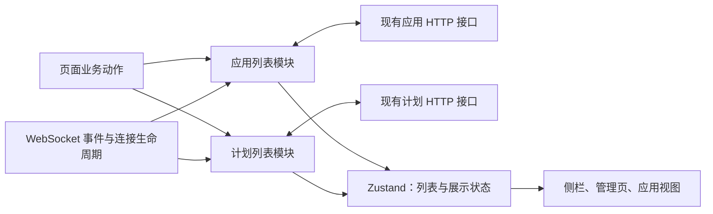

# 前端列表：读取、推送与操作回执契约

> **Status:** implemented — 应用、计划及会话列表各有统一业务入口，保留排序、身份和重连边界。

## 决策与范围

应用、计划和会话列表模块分别拥有更新责任，页面通过领域入口提交操作，WebSocket
通过事件入口提交变化。各模块分别拥有列表更新规则，现有 Zustand store
继续承载供 React 订阅的数据。应用模块同时维护在线与归档列表。

已确认的设计边界：保留应用推送的即时显示，丢弃可确定过期的响应，对无法
判定顺序的变化安排后续 GET；不增加服务端 revision。
“合并”指集中这些更新责任，不表示把应用、计划和 agent 合成一个实体或通用框架。

本文拥有前端同步设计；应用生命周期仍由 [applications.md](applications.md)
定义，置顶和排序规则仍由 [sidebar-pins.md](sidebar-pins.md) 定义，计划事件
语义仍由 [schedule-tool.md](schedule-tool.md) 定义。本文不改变服务端写入事务、
权限、归档保留文件、计划触发和 agent 列表既有逻辑。

## 接口选择与理由

当前采用 `applications.archive(id)`、`applications.reorder(ids)`、
`schedules.setEnabled(id, false)` 等领域业务方法。页面只表达动作，模块内部
负责请求、回执、推送、确认读取和错误分类，生产 HTTP 与可控 transport 共用接缝。

业务方法避免了每个页面必须正确维护“开始／应用／结束”的操作令牌，也无需
增加一套命令联合类型和分发器。方法数量不是深度标准：删除这层会让冲突判断、
刷新合并和错误分类重新散落到多个调用者。读取仍集中于各领域模块，不建设
无实际消费者的泛型同步引擎；原方案比较保留在固定历史版本。

## 事实、写入者与提交点



| 事实或状态 | 写入者与提交点 | 消费者及失败范围 |
| --- | --- | --- |
| 应用、计划持久事实 | 现有服务端事务；此设计不改变 | HTTP / WS 提供观察结果，浏览器不能撤销服务端提交 |
| 在线及归档应用 | 只有应用模块能提交；同一次 store 更新维护两区互斥 | 侧栏、All、应用视图；读取失败保留此前数据 |
| 计划列表 | 只有计划模块能提交 | 管理侧栏、Schedules 页；创建提示使用操作回执，不回写旧数组 |
| 排序临时意图 | 应用模块仅保存本次待确认的 ID 顺序 | selector 在最新行上应用顺序，不保存第二份应用数组 |
| 已观察变化、在途读取及失效标记 | 模块内部临时状态 | 生命周期结束清理，不持久化，不推断服务端版本 |
| 请求状态、刷新错误 | 模块写入最小可订阅状态 | 页面区分“操作已确认”和“列表尚未同步”；空列表不能冒充加载失败 |

`sessionStore` 保留唯一的完整展示数据。模块可使用 store 内部提交函数，页面
与 WS 不再直接调用无保护的列表 setter。归档数据从组件局部 state 移入同一
应用 slice；首次打开 All 时加载，已加载后随应用变化失效，下次进入仍刷新。
读取中的旧数组只由请求闭包持有，不另建业务缓存或永久删除标记。

## 当前接口及调用责任

实现位于 `web/src/lib/applicationList.ts` 与 `scheduleList.ts`，列表数据
仍在 store；不另建与领域无关的 manager。以下列出业务入口；具体类型由源码声明。

```ts
// 页面入口：方法内部选择 endpoint、提交策略及确认读取。
applications.refresh(view?: "live" | "archived"): Promise<RefreshResult>
applications.create(input: NewApplication): Promise<ApplicationRead>
applications.build(id: string, prompt: string): Promise<ApplicationRead>
applications.archive(id: string): Promise<ApplicationRead>
applications.restore(id: string): Promise<ApplicationRead>
applications.setPinned(id: string, pinned: boolean): Promise<ApplicationRead>
applications.reorder(ids: string[]): Promise<ApplicationRead[]>

schedules.refresh(): Promise<RefreshResult>
schedules.createFromText(input: ScheduleFromTextInput): Promise<Schedule>
schedules.setEnabled(id: string, enabled: boolean): Promise<void>
schedules.setWikiMode(id: string, mode: WikiMode): Promise<void>
schedules.remove(id: string): Promise<void>

type RefreshResult =
  | { state: "applied" }
  | { state: "pending" }  // 本次读取失效；已有后继确认读取需求
  | { state: "failed"; message: string }
  | { state: "obsolete" }; // 已离开原账户或连接范围
```

页面可以 `await applications.archive(id)`，无需接着手动 remove、刷新或恢复旧
数组。方法成功代表服务器确认该请求成功，不代表后续列表读取成功，更不
代表构建已经完成。读失败通过列表状态呈现，不把已成功的写操作变成失败。
返回的行只供操作提示等业务用途，页面不得再次 upsert。

写操作错误区分明确拒绝、结果未知和已离开账户范围。网络断开、超时或不能
证明无副作用的服务端错误属于结果未知，不自动重发创建、构建或删除。
后续 GET 只能确认列表当下状态，不能证明原请求一定未执行。已收到成功回执
但连接变化时，保留其业务结论，禁止旧范围直接修改新范围的展示数据。

创建应用通常在行已进入当前列表后打开应用。若回执因冲突未用于更新列表，
先留在创建页显示“已创建，正在同步”；后续列表出现该 ID 且页面仍在当前
账户、用户尚未离开时才打开。确认读取失败时提供刷新，不能再次提交创建。
这段页面导航状态只保存创建的 ID，不复制整行。

WS 集成入口只接收已解析的应用事件、计划失效通知，以及账户/连接生命周期。
它不是供页面任意灌入快照的公共接口。连接来源身份由 hook 捕获并传入，模块
核对后才改变列表或触发失败提示、会话补取等副作用。

## 读取与冲突规则

### 每个模块最多一个有效在途 GET

应用的 live、archived 共用一个读取调度点；计划独立。多个页面请求同一列表
可复用当前读取；多个失效通知合并为待读取标记，不按事件数量积累任务。
应用两个查询都需要读取时轮流服务，归档需求不能被持续 live 变化饿死。
只是已失效但已被本地退役的网络请求，可能仍在服务器完成，不计作有效读取。

每次读取捕获生命周期身份和本地变化序号。序号仅表示浏览器已经观察到什么，
不是服务端版本。有效 WS、操作开始/结束、已接纳的回执及快照推进该序号；
纯粹重复调用 `refresh()` 不推进序号，也不表示服务器出现了新事实。
操作先登记开始，再捕获自身序号；回执在登记自身结束前核对竞争，避免将
自身开始/结束误当成竞争。读取接纳时推进序号保护更早的写回执，但不因
接纳快照再安排读取，避免两个应用查询相互触发循环。

| 时机 | 处理 |
| --- | --- |
| 读取开始 | 记录来源范围与序号；消费该查询当时的待读标记 |
| 应用推送到达 | 核对来源后立即更新相关行或移除；推进序号，标记相关查询需要确认 |
| 计划变更通知到达 | 推进序号并标记重读，不构造推测的计划行 |
| 本地写开始/结束 | 使重叠读取失效；成功、失败或未知后均安排适用列表确认，不重放写请求 |
| GET 返回且范围、序号均未变 | 原子提交该查询快照；这是“读取期间没有已观察冲突”，不是全局最新证明 |
| GET 返回但已观察到变化 | 整份丢弃；保留当前数据，安排合并后的后继读取 |
| GET 出错 | 保留数据及 stale/error 状态，结束该轮；失败本身不产生下一次重试 |
| 账户/连接范围变化 | 退役旧读取，旧回调不得提交；按新范围安排所需读取 |

采用整份丢弃而非逐 ID 合并，可省掉每个在途请求的 changed 集合、删除墓碑和
字段版本表。代价是持续变化期间，漏掉的其他行要等一次无冲突读取才能补齐。
应用推送仍即时显示，计划可能保持旧列表并显示正在同步。这个取舍属于明确的
能力边界；若未来要求持续高频变化下仍完整前进，再单独评估更强协议。

后继读取期间若又发生变化，可以再需要一次读取。“合并一次后继”不是整段
会话最多发两次请求。安排在后续任务中启动，避免同步递归；不增加周期轮询。
单次 GET（包括响应体解码）设 30 秒本地期限，超时退役请求并忽略迟到结果，
避免一个悬挂请求永久占住入口；这不代表取消了服务器工作。测试替换时钟。

失败终止当前自动读取轮次，等待失败后的新事件、页面进入、重连或用户刷新
再启动；失败前已合并的标记不驱动自旋。`refresh()` 返回它所参与那次尝试的
结果，不等待变化无限期安静；若需要后继则返回 `pending`，页面订阅后续状态。

### 迟到 WS 和操作回执

即使当前没有 GET，有效应用事件也标记确认需求。否则“GET 已显示 ready，
迟到事件改成 building”后可能永远没有下一次读取。接受即时推送意味着这种
无法识别的新旧倒退仍可能短暂发生；本设计承诺随后确认，不承诺永不闪回。
全部有效事件均可触发失效，正确性不依赖整行相等比较或推测时间戳。
应用事件和操作保守地同时失效 live 与已加载的 archived 查询。HTTP 中的
`backend` 来自运行时补充，原始 WS 行不保证携带该字段；推送只提交其实际
携带的字段，缺失的运行时信息保持未知或待确认，不伪造默认事实。确认 GET
补齐读取模型，也不能把整行相等或 HTTP 派生字段当作事件版本依据。

操作回执只在范围仍有效、从请求开始至回执期间没有竞争提交或事件时用于
更新展示数据；否则保留当前列表，交给确认读取。竞争判断可以保守到整个
应用域，避免新建逐行版本系统。排序返回的整份列表尤其不能无条件替换。
成功回执与其 WS 通知重叠时，通常由 WS 提供即时显示，GET 完成确认。

允许在本地操作等待期间读取列表；无已观察冲突时可展示该次读取的服务端
现状，但操作仍未决，不能标记为操作之后的确认。操作结束会再次失效并确认。
因此长时间的自然语言计划创建不会阻塞其他计划读取，也不会被一次旧 GET
误判为创建失败。

### live 与 archived 的关系

两区在一次本地提交中保持 ID 互斥。完整行按 `archived` 放入对应区，并从
另一区移除；仅有 archived ID 的事件立即移出 live，已加载归档区等待 GET
补齐。deleted 移出两区。live GET 中缺失某 ID 只证明该次 live 快照没有它，
不据此发明归档行；归档查询同理。

一次查询接纳的行从另一区去重。两个查询共享变化序号并串行读取，避免本地
restore 与早先 archive GET 交错后重新引入重复项。它们仍不是服务端原子
双列表快照，跨查询期间可能暂时缺行；变化停止、所需查询成功后才能收敛。
归档区未加载时记录需要读取即可，不为隐藏历史提前拉取全量数据。

### 身份与副作用

继续使用 [accountFetch.ts](../../web/src/lib/accountFetch.ts) 的账户及响应体
读取保护；在模块内部补充当前 socket 来源身份和已知 `dispatchGeneration`。
断线或连接替换立即退役旧读取，重连刷新应用、计划及已加载的归档区。
已知服务代次变化同样使读取失效；不声称能识别尚未获知的服务器重启。

重连仍是同一账户，已有列表可保留并标记待同步；退出或切换账户清空列表、
归档加载状态、排序意图和错误。旧请求完成不得释放新请求的占用标记，旧
写回执不得触发新账户的导航、通知或会话补取。

应用已接纳的移除统一清理选中应用、未查看失败标记及相关排序 ID。有效 WS
仍保留现有失败状态提示和 `hydrateSession` 行为；原事件 handler 中的相同
副作用在迁移时移除。确认 GET 不再重放一次“事件到达”，已失效事件没有
副作用；会话自身的更新保护继续由会话模块负责。

## 排序：保留乐观反馈，限制重复提交

一次应用排序或 pin/unpin 提交尚未结束时禁用这三类控件，模块同步
拒绝第二次提交；其他页面的同类操作共用该状态。鼠标、触摸和键盘拖拽均
遵守禁用状态，读取 busy 后再点击的竞态也由模块入口保护。

这是当前采用的交互：首次拖拽立即反馈，提交中不能继续拖拽。
它用一个临时 busy 状态避免请求队列和“后发请求一定后提交”的错误假设。
若产品必须支持连续拖拽，应重新设计未发出意图的合并与提交次序，不能靠
忽略旧 HTTP 回执宣称最后拖拽一定生效。

乐观层只保存 ID 顺序，作用于最新行；WS 的构建状态、归档、删除及 pinned
资格继续立即生效。未列入意图的有效 pinned 行保持相对顺序追加在后面。
成功回执若可安全使用，则接纳其顺序；若有冲突，保留临时顺序直到写结束后
开始的一次有效 GET。确认失败则撤掉临时意图、展示最近已接纳数据并标记未
同步，不能把用户意图无限期当作已保存事实。明确写失败或结果未知也撤掉
临时意图并确认，不能回滚整份旧数组。

HTTP 结束后可再次操作，旧确认 GET 不得清除新操作的排序意图；清理须匹配
本次意图身份。跨标签页写入、未知结果的旧请求仍在服务端完成等情形没有
“本浏览器最后意图必胜”保证。未知结果不自动重发，下一次操作是用户另一次
显式提交，最终仍以服务端读取为准。

## 验收矩阵

测试通过业务入口、WS 入口及可订阅结果断言，控制 HTTP/响应体完成顺序，
不直接检查内部计数器。下列项目是持续保留的验收合同。

| 场景 | 必须观察到的结果 |
| --- | --- |
| GET building → WS ready → 旧 GET 返回 | ready 不被旧 GET 覆盖；后继 GET 可完成确认 |
| GET ready 完成 → 迟到 WS building | 即时推送可短暂生效；必有确认读取，安静后恢复服务端状态 |
| GET 期间收到多次计划通知 | 同时最多一个有效计划 GET；合并后继，最终采用无冲突列表 |
| 后继 GET 中再次变化 | 可以继续需要下一次，不能因“已经补读过”而漏同步 |
| 两个页面同时 refresh | 复用同查询在途读取，不产生响应倒序竞争 |
| `/schedule` 等待期间删除或修改其他计划 | 成功回执不恢复旧数组，已有变更保留，创建成功与同步失败分开呈现 |
| 旧归档 GET → restore → 旧 GET 返回 | 不重新归档已恢复行；live/archived 不重复，All 计数无重复 ID |
| 读期间收到 archive/delete | 不因旧快照复活；选中项与失败标记按移除规则清理 |
| 断线期间改变计划后重连 | 即使没有新通知，计划也重新读取 |
| 重连、服务代次变化、退出或换账户；旧 body 晚解码 | 旧结果及副作用失效，不能清掉新请求状态或污染新账户 |
| 排序期间 WS ready 或删除某行 | 乐观层只影响顺序，状态不退回，已删除行不复活 |
| 排序 pending 时再次拖拽或从 All pin | 控件禁用，直接调用模块也不发第二个竞争请求 |
| 第一次排序结束、第二次开始、第一次确认读取返回 | 旧读取不能覆盖新顺序或清除新意图 |
| 排序失败／未知结果 | 不恢复旧整表，不重发写操作，撤销临时意图并安排确认 |
| 写已成功，确认 GET 失败 | 成功结论保留，列表标记未同步，不提示重新创建或构建 |
| 创建成功但行回执被冲突挡住 | 显示已创建待同步，不打开不存在的行，不重复创建 |
| GET 悬挂、超时后迟到 | 30 秒本地期限释放入口；迟到结果不提交；可由新触发重新读取 |
| GET 失败后没有新触发 | 请求数量不继续增长，保留旧数据与错误；首次加载失败不显示为确认空列表 |
| 应用两区同时 dirty、live 持续变化 | 查询轮流服务，归档获得尝试机会；不承诺持续冲突期间完整新鲜 |
| 所有变化结束、网络正常、所需 GET 成功 | 展示与该次服务端查询结果一致，临时意图与同步标记收敛 |
| 持续事件、重复事件、长写请求 | 无事件队列增长；推送可显示，读可执行，刷新调用可返回 pending，不无限等待安静 |

至少保留一个真实 hook/页面到模块的集成测试，分别覆盖重连补读、旧闭包创建、
归档恢复、排序禁用及现有失败提示，防止模块测试通过但调用者仍绕过入口。
相关前端检查按 [testing.md](../testing.md) 选择；文档检查不能替代行为验证。

## 会话列表与跨重连写入确认

`SessionList` 统一侧栏及重连 GET、归档列表、详情补取、创建、归档/恢复、分支
创建以及模型/凭据等局部字段回执。Zustand 仍持有唯一 live/archived 列表；模块
只持范围、已观察变化基线和至多一个活动完整读取，不保存第二份列表或永久墓碑。
每次读取捕获账户/token、连接、服务代次及变化基线。有效事件和本地确认改变
基线；冲突快照整体丢弃并合并为一次后续读取，不能让旧 running 覆盖 idle、让
归档/删除项复活，或让快照期间新增的会话消失。删除/归档保护持续到新的协调
读取边界，不会由旧快照清除。

详情只在同一范围和观察基线接纳列表字段，并拒绝已知较旧的 dispatch revision；
读取开始尚无服务代次、期间由其他会话首次建立代次时，详情可用自身派发状态
确认与当前代次相同，再接纳转录和队列；账户、连接及已知旧服务的检查仍保留。
消息窗口、问题、Research 和输入派发仍保留原合并责任。部分字段写入只修改其
负责的字段。过期 socket、账户/token、服务代次和退休读取都不能更新当前列表。
创建、恢复、归档及字段修改的成功回执遇到连接/服务或观察基线变化时，仍按
原账户/token 使当前列表失效补读，不直接应用旧行；创建与父会话归档在同一
确认中合并。读取确认归档后不再用原操作基线重复写入列表。换账户/token 或
dispose 后旧回执不补读；未知 ID 的归档事件同样阻止迟到创建复活该行。
`ForkDialog` 拥有 rewind 成功回执的列表确认，`ChatView` 回调只切换视图和加载
转录。跨连接成功仍关闭原账户的确认弹窗，并补读包含归档的列表，让父会话历史
保持可打开；当前范围已确认分支时才导航，换账户/token 后旧回执没有副作用。
创建与恢复入口异步返回“可导航”的确认结果。同一范围的回执若撞上列表变化，
沿现有合并补读等待一次不再 stale 的已接纳快照，保留创建后的导航意图；并发
写回执造成的后续失效也必须确认。若目标已归档/删除、读取失败或原范围退休，
返回不可导航，保留同步错误或原范围约束；不会重发原 POST。确认读仍只有一个，
等待没有新增轮询器或持久状态，既有正文超时终止失败读取，范围退出结束等待。
异步确认结果只代表确认时的事实；消费者在 `await` 后、导航或写消息前重新
检查原范围，防止返回 true 与调用方恢复之间的账户/token、服务或连接切换。
侧栏收到创建成功回执后按原账户立即关闭表单，不等待列表确认，以免确认
读取悬挂时重复提交。确认期间用户已移到别的聊天时，后台分支就绪只
发布原聊天的提示，不抢走新焦点。
读取失败保留已有数据，侧栏与归档页呈现错误；有效刷新清除错误和 stale。

### 会话打开与辅助数据

选择会话立即切换选中项并收起手机抽屉，已有转录仍由原 store 展示。详情请求
独立接纳消息、派发状态和问题；后台任务列表及 Research 不阻塞正文或导航。
后台列表仍与详情并行请求，但必须等同次详情接纳后，才能沿该详情确认的服务
代次合并。详情失败不发布配对辅助数据；辅助失败不把已接纳详情标成队列不可用。
重连和归档历史使用同一入口。

辅助读取继续保留请求前的卡片合并基线，并检查账户/token、连接和服务代次。
每类读取用临时在途标记约束可替换字段和错误的顺序，不保存第二份业务数据。
BG 单条详情与列表共用此观察和顺序；较旧成功仍可贡献执行终态、补齐被 WS
截短的 stdout/stderr，不能以整对象拒绝换取状态正确。每个 id 只有一次执行，
running/pending 不能覆盖终态；更完整的详情正文也不被短列表裁掉。delivery 与
执行分别合并，WS 交付事件有独立保护；同目标 HTTP 读取沿原顺序接纳新错误及
明确清除。不同任务的并行详情仍有下述已知限制，不能推广为逐任务独立保证。
快照只继承现有事件标记，不把另一次 HTTP 写入冒充 WS 更新。
详情与辅助读取均限时 30 秒；辅助失败保留已有卡片，在会话内显示单独的 Retry，
只补读对应辅助接口，不重载正文、不重发业务操作。账户或服务代次变化清退错误。

## 辅助任务的读取与事件合并

BG 与委派的 HTTP 响应模型定义公开字段，BG 记录直接按模型过滤，内部知识上下文
不进入响应。前端从生成契约派生任务类型，保留 WS/历史材料允许缺失的字段；完整
HTTP 快照与稀疏事件不互相冒充，也不各自维护一份字段和状态枚举。

完整/detail/metadata读取都由 `hydrateSession.observeSession` 保存原观察。
选择、归档查看、重连、归档替换及 fork 跳转使用同一入口；页面不再拼接store
baseline。只补列表元数据使用 `GET /api/sessions/{id}/info`，不下载transcript；
App列表和委派卡片各自持有并结束观察。`SessionList` 使已删除、归档或退出的
未知列表成员也能让在途观察失效，不保存永久 tombstone 或第二份会话集合。

读取顺序裁定错误归属，领域状态裁定成功快照能否采用。同一读取目标的较新成功
不被旧失败改成错误；较旧成功仍可贡献合法完成状态，但不能覆盖较新的同状态
阶段或交付诊断。BG 不同任务共用读取排序的限制见下节。
BG/Research 每个 id 对应一次执行，终态不因另一份 running/pending 快照回退；新
任务使用新 id。两个请求共享 running baseline 时，无论返回顺序，另一份快照的
对象变化都不能遮住合法 completed。

transcript 沿持久 seq、历史窗口与 WS 去重合并；旧详情保留期间的新消息与新问题。
关闭问题不能复活；被较新成功详情替代的旧读取不再重建问题或 active attempt。
原生任务以 `tool_call_id` 归属原任务，委派以 `delegation_id + work_id` 归属原轮次。
同一子会话的下一 work 可以运行，不能按子会话设置全局终态最大值。

Zustand 仍持有唯一任务状态。不可变记录上的弱引用标记只证明 WS/本地权威更新，
快照写入沿用已有标记而不推进它；在途快照保留期间的真实更新与新增任务。BG 的
交付诊断继续独立保护，Research 的浏览器收讫、汇报输入接纳与父处理继续分别
表达。`SnapshotReads` 只为未完成的请求保留排序 token，不保存任务状态或服务版本。

委派专用读取供完整加载和请求卡片轮询共用；卡片仍决定轮询与观察结束，无须加载
完整聊天。合法列表缺少原轮次时停止轮询并显示不可用，不借下一 work 的状态；
失效观察不是权威缺失，连接/服务变化后重新观察。网络失败沿原有有界重试。
真实 hook、卡片、公开加载与辅助重试回归覆盖双成功乱序、真实 WS、新 work、
旧错误、身份切换、未知目标删除、局部失败及取消，不以纯 merge helper 代替入口。

### 已知限制：不同 BG 详情共用读取排序

在源码基线 `fd7ab9c`，同会话任务 A、B 的单条详情共用 background 的
`SnapshotReads.begin(sessionId)`，没有按 task ID 分开裁定交付诊断与读取错误。
因此 B 后发读取即使只涉及 B，也可使 A 的成功响应进入 `advanceOnly`：A 的
终态和完整输出仍能补齐，其新的 `delivery_error` 或明确清除却可能保留成旧值。
B 的失败也可能在 A 成功后把会话级 background 读取错误置为失败。这是详情
观测范围的现存缺口，不改变服务器的原任务结果或持久返回诊断。

依据是[公开辅助读取](../../web/src/lib/hydrateSession.ts)中共享的排序与 `claim()`，
以及[store](../../web/src/stores/sessionStore.ts)的 `upsertBgTask` 对 `advanceOnly`
保留旧 delivery 字段的分支。后续修复须经公开读取入口交错 A/B 成功和失败，
分别验证各任务诊断更新／清除与错误归属；同时保留同目标乱序、期间 WS 更新、
列表／详情交错、终态及完整输出的既有保证。本次仅记录限制，未修改产品实现。

## 历史分页与阅读锚点

`observeOlderMessages` 持有原会话观察、请求寿命、窗口身份及旧页游标。store 在
一次更新内检验窗口和游标后接纳、排序、去重；替换后的窗口不接纳旧页，也不
让它的 has_more=false 关闭当前缺口。WS 尾部追加及保留同一连续范围的数组替换
保持窗口身份，不能无条件丢弃可用旧页。合并、过期、不需要、已有在途与失败
分别返回；取消只释放原读取的入口，迟到回调不能释放后继读取。

ChatView 在接纳前捕获第一个可见项的稳定身份和像素偏移，重组后按该身份及
实际 DOM 位置恢复，不再以总行数差补偿。持久消息使用 seq，原生卡片使用原
工作身份，无 seq 的本地通知按消息实例保留弱引用身份；同文通知彼此独立。
这些标记不持久化，也不保存第二份 transcript。

切换会话、A→B→A、卸载/重挂或窗口更换都会结束原视图读取，旧回调不能修改
新视图的 loading、stalled 或锚点。同一窗口的连接/服务换代也会使读取失效；
原 UI read 仍负责结束自己的 spinner 并保留手动重试，发布资格由观察独立判断。
`transcript.test.ts` 与真实 ChatView 回归覆盖窗口缺口、交错和观察寿命；
`web/e2e/history-pagination.spec.ts` 经原 HTTP/WS、读取及 store，在实际浏览器
验证混合页和 child-only 重分组、尾部追加后的可见身份与 ≤2 px 偏移。

新建会话立即显示 Creating session 并禁用表单，用同步在途标记防止连续触摸或
Enter 重复 POST。服务器成功仍经原列表确认后导航，确认期间用户已移到其他
会话或页面时不抢焦点。明确拒绝保留表单与错误；传输或成功响应解析失败时，
关闭该表单并补读列表，提示检查结果，不能把未知结果当成失败自动重发。
创建请求同样限时 30 秒，超时按结果未知处理。

`ScheduleList` 的 PATCH/POST/DELETE 写入成功归原账户/token，而不归旧连接。
同账户迟到成功回执使当前列表失效并补读，不把旧连接的返回行直接写入新连接，
也不重发写操作。确认读取失败保留写成功及 stale/错误；登出、换账户/token 或
dispose 后旧回执不触发当前读取。`/schedule` 的成功提示使用同账户范围。

应用排序的 ID 验证、排序及返回行/确切变更集合在同一数据库事务完成；广播只用
提交返回的变化行。新增、恢复、归档或删除与事务交错，不再依赖事务外两次观察
具有相同 ID 集合，也不通过吞错掩盖排序成功后的通知问题。

回归入口是 `sessionList.test.ts`、真实创建消费者 `openAgentChat.test.ts`、
`useWebSocket.lists.test.tsx`、模型修改、侧栏归档/重连和
`hydrateSession.test.ts`，以及 `scheduleList.test.ts` 的迟到写回执与确认失败矩阵。
生产调用方的直接整表覆盖已移除；协调不承诺无通知、无刷新触发时自行发现变化。

## 能力边界与交付状态

本设计保证已知冲突不会由旧响应覆盖，更新责任集中，读取并发和待读状态有界。
它不提供线性一致性、WS 顺序证明、可靠事件补发或跨标签页最后意图获胜。
条件性收敛依赖变化最终停止、遗漏变化经重连/进入/刷新暴露，以及其后的
必要 GET 成功；没有通知且没有刷新触发的服务端变化无法由浏览器自行发现。

应用、计划、会话模块及真实页面、WebSocket 消费者已迁移，调用方原有的直接列表写入、
组件归档副本和独立 `refreshSchedules` 路径已移除。回归分别由
`applicationList.test.ts`、`scheduleList.test.ts` 及对应页面/hook 测试验证，
包括真实 `/schedule` 旧闭包和断线重连补取。提交前检查和发布仍使用仓库统一门禁。
新增服务端版本协议及 agents 合并不属于本方案；只有产品提出更强顺序或
持续更新下完整新鲜的要求时，才重新评估这些方向。

## Historical evidence

The [original design and version-bound evidence](https://github.com/Danuvius152/Octopus/blob/a8abac5ae0a9e3b98b7e71df003cfcd88c211571/docs/plans/frontend-list-reconciliation.md) explain the original implementation. Current behavior is maintained above; historical checks do not establish current deployment.
