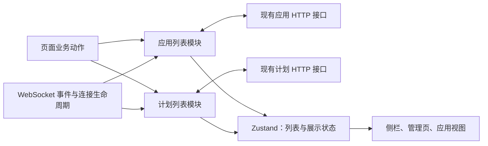

# 前端列表：读取、推送与操作回执契约

> **Status:** implemented — 应用、计划、会话、Connector 安装及 Wiki 任务观察各有业务入口，保留排序、身份和重连边界。


| 任务 | 首读范围 | 扩读条件 |
| --- | --- | --- |
| 应用/计划列表与排序 | [共享身份](#共享观察身份)、[读取冲突](#读取与冲突规则)、[排序](#排序保留乐观反馈限制重复提交) | 新增入口再查[调用责任](#当前接口及调用责任) |
| 会话列表、创建/删除或重连确认 | [会话列表](#会话列表与跨重连写入确认) | 页面草稿变化查[问题草稿](#页面问题草稿与原回执) |
| Connector 安装、断开与连接完成 | [安装列表](#connector-安装列表) | 服务端安装与授权归属查 [Connector 合同](connectors.md) |
| Agent 编辑草稿与迟到保存 | [Agent 表单](#agent-表单实例) | 安装选项的共享列表仍归上项 |
| Connector 配置草稿与迟到保存 | [配置表单](#connector-配置表单实例) | 授权登录观察归 [OAuth operation](connectors.md#browser-oauth-operations) |
| 应用 Iterate 草稿及迟到回执 | [应用修改草稿](#应用修改草稿与视图寿命) | 刷新恢复及存储失败查[输入恢复](input-reliability.md#browser-application-text-drafts) |
| 普通聊天共享文字、发送及恢复 | [共享聊天稿](#共享聊天文字与操作寿命) | 稳定账户与存储规则归[输入恢复](input-reliability.md#browser-text-drafts) |
| 打开会话、上下文或 Stop | [会话打开](#会话打开与辅助数据)、[执行快照](#执行快照与-stop) | 改辅助卡片再扩读下项 |
| BG/Research/Wiki 卡片与详情 | [辅助读取](#辅助任务的读取与事件合并)及对应业务小节 | 改历史读取再查[分页](#历史分页与阅读锚点) |
| 问题提交、回执未知或重挂 | [页面问题草稿](#页面问题草稿与原回执) | 改服务端结算才读[问题规则](input-reliability.md#问题结算) |

## 决策与范围

应用、计划、会话和 Connector 安装列表模块分别拥有更新责任，页面通过领域入口提交操作，WebSocket
通过事件入口提交变化。各模块分别拥有列表更新规则，现有 Zustand store
继续承载供 React 订阅的数据。应用模块同时维护在线与归档列表。

已确认的设计边界：保留应用推送的即时显示，丢弃可确定过期的响应，对无法
判定顺序的变化安排后续 GET；不增加服务端 revision。
“合并”指集中这些更新责任，不表示把应用、计划和 agent 合成一个实体或通用框架。

本文拥有前端同步设计；Connector 安装与授权仍由 [connectors.md](connectors.md)
定义，应用生命周期仍由 [applications.md](applications.md)
定义，置顶和排序规则仍由 [sidebar-pins.md](sidebar-pins.md) 定义，计划事件
语义仍由 [schedule-tool.md](schedule-tool.md) 定义。本文不改变服务端写入事务、
权限、归档保留文件、计划触发和 agent 列表既有逻辑。

## 接口选择与理由

当前采用 `applications.archive(id)`、`applications.reorder(ids)`、
`schedules.setEnabled(id, false)` 等领域业务方法。页面只表达动作，模块内部
负责请求、回执、推送、确认读取和错误分类，生产 HTTP 与可控 transport 共用接缝。

业务方法避免了每个页面必须正确维护“开始／应用／结束”的操作令牌，也无需
增加一套命令联合类型和分发器。方法数量不是深度标准：删除这层会让冲突判断、
刷新合并和错误分类重新散落到多个调用者。读取仍集中于各领域模块，不建设
无实际消费者的泛型同步引擎；原方案比较保留在固定历史版本。

## 事实、写入者与提交点



| 事实或状态 | 写入者与提交点 | 消费者及失败范围 |
| --- | --- | --- |
| 应用、计划持久事实 | 现有服务端事务；此设计不改变 | HTTP / WS 提供观察结果，浏览器不能撤销服务端提交 |
| 在线及归档应用 | 只有应用模块能提交；同一次 store 更新维护两区互斥 | 侧栏、All、应用视图；读取失败保留此前数据 |
| 计划列表 | 只有计划模块能提交 | 管理侧栏、Schedules 页；创建提示使用操作回执，不回写旧数组 |
| 排序临时意图 | 应用模块仅保存本次待确认的 ID 顺序 | selector 在最新行上应用顺序，不保存第二份应用数组 |
| 已观察变化、在途读取及失效标记 | 模块内部临时状态 | 生命周期结束清理，不持久化，不推断服务端版本 |
| 请求状态、刷新错误 | 模块写入最小可订阅状态 | 页面区分“操作已确认”和“列表尚未同步”；空列表不能冒充加载失败 |

`sessionStore` 保留唯一的完整展示数据。模块可使用 store 内部提交函数，页面
与 WS 不再直接调用无保护的列表 setter。归档数据从组件局部 state 移入同一
应用 slice；首次打开 All 时加载，已加载后随应用变化失效，下次进入仍刷新。
读取中的旧数组只由请求闭包持有，不另建业务缓存或永久删除标记。

## 共享观察身份

读取与回执先核对原账户/token、会话、连接、服务代次及观察寿命。身份回到相同值
也不恢复已退休的观察。取消观察只结束读取，不取消服务端业务；Zustand 保留唯一
展示数据，模块只持有顺序基线与临时读取资格。完整 HTTP 快照、稀疏 WS 事件和
写回执分别接纳；业务自己的 seq、revision、终态和删除确认条件见各任务章节。

## Connector 安装列表

`web/src/lib/connectorInstallations.ts` 拥有 `refresh()`、`disconnect(id)`、
`removeCustomDefinition(kind)` 与 `connectionCompleted(originalAccount)`。
ConnectorsPage 首读、SidebarAgents、OAuth 轮询成功及取消撞成功后的确认均进入
这一入口；组件不再直接提交安装数组。`connectorInstallations` 是 Zustand 中
唯一展示数组，`connectorRead` 只保存加载、过期与错误状态。SidebarManage 的计数
及 AgentFormPage 的启用选项订阅同一事实，不另增刷新者。Catalog 仍由原职责更新。

普通刷新复用一个有效在途 GET；重复刷新不会使它失效。断开成功确认时，在当前
数组上移除原 ID，custom 定义删除成功则移除当前账户该 kind 的全部安装；这与
服务端删除定义的事务效果一致。随后退休所有重叠 GET，包括 DELETE 等待期间
才发起的读取，并立即开始确认 GET。两个并发断开的成功回执分别作用于当前
数组，不因另一次删除或读取失效而丢弃。明确删除失败不移除卡片，页面显示错误；
定义删除失败在原弹层中显示。以上操作都不自动重发 DELETE。

连接完成携带开始时的账户/token 身份，退休登录完成前的读取并开启确认 GET。
已知登录 ID 的 error 或结果未知同样请求核对当前安装，不将这些回执解释为
确定没有安装效果；OAuth 视图资格与原登录收尾由 [Connector 合同](connectors.md#browser-oauth-operations)
定义，列表入口只裁定原账户观察是否适用。
若此 GET 又被断开淘汰，断开后的后继 GET 仍确认完整列表，使其他新安装可以
进入。已确认连接或删除成功与列表同步成功分别结算；读失败保留当前数组和
同步错误，页面提供刷新，侧栏显示 not synchronized，不把连接成功改成登录失败。

当前读取对象本身决定观察资格，无服务端 revision、永久删除标记或第二份数组。
账户/token 变化会永久退休旧观察，切走再返回也不复活；服务代次变化时，有效
在途读取被退休并补读。迟到读取的成功、错误或清理只能影响它自己，不能清掉
后继读取。每次读取含响应体解码有 30 秒本地期限；超时结算该次失败、释放入口，
忽略迟到响应，不自动重试。页面卸载不退休共享列表读取，也不丢弃同账户有效
删除回执。列表观察取消不代表远端业务被取消；OAuth 视图及原登录收尾另有责任。

## Agent 表单实例

Agent 编辑草稿归一次打开实例。`openAgentForm` 每次递增临时打开编号，
`AgentFormPage` 用账户代次、打开编号和 Agent ID 为编辑组件设 key；对象切换、
关闭重开及同批次 A→B→A 都重新初始化草稿，旧实例不恢复资格。字段差异始终
相对本次打开值计算，其他客户端的 Agent 更新不把未编辑字段变成修改。

异步读取、失败回滚、错误和提交清理只写仍挂载且身份有效的原实例。保存回执
仍按原账户的 Agent 合并规则确认服务端效果；视图退休不撤销已提交写入。
只有原表单仍有效且处于编辑页签时，保存成功才选择 Agent 并离开表单，旧回执
不能关闭或解锁新草稿。

连接器首读提供本实例的初值，逐项编辑覆盖该初值。成功写入保留覆盖，失败恢复
前一次覆盖；若没有前值则撤掉覆盖，采用首读结果，因此读取晚于失败也能恢复
真实选择。同项写入中同步拒绝再次提交并禁用该 checkbox，其他项仍可编辑。
这些状态仅供当前页面使用，不持久化，也不接管安装列表或 OAuth 登录的寿命。

## Connector 配置表单实例

ConnectorsPage 每次进入 setup 或 custom 都创建一个局部表单实例；Back、关闭、
页面卸载、对象切换和账户代次变化使原实例永久失效。同类型重开也重新初始化。
setup 的 kind、client ID、secret 和 redirect 来源同归本次打开；初始 GET 只补
未编辑的 client ID，用户清空也算编辑。secret 不从服务端回填；redirect 采用
本次 GET 的 URI，读取失败时保留本次打开的浏览器地址。

保存开始时捕获当前字段与原对象，实例内同步防止重复提交。成功回执仍可刷新
原账户的共享 catalog，但返回目录、错误和 busy 清理都须核验原实例，不能影响
另一草稿。setup 与 custom 共用弹层的 busy、错误和清理入口，两个保存入口遵循
同一实例规则。表单失效不会撤销已提交的配置，也不会自动重发保存；登录观察
继续由 `ConnectorOAuthOperation` 拥有，未并入表单状态。

## 当前接口及调用责任

实现位于 `web/src/lib/applicationList.ts` 与 `scheduleList.ts`，列表数据
仍在 store；不另建与领域无关的 manager。以下列出业务入口；具体类型由源码声明。

```ts
// 页面入口：方法内部选择 endpoint、提交策略及确认读取。
applications.refresh(view?: "live" | "archived"): Promise<RefreshResult>
applications.create(input: NewApplication): Promise<ApplicationRead>
applications.build(id: string, prompt: string): Promise<ApplicationRead>
applications.archive(id: string): Promise<ApplicationRead>
applications.restore(id: string): Promise<ApplicationRead>
applications.setPinned(id: string, pinned: boolean): Promise<ApplicationRead>
applications.reorder(ids: string[]): Promise<ApplicationRead[]>

schedules.refresh(): Promise<RefreshResult>
schedules.createFromText(input: ScheduleFromTextInput): Promise<Schedule>
schedules.setEnabled(id: string, enabled: boolean): Promise<void>
schedules.setWikiMode(id: string, mode: WikiMode): Promise<void>
schedules.remove(id: string): Promise<void>

type RefreshResult =
  | { state: "applied" }
  | { state: "pending" }  // 本次读取失效；已有后继确认读取需求
  | { state: "failed"; message: string }
  | { state: "obsolete" }; // 已离开原账户或连接范围
```

页面可以 `await applications.archive(id)`，无需接着手动 remove、刷新或恢复旧
数组。方法成功代表服务器确认该请求成功，不代表后续列表读取成功，更不
代表构建已经完成。读失败通过列表状态呈现，不把已成功的写操作变成失败。
返回的行只供操作提示等业务用途，页面不得再次 upsert。

写操作错误区分明确拒绝、结果未知和已离开账户范围。网络断开、超时或不能
证明无副作用的服务端错误属于结果未知，不自动重发创建、构建或删除。
后续 GET 只能确认列表当下状态，不能证明原请求一定未执行。已收到成功回执
但连接变化时，保留其业务结论，禁止旧范围直接修改新范围的展示数据。

创建应用通常在行已进入当前列表后打开应用。若回执因冲突未用于更新列表，
先留在创建页显示“已创建，正在同步”；后续列表出现该 ID 且页面仍在当前
账户、用户尚未离开时才打开。确认读取失败时提供刷新，不能再次提交创建。
这段页面导航状态只保存创建的 ID，不复制整行。

WS 集成入口只接收已解析的应用事件、计划失效通知，以及账户/连接生命周期。
它不是供页面任意灌入快照的公共接口。连接来源身份由 hook 捕获并传入，模块
核对后才改变列表或触发失败提示、会话补取等副作用。

### 应用修改草稿与视图寿命

`applicationDrafts` 按 App 保留修改文字的归属，以及构建、归档和 Retry deletion
的 busy/错误。等待期间文字仍可编辑，切换 App 或离开页面不移交这些状态。
构建操作始终由 `ApplicationList.build` 接纳实际结果；草稿清理使用原记录及稿版本，
不依赖包含连接资格的 `currentGuard()`，连接变化不会把已经确认的提交留作未发送稿。

提交时捕获稿版本，并立即让该版本退出可恢复未发送稿；文字暂留内存供检查。
成功回执只清仍属于原记录的同一版本，后续编辑即使文字相同也有新版本，不能被
旧回执清除。失败保留原 App 的内存文字及错误，结果未知不自动重发。忙碌和错误
不随页面刷新恢复；文本存储与账户规则归[输入恢复合同](input-reliability.md#browser-application-text-drafts)。

ApplicationView 的 App/账户视图寿命与 Iterate 弹层寿命分别控制关窗资格。
A→B→A、关闭后重开或卸载重挂均不能让旧回执关闭新弹层；普通成功仍会关闭
持续有效的原弹层。视图失效不丢弃原账户有效的列表结果，也不取消服务端构建。

`ApplicationList.onDeleted` 发布原账户已确认的 DELETE 和有效
`application_deleted` 事实，独立于该回执是否有资格直接应用列表行。草稿入口同步
移除原 App 的内存/存储并退休记录，旧 ACK、catch 和 finally 不能重新创建它。
未打开过的已存 App 同样清理；归档、列表暂缺或删除失败不证明删除，不清稿。
这里只退休当前记录，不增加永久删除标记或第二份应用列表。

旧构建会话删除后的现有 Iterate 初始化、
应用文件、错误和 Ready 含义保持原合同，不增加构建结果摘要或历史回填。

### 共享聊天文字与操作寿命

`textDrafts` 拥有账户内一份共享聊天文字、版本及同步保存错误；切换会话与
ChatView 卸载重挂不拆成每会话一份。`chatDraft` 接收已确认删除时捕获的
`wasActive`，在页面不在时也能清空当前会话的共享文字并推进版本。记录继续
有效，让仍挂载的输入框可以编辑下一稿；不使用永久墓碑或第二份会话列表。
存储与刷新恢复规则归[输入恢复合同](input-reliability.md#browser-text-drafts)。

ChatView 的 typing、history、slash、显式恢复、清空及两种发送均写入同一同步
文字入口。普通消息仍立即清空；原 submitted/rejected/unknown、恢复来源、附件
完整性及 message/compact 判断保持在原业务路径。compact 发出即让所属版本退出
刷新恢复，当前组件保留原 ID 的 GET 确认与内存命令；成功只清匹配稿版本，
卸载只清尚未被后续编辑替换的消费版本。不会将无原确认上下文的命令在重挂时
变回未发送稿，也不恢复旧操作资格或自动 POST。

fork 预填只持当前选择的记录、进入版本和是否已处理，寿命跟随共享 composer，
而非单次组件挂载。它等待 identity/metadata，保护已恢复文字与等待期间的编辑
或明确清空；先前会话的历史编辑不阻止新 fork 正常预填。账户退休后原记录
失效，旧回执不能清除新账户或相同字符的新版本。

### 聊天 reset 与延后 fork

[`useSessionFork`](../../web/src/hooks/useSessionFork.ts) 提供 queueFork、cancelFork、
reset 业务动作，拥有 reset 回执阻挡、唯一 fork watcher、每会话在途操作、重试和
清理。`sessionStore.pendingForks` 仍是唯一意图事实；hook 只保存原意图的引用及
临时 timer/请求状态，不建立第二个任务 store。ChatView 继续拥有输入提交、附件和滚动；
共享文字与保存由上述聊天稿入口负责。
Research 提交继续使用现有 `lib/research` 入口，不迁入通用聊天 controller。

每个 fork 请求捕获意图对象。旧 A 的成功、409、硬拒绝或网络错误均不能清除后来的
B，也不能把 A 的重试次数、退避或自动导航转给 B。只有仍拥有原意图的明确
`fork_blocked_parent_turn_active` 回执可以有限重试；其他失败不自动重放。成功创建
仍交给会话列表入口接纳，只有原前台观察持续有效且没有替换意图才自动切换。

reset 只处理开始时捕获的问题和 fork 意图；原观察有效期间阻挡延后 fork，回执或
观察结束时解除。账户、服务代次或组件观察结束后，旧回执不得向新范围写入展示。
视图或焦点离开后不再自动导航，但仍可在原账户/服务有效时接纳真实创建到会话列表；
离开后再返回也不会恢复旧导航资格。卸载注销订阅和 timer，已发 POST 的原意图按
引用退出，避免重挂后自动重放可能已接纳的请求；后来排队的另一意图保留。
旧操作的 finally 也只能删除它自己的登记，不能清掉新挂载创建的操作。
`ChatView.fork.test.tsx` 与 reset 回归覆盖这些交错。

### WS wire 校验

`wsEvents.decodeWsEvent(unknown)` 是普通事件与 submission/command_receipt 专用回执
共用的唯一解码边界，按 `type` 返回已验证事件、unknown 或 invalid。字段读者同时
推导判别联合，复用 HTTP DTO 和既有 dispatch/runtime 读者；不保留宽 Record 分发或
校验失败后的旧 cast 入口。工具参数与 provider 展示载荷保持 opaque；Octopus 自有
outcome/recovery 的身份、状态及实际消费字段须校验，内外 request 身份须一致。

校验发生在 pending 删除/Promise 结算、seq 去重推进、dispatch generation、列表
membership、store 写入及补查之前。成功 submission 必须带非空持久 request_id，
供原输入和附件恢复关联使用；失败及 unknown 回执保留原缺省规则。已知畸形帧记录
console 摘要后拒绝，原 pending 保持等待，随后合法同身份回执仍可结算；未知 type
忽略，不推进 seq、不触发重连。合法额外字段允许，账户、连接、服务和领域排序守卫
继续负责已验证事件的资格。

稀疏事件按原合同保留缺失与 null 的区别：BG delivery 可显式清除诊断，Research
progress 是局部补丁，recording_failed 可以没有 dispatch_state，archive 可以没有
session_id，文本问题可以没有 options。畸形高 seq 之后同 seq 合法帧、畸形回执之后
原合法回执，以及 archive 的零副作用回归固定这些时机。

`tests/test_ws_contract.py` 从真实 Python 构造路径产出共享
`wsProducerFixtures.json`，普通检查只比对，显式 `--update-ws-fixtures` 才更新；TS
decoder 和真实 hook/store 消费同一产物。Owner 结构化结果另复用 recordingReplay
证据。HTTP OpenAPI 生成检查仅证明复用的 HTTP 字段，不能代替这条 WS 契约检查。

## 读取与冲突规则

本节描述应用与计划的读取调度；Connector 使用独立的[安装列表规则](#connector-安装列表)。

### 每个模块最多一个有效在途 GET

应用的 live、archived 共用一个读取调度点；计划独立。多个页面请求同一列表
可复用当前读取；多个失效通知合并为待读取标记，不按事件数量积累任务。
应用两个查询都需要读取时轮流服务，归档需求不能被持续 live 变化饿死。
只是已失效但已被本地退役的网络请求，可能仍在服务器完成，不计作有效读取。

每次读取捕获生命周期身份和本地变化序号。序号仅表示浏览器已经观察到什么，
不是服务端版本。有效 WS、操作开始/结束、已接纳的回执及快照推进该序号；
纯粹重复调用 `refresh()` 不推进序号，也不表示服务器出现了新事实。
操作先登记开始，再捕获自身序号；回执在登记自身结束前核对竞争，避免将
自身开始/结束误当成竞争。读取接纳时推进序号保护更早的写回执，但不因
接纳快照再安排读取，避免两个应用查询相互触发循环。

| 时机 | 处理 |
| --- | --- |
| 读取开始 | 记录来源范围与序号；消费该查询当时的待读标记 |
| 应用推送到达 | 核对来源后立即更新相关行或移除；推进序号，标记相关查询需要确认 |
| 计划变更通知到达 | 推进序号并标记重读，不构造推测的计划行 |
| 本地写开始/结束 | 使重叠读取失效；成功、失败或未知后均安排适用列表确认，不重放写请求 |
| GET 返回且范围、序号均未变 | 原子提交该查询快照；这是“读取期间没有已观察冲突”，不是全局最新证明 |
| GET 返回但已观察到变化 | 整份丢弃；保留当前数据，安排合并后的后继读取 |
| GET 出错 | 保留数据及 stale/error 状态，结束该轮；失败本身不产生下一次重试 |
| 账户/连接范围变化 | 退役旧读取，旧回调不得提交；按新范围安排所需读取 |

采用整份丢弃而非逐 ID 合并，可省掉每个在途请求的 changed 集合、删除墓碑和
字段版本表。代价是持续变化期间，漏掉的其他行要等一次无冲突读取才能补齐。
应用推送仍即时显示，计划可能保持旧列表并显示正在同步。这个取舍属于明确的
能力边界；若未来要求持续高频变化下仍完整前进，再单独评估更强协议。

后继读取期间若又发生变化，可以再需要一次读取。“合并一次后继”不是整段
会话最多发两次请求。安排在后续任务中启动，避免同步递归；不增加周期轮询。
单次 GET（包括响应体解码）设 30 秒本地期限，超时退役请求并忽略迟到结果，
避免一个悬挂请求永久占住入口；这不代表取消了服务器工作。测试替换时钟。

失败终止当前自动读取轮次，等待失败后的新事件、页面进入、重连或用户刷新
再启动；失败前已合并的标记不驱动自旋。`refresh()` 返回它所参与那次尝试的
结果，不等待变化无限期安静；若需要后继则返回 `pending`，页面订阅后续状态。

### 迟到 WS 和操作回执

即使当前没有 GET，有效应用事件也标记确认需求。否则“GET 已显示 ready，
迟到事件改成 building”后可能永远没有下一次读取。接受即时推送意味着这种
无法识别的新旧倒退仍可能短暂发生；本设计承诺随后确认，不承诺永不闪回。
全部有效事件均可触发失效，正确性不依赖整行相等比较或推测时间戳。
应用事件和操作保守地同时失效 live 与已加载的 archived 查询。HTTP 中的
`backend` 来自运行时补充，原始 WS 行不保证携带该字段；推送只提交其实际
携带的字段，缺失的运行时信息保持未知或待确认，不伪造默认事实。确认 GET
补齐读取模型，也不能把整行相等或 HTTP 派生字段当作事件版本依据。

操作回执只在范围仍有效、从请求开始至回执期间没有竞争提交或事件时用于
更新展示数据；否则保留当前列表，交给确认读取。竞争判断可以保守到整个
应用域，避免新建逐行版本系统。排序返回的整份列表尤其不能无条件替换。
成功回执与其 WS 通知重叠时，通常由 WS 提供即时显示，GET 完成确认。

允许在本地操作等待期间读取列表；无已观察冲突时可展示该次读取的服务端
现状，但操作仍未决，不能标记为操作之后的确认。操作结束会再次失效并确认。
因此长时间的自然语言计划创建不会阻塞其他计划读取，也不会被一次旧 GET
误判为创建失败。

### live 与 archived 的关系

两区在一次本地提交中保持 ID 互斥。完整行按 `archived` 放入对应区，并从
另一区移除；仅有 archived ID 的事件立即移出 live，已加载归档区等待 GET
补齐。deleted 移出两区。live GET 中缺失某 ID 只证明该次 live 快照没有它，
不据此发明归档行；归档查询同理。

一次查询接纳的行从另一区去重。两个查询共享变化序号并串行读取，避免本地
restore 与早先 archive GET 交错后重新引入重复项。它们仍不是服务端原子
双列表快照，跨查询期间可能暂时缺行；变化停止、所需查询成功后才能收敛。
归档区未加载时记录需要读取即可，不为隐藏历史提前拉取全量数据。

### 身份与副作用

继续使用 [accountFetch.ts](../../web/src/lib/accountFetch.ts) 的账户及响应体
读取保护；在模块内部补充当前 socket 来源身份和已知 `dispatchGeneration`。
断线或连接替换立即退役旧读取，重连刷新应用、计划及已加载的归档区。
已知服务代次变化同样使读取失效；不声称能识别尚未获知的服务器重启。

重连仍是同一账户，已有列表可保留并标记待同步；退出或切换账户清空列表、
归档加载状态、排序意图和错误。旧请求完成不得释放新请求的占用标记，旧
写回执不得触发新账户的导航、通知或会话补取。

应用已接纳的移除统一清理选中应用、未查看失败标记及相关排序 ID。有效 WS
仍保留现有失败状态提示和 `hydrateSession` 行为；原事件 handler 中的相同
副作用在迁移时移除。确认 GET 不再重放一次“事件到达”，已失效事件没有
副作用；会话自身的更新保护继续由会话模块负责。

## 排序：保留乐观反馈，限制重复提交

一次应用排序或 pin/unpin 提交尚未结束时禁用这三类控件，模块同步
拒绝第二次提交；其他页面的同类操作共用该状态。鼠标、触摸和键盘拖拽均
遵守禁用状态，读取 busy 后再点击的竞态也由模块入口保护。

这是当前采用的交互：首次拖拽立即反馈，提交中不能继续拖拽。
它用一个临时 busy 状态避免请求队列和“后发请求一定后提交”的错误假设。
若产品必须支持连续拖拽，应重新设计未发出意图的合并与提交次序，不能靠
忽略旧 HTTP 回执宣称最后拖拽一定生效。

乐观层只保存 ID 顺序，作用于最新行；WS 的构建状态、归档、删除及 pinned
资格继续立即生效。未列入意图的有效 pinned 行保持相对顺序追加在后面。
成功回执若可安全使用，则接纳其顺序；若有冲突，保留临时顺序直到写结束后
开始的一次有效 GET。确认失败则撤掉临时意图、展示最近已接纳数据并标记未
同步，不能把用户意图无限期当作已保存事实。明确写失败或结果未知也撤掉
临时意图并确认，不能回滚整份旧数组。

HTTP 结束后可再次操作，旧确认 GET 不得清除新操作的排序意图；清理须匹配
本次意图身份。跨标签页写入、未知结果的旧请求仍在服务端完成等情形没有
“本浏览器最后意图必胜”保证。未知结果不自动重发，下一次操作是用户另一次
显式提交，最终仍以服务端读取为准。

## 验收矩阵

测试通过业务入口、WS 入口及可订阅结果断言，控制 HTTP/响应体完成顺序，
不直接检查内部计数器。下列项目是持续保留的验收合同。

| 场景 | 必须观察到的结果 |
| --- | --- |
| GET building → WS ready → 旧 GET 返回 | ready 不被旧 GET 覆盖；后继 GET 可完成确认 |
| GET ready 完成 → 迟到 WS building | 即时推送可短暂生效；必有确认读取，安静后恢复服务端状态 |
| GET 期间收到多次计划通知 | 同时最多一个有效计划 GET；合并后继，最终采用无冲突列表 |
| 后继 GET 中再次变化 | 可以继续需要下一次，不能因“已经补读过”而漏同步 |
| 两个页面同时 refresh | 复用同查询在途读取，不产生响应倒序竞争 |
| `/schedule` 等待期间删除或修改其他计划 | 成功回执不恢复旧数组，已有变更保留，创建成功与同步失败分开呈现 |
| 旧归档 GET → restore → 旧 GET 返回 | 不重新归档已恢复行；live/archived 不重复，All 计数无重复 ID |
| 读期间收到 archive/delete | 不因旧快照复活；选中项与失败标记按移除规则清理 |
| 断线期间改变计划后重连 | 即使没有新通知，计划也重新读取 |
| 重连、服务代次变化、退出或换账户；旧 body 晚解码 | 旧结果及副作用失效，不能清掉新请求状态或污染新账户 |
| 排序期间 WS ready 或删除某行 | 乐观层只影响顺序，状态不退回，已删除行不复活 |
| 排序 pending 时再次拖拽或从 All pin | 控件禁用，直接调用模块也不发第二个竞争请求 |
| 第一次排序结束、第二次开始、第一次确认读取返回 | 旧读取不能覆盖新顺序或清除新意图 |
| 排序失败／未知结果 | 不恢复旧整表，不重发写操作，撤销临时意图并安排确认 |
| 写已成功，确认 GET 失败 | 成功结论保留，列表标记未同步，不提示重新创建或构建 |
| 创建成功但行回执被冲突挡住 | 显示已创建待同步，不打开不存在的行，不重复创建 |
| GET 悬挂、超时后迟到 | 30 秒本地期限释放入口；迟到结果不提交；可由新触发重新读取 |
| GET 失败后没有新触发 | 请求数量不继续增长，保留旧数据与错误；首次加载失败不显示为确认空列表 |
| 应用两区同时 dirty、live 持续变化 | 查询轮流服务，归档获得尝试机会；不承诺持续冲突期间完整新鲜 |
| 所有变化结束、网络正常、所需 GET 成功 | 展示与该次服务端查询结果一致，临时意图与同步标记收敛 |
| 持续事件、重复事件、长写请求 | 无事件队列增长；推送可显示，读可执行，刷新调用可返回 pending，不无限等待安静 |

至少保留一个真实 hook/页面到模块的集成测试，分别覆盖重连补读、旧闭包创建、
归档恢复、排序禁用及现有失败提示，防止模块测试通过但调用者仍绕过入口。
相关前端检查按 [testing.md](../testing.md) 选择；文档检查不能替代行为验证。

## 会话列表与跨重连写入确认

`SessionList` 统一侧栏及重连 GET、归档列表、详情补取、创建、归档/恢复、分支
创建以及模型/凭据等局部字段回执。Zustand 仍持有唯一 live/archived 列表；模块
只持范围、已观察变化基线和至多一个活动完整读取，不保存第二份列表或永久墓碑。
每次读取捕获账户/token、连接、服务代次及变化基线。有效事件和本地确认改变
基线；冲突快照整体丢弃并合并为一次后续读取，不能让旧 running 覆盖 idle、让
归档/删除项复活，或让快照期间新增的会话消失。删除/归档保护持续到新的协调
读取边界，不会由旧快照清除。

`session_deleted`、成功删除回执或有效的包含归档完整快照确认删除后，统一调用
`SessionList.remove`：清除选中视图及所属消息、问题、Research、派发等缓存，并
在 commit/forgetSession 前捕获 `wasActive`，同步通知共享文字入口及页面清理
该会话的文字、附件和恢复草稿。当前会话的共享文字在页面卸载时仍会清理；
其他会话删除不清共享文字。在途提交也沿原草稿对象
核验所有权，删除后迟到的拒绝、unknown 或失败回执不能重新放回草稿。
发出删除请求或删除失败均不触发这项清理。

普通 live 列表缺行可能只是远端归档，不证明删除。重连发现先前已知的 live、
archived 或选中 ID 缺失时，保留这次待确认 ID，合并到既有 include_archived
读取；仅完整确认仍缺失才清理，覆盖未选中的缓存与草稿。归档行保留输入和
可读视图。待确认 ID 只服务这次读取，成功确认或账户退出后清除，不过滤新行，
也不成为永久墓碑。断线漏通知沿此路径恢复；旧账户、连接或服务代次的读取仍
不能确认删除。`sessionList.test.ts`、`ChatView.test.tsx` 与真实双页面
`session-deletion.spec.ts` 分别验证读取交错、草稿生产者及 REST→双 WS→页面。

详情只在同一范围和观察基线接纳列表字段，并拒绝已知较旧的 dispatch revision；
读取开始尚无服务代次、期间由其他会话首次建立代次时，详情可用自身派发状态
确认与当前代次相同，再接纳转录和队列；账户、连接及已知旧服务的检查仍保留。
消息窗口、问题、Research 和输入派发仍保留原合并责任。部分字段写入只修改其
负责的字段。过期 socket、账户/token、服务代次和退休读取都不能更新当前列表。
创建、恢复、归档及字段修改的成功回执遇到连接/服务或观察基线变化时，仍按
原账户/token 使当前列表失效补读，不直接应用旧行；创建与父会话归档在同一
确认中合并。读取确认归档后不再用原操作基线重复写入列表。换账户/token 或
dispose 后旧回执不补读；未知 ID 的归档事件同样阻止迟到创建复活该行。
`ForkDialog` 拥有 rewind 成功回执的列表确认，`ChatView` 回调只切换视图和加载
转录。跨连接成功仍关闭原账户的确认弹窗，并补读包含归档的列表，让父会话历史
保持可打开；当前范围已确认分支时才导航，换账户/token 后旧回执没有副作用。
创建与恢复入口异步返回“可导航”的确认结果。同一范围的回执若撞上列表变化，
沿现有合并补读等待一次不再 stale 的已接纳快照，保留创建后的导航意图；并发
写回执造成的后续失效也必须确认。若目标已归档/删除、读取失败或原范围退休，
返回不可导航，保留同步错误或原范围约束；不会重发原 POST。确认读仍只有一个，
等待没有新增轮询器或持久状态，既有正文超时终止失败读取，范围退出结束等待。
异步确认结果只代表确认时的事实；消费者在 `await` 后、导航或写消息前重新
检查原范围，防止返回 true 与调用方恢复之间的账户/token、服务或连接切换。
侧栏收到创建成功回执后按原账户立即关闭表单，不等待列表确认，以免确认
读取悬挂时重复提交。确认期间用户已移到别的聊天时，后台分支就绪只
发布原聊天的提示，不抢走新焦点。
读取失败保留已有数据，侧栏与归档页呈现错误；有效刷新清除错误和 stale。

## 会话打开与辅助数据

选择会话立即切换选中项并收起手机抽屉，已有转录仍由原 store 展示。详情请求
独立接纳消息、派发状态和问题；后台任务列表及 Research 不阻塞正文或导航。
后台列表仍与详情并行请求，但必须等同次详情接纳后，才能沿该详情确认的服务
代次合并。详情失败不发布配对辅助数据；辅助失败不把已接纳详情标成队列不可用。
重连和归档历史使用同一入口。

上下文快照只在会话detail和独立`context_state`事件中提供，不进入侧栏列表。
store按当前账户/会话/服务generation和独立context revision整份替换，明确接受
stale及初始null，拒绝旧HTTP或旧连接/账户结果；缺字段或畸形值不冒充清空。
context_pending与state保存在同一generation/revision记录；同revision只允许由
非pending降级为pending，更高revision且非pending的可信HTTP或WS都可恢复。
较旧HTTP不能解除pending。pending同时限制比例、历史标识和可访问说明，不
改写样本、持久有效性或时间。上下文用量不推进dispatch revision，也不触发恢复列表或辅助任务查询。换代和
删除清退旧上下文缓存。业务有效性与读数口径见
[上下文合同](model-reasoning.md#上下文样本与配置绑定)。

界面在Attach file旁以圆弧和数字共同表示剩余；颜色按未取整占用70%/90%分级，
超窗剩余显示0%并在详情保留原值。未知/待更新不显示有效比例。只读详情解释
token、模型、采样时间与估计来源，触控和键盘可打开，触发器的名称、值和状态
可由辅助技术区分。此观测入口当前消费Codex事件，不添加压缩按钮或计数请求。

## 执行快照与 Stop

store 在一次更新中接纳详情的 dispatch、服务 generation 与 active attempt。
完整活动快照可替换缓存的旧 attempt，包括同 request 的重试；显式
`active_attempt: null` 可清除旧 attempt，既支持空闲，也支持活动 request 暂无
attempt 的重试等待。缺字段、畸形值和与 dispatch 不匹配的 request 都不充当空闲。
服务代次切换经同一派发入口清除所有会话的旧 attempt。

读取捕获每会话的执行观察基线。WS 派发、attempt 开始和清除推进非持久观察计数，
HTTP 快照不推进它；这也区分“无→有→无”，不能只比较当前对象或把队列 revision
当 attempt 版本。读取期间观察到新执行事实后，旧响应不能局部改写 dispatch 或
attempt。Stop 继续发送当前 request/attempt/generation/revision，服务端精确核验。

执行目标拒绝不丢弃同账户、连接、服务范围内可安全合并的历史和任务终态，也不
阻断配对辅助读取。原观察至多持有一次新的详情确认；首份历史和导航不等它，
确认不会继续派生轮询，原观察取消也结束该确认。再次发生 live 变化时保留新事实。
过期账户、连接或服务的整份响应仍失去资格。hydration→真实 Stop hook、双成功
乱序、显式 null、迟到清除、历史补齐与一次确认回归分别固定这些命题。

辅助读取继续保留请求前的卡片合并基线，并检查账户/token、连接和服务代次。
会话错误和任务字段分别用临时在途资格裁定顺序，不保存第二份业务数据。
BG 单条详情与列表共用此观察和顺序；较旧成功仍可贡献执行终态、补齐被 WS
截短的 stdout/stderr，不能以整对象拒绝换取状态正确。每个 id 只有一次执行，
running/pending 不能覆盖终态；更完整的详情正文也不被短列表裁掉。delivery 与
执行分别合并，WS 交付事件有独立保护；同目标 HTTP 读取沿原顺序接纳新错误及
明确清除。不同任务的数据资格分别裁定，较新的会话读取错误不剥夺其他任务的
合并资格，完整边界见下节。
快照只继承现有事件标记，不把另一次 HTTP 写入冒充 WS 更新。
详情与辅助读取均限时 30 秒；辅助失败保留已有卡片，在会话内显示单独的 Retry，
只补读对应辅助接口，不重载正文、不重发业务操作。账户或服务代次变化清退错误。

## 辅助任务的读取与事件合并

BG 与委派的 HTTP 响应模型定义公开字段，BG 记录直接按模型过滤，内部知识上下文
不进入响应。前端从生成契约派生任务类型，保留 WS/历史材料允许缺失的字段；完整
HTTP 快照与稀疏事件不互相冒充，也不各自维护一份字段和状态枚举。

完整/detail/metadata读取都由 `hydrateSession.observeSession` 保存原观察。
选择、归档查看、重连、归档替换及 fork 跳转使用同一入口；页面不再拼接store
baseline。只补列表元数据使用 `GET /api/sessions/{id}/info`，不下载transcript；
App列表和委派卡片各自持有并结束观察。`SessionList` 使已删除、归档或退出的
未知列表成员也能让在途观察失效，不保存永久 tombstone 或第二份会话集合。

读取顺序裁定错误归属，领域状态裁定成功快照能否采用。同一读取目标的较新成功
不被旧失败改成错误；较旧成功仍可贡献合法完成状态，但不能覆盖较新的同状态
阶段或交付诊断。BG 的会话级读取错误与逐任务数据使用各自的资格。
BG/Research 每个 id 对应一次执行，终态不因另一份 running/pending 快照回退；新
任务使用新 id。两个请求共享 running baseline 时，无论返回顺序，另一份快照的
对象变化都不能遮住合法 completed。

transcript 沿持久 seq、历史窗口与 WS 去重合并；旧详情保留期间的新消息与新问题。
关闭问题不能复活；被较新成功详情替代的旧读取不再重建问题或 active attempt。
原生任务以 `tool_call_id` 归属原任务，委派以 `delegation_id + work_id` 归属原轮次。
同一子会话的下一 work 可以运行，不能按子会话设置全局终态最大值。

Zustand 仍持有唯一任务状态。不可变记录上的弱引用标记只证明 WS/本地权威更新，
快照写入沿用已有标记而不推进它；在途快照保留期间的真实更新与新增任务。BG 的
交付诊断继续独立保护，Research 的浏览器收讫、汇报输入接纳与父处理继续分别
表达。`SnapshotReads` 只为未完成的请求保留排序 token，不保存任务状态或服务版本。

委派专用读取供完整加载和请求卡片轮询共用；卡片仍决定轮询与观察结束，无须加载
完整聊天。合法列表缺少原轮次时停止轮询并显示不可用，不借下一 work 的状态；
失效观察不是权威缺失，连接/服务变化后重新观察。网络失败沿原有有界重试。
真实 hook、卡片、公开加载与辅助重试回归覆盖双成功乱序、真实 WS、新 work、
旧错误、身份切换、未知目标删除、局部失败及取消，不以纯 merge helper 代替入口。

## BG 列表与详情的逐任务合并

会话/account/kind 范围内的读取顺序只裁定错误提示。某任务的 delivery 字段按
涉及它的重叠成功读取分别排序，列表和详情共享同一资格；B 的成功或失败不能
剥夺 A 的数据资格。同任务较新失败可以保留会话错误，但没有新任务数据，不能
阻止较旧成功补输出或明确清除诊断。较新成功结束后，它的资格仍保留到较旧重叠
读取结束；全部退出后回收，不保存永久任务账本。

列表与详情共用字段合并：执行终态不倒退，stdout/stderr 不被较短输出裁断，
delivery 的两个字段分别接受缺失与显式 null。只有期间真正的 WS delivery
更新保护这些字段；单纯执行完成事件不会阻止 HTTP 补全输出或清除旧诊断。
视图取消结束原读取资格；账户、连接或服务失效的响应不能发布任务或错误。
`hydrateSession.test.ts` 和 `BgTaskChip.test.tsx` 通过真实读取入口覆盖跨任务、
同任务、列表/详情双向交错及两类 WS 事件。

## Research 创建、观察与浏览器确认

`/research` 在提交前捕获账户、目标会话、连接及服务观察。组件卸载或切换会话
会取消原确认读取并释放观察资格，旧回执不向已离开的视图发布结果或错误；服务端
job 仍由原 Research owner 负责，再次查看通过正常快照恢复，不重发创建。
原观察仍有效时，创建 POST 按实际返回初始化缺记录的任务；已有任务只补缺失的
question/session/创建或报告元数据，不覆盖
已观察的阶段、状态或投递事实，也不推进 WS 标记。丢失 started 后的 partial
event 仍沿原列表补查；创建回执不能使该补查失去纠正动态字段的资格。

首次提交时服务代次可能仍为 null。仍在观察的操作只记录第一次真实建立的 G；
只有账户/token、连接、目标存续及原视图都有效时，成功创建回执才发起一次当前 G
下的新 Research GET。该读取自有 observation，经原 merge 接纳后返回实际快照，
以原 job ID 核对创建；建代前缓存中存在同名 job 不作当前确认。null→G→H、
删除/归档及连接替换均终止这一候选，不伪造代次或放宽全局 current。

有有效创建回执但 GET 失败或未见原 ID，保留含原 job ID 的“已创建，当前状态待确认”
通知及辅助错误，使用现有 Retry research updates；无有效回执而超时/断线时显示
创建结果未确认。两者都不自动再 POST、递归 GET 或轮询。旧空快照仍经原合并规则
保护后来建立的 job/进度，较新的权威删除仍可移除任务。
本地 notice 可能被后到详情的 transcript 合并替换，不能据此判断创建没有发生。

报告终态与后续 delivery 分开合并。`/seen` 回执只写匹配 request/version 的确认
字段并保留事件标记，不能把旧 queued receipt 覆盖到新 processed。后到快照保留
已经取得的确认版本；新版本状态仍需单独确认。`sessionResearch.test.tsx` 从真实
ChatView 提交、partial event 补查和 ResearchCard 确认验证这些交错。离线
`research.spec.ts` 在首份详情返回前提交，详情建 G 后才返回 201，验证原 job、
报告链接、一次 POST 和一次新的确认 GET；既有已知代次场景继续保留。

## Wiki 卡片、详情与控制回执

`lib/wikiJobs.ts` 拥有卡片列表、保留身份核对、分页、详情/证据和输出的 GET 寿命。
每个实际读取均有覆盖 headers 和 JSON body 的30秒期限；AbortController 负责
中止传输，本地 promise 也必须结束，不能依赖 transport 必然响应 abort。
每个 session 的列表刷新合并在同一槽，旧请求只能释放自身槽。断线、同服务代次
重连、账户/token、服务、会话或主视图变化同步退役旧读取，迟到 body、错误和
finally 都不能提交或清除新观察。详情关闭另有视图控制；新列表观察初始化分页
busy/offset/more，旧分页挂起不能使重连后的“加载更多”一直禁用。
ChatView 切到管理页时只隐藏、不卸载；卡片与详情因此显式观察页面退出和重新
进入。隐藏期间结束原观察及 busy，不启动新读取；返回聊天重建 GET，保留同一
任务已加载的证据。手动刷新也经同一观察入口采用返回数量更新 offset/more，
首次失败后恢复30条仍可继续读取第31条。

重连按 vault/job 核对全部保留卡片，包括首屏之外的 completed；不以当前显示
折叠与否决定观察资格。任务事实按 state_version 单调合并；当前可读性独立于版本，
允许同版不可用，也不以更旧成功投影给新事实补造可读资格。后端关联、当前权限
及自动回报隔离归 [Wiki 合同](wiki-development-summary.md)。

聊天活动区只展开尚未完成或需要处理的维护。成功任务仅在当前状态可读、取消结算
为 none/confirmed、录制待核验及索引待完成均为零时自动收起。重连核对全部保留
卡片，包括首屏外已完成的旧任务，不能以完成判定排除后来重新尝试的任务。
默认折叠的已完成入口保留原卡片摘要、详情和保存结果，数量只表示当前已加载项，
后续分页入口仍可使用；重开聊天从持久卡片恢复同样的折叠展示，不删除任务或结果。
失败、取消、未知、需关注及尚未结算任务继续展开，较新 attempt 重新进入活动区。
组件生命周期回归与离线浏览器的真实 ChatView 消费检查覆盖上述展示边界；
任务提交、结果录制和通知接纳仍由原有后端合同负责。

当前观察内控制 POST 成功即发布原 attempt 的 accepted 回执，单独返回确认 GET 的 promise。
GET 失败只写读取错误，保留卡片和已加载证据，不改写原 POST 的成功或403/409
错误。卡片与详情分开显示控制回执、控制错误和读取错误；“刷新任务状态/详情”
只 GET，不重发控制 POST。回执说明请求已接纳，不声称原资源已退休。显式控制的
operation_id 仅在 POST 已接受后退出；未知结果仍沿原身份核对。相同服务的重连
可以继续展示原控制回执，离开账户、服务或原页面的回执不得污染新视图。
控制观察代次不因 WS 重连改变，却在账户、服务、会话或页面退出时结束，避免
“离开聊天再返回聊天”使旧 POST 回调重新有效。未被原页面观察到的响应不清除
原 operation_id；后来明确重试仍可使用该身份，不自动重发 POST。

回归从 `wikiJobs.recovery.test.ts` 的真实读取入口覆盖 headers/body、旧 finally、
账户 ABA 与分页；卡片/详情组件覆盖 POST200或403/409 后 GET503、保留证据及
只读恢复。离线 `wiki-job-cards.spec.ts` 使用真实路由/双库和一次性 ASGI 屏障，
分别验证 headers/body 悬挂后的期限及同代重连、提前可见的 accepted 回执和
一次 POST。body 屏障先发送不完整首字节，使 Vite 代理实际转发 headers，再扣住
余下正文；仅扣住整个 body 不能证明浏览器已进入 body 解码阶段。

## 任务取消反馈

Research、BG 和精确 work 的委派卡片均检查取消 HTTP 状态并显示服务端说明。
409 表示当前状态冲突，503 表示暂不可用；正文不可读时保留状态码。网络失败显示
结果未确认，并提供沿既有观察入口的 Refresh status，不自动重发取消。pending
只代表本次控制请求；操作失败不写任务终态或 delivery_error。

反馈归本次账户、服务、会话、任务/work 和视图寿命。身份退出、卸载或断线后再
回到相同值也属于新寿命，旧 pending、错误及迟到结果不能复活或覆盖新操作反馈。
手动 Refresh 的只读 handle 也由该视图持有，退出时立即取消读取并释放资格；
不能只丢弃本地反馈而让旧读取继续写全局辅助错误或任务数据。
卡片测试保留非 2xx、网络结果未知、主动刷新、重复点击、后到终态和重连回归。

## 浏览器有界预览与按需全文

浏览器 WS 订阅和显式 `view=browser` 的会话 detail、历史、native-details 出口
生成可丢弃的展示投影。默认 HTTP 完整表示、持久消息、原生审计、内部 bus、App
流与 LiveReply、fork 和 typed 导出继续使用完整原文；投影不原地改写这些来源。
首屏和重连仍通过 HTTP 读取 snapshot，不通过 WS 发送完整历史。

实际 UTF-8 JSON 编码限制为单条消息 64 KiB、含 envelope 的 WS 事件 256 KiB、
HTTP 消息数组 2 MiB（含数组括号和逗号）。根会话/历史返回最新连续后缀，原生
详情返回最早连续前缀；消息数和字节共同限制窗口，游标取实际返回成员，不跳过
超大记录。2 MiB 不是整份响应上界；其他 envelope 保留各自的数量界限，原生
卡片最多64个，展示文字每字段最多4 KiB，步骤保留最近12条、每条最多1 KiB。
这些文字限制不截断原生身份，也不建立整个卡片 envelope 的绝对字节保证。

消息省略正文或大字段时标记 `body_state=preview`，有原持久 seq 才提供同源
`detail_ref`；大结构显示明确占位。展示不重复 canonical 正文的 native_item/
request_context 副本。终态的 final-answer、compact 原生关联和控制字段优先于
诊断正文。恢复代码/尝试计数、录制缺口和派生问题提示同样是控制事实；两轮缩减
复用同一控制部分，只裁明确的正文、诊断位置或卡片展示文字，不重新按大小挑选
控制字段。result/recovery 的未知字段也保留，不能从部分事实恢复“已保存”声明。
原 request/attempt/native 身份通常完整保留；必需控制及原生身份没有统一长度
上限，连最小控制/身份表示也装不下时返回明确的 `identity_unavailable` 通知及
原 seq/全文引用，不截 ID 或伪造关联。原终态仍以有界说明显示。WS 无法表示的
事件产生可见通知；连直接回执都无法满足单帧上限时关闭1013，沿原观察恢复。
关联无法表示的记录展开后以完整只读原记录显示，包括原身份字段，不把取得全文
等同于已经把它重新关联到当前聊天视图。
WS 不可表示通知保留该标记并经 decoder/store 传入原消息视图；native-details
中的对应消息也复用同一只读记录显示原 `runtime_metadata` 和正文。
已持久问题的 WS 降级引用按原 session/seq 生成，与题干是否缩短无关；没有持久
seq 的实时事件不生成全文引用。
卡片的截短标记属于浏览器 DTO，默认完整快照保持原卡片形状。已存卡片的名称、
描述和步骤可缩成预览，原 card/task/native 关联和状态保留；其全文引用只覆盖
确实写入该行的字段，不能代表没有保存的 live prompt/summary。
展开已存卡片全文显示原序列的只读记录及完整字段；它与当前 live 卡片分开，不把
旧记录写回 live 状态，也不只读取 live 缓存却标记为已经显示全文。

`GET /api/sessions/{id}/messages/{seq}` 在同一短事务重核当前账户/会话归属并
读取完整 MessageContent；归档仍可按所属账户读取，缺失/删除404、重复seq409。
引用不授予权限，不接受文件路径，不调用模型补内容。成功及404/409详情响应为
`private, no-store`。用户主动展开才 GET，完整 JSON 接收并确认原 seq 后显示
全文；失败保留预览并可重试。原账户、消息和窗口内的局部缓存可供收起/展开及
连续窗口重连复用；切换账户/目标、更换窗口或卸载取消读取并丢弃迟到发布资格。
native-details 刷新、关闭及连接/服务换代仍结束它自己的旧详情视图。
若失败结果的原输入已外置，展开后的恢复按钮使用这次取得的完整记录，不能继续
引用缺字段的预览。恢复只写草稿并保留重新附文件的要求，业务发送仍由用户显式发起。

待答问题在历史窗口外有独立入口，按原问题身份去重，不改变消息窗口成员。大
题干/选项加载完成前，提交按钮和 handler 均拒绝回答；全文只补题目内容，期限、
暂停和是否仍待答继续取当前 pending 状态。用户编辑后，原问题草稿保存已验证的
题干/选项与答案，关闭后的草稿恢复不会丢失上下文；它沿原草稿的接纳、丢弃和
账户寿命清理，不成为完整消息缓存。异步问题即使正文外置也保留可见问题提示。
问题暂停事件只投影身份、seq 和当前控制事实，移除其冗余题目副本，避免题目
大小使已经生效的暂停在浏览器中不可见；内部事件仍保留原内容。
历史/归档问题保留摘要作为预览，主动展开后读取原序列的完整只读记录，包含题目
header、选项标签和说明；不把已经关闭的问题恢复为可提交表单。

非持久 delta 没有详情引用；WS 文本块有界，浏览器旧式累计文本最多64 KiB，
原生 scratch 最多32项、合计256 KiB，最终由持久消息恢复。SocketDelivery 继续
保留256帧/1 MiB待发送总预算及原发送期限；连续积压可关闭慢连接，不阻塞业务
提交、原终态或内部完整内容消费者，重连不重新提交业务输入。

## 历史分页与阅读锚点

浏览器消息窗口供界面阅读。CLI 恢复使用独立的完整 typed 导出，固定成员、分页
校验和本地提交边界见 [Harness 导出合同](harness-layer.md#complete-typed-transcript-export-and-local-pull)。

聊天展示投影不为当前不显示的根 `thinking` 生成虚拟列表行；只让气泡返回
`null` 仍会留下列表项的 12px padding。原消息、内容与持久 seq 继续保留，
分页窗口和高水位仍按原始历史计算。原生 child 观察先归入其卡片，不因空思考
而消失。`nativeOutput.test.ts` 检查投影与历史分离；浏览器
`message-spacing.spec.ts` 比较重新加载前后的真实几何间距，覆盖连续七条空思考。

`observeOlderMessages` 持有原会话观察、请求寿命、窗口身份及旧页游标。store 在
一次更新内检验窗口和游标后接纳、排序、去重；替换后的窗口不接纳旧页，也不
让它的 has_more=false 关闭当前缺口。WS 尾部追加及保留同一连续范围的数组替换
保持窗口身份，不能无条件丢弃可用旧页。合并、过期、不需要、已有在途与失败
分别返回；取消只释放原读取的入口，迟到回调不能释放后继读取。

ChatView 在接纳前捕获第一个可见项的稳定身份和像素偏移，重组后按该身份及
实际 DOM 位置恢复，不再以总行数差补偿。持久消息使用 seq，原生卡片使用原
工作身份，无 seq 的本地通知按消息实例保留弱引用身份；同文通知彼此独立。
这些标记不持久化，也不保存第二份 transcript。

切换会话、A→B→A、卸载/重挂或窗口更换都会结束原视图读取，旧回调不能修改
新视图的 loading、stalled 或锚点。同一窗口的连接/服务换代也会使读取失效；
原 UI read 仍负责结束自己的 spinner 并保留手动重试，发布资格由观察独立判断。
`transcript.test.ts` 与真实 ChatView 回归覆盖窗口缺口、交错和观察寿命；
`web/e2e/history-pagination.spec.ts` 经原 HTTP/WS、读取及 store，在实际浏览器
验证混合页和 child-only 重分组、尾部追加后的可见身份与 ≤2 px 偏移。

新建会话立即显示 Creating session 并禁用表单，用同步在途标记防止连续触摸或
Enter 重复 POST。服务器成功仍经原列表确认后导航，确认期间用户已移到其他
会话或页面时不抢焦点。明确拒绝保留表单与错误；传输或成功响应解析失败时，
关闭该表单并补读列表，提示检查结果，不能把未知结果当成失败自动重发。
创建请求同样限时 30 秒，超时按结果未知处理。

`ScheduleList` 的 PATCH/POST/DELETE 写入成功归原账户/token，而不归旧连接。
同账户迟到成功回执使当前列表失效并补读，不把旧连接的返回行直接写入新连接，
也不重发写操作。确认读取失败保留写成功及 stale/错误；登出、换账户/token 或
dispose 后旧回执不触发当前读取。`/schedule` 的成功提示使用同账户范围。

应用排序的 ID 验证、排序及返回行/确切变更集合在同一数据库事务完成；广播只用
提交返回的变化行。新增、恢复、归档或删除与事务交错，不再依赖事务外两次观察
具有相同 ID 集合，也不通过吞错掩盖排序成功后的通知问题。

回归入口是 `sessionList.test.ts`、真实创建消费者 `openAgentChat.test.ts`、
`useWebSocket.lists.test.tsx`、模型修改、侧栏归档/重连和
`hydrateSession.test.ts`，以及 `scheduleList.test.ts` 的迟到写回执与确认失败矩阵。
生产调用方的直接整表覆盖已移除；协调不承诺无通知、无刷新触发时自行发现变化。

## 页面问题草稿与原回执

`sessionStore.questionDrafts` 按账户、session、request、attempt、question 保管页面
易失草稿，包括原表单和答案；切换会话、表单卸载和断线不丢弃。刷新页面没有持久
草稿保证。换账户/token 或确认删除会话会清理原草稿，迟到回执不能将它复活。

答案发送前，页面登记原 `client_command_id` 和不可变提交快照；迟到接纳只清该
快照，不抹去发送后的新编辑。unknown 时按原问题只读查询持久结算；旧结果缺少
命令关联、缺记录或查询失败都保留不确定性，不自动重答。
已关闭题目的草稿可由用户预览到空输入框，并显式发送为新消息；发送前登记原
continuation 的 `client_request_id`。该消息回执未知时查询原 submission，不能
生成另一身份重发。丢弃预览或切换会话后，旧预览标记不阻挡普通显式输入。

暂停只由有用户操作依据的 pointer、keydown、change 或 Tab/Shift+Tab 焦点进入
触发；程序 `.focus()` 和仅发送消息不触发。客户端发送原身份，Owner 唯一裁定。
暂停事件按原持久 seq 合并，旧 HTTP snapshot 不恢复已经清除的期限。

完成展示读取原 outcome；根 completed 但必要工具结果缺失时说明工具结果未确认，
不另称缺少根终态。工具自身的显式失败留在工具卡。只有已加载的原正文行完整
匹配 request/attempt、根 thread/turn、final 阶段、item 和有序 seq，才显示正文
已保存；引用形状本身不足以证明。历史缺少关闭原因时使用中性说明，不猜测超时。

## 能力边界与交付状态

本设计保证已知冲突不会由旧响应覆盖，更新责任集中，读取并发和待读状态有界。
它不提供线性一致性、WS 顺序证明、可靠事件补发或跨标签页最后意图获胜。
条件性收敛依赖变化最终停止、遗漏变化经重连/进入/刷新暴露，以及其后的
必要 GET 成功；没有通知且没有刷新触发的服务端变化无法由浏览器自行发现。

应用、计划、会话模块及真实页面、WebSocket 消费者已迁移，调用方原有的直接列表写入、
组件归档副本和独立 `refreshSchedules` 路径已移除。回归分别由
`applicationList.test.ts`、`scheduleList.test.ts` 及对应页面/hook 测试验证，
包括真实 `/schedule` 旧闭包和断线重连补取。提交前检查和发布仍使用仓库统一门禁。
新增服务端版本协议及 agents 合并不属于本方案；只有产品提出更强顺序或
持续更新下完整新鲜的要求时，才重新评估这些方向。

## Historical evidence

The [original design and version-bound evidence](https://github.com/Danuvius152/Octopus/blob/a8abac5ae0a9e3b98b7e71df003cfcd88c211571/docs/plans/frontend-list-reconciliation.md) explain the original implementation. Current behavior is maintained above; historical checks do not establish current deployment.
