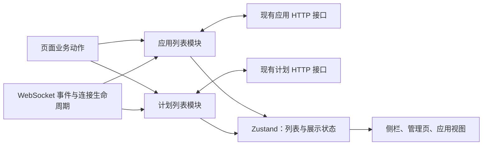

# 前端列表：读取、推送与操作回执契约

> **Status:** implemented — 各领域列表、排序、账户观察和写回执的合并边界。

| 任务 | 当前合同 |
| --- | --- |
| 列表、排序与业务写回执 | [列表协调](frontend-list-reconciliation.md) |
| 打开、恢复、Stop 与辅助任务 | [会话观察](frontend-session-observation.md) |
| 消息身份、全文、呈现与滚动 | [正文与阅读](frontend-transcript-view.md) |
| 表单、草稿、键盘与查看意图 | [交互状态](frontend-interaction-state.md) |

## 决策与范围

应用、计划、Agent、会话、模型凭据及 Connector 目录和安装列表模块分别拥有更新责任，页面通过领域入口提交操作，WebSocket
通过事件入口提交变化。各模块分别拥有列表更新规则，现有 Zustand store
继续承载供 React 订阅的数据。应用模块同时维护在线与归档列表。

已确认的设计边界：保留应用推送的即时显示，丢弃可确定过期的响应，对无法
判定顺序的变化安排后续 GET；不增加服务端 revision。
“合并”指集中这些更新责任，不表示把应用、计划和 agent 合成一个实体或通用框架。

本文拥有前端同步设计；Connector 安装与授权仍由 [connectors.md](connectors.md)
定义，应用生命周期仍由 [applications.md](applications.md)
定义，置顶和排序规则仍由 [sidebar-pins.md](sidebar-pins.md) 定义，计划事件
语义仍由 [schedule-tool.md](schedule-tool.md) 定义。本文不改变服务端写入事务、
权限、归档保留文件和计划触发。

## 接口选择与理由

当前采用 `applications.archive(id)`、`applications.reorder(ids)`、
`schedules.setEnabled(id, false)` 等领域业务方法。页面只表达动作，模块内部
负责请求、回执、推送、确认读取和错误分类，生产 HTTP 与可控 transport 共用接缝。

业务方法避免了每个页面必须正确维护“开始／应用／结束”的操作令牌，也无需
增加一套命令联合类型和分发器。方法数量不是深度标准：删除这层会让冲突判断、
刷新合并和错误分类重新散落到多个调用者。读取集中于各领域模块。

## 事实、写入者与提交点



| 事实或状态 | 写入者与提交点 | 消费者及失败范围 |
| --- | --- | --- |
| 应用、计划持久事实 | 现有服务端事务；此设计不改变 | HTTP / WS 提供观察结果，浏览器不能撤销服务端提交 |
| 在线及归档应用 | 只有应用模块能提交；同一次 store 更新维护两区互斥 | 侧栏、All、应用视图；读取失败保留此前数据 |
| 计划列表 | 只有计划模块能提交 | 管理侧栏、Schedules 页；创建提示使用操作回执，不回写旧数组 |
| 排序临时意图 | 应用模块仅保存本次待确认的 ID 顺序 | selector 在最新行上应用顺序，不保存第二份应用数组 |
| 已观察变化、在途读取及失效标记 | 模块内部临时状态 | 生命周期结束清理，不持久化，不推断服务端版本 |
| 请求状态、刷新错误 | 模块写入最小可订阅状态 | 页面区分“操作已确认”和“列表尚未同步”；空列表不能冒充加载失败 |

`sessionStore` 保留唯一的完整展示数据。模块可使用 store 内部提交函数，页面
与 WS 不再直接调用无保护的列表 setter。归档数据从组件局部 state 移入同一
应用 slice；首次打开 All 时加载，已加载后随应用变化失效，下次进入仍刷新。
读取中的旧数组只由请求闭包持有，不另建业务缓存或永久删除标记。

## 共享观察身份

读取与回执先核对原账户/token、会话、连接、服务代次及观察寿命。身份回到相同值
也不恢复已退休的观察。取消观察只结束读取，不取消服务端业务；Zustand 保留唯一
展示数据，模块只持有顺序基线与临时读取资格。完整 HTTP 快照、稀疏 WS 事件和
写回执分别接纳；业务自己的 seq、revision、终态和删除确认条件见各任务章节。

## Connector 目录观察

`web/src/lib/connectorCatalog.ts` 统一目录 `refresh()`、`create()`、`configure()`
与 `remove()`；ConnectorsPage 只表达操作，不能直接 GET 后替换目录。
Zustand 的 `connectorCatalog` 是唯一目录数组，`connectorCatalogRead` 保存
加载、过期与错误状态。安装列表仍由独立入口管理，两者不共享一套业务状态机。

成功 GET 或已确认写回执都会替换当前目录观察。创建与配置捕获开始时的观察，
只有它仍有效时才合并自己的行或配置字段；已被有效读取或其他写回执替代时，
保留写成功结论，只确认当前目录。每个成功写回执均退休所有重叠 GET，包括
写入等待期间才开始的读取，再发起一次确认。旧 GET 的成功、错误和清理均不能
改动后继读取或展示状态。普通刷新合并同账户的有效在途读取。

独立 DELETE 按原账户和目标过滤当前目录，不因别的目标后来删除而丢弃结果。
同 slug 删除后可以重建，因此目录入口只为在途 DELETE 保留有限目标观察：
创建成功响应头到达时，标记此刻仍在途的同 slug 删除已被替代，不依赖 POST
发起顺序。该创建的 body 尚未到达也不提前发布行；被替代的旧 DELETE 仅确认
当前目录与安装，不移除新定义或其安装。创建成功头到达后才发起的 DELETE
仍可正常应用。目标观察随请求结束或账户变化清理，不成为永久墓碑或服务端版本。

写成功与确认读取分别结算。读取失败保留当前目录、成功提示及 stale/error，
页面或原弹层提供只重试 GET 的入口，不把同步失败改称保存失败，也不重放写入。
每次 GET 包括 body 解码均有 30 秒期限，失败或超时结束本轮读取，不自动循环。
账户/token 代次变化永久退休旧观察，A→B→A 也不恢复；服务代次变化使旧观察
失效，有在途读取时淘汰并补读。卸载页面不丢弃同账户仍适用的写回执；表单关闭、错误与 busy
另沿[本次表单实例](frontend-interaction-state.md#connector-配置表单实例)核验。

真实 `ConnectorsPage.catalog.test.tsx` 固定 GET、写入成功头与 body 的交错，
覆盖旧读、迟到创建/配置、独立删除、同 slug 替换、账户变化及确认失败后的只读重试。

## Connector 安装列表

`web/src/lib/connectorInstallations.ts` 拥有 `refresh()`、`disconnect(id)`、
`definitionRemoved(kind, originalAccount)` 与 `connectionCompleted(originalAccount)`。
ConnectorsPage 首读、SidebarAgents、OAuth 轮询成功及取消撞成功后的确认均进入
这一入口；组件不再直接提交安装数组。`connectorInstallations` 是 Zustand 中
唯一展示数组，`connectorRead` 只保存加载、过期与错误状态。SidebarManage 的计数
及 AgentFormPage 的启用选项订阅同一事实，不另增刷新者。定义 DELETE 由
[目录入口](#connector-目录观察)拥有，安装入口只接纳其已确认的删除事实。

普通刷新复用一个有效在途 GET；重复刷新不会使它失效。断开成功确认时，在当前
数组上移除原 ID，custom 定义删除成功则移除当前账户该 kind 的全部安装；同 slug
已被新创建替代的旧删除只触发确认，保留新安装。随后退休所有重叠 GET，包括
DELETE 等待期间才发起的读取，并立即开始确认 GET。两个并发断开的成功回执分别作用于当前
数组，不因另一次删除或读取失效而丢弃。明确删除失败不移除卡片，页面显示错误；
定义删除失败在原弹层中显示。以上操作都不自动重发 DELETE。

连接完成携带开始时的账户/token 身份，退休登录完成前的读取并开启确认 GET。
已知登录 ID 的 error 或结果未知同样请求核对当前安装，不将这些回执解释为
确定没有安装效果；OAuth 视图资格与原登录收尾由 [Connector 合同](connectors.md#browser-oauth-operations)
定义，列表入口只裁定原账户观察是否适用。
若此 GET 又被断开淘汰，断开后的后继 GET 仍确认完整列表，使其他新安装可以
进入。已确认连接或删除成功与列表同步成功分别结算；读失败保留当前数组和
同步错误，页面提供刷新，侧栏显示 not synchronized，不把连接成功改成登录失败。

当前读取对象本身决定观察资格，无服务端 revision、永久删除标记或第二份数组。
账户/token 变化会永久退休旧观察，切走再返回也不复活；服务代次变化时，有效
在途读取被退休并补读。迟到读取的成功、错误或清理只能影响它自己，不能清掉
后继读取。每次读取含响应体解码有 30 秒本地期限；超时结算该次失败、释放入口，
忽略迟到响应，不自动重试。页面卸载不退休共享列表读取，也不丢弃同账户有效
删除回执。列表观察取消不代表远端业务被取消；OAuth 视图及原登录收尾另有责任。

## 通知目标集合

Settings 的通知面板拥有本实例的一份目标集合。POST 成功按 ID 合并当前集合，
DELETE 成功按 ID 从当前集合移除；均使用 functional 更新，两个独立删除不会
把彼此删掉的行带回。创建全局、删除按 ID 在发请求前同步登记 pending；重复
点击不能越过尚未提交到 React 的 disabled 状态，其他 ID 的删除仍可并行。

面板最多一个有效 GET，用读取对象身份同时保护响应头、body 接纳和 finally。
重叠确认合并为一个待读标记。读取捕获成功 mutation revision；期间有成功写入
便丢弃整份快照并执行合并后的确认。错误保留当前集合，结束本轮自动读取；
不会因失败自发循环，也不重试未知结果的写操作。

成功 GET 和成功 mutation 都替换局部 observation 身份。POST 开始时捕获该
身份，回执只在其未变时合并返回行；有竞争则保留成功结论，跳过旧行并安排
确认 GET。这覆盖 POST 已落盘但 body 迟到，GET 先展示新行、DELETE 后来成功
删除它的顺序，也覆盖 DELETE 404 后确认 GET 已证明缺席的情况。单独比较
成功写入 revision 无法保护后一种顺序。无需逐 ID 墓碑或第二份权威集合。

创建或删除失败显示面板级错误并安排确认 GET；表单关闭时也可见，确认成功
不清掉原 mutation 错误。失败响应不能证明服务器没有生效。面板卸载使旧读取
和写回执退休；账户代次 key 重建实例，异步出口另外实时核对账户和 token，
拦住 React 清理前的微任务。旧 finally 只结束原操作，不能影响新账户的表单、
集合或 pending。这里没有跨面板、跨浏览器的服务端版本协议。

真实 `SettingsDialog.test.tsx` 固定并发删除、旧 GET、迟到 POST、204／404 删除、
失败确认及账户切换的响应头/body 顺序，验证最终行、可见错误和控件可用性。

## 模型凭据列表

`web/src/lib/modelCredentials.ts` 拥有 `refresh()`、`remove(id)`、
`loginCompleted()` 和 `authenticationExpired()`。Harness 首读、删除及授权完成，
SidebarManage 首读，以及 WS result/error 两类认证过期事件均进入这些业务入口。
组件和 WS 不直接发布整表；Zustand 的 `credentials` 是唯一数组，`credentialRead`
保存加载、过期及错误状态。模块只持有当前在途读取，没有第二份整表或永久墓碑。

普通刷新复用同账户有效读取。每个成功 DELETE 回执分别按 ID 更新当时的当前
列表，并永久退休所有可能覆盖该事实的旧读取，包括 DELETE 等待期间开始的 GET。
随后的确认读取允许无关新凭据进入；读取失败保留已知事实并显示同步错误，不重发
DELETE。认证过期事件同样退休旧读取再确认，不复用可能早于服务端状态提交的 GET，
也不根据迟到事件直接修改某个凭据状态。

读取的成功、失败与清理都核对原读取身份。账户/token 切换永久退休原观察，
A→B→A 不复活；服务代次变化时退休在途旧读并补读。页面卸载不退休账户共享读取。
每次 GET 含正文解码有 30 秒本地期限，超时保留当前列表、结算同步失败并释放
读取入口，迟到响应不能清掉后继读取，不自动重试。

授权完成只触发列表确认，不插入历史成功对象。若确认被另一独立写入替代，登录
观察追随其后继读取，整次等待仍受 30 秒总期限约束，不取消其他消费者的共享
读取。列表观察与授权结果分别成立；两种登录的完成、关闭及只重读操作由
[凭据视图合同](harness-credential-reauth.md#frontend)定义。

## Agent 联合列表

Zustand 的 `agents` 只保存 live，`archivedAgents` 保存归档；同一次发布按 ID
合并并搬区，两区互斥。侧栏与选择器只消费 live，All 的展示、计数和 Restore
共同消费两区，不再由页面另存归档数组。HTTP 完整业务回执、WS 完整行与快照
都经 store 的 Agent 入口，`agentUpdates` 只保存重叠请求的临时 ID/顺序保护，
不保存第二份 Agent 行或永久删除标记。

请求保留原账户代次、服务代次及操作顺序，账户 A→B→A 不恢复资格。完整业务
回执和 WS 贡献整行事实，硬删除移除两区并保护重叠观察；读取不能取消独立的
合法业务回执。GET 和排序附带列表始终是观察，不因来自写操作而取得整行写权限。
较新完整观察保护较旧观察的同 ID；全集还能证明未知 ID 缺席，live 仅覆盖 live。
live 缺席不证明归档缺席，因此旧全集仍可补入同 ID 的归档行；较新 live 完整行
则能阻止旧归档版本回退该 ID。新 live 不能退休全集仍需提供的归档范围。

补读沿原操作身份和顺序，实际 GET 发出时开始新的观察阶段：此前已完成的 GET
不阻断这次新观察；发出后才完成的较新快照仍能保护其覆盖范围。阶段开始只重置
纯观察保护，保留真实业务回执、WS、硬删除和确认排序的保护。排序附带列表从
原排序开始观察，不借响应到达开始新阶段。loading/error 资格单独跟随较新的
全集读取意图，不能作为接纳或丢弃行的理由。

排序的乐观阶段只保护 `pin_order`，名称、归档及成员事实继续合并。成功只确认
原提交 ID 的位置，附带的其他行没有排序写权限；确认保护转移到重叠请求中，
即使排序调用已结束也持续到该请求退出。成功或失败响应都结束本次全部乐观
保护，确认因后继排序而不能发布也必须退出；失败后按原身份补读，不让旧乐观
状态挡住后继排序的恢复。旧确认及补读不能撤销较新确认或仍待确认的排序。

All 首次打开才请求 `include_archived=true`。归档读取分别记录 loaded、loading、
invalidated 和 error；尚未完整或已失效时显示 `All N+`，不把部分已知行算成全集。
失败保留两区和原草稿，显示同步错误及显式刷新。重连只确认 live，用户已请求过
All 时确认全集；不增加 socket 身份或可靠补发承诺。pin、排序与失败补读同样确认
用户已请求的范围。ID-only archive 以已知行补齐归档显示；未知 ID 不伪造行，
而是保护该 ID、使归档范围失效并按已请求范围确认。完整 archive 行直接进入
归档区，hard delete 从两区删除。

真实键盘排序、表单和 WS 回归覆盖 live/全集交错、首次 All 与排序回执两种顺序、
迟到成功/失败补读、重叠排序恢复、归档/删除不复活及账户代次；完整性、两区、
计数和 Restore 一起断言，不以单个合并函数返回值代替消费者验收。

## 当前接口及调用责任

实现位于 `web/src/lib/applicationList.ts` 与 `scheduleList.ts`，列表数据
仍在 store；不另建与领域无关的 manager。以下列出业务入口；具体类型由源码声明。

```ts
// 页面入口：方法内部选择 endpoint、提交策略及确认读取。
applications.refresh(view?: "live" | "archived"): Promise<RefreshResult>
applications.create(input: NewApplication): Promise<ApplicationRead>
applications.build(id: string, prompt: string): Promise<ApplicationRead>
applications.archive(id: string): Promise<ApplicationRead>
applications.restore(id: string): Promise<ApplicationRead>
applications.setPinned(id: string, pinned: boolean): Promise<ApplicationRead>
applications.reorder(ids: string[]): Promise<ApplicationRead[]>

schedules.refresh(): Promise<RefreshResult>
schedules.createFromText(input: ScheduleFromTextInput): Promise<Schedule>
schedules.setEnabled(id: string, enabled: boolean): Promise<void>
schedules.setWikiMode(id: string, mode: WikiMode): Promise<void>
schedules.remove(id: string): Promise<void>

type RefreshResult =
  | { state: "applied" }
  | { state: "pending" }  // 本次读取失效；已有后继确认读取需求
  | { state: "failed"; message: string }
  | { state: "obsolete" }; // 已离开原账户或连接范围
```

页面可以 `await applications.archive(id)`，无需接着手动 remove、刷新或恢复旧
数组。方法成功代表服务器确认该请求成功，不代表后续列表读取成功，更不
代表构建已经完成。读失败通过列表状态呈现，不把已成功的写操作变成失败。
返回的行只供操作提示等业务用途，页面不得再次 upsert。

写操作错误区分明确拒绝、结果未知和已离开账户范围。网络断开、超时或不能
证明无副作用的服务端错误属于结果未知，不自动重发创建、构建或删除。
后续 GET 只能确认列表当下状态，不能证明原请求一定未执行。已收到成功回执
但连接变化时，保留其业务结论，禁止旧范围直接修改新范围的展示数据。

创建应用通常在行已进入当前列表后打开应用。若回执因冲突未用于更新列表，
先留在创建页显示“已创建，正在同步”；后续列表出现该 ID 且页面仍在当前
账户、用户尚未离开时才打开。确认读取失败时提供刷新，不能再次提交创建。
这段页面导航状态只保存创建的 ID，不复制整行。

创建请求和已创建后的列表确认共用同步 pending 资格。完整创建编辑区及新的
配置写入一直冻结到该 ID 进入当前权威列表；列表失败不解除为可再次创建，
Refresh 只读列表。Cancel、页签和打开其他应用仍可用，退休的旧结果不能导航
或解锁后来的表单。

WS 集成入口只接收已解析的应用事件、计划失效通知，以及账户/连接生命周期。
它不是供页面任意灌入快照的公共接口。连接来源身份由 hook 捕获并传入，模块
核对后才改变列表或触发失败提示、会话补取等副作用。

## 读取与冲突规则

本节描述应用与计划的读取调度；Connector 使用独立的[安装列表规则](#connector-安装列表)。

### 每个模块最多一个有效在途 GET

应用的 live、archived 共用一个读取调度点；计划独立。多个页面请求同一列表
可复用当前读取；多个失效通知合并为待读取标记，不按事件数量积累任务。
应用两个查询都需要读取时轮流服务，归档需求不能被持续 live 变化饿死。
只是已失效但已被本地退役的网络请求，可能仍在服务器完成，不计作有效读取。

每次读取捕获生命周期身份和本地变化序号。序号仅表示浏览器已经观察到什么，
不是服务端版本。有效 WS、操作开始/结束、已接纳的回执及快照推进该序号；
纯粹重复调用 `refresh()` 不推进序号，也不表示服务器出现了新事实。
操作先登记开始，再捕获自身序号；回执在登记自身结束前核对竞争，避免将
自身开始/结束误当成竞争。读取接纳时推进序号保护更早的写回执，但不因
接纳快照再安排读取，避免两个应用查询相互触发循环。

| 时机 | 处理 |
| --- | --- |
| 读取开始 | 记录来源范围与序号；消费该查询当时的待读标记 |
| 应用推送到达 | 核对来源后立即更新相关行或移除；推进序号，标记相关查询需要确认 |
| 计划变更通知到达 | 推进序号并标记重读，不构造推测的计划行 |
| 本地写开始/结束 | 使重叠读取失效；成功、失败或未知后均安排适用列表确认，不重放写请求 |
| GET 返回且范围、序号均未变 | 原子提交该查询快照；这是“读取期间没有已观察冲突”，不是全局最新证明 |
| GET 返回但已观察到变化 | 整份丢弃；保留当前数据，安排合并后的后继读取 |
| GET 出错 | 保留数据及 stale/error 状态，结束该轮；失败本身不产生下一次重试 |
| 账户/连接范围变化 | 退役旧读取，旧回调不得提交；按新范围安排所需读取 |

采用整份丢弃而非逐 ID 合并，可省掉每个在途请求的 changed 集合、删除墓碑和
字段版本表。代价是持续变化期间，漏掉的其他行要等一次无冲突读取才能补齐。
应用推送仍即时显示，计划可能保持旧列表并显示正在同步。这个取舍属于明确的
能力边界；若未来要求持续高频变化下仍完整前进，再单独评估更强协议。

后继读取期间若又发生变化，可以再需要一次读取。“合并一次后继”不是整段
会话最多发两次请求。安排在后续任务中启动，避免同步递归；不增加周期轮询。
单次 GET（包括响应体解码）设 30 秒本地期限，超时退役请求并忽略迟到结果，
避免一个悬挂请求永久占住入口；这不代表取消了服务器工作。测试替换时钟。

失败终止当前自动读取轮次，等待失败后的新事件、页面进入、重连或用户刷新
再启动；失败前已合并的标记不驱动自旋。`refresh()` 返回它所参与那次尝试的
结果，不等待变化无限期安静；若需要后继则返回 `pending`，页面订阅后续状态。

### 迟到 WS 和操作回执

即使当前没有 GET，有效应用事件也标记确认需求。否则“GET 已显示 ready，
迟到事件改成 building”后可能永远没有下一次读取。接受即时推送意味着这种
无法识别的新旧倒退仍可能短暂发生；本设计承诺随后确认，不承诺永不闪回。
全部有效事件均可触发失效，正确性不依赖整行相等比较或推测时间戳。
应用事件和操作保守地同时失效 live 与已加载的 archived 查询。HTTP 中的
`backend` 来自运行时补充，原始 WS 行不保证携带该字段；推送只提交其实际
携带的字段，缺失的运行时信息保持未知或待确认，不伪造默认事实。确认 GET
补齐读取模型，也不能把整行相等或 HTTP 派生字段当作事件版本依据。

操作回执只在范围仍有效、从请求开始至回执期间没有竞争提交或事件时用于
更新展示数据；否则保留当前列表，交给确认读取。竞争判断可以保守到整个
应用域，避免新建逐行版本系统。排序返回的整份列表尤其不能无条件替换。
成功回执与其 WS 通知重叠时，通常由 WS 提供即时显示，GET 完成确认。

允许在本地操作等待期间读取列表；无已观察冲突时可展示该次读取的服务端
现状，但操作仍未决，不能标记为操作之后的确认。操作结束会再次失效并确认。
因此长时间的自然语言计划创建不会阻塞其他计划读取，也不会被一次旧 GET
误判为创建失败。

### live 与 archived 的关系

两区在一次本地提交中保持 ID 互斥。完整行按 `archived` 放入对应区，并从
另一区移除；仅有 archived ID 的事件立即移出 live，已加载归档区等待 GET
补齐。deleted 移出两区。live GET 中缺失某 ID 只证明该次 live 快照没有它，
不据此发明归档行；归档查询同理。

一次查询接纳的行从另一区去重。两个查询共享变化序号并串行读取，避免本地
restore 与早先 archive GET 交错后重新引入重复项。它们仍不是服务端原子
双列表快照，跨查询期间可能暂时缺行；变化停止、所需查询成功后才能收敛。
归档区未加载时记录需要读取即可，不为隐藏历史提前拉取全量数据。

### 身份与副作用

继续使用 [accountFetch.ts](../../web/src/lib/accountFetch.ts) 的账户及响应体
读取保护；在模块内部补充当前 socket 来源身份和已知 `dispatchGeneration`。
断线或连接替换立即退役旧读取，重连刷新应用、计划及已加载的归档区。
已知服务代次变化同样使读取失效；不声称能识别尚未获知的服务器重启。

重连仍是同一账户，已有列表可保留并标记待同步；退出或切换账户清空列表、
归档加载状态、排序意图和错误。旧请求完成不得释放新请求的占用标记，旧
写回执不得触发新账户的导航、通知或会话补取。

应用已接纳的移除统一清理选中应用、未查看失败标记及相关排序 ID。有效 WS
仍保留现有失败状态提示和 `hydrateSession` 行为；同一事件不重复执行副作用。确认 GET 不重放“事件到达”，已失效事件没有
副作用；会话自身的更新保护继续由会话模块负责。

## 排序：保留乐观反馈，限制重复提交

一次应用排序或 pin/unpin 提交尚未结束时禁用这三类控件，模块同步
拒绝第二次提交；其他页面的同类操作共用该状态。鼠标、触摸和键盘拖拽均
遵守禁用状态，读取 busy 后再点击的竞态也由模块入口保护。

这是当前采用的交互：首次拖拽立即反馈，提交中不能继续拖拽。
它用一个临时 busy 状态避免请求队列和“后发请求一定后提交”的错误假设。
若产品必须支持连续拖拽，应重新设计未发出意图的合并与提交次序，不能靠
忽略旧 HTTP 回执宣称最后拖拽一定生效。

乐观层只保存 ID 顺序，作用于最新行；WS 的构建状态、归档、删除及 pinned
资格继续立即生效。未列入意图的有效 pinned 行保持相对顺序追加在后面。
成功回执若可安全使用，则接纳其顺序；若有冲突，保留临时顺序直到写结束后
开始的一次有效 GET。确认失败则撤掉临时意图、展示最近已接纳数据并标记未
同步，不能把用户意图无限期当作已保存事实。明确写失败或结果未知也撤掉
临时意图并确认，不能回滚整份旧数组。

HTTP 结束后可再次操作，旧确认 GET 不得清除新操作的排序意图；清理须匹配
本次意图身份。跨标签页写入、未知结果的旧请求仍在服务端完成等情形没有
“本浏览器最后意图必胜”保证。未知结果不自动重发，下一次操作是用户另一次
显式提交，最终仍以服务端读取为准。

## 验收矩阵

测试通过业务入口、WS 入口及可订阅结果断言，控制 HTTP/响应体完成顺序，
不直接检查内部计数器。下列项目是持续保留的验收合同。

| 场景 | 必须观察到的结果 |
| --- | --- |
| GET building → WS ready → 旧 GET 返回 | ready 不被旧 GET 覆盖；后继 GET 可完成确认 |
| GET ready 完成 → 迟到 WS building | 即时推送可短暂生效；必有确认读取，安静后恢复服务端状态 |
| GET 期间收到多次计划通知 | 同时最多一个有效计划 GET；合并后继，最终采用无冲突列表 |
| 后继 GET 中再次变化 | 可以继续需要下一次，不能因“已经补读过”而漏同步 |
| 两个页面同时 refresh | 复用同查询在途读取，不产生响应倒序竞争 |
| `/schedule` 等待期间删除或修改其他计划 | 成功回执不恢复旧数组，已有变更保留，创建成功与同步失败分开呈现 |
| 旧归档 GET → restore → 旧 GET 返回 | 不重新归档已恢复行；live/archived 不重复，All 计数无重复 ID |
| 读期间收到 archive/delete | 不因旧快照复活；选中项与失败标记按移除规则清理 |
| 断线期间改变计划后重连 | 即使没有新通知，计划也重新读取 |
| 重连、服务代次变化、退出或换账户；旧 body 晚解码 | 旧结果及副作用失效，不能清掉新请求状态或污染新账户 |
| 排序期间 WS ready 或删除某行 | 乐观层只影响顺序，状态不退回，已删除行不复活 |
| 排序 pending 时再次拖拽或从 All pin | 控件禁用，直接调用模块也不发第二个竞争请求 |
| 第一次排序结束、第二次开始、第一次确认读取返回 | 旧读取不能覆盖新顺序或清除新意图 |
| 排序失败／未知结果 | 不恢复旧整表，不重发写操作，撤销临时意图并安排确认 |
| 写已成功，确认 GET 失败 | 成功结论保留，列表标记未同步，不提示重新创建或构建 |
| 创建成功但行回执被冲突挡住 | 显示已创建待同步，不打开不存在的行，不重复创建 |
| GET 悬挂、超时后迟到 | 30 秒本地期限释放入口；迟到结果不提交；可由新触发重新读取 |
| GET 失败后没有新触发 | 请求数量不继续增长，保留旧数据与错误；首次加载失败不显示为确认空列表 |
| 应用两区同时 dirty、live 持续变化 | 查询轮流服务，归档获得尝试机会；不承诺持续冲突期间完整新鲜 |
| 所有变化结束、网络正常、所需 GET 成功 | 展示与该次服务端查询结果一致，临时意图与同步标记收敛 |
| 持续事件、重复事件、长写请求 | 无事件队列增长；推送可显示，读可执行，刷新调用可返回 pending，不无限等待安静 |

至少保留一个真实 hook/页面到模块的集成测试，分别覆盖重连补读、旧闭包创建、
归档恢复、排序禁用及现有失败提示，防止模块测试通过但调用者仍绕过入口。
相关前端检查按 [testing.md](../testing.md) 选择；文档检查不能替代行为验证。

## 会话列表与跨重连写入确认

`SessionList` 统一侧栏及重连 GET、归档列表、详情补取、创建、归档/恢复、分支
创建以及模型/凭据等局部字段回执。Zustand 仍持有唯一 live/archived 列表；模块
只持范围、已观察变化基线和至多一个活动完整读取，不保存第二份列表或永久墓碑。
每次读取捕获账户/token、连接、服务代次及变化基线。有效事件和本地确认改变
基线；冲突快照整体丢弃并合并为一次后续读取，不能让旧 running 覆盖 idle、让
归档/删除项复活，或让快照期间新增的会话消失。删除/归档保护持续到新的协调
读取边界，不会由旧快照清除。

`session_deleted`、成功删除回执或有效的包含归档完整快照确认删除后，统一调用
`SessionList.remove`：清除选中视图及所属消息、问题、Research、派发等缓存，并
在 commit/forgetSession 前捕获 `wasActive`，同步通知共享文字入口及页面清理
该会话的文字、附件和恢复草稿。当前会话的共享文字在页面卸载时仍会清理；
其他会话删除不清共享文字。在途提交也沿原草稿对象
核验所有权，删除后迟到的拒绝、unknown 或失败回执不能重新放回草稿。
发出删除请求或删除失败均不触发这项清理。

普通 live 列表缺行可能只是远端归档，不证明删除。重连发现先前已知的 live、
archived 或选中 ID 缺失时，保留这次待确认 ID，合并到既有 include_archived
读取；仅完整确认仍缺失才清理，覆盖未选中的缓存与草稿。归档行保留输入和
可读视图。待确认 ID 只服务这次读取，成功确认或账户退出后清除，不过滤新行，
也不成为永久墓碑。断线漏通知沿此路径恢复；旧账户、连接或服务代次的读取仍
不能确认删除。`sessionList.test.ts`、`ChatView.test.tsx` 与真实双页面
`session-deletion.spec.ts` 分别验证读取交错、草稿生产者及 REST→双 WS→页面。

详情只在同一范围和观察基线接纳列表字段，并拒绝已知较旧的 dispatch revision；
读取开始尚无服务代次、期间由其他会话首次建立代次时，详情可用自身派发状态
确认与当前代次相同，再接纳转录和队列；账户、连接及已知旧服务的检查仍保留。
消息窗口、问题、Research 和输入派发仍保留原合并责任。部分字段写入只修改其
负责的字段。过期 socket、账户/token、服务代次和退休读取都不能更新当前列表。
创建、恢复、归档及字段修改的成功回执遇到连接/服务或观察基线变化时，仍按
原账户/token 使当前列表失效补读，不直接应用旧行；创建与父会话归档在同一
确认中合并。读取确认归档后不再用原操作基线重复写入列表。换账户/token 或
dispose 后旧回执不补读；未知 ID 的归档事件同样阻止迟到创建复活该行。
`ForkDialog` 拥有 rewind 成功回执的列表确认，`ChatView` 回调只切换视图和加载
转录。跨连接成功仍关闭原账户中尚未退休的原确认弹窗，并补读包含归档的列表，
让父会话历史保持可打开；当前范围已确认分支且原动作仍有前台资格时才导航。
换账户/token 后旧回执没有副作用。

聊天 `/archive` 的每次动作和 Rewind 的每个弹窗分别拥有前台生命周期。组件
同步订阅当前会话和主视图，离开原会话或聊天主视图会永久退休该次资格。
Rewind 离开时关闭原弹窗，返回后可重新打开。关闭、卸载和实例变化也会退休
原弹窗，实例清理释放订阅。聊天 `/archive` 的反馈资格还随文字草稿或账户变化
退休，附件编辑撤销自动交接资格。原操作仍按有效观察结算列表事实。侧栏归档发起时
记录当前打开，确认成功只在该打开持续拥有聊天前台时清空选择。切到 Monitor 或
离开再回原会话后，迟到的确认只应用有效列表事实。

每次 Archive 仅发送一次 POST，发送前开始 30 秒观察，包含响应头和响应体。
成功归档且无需替换的操作返回 204。竞争中未产生归档效果的请求被拒绝。
提交后后继创建、配置或重绑失败时返回结构化 500，含已归档事实、已知后继和
失败阶段。创建失败可以没有后继 ID。聊天命令的明确拒绝显示 HTTP 状态和可用
原因。侧栏的未知或未确认操作可按原会话 ID 找回只读确认入口。明确拒绝时优先
显示可用原因，并释放该操作的观察。

侧栏自动核对归档时，可见会话行继续显示归档中的忙状态。核对本身不显示告警，
包括归档广播先于 204 到达而触发的列表补读。自动核对无法确认时才显示提示及
手动确认入口。手动核对期间保留原提示并禁用该入口，取得归档事实后清除提示。
聊天命令自动核对及准备后继期间显示普通忙态。手动核对保留已有反馈，读取期间
禁用确认入口。

连接丢失或不可读回执保留原结果未知，
通过 `SessionList.confirmArchive` 只读确认包含归档的集合。确认另有一次 30 秒
预算，由重叠读取、过期重读和后继查询共用。共享 GET 正常结束，早于归档确认的
快照按列表变化判定为过期。首个服务代次替换在途读取时，仍有资格的确认沿原
剩余预算补读。未确认时可由用户显式启动一次新的只读确认。本地到期结束观察，
服务端归档继续按原生命周期结算。

`session_archived` 由 SessionList 同时发布归档状态、直接后继与共享失败阶段。
广播不结算某个标签页的 POST。GET 可确认归档行，原命令仍可未知。原前台仍在时可
接收晚到的共享阶段，同服务重连也可接收当前连接的共享阶段。恢复、删除或换链
退休阶段。只读确认的归档提示在源仍归档且观察有效时可跨同服务重连保留。源会话
恢复或服务代次变化会清除旧确认，原 POST 的结论仍保留在当前聊天。手动重连确认
只读取事实，已有关系可核对，缺失的关系仍须原连续观察才有资格登记。共享归档
广播保留后继已有转录、问题和派发快照。

归档使源会话立即只读。当前打开按实测的底栏和正文高度保留读位，包括先切走
再回来才收到的原归档事实。缩窗时底栏按实际空间收缩并可滚动，正文的最小高度
取确认前实测的正高度与 `3rem` 中较小者，缺少可用测量时采用 `3rem`。底栏退场
造成焦点落回页面时，把原来由底栏控件持有的焦点交给当前正文入口并保持读位。
用户已选中的其他控件保留焦点。

聊天命令只在对应账户、连续前台、草稿和操作观察都仍有效时自动交接，并核对原
会话已归档、后继仍是当前直接关系且可以编辑。非空后继先按其自己的标题、问题、
队列及输入区排版，准备中的视图不接管交互。确认当前正文已可读后，保留同一个
正文实例，一次切换标题、正文和发送目标。可信空基线一次进入空态。详情失败、
部分失败、失去资格或两秒有效布局预算用尽时保留当前阅读选择，已知后继可由用户
主动打开。后继读取观察仍有效时，详情或布局错误与已确认的归档事实、原 POST
的已知或未知结论一起呈现。断线会结束原连接的后继准备，并清除该观察中的后继
读取错误。已收到成功 POST 回执且源聊天仍拥有命令反馈时，准备结束后显示该
回执，包括因断线取消准备的情况。 [正文可读条件](frontend-transcript-view.md#首次正文呈现)
[归档交接回归](../../web/e2e/archive-feedback.spec.ts)

SessionList 保存当前账户已明确观察到的临时 old→new 关联，不按名称推断，
不追踪后继链，也不持久化。稀疏广播可以先于原行到达；局部列表缺席本身不
证明删除，包含归档的完整确认会清退确实缺失的原行或目标。原行恢复、原行或
目标删除、账户变化及明确无后继的归档使关联失效。重载或断线后没有依据重建的关联保持未知，
仍可沿现有会话列表查找。

归档/回退请求在本次寿命内观察原行。首次归档和普通 live 列表暂缺会淘汰旧
详情读取，但保留原归档回执资格；恢复、确认删除或关联变化则永久退休它，
迟到成功不能覆盖较新的后继关系。首次接纳恢复证据时同时结束暂缺记录，
防止后续无关字段更新再次退休新操作。稀疏广播缺少原行时，由 SessionList
主动合并 include_archived 补读，不等待外部刷新；详情在途也能恢复只读历史。
每次等待确认后，写入关联和导航前都重新核对原账户及观察资格。

归档历史对已知后继提供主动入口。点击沿当前账户、连接与服务观察等待有效、
不再 stale 的完整列表，确认直接目标存在后才沿原选择和快照入口打开；目标
已经归档时打开其只读历史。等待期间离开原前景、恢复原会话、改变关联或删除
目标，都会永久结束该次点击资格。最后一次等待后再次复核原会话仍归档、关联
仍匹配；恢复后再归档不复活旧点击。确认失败保留历史与读取错误，入口仅重试
读取，不重发归档或回退写入；详情读取失败沿现有快照入口显示。

弹窗打开记录固定原账户、session、消息序号及实例编号，不能用当前选中会话重新
解释旧消息序号；每次打开都有独立表单，原关闭回调只能结束自己的打开记录。
列表补读暂时缺少父行不会另建原弹窗。账户、连接与服务 observation 另行判断
结果适用性，前台退休不取消服务端工作，也不阻止有效成功先经列表协调接纳。
确认结束后重新检查原资格：仍有效时沿 `selectSession` 进入结果并按该会话规则
采用预填；失效动作不导航、不关闭新弹窗、不写新表单或草稿。旧失败也不能修改
新实例；当前失败释放自己的忙碌状态并保留可重试表单。

创建入口异步返回“可导航”的确认结果。同一范围的回执若撞上列表变化，
沿现有合并补读等待一次不再 stale 的已接纳快照，保留创建后的导航意图；并发
写回执造成的后续失效也必须确认。若目标已归档/删除、读取失败或原范围退休，
返回不可导航，保留同步错误或原范围约束；不会重发原 POST。确认读仍只有一个，
等待没有新增轮询器或持久状态，既有正文超时终止失败读取，范围退出结束等待。
异步确认结果只代表确认时的事实；消费者在 `await` 后、导航或写消息前重新
检查原范围，防止返回 true 与调用方恢复之间的账户/token、服务或连接切换。
侧栏收到创建成功回执后按原账户立即关闭表单，不等待列表确认，以免确认
读取悬挂时重复提交。确认期间用户已移到别的聊天时，后台分支就绪只
发布原聊天的提示，不抢走新焦点。
读取失败保留已有数据，侧栏与归档页呈现错误；有效刷新清除错误和 stale。

### 创建与写入确认

新建会话立即显示 Creating session 并禁用表单，用同步在途标记防止连续触摸或
Enter 重复 POST。服务器成功仍经原列表确认后导航，确认期间用户已移到其他
会话或页面时不抢焦点。明确拒绝保留表单与错误；传输或成功响应解析失败时，
关闭该表单并补读列表，提示检查结果，不能把未知结果当成失败自动重发。
创建请求同样限时 30 秒，超时按结果未知处理。

`ScheduleList` 的 PATCH/POST/DELETE 写入成功归原账户/token，而不归旧连接。
同账户迟到成功回执使当前列表失效并补读，不把旧连接的返回行直接写入新连接，
也不重发写操作。确认读取失败保留写成功及 stale/错误；登出、换账户/token 或
dispose 后旧回执不触发当前读取。`/schedule` 的成功提示使用同账户范围。

应用排序的 ID 验证、排序及返回行/确切变更集合在同一数据库事务完成；广播只用
提交返回的变化行。新增、恢复、归档或删除与事务交错，不再依赖事务外两次观察
具有相同 ID 集合，也不通过吞错掩盖排序成功后的通知问题。

回归入口是 `sessionList.test.ts`、真实创建消费者 `openAgentChat.test.ts`、
`useWebSocket.lists.test.tsx`、模型修改、侧栏归档/重连和
`hydrateSession.test.ts`，以及 `scheduleList.test.ts` 的迟到写回执与确认失败矩阵。
生产调用方的直接整表覆盖已移除；协调不承诺无通知、无刷新触发时自行发现变化。

## 能力边界

本设计保证已知冲突不会由旧响应覆盖，更新责任集中，读取并发和待读状态有界。
它不提供线性一致性、WS 顺序证明、可靠事件补发或跨标签页最后意图获胜。
条件性收敛依赖变化最终停止、遗漏变化经重连/进入/刷新暴露，以及其后的
必要 GET 成功；没有通知且没有刷新触发的服务端变化无法由浏览器自行发现。

回归入口包括 `applicationList.test.ts`、`scheduleList.test.ts`、
`agentReconciliation.test.ts` 及对应真实页面/hook 测试。列表协调不提供通用
服务端 revision；归档恢复的专属身份/代次只证明原恢复能否继续生效，不提供
跨列表版本顺序。
