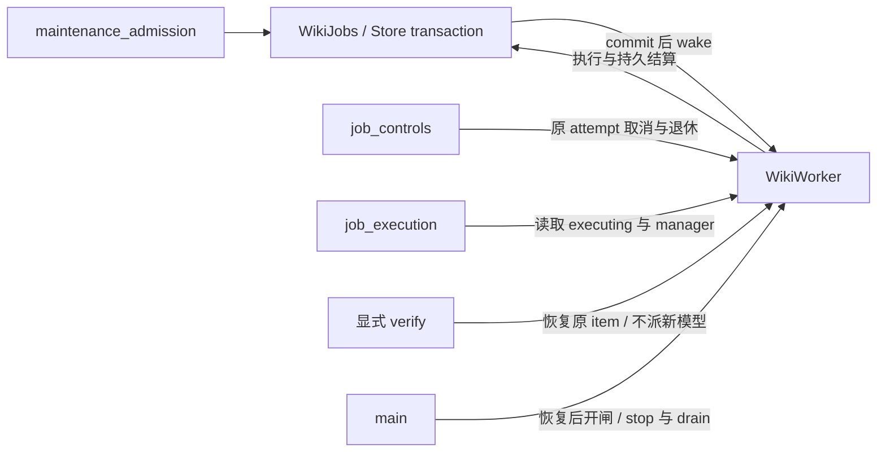

# 共享 Wiki：当前契约与设计理由

> **Status:** implemented — 当前检索、维护、权限、效果证据及恢复边界；后续产品范围单列。

普通查询按当前 query 指南和工具执行，不需要加载本文工程合同。

| 开发任务 | 首读范围 | 扩读条件 |
| --- | --- | --- |
| 检索、正文窗口或阅读留证 | [查询和证据](#查询和证据)、[查询投影](#查询投影与性能) | 字节拒绝查[资源政策](#文档字节支持与资源拒绝) |
| 维护接纳、内容操作或派发 | [维护](#维护和日常增量)、[受保护入口](#受保护操作与入口)、[Worker](#wikijobs-与-worker-的协作) | 改内容规则再查[受控操作](#内容与受控操作) |
| 恢复、取消或效果核验 | [恢复与效果](#恢复与效果核验) | 格式改变查[存储](current-storage-format.md)，界面查[前端](frontend-list-reconciliation.md#wiki-卡片详情与控制回执) |

## 范围、产品选择及其理由

**派发与执行证据分开。** 显式重试或范围重准入成功时，在原事务推进派发代次并登记
本次可信入口；旧任务、原执行和收据用于保全与安全续作，历史订阅不再唤起旧会话汇报
后续派发。已完成取结果、控制重放、同次复用及自动恢复不制造新派发。回传聚合只取
本代订阅，原请求的汇报身份保持稳定；与派发转交共同串行化接纳，已接纳输入保留事实。
普通 Weber 与其他提交者一样先走 entry，有效 worker 才走 worker；提交端不抢做
恢复任务的正文和网页语义验收。有限存量交接与当前格式见[存储合同](current-storage-format.md)。

| 决定 | 解决的问题与约束 |
| --- | --- |
| 一份主库正文，多种入口共享 | Octopus agent、Sapphire、SmartReader 不各存一份权威知识；主库存放在应用 data 内不意味着核心依赖该 App 启动。 |
| 查询、普通保存、维护分别处理 | 普通保存只更新文件/索引；聊天和搜索不自动沉淀，明确任务才进入维护；避免一次小修引发全库重写。 |
| 现有文章原位维护 | 当前文件就是正式文章，保留路径、身份、原思想和表达；不逐篇创建永久原稿副本，不搬迁为参考项目的目录体系。 |
| 程序保证权限与字节，模型负责理解 | 身份、版本、范围、读覆盖、未选字节、回执和恢复可验证；摘要是否准确、条件是否保留仍需内容判断，hash 不证明事实正确。 |
| 不按 AI/人工作者限制维护资格 | 人工改过的文章可以继续纠错；只在当前版本定点修改，不认领作者、不重新生成整篇正文。 |
| 复用有价值的知识页 | Concept/Topic/Synthesis 可直接支撑适用问题；精确数字、引文、冲突或来源更新再追必要原文，不每问重读全部来源。 |
| 维护范围明确到对象 | 有依据的 `[[关联]]`、派生反向关系及必要导航入口配套允许；关联不赋予旧页正文重写权。专题正文更新保持指定对象，新知识页按有限创建范围处理。 |
| Markdown 为本期搜索和新维护范围 | `.md/.markdown` 兼容大小写；非 Markdown 原件和历史保全，支持字节范围内的已知 HTML/TXT 可直接读取；PDF 自动理解未交付。 |
| 按需要增加知识和技术 | 不为每篇材料强造 Concept，不定期让模型扫描全库所有句子，不无条件上向量、重排或图数据库。 |

## 查询和证据

所有有效账户内 agent 均可按任务需要查共享 Wiki，不要求先询问 Weber 或输入 `/wiki`。
`read` 只收窄维护权，不关闭查询；旧 Off 是历史控制语义，不是当前可提交的第四种模式。
当前只接纳 auto/read/maintain，旧合同保全及重新授权归
[知识请求](knowledge-requests.md)。已知身份/路径直接读；否则保留原问题命名对象，用 compact 导航定位：明确文章用 lookup，具体问题用 question，宽主题用 overview，多方比较用 compare。

索引卡和 snippet 只作导航；实际读到的当前摘要、Key note 或知识页已覆盖问题及条件即可回答。缺少定义、理由、条件、出处或另一方观点才补相关正文。明确整篇总结/评价须以同一 revision 的实际正文覆盖 `[0,end)`，没有缺口；工具预算不构成全文上限。比较需各方依据，未读/失败范围不算已读。

已知多个正文范围可用 `read_many` 批读；本调用方上下文仍保留的同版正文可以复用，
只补缺口。上下文丢失后须重新取得所需正文，不能用“此前交付过”代替模型现在
可见的材料。身份、revision、当前授权和维护终稿冷读仍各自核验，正文复用不转移
其他任务的阅读证明。HTTP 与 MCP 的单读、批读条目均默认16000字符，接受1–24000；
非法请求在阅读留证前拒绝，最终证明仅覆盖预算裁剪后真正返回的码点范围。

回答保留主张、支持理由和必要条件，区分原文观点、转述与自己的推导，并附实际路径/位置、简短 confidence 和必要限制。检索分数不等于正确概率。个人背景只从当前 `Library/Me` 定位和读取，缺失字段如实说明，不能用收藏文章或在读身份补出职业。

精确身份 lookup 不被广义相似度替代。直接、已解析的重复表示可归并；共同标签、参考文献或综合同时引用 A/B 不代表它们是同一个作品。知识页的复用价值与独立证据数量分别判断，`generated`/`stable` 不等于已核验事实。

lookup 的 lexical 候选须满足完整命名概念，连续中文词组不以散落词片段替代；
question/overview 在严格候选为空时可使用既有 topic fallback。简称未命中不直接
证明索引缺失，也不自动授权补别名或放宽 lookup。改动须按
[评测方法](../wiki-evaluation.md)取得独立来源和质量依据，保留不同检索意图的准入边界。

## 维护和日常增量

普通 agent 和普通会话 Weber 可按任务提交精确 paths 或完整 material；实际正文修改仅由框架绑定的 Weber 有效 assignment 执行。普通委托、文内指令、状态查询、来源字段和“已打开文件”都不授写权。已有文件传精确 paths、material 留空；未保存新材料才提交完整原文及已知来源，不能先创建同名文件再当新材料创建第二次。

`/wiki` 独立记录 wiki/web 来源要求，一般正文进入 auto，由主 agent 按可信人类请求的含义选择查询或维护；显式 read 和父任务限制仍优先，已有只读任务不追认权限。询问方法、引用或否定维护只查询；明确要求维护知识库且没有指定对象时有界观察当前 Library Markdown 增量；指定对象则保持范围，不扩成全库。后端不承担任意自然语言的语义分类。

原有形式化 `/wiki维护`、`/wiki 维护`、`/wiki maintain` 仍共用解析和精确选择限制；唯一短名可定位，重名歧义拒绝。auto 没有更窄选择限制的 checked 默认复核同样在接纳处限制 Library Markdown；review 只证明当前状态，不代替主 agent 判断人类意图。具体修订继续提交精确 paths 与该目的的固定 key，不混用默认复核。

`maintenance_status` 有界提供当前身份/revision、合格维护基线、来源警告、未完成尝试和已知历史路径入链。基线取真实 worker 任务中已接受、已索引的输出；普通 save 不构成维护，旧维护操作即使记名 `save` 也须满足任务、单项及发布落定条件。版本相同不能掩盖来源警告或待恢复任务，状态不代替正文阅读或触发恢复。

默认增量只列语义复核或恢复差异，纯移动不反复出现；精确 doc 和 links 仍返回当前位置及历史收据路径，不改写旧事实。冻结选择只保留创建时可执行的 review，同次返回有界 `deferred` 列明已有任务与未核实项，后续页沿用原序号；接纳继续复核当前资格。空可执行列表不自动意味着没有待恢复工作。来源确认按 resource 定位，同资源多位置用原 location 区分，可以一次确认多个已读位置；无需重套模板或制造正文补丁。

来源声明与后续核验分别保留：`confirm_sources` 将实际检查的目标版本和位置写入现有操作收据，绑定文章身份、原字节版本及当前来源 observation/occurrence，不改写文章 YAML 或制造新 revision。`source_refs.revision` 保留原声明，`confirmed_revision`、`confirmed_location` 和 `confirmation_receipt_id` 表达后续核验；直接读取仍检查来源磁盘的即时版本。纯移动保留来源观察身份；文章编辑、恢复及复制重建观察或文档身份，旧核验不继承。维护状态与读取共用核验事实，真正来源变动仍失效；相互引用不因核验记录变化循环排队。不新增账本、环调度或跨层自动维护。

完整维护流程把版本比较、范围合并、索引去重和结算交给既有程序职责。worker 任务提供准入时的复核基线、输出版本、变化原因及另列的当前直接来源事实；compact read 保留有界来源详情，read 的独立 source_cursor 绑定账户/库/文档/版本和依赖 generation，续页不增加正文阅读证明。read/read_many 可按真实 location 读取；批读显式 reuse_delivered 复用同任务、同身份与版本的实际返回，上下文丢失仍可普通重读。原始块与提取文本经程序逐字确认相同时，实际交付区间同时满足引用读取与显式复用；BOM 等造成坐标差异时保留两套坐标，不直接借用。加载指南给已交付范围提示，不改变政策摘要或授予阅读证据。

已有导航页通过 blocks(view="navigation") 读取实际主题上下文，relations-only organize 由程序检查完整索引、身份和已存在入口并固定追加。Markdown 节点识别主题，通用标题或链接空壳不能自动视为上下文充分；追加不认证索引正文已复核。操作回执保存真实 writer 变换和本任务连续变更链上的最终 readback 义务，覆盖新增、修正及纯重排后的标题、接缝和语境；原文保全 origin 不能代替本任务变更清单。未改的管理正文按真实 copy 保留，仅更新管理元数据不制造正文义务，同时返回实际生效字段；前序仍存正文改动继续检查。结果提供原始字符坐标与 block_ids，纯确认及固定导航不制造新正文回读，未知映射扩大检查。模型检查语义，框架仍按原执行终态、实际收据和索引结算并幂等恢复。

游标绑定账户、注册、筛选及一致快照中的收据和任务落定状态；状态接口不返回正文、原始错误、理由或敏感附带值，links 不透出 query/fragment/标签。可行动复核复制返回的 typed review/review_key，在准入锁内再次核对身份、版本、可信选择、基线、直接依赖与索引；安全重放与首次新入队分开，防止旧观察换绑新对象或内容回退误复用旧成功任务。

多个日常候选通过 `maintain_batch(selection_id, ordinals)` 按最多三篇合批，每批独立 worker 上下文。冻结观察只减少参数搬运，服务仍在同一接纳事务逐篇复核原范围与当前事实；任一项失效整批不接纳，实际执行允许逐篇成功或失败。原 review_key 作为 `job_requests` 别名保留单篇规范化请求 hash，已接受成员复用，新成员另组；不跨运行中的 job 合并。`selected_items` 表达本次选择的逐篇状态，批进度与通知明确按完整关联 job 统计，retry/cancel 仍控制原 job。首次与增量阶段按 doc_id 写入各目标，恢复跳过 done/excluded 项。

结果回传附带有界收据摘要及截断标记，包含操作、输出版本和复核理由，已有证据足够时直接汇报；只为具体缺失或截断查询完整 job，不把整份导出重新灌入上下文。token 优化按无效提交、失败绕路、重复读取与重复验收衡量；提示词字数变化不作为行为收益。

模板化不是检索准入条件：既有 Markdown 的题名、章节与正文照常索引，实际别名、标签、简介和前置要点提供额外选材线索。标准章节帮助区分正文与整理补充；标准“相关笔记／整理说明”后的括号归属不改变其角色，Markdown 与 HTML 共用同一识别规则。此规则更新只重建派生索引，不改文章字节或维护收据。已存在合适开头摘要的文章不因缺少模板壳重新写作；需要改善检索时按真实缺口补足元数据或结构，不对全库机械重套模板。

指南公共规则和操作卡支持无状态条件回包：首次完整返回 `context_digest`，上下文仍完整时可传 `known_context_digest` 省略相同公共内容；变化自动返回完整新卡，模块鉴权始终先执行，摘要不保留权限。文末修订可直接 `blocks(tail=2)`，无需枚举全篇定位符；续页去掉 tail，使用全篇 `next_offset` 与部分块的 `next_start`。同版已读范围和不同版本的终稿冷读义务分别保留。kind 采用共享的小写枚举，未知值明确拒绝，避免把参数错误当作无知识。

纯移动/改名若身份和版本未变、索引就绪、无来源警告及待恢复工作，观察后停止，不为制造完成记录再排 `no_change`。旧名字面链接另查当前影响；其存在不证明是这次移动新造成，未选关联页的正文保持只读。人工编辑后以当前内容、删除和未知字段为权威，完整复核可以合法 `no_change`，不强制文章壳或让简介穷举个人信息。

## 创建权限与恢复边界

仅授权入库 A，不再默认获得任意新建 B 的权利；必要知识新页由受信任务给出有限创建范围。A 中有依据的 `[[B]]` 强关联、派生反向关系和检索索引同步继续允许；有效 worker 还可为本批输入在已有导航 Markdown 追加固定入口，无需逐次确认。这不赋予关联页正文重写权，也不把导航收据当作 A 或新建页的整理完成证明。

权限在领取时固定到实际文档及创建预留身份，路径移动只更新位置；同一 job 的其他文档占据旧路径也不能加入当前批次。旧待办、注册变化和异常恢复沿原 job 处理，保留原请求、材料、授权与收据；不确定的 prepared 发布不自动另建稿。明确选中的 assets/ASSETS 内 Markdown 保留既有原位维护及重新准入例外，未选身份和资产目录新建限制不放宽。

## 内容与受控操作

文章、个人短记录、导航、模板和综合按用途组织；Library 目录大分类、细粒度标签、必要关联，不统一套外部文章模板。保持原思想、理由、条件、否定、反例、引文、公式、代码、媒体、锚点和风格。已有准确要点沿用，缺失摘要由 Weber 理解后生成；新解释与原文归属清楚。

来源可空，不造作者、日期、出处或 verified；库内依据使用真实 doc/revision/location，外部文件路径/字节/hash 是接收范围记录，不能伪装库内引用。服务端保持 uid 和未知元数据，省略来源/标签不等于清空。可移植身份别名不代替服务稳定 id，也不产生权限。

`organize` 用于合法原位规范化，`restructure` 保留原块做结构重排/追加，`revise` 绑定当前 raw locator/hash/expected_text 定点纠错或补充，`publish` 只新建必要页。read 的提取文本坐标不能直接当 raw 坐标，Unicode code point、UTF-16 和字节不得混用。保护拒绝后不能拆小删除绕过；新证据不同于旧观点时保留主体和语境，不擅自替作者换立场。

worker 写前读当前任务所需范围；整体整理和复核读全文，局部修订读相关位置与必要上下文。终稿冷读覆盖该 job 的全部最终新增/修改区段、标题和必要邻接上下文，后续再改正文便重新覆盖，旧任务阅读不跨任务继承。未选字节由程序保全，含义与表达仍由模型检查。

当前代码的 HTTP 批读和维护入口分别是 `/api/wiki/read-many`、`/api/wiki/maintain`；
绑定 App 使用 `/apps/{id}/wiki/read-many`、`/apps/{id}/wiki/maintain`，复用相同授权
和受理检查。旧 HTTP/App `read_many`、`submit` URL 不再注册，不提供重定向；MCP
工具及能力名称仍为 `read_many`，调用当前 `read-many` 路径。维护继续核对当前身份、
选择和 scope，同一幂等键及原载荷返回原 job，改变载荷返回409。同材料的待处理
submission（queued/running/interrupted）仅在 scope 和规范化 sources 相同时跨 key、
跨建议 target 复用。来源的稳定身份、revision 和 location 参与比较；当前显示路径
变化不改变意图，来源改名仍复用原任务且不改写原载荷。不同意图返回
409、`maintenance_intent_conflict` 及已授权的 `existing_job` 摘要，HTTP/MCP 均保留
这些字段。比较在接纳事务内、授权之后及别名/订阅写入之前完成；冲突不修改原
任务、不接纳新别名或来源，不扩大 grant。已完成材料仍沿原复用规则，新的文章
维护要求需显式提交。入口退出不删除
当前任务、文章或来源证明，也不表示相应代码已经发布到正在运行的安装。

普通会话启动时只常驻简短 Wiki 能力入口；使用 Wiki 时按需取得 query/entry/retrieval 指南及当前操作卡。load_guide 在同一次授权视图中返回公共规则、模块正文、操作卡和实际正文 digest；已有完整指南先按当前操作卡的 guide_digests 核验后复用。auto 与显式 maintain 共用 entry 提交合同；指南正文 digest 与当前权限分别核对，整包 guide_hash 不作为正文缓存键，也不授予权限。未使用 Wiki 的任务不预装查询或入库指南。

worker 先按需加载 worker 基础合同，再按需加载 maintenance/article/writing 指南；只有有效当前 assignment 才开放这些维护模块。取消、结束或注册失效后，旧卡与旧 digest 不能恢复授权。worker 根据服务回执、输出版本和索引结束本轮，框架在模型返回后确认 job 终态，不能在任务内等待自己的 job 完成。

首次日常复核由保留的 review 无基线事实识别，检查适用摘要、分类、标签、相关材料比较及已有导航；增量复核按当前变化做必要检查。真实 no_change 保留具体不变理由，检索索引就绪不代替知识整合。通知按 job、原请求和目标分别订阅；同一原请求的提交权限退出且最终准入事务排空后，等待该组任务返回终态，再通过原会话的持久输入汇总回传。回传继承该次执行中已确认接纳的人工追加要求；未确认追加或执行、关闭会话、账户不可用及接纳后重启保留卡片、说明或已保存输入，不自动重跑模型。进度卡片、汇报输入接纳及实际回复分别核验；completed_with_attention、取消和索引待恢复如实报告，样本省略仍汇总全部未决录制和取消结算，同一次 attempt 的普通状态更新只更新卡片。

Codex 控制指令的当前交付生命周期见[Codex 当前契约](codex-backend.md#interactive-execution)：正常续聊和重启恢复复用最新稳定检查点，规则真正变化才更新；本轮来源要求与一次性分叉说明单独交付。历史 A02 的每轮 full snapshot 不再作为当前交付策略，原有过期 Wiki 禁令迁移能力继续保留。

内部任务只捕获文档及创建预留身份，卡片中的路径从当前 grant 投影，不另存旧路径或新页布尔授权镜像。原位整理保留单一目标；App 的准备和跟随任务分别由 task→owner 字典登记，失败任务与真实 writer 退休语义保留。后继选定修复沿用这些简化，并补齐持久通知、原执行交接与 owner 恢复，不扩展其他条件项。

## 受保护操作与入口

维护状态和 selection 创建/读取由 `maintenance_observation` 拥有完整观察。
Registry 的 `using` 在业务锁外准备 Store，保留原代次使用权；`registered` 只保护并
重验已捕获的账户、root、vault、registration generation 和完整注册，不重新构造
或换库。History 决定观察及文件操作的锁范围，业务按 History → 账户/注册进入最终
检查。重绑后的旧 Store 保留到原使用者退出，旧操作不得改取新 Store 继续提交。
普通使用不触发全库恢复；当前调用 scope、App 绑定和原 turn 在领域内重验，selection
准备期间撤权会使最终事务回滚，读取期间撤权不发布原观察。
路由的 `access` 只承担读取任务解析和 owner-only 入口检查；写入及发布权限由上述
受保护领域操作核验，不保留第二套路由写权限开关。

`maintenance_admission` 接管 maintain、maintain-batch、curate 的资源取得和提交
策略；短事务仍由原 jobs/grants/selection 实现提交 job、grant、别名、订阅和选择
证据。批量共同核对当前 revision、观察与范围，一项失效整批不接纳。commit 失败
不 wake；commit 成功后 wake 失败保留原 job。重复提交沿原 key 与规范化请求校验，
checked 日常复核的单项与批量提交均以最终事务内读回的 queued 状态决定唤醒：新任务以 queued 插入，
queued 原任务可再次 wake，running/终态重放不唤醒，不新建工作或绕过当前权限。
requester 身份统一由
`job_events` 从原 turn 或已认证客户端构造，不改变汇报订阅的归属。

`job_controls.control` 拥有 cancel/retry/verify/readmit 的原 job 归属、授权和
dispatch gate；执行退休及文件核验继续归原 owner。worker 仅控制其原 job 和已绑定
attempt/request；取消及核验不要求新提交权，retry 仍重验提交许可和原 work 退休。
cancel 的 `operation_id` 与取消意图同事务保存，丢确认后重放只读取原控制，不再次
取消重试后的执行。curate/readmit 保持原 owner-only 策略；App 仅保留原白名单，
readmit 不向 App/MCP 新开放。

App 请求的有限效果由原 `WikiEffects` 进入 ApplicationManager 的每 App 保护，
不把整个 handler 或模型运行放进删除锁。maintain、maintain-batch、curate 保护
job/grant/别名/订阅提交及现有 worker 接管；selection 创建保护到持久提交。
cancel 保护取消标记、控制收据提交与原取消 owner 建立，后续退休等待在保护外；
提交后的 HTTP 取消不丢失交接。retry 保护原控制提交及派发交接。verify 保留其
有限操作保护，并在每次异步等待后的同步恢复效果和最终提交处重验原调用身份，
不能只检查末次收据。已合法接纳的独立 job/取消 owner 不继承这次 App 请求资格，
继续使用原 Store、注册和 grant；删除 App 不另外撤销它们。

`content_mutations` 为普通编辑、history restore、旧 snapshot restore 以及
publish/revise/restructure/organize 保留同代 Store、History
和注册保护，并把当前 curator、path、source-read、revision 检查交给原 Curation/
History/grant 规则。效果前仍核验真实授权，原像、prepared/applied、文件效果和
SQLite 收据各自保留，取消或记录失败不伪造跨资源回滚。显式 recovery 和 App bridge
继续各自完整操作；snapshot 创建
仍为 410。SmartReader 的 agent 通路和 Sapphire 的文件通路保持，同次保存不双写。

七类内容命令 edit、restore、restore_snapshot、publish、organize、restructure、
revise（含写收据的 no_change）均在 `using → History.locked → registered → tasks.caller`
内完成。App 路由从首次绑定检查使用的同一配置，在请求正文等待前捕获不可变的
`WikiCaller`：原 registration generation、App 身份及 MCP scope。身份由服务器
构造，不接收正文代次或事后补取；请求另保留原效果 owner，不重取新 manager
恢复资格。最终注册保护内核对原代次、当前绑定及原 caller，保护持续到真实文件、
History 和收据效果结束。
撤权先提交则旧操作没有正文、历史或回执效果，A→B→A 也不恢复旧资格；写入先
取得完整保护则先完成，改绑等待，不回滚已完成内容。等待网络正文时不持有 Store、
文件锁或 App 效果保护。App 删除接纳与真实效果退出由
[应用生命周期](applications.md#5-rest-surface)协调；已退休的原 Store 可以拒绝操作，不能
重取新 Store 或重试身份来继续写入。账户人工入口不额外要求 App 代次；human-only、维护 grant/publish 与
revision 冲突分别沿用原规则，审计 actor 不授予权限。

Sapphire 的受管 HTTP 操作由 AppMutation/app_bridge 持有完整生命周期，proxy
只消费结果。它复用 supervisor 的原实例使用登记；202 无 await 转交原登记与
client 给既有 follower，后续每次 poll 验证原 target，直到实际工作及 journal 清理
确认才释放。主动 abort 只等原进程退出证明，完整退休另等消费者，避免自身等待；
传输观察失败与清理失败分别留诊断，后者继续阻塞 drain。没有新增任务队列或租约
服务。原 backend 身份、异步 job 接管、失败及清理责任见
[应用后端合同](application-backends.md#7-routing)。

隔离真实文件与 HTTP/App/MCP 路径回归覆盖准备后撤权、重绑、旧借用退出、最终
事务失败、原 key 找回并唤醒、原控制重放及退休证明；入口参数、模型回包预算、
读取证据、文件恢复与 App bridge 的既有回归继续保留。没有新增持久表、存储根或
迁移表示，控制收据仍随既有 Wiki 账本保全。
慢正文/删除、绑定 A→B→A、实际文件线程与 HTTP 取消、控制提交前后交接及等待后
重绑回归分别验证拒绝无效果、先获准效果真实退出和独立工作继续；无关 App 并行
保持，不以响应取消或模型结果推断持久效果是否发生。

## WikiJobs 与 Worker 的协作

持久 job、grant 与控制事务仍归 WikiJobs/Store；Worker 拥有派发和原执行的协调。
`JobOwner` 只记录 entered_attempt/retired 等运行事实，不独自写所有 job 状态。

`executing` 与 `cancellations` 各保留一个所有者；跨线程 wake 进入原事件循环。
恢复先于生产者开闸，cancel 的撤权、持久状态、结算和实际退休分别取证，verify
继续核验原效果。简单移动 Worker 类仍保留这些双向依赖，不能减少调用方的生命周期
义务；显式 verify 的临时 Worker 恢复入口也有原 manager 前提。当前保留文件布局，
不以局部 import、第二 registry 或新协调服务掩盖依赖。

## 文档字节支持与资源拒绝

当前支持的 Markdown/TXT/HTML 文本读取、解析及受控写入统一支持至
**256 KiB（262144 字节，含边界）**。
这是保守的产品支持政策，独立于一次返回的字符数；不是实验推导的最大安全值。
密集 Markdown 在较小样本也比普通 TXT/HTML 昂贵，当前采用共同阈值而非按扩展名
建立资源保证。[固定版本实验](../reference/runtime-resource-boundaries-20261103.md#wiki-store-cost-and-admission)
记录方法、现存文件影响、样本与未覆盖边界。PDF 仍排除正文处理，不新增解析器。

Store 的 `read_document_bytes` 在同一打开 handle 上先 fstat 快速拒绝，再最多读
limit+1 字节；未知大小和读取中增长也受界限约束。`require_document_bytes` 检查
已提供的 raw，避免内部入口绕过。显式 read/public、来源版本刷新、维护原文、
新候选及锚点目标共用规则。完整性证明可以流式 hash 超限原文件，不解析其正文；
原身份/revision 规则不承诺侦测恶意并发同长度重写。

超限时 HTTP 返回 413、`code=document_too_large` 及结构化 path/limit_bytes；MCP
错误投影保留 status/code/error，路径和限额在 error 文本中。索引同步记录
逐文档 `quality=error`、metadata.resource_error，并保留原正文、身份、旧 text、
revision 与 FTS。首次见到的超限文件只产生不可用占位，revision 为空，不能当作
当前读取证据或维护准入。full/compact 导航显式 stale/resource_error，健康状态为
partial；其他合规文件仍可索引和读取，维护准入继续遵守原完整健康检查。
普通 HTTP 搜索的类型投影保留这些事实：full 的 stale 与 metadata 中资源错误、
compact 的 stale/resource_error/error 均保留最后可用 revision 的含义，与 App
桥接及 MCP 所用的任务鉴权 host API 一致。compact 的正常条目省略告警字段，
不补 false/null；full/compact union 与额外字段过滤仍有效，生成接口同步该可选形状。
原 human envelope 的 index_errors_truncated=false 默认不变。
小文档引用超限来源仍可读，但来源为 version_unknown/current_revision=null，
不能误报 missing，也不能把保留的旧 revision 当作当前来源。

搜索重建先 refresh；仍有资源错误时在删除 FTS 前返回明确 409，保全全部旧搜索
投影并列出受影响路径。文件缩小后清除资源错误并恢复 quality；即使恢复成原来
相同 bytes/hash、随后重启，也不能沿旧快路径保留错误。错误状态不授予已退休身份
重新绑定权限，未知观察区间仍走原批准恢复映射。
`test_wiki_search_resource_state.py` 经普通 HTTP、App 与任务鉴权 API 验证正常、
超限、恢复原字节，以及最终序列化的字段和 full/compact 形状；资源字节、写入
门禁和分页仍由原 Store 规则裁定。

History 普通写入、维护候选和 Sapphire save 在文件、变更或发布效果前检查新 bytes；
当前原文及提交前复核也有界。旧 blob 不截断；restore 超限时拒绝，legacy snapshot
在首个文件效果前预检**全部当前目标与候选**的预算及 hash，再逐项走原写入复核。
这保证静态超限不会造成部分恢复；不将跨资源外部并发效果伪装成批量原子事务。
materials 去重跳过超限候选，不能复用它，也不阻塞合规新材料。

显式文件系统恢复在正文解析前检查预算，稳定超限仍流式核对原 stamp/hash/fence，
逐文档记录 resource_rejected 并推进 cursor。真实文件变化仍保留 uncertain 语义；
资源拒绝不能被笼统当作变化。已经接管的外部写入 journal 仍按原承诺完整归档，
包括旧政策下的 bytes；新准入不能截断旧历史或撤销已经发生的外部效果。本规则
约束受控正文操作，不是任意 App/agent 文件访问的 OS 沙箱。

资源错误复用既有 quality/error/index_state 与 metadata，不新增表、限额服务或
worker。账户迁移仍按真实 archive manifest 保全原文件、历史和证明，允许已明确
标记资源拒绝的旧/空索引，未决写入及身份检查保留，见[搬迁合同](../backup-and-migrate.md#account-export-and-import)。

## 恢复与效果核验

稳定 id、revision、job/item、来源、receipt/change 和索引共同证明实际结果；排队、模型自述、文件存在和退出码均不能独立证明维护完成。取消不回滚已提交结果，失败只续未完成项；已保存但索引失败只恢复索引，不能重新生成。恢复检查当前版本，不能覆盖后来的人工编辑。

App Server 维护沿原 request receipt 和 work 退休，不读取最终答案字符串。
根终态、task grant、资源退出和实际维护效果分别确认；根 terminal 或 Stop 即撤销
新的受控效果资格，原身份的有限采集不延长授权。根成功但缺少维护凭证仍需 attention；
根失败或取消保留已发生效果与失败原因，helper partial 不独立判定领域成功或失败。
通知失败不重跑模型，也不重做已提交效果。

新的 Wiki worker 根工作使用 unattended 策略；人工原工作产生的异步 Wiki 返回
继承原策略。必要决定缺失且没有既定授权默认时，原问题立即结算 `needs_input`，
不留下长期人工表单，也不允许以代答扩权。worker 先核对原领域效果 receipt；
仍缺效果时，读取同一原 request 已保存的问题关闭记录，将准确缺失决定附到原
item 的 attention 说明。已有失败原因继续保留，不能被缺失决定文字覆盖；正常
最终文字不能代替维护凭证。已确认效果及独立完成部分保留，不自动重开问题、
重生成、重新提交原请求或补做 schedule fire。`test_unattended_domain_consumers.py`
验证原 WikiWorker、实际文件和 effect 事实，以及一次性 schedule 只消费一次。

任务按原 ExecutionRef 的 attempt/session/request 核验效果，旧引用只供诊断，
不能推进当前执行。正常完成、取消和启动恢复保留部分输出及未确认录制为 attention，
不自动调用模型补齐。当前 JSON、收据匹配、有限旧任务交接及格式准入由
[存储合同](current-storage-format.md#wiki-任务表示与恢复资料)维护。

聊天的持久观察关联以原账户、session、vault、job 发现任务，不以原 dispatch
仍能接收自动回报作为读取资格。`GET /api/sessions/{id}/wiki-jobs` 先读主库原关联，
再在当前注册及调用方授权下，从 Wiki 同一读事务取得 job 当前 state_version
对应的不可变通知投影；事件是否已 ACK 不影响当前读取。保留原 subscriber、
request 和接收元数据，不新增订阅、模型输入或历史请求副本。人类在别处 retry/
readmit 后，原聊天可显示同一 job 的新 attempt；旧 dispatch 的自动返回过滤继续
使用原身份，不因只读观察变新而恢复。

响应的 `current_state=available/unavailable` 仅表示本次是否可读当前状态，不写入
任务、主库卡片或通知正文。换库、任务缺失或当前权限不可用时，只保留原获准摘要，
显示“当前状态不可用”并关闭依赖当前权限的详情和控制，不披露新诊断。可读性变化
不要求 job 版本递增，任务事实仍按版本单调合并。前端读取与回执恢复规则归
[列表合同](frontend-list-reconciliation.md#wiki-卡片详情与控制回执)。

卡片展开、收起和重连展示归[前端合同](frontend-list-reconciliation.md#wiki-卡片详情与控制回执)。

取消由原任务唯一的取消工作关闭 scope，等待已捕获的后端、Research、BG 进程及
文件线程退出；一个清理失败仍等待其余清理，最后报告失败，HTTP 等待超时仍为
pending。冷恢复在同 vault/服务代串行进行，注册变更等待旧构造退出，任务分类与
旧 writer 退休标记在有效注册锁内提交；旧代证明只用于原引用，不把 unknown
改成 pending。

Registry 统一 Store 创建、注册、冷恢复与准入。新注册只在完整账本和 filesystem
binding 持久化后发布配置；已有配置丢失账本时保留配置与正文并关闭写入，不自动
建库、重造身份。原注册命令重入先验证已有 binding。一次 Construction 使用尚未
公开的候选 Store 完成 observer → history → 索引 → job 恢复，再公开对象；普通
请求不反向触发恢复，不增加独立 recovered 标记或常驻恢复循环。

health 只在冷生命周期绑定；换代前关闭准入并确认 constructor、receiver、Store
退出。旧 observer/journal 不静默接到新 health。存储层隐藏实际连接的持久性设置
和错误分类；Registry、History、job execution 分别承担生命周期、文件效果与任务结算。

Wiki 结束或重试原 work 时，先关闭准入/授权，再加入原 BG、Research、会话和
backend 清理。`require_retired` 使用会话公开的 work/旧会话范围查询与自己的持久
退休确认，不再读取会话私有队列或退休集合。缺少原证明，即使会话仍存在且空闲，
也拒绝重试；旧记录缺少 work 身份时保留原会话范围的保守检查。失败 Owner 可
保留诊断引用，但只有其原 `resource_cleanup` 明确成功后才不再算活动资源；
缺失、pending、失败或取消均不能被当作成功。归档不删除这些诊断来制造退休证明。

文件效果保存同步后的 blob/prepared、实际修改和父目录同步，再写 applied/receipt。

移动和 reread 的身份、路径、revision、字节来自同次读取，以稳定 `output_doc`
定位结果；旧路径被其他文档占据不能污染其前像，历史展示不自动 restore。

任务详情分页读取完整错误、原执行和输出回执，保留 no_change 原因；jobs 原行按 attempt 保存完整诊断，即使 ingest 或请求准备前失败、尚无执行引用或 items，重试后仍可读取。历史输出按原 receipt/hash 读取，当前正文按稳定文档身份定位移动后的路径。查看只执行 GET。核验原效果和索引、继续已知未完成项、有限 scope 重新准入是三个显式动作；后两者仍要求原资源退役和当前权限，控制操作标识在响应丢失后复用，不能因此新增尝试。

`WikiHistory.read_blob` 在原 Store 使用范围和与 GC 共用的 History 锁内交付经过
摘要校验的原字节，支持外层写锁中的重入。任务输出及 readback 不自行解释 blob
布局或分开检查存在再打开。缺失返回 410，摘要损坏返回完整性冲突，权限及其他
I/O 错误保留存储失败；读取与 GC 交错只返回原字节或明确不可用，不借当前正文
代替历史。原 job/attempt/receipt 资格、分页、readback 范围与保留策略各自保持。

注册变更后的显式 scope 再准入保留同一文档的原请求录制未确认引用；后续恢复仍须核验原请求的持久终态，再确认输出并归档原会话。重新选择的当前版本和有限写权限继续独立校验，录制引用不能转移到其他文档。

存活原会话仍有录制阻塞时，再准入继续返回 409。先确认原执行和后台清理已退出、没有待调度请求，再通过原会话的 `dispatch/resume?resume_queue=false` 对账录制，保持原调度状态；存储仍未确认时返回 503，不进入再准入或重跑模型。对账成功后，显式再准入和原请求恢复继续各自校验，再准入仍保留全部排队、后台清理和实际写入退休检查。

主库正文唯一，保留正常按文档有限历史与必要任务/失败证据，不默认长期整库备份，也不自动 Git 提交知识库。Sapphire 继续负责文件、附件和 Git 体验；本机此前一次主库 Git 保存不授权以后每次保存都提交/推送。

完整布局、订阅身份/ACK 与发布交接归[存储合同](current-storage-format.md)。
未知结构或缺失持久账本保留资料并拒绝，运行时不重造身份或解释旧格式。

已知派生投影仍由原 owner 重建，维护 nonce 随实际重建更新；正文、来源证明、历史和原通知事件不作为缓存清空。进度卡片提交及终态汇报接纳后才 ACK 相应 outbox 事件，重送继续使用原事件与原汇报输入去重。恢复使用支持当前格式及协议的已验证代码或前向修复，不以旧数据库覆盖新写入，也不维护第二份知识库。实际运行提交和格式以发布验收为准，代码更新不表示生产已经升级。

文件事件协议仍为1；已观察事件先持久接收，再将身份/索引应用和 applied 标记原子提交，最后精确确认。观察器中断、overflow、armed/uncertain 等不确定证据失败关闭，不丢队列伪造 ready；未被观察到的离线瞬时历史不能追溯。Store 生命周期、后台对账与关闭等待保留真实 writer/线程完成语义。

外部文件移入尚未观察的新目录存在身份盲窗；使用既有诊断和显式核对入口，
不能靠扫描或 hash 重建从未取得的身份。

查询热路径不重复全库回填/扫描；改动增量更新。模型默认导航/读取 compact。
模型读取的 32,768 UTF-8 字节预算计入序列化后的 MCP text result 及结果包装，
不是仅正文字节、token 或整篇上限，也不计传输 framing 与客户端后续上下文限制。
[reading](../../server/wiki/reading.py)在 compact 视图或带 task 的读取中应用
[read_response](../../server/wiki/read_response.py)裁剪，模型请求 full 视图不绕过预算；
不能把该预算误写成所有普通 HTTP full 读取的统一上限。任务默认小摘要，按固定 key 服务端定位；full/export 返回文件、字节数和 SHA，用短程序读必要字段，不把大 JSON 塞入 shell 参数。

## 查询投影与性能

文档与查询共用 Unicode NFKC／大小写规范化及结构词项规则：字母数字、下划线、
名称前缀、内部点号／命名空间／作用域连接和符号后缀保留完整身份，版本表达
与连字符片段也保留段内结构，不依赖语言或产品名单。完整结构查询不借普通
发现碎片拼出另一个标识符；普通词仍可发现复合名称中的相应部分。名称两端
下划线另提供去装饰的完整词，兼容常用 Markdown 强调和代码写法，同时保留
原名称；符号后缀不会因此退成裸字母。中文分词、连续相邻词组及混排能力沿用。

路径字段另投影目录、文件名、去扩展名文件名及文件名词，局部路径的分量只在
该字段组合，不从散落正文借词。完整路径、ID 仍先精确定位，lookup 的标题或
别名也沿原精确入口裁定。上述规则是有限词法导航，不解释程序语法或推断近义
概念；格式和标点的歧义仍需读取当前正文确认。

查询先保留完整词项组覆盖；它可以跨同一文档的章节，不能据此称为连续词组。
同等正文覆盖时，有序正文词项（包括索引支持的连字符同名）优先于散落词；
`compare` 保持原跨章节比较与方向排序。只有筛选后完整结果总数为零，且 intent
为默认 `question`、显式 `question` 或 `overview`，才启用主题放宽；空分页不触发
退路，`lookup` 不启用主题放宽，路径／ID／标题／别名的原定位职责保持。

放宽沿现有词典的 search 词项按字符跨度选不重叠概念，保留间隙与尾部，单字
附着邻词而不逐字 OR。结构标识符与混排对象须在同一文档中保留身份，不要求
名称在每个相关段落重复出现。内容接纳复用原索引章节的阅读窗口，至多6000个
原文字符，通常要求至少两个完整局部词项组；有明确身份约束时可为一个，
非身份概念最多缺一个。有实际正文的子章节标题可提供该窗口的语境；文档
首标题单独命中不作正文支持，首标题由已解析的章节元数据裁定，不依赖可与
它不同的 frontmatter title。接纳使用语境覆盖，排序仍分别保留实际正文覆盖
的优先性。词项流中的距离不代表真实文本间距，因此不以 bigram 流 NEAR
承诺正文邻近；文档身份、局部内容和阅读窗口各自承担上述职责。

原无约束的“任意一个词即可接纳”退路已移除。候选收集仍沿原 FTS，最终接纳、
去重、total、分页及 compact/full 使用同一集合。`match_mode` 与
`match_explanation` 区分精确身份、完整组覆盖、比较及主题放宽，并说明实际
限制。完整概念在同一窗口内也可能属于不同话题，近义表达不会自动互换，
命中文档与选中章节的相关性也不同；均须读当前正文确认，不能用检索分数
证明答案。

搜索、单读、批读、引用行定位与模型回包裁剪使用同一原始换行坐标：LF、CRLF、
CR 和混合换行均支持，CRLF 仅在 LF 结束后递增行号。区间端点表示该字符位置
所在行，空区间的首尾行相同；末尾换行之后的 EOF 属于下一空行。裁剪保留
原始字符偏移，阅读证明只覆盖实际返回区间；不重写原文或 revision。搜索派生
版本 sections-v11 沿原自动／显式重建入口刷新词项和章节，保留纯 CR 标题范围
处理；重建不改变正文字节、稳定身份、ownership 或历史。

compact 列表仅从 SQLite 投影 id、path、title、revision、metadata 和整理元数据，
不加载正文、blocks 或 pages。筛选仍在 SQL 中执行，来源关系、排序、精确 total、
分页 epoch/游标及健康摘要语义保持；完整导航与 read 各自保留原读取范围。

当前读路径保持每次 live read 的真实字节、身份和材料证明核验。
只有事实相同时，才跳过 identity、material 和 signature 的重复写入；location
定位和正文截取使用同次请求的同一快照，阅读证明仍只覆盖实际返回的区间。
分页直接读取 epoch，每个搜索／列表响应只构造一次健康摘要，真实错误总数及
旧游标失效合同保持。Wiki 取消 Task 仅在持久结算确认且资源退休后释放；失败或
待核验责任继续保留，旧回调只可移除自身引用。

同一正文在本次索引或链接校验操作内复用格式解析的 CommonMark tokens、render env 与原坐标映射，搜索章节和引用投影不重复解析。tokens 可被 renderer 修改（如图片 alt），仅归当前正文和当前操作所有，不跨请求缓存或持久化；延迟执行的 catalog 仍按当前正文解析，layout 仍独立检查原始插入片段。解析/搜索版本、原文坐标、YAML 错误保留与持久来源合同不变。

标题、来源章节和锚点从同份 CommonMark 结构取得，不能分别猜测或配对版本。

维护输入派生投影 `maintenance-inputs-v11`（版本由 `maintenance_inputs.VERSION` 声明） 以 job↔doc 并集表示影响范围，五类事实来源及旧/新身份失效均保留；状态经同一 codec 解码，确定排除的旧成员保留证据但不再派发。条目进度只使变化输入及其收据/发布输出的投影失效，任务整体状态变化仍覆盖全部成员；成员身份变化才核对关系并写入增删差异。成员来源由同一可重建视图定义，逐篇授权不重算任务成员；脏文档在失效边界保留当前与投影路径，避免重复求值选择集合。相同状态和仅更新时间不重新使维护判断失效，未变的条目 JSON 不重复做协议校验。job 版本及通知仍在原事务内记录；条目 JSON 的读写、校验、通知和任务归一化仍随任务长度增长。沿现有事务重建缓存及视图并换 nonce，不修改持久任务和来源事实。旧分页游标及旧计算失效，语义等价的 review/review_key 和稳定 selection 不因缓存重建额外失效。旧 `wiki_edge_lookup` 索引退出，`lookup_key` 的计算和值仍参与完整依赖摘要及旧迁移证明；不能写空值或删摘要字段来代替索引清理。

Store 的私有读取值一次给出同版只读文档投影、原始 bytes、完整提取文本、可用的
原始 UTF-8 文本与坐标。公开 read 仍只返回请求窗口和原预算内投影。batch_read、
任务来源检查和 raw_blocks 消费同一值，不再另查正文并自行配对版本；批读只在
本次请求复用它，裁剪后才记实际阅读范围。raw 与提取文本坐标相等时才复用证明，
BOM、HTML 等差异不能被混作同一坐标。这不增加跨请求全文缓存或锁；原 History、
授权与预算责任保持。`tests/test_wiki_source_read_consistency.py` 覆盖同版完整值、
Unicode/BOM/HTML 与只读投影，原批读、来源和终稿阅读回归仍保留。

原始块读取使用这份 Store 值的正文、版本和索引状态。每个 Store 最多保留最近四份 revision 的不可变块坐标、hash 和章节标签，交替读取文章不反复解析；不保留全文、可变 tokens、权限或阅读覆盖，分页只装配选中的块。每次请求重新读取当前文件并核对身份、revision、来源和授权，只有实际返回的正文计入阅读覆盖。`no_change` 仍核对当前正文、维护资格及完整阅读，并记录原版本回执；不为无编辑操作解析或装配原始块。搜索、目录及图导航在同一读事务内取得分页代、结果、来源与索引状态，复用调用方连接，连接数不再随返回结果数增长；SQLite 的同步持久性和连接退出检查保持原合同。

compact lexical 搜索在原读事务中一次批取当前页最佳章节和所需原生/managed metadata，
不再逐命中读取完整文档。候选、排序和分页保持原算法；章节切片带绝对 origin，
preview 使用原文坐标，body 的 `matched_fields` 仍检查完整最佳章节。SQLite 的 TEXT
`substr` 在 U+0000 截断，因此含 NUL 的既有合法正文沿同一页查询搬运全文，作为明确
兼容例外；不能声称这类输入也实现了窄正文投影。exact 先解析稳定身份，再以同一
谓词 count、过滤、分页和投影；被过滤或退役的身份不借同名标题回退，空页依据 total
保留 exact/ambiguous 语义。compact 只取所需列，full 仍保留当前页完整导航字段。

健康 summary 继续拥有准确 count/status。Store 的 `error_limit` 只限制错误样本物化：
文档 count 和样本使用相同谓词与同一数据库快照，文档按 id 确定顺序后加入既有
系统诊断；顺序不表示严重度。compact 最多三条说明，每条最多160字符；
`index_error_count` 是准确总数，`index_errors_truncated` 同时标记漏出样本和说明裁剪。
系统诊断即使未入前三条，也只计数一次并继续影响 unavailable 和维护阻塞。
search/list 复用原 BEGIN，独立健康读取自建读事务。read、批读、模型 graph 和 info
在上游即限样；compact 批读逐文档及 graph 中心不加载随后会丢弃的错误列表。
HTTP info 默认 full，MCP info 默认 compact，显式 full 可查询完整诊断；MCP 仍遵守
既有响应字节上限。full 保留完整错误数组及准确 count，维护/恢复从完整事实判断
准入，不从样本长度推断健康。不新增持久计数或样本缓存，COUNT 仍有实际扫描成本。

## 实现的权威入口

| 职责 | 入口 |
| --- | --- |
| 接管、执行、持久终态、通知 | [sessions](../../server/sessions/)、[harness](../../server/harness/)、[逻辑轮次计划](https://github.com/Danuvius152/Octopus/blob/b19f6f9deaa36245d80ed3c283d6e64dc257d978/docs/plans/runtime-log-repair-20261013.md)、[接口修补计划](https://github.com/Danuvius152/Octopus/blob/a8abac5ae0a9e3b98b7e71df003cfcd88c211571/docs/plans/runtime-interface-repair.md) |
| HTTP / MCP 与真实参数 | [router](../../server/routers/wiki.py)、[MCP](../../server/mcp_servers/wiki.py)、[contracts](../../server/wiki/contracts.py) |
| 权限、命令选择、维护观察与接纳 | [tasks](../../server/wiki/tasks.py)、[maintenance_observation](../../server/wiki/maintenance_observation.py)、[maintenance_admission](../../server/wiki/maintenance_admission.py)、[maintenance_state](../../server/wiki/maintenance_state.py) |
| 注册、索引与文件事件 | [registry](../../server/wiki/registry.py)、[store](../../server/wiki/store.py)、[events](../../server/wiki/events.py) |
| 格式准入、原子准备与当前 DDL | [schema](../../server/wiki/schema.py)、[schema_ddl](../../server/wiki/schema_ddl.py)、[storage](../../server/wiki/storage.py) |
| 持久任务、历史、原始材料 | [jobs](../../server/wiki/jobs.py)、[history](../../server/wiki/history.py)、[materials](../../server/wiki/materials.py) |
| 任务控制与受授权内容变更 | [job_controls](../../server/wiki/job_controls.py)、[content_mutations](../../server/wiki/content_mutations.py)、[受保护操作与入口](#受保护操作与入口) |
| 规则装配与按需指南 | [workflow](../../server/wiki/workflow.py)、[prompts](../../server/wiki/prompts/)；实际 Weber persona 属于代理配置，curator 参考文件不表示已自动应用 |
| 检查、文档入口及本机发布 | [AGENTS](../../AGENTS.md)、[check.sh](../../scripts/check.sh)、[文档索引](../../scripts/gen-docs-index.py)、[local-wsl](../local-wsl.md) |

运行规则留在实际指南和程序里；文档解释职责与取舍，避免草案、persona、操作卡和 schema 各维护一套不一致的完整手册。

普通账户路由与 App Wiki dispatcher 共用主路由的操作级正文参数合同（FastAPI
body fields），不再另存一份请求模型/可空性映射。`verify` 缺正文或显式 null 都
返回 422；`cancel`、`retry` 仍允许这两种输入，空对象遵守原字段默认值。畸形 JSON、
错误类型与非法字段在领域操作前拒绝；query alias/default/bounds 和 bool 解析保留。
账户认证、App 绑定白名单和任务/job grant 仍各自校验，不因共用解析扩大权限。
两个真实 HTTP 入口的矩阵由 `tests/test_wiki_app_parameters.py` 验证。

后续产品范围见[Wiki 未来计划](../plans/wiki-future-plan.md)。验证策略见[testing.md](../testing.md)。

## 验证与经验的适用边界

质量与效率评测的方法归[Wiki 专项评测](../wiki-evaluation.md#wiki-evaluation-method)，日常工作不自动运行可选评测。
程序拥有权限、事务、恢复和参数校验；按需指南拥有任务步骤，persona 保留角色方法。
已有规则足够时，优先修复接口与流程中的重复工作，不能以省 token 为由省略真实授权、
版本或材料新鲜度检查。协议用可控机制验证，模型理解使用明确选择的代表材料和真实入口。

局部语义抽查不证明全库逐篇正确；部署验收不认证所有文章外部事实。源码与进程可以
共享本机依赖，不提供 OS 级 App/agent 文件隔离。取消等待不证明底层线程停止，索引 ready
不恢复未观测历史。完整来源谱系、自动独立证据计数、多账户压力及所有语言/题材的最佳
效果均未获普遍认证。历史成本测量不证明重新准入性能、整项性能或生产 SLA。后续产品条件见[未来计划](../plans/wiki-future-plan.md)。

## 固定版本的成本与回归观察

以下是2026-10-27记录的隔离样本与当次回归，保留其语料、范围和不能外推的边界；
不表示本次重跑，不是当前门禁数量，也不证明生产时延或召回质量。

2026-10-27 定向回归为 181 passed、1 deselected，覆盖待处理意图冲突、跨目标复用、
原始换行、旧索引重开、裁剪和现行授权边界。两个约7.5万字符样本中，完整导航
请求观测到的 SQLite 行字符串数据为151446字节，两页 compact 共1226字节；
前者包含完整导航的依赖读取。这是有界数据传输对照，不表示整体时延收益。

隔离小样本中，两次未变化读取仍读取 100 字节、执行 4 次 hash，变更行数由 6 降至
0；独立于该写入优化，location 读取由 2 次／100 字节降至 1 次／50 字节。
搜索和列表的健康摘要构造由每响应 2 次降至 1 次。这些是确定性成本对照，
不代表生产延迟、真实召回率或 token 节省；正确性与成本回归进入默认离线层。

## Historical evidence

2026-10-31 的第一阶段验收使用固定100篇合成语料、seed 20261030、Python 3.14.4、
SQLite 3.46.1 和[解析约束](../../constraints-wiki.txt)。[冻结参考](../../tests/fixtures/wiki-baseline-reference.json)
保留50份旧版页面、55组旧观察及最初54套计时上限；稳定 vault 身份保证 UID、同分
顺序和错误样本可重建，full 页面只按明确合同补入准确 count。最终候选55项测量
齐全，50页严格等价，54套原阈值全部通过。早先版本的尾部失败仍是失败，不能
用后一次成功追认；参考保留其出处及适用机器条件，不构成可移植 SLO。

普通无 NUL 长文的 lexical 文字搬运由2803738降至188168字节，exact 由280702
降至1817字节；这些数值是 SQLite 交给 Python 的文字单元，不是物理 IO。诊断
错误从3增至300时，search 操作总返回行保持30行、诊断 Python peak为242181至
242185字节；其中错误样本始终三行。list 在50至300错误时总行数保持51行、peak
为199757至199759字节。peak不是RSS，也不以某项改善抵消其他场景的阈值失败。

模型证据固定 `gpt-6.1-sol/max/default`，包含普通聊天和专用查询：改前八类题中
七题完成并通过人工语义评阅，一题240秒超时，失败与部分用量保留。七题可核对的
CLI input/output 合计1385351/16372；超时题另有部分原生用量16773/422，不能据此
补造完整总量。调用指南更新后四个代表题（含保留题）完成并通过人工评阅，合计
528610/5138；两批问题不同，不能当作整体 A/B 收益。实际原生 developer 注入和
指南正文/digest均经核对，全文题同版覆盖无缺口；没有观察到 `read_many` 的实际
调用，不能宣称批读收益。原报告 `not_reviewed` 与单列人工结论分别保留，native
tier和完整USD未知。具体复现、留证和清理要求归[验证方法](../wiki-evaluation.md#wiki-evaluation-method)。

The [original design and version-bound evidence](https://github.com/Danuvius152/Octopus/blob/a8abac5ae0a9e3b98b7e71df003cfcd88c211571/docs/plans/wiki-development-summary.md) explain the original implementation. Current behavior is maintained above; historical checks do not establish current deployment.
