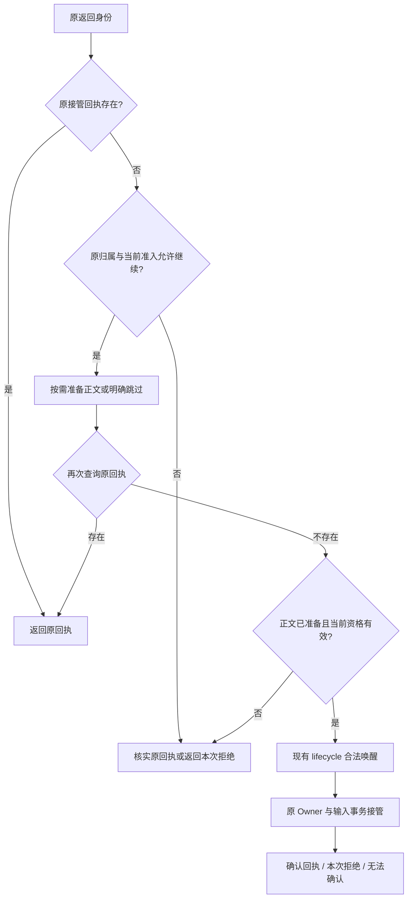

# Octopus 架构约定与未完成范围

> **Status:** implemented — 当前架构、数据演进和接口约定；七项执行扩展仍暂停，部署状态另行核验。

本文合并架构执行与账户简化工作中仍有效的决策、理由和行为边界。
当前约定直接在所属章节修订；实施顺序、逐轮访谈和已被替代的状态保留在 Git
历史，不再追加到正文。文档中的支持范围不授予代码实施、发布或生产数据清理权限。

[待处理返回接管设计](#待处理返回接管设计未实现)已确认职责与接口方向，尚未实现；
该小节描述拟议变更，不改变本文其他章节记录的当前能力。

## 文档职责

| 文档 | 唯一职责 |
| --- | --- |
| 本文 | 跨模块的架构约定、取舍、明确保留项和暂停工作的恢复条件 |
| [architecture.md](../architecture.md) | 当前组件地图、接口和数据模型概览 |
| [current-storage-format.md](current-storage-format.md) | 当前格式声明、存量验证及当次发布交接 |
| [backup-and-migrate.md](../backup-and-migrate.md) | 完整备份与账户搬迁的范围、命令和恢复操作 |
| [testing.md](../testing.md)、[local-wsl.md](../local-wsl.md) | 验证门禁、证据复用及本机发布操作 |
| [Wiki 当前合同](wiki-development-summary.md)、[知识请求](../knowledge-requests.md) | Wiki 领域行为及跨请求工作、返回身份与通知规则 |

实现事实以相关源码和行为证据核对；上线状态以实际服务及发布回执核对。
较新的文件日期、计划状态、旧测试数量都不能替代这两项证据。

## 所有权与故障模型

| 事实 | 权威与责任模块 | 消费者边界 |
| --- | --- | --- |
| 本代执行资格与旧代退出 | `main`、安装锁、`ServiceHealth`、受管 supervisor | 捕获同一代的真实执行句柄；历史 PID 不授予停止权 |
| 接纳、顺序与执行绑定 | `client_submissions` 和 Database 业务事务 | mailbox 传命令，界面读取投影，不再保存另一份待执行正文权威 |
| 活动执行、问题与生命周期意图 | 每会话一个 `SessionOwner` | `SessionManager` 保留入口、注册、跨会话配额及原 Owner 失败接管 |
| 业务结果 | 主库精确 terminal 及其输入关联 | 通知送达、HTTP 等待者和资源退休分别取证 |
| Wiki 账本归属与准入 | Registry 的注册、Construction 与生命周期 | 普通 Store 借用已准入对象，不自行选择 owner 或触发全量恢复 |
| Wiki 文件效果 | History 原像、prepared/applied、operation receipt、observer inbox | job item 引用效果证据，模型文字和取消确认不能替代实际效果 |
| 账户秘密与配置 | UserManager、账户 DEK、保存的 agent 配置 | 默认值仅用于新资源；普通启动、更新和搬迁保留用户设置 |

主库使用一个写连接和明确的短事务。`Database.transaction()` 统一连接锁、驱动与
游标结束、总期限及 COMMIT/ROLLBACK；SQL helper 接收事务，不重入公共事务或
跨调用留下未提交 SQL。接纳、claim、终态结算各自完整提交后才发布成功或外部动作。
取消等待者与取消已接管命令不同；取消不能丢失仍在运行的驱动操作。

主库使用 FULL，Wiki 权威连接使用 EXTRA。正常 COMMIT 返回确认提交；存储或
提交结束失信进入统一 fail-stop，不在同代独立回读猜结果、补写或重放业务。
`RETURNING` 只返回事务内的 SQL 结果，提交前不能当作对外成功证据。
接受一个权威存储故障中断本代全部会话的代价，以减少失信后多处在线恢复。
业务冲突、正常取消、认证失败和通知断线仍按各自语义处理，不泛化为 fatal。

受管启动在旧代真实退休、当前恢复完成后才开放 producer 和写入入口。代际准入
使用冻结旧代范围与退休证明，不能靠 managed 标志、隐藏 unknown 或历史 PGID
扫描放行。standalone 不承诺清理未知历史进程。正常发布自然排空；fatal 的强制
退出不替代发布过程。相关实现见 `service_installation.py`、`service_scope.py`
和 `service_health.py`。

## 输入、完成与资源退休

输入事实、送达证据、业务提交、通知和资源退休必须分开。明确拒绝未接纳的请求
不创建输入行，条件恢复后用户可主动用同一 ID/内容重提；已接纳或 unknown 的
身份仍严格去重，客户端不自动重发 POST。同 ID 不同正文冲突。恢复沿
`recovery_of` 保存唯一直接后继，unknown 不改记成功或自动变回待执行。
Dismiss 只改变提示处置，不证明原工作已停止，也不改变原结果或当前准入资格。

Owner 串行修改活动状态；慢准备、spawn、stdin、reader 和退休在受管 I/O task
中执行，结果携带原 request/attempt/work/backend 身份回报，不能在出队时改绑
到“当前请求”。Owner 不等待另一个 Owner；广播负责通知，不驱动第二套权威终结。

| 接口事实 | 保证与限制 |
| --- | --- |
| `SubmissionReceipt.disposition` | 表达是否接纳；取消等待者不撤销已接管工作，重复 delivery 返回原 receipt |
| `RequestCompletion.input_request_id` / `request_id` | 区分原输入与携带请求；未确认发送的 steer 不能套用主请求成功 |
| `recording_state` / 业务 outcome | terminal 事务确认后保留 committed；缺少确认时返回 unavailable，不伪造成功或失败 terminal |
| `notification_state` | delivered、failed、unavailable 独立于业务结果；通知失败不抹掉已提交结果 |
| 原 execution/preparation/reader/retirement 引用 | CloseWork、归档与撤权等待真实资源；外部关闭另行排空 publisher，不能反向等待正在调用自己的 subscriber |

执行输入只在 `SessionManager.initialize()` 的输入恢复、会话载入与 fork 恢复全部
成功后开放。数据库引用非空不证明就绪；未初始化、初始化中或恢复失败明确返回
`service_not_ready`，不保存、排队或启动输入。所有来源与 steer 共用持久接纳和
claim，没有无数据库执行分支；待执行队列只持身份与展示/调度投影，正文和附件
从原持久输入读取。结果记录、通知及资源退休仍分别确认，构造、监听、内存查询
和空资源关闭不依赖执行就绪。详见[输入接纳与恢复](../input-reliability.md)。

每个原 receipt 只有一个 completion Future。Delegation 在读取正文前固定原轮次
和嵌套分类；广播只上送问题，不独立结算 result/error 或保存第二份回复正文。
构建状态、App ask/SSE、Research、Wiki 和 scheduler 消费原请求完成事实。
App 的成功 `done` 还要求原正文通知前缀已送达；响应结束不直接释放执行槽位。

审计原执行结果时使用非空 `terminal_request_id` 及其唯一性，不按消息时间或
`request.content_id` 计数；复制的历史可以保留这些值而不代表新执行。原生父轮的
`turn.completed` 不证明 helper 已完成或父轮已消费其报告；有限已写记录观察不等于
等待活动 helper，归一化 wait 展示也不代替原始超时结果。当前支持范围与下方暂停
项目分开判断。

归档和 rewind 共用原 reservation、退休期限及失败释放。Owner 退出由 Manager
接管原对象与预留；关系冲突不免除已捕获 work 的清理。资源确认后仍需 seal/join
原 publisher；不能确认退休时保留原引用并进入真实故障出口。原 child 已成功而
正文随后丢失时，沿稳定返回身份告知父 work 交付失败，不改写 child 成功事实。

mailbox、控制入口及顺序 publisher 按实际内容计预算，背压到达 producer。
合法大命令可独占空控制通道；未接纳的容量等待者取消后不执行，Owner 失败释放
等待者。超时只结束等待，不丢弃原命令、句柄或数据库责任。

当前使用 Codex exec 与 Claude stream-JSON：Codex 新输入在运行中排队；Claude
按实际活动通道能力处理 steer，已到达的 idle 消息保留原身份。普通委托完成或
重启不自动归档；人工追问和 parent follow-up 是新 request/round，显式归档与
schedule 策略仍有效。可靠跨请求返回走现有独立工作机制；完整原生尾部及更强
的送达、授权切换保证仍属下方暂停范围，不能从 stdin 能力或首个 result 推断。
普通父会话不因等待独立工作自行归档；归档中断当前输入并撤销队列，合法新返回
可唤醒原会话，但保留已有 Stop 暂停且不重放取消输入。具体返回边界见
[Research 完成与投递](native-deep-research.md#6-researchmanager-async-job-like-bgdelegationsscheduler)。

退休责任覆盖启动时捕获的整个进程组，不能用直接 child 退出或管道 EOF 证明
所有 writer 停止；后代可重定向输出继续写入。保留未确认退出的 backend owner，
即使请求、assignment 或 executing 注册已经结束，也不能提前释放配额或允许 Wiki
重试。AppMutation.abort 同样依赖应用后端真实停止；正常退出与忽略 SIGTERM 的
后代分别验证，不能用自动丢弃 done task 的集合代替退休 owner。

BG 在 shell 和输出结束后固定原业务结果，再主动对原进程组执行 TERM、宽限、
KILL 和活跃成员退出确认；普通完成广播及父会话返回都在退休确认后发生。
正常收尾不设置取消原因，之后的取消与关停复用原清理而不改写成功结果。
记录、退休或投递失败均保留原 owner 和结果；退休先于结果持久化，存储失败
不能遗失 writer。后续取消或关停可重试未完成阶段；通知重试沿用原任务身份，
不重跑命令，也不重复已确认的记录或完成广播。关停无法排空时明确失败，不能
提前关闭依赖。覆盖范围限于启动时捕获的进程组，不追踪主动脱离该组的任意后代。

应用彻底删除由应用生命周期记录未完成阶段，关闭相关写入，再让原资源 owner
确认开发执行、BG、确切委派轮次、应用对话及后端进程组/reader 退休。会话归档、
删除或替换不得先抹掉仍承担清理责任的关联；缺失历史不补造。失败保留资料、应用行
及原身份，重启保持关闭并等待显式重试。成功后保留开发聊天原有行为，不设永久
只读；详细阶段与文件边界归 [applications.md](applications.md#5-rest-surface)。

当前 Research 投递已区分接纳错误：`AdmissionIntegrityError` 是效果发生前的永久
完整性拒绝；`SessionAdmissionBusy`、`SessionMailboxFull` 与配额拒绝表示可重试的
明确未接纳。丢失 ACK 后先核实原 source receipt；暂不可读或无可核实回执时保留
`unknown`，不把后来的拒绝当作早先未接纳的证据。永久拒绝与接纳未知都保留完成
报告；程序错误和 `SubmissionConflict` 保留原异常、诊断及原任务，不进入普通
重试循环。存储失信仍沿 fail-stop。恢复只观察原回执，详见
[Research 合同](native-deep-research.md#6-researchmanager-async-job-like-bgdelegationsscheduler)。
这些局部错误分类不表示三来源统一返回接管设计已经实施。

### 待处理返回接管设计（未实现）

状态：设计已确认，未实施、未运行实现验收。源码依据为 `0df8b78ec470c0186c0ef6bd758a3695f1e686d1`，
对比基线为 `before-takeover` 的 `88d2284b2b2493001be2e945df375d7a228ccc1f`。
本设计只覆盖 BG、Research、委派终态及委派问题的返回接管。

#### 问题与选择

基线中的三个来源主要直接调用 `start_message`：BG 记录投递失败，Research 保存
`injection_status`，委派用内存中的 `_terminal_injected` 防重。当前版本新增持久
接管回执、稳定返回身份和原工作归属校验；`b19f6f9` 又集中合法返回的归档唤醒。
这些保障继续保留，改进对象是三个来源重复编排同一段会话接管协议。

当前入口见 [BG](../../server/sessions/turns.py) 的 `deliver_bg_result`、
[Research](../../server/research/manager.py) 的 `_inject_report` 与
[委派](../../server/delegations.py) 的 `_inject_terminal` / `_inject_question`。
[resolve_task_return](../../server/sessions/lifecycle.py) 已封装归属与唤醒，但调用者
仍需拼接原回执查询、Owner 判断、提交和确认丢失后的处理。

采用一个接管入口与按需正文准备函数。两阶段入口会让调用者继续承担调用顺序；
正文/正文引用联合类型则会让会话接管模块认识来源材料的不同读取方式。按需函数
保留材料读取的来源归属，同时让共同模块拥有完整接管顺序。

#### 责任、权威与提交点

| 责任 | 所属模块与可观察事实 |
| --- | --- |
| 本次返回的接管协议 | 现有会话模块；查询原回执、判断资格、按需准备、合法唤醒及提交 |
| 正文、是否仍需返回 | BG / Research / 委派；只准备自己的材料，不决定会话是否具有当前接管资格 |
| 重试节奏、放弃条件、来源结果结算 | 各来源现有交付任务；共同入口不循环重试、不启动后台观察任务 |
| 归档成员关系 | 现有 lifecycle；恢复原会话，保留派发暂停，不重放已取消输入 |
| 输入接管与去重 | 原 SessionOwner 与运行数据库的输入事务；完整输入和接纳事实提交后才确认 |
| 后续处理、结果记录、通知、执行退役 | 各自现有权威；继续观察原 `SubmissionReceipt`，不新增完成 Future |

会话唤醒与输入接管仍是两个提交点。本次没有新接管输入，不证明此前没有发生
合法唤醒；不得自动回滚归档成员关系，也不得将两者描述为一个原子事务。

Wiki 返回继续拥有请求组聚合、派发代次、原输入终态和 outbox 交接协议；schedule、
App、人工输入继续使用现有入口。本设计不引入通用任务框架、执行表、持久队列、
新恢复流程或 provider 传输变更，也不恢复下方暂停项目。

#### 接口与调用合同

下列为接口草图，名称可随实现约定微调；所有值只在本次调用内使用，不另行持久化。

```python
@dataclass(frozen=True)
class ReturnTarget:
    session_id: str
    source: Literal["bg", "research", "delegation"]
    delivery_id: str
    work_id: str | None
    owned: OwnedTaskContext | None

@dataclass(frozen=True)
class ReturnBody:
    prompt: str
    question_session_id: str | None = None
    question_id: str | None = None

async def admit_return(
    self,
    target: ReturnTarget,
    *,
    prepare: Callable[[], Awaitable[ReturnBody | ReturnSkipped]],
) -> SubmissionReceipt | ReturnRefused | ReturnUnconfirmed:
    ...

# 来源只描述原身份与材料准备，不查询会话内部准入状态。
result = await sessions.admit_return(original_return, prepare=prepare_reply)
```

`ReturnTarget` 由可信来源按原记录构造，不能直接承接外部请求字段。现有 delivery
命名保留：`bg:{task_id}`、`research:{job_id}`、`agent-terminal:{work_id}`、
`agent-question:{work_id}:{question_id}`。目标会话、work 和 owned binding 必须相符；
缺失 binding 不妨碍确认已有回执，但不能用于创建新输入。

`prepare` 每次调用至多执行一次；已有回执或确定无法新接管时可以不执行。它可以
异步读取并构造正文，但不得提交来源结算、启动执行、发送通知或修改授权。并发
调用与来源重试可能重复准备，因此它必须允许重复读取。运行时不持有 Owner
mailbox、生命周期锁或数据库事务来等待这个回调。

`ReturnSkipped(reason)` 明确表达来源不再需要新投递，例如问题已经关闭；空正文
不代表跳过。问题关联字段必须成对提供，仍由 Owner 在实际执行前检查有效性。
委派的子会话已删除时，准备函数沿现有语义产生 `reply_unavailable` 正文；子轮次
成功结论不变。会话仍存在但精确 terminal 缺失属于完整性错误，不伪造空回复。

#### 一次调用的顺序



1. 先用原 `session_id/source/delivery_id` 查询回执。已确认的原接管优先于当前
   Owner 失败、来源关闭或材料缺失；该快路径不运行回调、不唤醒会话、不重开输入。
   已撤销输入的原回执仍只供观察，不能重新入队。
2. 未找到回执才检查原归属与当前准入。准备前的检查不授予跨 `await` 的许可。
   调用 `prepare` 后再次查询原回执，覆盖准备期间另一次调用已经接管的情况。
3. 准备结果为跳过时，完成上述回执确认后返回本次拒绝。正常正文沿现有 lifecycle
   校验并恢复原目标；在恢复等待之后再次确认原身份与资格，提交由原 Owner 最终裁定。
   慢准备结束前不预留执行资源，也不提前持久化新的输入。
4. 接管只使用既有输入事务。并发唯一性和实际提交正文的 digest 冲突仍由该事务及
   Owner 裁定，不新增每 delivery 的锁、队列或注册表。普通重复回执查询无需重新
   生成正文；实际提交遇到 `SubmissionConflict` 时则必须保留冲突，不能回查后吞掉。
5. 拒绝、跳过及可确认的交接异常出口在存储可信时核实原回执；查询不到只代表
   当前观察中没有证据，不是另一在途提交不会成功的证明。回执查询不是新的接管。

#### 结果与错误语义

| 返回或异常 | 判定依据与调用者合同 |
| --- | --- |
| `SubmissionReceipt` | 只返回已确认接纳的原 receipt；不推断其执行成功，来源继续使用原 completion 观察后续结果 |
| `ReturnRefused(reason)` | 有证据表明本次没有新接管；原因限定为 `source_withdrawn`、`binding_unavailable`、`destination_unavailable`、`admission_closed`、`capacity`、`busy` |
| `ReturnUnconfirmed(cause)` | 可靠的原回执观察暂时不可用，或进入提交交接后未取得确认；保留原身份与原因，不推断未接管 |
| `SubmissionConflict` | 实际提交正文与原身份冲突，原样传播；不能转为 duplicate 或普通重试 |
| 准备函数的程序/完整性错误 | 原样传播，不转成 skipped、refused 或接管成功 |
| `CancelledError` | 原样传播；只停止等待，已交给 Owner 的 Submit 继续由原 Owner 负责 |
| 存储失信 / `ServiceUnavailable` | 沿现有 fail-stop；不在同代读取回执猜结果，不转换成普通 unconfirmed 重试 |

分类必须结合发生阶段。已知容量拒绝沿 `SessionMailboxFull` 识别；归档/fork 忙和
生命周期资格拒绝在其产生点使用明确业务分类，可用兼容现有捕获的 `ValueError`
子类，但不能匹配异常文案或把任意 `ValueError` 当拒绝。初始读取的已知临时容量/
期限失败可表示无法确认，不能据此推断没有输入。

在提交交接处，`SessionOwnerUnavailable` 或确认链路中断先尝试核实原回执；有
可靠回执就返回它，否则保留无法确认。其他未分类异常原样传播，不建立
`except Exception -> success/refused` 的兜底规则。普通异常未被包装也不证明未接管。

来源根据拒绝原因保留原有重试策略：容量和暂时忙可以再次尝试；资格或来源决定
是否放弃由其原交付任务判断。它们不得用后一次调用的拒绝抹掉此前未确认尝试。
停止观察时保留原材料与准确的未确认说明，不改变来源业务结论、不更换 delivery
身份、不重新执行原任务。这里的“接管无法确认”不是 `RequestCompletion` 的执行
结果未知，也不是新增的数据库状态。

#### 来源接入与旧路径删除

| 来源 | 保留的职责 | 替换与删除 |
| --- | --- | --- |
| BG | 已完成输出、prompt 组织、交付循环及停机条件 | `deliver_bg_result` 仅作来源转换；回调改用三类结果，删除 bool 对拒绝/未确认的混合表达及共同接管编排 |
| Research | 报告状态、是否仍投递、queued/processing/processed 投影、原 receipt 的完成观察 | `_inject_report` 改用单入口，删除自行查询回执、恢复会话和读取 `_admission_closed` 的接管分支 |
| 委派终态/问题 | 精确正文读取、问题是否有效、原轮次结算、`_terminal_injecting` 的来源重入保护 | 两个入口共用 `admit_return`，删除 `_return_context` 及重复的 Owner/准入/确认编排 |

入口放在现有 `sessions/turns.py`，值类型与 receipt 放在 `sessions/submission.py`；
`SessionManagerBase` 补齐所属调用合同。`resolve_task_return` 及其归属、唤醒检查
转为会话模块内部实现；保留被 Wiki/schedule 使用的 `source_receipt` 和通用
`start_message`。不顺便迁移 Research 的进度观察或完成消费者。

实现完成的删除标准：三个来源不再需要按顺序调用 `source_receipt`、
`resolve_task_return`、`start_message`，也不再通过 `_admission_closed` 等内部字段
解释一次接管。来源仍有重试循环是预期职责，不以抽取循环代替这项标准。

#### 验收与实施界限

依赖属于 local-substitutable：使用现有临时 SQLite 和可控本地执行替身，通过
同一接管入口观察真实输入行、原回执、模型启动与来源记录。不新建 Repository
或 mock 掉最终接管事务。以下是拟实施时的验收，不是本次已通过的测试结果。

| 注入场景 | 必须观察的事实 | 已有覆盖入口 |
| --- | --- | --- |
| **首个反证：接管提交后丢失确认，随后 Owner 失败，再投递同一返回** | 返回原 receipt；仅一个输入；来源结论不变；重复确认不准备正文、不唤醒 | `test_durable_independent_returns.py`、`test_source_return_owner_failure.py`、`test_delegation_return_retry.py` |
| 两个同身份调用并发准备 | 准备允许重复，接管只有一次；实际提交的不同正文冲突不被吞 | 前述持久返回测试与新的公共入口竞争场景 |
| 已有回执，委派正文随后删除 | 只确认原接管；不存在原回执时仍按原规则发送正文不可得说明 | `test_delegation_text_deletion.py` 与公共入口场景 |
| 准备/恢复期间归档、撤权或 work 关闭 | 原身份不变，最终资格复核生效；合法恢复保留 Stop，取消输入不重放 | `test_research_session_return.py`、`test_bg_session_return.py` |
| 容量拒绝、来源跳过、问题在等待中关闭 | 本次结果准确；来源决定重试；失效问题不启动回答 | `test_delegation_return_retry.py` 与公共入口场景 |
| 等待者在提交交接后取消 | 取消不撤销 Owner 命令；以后观察仍关联同一输入 | `test_submission_recovery.py` 与公共入口场景 |
| 正文错误、明确冲突、提交失信分别出现 | 不吞错误、不猜结果；失信保持 fail-stop，重启不自动重放 | `test_submission_recovery.py` 与公共入口场景 |

保留各来源的实际接入与结算断言；公共接管场景集中到一个测试面后，才删除被
完整替代的 helper 形状测试。每项检查只安排一个执行者，受影响检查与提交门禁
遵循 [testing.md](../testing.md)。本次仅写设计与核对文档，不创建上述入口、修改
生产行为或声称回归已通过。

## 公开接口与账户配置

- 全局新建会话或 schedule 显式指定所属 `agent_id`；agent-scoped URL 提供该
  身份，MCP schedule 从已验证会话确定 owner。`session_id` 的执行目标用途保留。
  CLI handoff/import 仍使用其现行账户归属逻辑，不因没有网页入口而删除。
- 外部 WS 发送、控制使用当前请求/命令及目标身份；缺身份明确拒绝，不补身份执行。
  UI 只消费完整 `dispatch_state`，保留 generation/revision 防乱序；活动状态
  缺失或畸形不伪装为空队列，归档详情不创建 live Owner。
- 旧工具批准链已退出。当前问答、完整回答和取消正常工作；历史批准正文可只读
  展示，旧动作按不支持拒绝，不重新启用另一套审批或改写工具设置。
- Wiki 新请求使用 `auto`、`read`、`maintain`。HTTP 使用 `/read-many`、
  `/maintain` 等当前路由；MCP 工具 `read_many` 名称保持，不能按字符串一起删除。
- 正式会话 MCP 使用 HTTP scope；无 session 的 stdio 装配保留参数检查与诊断
  用途。它不是 HTTP 失败后的自动接管，也不豁免当前账户和工具授权。
- 空安装以 setup 证明创建首管理员、账户 DEK 和有 owner 的默认 agent，整个
  账户聚合同事务提交。响应丢失后走正常登录，不重新开户或生成密钥。
  未开户/缺证明不开放无账户业务；非空安装时代数据拒绝启动并保留原件。
- 旧安装接管、memory handoff、token rotation 及专属在线恢复已退役；账户登录、
  密码修改、bearer 撤销、master key、当前 connector 锁和 refresh 仍保留。
- 已有 agent 的名称、persona、模型、强度、速度和工具选择由用户控制。新默认值
  只用于创建，不在启动、版本更新或搬迁时回填。

配置与授权在所属模块统一解析。后台查询中的空 owner 不等于可接受的用户业务
身份；按调用边界校验，不全局替换空值。保存的 canonical 授权根固定比较，访问
路径仍解析 symlink；后来出现的链接不能扩大原授权。App proxy 保留完整多值
query，写桥检查的目标必须与下游执行相同，包含重复值与空值。

MCP 工具调用要求当前授权；正确签名的退休 scope 只可 DELETE 它初始化的确切
transport，完整 scope 含账户、会话、installation、work 和 run lease。新 lease
不能继承旧 transport 的清理权，退休 POST 仍拒绝。核验实际 SDK transport 释放，
不只看 HTTP 状态；401 须区分 method、route、runtime PID，后续清理拒绝不改写
已经完成的业务结果。工具启动失败可能没有 `is_error` 回包，缺少错误行不证明可用。

同 kind 的 connector MCP 是进程级实例；即使 token 命中缓存，也先验证本次
installation 和 owner。ConnectorManager 负责该 installation 的持久刷新与锁；
凭据新鲜度不替代调用权限。外部登录 await 前后的目标 credential owner 都须有效；
`user_id=None` 的后台无过滤查询不等于只选无 owner 记录。
Connector OAuth 在本地安装绑定前可取消，回调单次领取；普通失败重新发起连接。
十五分钟 TTL 限制回调领取，领取后的网络操作使用各自超时，不反向恢复已消费的
回调；取消与本地绑定由原 login 的锁确定先后。

## 当前数据与存储演进

演进基线是实际运行代码能正常使用的完整数据集。保全账户、知识、用户文件、密钥、
归属及仍有效的状态/效果；不因取消旧 API 或不搬旧聊天而删除源端资料。
旧记录在核验、效果收束及当前责任交接后可退出，不永久保存原始请求影子档案。
旧格式 Wiki 任务的限定清理同时要求“已结束”和“责任已收束”；终态名称或日期
不足以判断，不删除正文、现有来源依赖、当前任务或未决效果。实际清理另受操作授权约束。

长期只维护一种当前表示。新空库创建完整 DDL；已有库启动前等值检查当前 marker，
不匹配即拒绝，不自动建空库掩盖问题，也不维护历史升级链。marker 只防错配，不能
证明内容完整。只有结构或语义变化才改 marker，纯代码优化不改。

当次发布负责旧 writer 退出后的存量检查、必要有限转换和结果验证。当前完整声明、
转换边界和验证入口统一在 [current-storage-format.md](current-storage-format.md)，
这里不重复版本号或发布步骤。跨数据库与文件不构成全局事务；部分完成或提交未知
保持业务关闭，按实际持久事实前向恢复。使用兼容当前数据的代码恢复，不回灌旧库
覆盖新文件，也不新建第二份正式知识库。交接与恢复责任结束后，临时转换及其专属
夹具退出；未来格式变更由未来变更承担，不承诺任意旧库/旧包直接打开。

秘密正文由 `credential_secrets` 唯一保存；恢复关系以 `recovery_of` 保存，
对外派生后继信息。删除旧物理列或接口时同步生产者、消费者及测试，不按同名字段
全局删除，不把旧 rejected/unknown 转成可执行或已成功事实。

## 文件归属与长输入

新附件和长输入使用账户下的 `attachments/<session_id>/` 与
`large-prompts/<session_id>/`。上传、下载、发送校验、fork 引用/复制、准备、重试
与清理保持同一 owner；不逐请求改全局 Settings。

存量全局文件按实际 owner 和引用交接；归档会话、fork 后代及原生 transcript
中的绝对路径引用也须处理。归属不明先保留。旧 writer 退休、内容与引用验证后
才能删旧位置；删会话本身不证明文件无人使用。正常新写入应符合安装资源声明，
不能靠补 marker、删除有效 marker 或关闭检查绕过归属问题。

Codex 对话和重试沿现有传输：拼装后的 prompt 按 UTF-8 字节计，`<=102400`
使用 argv，`>102400` 完整写文件并让模型读取；用户原文完整持久化。这是明确
保留的选择，账户路径修正不重新打开 stdin 改造，不恢复票43的完整 argv/env
预算项目，也不扩大到 one-shot。运行参数与诊断保留可读信息，只掩码实际秘密。

凭据的 `CODEX_HOME` 同时保存认证和原生会话。重新授权借用已有目录；取消、
provider 失败和 spawn 失败不授予删除该目录的权限。用预存 rollout 验证这些
清理出口，不能只验证新建空目录。诊断须区分仍可重读的完整原文、历史中确实发生
的重读和已丢弃的字节；显示预算截断本身不证明原文丢失。

## Wiki 的恢复与效果证据

Registry 统一 Store 创建、注册、冷恢复与准入。新注册只在完整账本和 filesystem
binding 持久化后发布配置；已有配置丢失账本时保留配置与正文并关闭写入，不自动
建库、重造身份。原注册命令重入先验证已有 binding。一次 Construction 使用尚未
公开的候选 Store 完成 observer → history → 索引 → job 恢复，再公开对象；普通
请求不反向触发恢复，不增加独立 recovered 标记或常驻恢复循环。

health 只在冷生命周期绑定；换代前关闭准入并确认 constructor、receiver、Store
退出。旧 observer/journal 不静默接到新 health。存储层隐藏实际连接的持久性设置
和错误分类；Registry、History、job execution 分别承担生命周期、文件效果与任务结算。

文件修改/删除保留同步后的 blob/prepared、实际效果及父目录同步、applied/receipt。
取消由一个 owner 依次表达意图/撤权、释放锁、join 原 writer、核验效果、结算；
pending 表示仍在停止，confirmed 不表示业务成功。恢复不调用模型或重放工具。
job item 使用 typed JSON 与精确 ExecutionRef，同一 attempt 的多批不能混结算。
缺少原执行引用时保留 attention，不猜测从未执行。

通知先以原身份进入主库并提交，再 ACK Wiki outbox；重送幂等，通知失败不改已提交
效果。来源授权要求实际正文及版本/身份/覆盖证据，目录或 ingest 摘要不能替代。
移动和 reread 的身份、路径、revision、字节来自同次读取，以稳定 output_doc
定位结果；旧路径被其他文档占用不能污染其前像。历史展示不自动 restore。

优化保留独立断言：纯进度只使相关投影失效，成员/资格变化才核对 membership；
坐标缓存只持有确切 revision 的有界不可变坐标/hash/章节标签，每次读取新 snapshot
并核验当前权限，不缓存正文、可变 tokens 或授权。`no_change` 仍核验正文、版本、
权限、覆盖并生成真实回执。标题、来源章节与锚点来自同份 CommonMark 结构。

外部文件移入尚未观察的新目录存在身份盲窗；使用现有诊断与显式核对入口，不承诺
靠扫描或哈希重建从未取得的身份。具体领域合同和成本证据归
[Wiki 当前合同](wiki-development-summary.md)，不重复维护另一套任务清单。

## 账户搬迁的开发约定

`server.portability` 提供一个公共离线导出/导入实现，CLI 是薄入口，各领域维护自己
的选择、排除和恢复规则。同版空数据目标、当前 home 布局及可变 home 前缀是支持
边界；用户侧范围和操作步骤只维护在
[账户导出与导入](../backup-and-migrate.md#account-export-and-import)。

每次按真实账户归属、资源注册和目录收集，不能写死今天的应用名、vault 位置或数量。
普通内容增长自动纳入。新增持久类型、字段/关系、根或格式时，同次变更更新
`server/db/portability.py`、`server/portability.py` 或 `server/wiki/portability.py`
的相关规则，明确排除项并验证往返；不预造迁移插件框架。

源端只导出稳定资料：未决写入交原 owner 收束；稳定副本完成后恢复源端，再压缩。
导入先核验，再私有暂存、重绑明确的系统路径和本机身份，持久化后启用。不以单库
一致性冒充跨资源快照，不扫描改写任意正文/第三方代码，不把源执行过程搬到目标。

账户搬迁专项的隔离验收覆盖首次导出、增长后再次导出、源端离线后的独立导入、
原账户登录、agent 配置/memory/Wiki、应用依赖重装后的数据读写，以及中断拒绝。
专项用例、夹具和审查副本按用户要求退役；这是保留的历史验收结论，未来语义变更
仍需当次验证，不免除现行权限、完整性与恢复测试，也不证明生产曾执行搬迁。

## 暂停范围与恢复条件

原执行票22、23、24、28、31、42、43整票暂停；它们不是普通待办，不因其他改动
交付或技术依赖满足而自动恢复，也不进入当前发布门禁。这里的票号属于原架构执行
计划，与已经完成的账户搬迁专项无关。

| 原执行票 | 尚未承诺的完整责任 | 直接依赖 |
| --- | --- | --- |
| 22 | 本次 CLI 调用、迟到 idle 消息及 held 资源的完整收尾验证 | 已完成的 Owner 基础20 |
| 23 | 原 held 资源退休后才安装新请求绑定，完整权限切换 | 22、已完成的配置捕获52 |
| 24 | 每个输入/问题通道的真实送达证据与慢发送期间控制 | 已完成的输入21、23 |
| 28 | 按送达证据原子结算本轮输入集合与 terminal | 21、24 |
| 31 | CLI、输入、独立返回与会话保留的组合验收 | 已完成的27/30/25/26、28 |
| 42 | 指南与模板完整反映本轮真实能力，保全自定义 persona | 23 |
| 43 | UTF-8 输入预算与最终真实 spawn 边界一致 | 21、23 |

恢复须用户确定产品范围及维护责任，并先验证 provider 能支持拟承诺的行为。
不以静默等待、强制 wait 提示词、自动 exec/resume 报告、provider 补丁或旧实验
替代协议保证。恢复顺序为22→23→24→28→31；42/43在23之后按文件归属安排，
31不是42的额外依赖。

以下保留恢复所需的验收问题，不将目标写成当前已交付能力：

- **22：调用与资源。** 分别观察内容项、本轮 result/turn 终态、EOF、receipt 和
  退休。首个反例是正文已显示而工具尚未收齐，随后 receipt 完成、idle 到达并
  Stop held 资源。partial、usage、错误与原身份保全；旧 App/委托响应不重开，
  已知失败不被父 success 掩盖，Codex 不承诺调用结束后的原生尾部。
- **23：先退役后安装。** R1 已返回但进程 held，R2 入队同时发生旧 idle/Wiki
  调用/Stop：先撤旧 lease 并 join 原资源，再安装 R2 context/WikiTask；原 grant
  不延长或转绑。新逻辑请求用新进程/lease 并 resume 历史，同一活动 Claude
  请求的 steer 保留。额外启动成本和可能中断未到达尾部是明确取舍；退休 CLI
  不等于取消独立 bg/Research/delegation work。
- **24/28：送达与结算。** 原 argv、stdin 和 Answer 通道分别给证据，不强行统一。
  一个主输入及一个已确认 steer、另一个未知 steer 与 Stop 交错，再在提交两侧
  中断：仅可靠送达集合与唯一 terminal 同事务结算。pipe drain 不冒充 provider
  确认，未知不自动重发，迟到确认/idle 不扩大已结算集合；控制能接管慢发送。
- **31：消费者组合。** 原 receipt 返回后，idle、新输入、旧 Stop 与独立返回
  交错：旧结果/身份不变，后续输入一次接纳，ACK 丢失仍幂等，普通委托可追问且
  显式归档有效。验证 one-shot、人工优先及最后资源释放；缺口回原负责模块修正，
  集成层不增第二个状态机或父报告完成门。
- **42：能力与指令。** 对比普通请求及无 Wiki/MCP leaf 的真实装配，再变化授权：
  工具承诺匹配实际能力，静态预热不缓存动态 selection/权限，自定义 persona
  不被覆盖；新进程切换和原生尾部限制明确，必要 helper 结果与跨请求工作按
  各自真实生命周期处理。先测 prepare/扫描，再删重复工作。
- **43：外部大小边界。** 等字符数、不同 UTF-8 长度的正文叠加 env/指南，分别
  触发合法完整传输、接纳前拒绝及接纳后真实 E2BIG。涵盖单参数、完整 argv/env、
  Claude frame 和 Answer，原输入可核对；不截断正文、不增压缩或 prompt 缓存。

Codex app-server/HOST、完整跨 turn 原生子树、raw/trace 完成屏障、自动补报告、
动态 bearer、ACP/宿主池等不随常规修复启动。既有 controller 更新独立使用的短时
app-server 不按关键词删除。候选设计见
[app-server 迁移设计](../review/future.md#codex-app-server-scope)。

## Conventions 与验收

- 一个真实事实只有一个 owner；接口接管时同步全部消费者和删除项。保留承担
  不同职责的 quota、事务锁、文件锁、receipt/journal，不按名称或文件长度合并。
- 不为一般修复引入 Repository/PostgreSQL 抽象、Event Bus、Queue Manager、执行
  表、PDEATHSIG、状态机库、Wiki items 多表化、持久缓存或指南协商状态机。
  新机制须有具体需求和无法由现有 owner 承担的证据；这些既往取舍不是永久技术
  黑名单，需求或事实变化后重新评估，不能由局部修复自行扩大范围。
- 配置更新保全用户选择；动态授权在实际边界检查。已发布 Canonical Vault 仍是
  知识正文权威，框架 SQLite 称“运行数据库”，避免用“主库”混指两者。
- 用调用者实际接口验证正常、拒绝、竞争/取消和提交中断。命中原 work 的真实
  阶段，分别取接纳、送达、提交、通知、退休证据；不靠额外 sleep 拼顺序。
- 测试随被替代行为调整，保留独立拒绝、恢复及共享 fixture 消费者的覆盖。有效
  同版证据复用，命令和门禁只维护在 [testing.md](../testing.md)。源码、隔离验证
  和生产上线分别陈述，历史数量不作为新候选通过证明。
- 机制测试不证明自然模型质量、token 收益、生产 p95、峰值内存或任意并发组合。
  效率结论需要同输入同版本测量，可选质量/规模评测不扩大默认发布范围。
- 热迁移、任意跨版本导入、双机同步、账户合并、额外 backend 和阅读器集成按各自
  产品需求另定范围，不借文档合并恢复暂停项目或新增实施授权。

## 决策与历史证据

当前约定在上文维护；需要原讨论、实施顺序或逐批验收时查固定版本：

- [原架构执行计划](https://github.com/Danuvius152/Octopus/blob/cf98ecb75d1aa741c31292977ac9d83e727d366f/docs/plans/minimal-architecture-execution-20261020.md)：Owner/事务/输入/Wiki 架构的取舍、票20和其余批次验收范围。
- [原账户简化与搬迁计划](https://github.com/Danuvius152/Octopus/blob/cf98ecb75d1aa741c31292977ac9d83e727d366f/docs/plans/architecture-simplification-20261023.md)：接口退出、存储政策取代关系、搬迁专项验收与当时的发布缺口。
- [Owner 范围失控复盘](../post-mortems/2026-10-21-session-owner-scope-creep.md)、[开户退役复盘](../post-mortems/2026-10-24-account-setup-retirement.md)：保留触发条件、原因及可复用的回归经验。

这些证据限定于其记录版本。本文不复制旧“尚未实施/待发布”状态，也不从历史
验收推导今天的生产版本；本机发布按实际配置和回执核验。
