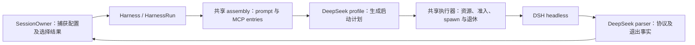

# Codex / DSH 兼容与 DeepSeek backend 可行性方案

> **Status:** proposed — 保留 Claude 原生支持与 Codex，评估以 API key 增加 DeepSeek backend；DSH 接口按适配度选择，尚未实施。
>
> **2026-10-23 选型修订：** 用户明确 headless CLI 不是必须。§1.3–1.5 重新比较
> ACP、SDK 与 headless，不再以“先做 headless、失败才看 SDK”为前提。下文原有
> headless 的详细设计保留为条件方案；其中 argv、stdin、八类投影、final/exit
> 聚合与原生能力限制不约束另两条路线。共同的账户、授权、配置、结果和资源合同
> 继续成立。T0 必须选定路线并修订所有受影响章节，才进入实现。

**评估结论（2026-10-23）：Codex 与 DSH 共用 Octopus 的产品流程可行，DSH 接入
仍有必须验证的前提。** Codex 已有实现；DSH 应增加一个 `RuntimeProfile`，不需要
第二套 SessionManager 或执行框架。Claude Code 是已有原生后端，继续保留；用户
当前无法使用 Claude，因此不把其登录或实机测试设为本机实施前提。

这里的“兼容”是 agent、会话、MCP、memory、后台回报和应用等上层流程可以选择
Codex 或 DSH，且结果、取消、权限和持久化合同明确；不是相同 CLI 参数、相同工具
名称、原生历史互通，或所有原生功能一致。新增接入必须同时证明 Codex 不回归与
DSH 达到选定范围，不能把“注册 profile、协议可连通”当作完成。

本次核查基线为 `3d793d3326b749c171675d4349907a50b4f7b9b2` 及现有文档工作树，
覆盖 profile、执行器、凭据解析、模型 API、research 调用与前端分支。保留已有
未提交文档修改；本文是设计评估与实施安排，**不表示 DSH backend 已实现或通过
真实模型验收**。本次不安装、不调用模型、不提交或发布。

DSH 协议依据本机 npm 包 `@deepseek-ai/dsh@0.2.1-rc.2` 的 README、类型和已编译
源码；已复核 headless 事件投影，并补查 SDK/ACP 的服务入口与完成/取消合同。
阅读源码仅证明该包的协议形状，不等于配置桥、resume、工具限制或取消已经联调通过。末尾官方文档链接
便于追溯；其 `master` 会变化，不替代锁定包的兼容性证据。

## 1. 当前代码与原方案的差异

| 原方案的假设 | 当前事实与修订 |
| --- | --- |
| 新建约 600 行 `deepseek.py` 即可接入 | 保留 profile 方案，但去掉行数估计。启动资源、EOF 终态、调用方账户信息、配置 Literal、模型设置和完整前端都要进入同一交付。 |
| 在 `build_turn_argv()` 内写临时 YAML，再在函数里 `finally` 删除 | [run.py](../../server/harness/run.py) 的 `build_argv()` 用于无文件副作用的命令检查。renderer 返回后 CLI 才读文件，不能在 renderer 内创建或删除；由实际执行者持有启动资源，见 §3.2。 |
| `ctx.user_id`、`ctx.run_id` 已存在 | [TurnContext / OneShotContext](../../server/harness/profile.py) 均无这两个字段；`RunConfig` 才有 `user_id`。必须显式传账户信息，不能按 cwd 或 key 反推。 |
| 所有 MCP 共用一个 `OCTOPUS_MCP_TOKEN` | [assembly.py](../../server/harness/assembly.py) 已为每个 entry 生成 bearer，包含 installation、Wiki task、run lease 和 work 身份。必须逐 entry 使用，URL 也直接取 `entry.url`，不重建 `/mcp/ask` 之类路径。 |
| `final` 一律转成功 `result` | DSH 在轮内失败时也发 `final`，甚至携带此前的非空回答。成功需要最后一个 `turn_end.reason.kind=completed`、完整 `final` 和正常进程退出共同成立。 |
| stdout EOF 由 `run.py` 合成失败 `result` | 当前 `_read_stdout()` 在 EOF 关闭流；Owner 把无终态 attempt 判失败。DSH 若需要合成错误，必须在明确的进程结束接口实现，不能假称已有。 |
| `text` 直接持久化，`final` 只作结果 | DSH 普通事件字符串上限 8 KiB、整行 32 KiB，只有 `final` 不受此上限；直接存 `text` 会截断长答案，重复存 `final` 又会重复回复。见 §4.3。 |
| 无逐 token 输出，因此没有 activity | 协议帧仍可表示真实 activity；活动检测与 token 流式是两回事。不用轮询心跳伪造进展，见 §4.4。 |
| 换 key 要“新建再删旧”，未来补 PUT | 已有 `PATCH /api/credentials/{id}`，会清除失效状态。原地换 key 保留 agent/session 绑定，直接复用。 |
| 后端标签之外，给 `modelOptions.ts` 新增静态目录 | 目录来自 `/api/backends/{backend}/models` 与 `/api/backends`；[modelOptions.ts](../../web/src/lib/modelOptions.ts) 是通用合并器。不能再维护一份前端模型真相。 |
| 关闭 `agent-instructions` 可避免 Octopus 重复注入 AGENTS.md | [compose_system_prompt](../../server/harness/assembly.py) 并不加载项目 AGENTS.md。普通轮次应保留 DSH 项目指令发现，否则会丢失仓库规则。 |
| `diagnostic_environment()` 是通用脱敏 | 它在 [codex_activity.py](../../server/harness/codex_activity.py) 中设置 Codex 的 `RUST_LOG`；通用脱敏是 [diagnostics.py](../../server/diagnostics.py)，不可照搬。 |
| `danger-full-access` 下账户边界由 `confine()` 保证 | [workspace.py](../../server/workspace.py) 校验 cwd 和授权根，不拦截模型 shell/file 工具的任意路径访问；不得称为 OS 沙箱。 |

### 1.1 三个后端的现状与目标

当前 [BackendKind](../../server/models.py) 只有 `claude-code`、`codex`，
[注册入口](../../server/harness/__init__.py) 也只加载这两个 profile；没有已接通的
`deepseek` 后端。下表 DSH 一列是锁定包的 **headless 条件方案**，不是产品现状或
最终选型；SDK/ACP 的差异见 §1.4。

| 能力 | Claude Code：保留现状 | Codex：现有接入 | DSH：headless 候选目标 / 限制 |
| --- | --- | --- | --- |
| 运行方式 | `claude --print`，stdin/stdout stream-json，可保持进程 | 普通轮次 `codex exec --json`，结束后退出 | `dsh --profile headless --json`，每进程一个任务 |
| 忙时新输入 | `STREAM_JSON` 支持轮内追加 | 排队，当前轮结束后启动下一轮 | 排队；headless 不提供轮内追加入口 |
| 输出与终态 | partial/text/tool + 原生 result | item 事件 + `turn.completed/failed` | 提交后的块 + final；需结合最后 reason 与退出码判定 |
| 认证 | 已有 API key/OAuth 路径 | 已有登录凭据与 `CODEX_HOME` | 显式绑定 API key，账户私有 `DSH_HOME`；不复用 Codex 登录 |
| 继续会话 | 原生 resume | 原生 thread resume | 同账户、同 cwd 下采用精确 session id |
| 分叉 / rewind | 原生复制与 history replay | 原生 rollout 复制与 history replay | history replay；不宣称原生历史复制或跨后端 resume |
| MCP / Octopus 委托、schedule、bg | 已有装配与回报路径 | 已有装配与回报路径 | 渲染相同中立 entries，复用 Owner 与原始 completion |
| agent memory | 原生 memory 指向 canonical 目录 | 注入目录说明，由文件工具访问 | 同 Codex 的 canonical 目录合同，独立于 DSH 认证和历史 |
| 项目规则 / skills | 保留现有发现机制 | 保留现有发现机制 | 项目 AGENTS.md + DSH skills；具体 skill 的工具依赖另核实 |
| 原生 subagent | 已有事件适配 | 已有 collaboration 事件适配 | headless 投影不足，该候选关闭原生入口；是否接受此范围进入 T0 选型，不能推及 SDK/ACP |
| 模型控制 | 保留当前模型选项 | 本地 catalog、effort、service tier | 锁定包目录、effort；不提供未经支持的 service tier |
| handoff / pull | 有 transcript codec | 无 codec，不支持 | 无 codec，不支持 |
| 本机验证 | 离线回归；Claude 实机未执行 | 实施时复用/补齐 Codex 实机门禁 | 新增离线与显式 DSH 实机验收；当前均未因本文执行 |

依据是 [Claude profile](../../server/harness/claude_code.py)、
[Codex profile](../../server/harness/codex.py)、
[stdin 与启动行为](../../server/harness/run.py) 及
[`can_steer` 推导](../../server/routers/sessions.py)。产品能力由 profile 及已有
元数据推导，不新增一份手工同步的运行期三后端能力表。

### 1.2 共同接口不等于已经具备相同保证

以下差异需要进入实施和验收，不能用函数注释替代证据：

- **普通轮次的 tool mask：** Claude renderer 消费 `tool_allow/tool_deny`；当前
  Codex renderer 没有消费这两个字段。DSH bridge 的强制 allow/deny 是新增合同，
  不能声称现有 Codex 已等价支持。Codex 不支持的策略应在配置边界明确提示/拒绝，
  或在实际 CLI 支持验证后接通；不能静默接受成“已限制”。不为统一工具名另造运行时。
- **Oneshot：** `Harness.run_oneshot()` 注释称 tool-free，但 Codex renderer
  使用 `--dangerously-bypass-approvals-and-sandbox`，没有显式关闭原生工具、宿主
  MCP、skills 或项目规则。当前证据不足以保证零工具调用。双后端交付必须把 Codex
  与 DSH 的 oneshot 实际限制都验收，不能把现状当安全模板，也不能仅改成 read-only
  就称为 tool-free。
- **Research leaf：** Codex 当前启用 `read-only` 和 `web_search`，这不证明只剩
  web 工具；[leaf](../../server/research/leaf.py) 的 `mcp_servers=[]` 只证明本次
  Octopus 未装配 MCP，不证明 CLI 没有加载宿主配置。验收分别断言模型可见工具、
  强行调用的执行结果和真实外部副作用；本文 §6.3 的 DSH 严格 web-only 目标不能
  反写成所有现有后端已实现的事实。
- **请求指令：** `_make_context()` 已对 Codex 分离稳定 controller 与
  `turn_instructions`，其他 profile 则将当轮指令拼入 system prompt。DSH 可先
  使用这条现有装配路径，但必须证明 resume 后更新的 Wiki 权限/当轮规则生效，
  不是只更新模型与 effort。MCP 服务端当前授权仍是执行权威。
- **账户与准入：** 普通 turn 有 `RunConfig.user_id/authorize_spawn`；当前
  `OneShotContext` 没有 owner，`run_oneshot()` 也没有同等 spawn 授权回调。
  research leaf 当前未传账户。这里需要补齐捕获身份与实际准入，不能写成简单
  “沿用已有校验”后就漏掉这些消费者。

普通 Codex 已有的 agent、登录、会话和 native collaboration 应继续工作；能力
确实缺失时如实标示。上面发现的 oneshot 隔离缺口是共同合同的必要修正，不扩展
到重写 Codex harness，也不以 Claude 不可用为由删除其已有实现。

### 1.3 路线选择与不混用的边界

| 路线 | 判断 | 原因 |
| --- | --- | --- |
| 新增 DSH ACP 接入 | 当前优先验证的候选，未选定 | 已有 prompt 完成、取消/关闭、MCP 与配置合同；仍需证明标准事件投影足以支持 Octopus |
| 新增 DSH SDK / 原生 RPC 接入 | 直接参与选型，未选定 | 事件与原生子代理可观测性更完整；需自行关联入队、等待、结果及宿主退役 |
| 新增 DSH headless profile | 保留条件方案，未选定 | 有限进程较直接；不能为迁就现有 exec 引擎而预先放弃需要的交互/原生信息 |
| 把 DeepSeek 模型塞进现有 Codex 配置 | 不作为 DSH 接入 | model provider 可配置不等于协议、工具、历史、认证和能力相容；也无法获得 DSH 自身的行为 |
| Codex 普通轮次迁到 app-server | 独立设计，可与 DSH 协调公共接口 | 不是 DSH 的前提，也不阻塞 DSH；两者共享的输入、配置和退役接缝只维护一份 |
| 跨账户或跨请求的常驻服务池 | 当前不引入 | 采用 SDK/ACP 不等于必须常驻复用；每 attempt 隔离宿主可以继续保持原授权责任 |
| 自己直接请求 DeepSeek API 并实现工具循环 | 不选 | 会新增一套上下文、工具执行与恢复引擎，违背复用 harness 的目标 |

Codex 官方支持 [`exec resume`](https://developers.openai.com/codex/noninteractive)
及 [app-server 的 `turn/steer`](https://developers.openai.com/codex/app-server)。
后者属于另一条接入协议，不能由此推断当前 Octopus exec 会话已经能 steer。
忙时能力按实际接入判断：当前 Codex exec 排队，迁移后的 app-server 单独验收
steer；DSH headless 排队，ACP 一次只允许一个 prompt，SDK 入队不等于 steer。
不把 kill + resume 冒充轮内追加。

API、数据库保持 `codex`、`claude-code`，新增值固定为 `deepseek`；`dsh` 是 CLI
名称，不再另注册同义 backend。不同 backend 不互相采用 resume id、不转换或
合并原生历史；选择 DSH 开始新后端会话，共享的仍是明确授权的项目和 agent memory。
现有会话不因默认 backend 或 agent 设置变化而自动搬到另一后端，也不因 DSH
失败自动转向 Codex/Claude。

### 1.4 三条接口路线的实际差异

本机 `0.2.1-rc.2` 的 CLI 文档列出 `headless`、`sdk`、`acp` 三种 profile。
SDK/ACP 都通过 `dsh` 提供 stdio 服务，不要求将 Node agent loop 嵌入 Python。
SDK 库是否更省工作，要连同它自动启动进程、销毁、超时与当前 HarnessRun 所有权
一起判断；可直接使用官方协议时，不为了调用库再增加一层自制 Node 桥。

| 方面 | headless | SDK / 原生 RPC | ACP |
| --- | --- | --- | --- |
| 启动 | 每任务一个 `dsh --profile headless --json` | `dsh --profile sdk`，JSON-RPC stdio | `dsh --profile acp`，ACP stdio |
| 输入确认 | 没有独立 RPC 接受响应 | `session/prompt` 返回已入队的 messageId；没有将后续 assistant/turn 自动归给该 prompt | prompt 响应是完成后的 stopReason；不能将等待响应视为尚未发送，断连仍可能已执行 |
| 完成 | final + 最后 turn_end.reason + 实际 exit | `session/wait` 等根与正在推进的受管后代；成功响应不代替 Session 事件中的业务结果 | prompt 结算覆盖所述活动区间、受管后代与有序输出；仍需映射错误、cancel 与资源退出 |
| 追加输入 | 无轮内入口 | 可继续入队；不保证等于 Codex expectedTurnId steer，也无逐输入完成关联 | 同 session 一个活动 prompt，第二个会拒绝；由 Octopus 排队 |
| 取消和关闭 | 退役进程 | wire 无独立 cancel/session-close；shutdown 或退役隔离宿主，必须验证有界退出 | 有 session/cancel 与 session/close；取消本身不等于后代全部销毁，最终仍需 close/退役 |
| 输出信息 | 有界的八类投影，非 token delta | Session 事件、agent 状态、subagent.started/finished；子完成通知有本地性范围 | 提交后的文本/思考、通用工具、配置与上下文用量；无原始 delta 或 DSH 专有展示 |
| MCP 与问题 | patch 配置；Octopus MCP ask | profile 配置；wire 当前无原生审批请求，Octopus MCP ask 需验证 | new/resume 可携 stdio/HTTP MCP；有 request_permission，不能当作通用用户问答；elicitation 不支持 |
| 原生后代 | 当前投影不足，原草案关闭原生入口 | 信息较多；wait 不把 idle 且有 parked inbox 的后代视为仍在推进 | prompt/close 有后代责任，但标准更新不提供同等 DSH 专有展示；需核查子代理卡片所需身份 |

以上是锁定包的接口事实，未做模型或 loader 联调。ACP 的完成方法与 SDK 的 wait
均不能据名称宣称“任意未来后代都完成”；需要明确本请求支持的原生范围。

**选型建议：优先验证 ACP 与现有请求/取消合同的匹配程度；如果必要的原生身份、
事件信息或交互被其投影删掉，优先改评 SDK。** headless 仅在已选产品范围确实
只需有限任务执行、信息足够且总体维护成本更低时胜出。SDK/ACP 并不保证 token
流或 mid-turn steer，不能用协议名字承诺产品能力。三条候选按同一要求比较，
最后只实现一条 DSH 主执行路径，不保留运行失败时切协议的自动 fallback。

### 1.5 选型实验及与 Codex 的共同接缝

T0 使用已锁定包、临时根和本地假 provider，先验证最可能推翻推荐的场景；本次
仅完成文档/源码比较，没有执行下列实验。优先顺序是必要能力、完成/取消正确性、
信息完整性、维护复杂度，不能仅比较启动参数多少。

| 问题 | 选择所需的证据 |
| --- | --- |
| ACP 投影是否足够 | 多段文本/思考、长工具参数、工具错误、原生子代理及延迟结果走实际输出；列明每个现有消费者需要的字段，缺失的必要字段不能靠猜测补齐 |
| 结果能否对应原输入 | 一次 prompt、忙时第二次输入、根先结束/子后结束、先正文后错误、发送后断连；SDK 需验证 messageId 与活动归属，ACP 需区分未发送、可能已发和最终响应 |
| Stop 是否实际结束原工作 | 初始化、等待模型、等待 MCP ask、原生后代活动时取消；记录关闭/退出与无晚到副作用。SDK 没有 cancel 时检验整宿主退役，不把关闭 Python iterator 当停止 |
| 配置和身份是否完整 | 新建/resume 改 controller/model/effort，两个 MCP bearer、账户换 key、撤权、literal prompt、tool-free oneshot、只读 leaf；复用 §2.3 的配置实验 |
| 问题和事件是否阻塞协议 | Octopus ask→answer 与 Stop、审批拒绝、慢 UI/满队列同时发生；持续处理 response/control，有界失败，无静默丢正文或自动授权 |
| 运维成本是否可接受 | 锁定客户端/runtime 版本、正常退出/崩溃/升级、冷 resume；记录私有模块与兼容代码，而非仅估代码行数 |

Codex 的[迁移可行性文档](../review/codex-app-server-feasibility-20261023.md) §4.5–4.6
定义共享接缝：一个公共 Harness/Profile，一个资源 owner，各后端私有协议；start、
stream、stop 及可选 steer/answer 的含义不随 provider 改变。DSH T2 与 Codex F1/F2
协调 `RuntimeProfile`、LaunchPlan、owner 传参及退出接口；不在业务 manager 中
识别 RPC method，也不把 DSH 完成强制映射成 Codex turn.completed。

LaunchPlan 的配置文件所有权可用于三条 DSH 路线；headless 的进程结束回调仅是
其结果聚合实现，RPC 可先报告原生结果再退役。公共 HarnessRun 必须容纳这两种
顺序，Research/oneshot 也要得到正确结果。Codex、Claude 的现有功能及身份不因
DSH 的限制而降级，DSH 回归使用届时实际生效的 Codex 协议。

## 2. 交付范围与 DSH 兼容合同

共同交付要求：持久化 backend `deepseek`、API key 创建及原地更换、普通执行与
取消、文本/思考/工具事件、MCP、resume、模型与 effort、工具限制、canonical agent
memory、history-replay fork、tool-free oneshot、只读 research leaf，以及对应文档和
测试。§10 列出的独立能力不因此获得支持；普通 Octopus 委托仍可使用。
同时修正 §1.2 与这次共同合同直接相关的 Codex 能力表述和执行限制；保留其普通
轮次、登录、历史及原生子代理行为。实施完成以 §9.5 的兼容验收为准。

### 2.1 headless 条件方案：锁定版本的事实

| 主题 | `0.2.1-rc.2` 合同 |
| --- | --- |
| 命令 | `dsh --profile headless --patch <file> --json [--session-id <id>] <task>`；launcher 参数必须在 app 参数之前。每次调用一个任务。 |
| 持久化 | 新建时发 `session.sessionId`，通过 `--session-id` 采用精确 Session；不接受不存在的 id、cwd 不一致、subagent/fork 或不兼容 preset。 |
| 事件 | `session/status/text/thinking/tool_call/tool_result/final/error`；`status.phase` 区分 turn/step 起止。text/thinking 是提交后的块，不是 token delta。 |
| 结束 | `final` 只有 `text`，没有成功标志。最后的 `turn_end.reason` 是对象：`kind=completed/error/aborted`；错误原因中的 `error.code/message` 需保留。完成退出 0，其他退出 1。 |
| 有界投影 | 非 final 字符串及 key 最多 8 KiB，事件整行含换行最多 32 KiB；超限可丢结构字段，甚至只剩 `type/truncated`。不能假设 tool input 永远是完整 dict。 |
| usage | `step_end.usage` 是该 step 各尝试的合计；某尝试缺样本时整个 step 可省略 usage。字段为 `inputTokens/outputTokens/cacheReadTokens/cacheWriteTokens/reasoningTokens` 等。 |
| key | headless 默认关闭 credentials、authorization、deepseek-account。读取 launch env，再读调用 cwd 的 `.env` 和 `$DSH_HOME/.env`；已导出的空变量会遮蔽文件回退。 |
| 覆盖顺序 | bundle → profile patch → `$DSH_HOME/cordis.patch.yml` → `--patch`。仅指定 headless 不代表屏蔽已有用户覆盖层。 |
| MCP | stdio 与 streamable-http 均可；HTTP 支持自定义 headers。`serverName` 是工具命名空间，长度为 1–32，字符集为字母、数字、下划线和连字符。 |
| prompt | `personaPrefix` 和 `personaSuffix` 都严格解析 `{{variable}}`；换 suffix 不能解决字面量插值。注册 `interpolate: false` 的 section 可保留原文。 |
| 工具策略 | `tools.restrict()` 可限制可见/可执行工具；它对 global tools 的限制不自动覆盖 scoped registrations，必须连同最终执行 guard 验证。 |
| 默认模型 | 随包目录含 `deepseek-flash`、`deepseek-v4-pro`。DeepSeek adapter 接受 `off/low/high/max`，不能照抄 Codex 的 effort 列表；没有本计划可宣称的 service tier。 |
| web | base 挂载 `web_search/web_fetch`；search 还需要可用的实际 provider 和 key。工具可见不等于检索成功。 |

### 2.2 兼容性检查

实施和升级都锁定 `@deepseek-ai/dsh@0.2.1-rc.2`，不使用 `@latest`。版本检查在
安装验收或所选 DeepSeek 运行的准备阶段有界执行，不在 import、pytest collection、
每次模型目录读取或无关后端启动时调用 CLI。`is_available()` 继续只回答二进制能否
解析；“已安装”“版本已验收”“key 可用”是不同事实。

实施与升级准备时，先用无模型的配置/回放核实实际合成树：row id、MCP headers、bridge
注册顺序、prompt 原文、tool mask、resume 模型选择。版本不兼容时在派发 prompt
之前明确失败，不退到 Codex/Claude，也不靠“忽略未知事件”宣称支持新版本。
这些兼容性实验不是每个用户 turn 的前置动作；普通执行只做本次必要的配置、
版本与准入检查，不重复跑回放或另发探测请求。

### 2.3 进入实施的证据与停止条件

这些是原 headless 候选的详细实验，T0 选中 SDK/ACP 时保留共同命题并替换协议
步骤。当前是“代码结构支持候选路线，关键组合待实证”，不是“全部协议已打通”。用
锁定的真实 CLI、临时根和本地假 provider 做以下小实验；它们不需要真实 key 或
远端模型。记录包版本、合成配置、输入/事件和断言，密钥只使用测试值。

| 待证命题 | 最小反证实验 / 通过条件 | 不通过的处置 |
| --- | --- | --- |
| bridge 可加载且不会启动死锁 | 字面 prompt 含 `{{x}}`、引号、换行；新建/resume 实际模型输入均保留原文；loader 有界结束 | 修改桥接方式并重验；不靠删除模板字符改变用户指令 |
| 工具策略可真正执行 | 普通 turn、oneshot、web leaf 分别记录工具集合；假 provider 强行发被禁调用，确认没有文件/命令/MCP 副作用，含 scoped/PTC 路径 | headless 不能满足时停止此路线，不用 prompt 或隐藏按钮代替执行限制 |
| 输出分组足以无损替换最终消息 | 多 block、多 step、相同内容的两条消息、超过 8 KiB、先有回答后失败；最终正文恰好一次且错误不成功 | 先核实消息身份/顺序；投影不足则重新评估协议，不靠字符串相等猜身份 |
| resume 更新当前配置且保留对话 | 两次真实 loader 运行；更改 model/effort、controller/Wiki 当轮规则，记录第二次模型输入及原历史 | 区分更新选择与更新 prompt；不能仅凭 session id 未变判通过 |
| MCP 身份和等待合同成立 | 隔离 HTTP 服务接收两组 entry bearer；完成 ask→answer，撤权后拒绝；校验 timeout 换算 | 修正 adapter；不合并 bearer、不重复提交有副作用的调用 |
| 可观测活动足以支撑 watchdog | 用延迟假 provider 模拟长 step、首 token 前等待及 MCP 人工等待，验证真实活动/暂停超时与取消 | 先判断需要原生观测还是不同协议；不靠伪心跳/无限等待掩盖 |
| Codex 的共同合同可实现且不回归 | 隔离 CLI 配置中放入测试 MCP/skill/项目指令；实际检查 oneshot、leaf 加载内容与工具拒绝，以及普通 resume | 补齐 §1.2 缺口；不以 DSH 已通过宣称双后端通过 |

这些实验只回答外部协议和配置组合问题，不先搭建完整 UI 或新执行框架。无可用
search provider、无 DeepSeek 实测凭据时，可以完成离线证据，但对应能力/后端
保持未验收。若失败说明候选无法表达已选的普通执行、结果、工具限制或取消合同，
应回到 §1.3 重新选路线，不能把必要能力移入 §10 后仍称完整交付。

## 3. 架构与启动资源

### 3.1 现有职责保持集中

下面是 headless 候选的具体接线，SDK/ACP 应沿相同公共职责替换私有协议部分。
`CLOSE_AFTER_SPAWN`、parser 和终态回调都不是所有 DSH 接入必须遵守的接口。



- 新增 [server/harness/](../../server/harness/) 下的 `deepseek.py`，只放后端协议、
  argv/config 渲染、目录元数据、错误映射及 replay fork collaborator；按已有模块
  自注册惯例 `register(Harness(DEEPSEEK))`，包 `__init__.py` 只引入模块。
- 仍为 `credential_style="env_secret"`、`stdin_mode=CLOSE_AFTER_SPAWN`、
  `premature_exit_recovery=False`、`injects_memory_prompt=True`；`login=None`、
  `transcript_codec=None`，`can_fork=True`、`fork_copy=None`，fork 用
  `HISTORY_REPLAY`。原生 resume id 继续存现有 `sessions.claude_session_id`，
  不为第三后端另增一份 resume 状态。
- `web=WebCapability(("web_search", "web_fetch"), combined=False)` 只有在 §9
  的 web provider 与只读执行验收通过后才能作为交付能力启用。
- 不引入 provider 子类、第二份执行队列、完成广播监听器或 DSH 专用重试器。

### 3.2 纯渲染与真实启动分开

**选定方案：增加一个由执行器消费的中立启动计划，统一持有临时文件。** 这是一处
共享接口扩展，列入本期实现；不把文件路径塞进 subprocess kwargs，也不在 renderer
里使用 `NamedTemporaryFile` 后期待 CLI 自己接管。

1. 在 [profile.py](../../server/harness/profile.py) 定义启动计划值：argv、合法
   subprocess kwargs，以及需物化的文件内容与参数引用。文件引用结构化绑定到
   对应 argv/env 位置，不做字符串全局替换。构造计划没有 I/O。
2. turn 与 oneshot 的 renderer 都返回这一形状；Claude/Codex 计划没有附带文件。
   同步迁移现有 render/inspection 测试，不长期保留 tuple 和新计划两套实现。
3. 共享执行器在准备阶段创建本次私有目录（0700）及 YAML（0600、排他创建），
   得到最终 argv；renderer/`build_argv()` 的检查路径不物化文件。文件内容使用
   PyYAML 安全序列化，用户提示和工具参数不能成为 `!!js` 代码。
4. `HarnessRun` 持有 turn 的原始资源；`Harness.run_oneshot()` 持有 oneshot 的
   原始资源。spawn 失败、准入拒绝、开始过程取消、超时、正常结束、再次取消均
   走同一资源释放路径。原进程未确认退出时不得提前删除其启动资源。
5. cleanup 是共享 stop/retirement 的一部分；仍由原始受管任务确认结束，等待者
   被取消不撤销所有权。不能 `create_task(cleanup)` 后丢句柄，也不能用未经证实
   的“stop 已调用”表示已收束。
6. 临时目录放在该账户 DSH 根的受管 runtime 子目录，按随机执行身份区分，不按
   session 单一文件名覆盖。服务硬停遗留文件仅在确认上一代结束后的启动清理中
   回收；复用现有服务代际准入，不另建 PID 接管协议。

启动计划只描述本次资源；`prepare_spawn()` 继续负责 PATH、cwd 准备和 process
session。实际 OS spawn 前继续调用原 `RunConfig.authorize_spawn`；增加的异步准备
不能把授权检查移到准备之前，也不能在准入之后再插入可取消的准备操作。
以上原回调仅存在于 turn 路径；oneshot 的等价准入需要按下一节补齐，不能假定
当前 `run_oneshot()` 已调用它。

### 3.3 账户信息必须贯通 turn 与 oneshot

- `RunConfig.user_id` 显式传给 `TurnContext`；`OneShotContext` 增加账户字段。
  叶子、schedule 解析与 `/showme` 的调用链一起传入捕获的 owner。
- 覆盖 [research/leaf.py](../../server/research/leaf.py)、
  [schedule_ai.py](../../server/schedule_ai.py)、[showme_ai.py](../../server/showme_ai.py)
  及其 router/orchestrator 调用方。research 当前构造 `RunConfig(session_id=None)`
  且没有 user_id，不能因此误落到宿主 DSH_HOME；缺 owner 的 DSH 执行应拒绝。
- 调用方捕获账户、所选凭据及 work 的权限来源；将实际 spawn 准入显式传至
  oneshot 与 research leaf，准备完成后、提交 OS spawn 前检查。复用现有授权
  规则和所属 Owner/任务的关闭状态，不为 oneshot 新建 SessionOwner；取消等待
  不能丢掉原始 spawn/退休任务。缺 owner、凭据删除、账户停用和 work 关闭均有
  真实拒绝执行的验收。
- `None` 仍明确表示旧安装；账户调用漏传 owner 应被测试发现，不能从 secret、
  working_dir 或环境变量猜 owner，也不通过 contextvar/模块可变全局补传。

### 3.4 路径、安装与账户架构计划的衔接

原调查基线包含 legacy/首账户 bootstrap；当前已按
[架构约定](architecture-contract.md#公开接口与账户配置)退出该历史业务。
**DSH 的目标安装以现有账户为入口，不新建 ownerless DSH 支持。** 实施时使用
当前账户合同，缺 owner 明确拒绝，不恢复首账户接管，也不让缺失的 user_id
隐式落到宿主目录。原调查中的 legacy 描述不构成新的兼容义务。

- [config.py](../../server/config.py)：增加 `dsh_home_dir`，并把
  `default_backend: Literal[...]` 同步扩展为包含 `deepseek`；不改当前安装默认值。
- [workspace.py](../../server/workspace.py)：`UserPaths` 增加 `dsh_home`，账户使用
  `<users_root>/<uid>/dsh`。设置根只用于明确的路径配置，不创建共享执行身份。
  `DSH_AGENTS_HOME` 默认设为
  该根下的私有 `agents`，不继承宿主 `~/.agents`。ensure/首次准备与权限一并覆盖。
- 同账户所有 key 共用其 DSH session 根，因此原地换 key 不丢 resume；不同账户
  绝不共用目录。更换 backend 不采用另一后端的 resume id。
- [service_installation.py](../../server/service_installation.py) 的目录清单、安装
  标记、profile 指纹、旧空目录退休与相关 fixtures 一起更新。已有安装 profile
  需要兼容升级路径；增加字段不能把合法安装直接变成无法启动的“路径不匹配”。
- 外部已有的 `~/.dsh` 或 npx 配置不是 Octopus 管理的 legacy 数据，不自动导入、
  合并或删除。账户 DSH 根初次使用时创建；换 key 保留会话，换机器按明确的迁移
  范围处理。DSH 尚未发布，无需为不存在的 Octopus DSH 存量添加 bootstrap 转换。

## 4. 事件、终态与输出完整性

本节为 headless 的条件实现；SDK/ACP 使用 §1.4 对应的原生事件与完成证据。
正文完整、真实错误、工具身份和直接消费者结果一致是所有路线的共同要求。

### 4.1 规范化映射

| DSH 记录 | Harness 输出/状态 |
| --- | --- |
| `session` | `session_started(session_id=...)`；捕获精确 resume id。无合法 id 不伪造。 |
| `status` 的四种 phase | 更新真实活动；按 `turn/step` 记录 usage 和最后 reason，`turn_end` 本身不结束整个进程。 |
| `text` | 累积当前 assistant 文本块；可用 `text_delta` 作临时展示，完整持久化规则见 §4.3。 |
| `thinking` | `thinking(content=text)`；有截断须保留可见标记和诊断，不宣称完整推理。 |
| `tool_call` | `tool_use(tool_name=tool, tool_use_id=callId)`；input 为 dict 时原样，其他形状保留有类型的原始证据，不静默变成 `{}`。 |
| `tool_result` | `tool_result(tool_use_id=callId, content=result, is_error=(status=="error"))`；通过 id 关联原工具，保留错误/截断信息。 |
| `final` | 捕获无损最终文本，完成正文去重；先保留为进程结果候选，不直接报成功。 |
| `error` | 捕获启动/采用/用法错误及诊断。message 是人类文案，不直接充当 `error_code`。 |
| 未知或损坏记录 | 走现有有界 protocol diagnostics；未知扩展可忽略，缺少身份/终态、字段损坏或超限不能伪造成功。 |

所有工具事件继续经过 [ToolIdentityTracker](../../server/harness/tool_identity.py)，
由现有请求、attempt、run lease 身份捕获来源；不得用工具名或结果文本重新推断
一个可取消的执行目标。headless 候选的原生 subagent 不属于已支持的卡片协议，
该候选关闭其入口；T0 决定这是否符合需要的范围，不据此限制 SDK/ACP。

### 4.2 进程结束是协议的一部分

headless 路线下，当前 parser 只接收 JSON 对象，需要增加默认无操作的 **进程结束回调**，
由共享 engine 在 stdout 已读完、进程退出已确认且 stderr 已收集后调用。输入包括
退出码和原始诊断；DSH parser 在此最多产出一个 terminal `result`。Claude/Codex
仍按自己的原生终态工作，默认回调不补造结果，不改 Owner 的结算权威。

这个回调不要求 RPC 等待进程退出后才发结果。Codex app-server 和所选 DSH RPC
应先按各自协议报告结果，再由同一资源 owner 退役；禁止用统一 EOF 门槛造成互等。

headless 的判定表：

| 已观察事实 | 归一化结果 |
| --- | --- |
| 有 final，最后 reason 为 completed，退出 0，无致命协议缺口 | 成功 result。 |
| 有 final，reason 为 error | 失败 result，保留 `reason.error.code/message`，即使 final 非空也失败。 |
| reason 为 aborted、退出被信号终止、或 final 后非零退出 | 失败；Owner 已接受的用户取消仍由原请求取消路径结算。 |
| 启动 error，随后 EOF，无 final | 失败，区分 auth、采用失败和配置错误。 |
| 退出 0 但缺 final 或有效 turn_end | 协议不完整失败，不能拿最后一段 text 补成功。 |
| 未确认进程退休 | 保持已有退休失败/不确定语义，不能凭缓存 final 发布干净成功。 |

EOF 回调要与 `_read_stdout()`、stderr reader、`stop()` 的 join 顺序一起设计，
不能在 stdout task 内等待会反过来等待自己的任务。原始退出等待由受管任务持有；
取消后的晚到终态不得复活已关闭 lease。直接 `run.stream()` 的消费者也要得到同一
结果，不能只在 SessionOwner 补救，否则 research leaf 会把失败当成成功。

### 4.3 长文本、去重与截断

`final.text` 是最后一个非空 assistant message 的完整文本；普通 `text` 是各个
committed content block 的有界投影，不是同一条记录的 token delta。

- parser 缓存当前 message 的 text blocks，按协议 phase/工具顺序完成消息分组。
  preview 用 broadcast-only delta；在确认一条非最终消息已结束时只发一次 `text`。
- 锁定包的 `text` 只有 `type/text`，没有 message id；`final` 也不带来源 id。
  因而上述分组是待验证算法，不能直接假定一个 step 就是一条 message。尤其
  `final` 是**最后一条非空消息**，工具调用并不证明它不会再次出现于 final：保留
  候选到后续非空消息或 final 明确替代后再持久化。§2.3 必须证实可区分的边界；
  无法从现有投影恢复时先调整协议方案，不能静默丢掉工具间说明或重复最终正文。
- final 到达时，用 `final.text` 替换最后一条候选消息的有界预览，发一次完整 `text`，
  再在进程结束回调中发 result。不能把所有历史输出拼起来与 final 做字符串去重，
  也不能只把 final 放进 result——当前 UI 和 research leaf 消费 `text`。
- 覆盖多 text blocks、连续多 step、工具间说明、先有非空回答后失败/空 final 等
  情况。较早消息、thinking、tool input/result 的截断无法由 final 修复，保留
  `truncated` 元数据/可见标记，不伪造丢失字段。精确 callId 丢失时只保留诊断，
  不给它可操作的工具身份。
- 当前 stdout 单行上限为 **4 MiB**，DSH final 无上游上限。沿用本地资源上限，
  超限记录现有 protocol issue 并失败；不能改成无界读，也不能把截断结果报成功。
- `HarnessEvent.error_code` 使用稳定内部代码或映射后的 provider code，raw 保留
  结构化原因；用户文案只作 content/诊断。结果正文与 diagnostic 分开脱敏。

### 4.4 活动与测量

- 认识且有效的 session/status/text/thinking/tool 帧可更新 activity；未知 JSON、
  stderr 噪声、进程仍存活或定时器跳动均不算活动。
- 本期不从 stdout 发明 token 心跳。单个长 step 仍受真实 idle/overall watchdog
  约束；live 验收包含较长 reasoning 和等待 MCP 人工回答，确认现有问题等待暂停
  超时的合同有效。确实不足时须增加经过身份验证的原生观察能力，不能关掉 watchdog。
- usage 按 step 汇总，缺失保持 unknown，不记零，不重复累计重试；不能用 step
  总墙钟或 text 到达时间伪造模型 TPS/TTFT。当前 `model_measurement` 消费路径和
  Monitor 指标只接通 Codex，往 `result.raw` 塞 usage 不会自动产生 DeepSeek TPS。
- 本期保证结果、usage 原始证据和现有轮次耗时准确；不提供没有原生采样依据的
  DSH 模型吞吐指标，独立测量范围见 §10。

## 5. API key、环境与 MCP

### 5.1 创建、更换与失效

1. 创建：复用 `POST /api/credentials`，`backend=deepseek`、`auth_type=api_key`。
   为 DeepSeek 拒绝不支持的 oauth 类型，避免写入不能解析的“OAuth bundle”。
2. 存储/解析：复用 [secret_key_scope](https://github.com/Danuvius152/Octopus/blob/04fbc7d8edee2c19ae485e35046ee39733da55a6/server/installation_keys.py)、账户 DEK
   与 [CredentialsMixin](../../server/sessions/credentials.py) 的 env_secret 路径。
   数据表的 backend 已是 TEXT，无需为枚举新增列或复制密钥存储。
3. 更换：复用 `PATCH /api/credentials/{id}`，原地改 label/secret 并清除
   needs_reconnect；ID、现有绑定与该账户 DSH_HOME 均保持。
4. 失效：provider auth 拒绝映射为 `auth_error`，由现有 `_auth_decision` 标记
   原凭据；缺 key 的准备失败与失效 key 分开显示。key 保存只代表保存成功，
   不表示已通过远端认证。
5. 删除：复用现有 configuration lock 与数据库解绑。`login=None` 时无登录目录
   cleanup；删除 key 不删除账户 session 历史。已准备但尚未 spawn 的请求仍需
   `require_run_authority` 校验，不能因快照保有 secret 就继续启动。

### 5.2 不允许隐式借用宿主 key

**本期选择：DeepSeek 执行必须有明确绑定且可解析的 Octopus API key。** 无绑定、
needs_reconnect、解密失败或 auth_type/backend 不匹配，在 spawn 前失败。
不能依靠“不设置 `DEEPSEEK_API_KEY`”触发缺凭据错误，因为宿主 env、工作区 `.env`
和 DSH home `.env` 都可能提供另一把 key。

turn/oneshot 使用同一认证校验和 env 构造。显式覆盖 API key、`DSH_HOME`、
`DSH_AGENTS_HOME` 及所选官方 provider 配置；清除会改写工具模式、权限模式或
路由的继承变量，并以最终覆盖层固定这些设置。普通 PATH/代理保留现有运行所需。
官方 API base URL 不能被项目 `.env` 悄悄重定向；如实现允许自定义 endpoint，必须
成为明确配置并独立验证，不能无条件继承 `DEEPSEEK_BASE_URL`。

API key 和 bearer 不进入 argv、生成 YAML、普通日志、异常回显或前端 store。
用现有 `diagnostic_text/exception_diagnostic` 的捕获密钥上下文脱敏；新增每个 MCP
bearer 也纳入该上下文。DSH 配置 dump 可能解析出 headers，只用于无真实 secret
的离线检查，不能把真实 dump 写入日志或验收文档。

### 5.3 逐 entry 渲染 MCP

- 只消费 `TurnContext.mcp_servers`；不从 built-in 列表自行补齐。`[]` 必须保持为空，
  Wiki 仅在 assembly 已提供对应 task entry 时可用，connectors 保持 per-installation key。
- `serverName=entry.key`、`url=entry.url`。每个 entry 将自身 `credential` 放入唯一
  env 槽位（例如按序号生成），YAML 仅含受信任的 env 引用表达式。两个 Gmail/GitHub
  installation 的 token 不得互换；保留 user/task/run lease/work 范围。
- HTTP/stdio 两种 entry 形状都按中立规格渲染，不把 stdio command 拼成 shell 字符串。
  stdio env 同样避免将 secret 明文落入 patch。
- `tool_timeout_seconds` 从 entry 换算，不再读 settings 算第二遍。ask 的 host deadline
  为 0 时，assembly 使用正 sentinel；不能把 `2**31-1` 秒直接乘 1000 给 Node
  计时器。本机所用 SDK 最终调用 `setTimeout`，没有可据以承诺无限等待的配置；
  DeepSeek 采用最大合法正 sentinel `2**31-1` 毫秒（约 24.8 天），仍可取消。
  有限 host deadline 加余量若超过此范围，在准备阶段明确拒绝配置，不能静默缩短
  到 host deadline 以内。不为延长等待而重发 `tools/call` 或重新创建问题。
- `failOnStartupError=true`；启动连接失败在派发模型前报错。ask 的回答、取消和
  lease 关闭继续由 Octopus 管，重连不能获得已撤销权限或重放变更类工具。

## 6. DSH 覆盖层、工具策略与 skills

### 6.1 小型 DSH 配置桥接插件

纯 YAML 的 persona 模板不能安全承载任意 `{{...}}` 文本，逐个关闭工具 row 也不能
完整表达 agent 的 allow/deny。选用 harness 内随包发布的小型受信任 JS 插件，
只处理 DSH 的 prompt section 与工具策略：

- 从安全序列化后的 config 读取 Octopus system prompt，以 `interpolate:false`
  注册字面 section；默认 personaPrefix 置空，避免默认模板与自定义提示重复。
  suffix 同样不能被当成逃逸机制。
- 注册受等待的 `agent/created` listener，在新建和 resume 的 `agent.ctx` 中应用
  allow/deny；该事件在 queued input 放行前完成。`tools.restrict()` 不能在 root
  context 调用；空策略不调用 restrict，oneshot 用明确的 `allow: []`。
  执行 guard 还要覆盖 scoped 或嵌套调用，工具隐藏和实际拒绝都要测试。
  只读 leaf 用 allowlist；listener 不等待 `agent.whenIdle()`，也不在插件 apply
  内等待包含自身的 loader 完成，避免启动死锁。
- 不承担 spawn、Session 状态、结果结算、密钥读取、重试或全新 RPC 服务。依赖
  DSH 提供的 context，不另装一套 Node SDK；资源路径随 Octopus 安装发布，不能
  固定到 `/home/jack` 或 npx 缓存。

[pyproject.toml](../../pyproject.toml) 的 package-data 与安装包资源测试要覆盖该 JS
和必要静态模板；源码 checkout 运行成功不代表 wheel/release 中有这些文件。

### 6.2 覆盖层的最终职责

以下为**生成器必须满足的结构示意**，不是可直接粘贴运行的完整配置：

```yaml
- id: credentials
  disabled: true
- id: authorization
  disabled: true
- id: deepseek-account
  disabled: true
- id: tools
  config:
    mode: native
- id: system-prompt
  config:
    personaPrefix: ''
- id: agent-default-model
  config:
    provider: deepseek-official
    model: <resolved model>
    reasoningEffort: <resolved effort or omitted>
- id: sandbox-policy
  config:
    mode: <mode for this execution>
- id: approval
  config:
    policy: never
- id: tool-ask-user
  disabled: true
- insert:
    - id: octopus-controller
      name: <absolute packaged bridge module>
      config:
        instructions: <literal composed system prompt>
        tools: <resolved allow/deny policy>
    - id: octopus-mcp-0
      name: '@deepseek-ai/dsh-mcp-client'
      config:
        serverName: <entry.key>
        transport: streamable-http
        url: <entry.url>
        headers:
          Authorization: !!js '`Bearer ${process.env.OCTOPUS_DSH_MCP_0}`'
        toolCallTimeoutMs: <validated MCP deadline>
        failOnStartupError: true
```

最终 patch 还必须关闭 DSH 原生 subagent/workflow/独立 schedule、自动 goal
续跑及配置修改入口，避免创建不受 Octopus 管理的执行、改写本轮工具策略或把任务
交给没有协议支持的后台服务。按锁定版本的实际合成树列出 row id，不把以上示意
当完整关闭清单。Octopus `mcp__bg__*`、`mcp__ask_agent__*`、`mcp__schedule__*`
依然按该 agent 的 MCP 选择提供。

原生 `ask_user_question` 在 headless 没有 answerer；显式关闭，提示模型使用
`mcp__ask__user`。`approval.policy=never` 表示需要审批的请求自动拒绝，**不表示
自动批准**；不能用 prompt 把被拒操作伪装成获批。

### 6.3 普通轮次、leaf 与 oneshot

| 执行类型 | 必须成立的行为 |
| --- | --- |
| 普通 turn | 可执行文件/命令工具，保留项目 AGENTS.md 发现；使用 canonical memory blurb、选定 MCP 与 agent tool mask。 |
| Web research leaf | 新 session、scratch cwd、read-only、仅 `web_search/web_fetch`，无 MCP/connectors/memory、项目指令、skills、shell/fs/PTC 或 fan-out。 |
| Oneshot | 不加 `--json`，stdout 为最终文本；无任何可执行工具、MCP、memory、skills、项目指令或 fan-out；read-only，非零退出按现有 HarnessOneshotError 处理。 |

普通轮次采用 `danger-full-access`，与现有无人值守 full-turn 行为一致；明确这是
同一 OS 用户下的受信任执行模式。`confine/extra_roots` 只约束 Octopus 可选择的
cwd，DSH_HOME 隔离的是配置/历史，二者都不提供强进程文件隔离。

`workspace-write` 的单 cwd 根不能完整表达现有 `extra_roots` 与 memory 路径；本期
不声称已解决跨账户恶意 shell 隔离。leaf 的只读保证靠允许工具集合及实际执行
拒绝共同验证，不能仅修改 sandbox 默认值。无可用 search provider 时明确返回
research 能力错误，不把“工具在目录中可见”当作完成检索。

### 6.4 模型、effort 与 resume 更新

- [ModelSettings](../../server/harness/model_settings.py) 返回锁定版本目录、默认
  `deepseek-flash` 和确认支持的 `off/low/high/max`；按模型记录可用范围，不做
  联网目录探测。model 字符串仍不是 whitelist。
- 不提供 service_tiers，未知/不支持的 effort 或 tier 走现有模型设置 API 校验。
  前端根据 catalog 决定是否显示控件，保存时不能继续只允许 `backend===codex`
  才序列化 reasoning_effort。
- 每轮模型/effort 均来自当前捕获配置。锁定包的 headless runner 对新建与 resume
  都传入当前 selection 的 setup，并调用 `installModelSelection`；优先复用这条
  原生路径，不复制 Codex 的 controller refresh。离线 replay 必须确认恢复后的
  下一次模型请求使用新 model/effort，且保留旧对话，而非仅检查 YAML 字段。
- ordinary turn 保留项目指令链：Octopus 注入 persona/工具/memory/Wiki 请求规则，
  DSH 负责 AGENTS.md；测试新增/修改嵌套指令及 resume，不重复同一份正文。

### 6.5 Skills 的本地发现与同步

锁定包默认发现顺序如下；rank 小者优先，实际去重遵循 provider 实现：

| rank | 根 |
| --- | --- |
| 100 / 200 | `<projectRoot>/.dsh/skills` / `<projectRoot>/.agents/skills` |
| 300 | `customSkillDirs` |
| 400 / 500 | `<DSH_HOME>/skills` / `<DSH_AGENTS_HOME>/skills` |
| 600 | 随包 bundled skills |

`projectRoot` 从当前实际工作目录寻找最近 `.git`，不能一律写成 Octopus 源码库。
本机 `~/.agents/skills -> ~/.codex/skills` 是安装细节，实施时重查；它不会成为
多账户默认共享配置。显式设置账户的 DSH_AGENTS_HOME 后，DSH 只自动发现该
账户的 user-agents 根及获准项目根。普通 turn 的 skills 可用不代表每个 Codex
skill 的工具名或 OpenAI 专有能力在 DSH 都兼容。

npm CLI 不包含上游仓库根 `.agents/skills`；仓库开发 skills 不会因安装 DSH 自动
出现。确需使用时，由使用者维护 checkout，并将选中的目录登记为受信任
`customSkillDirs`；同步是该 checkout 的 `git pull`，不是 Octopus 自动克隆、更新
或改写宿主 `~/.agents`。不要为此复用 Codex auth/config home。CLI/bundled skills
随锁定 npm 包更新，上游仓库 skills 独立更新。

watch 仅在当前 DSH 进程存活时起作用；headless 每轮重启会重新发现。新增、删除、
重名及软链目标的可见性需要离线测试，不能承诺跨进程热同步。leaf/oneshot 关闭
skills 发现与相关工具，而不是靠提示词要求模型不用。

## 7. 配置、API 和前端的完整接入面

| 位置 | 必须修改的行为 |
| --- | --- |
| [models.py](../../server/models.py)、[config.py](../../server/config.py) | BackendKind 与默认 backend Literal 同步；存储保持原 backend 字符串与现有默认。 |
| [harness/__init__.py](../../server/harness/__init__.py)、[registry.py](../../server/harness/registry.py) | 引入并注册 profile；PATH/fallback 继续复用 `_which_with_fallback/prepare_spawn`。 |
| [main.py](../../server/main.py)、[routers/backends.py](../../server/routers/backends.py) | 复用可用 backend 与模型目录端点；DeepSeek 目录只读，不触发登录或模型调用；未装 CLI 也能管理已保存凭据。 |
| [credentials.py](../../server/routers/credentials.py)、[credential_bindings.py](../../server/credential_bindings.py) | 创建/原地更新/删除和账户/backend 匹配；拒绝不支持 auth 类型；保留现有 404 隔离语义。 |
| [HarnessPage.tsx](../../web/src/components/HarnessPage.tsx) | 新增 DeepSeek key 表单和 submitting/error 状态，password 输入不入 store；创建 POST、更新 PATCH。所有 reauth/标题/徽标的 Claude/else-Codex 分支改为明确三态。失效卡保留“更换 API key”，不能因 login=None 把恢复入口隐藏。 |
| [AgentFormPage.tsx](../../web/src/components/AgentFormPage.tsx) | 替换两后端硬编码列表、label 与 grid；增加第三项、availability 提示、凭据过滤；按 catalog 显示/保存 reasoning 控件；切换后端同步清理不兼容绑定与选项；Codex 不支持的 tool mask 不静默接受。 |
| 侧栏、创建会话、chat header、model picker | 扫描实际 backend 文案分支和 fallback，避免 DeepSeek 被显示为 Codex。尽量共用一份类型完整的展示映射，模型数据仍由后端提供。 |
| [contracts.ts](../../web/src/api/contracts.ts) | 用 `bun run generate:contracts` 生成，不能手改生成文件；检查新增 union 对 API/store/组件的影响。 |
| 安装与文档 | architecture、model/reasoning、local-wsl、AGENTS 和 docs 索引随实现更新；支持范围写清 API key、所选协议及其实际限制。 |

前端请求继续使用 [accountFetch](../../web/src/lib/accountFetch.ts)，并遵守现有
account/service generation 失效处理；账户切换后的旧提交响应不能 upsert 到新
账户 store。API key 表单关闭、成功、切换账户时清空 secret，错误保留可重试的
表单，不回显 secret。键盘与手机布局覆盖第三选项。

保留 Claude 条目及已有数据，以当前安装不可用状态展示；不自动切换已有 agent。
聊天输入根据有实际实现的 `can_steer` 决定追加/排队；当前 Codex exec 与 headless
候选排队，后续按实际 Codex/DSH 协议重新验收，不从“RPC”或 stdin 模式推导能力。
handoff/pull、原生子代理定义等入口按实际能力限制，不能把“非 Claude”统一显示为
Codex，或因为 DSH 没有某能力就隐藏 Codex 已有能力。

## 8. 失败与恢复

错误先保存结构化 provider code，再映射到共享分类器。不要使用裸 `api key`、
`401`、`not found`、`working directory` 等宽泛子串：它们可能只是工具输出或普通
文件错误，误判后会把有效 key 标失效或丢弃正确历史。

| 条件 | 处理 |
| --- | --- |
| 未绑定 key、失效标记、无法解密、类型/backend 不匹配 | 准备阶段明确失败；不 spawn、不借用宿主认证、不自动重试。 |
| `MISSING_CREDENTIAL/INVALID_CREDENTIAL` 或已确认的 provider 认证拒绝 | 映射 auth_error；已绑定凭据进入 needs_reconnect，前端原地换 key。 |
| provider 过载、连接重置或明确可恢复的服务错误 | 复用现有 `_transient_decision` 的两次重试预算及总 deadline；DSH 内部 retry 也消耗墙钟，不再加第三套重试。 |
| quota/余额/credit 不足 | 非 auth、非 transient；明确失败，不把所有 429 都重试。 |
| 精确“缺少已存 Session”采用失败 | 只在确有 resume id 且无本次输出时走一次 stale history replay；保留提示和原历史。 |
| cwd/preset/会话归属不匹配、占用或文件读取权限错误 | 配置或归属错误，保留 resume id 并失败；不能一律当 stale 开新 session 掩盖问题。 |
| `error` 用法错误、插件未加载、MCP 初始化失败 | harness 准备/配置错误，带脱敏诊断；不标 key 过期、不丢历史。 |
| 中途 timeout/取消/被杀 | 先撤销当前 lease，确认原进程组退休，再由原 Owner 决定结算或恢复；有副作用的请求只按现有继续语义处理。 |
| final 与 reason/退出码不一致、截断导致关键字段缺失 | 协议失败，结果不可冒充成功；保留已有正文及有界诊断。 |

重试继续使用第一次准备捕获的 agent、credential、connectors、model 与 owner；
中途配置更新只影响后续请求。配置快照本身不授权 spawn，每次实际新进程仍做当前
权限检查；删除凭据、停用账户、关闭 work/lease 或服务失败后均不得再派发。
SDK/ACP 已发输入但响应丢失时保持 unknown，禁止套用“无正文就重试”的旧判断；
SDK 的 messageId 是关联证据，不是已证明的跨重连幂等键。

## 9. 实施顺序与验收

### 9.1 工作包与交付条件

以下是同一完整候选的依赖顺序，不是可逐步发布的半套功能。T0 先收敛选型；
T1–T6 中 headless 专属实现只在该路线胜出后生效，否则必须替换为所选协议。

| 包 | 工作 | 完成条件 |
| --- | --- | --- |
| T0 | §1.4–1.5 三路线比较；先反证 ACP 的事件/身份与交互覆盖，必要时实证 SDK/headless | 固定一条路线、版本和原生能力范围；将全文 argv/配置/终态/取消/测试/§10 改为该路线；不能仅用最少改动选 headless。 |
| T1 | §2.3 全部协议与配置实验，包含 Codex 的共同合同缺口 | 锁定 CLI 的隔离回放给出可实施证据；不调用远端模型、不读取真实 key。关键条件不成立时先重新选路线。 |
| T2 | 启动计划/资源所有权、账户传参、oneshot/leaf 准入、账户路径/安装兼容、退出回调 | 三个 profile 同步迁移共享接口；原有 turn 行为不回归；spawn 前拒绝和取消/迟到/退休路径无文件/进程泄漏。 |
| T3 | DSH profile、parser、最终正文与错误矩阵、oneshot/leaf、memory/replay fork；补齐 Codex 共同限制 | 两后端通过公开 Harness 与 Owner 接口验收；正文完整、不重复、失败不成功，执行限制不是提示词约定。 |
| T4 | 凭据 POST/PATCH、绑定、模型 API、枚举/契约、完整前端 | UI 建 key→绑定→普通会话→原地换 key；第三后端和所有控件行为正确，账户切换无污染。 |
| T5 | hermetic、离线浏览器和显式 DeepSeek live 验收 | 下面的边界用例通过；无 key 时明确报告 live 未验收，不以 skip 代替通过。 |
| T6 | 文档、索引、安装/release 证据 | 完整候选通过适用门禁；只有满足本期全部范围才标 shipped。 |

### 9.2 Hermetic 与离线回放

新增 `tests/test_harness_deepseek.py`，按需拆分行为集；断言穿过真实公共接口，
不是把生成器实现复制到期望值中。

- 渲染/资源：argv 次序、以 `-` 开头的 prompt、resume、无文件副作用的检查；
  目录/文件权限、相同账户并行 run、spawn 拒绝、创建失败、超时、反复取消和
  late spawn 后清理。JS/模板安装资源在构建产物中可定位。
- 协议：正常、轮内 error/aborted + final、启动 error 无 final、非零退出、空 final、
  缺 reason/final、未知扩展、损坏 JSON、缺字段、超过 8 KiB 的 text/参数、32 KiB
  投影降级、4 MiB 本地上限、多 step/multi-block、usage 缺样本与重试，正文不重不丢。
- MCP：两个同 kind installation 用不同 bearer；正确的 `/mcp/.../mcp` URL、
  user/task/run/work 约束、撤销后拒绝、普通与 disabled ask deadline、stdio env、
  密钥不落盘/不入 argv/不出日志。通过隔离 HTTP server 真正走工具与回答路径。
- 账户/认证：双账户、跨 backend 绑定、未绑定/缺失/needs_reconnect 不回退 `.env`；
  原地换 key 保留绑定及 resume；删除后、准备期间停用/撤权后不再 spawn。
- 执行策略：工具不可见与强行调用均被拒绝；普通项目 AGENTS 有效，leaf/oneshot
  不加载项目规则/skills/MCP，拒绝 shell/fs/fan-out；memory 与 history replay 正确。
- Owner：复用 [test_request_configuration.py](../../tests/test_request_configuration.py)、
  [test_harness_authorization_stop.py](../../tests/test_harness_authorization_stop.py) 的
  配置捕获/实际准入合同；覆盖重试、取消、问题回答、凭据删除和提交的唯一终态。
  应用构建、委托、schedule、research 消费原始 completion，不另增结果广播终结器。
- 假 `dsh` executable 通过现有 `Guard.allow_fake_executable()` 注册；同时把
  [hermetic_guard.py](../../tests/hermetic_guard.py) 的真实 CLI 禁止集合扩展到 dsh
  及其受支持启动形态。不能只放行 fake 而忘记保护真实第三后端。

独立的 DSH 配置/JS 回放无需远端模型，但需要安装包，使用 `real and dsh_bin`
明确与默认 hermetic 分开。可用临时离线 provider 记录模型输入、返回固定协议，
验证真实 loader/prompt/tool guard/resume 行为，不能向线上 provider 发送探测。

### 9.3 前端与浏览器

- 单测覆盖 DeepSeek 创建/换 key/错误恢复、三后端标签/选择器、catalog 驱动 effort、
  unsupported tier、账户切换后的旧响应与 secret 清空；覆盖不支持的 tool mask、
  原生 subagent 定义和 handoff/pull 入口，不误影响 Codex 现有能力。
- [tests/e2e_backend.py](../../tests/e2e_backend.py) 和离线浏览器增加第三后端路径，
  后端为假 DSH/测试 harness，验证 UI→凭据→绑定→消息/工具事件→最终正文。
  保持 offline audit，不调用真实 provider。
- 不只检查表单 POST 被调用；需检查原 credential id、绑定保留、正确后端、正文
  完整、错误结果可见，以及刷新后状态仍正确。

### 9.4 显式 live 与门禁

在 [pyproject.toml](../../pyproject.toml) 注册 `real_deepseek`、`dsh_bin`；
[conftest.py](../../tests/conftest.py) 仅在所选 item 的 setup 做可用性探测。
live 的 key 从明确选择的环境/凭据引用注入临时测试账户，不复制凭据文件、不改
宿主默认配置；整个 DSH_HOME、DSH_AGENTS_HOME、workspace、DB 与输出均在临时根。

```bash
# 日常开发：先跑受影响用例，再跑邻接；默认不含 live 与两个可选 tier
.venv/bin/pytest tests/test_harness_deepseek.py -m 'not real and not knowledge_eval and not wiki_perf' -q

# 实施后：DSH 实际 loader/配置回放，不请求远端模型
.venv/bin/pytest tests/ -m 'real and dsh_bin and not real_deepseek and not knowledge_eval and not wiki_perf' -v

# 实施后：只在显式选择 DeepSeek 验收时运行
.venv/bin/pytest tests/ -m 'real and real_deepseek and not knowledge_eval and not wiki_perf' -v
```

真实模型至少覆盖：单轮、文件工具实际效果、同 id resume 与模型/effort 更新、
MCP 提问及回答、两个 connector 身份、oneshot 零工具、只读 web leaf 的实际来源、
取消和后续继续。校验协议、调用数据与持久效果，不要求模型固定措辞或可选 thinking。
新增 DeepSeek 浏览器用例在独立 live 选择下以一 worker 运行。

代码提交前运行 `./scripts/check.sh` 全套八门禁、重新生成 contracts 并核对。
发布前再完成本机 Codex live/offline E2E/Codex browser；引入 DeepSeek 的候选还需
上述 DeepSeek 实测，不能把 Codex 通过当作第三 provider 通过。安装目录/managed
service 行为有变化时补 supervisor integration，再按 [自动发布](../local-wsl.md#自动发布)
构建验证候选并自然 drain。Claude 仍未配置，不探测、不安装、不认证；hermetic
覆盖不代表三 provider live 全通过。`knowledge_eval/wiki_perf` 仍独立 opt-in。

**本次仅修改方案文档**：只做受影响链接、docs index 与 diff 检查；以上命令是
将来实施的验收要求，不是本次已运行或已通过的证据。

### 9.5 Codex / DSH 兼容交付的完成条件

| 验收面 | 必须提供的证据 |
| --- | --- |
| 共同执行与生命周期 | 两后端从真实产品入口完成新建、续聊、忙时排队、取消与再次继续；同一提交只有原 Owner 结算，晚到事件不复活关闭的工作 |
| 工具与副作用 | 普通 turn 文件/命令/MCP 实际成功；oneshot 强制零工具；leaf 按声明范围限制并给出真实来源。测试 provider 强发禁用调用也不能执行，空列表不借用宿主配置 |
| 指令、配置与身份 | resume 保留历史、应用当前 model/effort/controller/请求规则；双账户、原地换 key、凭据删除/停用期间准备或重试均保持正确身份与准入 |
| 上层消费者 | schedule、bg 回报、Octopus 委托、应用构建、research 和 Wiki 请求仍消费原始 completion；DSH 的失败不能仅在聊天页显示正确而被 leaf 当成功 |
| Codex 回归 | 登录/reauth、controller refresh、原生 fork、native collaboration、memory、model/effort/Fast 与现有会话不回归；不强制要求改用 DSH 的 key/目录/模型 |
| Claude 保留 | 同步 renderer 接口、parser 默认退出钩子及前端类型的 hermetic 回归通过；不调用 Claude CLI，不把离线通过描述为实机通过 |
| 发布证据 | 同一候选的公共门禁与 Codex 实机验收有效；DSH 另有自己的 loader、模型及浏览器结果。缺 DeepSeek key 时明确“DSH 实机未验收”，不能标双后端完成 |

优先复用 [Harness 核心测试](../../tests/test_harness_core.py)、
[Codex 协议测试](../../tests/test_harness_codex.py)、
[Claude 协议测试](../../tests/test_harness_claude.py)、
[controller 测试](../../tests/test_codex_controller.py)、
[模型设置测试](../../tests/test_model_settings.py) 与已有 fork/research/Owner 测试。
新增测试围绕上述行为与实际消费者，不复制一套 DSH 专属 Session 测试框架。
同版本、同环境、同命令已有证据直接复用；本次文档核查不计作任何代码测试通过。

## 10. What this defers

本节只保留真正独立的产品能力及其恢复条件；普通执行正确性、账户传参、换 key、
取消清理、工具限制和输出完整性均已纳入本期，不在这里留“后续完善”。

| 独立能力 | 不纳入本期的原因与恢复条件 |
| --- | --- |
| DeepSeek 账户浏览器登录、复用 GUI credentials | 本期认证合同是显式 API key；接入账号体系时需单独明确授权/刷新/撤销和隔离，不能偷偷启用 headless 已关闭的 store。 |
| 跨请求常驻宿主或共享宿主池 | 接口选 SDK/ACP 不要求此机制；出现明确复用收益后，单独证明授权更新、资源及原生工作归属。SDK/ACP 选型本身已纳入 T0，不在此延期。 |
| token 级 delta、mid-turn steering | 不预承诺候选未提供的能力；T0 明确产品要求和锁定版本证据。若为必要需求，缺失就是选型阻断，不能仅以 headless 不支持为由排除。 |
| DSH 原生 subagent 卡片与控制 | T0 决定需要的范围和候选是否满足；headless 的投影限制不适用于整个 DSH。所选范围内的身份、结果与取消必须完整验收，不能默默关闭后标兼容。 |
| 原生 transcript fork/copy、handoff/pull | 缺少已验收 codec/复制合同；本期有完整 HISTORY_REPLAY fork，不宣称原生保真复制。 |
| DSH 模型 TPS/TTFT | 现有 step 投影不足以证明模型生成时间窗，Monitor 接线也只有 Codex；需要原生 measurement 数据与专门测量验收后再提供。 |
| 自动同步上游仓库 skills、跨账户共享宿主 skills | 不属于 backend 执行合同；由明确的配置分发需求决定，默认账户私有。 |
| 强 OS 多租户沙箱与任意 extra_roots 映射 | 当前产品各 backend 均运行于同一 OS 用户；需要独立运行隔离合同，不能靠 cwd 校验或 DSH_HOME 宣称已经具备。 |

## 11. 依据与评审入口

**Octopus 当前源码**

- [RuntimeProfile、上下文与 ParseOutput](../../server/harness/profile.py)、
  [HarnessRun](../../server/harness/run.py)、[oneshot](../../server/harness/harness.py)。
- [Codex 的 turn/oneshot 与 MCP renderer](../../server/harness/codex.py)、
  [Claude 对照实现](../../server/harness/claude_code.py)、
  [research leaf 的实际调用](../../server/research/leaf.py)。§1.2 的能力缺口依据这些
  实现，不把注释中的 tool-free/read-only 当作已经通过的执行验证。
- [SessionOwner 实际执行](../../server/sessions/owner_runtime.py)、
  [配置/恢复决策与 MCP run 构造](../../server/sessions/turns.py)、
  [请求配置测试](../../tests/test_request_configuration.py)。
- [MCP 组装](../../server/harness/assembly.py)、[MCP identity](../../server/mcp_identity.py)、
  [凭据路由](../../server/routers/credentials.py)、[模型设置](../../server/routers/backends.py)。
- [架构约定与暂停范围](architecture-contract.md)、
  [Harness 设计](harness-layer.md)、[模型与 reasoning](model-reasoning.md)、
  [架构说明](../architecture.md)。历史计划帮助解释目的，具体签名以源码为准。

**DSH 证据**

本机包根为 `~/.npm/_npx/1e7f6d9597241db0/node_modules/@deepseek-ai/`，
这是本次只读核查的定位，不是将来安装依赖。关键文件：

- `dsh/package.json`、`dsh/README.md`：版本、发行内容、launcher 与 patch 顺序。
- `dsh-headless/README.md`、`lib/index.js`、`lib/json-stream-*.js`：采用、真实事件
  字段、截断、usage 与退出映射。
- `dsh-base/cordis.patch.yml`：实际启用的工具、默认权限及 web provider。
- `dsh-mcp-client/lib/types/index.d.ts`、`dsh-system-prompt/lib/types/index.d.ts`、
  `dsh-tools/lib/types/index.d.ts`：HTTP header、字面 prompt 和 restrict/guard 合同。
- `dsh-agent-instructions/README.md`、`dsh-skill-filesystem/lib/types/index.d.ts`、
  `dsh-llm-deepseek/lib/types/config.d.ts`：指令、skills 及 effort。
- `dsh-sdk-jsonrpc-server/README.md`、`lib/index.js`，`dsh-sdk-protocol/README.md`：
  prompt 入队回报、resume/wait、请求分派中无 cancel/session-close。
- `dsh-acp/README.md`、`lib/index.js`：一个活动 prompt、完成响应、取消/关闭和
  标准事件投影；`dsh-sdk-app/README.md`、`dsh-acp-app/README.md`：launcher、
  stdout、配置与退出。以上补查不包含 Python SDK 自动 spawn/reap 实测。

官方参考：[SDK server](https://github.com/deepseek-ai/deepseek-harness/blob/master/packages/sdk/server/README.md)、
[SDK protocol](https://github.com/deepseek-ai/deepseek-harness/blob/master/packages/sdk/protocol/README.md)、
[ACP](https://github.com/deepseek-ai/deepseek-harness/blob/master/packages/acp/acp/README.md)、
[headless](https://github.com/deepseek-ai/deepseek-harness/blob/master/packages/bundle/headless/README.md)、
[CLI](https://github.com/deepseek-ai/deepseek-harness/blob/master/apps/cli/README.md)、
[system prompt](https://github.com/deepseek-ai/deepseek-harness/blob/master/packages/core/system-prompt/README.md)、
[MCP client](https://github.com/deepseek-ai/deepseek-harness/blob/master/packages/mcp/mcp-client/README.md)。
