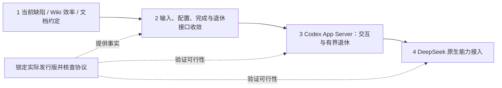

# Octopus 工程收敛与运行时路线

> **Status:** in-progress — 第一、二阶段与 Codex G0-Base 已验证；R2 产品集成与默认切换待验，DeepSeek 待实施。

> 日期：2026-10-30（Asia/Shanghai）。源码核查基线：`1126d106d95af582ecf989b7c9206ec48c0a09c2`。
> 历史架构候选补充核查：`0ca897e97189c5f213a658d986cbd67f4d69c5e3` 及当前文档工作树，范围见§7.3。
>
> 第一阶段合同更新：2026-10-31，实施起点 `5867e6c5a92e47869859119b56d00995ec995dd4`。
> 第二阶段设计更新：2026-10-31，源码基线 `28c067a090414bdd0513f570320584b2d42d1ee3`。
> 当次设计整合架构访谈 D1–D12 与 Stage 2 补充评审 R1–R8，设计与分票不作为实施证明。
> 初始设计基线不代表当前运行版本。九项第二阶段范围已进入所属当前合同；G2 的真实入口、反例和旧路径退出已验收，回归入口见§3。实现、验证与生产发布分别取证。
>
> 本文替代原 `future.md`、2026-10-29 架构路线、2026-10-29 回复调度指南及 2026-10-28 行动指南。按最新源码和本次访谈重新裁决，不按旧票号拼接待办。长期当前合同由 `implemented/` 各主题维护；本文只拥有未来变更的路线、取舍与范围。

2026-11-01 第三阶段文档更新：按用户要求完善 R2 工作稿，以活动原生协作、绑定根终态和有界退休替代本期任意 post-final 递归闭合承诺；旧反证保留。产品源码基线 `26aa78f`，本次已核查本地文档提交 `3a94312`；文档完善不代表 G0 通过、完整设计再次确认或实施授权。

2026-11-01 当前实施前沿：[G0-Base 原生前提通过](#codex-g0-base-evidence)，旧 G0-Recursive 反例保留。02–07 已通过各自范围的 Vera 最终独立验收；合同归 [Codex](../implemented/codex-backend.md#opt-in-app-server-start-and-precise-resume)、[输入证据](../implemented/architecture-contract.md#codex-native-input-evidence)、[steer](../implemented/inline-steering.md#bound-codex-root-and-queue-qualification)、[问题控制](../implemented/architecture-contract.md#native-question-control)与[原生输出](../implemented/native-subagents.md)。08–17 未启动，本轮停在 06–07 的交付边界；默认切换、生产发布及主库转换未执行。

阅读：[范围与顺序](#scope) · [三份架构意见的当前适用性](#prior-architecture-reviews) · [第一阶段](#phase-1) · [第二阶段](#phase-2) · [全部历史候选的扩展价值](#architecture-candidate-value) · [第三阶段：Codex](#codex-app-server-scope) · [第四阶段：DeepSeek](#deepseek-design) · [验收与证据](#verification)。

## 1. 已确定的目标、保留行为与顺序

按四阶段推进：**当前 bug、Wiki 效率与工程约定 → 架构和接口收敛 → Codex App Server 交互、活动原生协作与有界退休 → DeepSeek Harness 正式接入。** 每阶段交付完整责任，后阶段复用前阶段已经验证的接口。协议调查可提前进行，产品切换按此顺序。

这是一项交付顺序选择：DSH 技术上不依赖 Codex 协议；先完成 Codex 可以验证共同接口，避免同时重写两个后端与所有消费者。继续采用模块化单体、SQLite、SessionOwner 和现有 Harness，不增加第二套模型工具循环、SessionManager 或全局任务总线。

### 1.1 自动返回继续逐条处理

BG、Research、命名 agent 的终态和问题返回，继续保留原 source、delivery、work 与 receipt，按**成功接纳顺序**进入原会话，每次派发一条。来源完成时间、提交时间和成功接纳次序不能混称同一个顺序。

保留既有例外：普通 Stop 暂停派发并保留积压；暂停后新人工纠偏可以先执行，但不自动恢复积压；显式恢复后沿原顺序处理。人工 steer 的既有资格与后端能力另行判断。依据：[Owner 调度](../../server/sessions/owner_runtime.py)、[队列回归](../../tests/test_session_dispatch.py)。

本次明确撤回旧稿中的 collect-ready、StartBatch/AppendBatch、自动返回 steer、默认 join-all/wait-any、notification-only，以及正常派发时新增人工优先政策。它们会改变产品行为，不能作为修 bug 或 app-server 迁移的附带优化。多条回复排队本身不再列作缺陷；永久拒绝后无效重试仍须修复。

### 1.2 原生子任务与独立返回分开

原生子任务由 provider runtime 在当前逻辑请求内创建、管理和回报；BG、Research、命名委派拥有独立工作身份，允许父请求先结束，再以新输入回流。**Codex R2 不改变独立返回的队列政策，也不让父请求等待所有独立工作。**

Codex R2 保留活动根 turn 内的原生等待、嵌套协作与后续采样；根正式结束后保全必要事实并有界退休，不追加父模型轮次。旧任意 post-final 递归闭合有反证，单列上游能力目标。R2 的输入、配置、结果、资源与既有功能必须完整验收，不能把接通协议当作完整交付。

允许统一重构 Claude、Codex、DSH 的公共责任；保留各后端真实能力与证据差异，不把 Claude 的现有实现当作不可改变的模板。轮内引导、双向通信、完整完成范围和跨请求宿主复用是四件事。

### 1.3 默认配置允许改变

用户确认的使用方式是：Agent 默认配置可以改变，旧会话需要时自行调整配置再继续。**因此，不能仅因新默认值使旧会话暂不兼容，就认定保存成功是 bug，或强制禁止保存。** 不自动固化所有旧会话 override，不静默换 backend 或转换历史。

同后端换模型通常可通过会话 model override 处理；跨后端凭据还需选择匹配 credential。工具策略当前来自 Agent，并非所有字段都有会话 override。配置应让用户看清实际继承结果与可修正原因；执行前仍须验证实际 backend 能兑现的约束。具体分类见第一阶段。

### 1.4 三份 HTML 架构意见：保留依据，重新判断适用范围

以下是对三份报告与当前源码的交叉核对，不是新增实施授权。报告主要基于
`0df8b78`，前后对照另含 `before-takeover@88d2284`；本节按本文基线及当前工作树
核对。表中的“已有实现”只陈述所读代码，不替代当前版本的测试或部署证据。

| 报告 | 值得复用的内容 | 使用限制 |
| --- | --- | --- |
| [前后架构对照](https://github.com/Danuvius152/Octopus/blob/a8abac5ae0a9e3b98b7e71df003cfcd88c211571/docs/review/architecture-before-after-20261028-131512.html) | 模块化单体、Harness、账户与独立工作原已存在；后续变化集中在原请求权威、资源责任与 Wiki 效果 | 用于说明现有设计为何形成；图中的“当前”是报告固定版本，不是今日实现 |
| [返回接管与三个深化候选](https://github.com/Danuvius152/Octopus/blob/a8abac5ae0a9e3b98b7e71df003cfcd88c211571/docs/review/architecture-review-20261028.html) | `admit_return` 的完整顺序、原回执优先、来源职责与反例；配置捕获及会话视图时序的边界 | 接管设计以现有架构合同为正文 owner；聊天详情投影不等于已实施的应用/计划列表更新 |
| [全库七项候选](https://github.com/Danuvius152/Octopus/blob/a8abac5ae0a9e3b98b7e71df003cfcd88c211571/docs/review/architecture-review-codebase-20261028.html) | 以调用方泄漏的锁序、生命周期、事务和合并规则定位改进点；逐项说明保留理由与删除标准 | 缺少原始复现附件；缺陷和建议须分别核实，旧优先级不能直接变为当前待办 |

去重后，各项意见在当前代码中的位置如下。未选定候选仍是候选，不因进入此表
就成为第二阶段或运行时迁移的必做项。

| 意见 | 当前事实与路线对应 | 尚需区分的范围 |
| --- | --- | --- |
| 应用删除先确认退休 | [应用删除](../../server/applications.py)已有 `retiring → files` 阶段，失败保留原责任与资料；§2.1 不重复开发 | 保留成功删除后开发聊天可继续的既有行为 |
| 应用与计划列表统一更新 | [应用列表](../../web/src/lib/applicationList.ts)、[计划列表](../../web/src/lib/scheduleList.ts)已有业务入口；合同归[列表协调](../implemented/frontend-list-reconciliation.md) | 这不证明聊天详情、Research 卡片、问题与 transcript 的合并责任已经集中 |
| Connector 首次绑定原子性 | [ConnectorManager](../../server/connector_manager.py)已有外部身份与 installation 串行化；[业务事务](../../server/db/connectors.py)以 upsert 一同保存身份和秘密 | 不再沿旧报告认定“先查后写导致首次绑定冲突”仍待修；锁与事务分别保护真实的不同责任 |
| 普通/App Wiki 请求校验 | [App 入口](../../server/routers/wiki.py)已复用路由正文校验，旧 null 缺陷已有修正路径 | 操作白名单、路径映射与特殊依赖仍由入口编排；完整 adapter 深化是另一项候选 |
| 返回接管 | [BG](../../server/sessions/turns.py)、[Research](../../server/research/manager.py)、[委派](../../server/delegations.py)已使用同一公共接管操作，见[当前合同](../implemented/architecture-contract.md#公共返回接管) | 保留来源重试、业务结算及独立返回消费政策，后续来源沿同一接口接入 |
| 原执行退休与单轮结算 | 原 OwnerRuntime 绑定 driver/资源观察并唯一结算；[Wiki](../../server/wiki/job_execution.py)通过公开查询及原 work 清理证明守住重试；结果关联已集中 | 当前合同归[原执行观察](../implemented/architecture-contract.md#原执行的观察)与[结果读取](../implemented/architecture-contract.md#原请求结果读取)，新协议尾部仍另行实施 |
| 配置变更与请求捕获 | 默认保存归 AgentManager，覆盖与捕获归[会话配置操作](../../server/sessions/configuration.py)；路由锁序已退出 | 保持§1.3允许改默认、准备锁内捕获及效果前撤权；不以保存或捕获延长授权 |
| Wiki 注册与受保护借用 | [W1–W4](../implemented/wiki-development-summary.md#受保护操作与入口)已收回同代、授权与锁序；History/Store 保留各自权威 | 新业务操作沿原 owner 接入，不为统一函数形状重写简单操作 |
| 聊天详情投影 | [读取合同](../implemented/architecture-contract.md#辅助任务的读取与事件合并)已集中完整/辅助/委派读取与目标失效 | 新类型仍须说明身份、事件及快照规则，视图保留观察结束 |
| 安装交接与自然排空 | [各域事实与成功收据](../implemented/architecture-contract.md#安装自然排空与交接收据)已贯通安装与导出消费者 | 新内部资源进入所属 owner，不由安装层猜私有布局；实际退出仍另取证 |

三份报告支持的共同方向是减少调用方必须了解的内部规则，继续利用已有责任模块。
它们没有证明统一 Job 总线、额外持久执行账本、通用 Repository 或全仓拆类能带来收益。
已实施接口的选择理由归[架构决策](../implemented/architecture-contract.md#既有领域接口的取舍)，后续候选见§3.3；不能把候选数量、
文件长度或接口名称当作架构质量结论。

### 1.5 已确认的架构评价标准与本次评估范围

用户已确认：总代码量不必下降，主要看规则是否有明确归属、一次变更是否集中、
调用方是否减少锁序/提交顺序等知识，以及完整行为能否通过公开入口验证。
可靠性、权限、结果真实性和既有产品行为继续作为约束；性能收益单独测量。

本次须评价三份 HTML 的**全部历史架构候选与次级建议**，结合本文的运行时路线及
[Wiki/App 后续计划](../plans/wiki-future-plan.md)判断扩展价值，不限于 Codex/DSH
迁移的直接前置。全面评估不等于全部实施；已有实现、值得继续深化、有明确触发条件
和不建议采用的方向分别给出结论。第二阶段已按 2026-10-31 访谈确认，范围以§3
为准；后续产品取舍仍须独立确认。

判断依据是已知变化：新运行时及其原生完成边界、持续变化的模型/凭据/工具配置、
Sapphire/SmartReader 与受限 App 客户端、更丰富的任务展示，以及这些资源的发布排空。
不以假想第四种后端、分布式部署或无限通用性为由增加机制。

## 2. 第一阶段：当前可处理的问题、Wiki 效率与工程约定

### 2.1 已实现的行为与当前 owner

第一阶段的代码、定向审查、默认提交门禁及本机离线/实机验证已完成；G1 的
最终交接和部署仍以对应版本的审查及发布回执为准，源码状态不证明生产已升级。

| 行为 | 当前合同与已实现边界 |
| --- | --- |
| BG、委派终态和问题返回 | [执行合同](../implemented/architecture-contract.md#输入完成与资源退休)拥有原身份、receipt 优先、永久停止、unknown 有限观察及来源 writer 保责；[委派](../implemented/agent-collaboration.md)拥有 round/问题生命周期；Research 原分类保留。 |
| Agent 默认与旧会话 | [模型设置](../implemented/model-reasoning.md)允许合法默认保存，旧会话保留 backend/历史，按有效组合修正后继续；共享纯校验、实际参数、捕获和效果前授权均已覆盖。 |
| Wiki 读取与查询说明 | [Wiki 合同](../implemented/wiki-development-summary.md)拥有四入口长度边界、实际指南注入、同版正文复用及完整覆盖；评测失败完整收束先于 API/DB 退出。 |
| compact 投影与健康摘要 | lexical 页内章节批取、exact 先过滤/count/分页，准确 count 与有界样本已实现；排序、Unicode、分页、live revision 与维护准入保持。 |
| 可复现成本与环境 | [验证方法](../testing.md#wiki-evaluation-method)、[解析约束](../../constraints-wiki.txt)和冻结合成参考保留原判据与适用条件，专项仍独立 opt-in。 |

删除前退休、排序事务和列表协调的既有合同继续保留。应用成功删除后旧开发
聊天仍可重新创建目录，不恢复“成功后永久禁写”提案。公共返回接管及[配置保存与请求捕获](../implemented/model-reasoning.md#saving-defaults-and-repairing-an-existing-session)已完成；
统一[退休查询](../implemented/architecture-contract.md#原执行的观察)与
[领域排空](../implemented/architecture-contract.md#安装自然排空与交接收据)已完成；
Codex R2 的协议、模式、输入/结果及资源合同仍待第三阶段验证；旧递归强目标另列依赖。

### 2.2 投递错误分类：先修完整行为，再收回共同编排

返回真值表、各来源的业务材料/诊断/恢复差异及真实消费者统一归
[执行合同](../implemented/architecture-contract.md#输入完成与资源退休)。当前回归
经过真实 SQLite/Owner，覆盖永久拒绝、ACK 丢失、冲突、问题过期、人工回答、
删除/归档与写入失败；通过现有命令重入保责，没有新返回账本或常驻观察器。

第二阶段已完成[公共返回接管](../implemented/architecture-contract.md#公共返回接管)，
保留来源结果、接纳、父处理、通知和退休分别取证；未知不授权重放，正常返回仍按
成功接纳次序逐条派发。各来源不同的业务结算与恢复策略继续由其原 owner 维护。

### 2.3 Wiki：优先减少数据搬运，保持检索与阅读合同

当前投影、NUL 兼容例外、完整章节字段匹配、exact 身份语义及健康事实归
[Wiki 合同](../implemented/wiki-development-summary.md)。冻结参考逐字段保留页序、
total/cursor、revision、sections/role、matched fields 和原文坐标；准确性先于搬运。
最终完整测量遵循最初阈值；早先失败及参考身份修正的来由保留，不能用新容差
或删字段换取通过。固定100篇/长文/错误增长的结论及模型用量限制见该合同的
[版本化证据](../implemented/wiki-development-summary.md#historical-evidence)。

full 当前页依赖批读、宽查询/深分页计划、reader handle、多库公平性和语义检索
保留测量后再选择的条件。已有章节 FTS5、中文分词/bigram、去重、overview/compare
及增量同步不重写；不能通过减少候选牺牲召回。查询调用、SQLite 搬运和 live 文件
读取分别衡量，不把 JSON 小或调用少直接解释为 token/整体延迟收益。

### 2.4 文档与工程约定

一个解释有一个正文 owner：根 AGENTS 管高频工程规则，implemented 管当前合同，
plans 保留未完成范围，testing/local-wsl 管验证与本机操作。活动审阅和临时材料
退出前将必要理由及证据归回 owner；persona 管角色，memory 只存偏好与短入口。
代码、受影响验证和审查收敛后统一整理长期文档，不逐补丁复制过程记录。

当前解析链使用现有 venv/pip 和固定约束，前端沿用锁文件。新字段及校验边界已
同步类型，没有全仓 strict、ORM 或包管理器迁移。Harness 的能力拒绝、当前
Wiki 格式和完整原生尾部范围各有权威；原生卡片可见不证明完整尾部已完成。

## 3. 第二阶段：既有领域操作与后续交接

S1、S2、S2b、S3、S4、S5、按实际用法收窄的 S6、S7、S8 已实施；G2 的
交付检查与独立审查已通过。已完成的操作、失败边界和必要理由归所属 implemented
合同，本节不再保留第二份实施步骤。生产发布按实际发布回执单独判断。

| 范围 | 当前合同与责任 | 后续变化在何处接入 |
| --- | --- | --- |
| S1 返回接管 | [原身份与公共接管](../implemented/architecture-contract.md#公共返回接管) | 新来源沿会话接纳操作返回，来源继续拥有正文、业务结论与重试 |
| S2 原执行/资源、S2b 结算/结果 | [原执行观察](../implemented/architecture-contract.md#原执行的观察)、[结果读取](../implemented/architecture-contract.md#原请求结果读取)、[问题结算](../implemented/architecture-contract.md#问题结算) | 新宿主在原 owner 提供实际资源证据，消费者保持原 request/attempt/work |
| S3 配置 | [保存、修正与准备时捕获](../implemented/model-reasoning.md#saving-defaults-and-repairing-an-existing-session) | 新配置进入原继承/捕获操作，不把当前授权固化为配置快照 |
| S4 能力与恢复 | [运行时合同](../implemented/harness-layer.md)、[恢复证据](../implemented/harness-transient-retry.md#4-recovery-evidence-in-the-original-owner) | adapter 声明真实能力，Owner 按实际输入/效果证据裁定恢复 |
| S5/S6 Wiki | [W1–W4 受保护操作](../implemented/wiki-development-summary.md#受保护操作与入口) | 新调用者消费现有领域操作，冷准备、同代借用、授权与提交仍由原 owner 负责 |
| S7 读取 | [完整/辅助/委派读取](../implemented/architecture-contract.md#辅助任务的读取与事件合并) | 新任务类型说明自己的身份、事件与快照规则，页面不拼 baseline/服务代次 |
| S8 排空 | [领域事实与交接收据](../implemented/architecture-contract.md#安装自然排空与交接收据) | 内部资源在所属 owner 纳入事实与退休；新业务域才扩展安装显式组合 |

### 3.1 保留的协议范围与阶段出口

本阶段保持当前 Codex exec 与 Claude 有条件宿主复用；claim、本地写入/drain、
root 结束、业务结算、通知和资源退休的证据不能互相提升。公共 prepare/events/
steer/answer/completion/interrupt/reuse 操作沿现有 Harness 与原 Owner 演进，
真实差异归 adapter；新 RPC 握手、双向关联和各后端所选完成范围在第三/四阶段分别验证。

未预建输入 ACK 状态层、最终原生答案引用表、新 RPC 引擎或跨请求宿主池。
S6 保留简单查询、History 操作、既有 App 白名单与反射兼容，不扩展到完整网关
替换或未经选择的直接 App 产品。snapshot 创建保持 410。原生尾部仍是下一阶段
完整完成范围，不能以本阶段收敛或短对话通过宣称已经解决。

### 3.2 G2 反例与回归入口

下表保留验收映射和可复查入口，不缓存测试数量或部署状态。完整门禁、实际安装
发布矩阵与有效证据复用规则归 [testing.md](../testing.md)。原失败及修复后结果
分别记录，未执行的 Claude 实机不计为通过。

| 验收与补充评审 | 保留的反例与回归入口 |
| --- | --- |
| A01–A03、A31；R8 | 返回已接纳但丢确认、慢准备撤权与 Stop backlog：[接管](../../tests/test_return_admission.py)、[生命周期](../../tests/test_return_admission_lifecycle.py)、[派发](../../tests/test_session_dispatch.py) |
| A04、A07–A08；R4 | terminal 提交后通知失败、原 A 与复用宿主的 B、原 work/失败接管：[完成事实](../../tests/test_request_completion_facts.py)、[原执行](../../tests/test_execution_observation.py)、[Owner 接管](../../tests/test_session_owner_failure_handoff.py) |
| A05–A06 | 多 attempt、承载身份、空/失败正文与同快照结果：[结果读取](../../tests/test_session_results.py)及 App/委派真实消费者 |
| A09、A32；R6 | 排队/等锁/捕获后改值及效果前撤权：[配置捕获](../../tests/test_request_configuration.py) |
| A10、A30；R3 | 能力独立与无输出但可能已有副作用：[能力投影](../../tests/test_session_capability_projection.py)、[恢复证据](../../tests/test_retry_evidence.py) |
| A11–A13、A33；R5 | 正常结构化回答、可信来源、非法回答不消费、保存失败与到期竞争：[问题结算](../../tests/test_question_resolution.py)及真实问答入口 |
| A14–A18；R7 | 同代/撤权、整批接纳、commit/wake 与效果后失败：[维护接纳](../../tests/test_wiki_maintenance_admission.py)、[原任务控制](../../tests/test_wiki_job_controls.py)、[效果结算](../../tests/test_wiki_effect_settlement.py) |
| A19–A22、A28；R1 | 双成功乱序、真实 WS、未知目标删除、A→B→A、局部失败与新 work：[公开读取](../../web/src/lib/hydrateSession.test.ts)、[委派读取](../../web/src/lib/delegationReads.test.ts)、[真实重连卡片](../../web/src/components/AgentDelegationRequestCard.reconnect.test.tsx) |
| A23–A26、A29、A34；R2 | 线程排出未 borrow、通知/桥接清理空隙、部分封口、丢响应、ASGI/WS：[安装](../../tests/test_installation_drain.py)、[ASGI](../../tests/test_installation_admission.py)、[导出消费](../../tests/test_portability_handoff.py)、[存储故障](../../tests/test_installation_storage_failure.py) |
| A27；跨票 | 上述真实入口退出旧接管/裁定/锁序/基线/私有排空编排；全量离线覆盖 Claude/Codex，发布另覆盖浏览器、Codex 实机与适用 supervisor |

### 3.3 后续候选的真实触发条件

已实施九项范围的选择理由归[架构决策](../implemented/architecture-contract.md#既有领域接口的取舍)。
三份历史报告中的次级建议仍按实际收益判断，不因旧优先级或文件长度自动进入下一阶段。

| 候选 | 保留的结论与触发条件 |
| --- | --- |
| 前端输入接管/恢复编排 | 新发送入口、复杂附件恢复或接纳 UX 改变时，集中原身份、unknown 确认与草稿责任；本阶段没有借读取重构改写发送政策 |
| 全部 Wiki/App transport 深化 | 现有 W1–W4 已收回实际业务规则；新的现实客户端或跨 owner 用例再证明剩余适配边界，不为函数形状统一所有路由 |
| Research 浏览器收讫账本 | 浏览器收到、汇报接纳和父模型处理有独立含义；只有产品明确取消保证时才讨论删除 |
| 额外 ORM/Repository、TaskManager 或通用 Job/reducer | RecordProjection 已集中完整行映射，Research 已集中原任务登记；尚无独立责任或真实复用证明需要另一层权威 |
| 按 mixin/文件大小拆类 | 不以文件数量判断深度；只有一次变化仍要求调用方掌握跨模块规则时才深化所属操作 |

应用删除保留原持久退休阶段，未来新 writer 接入同一生命周期；应用/计划列表沿
原业务操作演进，不强迫它们与聊天详情共用一个同步模型。Connector 新 provider
沿现有身份串行化与原子 upsert 接入，不重建 OAuth 事务框架。BG 退休、应用容量、
列表竞态、OAuth 绑定和中文路径等历史缺陷仍按其行为合同维护，不变成额外重构项目。

## 4. 第三阶段：Codex App Server、活动原生协作与有界退休

### 4.1 当前行为与 R2 范围修订

普通 Codex 当前仍使用 `exec --json`。根完成后原执行退休，未完 helper 可为
`interrupted/parent_done`；[退休回归](../../tests/test_native_subagent_retirement.py)
允许父 success，卡片可见不证明父已消费子结果。opt-in App Server 现已实现
原问题控制与根子输出身份，仍不构成完整 R2 或默认切换验收。

旧方案要求父已结束后，任意层级晚回结果仍被逐层继续处理并可靠闭合。0.166.0
的受控实验反证了普通自动 wake 对 idle 中间父的覆盖；v2 child 直输也被拒绝。
[原 G0 证据](#codex-g0-evidence)保留，不能改标通过，也不证明所有未来路线均不可能。

当前 R2 工作稿改为：一个 attempt 绑定一个已接纳根 native turn，保全该活动
turn 内的原生等待、嵌套协作、followup、人工 steer 与结构化观察；根正式 terminal
形成候选后立即冻结操作并启动有界退休。原生模型是否等待及如何使用结果不由
Octopus 另建递归调度器保证。任意 post-final 递归闭合保留为独立上游能力目标，
不再作为 R2 的默认切换门槛；这项范围变化不代表旧强目标已实现。

本阶段须完整交付输入证据、配置与权限、结果选择、只读详情、资源生命周期及
原功能保全。提示词、一次成功演示、静默窗口或常驻宿主均不能替代实际协议依据。

### 4.2 Claude 与辅助调用保持原合同

Claude 的 steer、held、signature、晚到完整输出、fork 与既有 receipt 语义保持
等价；晚事件保留原 request/attempt/work，旧 receipt 不重开，不宣称新增递归闭合。
不能把 Claude held 当成 Codex post-final 唤醒方案，也不能为 Codex 已撤权后的
只读事件采集放宽 Claude 原 idle/live-lease 条件。

共享层沿原 SessionOwner、HarnessRun、OwnerQuestions 分责，wire、输入证据和
复用策略由真实后端表达。Research web leaf 保留独立受限 exec，one-shot/reason
leaf 保留无工具文本 worker；它们不是普通请求失败的 fallback。已有 subagents
定义及 Claude 装配保全，Codex 新角色映射后置，DeepSeek 不预建空实现。

### 4.3 attempt 宿主、根绑定与模式

一个普通 Codex request attempt 独占本地 stdio App Server，**只绑定一个实际
接纳的根 native turn**。该 turn 可有多次模型采样、工具及原生后代的多个 turn；
根正式终态后不由客户端自动追加总结或继续。下个逻辑请求等旧 writer 确认退休后，
新建宿主并精确 resume 原 thread；不建跨请求池。

HarnessRun 持有进程组、I/O、lease、临时材料和退出责任；driver 解释 RPC、原生
身份和输入/终态事实；SessionOwner 唯一接管、调度和结算。RuntimeProfile 保持
能力单一来源，共享层不构造 Claude frame 或解析 Codex wire，不新增通用任务树。

在同一受管宿主完成 reader/握手、controller 检查与更新、精确 thread 准备及实际
配置核验后才发送业务帧。controller 注入未知不能继续；compaction 后仍能核对
有效指令，不复用旧请求 bearer/grant，也不向共享 credential home 写请求状态。

G0-Base 必须证明按 attempt 关闭 `wake_on_agent_messages`，并隔离 goals 等额外
自主根执行；新建、恢复及所用历史操作都纳入验证。无法保证时在业务输入前准确
拒绝，不静默清除用户 goal。意外新根 turn 作为协议/配置异常保留真实效果并退休，
不能默并入当前请求；事后杀进程不能代替正常模式可控的前提。

版本锁定和已有局部字段依据见[原 0.166.0 证据](#codex-g0-evidence)。schema 只
证明形状，源码、确定性轨迹和真实装配分别取证，不据旧版本号直接冻结新 parser。

### 4.4 输入、问题与停止

首输入和 steer 使用原 submission，写业务帧前记录可能发送；只有明确未发送/
未接受才可按原身份和预算回队。写后 ACK 丢失保留 unknown，不重放、不换 thread、
backend 或 fallback exec。provider accepted、进入历史与模型已消费分别表述，
根 success 不能抹去 unknown。App Server 无业务正文的 spawn/initialize 不跨业务
发送边界；保留的 argv 和 Claude 路径仍遵守各自真实边界。

人工 steer 只针对捕获的活动根 turn，保留原来源、附件、Wiki、明确配置意图、
暂停例外、容量和顺序；准备、无目标、terminal 或资源收束时排队。根仍在原生 wait
中时可按已验证协议 steer；wait 返回不是根完成，也不是 join-all。自动返回沿 §1.1。

原生问题绑定 connection generation/server request/thread/turn/item 与产品
question，原 OwnerQuestions 负责来源和关闭。审批、普通问题、动态工具分别按原
政策处理，未知类型明确不支持；迟答不能回复新连接的问题。单 reader 分类、单
writer 串行完整帧，控制不等 stdout 或展示队列，必要事件不得静默丢弃。

根 terminal 或 Stop 立即冻结原输入/问题及受控工具准入，并启动有界取消、
TERM/KILL/join/drain。DB 背压、缺失 item、宿主仍存活均不能阻止取消启动。
保留不携带执行授权的原身份及唯一解析通路作有限采集，不保活 grant，不把 raw
drain 当作完整记录，也不把事件送入 Claude idle 兜底。独立 BG/Research/命名
委派保持自己的取消与返回合同。

### 4.5 结束候选、结果判定与失败出口

只有绑定根 turn 的正式终态提供 provider 结束候选；模型 response、final 文本、
工具或 child completed 均不能单独完成产品请求。根活动/原生等待保持原配额与
总预算，实质根/子进展可刷新活动，poll、ACK、重复通知与详情不能续命；native
wait 不无限豁免 idle。根 terminal 触发原有界退休，清理宽限独立记录。

必要记录是根最终正文或有依据的空正文、原输出通道已接纳的完整消息/工具审计、
问题处置及输入发送事实。仅未采集的可选历史详情，或正常取消而从未产生的 child
答案，不成为根成功前置；已经接纳的必要记录丢失不能借“详情缺失”豁免。

| 情形 | 原 Owner 与消费者应遵守的判定 |
| --- | --- |
| 根 success、必要记录完整、资源确认退出 | 原 Owner 可选 success；helper 可同时 interrupted/parent_done 并保留 partial，不称全树已汇总 |
| Stop 先于 Owner 唯一选定业务结论 | 选择 interrupted；根 provider 候选与 partial 保留，根 terminal 到达本身不抢占这个选定点 |
| Stop 晚于已选定结论 | 不重选 outcome；仍关闭准入、暂停派发并收束资源，未确认提交不冒称已持久成功 |
| 必要记录缺失 / 仅可选详情不可用 | 前者在尚未选定且存储可信时准确失败并保留完整性诊断；已有结论不重选。后者只影响详情，不重跑模型 |
| 写入失败、确认缺失或通知失败 | recording_failed/unavailable 与通知状态沿原合同；确认提交的 outcome 不被后续通知失败改写，不伪造第二 terminal |
| 有界退休失败、退出仍未确认 | 进入原 Owner/Manager 失败接管，按已提交证据结束 completion，保留资源引用并执行既有有界清理；仍失败走现有 health/fail-stop，不永久正常 pending，不放行同历史第二 writer |

正常成功交付仍需必要记录、原通知和退休门；故障接管返回的 completion 不冒充
资源退出证明。输入 unknown 独立保留，对应输入不能借用主请求成功。原执行结论、
结果记录、通知交付和资源退休各自拥有证据，失败或 Stop 不撤销已发生效果。

这里复用[既有执行与故障合同](../implemented/architecture-contract.md#输入完成与资源退休)，
不新增完成 owner、持久状态机、后代义务图或无限退休重试。

### 4.6 消费者、历史、数据与观察

SessionResult/LiveReply、App ask、命名委派及正文查询共用绑定根 turn 的最终正文
选择；支持多个有序最终 item，引用原持久消息，不复制答案账本。commentary、child
与另一个根 turn 不混入结果；空答、坏引用、缺 terminal、unknown 分别解释。
App build/scheduler/Wiki 沿原 completion/receipt/退休事实及各自产物、记录和效果
验收，不增加正文查询依赖；App done 保留其原正文通知前缀条件。

根/子/thread/turn/item 身份贯通工具 key、delta、完整 item、metadata、WS、
前端与历史读取；child started 不覆盖根 resume ID，同名 item 不串流，保留真实
seq/高水位及效果审计。卡片缓存不拥有资源责任。子详情只读已采集内容，退休后
读保存 items，缺失明确，不续 lease、不建历史查询宿主、不开放 child 直输。

旧 exec 历史精确恢复，fork/rewind 保全目录、归属、产品消息截断与失败清理；
原生 fork 如需替代复制，在原 saga 同时处理真实 ID、创建未知和清理，不隐式执行。
model/effort/Fast→normal、审批/sandbox、cwd、凭据、controller、memory/skills
及 MCP/connector 在新建/恢复逐项验证；共享合法 home 不共享请求授权。

原地升级保全新增关联及发送证据；会话 transcript 只导出原消息行范围；完整备份
沿原安装数据与引用文件范围；账户导出/导入继续排除 sessions/messages/
client_submissions，不改源聊天、不新增会话导入或扩大原生历史删除能力。

Monitor 区分产品请求、native turn、采样与父子累计/增量用量，正常路径只选一个
计量来源；没有真实 response timing 不造 TPS。Research web leaf 的 read-only、
无 Octopus MCP 和严格 web-only 分别验证，无工具文本 worker 保持原资源责任。

### 4.7 基础门禁、实施依赖与旧路径退出

**G0-Base 已通过[锁版原生前提验证](#codex-g0-base-evidence)；G0-Recursive 保留旧反例且移出本期。** 基础门禁用独立最小
客户端、目标 binary、受控 provider 与进程监督，证明版本/有效模式、根绑定、
活动嵌套 wait/followup、输入与问题证据、完整项及原生退出、历史/配置/只读前提。
不要求尚未实现的 Owner/DB/UI/结果/详情/fork 先验收，从而避免循环前置。
缺少原始材料时实际补取证据，旧票勾选或摘要不代替它。

17 张本地票的编号和依赖保持：01 是基础探针；02 是现有 Codex/Claude/辅助用途
行为等价的 driver 预重构，技术上无协议前置；03 同时等待 01 与 02。随后分票
闭合配置、输入、问题、身份、根终态/退休、正文、详情、业务效果、历史、错误、
观测和保存范围；12 不依赖 09。17 汇合全部验收再切默认。这个技术前沿不自动
授予代码或模型执行权限。当前 01–11 的产品实现范围见
[Codex 合同](../implemented/codex-backend.md#opt-in-app-server-start-and-precise-resume)和
[原生子任务合同](../implemented/native-subagents.md#saved-app-server-details)。
12–17 保留原依赖；阶段性交付不能解释为完整 R2 或默认切换放行。

开发期发送前明确 transport，不双跑副作用请求、不在 unknown 后换协议。
默认切换须在同一候选通过原仓库门禁及本机离线 E2E、Codex live pytest/浏览器
验收；共享改动覆盖 Claude 离线行为，不新增 Claude 登录或 DeepSeek 实机。
每项检查一个执行者，复用仍有效证据，不因票数增加重复套件。

同次交付删除普通对话旧 exec、被替代的重复 controller writer、猜测 steer 能力
及重复正常计量路径；保留有独立用途的 web leaf/text worker、登录控制和诊断。
发布自然排空，不热搬连接、问题或 lease；回退核对数据/原生历史/配置及旧 writer
退出，不覆新库、删历史或重放 unknown，不能安全回退时前向修复。仅依据实测成本
再讨论跨请求复用，不预承诺性能倍数。完成 R2 不宣称 G0-Recursive 已实现。

## 5. 第四阶段：复用既有架构的 DeepSeek Harness 接入设计

### 5.1 锁定实际接口，选择一条主路线

2026-10-30 实查 npm 的 `@deepseek-ai/dsh` latest/next 为 **0.2.1-rc.5**，发布于10-29；本机旧缓存为rc.2，PATH 无 dsh。已下载并核对 rc.5 发行包的 README、公开类型及编译代码，未安装或运行 DSH。[固定发行元数据](https://registry.npmjs.org/@deepseek-ai/dsh/0.2.1-rc.5)

官方仓库当时 HEAD 为 `f3803c96974ad4a94195fb97e5c637e9c2a3afe3`，但其文档与发行包并非全部相同，元数据也没有 gitHead，不能将二者写成同一构建。下表以 rc.5 发行包为主，升级需重验。

| 接口 | 实际语义 | 本次裁决 |
| --- | --- | --- |
| 公开 Agent API | `followup` 是 next-turn，`steer` 是 next-step，`inject` 不唤醒；idle 时 steer 会开新 turn | 使用真实 steer；不能谎称它与 Codex expectedTurnId 完全相同 |
| SDK wire | `session/prompt` 调用 followup，返回 messageId；有 resume/wait/shutdown，未暴露 steer 或逐 session cancel/close | 复用官方 server，以薄插件补公开原生控制 |
| ACP | 一个 session 一个 inflight prompt；cancel 与 close 责任不同，标准事件投影较少 | 保留选型依据，不作为正式并行主路径 |
| headless | 有限任务、无运行中输入口，普通字符串/帧裁剪，final 也可能出现在失败后 | 不为适应旧 exec 而放弃原生交互 |
| 高层 SDK run | 只收集到下一次根 idle | 不作 Octopus 完整请求的 completion；使用低层 wait 与事件证据 |

来源：[Agent rc.5](https://registry.npmjs.org/@deepseek-ai/dsh-agent/0.2.1-rc.5)、[SDK server rc.5](https://registry.npmjs.org/@deepseek-ai/dsh-sdk-jsonrpc-server/0.2.1-rc.5)、[SDK client rc.5](https://registry.npmjs.org/@deepseek-ai/dsh-sdk-client/0.2.1-rc.5)、[ACP rc.5](https://registry.npmjs.org/@deepseek-ai/dsh-acp/0.2.1-rc.5)、[headless rc.5](https://registry.npmjs.org/@deepseek-ai/dsh-headless/0.2.1-rc.5)。

### 5.2 一个 DSH 宿主，一个薄插件

推荐 `dsh --profile sdk --patch …`：在同一 DSH 进程中，用 Octopus 插件替换 SDK stdio wrapper，保留官方 SDK 启动与资源层。原 wrapper 没有公开动态注册 RPC method 的服务，不能假设旁挂插件就能扩展已有 dispatcher。

插件从包根导入公开 `HarnessSdkJsonRpcServer` 和 `JsonRpcLineTransport`；普通 initialize/prompt/resume/wait/shutdown 转给 `server.handleRequest()`。只增加 Octopus 命名空间的 steer/cancel 与必要观测，调用公开 Agent API。**不读取 private sessions，不导入 src 私有模块，不重写 agent loop、工具执行、历史或子任务调度。** 这是由公开接口支持的设计推断，尚待离线 loader/假 provider 实验验证组合可行性。

| 所有者 | 责任 |
| --- | --- |
| Octopus SessionOwner | 原输入接纳、逐条派发、人类 steer 资格、问题与业务结算 |
| Octopus HarnessRun | 一个 attempt 的 DSH 进程组、管道、lease、临时秘密文件、停止升级和退出确认 |
| DSH SDK server／原生 runtime | 根创建/resume、Session 事件、失败记录、wait、后代 drain、AgentHandle.dispose |
| 同宿主薄插件 | 原活动身份校验、公开原生控制桥、必要增量/任务观测；不另拥有 completion 或执行账本 |

只有本 attempt 已接管根的精确 Agent 引用可控制；不能接受任意 id 后直接在全局 registry 找对象。新历史通过原生创建，恢复必须精确匹配原 session，不存在或不可读时明确失败。

### 5.3 原生 steer 的关联与证据

运行中的 DSH 在下一 step 边界消费 steer；被 pre-step 拒绝可停留 inbox，cancel/dispose 可能丢弃未处理输入。idle steer 会自动开 turn，因此插件必须在**无 await 的同一准入步骤**核验原 Agent、活动身份与阶段再提交；状态已变就明确拒绝，让 Owner 沿原输入规则排队，不偷偷开新轮。

命名空间接口携原 attempt、native root、预期活动标识和输入身份；活动标识从可信 Session/Agent 事件关联，不从当前 UI 卡片推测。ACK 至多表示输入被原生 inbox 接纳，不能伪造“模型已经处理”。`agent/inbox/claimed` 也不等于消息已经提交到模型步骤：配置路由或取消仍可能发生在提交前。接受、认领、持久 user message 与实际结算按所取得证据分别映射；不能因为根后来成功就把所有 steer 标 done。

BG/Research/命名委派仍在 Octopus 排队，不能同时预装到 DSH next-turn inbox 形成第二个产品派发者。只把已获准的首输入与人工追加送入本 attempt；DSH 原生后代向父回报是本请求内部活动。

### 5.4 完成、取消与后代

低层 `session/wait` 等根 idle、受管后代，再检查根仍 idle 且 session seq 未变，能覆盖子回报触发的父后续 turn。它不把 idle 且仅有 parked inbox 的后代视为推进中；因此要关闭未经选定的自主未来触发，并说明本次受管范围，不能宣称任意未来工作都完成。

wait 成功不是业务 success：从本 attempt 的持久 turn/end、原生错误、完整根输出及输入关联裁定 completed、blocked、aborted、error、max-tokens 等结果；子正文不能覆盖父最终答案，先正文后错误不伪成功。只取 `run().final_response` 不满足合同。

Stop 可先原生 `agent.cancel()`，最终仍按官方 server.shutdown → 受管 descendants drain → AgentHandle.dispose → launcher 清理，再由 HarnessRun 确认进程组与 I/O 退出。取消 Python await/to_thread 或 ACK 不代表线程、回调、后代停止；迟到 spawn/callback 保留原身份并收束。Octopus 尚未派发的 backlog 不受 DSH 原生清 inbox 影响。

现有子任务卡片按真实身份/事件映射；SDK 的 `subagent.finished` 只转发 local 子完成。若所选受管范围需要额外观测，插件订阅公开 `subagent/start/end`，保留 runId/provider/id/local，不猜测外部后代已经完成。用户直接控制每个原生 child、通用 transcript 浏览不纳入首轮接入。

### 5.5 问答、MCP、权限与配置

| 面向 | 接入要求 |
| --- | --- |
| MCP | 逐 entry 保留原 URL、独立 Authorization bearer、installation/task/work/attempt/lease 和实际 timeout；不合并成一个全局 token |
| 问答 | 复用既有 Question owner 与 MCP ask；若启用 DSH 原生问答，通过公开 user-questions/request 桥接同一 owner，先核对其根/后代发起范围；不建第二套等待状态 |
| 审批 | approval/request 与普通问题分开；沿明确 sandbox/approval 配置处理，未支持的动态批准请求明确拒绝，不把 ACP permission 当通用 ask |
| 指令 | 分开稳定 controller、当轮上下文与项目原生 AGENTS/skills；使用 literal prompt section，避免 `{{…}}` 被插值；resume 后权限与规则实际生效 |
| profile | 显式选择工具、原生子任务和必要事件组件；禁用重复的 autonomous scheduler、cron、后台队列等产品调度来源，不直接照搬 full profile |
| 工具限制 | tool-free one-shot、Research 受限 leaf、普通 agent 分别装配并强制验证；sdk-minimal 仍有 shell/image，不能当作 tool-free |
| 认证与目录 | API key、账户/credential 私有 home、项目 cwd 与 canonical memory 分清；不按 cwd/key 猜账户，不把 home 隔离宣传成同 OS 用户的恶意租户沙箱 |

**timeout 换算是已查明的接入陷阱。** Octopus 禁用 ask deadline 时使用 `2**31-1` 秒；DSH MCP 接收毫秒，经其 MCP client 交给 Node setTimeout。直接乘1000将超过 Node 上限，本机最小实验结果为被压成1ms。不能照搬 sentinel，也不能猜 `0` 表示无限。

接入门要求在 DSH 端兑现既有人工等待语义：有限时长使用合法毫秒；无产品 deadline 的 ask 必须有真正可取消的无截止等待接口，或通过既有 Question owner 的原生桥实现。如果选定 MCP client 没有这项能力，先完善该接口或改走同 owner 的问答桥，不能暗加60秒/任意有限期限，也不自动重发已经发出的 ask。ACP 标准 MCP 转换没有 timeout 映射，同样不能绕过此要求。依据：[当前装配](../../server/harness/assembly.py)、[MCP 插件 rc.5](https://registry.npmjs.org/@deepseek-ai/dsh-mcp-client/0.2.1-rc.5)。

### 5.6 正式产品闭合与退出条件

后端身份统一为 `deepseek`，保留 `codex`、`claude-code`，不另注册同义 dsh。扩展 BackendKind、凭据/认证、home 解析、运行时注册、模型/能力目录、生成前端契约、AgentForm/HarnessPage、Monitor 及所有真实调用方。模型、effort、tier 来自实际 provider 能力，不静默承诺同功能。

配置临时文件归 launch owner，存活到实际资源退出，不在纯 argv renderer 内创建后立刻删除。原地换 key、撤权、两账户/两 bearer、配置继承与当前/下一请求都要验证。不同 provider native ID 不互用；DSH 失败不自动切 Codex 继续未知执行。

持久 home、被选择保存的历史/附件分别进入现有备份和账户搬迁的对应范围；临时秘密、socket 和运行资源不导入为新授权。当前账户迁移的保留/排除策略由 [搬迁合同](../backup-and-migrate.md) 决定，不把“备份全历史”偷换成“换机必须导入所有旧会话”。服务关闭和发布排空必须看到准备、问题、RPC 与退休责任。

| 单元 | 必须取得的证据与删除项 |
| --- | --- |
| D0 同宿主适配验证 | 锁定rc.5发行包与依赖；薄插件加载、公开API、首输入/steer竞争、完整wait、人工等待、停止退出的假provider实验；任何能力缺口显式保留 |
| D1 adapter与账户 | 原共享接口驱动新建/resume/输出/错误/问答/Stop；账户、key、home、MCP、规则与工具策略真实生效 |
| D2 全消费者 | 普通会话、委派、BG/计划回流、App、Wiki、one-shot、Research、UI、Monitor与资料交接分别通过 |
| D3 正式切换 | 实机及浏览器证据达成选定合同；只保留一条DSH主路线，旧条件方案和二后端漏项退出，现有Codex与Claude共享/离线行为不回归 |

DSH 的任务循环仍由 DSH 拥有，Octopus 只拥有产品请求和资源责任。是否成功复用架构，以新后端接入时业务消费者不识别其 RPC、没有第二份输入/结果权威，以及旧旁路实际删除来判断。

## 6. 验收、暂停项与文档交接

### 6.1 各阶段首先验证什么

| 阶段 | 最先执行的反例 | 完成标准 |
| --- | --- | --- |
| 1 正确性 | 已完成来源遭永久拒绝；已接纳但ACK丢失；默认变更后旧会话调整有效配置再继续 | 投递不无效重试、不重跑来源；配置行为符合§1.3；已有成功结果保全 |
| 1 Wiki效率 | 长命中章节的匹配位于snippet窗口外；同快照分页、外部修改和撤权 | 必要字段与坐标等价，有实际成本改善；不放宽阅读证据或授权 |
| 2 接口 | receipt命中但正文已消失；prepare期间重绑；旧请求退休时新人工请求活动 | 原owner裁定原事实，调用者不依赖私有布局，逐条派发政策未变 |
| 3 Codex R2 | 活动中间父等待孙任务；根 terminal 时 helper 尚在运行；steer/Stop/late ACK/记录/EOF 竞争；意外新根 turn | 基础协议与模式有证据；输入、必要记录、根答案正确；资源有界退休及失败接管明确；既有消费者、Claude 和资料范围保全，不承诺旧递归闭合 |
| 4 DSH | steer与idle竞争；根idle后子回报；长ask与Stop；cancel后晚事件 | 公开原生接口语义正确，无双重调度或完成owner，能力差异如实体现 |

各运行时按其真实协议覆盖发送后失联、正文后错误、异常 EOF、满展示队列时 Stop、
取消后 spawn 迟到、旧答案遇新请求、账户/credential/MCP bearer、撤权、恢复与
排空。新 RPC 特有的通知早于 response、双向重号等由第三/四阶段验证；不把它们
倒置为第二阶段 exec 的前置实现。正常短对话不能替代适用的失败边界。

每个检查一个执行者。离线fixture证明映射；真实pipe/子进程替身证明本地竞争和资源；锁版runtime实验证明协议；浏览器证明产品入口。已有证据在源码、配置、依赖、环境有效时复用，修复或新反例出现后只重跑受影响检查。提交/发布门禁统一归 [testing.md](../testing.md)，不维护第二份测试数量表。

本机真实验证使用既有 Codex 登录，不申请新设备授权或访问 `auth.openai.com`；仅链接auth.json不是网络行为证明。Claude 保留共享与离线回归，不将未执行的实机测试记作通过。DSH 未有目标版本和真实凭据验证前，不标记产品可用。

### 6.2 原暂停票如何处理

旧22/23/24/28/31/42/43的编号不继续决定新阶段依赖。与本次完整请求、配置安装、真实发送、原输入结算、组合验收、能力说明和输入预算有关的责任，已进入第二/三阶段的目标合同；**不能用“旧票暂停”免除 R2 的输入、结果、模式与资源责任，也不能据此声称整个旧票包已恢复实施或验收。** 旧递归强闭合已从本期门槛移出，不能借总括文字重新纳入。

原路线整合阶段只交付文档，后续实施已更新所属 [架构合同](../implemented/architecture-contract.md)；当前部署另按实际发布回执判断。后续阶段继续更新对应 owner 的当前正文和暂停边界，已完成的独立返回/会话保留不重新实现。跨请求池、远程宿主、公开恶意多租户隔离、通用任务树、自维护 provider fork 及全项目双语镜像不自动纳入。

### 6.3 保留但不作为运行时前置的知识产品范围

原future中的以下需求没有因合并而消失，仍由 [Wiki未来计划](../plans/wiki-future-plan.md) 维护；本次四阶段不自动实施相邻应用：

| 方向 | 真正前提与保留约束 |
| --- | --- |
| Sapphire标签/目录浏览 | tags all/any及目录交集在排名/分页前处理，cursor绑定过滤，facet按文档计数；不是从零添加标签可检索 |
| 稳定引用与SmartReader | 统一vault/doc/revision/selector，移动、同路径替换、旧版本、重复句、Unicode与换行可解释；未安装reader仍可预览 |
| 受限App客户端 | owner与client授权明确，读/草稿/提交/取消/重试按任务归属；直接网关、REST/MCP、AppAgent和撤权一同覆盖 |
| PDF/网页材料 | 保留原件、抽取版本、页码/文本坐标和恢复失败；OCR另定范围，预览不等于Wiki已入库 |
| 来源变化与定向维护 | 有可靠来源关系和真实需求，保留diff/版本冲突/人工修改，不做全库自主重写 |
| 语义召回及巨型文档治理 | 真实问题集证明词法缺口或规模瓶颈；新增索引可重建，不替代身份、正文和授权 |
| 任务诊断与成本展示 | 复用原request/work/attempt/receipt区分排队、执行、记录、投递、退休，不另建任务真相 |

Octop/Okou等外部项目的有界缓冲、身份保留、源会话串行和完成/退休分离可以作为结构参考；其内存inbox、结果合批、取消后重新调用或backend接受后另行记账，不能直接移植为本项目保证。相关旧稿的产品政策已由§1.1裁决，不保留第二套待实施调度方案。

### 6.4 各文档的后续职责

| owner | 实施时更新什么 |
| --- | --- |
| [architecture-contract](../implemented/architecture-contract.md) | 输入/完成/退休、返回错误分类、实际恢复的范围 |
| [harness-layer](../implemented/harness-layer.md)、[codex-backend](../implemented/codex-backend.md)、[native-subagents](../implemented/native-subagents.md) | 公共接口、Codex R2、原生范围与 Claude 行为保全 |
| [deepseek-harness-backend](../plans/deepseek-harness-backend.md) | 本文推荐路线的实现状态、固定发行版差异与实机证据；退出旧headless条件规格 |
| [wiki-development-summary](../implemented/wiki-development-summary.md)、[wiki-future-plan](../plans/wiki-future-plan.md) | Registry、查询/读取合同、实际效率数据及条件性产品范围 |
| [current-storage-format](../implemented/current-storage-format.md)、[backup-and-migrate](../backup-and-migrate.md) | 只有新增持久语义时更新格式/交接、保留与排除项，不因重构机械升版 |
| [testing](../testing.md)、[local-wsl](../local-wsl.md) | 验证选择、证据复用、真实环境与发布操作 |

新结论修改其原owner，不再每轮增加一份重叠路线图。本文保留本次取舍与版本证据，不能长期变成另一份“当前实现”。

## 7. 来源、历史裁决与本轮证明范围

### 7.1 四稿合并的取舍

| 原稿 | 本文保留 | 本文替换或撤回 |
| --- | --- | --- |
| `future.md` | 完成/输入/退休反例、轻量调用边界、Wiki/App条件计划、文档owner和验收原则 | 旧优先级、A可独立宣告本次完成、旧DSH选型前提 |
| `Octopus_Architecture_Review_and_Runtime_Roadmap_2026-10-29.md` | 当前代码入口、R2分类、Wiki数据搬运证据、接口收敛与外部版本边界 | N3一概禁止保存；BG不steer作为必须修复项；自动返回合批主线 |
| `Octopus_Reply_Queue_Scheduling_Guide_2026-10-29.md` | 接纳/消费/退休分离、原身份、有界资源与外部方案的失败窗口提醒 | collect-ready、批量execution、自动steer、正常队列新优先级等产品变化 |
| `Octopus_Review_Action_Guide_2026-10-28.md` | 已修项不重开、S1/S2、真实消费者、删除标准和验证矩阵 | 旧排期与重复说明；尾部仍只是可选的本次范围；旧安装包与当前发行混用 |

输入以本轮实际工作树为准，包含用户已有未提交修改。行动指南现存正文从第4节开始，回复调度指南从第7节开始；没有假装读到缺失前半部，也没有凭后文引用补造内容。四份旧文件从docs树退出；已提交历史由Git保留，未提交输入在本轮忽略的工作证据目录保全。

原稿SHA-256：

| 原稿简称 | 摘要 |
| --- | --- |
| future | `5eefcea79ceb268cce03821c1d07a4088b7f25a42d85c5f00da85536ea42a047` |
| Architecture | `d33451c9905089991de2d4162740da27a82c02a5f4bffe78ef7983591c1c1c43` |
| Reply Queue | `43b87b5fadb2fc03e76a0acf1a941f40a00be47ccc5e3f9b9fd3a4b40896cbec` |
| Action | `6ef1d7d8fd9c5a9d84978dbaa93743a6c83eaeeec9f81f68e3ca5b00c51678e9` |

### 7.2 外部版本证据与可重复核查

#### Codex G0：0.166.0

以下保留 `3a94312` 记录的原实验及其当时结论。其强目标现称 G0-Recursive；该负证据没有转成通过。R2 的 G0-Base 结果见[新增验证](#codex-g0-base-evidence)，当前依赖与解除条件见 §4.7，不沿用本段历史状态阻断纯行为等价的票 02。

2026-11-01 核对 standalone Linux musl binary，SHA256 为
`b8a11fedf24b2dfb59a70c9e52b030f9a508dcd49cd2dd0d41956f4c785156b8`；
[发行版](https://github.com/openai/codex/releases/tag/rust-v0.166.0) 的 tag 解析到
`6ff1e1ca3b30fc8b914720681fcf5fe62e95f856`。官方 sigstore Rekor body 声明的 binary
digest 与本机相同；本次未执行签名信任验证。由该 binary 执行
`app-server generate-json-schema --experimental --out <隔离目录>`，bundle SHA256 为
`8aabf260bb66e9ca9ae5d20253f443971834644fe4659c85f8b1cc9e1d22dd5c`。

真实 binary 配合 loopback Responses SSE 的确定性实验，使用独立 CODEX_HOME/cwd、
read-only、low effort、无登录及无 MCP；显式开启 multi_agent_v2 与 wake_on_agent_messages。
先由 exec 建立历史并退出，再由新 stdio 宿主精确 resume，确认旧内容后才发送业务输入：

- 一层 child 晚回后，根自动续跑，实际后继模型请求包含 child 结果。
- 递归轨迹使用当前模型目录中明确标注 v2 的 `gpt-6.1-sol` 元数据：根首完成、child
  完成、根后继完成后才释放 grandchild 结果；孙完成后观察到 child 仍只有原先的两次
  模型请求，没有包含孙结果的后继输入。直接向该 child 输入返回 -32600。
- 初次递归试验采用没有 v2 子协作能力元数据的模型，spawn 返回 unsupported call；
  该失败是试验前提错误，未计作递归反例。只启用 feature 不证明子工具实际可用。

反例的依据是实测与锁版
[wake 准入](https://github.com/openai/codex/blob/6ff1e1ca3b30fc8b914720681fcf5fe62e95f856/codex-rs/core/src/session/turn_input.rs#L714)
一致：无显式 trigger/durable sleep 时，自动消息 wake 排除 non-root agent；不是用
一秒观察窗口证明永久静默。[直接子输入限制](https://github.com/openai/codex/blob/6ff1e1ca3b30fc8b914720681fcf5fe62e95f856/codex-rs/app-server/src/request_processors/thread_input.rs#L8)
阻止客户端用 child turn/start 补齐。
[回流实现](https://github.com/openai/codex/blob/6ff1e1ca3b30fc8b914720681fcf5fe62e95f856/codex-rs/core/src/agent/control/completion.rs#L48)
先发 completed activity，再尽力向父入队；
[turn 收尾](https://github.com/openai/codex/blob/6ff1e1ca3b30fc8b914720681fcf5fe62e95f856/codex-rs/core/src/tasks/mod.rs#L703)
还会记录 pending input，并在发完成事件后检查下一轮工作。因此 completed、历史存在
与父模型已处理不能混用，尚无本期可依赖的完整范围结束证明。

以上是安装 binary 的局部协议证据，不是真实远端模型或 Octopus 装配验收。
未完成根再派 child、同 child 第二轮、快 child、回流失败/仅记历史、ACK 丢失/steer
竞争、Stop 三阶段、fork/rewind/controller/授权兼容矩阵；没有据实验进程退出冒充
产品退休验收。G0 未通过，产品代码与默认 exec 路径未改变，未触发产品全套回归或发布。
旧 0.165.0 等版本的 schema 检查仅保留历史适用性。

#### Codex G0-Base：R2 单根合同的锁版验证

2026-11-01，票 01 的 G0-Base 原生前提通过，Standards/Spec 两轴与 Vera 独立复核均无阻断缺陷或不必要复杂度。
本节仅适用于 R2：一个 attempt 绑定一个已接纳根 turn，允许其活动协作，
根正式终态后冻结业务输入并有界退休。原 G0-Recursive 的反例和未通过结论保留；
这次验证没有解决已结束中间父的任意递归自动推进，也没有切换产品 transport。

装配沿用上节同一 0.166.0 binary/source，全量 schema bundle hash 未变。
独立 CODEX_HOME/cwd、read-only、`gpt-6.1-sol/low`，实际 v2 工具面与 wait 已启用；
正常路径显式关闭 `wake_on_agent_messages`、`goals`、`sleep_tool`，不开放其他根输入
writer。受控 provider 为无登录的 loopback Responses SSE，逐项保留配置和原始请求体。
源码的 [pending-work 准入](https://github.com/openai/codex/blob/6ff1e1ca3b30fc8b914720681fcf5fe62e95f856/codex-rs/core/src/session/turn_input.rs#L715)
区分 trigger、durable sleep 与 message wake，
[原生 followup](https://github.com/openai/codex/blob/6ff1e1ca3b30fc8b914720681fcf5fe62e95f856/codex-rs/core/src/agent/control/api.rs#L120)
拒绝指向 root；有限静默窗口不是单根保证的独立依据。

27/27 个确定性 native 场景、2 项 transport 回归、探针 lint 和类型检查通过。
逐项核验 33 次原生进程退出、完整帧与 reader join；26 次需要 TERM，无原生场景
需要 KILL，另以拒绝 TERM 的静默受控进程实测 KILL 分支。隔离 home/cwd 无遗留进程。

| 协议边界 | 实测结论与后续实现条件 |
| --- | --- |
| 活动协作 | 根与中间父实际 wait 后释放孙结果；孙/子结果进入各自父的下一模型请求；原生 followup 完成同 child 第二轮，根仍只有原 turn。进度、任一 child 完成、steer、timeout 均可使 wait 返回，不构成 join-all。 |
| 单根身份与终态 | start ACK 可与确切 thread/turn 关联；root completed/failed/interrupted、child/tool 完成、final item 和进程退出分别可观测。wake on 负对照的新 turn.id 可不同而 rootTurnId 沿用首轮，必须检查确切 turn.id。终态内 items 可能是 summary/notLoaded，完整输出以 item/completed 为依据。 |
| 输入证据 | steer 接受、错身份/终态后拒绝分别有证据；通知可先于 ACK。ACK 丢失时完整 userMessage.clientId 可证明接纳；确认全丢或断连时只能保留 unknown，即使 oracle 证明模型已经执行。spawn/initialize/thread 准备没有业务请求，exec argv 的发送边界独立保留。 |
| 问题与压力 | 原生问题、审批、dynamic tool 有双向编号和 thread/turn/item 或 callId。双方同时使用数字 id=0 不冲突。取消后迟答、未知 response、问题等待中断连已验证；2,000,028-byte 完整 commentary 压力下控制 write 可返回，通知和 ACK 仍依赖持续 stdout drain。request_user_input 仅 root 可用，child 被拒绝，child 审批仍可能晚到。 |
| 根先结束与退休 | 根成功可与残余 child interrupted 并存；根 terminal 后可采集 child 完整 partial 和 late approval。活动 wait、child、问题、无 stdout 长工具和终态后残余工作均可取消并收束。ACK 不等于退出；partial/parent_done 的产品映射仍归后续实现。 |
| 历史与配置 | 旧 exec 同 home 精确 resume、controller 通过 thread/inject_items 进入请求、权限和 300,018-byte JSONL 输入已验证。beforeTurnId fork 排除指定 turn；恢复、fork、只读查询没有隐式模型请求，保存的 active goal 在禁用 goals 后不能续跑。退休后可用新宿主 thread/read，只读详情不得依赖已退出宿主。 |

历史策略选定同一独立 CODEX_HOME 内的 native thread/fork。整 home 复制的反例表明
paginated storage 保留绝对 rollout 路径，会遇到 stale-path 拒绝或仍指向原 home；
不能把改 SQLite 或绕过校验作为原生可移植合同。late mailbox 在宿主退出后没有进入
source/fork 恢复后的显式请求；必须在退休前保存已采集结果，不能依赖重启重捞。
已测试的 300 KB 输入不是任意 JSONL 长度保证。

另一次必要真实模型验证使用本对话选定既有登录的 symlink、独立 home/cwd 和
阻断 auth.openai.com 的 CONNECT 代理；未观察到认证或刷新请求。真实根、子、孙
逐层等待并返回 `G0_LIVE_ROOT=899`，根 commentary 与 final_answer 分开，宿主正常退出。
它证明一次模型选择了活动等待；逐层请求体消费由确定性场景证明，不推断 TLS 内内容。

当次证据根为 `~/.cache/octopus-tests/codex-app-server-g0-base-20261101/`，
`matrix-1/receipt.json` 保存全部命令和 14 个探针源码摘要，SHA256 为
`fa66c2daad2e600a2f6c0055b6e6ebb8fd98b80d429a6d6f9723836cff4f5999`；
`evidence-manifest.json` 的 trace/config/summary/stderr 摘要清单为
`9f7ca33513d8e0c94c8f6628c52e632525f4d31ee2e2d6b90a87f85b62707c9c`。
`live-nested-2/` 单列真实模型轨迹；先前失败目录保留其探针前提错误，不混入通过计数。
这些是本次门禁审计材料，后续清理不改变本节的固定版本、条件和证据边界。

本票没有修改产品代码，没有以探针成功冒充 Owner/DB/UI、正文消费者、Stop、恢复或
fork saga 的正确性，也没有运行产品全套或发布。01 已完成，02 仍须完成行为等价预重构，
03 仍等待 02；03–16 及最终 17 的产品验收不被本门禁豁免。用户要求本次保留本地未提交。

#### DSH：0.2.1-rc.5

DSH：原文档整合阶段下载rc.5发行包及所需类型/编译源码，未安装。以下npm SRI固定主要候选产物；实施须锁定完整解析依赖、profile、插件和runtime，不以三个摘要冒充完整环境锁：

| 包（均0.2.1-rc.5） | npm integrity |
| --- | --- |
| `@deepseek-ai/dsh` | `sha512-WkyJZv4zl9sCAxSzRctGm58m0rilGqwR6pniBiLOz5CPDfHfDuAUicg0AAazXI7oj/Cph6/cjNTncA/rpLTXpw==` |
| `@deepseek-ai/dsh-agent` | `sha512-mHNbxag0rZVNHaXZvr4OhiveaTTGMNPEpzO4nS8ohOQiQL0MWqA7brwtjBbaAlB3aMZ13tbHGHINpFlXdu8J3Q==` |
| `@deepseek-ai/dsh-sdk-jsonrpc-server` | `sha512-sNE9NqKXHpjVpZWr+ytlxrINqsURdKt4rY88Itgj6CBol1dEChr7j1B1LksK+yF6ffDcuYxkgw8KcwTVOSfjBQ==` |

rc.5核查的关键位置为Agent公开类型与README、SDK server prompt/wait/shutdown/dispatcher、SDK client run、ACP映射、MCP配置和timeout实现。Node v24.21.0最小实验观察到 `2147483647000ms` 被压成1ms；这只证明该定时器陷阱，不证明任何DSH问答桥已通过联调。工作证据暂存 `.scratch/deepseek-facts-20261030/` 和 `.scratch/review-consolidation-20261030/`；长期依据为上述固定发行产物、源码位置与本节结论。

原文档整合阶段完成源码/现存测试阅读、外部主源核查、schema生成、文档入链/锚点/索引/差异检查；当时没有执行产品测试、真实模型、Wiki性能基准、生产资料读取或服务切换。后续票 01 的真实验证与当前裁定见[G0-Base 证据](#codex-g0-base-evidence)，历史绿色不充当新实现验收。本次改动保留本地未暂存、未提交。

### 7.3 全部历史架构候选的补充核查

本次按用户确认的评价标准，覆盖三份 HTML 的七项、三项及重复候选，并补核次级
输入恢复、行映射、Research 登记、浏览器收讫及无数据库执行路径。建议结合本文
Codex/DSH 路线与 `wiki-future-plan.md` 的受限客户端、引用阅读及资料维护扩展，
不把“不是运行时迁移前置”当作排除理由。

补充核查基线为 `0ca897e97189c5f213a658d986cbd67f4d69c5e3`。与原基线 `1126d106`
相比，仅新增侧栏计划和会话列表相关实现/测试变更；后端源码未变。复用仍有效的
后端阅读证据，另读 Wiki/App 入口与准入、配置路由、结算调用、Research 登记、
数据库投影及前端输入/收讫消费者，确认上述范围和现存实现。

这轮历史核查时，领域接口候选尚是技术推荐；其范围后来由 2026-10-31 访谈确认并
按 D3/D4/D6/D11 修订，当前以§3为准。历史阅读和文档检查不证明产品实现。

### 7.4 第二阶段设计补充的证据边界

2026-10-31 在 `28c067a090414bdd0513f570320584b2d42d1ee3` 上核对已有架构访谈、
《Octopus Stage 2 架构设计评审》与真实调用：BG 快照写入可被当作实时变化；
quiesce 提前设置的 offline_request 被 ready/managed_source 当成功收据；
idle/transient 的无输出原 prompt 重放缺少无效果证明；配置在准备锁内捕获。
Wiki 操作清单按路由和已有领域保护冻结，另核实 snapshot 创建已退役为 410。
R1 的纯函数反例由补充评审执行；源码阅读不等于真实 WS、重复效果或安装故障复现。
该次设计整合没有改变产品或证明运行行为。后续实施已将当前合同归回 implemented，
G2 的反例入口见§3.2；设计审计仍只覆盖原冻结版本，不替代实现、验证或生产发布证据。
