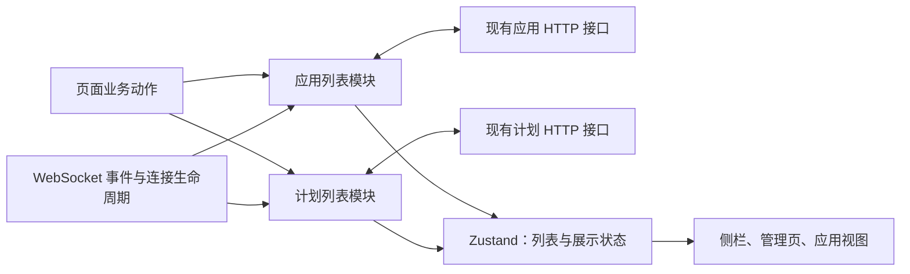

# 前端应用、计划与会话列表：统一更新入口

> **Status:** implemented — 应用、计划与会话列表的读取、推送和操作回执由各自业务模块统一处理；发布仍按仓库验收流程进行。

## 决策与范围

应用、计划和会话列表模块分别拥有更新责任，页面通过领域入口提交操作，WebSocket
通过事件入口提交变化。各模块分别拥有列表更新规则，现有 Zustand store
继续承载供 React 订阅的数据。应用模块同时维护在线与归档列表。

已确认的设计边界：保留应用推送的即时显示，丢弃可确定过期的响应，对无法
判定顺序的变化安排后续 GET；不增加服务端 revision。
“合并”指集中这些更新责任，不表示把应用、计划和 agent 合成一个实体或通用框架。

本文拥有前端同步设计；应用生命周期仍由 [applications.md](applications.md)
定义，置顶和排序规则仍由 [sidebar-pins.md](sidebar-pins.md) 定义，计划事件
语义仍由 [schedule-tool.md](schedule-tool.md) 定义。本文不改变服务端写入事务、
权限、归档保留文件、计划触发和 agent 列表既有逻辑。

## 已确认的问题与依据

基线：2026-10-28，`0df8b78ec470c0186c0ef6bd758a3695f1e686d1` 的开发树。
下列为该固定基线中的问题；链接保留原源码证据，不表示当前实现仍有这些缺陷。

| 问题 | 位置与触发路径 | 影响与应补的行为测试 |
| --- | --- | --- |
| P2：旧应用快照覆盖已完成构建 | [原 useWebSocket.ts](https://github.com/Danuvius152/Octopus/blob/0df8b78ec470c0186c0ef6bd758a3695f1e686d1/web/src/hooks/useWebSocket.ts#L650) 第 650–654 行重连 GET 直接 `setApplications`；第 371 行的 `application_updated` 先 `upsertApplication` | GET 开始 → WS `ready` → GET 旧 `building` 晚到，页面退回构建状态；应断言旧快照不能提交 |
| P2：计划多处独立读取，晚到者覆盖 | [原 refreshSchedules.ts](https://github.com/Danuvius152/Octopus/blob/0df8b78ec470c0186c0ef6bd758a3695f1e686d1/web/src/lib/refreshSchedules.ts#L19) 第 19 行与 [原 SidebarManage.tsx](https://github.com/Danuvius152/Octopus/blob/0df8b78ec470c0186c0ef6bd758a3695f1e686d1/web/src/components/SidebarManage.tsx#L51) 第 51 行均可直接 `setSchedules` | 较旧的 enabled 列表晚于 disabled 列表返回，UI 恢复旧状态；应控制两个响应顺序验证 |
| P2：创建计划时重新写入捕获的旧数组 | [原 ChatView.tsx](https://github.com/Danuvius152/Octopus/blob/0df8b78ec470c0186c0ef6bd758a3695f1e686d1/web/src/components/ChatView.tsx#L879) 第 879 行：`/schedule` 在请求前取得 store，响应后执行 `store.setSchedules([...store.schedules, created])` | 等待自然语言解析时收到的修改或删除被旧数组覆盖；应在等待期间改变其他计划后完成创建 |
| P2：重连未补取计划 | [原 useWebSocket.ts](https://github.com/Danuvius152/Octopus/blob/0df8b78ec470c0186c0ef6bd758a3695f1e686d1/web/src/hooks/useWebSocket.ts#L631) 第 631 行起的 `onopen` 补取 agents、sessions、applications，没有 schedules | 断线期间变更后，没有后续事件或页面重挂载时，侧栏继续展示旧计划；应断线修改后重连验证 |

前两条在实施前已于隔离副本的真实 hook/store 路径上复现，并核对其余调用链。
当前已按下文方案实施；原反例及验收矩阵由对应模块和真实消费者回归测试覆盖。

另外两个约束决定实现形状：

- 基线的 [ApplicationFormPage.tsx](https://github.com/Danuvius152/Octopus/blob/0df8b78ec470c0186c0ef6bd758a3695f1e686d1/web/src/components/ApplicationFormPage.tsx)
  曾单独缓存归档列表。恢复应用后，早先发出的归档 GET 可能把它放回归档区域。
  两个区域必须共用更新责任，但服务端两个查询仍是两个不同时间的快照。
- [server/db/base.py](../../server/db/base.py) 的 `_set_pinned`、`_reorder_pins`
  不修改 `updated_at`。该字段不能用作完整版本号；请求发出顺序也不能代表
  服务端提交顺序。[计划事件](../../server/routers/schedules.py) 只有
  `schedules_changed` 通知，没有可用于逐行合并的内容。

## 三种接口方案

### A：统一命令入口

例如 `applicationList.execute({ type: "archive", id })`，配合 `refresh()`
和 `receive(event)`。入口数量少，读写、失效和收敛都在模块内部；HTTP 与
可控测试 transport 是内部依赖，页面不接触读取令牌。

优势是同步规则集中。代价是命令联合类型及返回类型成为新的协议；增加业务
动作需要修改分发器，调用者仍须理解每种动作，并不因方法数量少而更简单。
适合确实已有命令路由的系统，当前列表没有这项需求。

### B：显式操作范围

例如 `withOperation(scope, async operation => operation.applyRow(await api()))`，
并向同一范围提交读取和推送。它能表达不同消费者的提交策略，较容易沿用
[agentUpdates.ts](../../web/src/lib/agentUpdates.ts) 的逐请求保护。

代价是每个页面仍须正确选择范围、处理结果和结束操作，遗漏任一步便绕过
同步保证。测试既要验证合并器，又要证明所有页面正确使用协议。它的灵活性
适合确有不同合并政策的生产者；当前问题恰恰是各生产者承担了太多同步责任。

### C：业务方法，内部统一读取与提交（推荐）

例如 `applications.archive(id)`、`applications.reorder(ids)`、
`schedules.setEnabled(id, false)`。页面只表达动作；模块负责请求、回执、推送、
确认读取和错误分类。生产 HTTP 与可控测试 transport 放在同一内部接缝。

方法比 A 多，但调用者不需要学习额外的命令协议，也不需要 B 的操作令牌。
其深度来自一次业务调用覆盖完整同步责任，变更集中在对应领域模块。
若删除这层，冲突判断、刷新合并、错误区分会重新散落到多个页面，因此这层
并非 HTTP wrapper。推荐采用 C 的接口和 A 的集中读取方式，不建设泛型同步引擎。

## 事实、写入者与提交点



| 事实或状态 | 写入者与提交点 | 消费者及失败范围 |
| --- | --- | --- |
| 应用、计划持久事实 | 现有服务端事务；此设计不改变 | HTTP / WS 提供观察结果，浏览器不能撤销服务端提交 |
| 在线及归档应用 | 只有应用模块能提交；同一次 store 更新维护两区互斥 | 侧栏、All、应用视图；读取失败保留此前数据 |
| 计划列表 | 只有计划模块能提交 | 管理侧栏、Schedules 页；创建提示使用操作回执，不回写旧数组 |
| 排序临时意图 | 应用模块仅保存本次待确认的 ID 顺序 | selector 在最新行上应用顺序，不保存第二份应用数组 |
| 已观察变化、在途读取及失效标记 | 模块内部临时状态 | 生命周期结束清理，不持久化，不推断服务端版本 |
| 请求状态、刷新错误 | 模块写入最小可订阅状态 | 页面区分“操作已确认”和“列表尚未同步”；空列表不能冒充加载失败 |

`sessionStore` 保留唯一的完整展示数据。模块可使用 store 内部提交函数，页面
与 WS 不再直接调用无保护的列表 setter。归档数据从组件局部 state 移入同一
应用 slice；首次打开 All 时加载，已加载后随应用变化失效，下次进入仍刷新。
读取中的旧数组只由请求闭包持有，不另建业务缓存或永久删除标记。

## 推荐接口及调用责任

实现位于 `web/src/lib/applicationList.ts` 与 `scheduleList.ts`，列表数据
仍在 store；不另建与领域无关的 manager。以下列出业务入口；具体类型由源码声明。

```ts
// 页面入口：方法内部选择 endpoint、提交策略及确认读取。
applications.refresh(view?: "live" | "archived"): Promise<RefreshResult>
applications.create(input: NewApplication): Promise<ApplicationRead>
applications.build(id: string, prompt: string): Promise<ApplicationRead>
applications.archive(id: string): Promise<ApplicationRead>
applications.restore(id: string): Promise<ApplicationRead>
applications.setPinned(id: string, pinned: boolean): Promise<ApplicationRead>
applications.reorder(ids: string[]): Promise<ApplicationRead[]>

schedules.refresh(): Promise<RefreshResult>
schedules.createFromText(input: ScheduleFromTextInput): Promise<Schedule>
schedules.setEnabled(id: string, enabled: boolean): Promise<void>
schedules.setWikiMode(id: string, mode: WikiMode): Promise<void>
schedules.remove(id: string): Promise<void>

type RefreshResult =
  | { state: "applied" }
  | { state: "pending" }  // 本次读取失效；已有后继确认读取需求
  | { state: "failed"; message: string }
  | { state: "obsolete" }; // 已离开原账户或连接范围
```

页面可以 `await applications.archive(id)`，无需接着手动 remove、刷新或恢复旧
数组。方法成功代表服务器确认该请求成功，不代表后续列表读取成功，更不
代表构建已经完成。读失败通过列表状态呈现，不把已成功的写操作变成失败。
返回的行只供操作提示等业务用途，页面不得再次 upsert。

写操作错误区分明确拒绝、结果未知和已离开账户范围。网络断开、超时或不能
证明无副作用的服务端错误属于结果未知，不自动重发创建、构建或删除。
后续 GET 只能确认列表当下状态，不能证明原请求一定未执行。已收到成功回执
但连接变化时，保留其业务结论，禁止旧范围直接修改新范围的展示数据。

创建应用通常在行已进入当前列表后打开应用。若回执因冲突未用于更新列表，
先留在创建页显示“已创建，正在同步”；后续列表出现该 ID 且页面仍在当前
账户、用户尚未离开时才打开。确认读取失败时提供刷新，不能再次提交创建。
这段页面导航状态只保存创建的 ID，不复制整行。

WS 集成入口只接收已解析的应用事件、计划失效通知，以及账户/连接生命周期。
它不是供页面任意灌入快照的公共接口。连接来源身份由 hook 捕获并传入，模块
核对后才改变列表或触发失败提示、会话补取等副作用。

## 读取与冲突规则

### 每个模块最多一个有效在途 GET

应用的 live、archived 共用一个读取调度点；计划独立。多个页面请求同一列表
可复用当前读取；多个失效通知合并为待读取标记，不按事件数量积累任务。
应用两个查询都需要读取时轮流服务，归档需求不能被持续 live 变化饿死。
只是已失效但已被本地退役的网络请求，可能仍在服务器完成，不计作有效读取。

每次读取捕获生命周期身份和本地变化序号。序号仅表示浏览器已经观察到什么，
不是服务端版本。有效 WS、操作开始/结束、已接纳的回执及快照推进该序号；
纯粹重复调用 `refresh()` 不推进序号，也不表示服务器出现了新事实。
操作先登记开始，再捕获自身序号；回执在登记自身结束前核对竞争，避免将
自身开始/结束误当成竞争。读取接纳时推进序号保护更早的写回执，但不因
接纳快照再安排读取，避免两个应用查询相互触发循环。

| 时机 | 处理 |
| --- | --- |
| 读取开始 | 记录来源范围与序号；消费该查询当时的待读标记 |
| 应用推送到达 | 核对来源后立即更新相关行或移除；推进序号，标记相关查询需要确认 |
| 计划变更通知到达 | 推进序号并标记重读，不构造推测的计划行 |
| 本地写开始/结束 | 使重叠读取失效；成功、失败或未知后均安排适用列表确认，不重放写请求 |
| GET 返回且范围、序号均未变 | 原子提交该查询快照；这是“读取期间没有已观察冲突”，不是全局最新证明 |
| GET 返回但已观察到变化 | 整份丢弃；保留当前数据，安排合并后的后继读取 |
| GET 出错 | 保留数据及 stale/error 状态，结束该轮；失败本身不产生下一次重试 |
| 账户/连接范围变化 | 退役旧读取，旧回调不得提交；按新范围安排所需读取 |

采用整份丢弃而非逐 ID 合并，可省掉每个在途请求的 changed 集合、删除墓碑和
字段版本表。代价是持续变化期间，漏掉的其他行要等一次无冲突读取才能补齐。
应用推送仍即时显示，计划可能保持旧列表并显示正在同步。这个取舍属于明确的
能力边界；若未来要求持续高频变化下仍完整前进，再单独评估更强协议。

后继读取期间若又发生变化，可以再需要一次读取。“合并一次后继”不是整段
会话最多发两次请求。安排在后续任务中启动，避免同步递归；不增加周期轮询。
单次 GET（包括响应体解码）设 30 秒本地期限，超时退役请求并忽略迟到结果，
避免一个悬挂请求永久占住入口；这不代表取消了服务器工作。测试替换时钟。

失败终止当前自动读取轮次，等待失败后的新事件、页面进入、重连或用户刷新
再启动；失败前已合并的标记不驱动自旋。`refresh()` 返回它所参与那次尝试的
结果，不等待变化无限期安静；若需要后继则返回 `pending`，页面订阅后续状态。

### 迟到 WS 和操作回执

即使当前没有 GET，有效应用事件也标记确认需求。否则“GET 已显示 ready，
迟到事件改成 building”后可能永远没有下一次读取。接受即时推送意味着这种
无法识别的新旧倒退仍可能短暂发生；本设计承诺随后确认，不承诺永不闪回。
全部有效事件均可触发失效，正确性不依赖整行相等比较或推测时间戳。
应用事件和操作保守地同时失效 live 与已加载的 archived 查询。HTTP 中的
`backend` 来自运行时补充，原始 WS 行不保证携带该字段；推送只提交其实际
携带的字段，缺失的运行时信息保持未知或待确认，不伪造默认事实。确认 GET
补齐读取模型，也不能把整行相等或 HTTP 派生字段当作事件版本依据。

操作回执只在范围仍有效、从请求开始至回执期间没有竞争提交或事件时用于
更新展示数据；否则保留当前列表，交给确认读取。竞争判断可以保守到整个
应用域，避免新建逐行版本系统。排序返回的整份列表尤其不能无条件替换。
成功回执与其 WS 通知重叠时，通常由 WS 提供即时显示，GET 完成确认。

允许在本地操作等待期间读取列表；无已观察冲突时可展示该次读取的服务端
现状，但操作仍未决，不能标记为操作之后的确认。操作结束会再次失效并确认。
因此长时间的自然语言计划创建不会阻塞其他计划读取，也不会被一次旧 GET
误判为创建失败。

### live 与 archived 的关系

两区在一次本地提交中保持 ID 互斥。完整行按 `archived` 放入对应区，并从
另一区移除；仅有 archived ID 的事件立即移出 live，已加载归档区等待 GET
补齐。deleted 移出两区。live GET 中缺失某 ID 只证明该次 live 快照没有它，
不据此发明归档行；归档查询同理。

一次查询接纳的行从另一区去重。两个查询共享变化序号并串行读取，避免本地
restore 与早先 archive GET 交错后重新引入重复项。它们仍不是服务端原子
双列表快照，跨查询期间可能暂时缺行；变化停止、所需查询成功后才能收敛。
归档区未加载时记录需要读取即可，不为隐藏历史提前拉取全量数据。

### 身份与副作用

继续使用 [accountFetch.ts](../../web/src/lib/accountFetch.ts) 的账户及响应体
读取保护；在模块内部补充当前 socket 来源身份和已知 `dispatchGeneration`。
断线或连接替换立即退役旧读取，重连刷新应用、计划及已加载的归档区。
已知服务代次变化同样使读取失效；不声称能识别尚未获知的服务器重启。

重连仍是同一账户，已有列表可保留并标记待同步；退出或切换账户清空列表、
归档加载状态、排序意图和错误。旧请求完成不得释放新请求的占用标记，旧
写回执不得触发新账户的导航、通知或会话补取。

应用已接纳的移除统一清理选中应用、未查看失败标记及相关排序 ID。有效 WS
仍保留现有失败状态提示和 `hydrateSession` 行为；原事件 handler 中的相同
副作用在迁移时移除。确认 GET 不再重放一次“事件到达”，已失效事件没有
副作用；会话自身的更新保护继续由会话模块负责。

## 排序：保留乐观反馈，限制重复提交

建议在一次应用排序或 pin/unpin 提交尚未结束时禁用这三类控件，模块同步
拒绝第二次提交；其他页面的同类操作共用该状态。鼠标、触摸和键盘拖拽均
遵守禁用状态，读取 busy 后再点击的竞态也由模块入口保护。

这是本方案明确建议收窄的交互：首次拖拽立即反馈，提交中不能继续拖拽。
它用一个临时 busy 状态避免请求队列和“后发请求一定后提交”的错误假设。
若产品必须支持连续拖拽，应重新设计未发出意图的合并与提交次序，不能靠
忽略旧 HTTP 回执宣称最后拖拽一定生效。

乐观层只保存 ID 顺序，作用于最新行；WS 的构建状态、归档、删除及 pinned
资格继续立即生效。未列入意图的有效 pinned 行保持相对顺序追加在后面。
成功回执若可安全使用，则接纳其顺序；若有冲突，保留临时顺序直到写结束后
开始的一次有效 GET。确认失败则撤掉临时意图、展示最近已接纳数据并标记未
同步，不能把用户意图无限期当作已保存事实。明确写失败或结果未知也撤掉
临时意图并确认，不能回滚整份旧数组。

HTTP 结束后可再次操作，旧确认 GET 不得清除新操作的排序意图；清理须匹配
本次意图身份。跨标签页写入、未知结果的旧请求仍在服务端完成等情形没有
“本浏览器最后意图必胜”保证。未知结果不自动重发，下一次操作是用户另一次
显式提交，最终仍以服务端读取为准。

## 迁移与可删除的维护负担

下表列出已迁移的生产者与删除的旧更新路径。

| 当前生产者 → 消费者 | 集中后的入口与移除内容 | 保留行为／保留原设计的最强理由 |
| --- | --- | --- |
| `SidebarApplications` 初载、排序、pin → 应用 store | 改用应用业务方法；删除组件内 load、整表覆盖及失败补偿 | 保留即时排序和侧栏可见规则；现状组件自给自足，单独阅读更短 |
| `ApplicationFormPage` 创建、恢复、归档、pin → 全局 live + 局部 archived | 统一应用模块；删除局部归档数组及两处手工搬移 | 保留 All 计数、恢复置顶与创建导航；现状归档仅在挂载时占用内存 |
| `ApplicationView` 构建、归档 → 应用 store | 业务方法；删除回执后的手工 upsert/remove | 保留 iframe、`last_built_at` 刷新与构建提示；现状回执可立即更新 |
| WS 与重连 GET → 应用 store | 事件/生命周期入口；删除独立应用 GET 提交及重复副作用 | 保留即时事件、失败提示、会话补取；现状无需每批事件后再确认读取 |
| `refreshSchedules`、`SidebarManage` → 计划 store | 统一 `schedules.refresh()`，删除旧独立读取实现；credentials 原路径保留 | 保留后台读取失败时已有数据；现状只需一个简单 fetch |
| `SchedulesPage` toggle、delete、Wiki mode → 计划 store | 计划业务方法；删除散落的请求后刷新 | 保留 Wiki 权限选择及删除确认；现状页面直接掌握请求错误 |
| `ChatView` 的 `/schedule` → 计划 store | `createFromText`；删除旧数组 append | 保留原会话、agent、时区及成功通知；现状无需再 GET 就可见新行 |

[SortablePins.tsx](../../web/src/components/SortablePins.tsx) 只增加可复用的
禁用能力，不承担网络或领域规则；agent 调用者保持原行为。
[sidebarPins.ts](../../web/src/lib/sidebarPins.ts) 的展示选择规则继续保留。

依赖策略：Zustand 和 selector 属于进程内依赖；现有 HTTP 是远程但由项目
拥有的依赖。生产使用现有 `accountFetch` 与类型；测试使用能控制完成顺序的
transport 和 WS 事件输入。只为这两个真实用途保留内部接缝，不增加 repository
层、事件总线、持久缓存或替代 Zustand 的状态框架。

实施后，页面与 hook 应找不到绕过模块的列表 setter，也不保留两套有效刷新
路径。旧测试仅在被同等行为覆盖后替换，既有侧栏选择、权限和会话测试保留。
同步规则变化集中在两个模块，不扩大到 agents 或整个 store 拆分。

## 验收矩阵

测试通过业务入口、WS 入口及可订阅结果断言，控制 HTTP/响应体完成顺序，
不直接检查内部计数器。下列项目是持续保留的验收合同。

| 场景 | 必须观察到的结果 |
| --- | --- |
| GET building → WS ready → 旧 GET 返回 | ready 不被旧 GET 覆盖；后继 GET 可完成确认 |
| GET ready 完成 → 迟到 WS building | 即时推送可短暂生效；必有确认读取，安静后恢复服务端状态 |
| GET 期间收到多次计划通知 | 同时最多一个有效计划 GET；合并后继，最终采用无冲突列表 |
| 后继 GET 中再次变化 | 可以继续需要下一次，不能因“已经补读过”而漏同步 |
| 两个页面同时 refresh | 复用同查询在途读取，不产生响应倒序竞争 |
| `/schedule` 等待期间删除或修改其他计划 | 成功回执不恢复旧数组，已有变更保留，创建成功与同步失败分开呈现 |
| 旧归档 GET → restore → 旧 GET 返回 | 不重新归档已恢复行；live/archived 不重复，All 计数无重复 ID |
| 读期间收到 archive/delete | 不因旧快照复活；选中项与失败标记按移除规则清理 |
| 断线期间改变计划后重连 | 即使没有新通知，计划也重新读取 |
| 重连、服务代次变化、退出或换账户；旧 body 晚解码 | 旧结果及副作用失效，不能清掉新请求状态或污染新账户 |
| 排序期间 WS ready 或删除某行 | 乐观层只影响顺序，状态不退回，已删除行不复活 |
| 排序 pending 时再次拖拽或从 All pin | 控件禁用，直接调用模块也不发第二个竞争请求 |
| 第一次排序结束、第二次开始、第一次确认读取返回 | 旧读取不能覆盖新顺序或清除新意图 |
| 排序失败／未知结果 | 不恢复旧整表，不重发写操作，撤销临时意图并安排确认 |
| 写已成功，确认 GET 失败 | 成功结论保留，列表标记未同步，不提示重新创建或构建 |
| 创建成功但行回执被冲突挡住 | 显示已创建待同步，不打开不存在的行，不重复创建 |
| GET 悬挂、超时后迟到 | 30 秒本地期限释放入口；迟到结果不提交；可由新触发重新读取 |
| GET 失败后没有新触发 | 请求数量不继续增长，保留旧数据与错误；首次加载失败不显示为确认空列表 |
| 应用两区同时 dirty、live 持续变化 | 查询轮流服务，归档获得尝试机会；不承诺持续冲突期间完整新鲜 |
| 所有变化结束、网络正常、所需 GET 成功 | 展示与该次服务端查询结果一致，临时意图与同步标记收敛 |
| 持续事件、重复事件、长写请求 | 无事件队列增长；推送可显示，读可执行，刷新调用可返回 pending，不无限等待安静 |

至少保留一个真实 hook/页面到模块的集成测试，分别覆盖重连补读、旧闭包创建、
归档恢复、排序禁用及现有失败提示，防止模块测试通过但调用者仍绕过入口。
实施时还须按 [testing.md](../testing.md) 完成对应前端检查；设计文档检查不能
替代行为验证。

## 会话列表与跨重连写入确认

`SessionList` 统一侧栏及重连 GET、归档列表、详情补取、创建、归档/恢复、分支
创建以及模型/凭据等局部字段回执。Zustand 仍持有唯一 live/archived 列表；模块
只持范围、已观察变化基线和至多一个活动完整读取，不保存第二份列表或永久墓碑。
每次读取捕获账户/token、连接、服务代次及变化基线。有效事件和本地确认改变
基线；冲突快照整体丢弃并合并为一次后续读取，不能让旧 running 覆盖 idle、让
归档/删除项复活，或让快照期间新增的会话消失。删除/归档保护持续到新的协调
读取边界，不会由旧快照清除。

详情只在同一范围和观察基线接纳列表字段，并拒绝已知较旧的 dispatch revision；
读取开始尚无服务代次、期间由其他会话首次建立代次时，详情可用自身派发状态
确认与当前代次相同，再接纳转录和队列；账户、连接及已知旧服务的检查仍保留。
消息窗口、问题、Research 和输入派发仍保留原合并责任。部分字段写入只修改其
负责的字段。过期 socket、账户/token、服务代次和退休读取都不能更新当前列表。
创建、恢复、归档及字段修改的成功回执遇到连接/服务或观察基线变化时，仍按
原账户/token 使当前列表失效补读，不直接应用旧行；创建与父会话归档在同一
确认中合并。读取确认归档后不再用原操作基线重复写入列表。换账户/token 或
dispose 后旧回执不补读；未知 ID 的归档事件同样阻止迟到创建复活该行。
`ForkDialog` 拥有 rewind 成功回执的列表确认，`ChatView` 回调只切换视图和加载
转录。跨连接成功仍关闭原账户的确认弹窗，并补读包含归档的列表，让父会话历史
保持可打开；当前范围已确认分支时才导航，换账户/token 后旧回执没有副作用。
创建与恢复入口异步返回“可导航”的确认结果。同一范围的回执若撞上列表变化，
沿现有合并补读等待一次不再 stale 的已接纳快照，保留创建后的导航意图；并发
写回执造成的后续失效也必须确认。若目标已归档/删除、读取失败或原范围退休，
返回不可导航，保留同步错误或原范围约束；不会重发原 POST。确认读仍只有一个，
等待没有新增轮询器或持久状态，既有正文超时终止失败读取，范围退出结束等待。
异步确认结果只代表确认时的事实；消费者在 `await` 后、导航或写消息前重新
检查原范围，防止返回 true 与调用方恢复之间的账户/token、服务或连接切换。
侧栏收到创建成功回执后按原账户立即关闭表单，不等待列表确认，以免确认
读取悬挂时重复提交。确认期间用户已移到别的聊天时，后台分支就绪只
发布原聊天的提示，不抢走新焦点。
读取失败保留已有数据，侧栏与归档页呈现错误；有效刷新清除错误和 stale。

`ScheduleList` 的 PATCH/POST/DELETE 写入成功归原账户/token，而不归旧连接。
同账户迟到成功回执使当前列表失效并补读，不把旧连接的返回行直接写入新连接，
也不重发写操作。确认读取失败保留写成功及 stale/错误；登出、换账户/token 或
dispose 后旧回执不触发当前读取。`/schedule` 的成功提示使用同账户范围。

应用排序的 ID 验证、排序及返回行/确切变更集合在同一数据库事务完成；广播只用
提交返回的变化行。新增、恢复、归档或删除与事务交错，不再依赖事务外两次观察
具有相同 ID 集合，也不通过吞错掩盖排序成功后的通知问题。

回归入口是 `sessionList.test.ts`、真实创建消费者 `openAgentChat.test.ts`、
`useWebSocket.lists.test.tsx`、模型修改、侧栏归档/重连和
`hydrateSession.test.ts`，以及 `scheduleList.test.ts` 的迟到写回执与确认失败矩阵。
生产调用方的直接整表覆盖已移除；协调不承诺无通知、无刷新触发时自行发现变化。

## 能力边界与交付状态

本设计保证已知冲突不会由旧响应覆盖，更新责任集中，读取并发和待读状态有界。
它不提供线性一致性、WS 顺序证明、可靠事件补发或跨标签页最后意图获胜。
条件性收敛依赖变化最终停止、遗漏变化经重连/进入/刷新暴露，以及其后的
必要 GET 成功；没有通知且没有刷新触发的服务端变化无法由浏览器自行发现。

应用、计划、会话模块及真实页面、WebSocket 消费者已迁移，调用方原有的直接列表写入、
组件归档副本和独立 `refreshSchedules` 路径已移除。回归分别由
`applicationList.test.ts`、`scheduleList.test.ts` 及对应页面/hook 测试验证，
包括真实 `/schedule` 旧闭包和断线重连补取。提交前检查和发布仍使用仓库统一门禁。
新增服务端版本协议及 agents 合并不属于本方案；只有产品提出更强顺序或
持续更新下完整新鲜的要求时，才重新评估这些方向。
