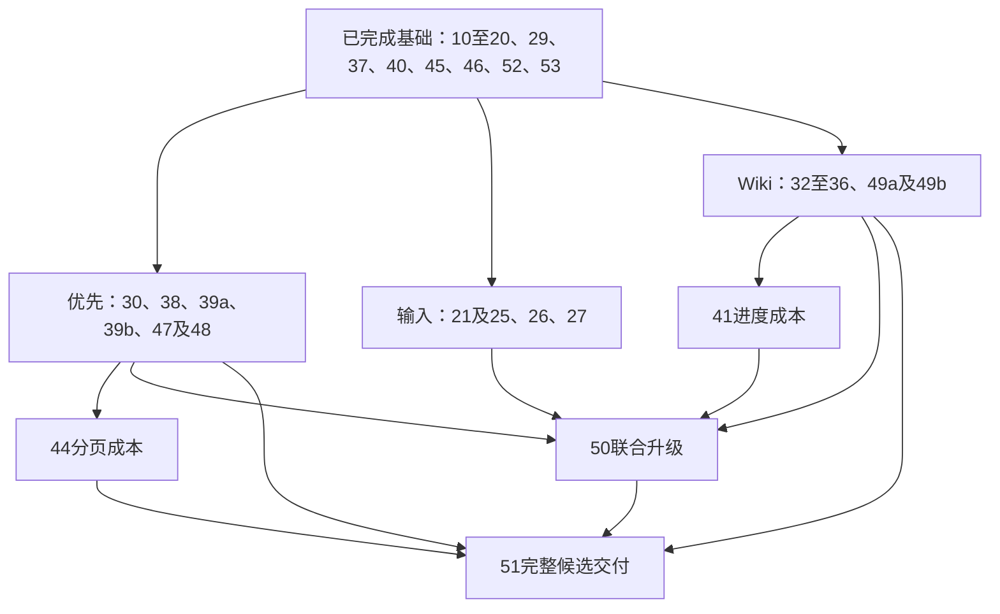

# Octopus 最小机制架构：执行计划

> **Status:** in-progress — 现有CLI下修复输入与Wiki缺陷；22/23/24/28/31/42/43整体暂停。

**2026-10-22后续范围决定（2026-10-23核对）：** 本期沿用Codex exec与Claude
stream-json/idle，22、23、24、28、31、42、43整体暂停，不作为后排任务，也不进入
本期51门禁。普通委托完成及重启后保留会话；不把旧RPC实验算作本期验收。
先修30、38、39a/39b、47→48，再推进输入21/25/26/27与Wiki任务缺陷。
纯成本优化41/44不抢在明确bug之前。此处记录范围与依赖，不增加单次实施或发布授权。

真实依赖同步修订：30→20/29；32→10/20；47→11；48→47；49b→49a/34/47。
50直接汇合27、30、25、26、35、37、39a、39b、41，不等待暂停的31；51不等待42/43。
原票号、当前完成数和各票证据由本机当前执行索引维护。
旧P1～P8图表达责任组，不再作为“全部P4完成才可修任意Wiki bug”的阶段阻塞。

**本轮止点（2026-10-21）：** 按用户最新要求，只完成票20的修复、同版验证、
独立复核和文档收尾；这些工作已完成，本轮停止。后续票和第51票完整发布门禁保留待办，
不因依赖满足而自动启动。本文中的完整实施路线仍是计划，不是本轮继续执行或发布的授权。

**2026-10-22 文档统一记录：** 当时仅更新剩余 spec、票据及依赖，未启动后续实现或发布。
主要设计解释采用[开发指南](../review/octopus-development-guide-20261022.md)，以源码核实事实。
原统一拆分为30项：配置前置正式编号52，旧代准入接管单列53，39/49各拆成两项；当前数量与新顺序见上方后续范围决定。
53在21之前接管旧代证明，52已明确配置快照；21交付普通单输入原子结算。
28的多输入送达集合及31/42/43随生命周期分支整体暂停。
38/39a/39b基于已有Store合同，不再人为等待35；50/51只汇合本期活动票。
各票状态、直接依赖以本机当前索引为准。

本机私有 tickets 保留 P1～P8 工作包，将允许前置的 CR-18 单列为 01；
公开进度与票20验收见[实施验收摘要](../review/session-owner-20-acceptance-20261021.md)。
原始票据、冻结包与日志不纳入源码仓库；设计合同仍以本计划和最小机制规范为准。

## 1. 依据、范围与实际起点

本计划把[架构简化审阅](../review/architecture-optimization-20261020.md)作为问题来源，
把[最小机制实施规范](../review/octopus_minimal_architecture_spec_20261020.md)作为设计合同。
二者冲突时使用后者；本计划 §2 记录本次访谈进一步确定的两项修订。
本文件负责实施依赖、删除条件与验收安排，不再复制一份架构规范。

2026-10-20 已只读核对的本地起点：

- HEAD 为 `5d99de373921affd27fe307e5770ea397d4f04d6`，同时存在已暂存 CR-03
  输入恢复实现、相关文档和未暂存修改。不能只基于 HEAD 编写迁移，也不能重置暂存区。
- 实际环境为 Python 3.14.4、SQLite 3.46.1、aiosqlite 0.22.1；规范引用的历史环境
  不替代这次实施环境。当前 staged 主库已经使用 WAL + FULL。
- 当前服务已受 systemd 管理，并启用 `KillMode=control-group`、`SendSIGKILL=yes`、
  `Delegate=no`、`TasksAccounting=yes`；尚无规范要求的启动检查器、安装独占锁和 profile 门禁。
- 启动时 `scheduler.initialize()` 已开始调度；Wiki worker 在 `start()` 后立即 wake，
  且恢复藏在 worker.run 内。BG 的 `start()` 和 Research 的恢复目前主要结算历史，
  不能仅凭方法名认定它们都会派发新工作。
- CR-03 当前仍是 reserve → 内存 start_message → settle，另有 claim 与完成补写；
  新规范要求把这些提交点和所有输入来源一起收束。

实施开始时重新核对 HEAD、diff 与实际配置即可；若已有其他改动，检查其影响后纳入或保留，
不为标识版本另建多层快照、任务账本或重复审批文件。现有 CR-03 的测试结果属于旧实现证据，
不能直接计为新事务、owner 或 supervisor 的验收结果。

文中的“运行数据库”专指框架 SQLite；“主库 / Canonical Vault”继续指权威知识正文，
与 [GLOSSARY](../../GLOSSARY.md) 的既有用语一致。

## 2. 已确定的决策及规范修订

### 2.1 架构决策记录

**故障域。** 运行数据库或 Wiki 权威存储失信时，全服务停止本代并由 systemd 收束后代。
接受一个存储故障中断所有本机会话的代价，删除同代在线补写和反复恢复失信连接。
业务冲突、正常取消、认证失败、通知断线仍按各自语义处理。

**事务与所有权。** 运行数据库保留一个写连接和明确短事务，取消跨公共调用的未提交 SQL。
每会话只有一个状态 owner；耗时 Harness I/O 由受管任务回报事实。
权威输入只有一份，Wiki 跨数据库/文件的 journal、receipt 与通知 outbox 保留。

**请求权限。** 带请求工具权限的物理进程不跨逻辑轮次复用，新轮次创建新 lease/bearer。
活动轮次的权限、来源和回传合同不可变；合同变化的新输入排下一轮。
支持 stdin 不代表允许跨请求持有进程，也不代表 provider 已确认收到追加输入。

这些决定具有真实兼容和性能取舍，集中在现有计划目录记录；不恢复已退役的 ADR 目录，
不另建一套重复的设计决策文件。

### 2.2 本次访谈的两项确认

| 决策 | 用户确认 | 对规范及实施的影响 |
| --- | --- | --- |
| D1：升级后恢复 | 沿用兼容代码恢复或前向修复，不采用整套快照回退 | 修订规范 §9.3 的备份/回退步骤；不新建第二份正式知识库，不回灌旧 DB 覆盖新文件。保留隔离迁移演练、现有增量 history/blob 和必要版本证据。 |
| D2：明确拒绝后的重试 | 新请求未 accepted 时不占五态输入账本；用户可主动用同 ID/内容再次提交 | 五态描述已接纳输入。accepted 或 unknown 的原身份仍严格去重；客户端不自动 POST。旧版已持久拒绝回执只读保留，不能为迁移生造接纳或执行事实。 |

D2 的具体例子：配额满时明确拒绝 K；容量恢复后，用户再次提交 K 可首次接纳。
若 K 已 accepted，响应丢失后的再次提交只返回 K 的原状态。旧版已保存的拒绝 K
仍返回其历史拒绝事实；新的主动发送须使用新身份。旧数据兼容不形成第二套在线 writer。

本轮范围包含审阅确认的 CR-01～CR-20，覆盖此前 CR-03 单项计划中尚未纳入的修复。
这是新的实施目标，不把旧计划的“尚未确认”误写成已修复；旧验收记录保留。
全目录覆盖核对补入 CR-17～20、CR-12 的参数分支及选定工作流/效率项，分类见 §11。

## 3. 实施依赖与切换原则

本图按本次范围展示工作分支，组间箭头不表示整组的开工门；每票的精确依赖以
`.scratch/minimal-architecture-20261020/execution-index.md`为准。尤其30、32、47可基于
已完成基础独立开工，48只等47，不能再用整个P4完成阻塞Wiki与界面修复。
后文P1～P8保留为审查和证据单元，不是八次生产发布。实现工作树可连续演进；生产只接收通过
全部适用门禁的完整候选。不得部署新旧权威 writer 同时存在的版本。

三个必须同时接通的切换面：

1. **P2 的全部 SQL 调用面：** 改 Database 入口时，同步迁移各 writer、公共读取和直接 conn 调用；
   不能用新 wrapper 包住旧方法内部的 commit。
2. **P3/P4 的接纳与执行面：** durable 输入、派发选择、owner 和 claim 同时满足新合同后，
   才删除旧内存队列的权威角色及完成补写。P3 的存储/协议可先审查，不独立发布半套派发器。
3. **P4/P5 的执行结束面：** lease撤销、工具调用登记、本轮终态发布、held资源和Wiki join
   各有准确完成点并形成闭环后，才删已被接管的检查；不再等待跨turn原生全树完成。

P6/P7 只有在不改动同一文件且依赖已稳定时才并行；P5 与 P6 共用绑定或装配文件时顺序写入。
不把并行本身当目标。

CR-18 的历史前像错绑存在跨文档恢复风险，完整定点修复可在 P1～P4 搭建时先行完成与验证，
不等待全部 owner 重构；修复须同时覆盖 reread、正常 publication 结算与旧候选恢复资格。
它仍合入最终候选，不以临时绕过移动/恢复功能代替完整修复。

### 3.1 实施收敛：按职责完整替换，再删除旧机制

本节把规范 §2～§6 落到当前模块的替换顺序，不新增设计合同。进度和实测结果
仍只由 tickets 维护。实现以一个完整职责的接管为单元；局部反例用于验证设计，
不能让每个反例各自衍生一个状态、重试器或恢复入口。

#### 唯一事实与写入 owner

| 事实 | 唯一权威及 owner | 其他模块允许持有的内容 |
| --- | --- | --- |
| 本代是否可执行、旧执行是否结束 | main 持有安装锁与 ServiceHealth；systemd 收束整代 | 捕获的同一 health、当前执行句柄；历史 PID 不授予停止权 |
| 输入被接纳、顺序与执行绑定 | 现有 client_submissions；Database 的业务事务写入 | owner mailbox 传命令，UI/通知读投影，不另存待执行正文队列 |
| 会话活动 run、问题、取消与归档意图 | 一个具体 SessionOwner | I/O task 捕获不可变执行身份并回报事件，不直接改 Session |
| 一次业务结算 | 主库中的精确 terminal 与输入关联，同事务提交 | 主输出候选、通知发送状态、HTTP waiter 是独立事实 |
| 哪份账本拥有正文范围 | 已有注册、安装/范围引用；Registry 统一认领与交接 | Store/observer 持有捕获引用，不各自再选择 owner |
| Wiki 已发生的效果 | history 原文与 prepared/applied、operation receipt、observer inbox | job item 引用这些证据；模型文字、索引或取消确认不能替代它们 |
| 跨资源安装变更 | 原命令 owner、实际账户/adoption 行及已有专属 intent/journal | startup 只按持久事实收束；不新增通用迁移框架或双写状态 |

#### 模块接口与依赖方向

1. **进程归属模块。** `main/cli/service_installation/service_scope` 负责取得
   执行权、恢复前准入及正常退休。`ServiceHealth.fail()` 是唯一不可返回故障出口。
   Registry、Database 和线程捕获同一个对象，不各建 fatal watcher 或补偿任务。
2. **运行数据库模块。** `Database.transaction()` 隐藏连接锁、驱动回执、游标、
   总期限与 COMMIT/ROLLBACK；业务 SQL helper 接收 tx，不重新进入公共事务。
   接纳、claim、结算各自是一笔完整业务事务。HTTP 等待者不拥有命令寿命。
   独立导出读取可以保留；不得把正常提交后的独立回读继续当成功依据。
3. **会话执行模块。** `SessionManager` 保留现有应用接口、owner 注册和跨会话
   配额；`SessionOwner` 接受 Submit/Interrupt/Answer/Archive/Close 及带身份的
   I/O 回报。长 spawn/stdin/stop/模型 I/O 在受管 task 中执行。只有 owner 写活动
   会话状态；完成通知只在提交后发送。主输出、原生尾部与独立后台返回按规范分开。
4. **Wiki 模块。** Registry 统一负责注册、Store 生命周期与一次恢复准入；小型
   同步 storage 接口负责每条实际连接的 EXTRA、结束确认和原异常分类，返回原
   Connection；History 负责文件效果协议；job_execution 负责 typed JSON 与效果
   结算。调用者无需拼装 PRAGMA、commit、异常回读和重试。文件/数据库不冒充同一
   事务，不增加 Repository、SQL/Cursor 代理或通用事务协调器。

运行数据库模块和 Wiki 模块共同依赖 ServiceHealth，但彼此不套事务、不共用
数据库锁。Session owner 不等待另一个 owner；broadcast 只通知，不驱动权威状态。
请求级 Wiki binding 沿用现有不可变类型，注入真实 WikiTasks 实例，不保留 fallback
singleton。认领锁、数据库事务锁、文件写锁分别保护不同对象，不因名称相似合并。

#### 按协议一次解决创建、效果与恢复

| 协议 | 发布成功所需的完整事实 | 失败后的唯一责任 |
| --- | --- | --- |
| 主库操作 | 驱动/游标已结束，COMMIT 已确认 | 领域拒绝在确认 rollback 后返回；存储/结束失信立即 fatal，启动读取实际事实 |
| 新 Wiki 注册 | 完整初始账本及既有 filesystem binding 已持久化，然后才发布 config | 原注册命令重试沿用已发布的 binding；普通重开永不自动建库 |
| Wiki 修改/删除 | blob 与 prepared 先提交；授权/版本检查；文件效果及父目录同步；applied/receipt | 普通冲突由原操作 owner 收尾；持久性失信 fatal；冷恢复核验 before/after，不重写正文或调用模型 |
| token 轮换 | C0 prepared → F1 全部目标文件同步 → C1 原子 rekey+删除 intent → live handoff | prepared 存在则恢复旧文件；不存在则沿新配对；非领域退出 fatal，不加 committed phase |
| 首账户交接 | 关闭旧准入并 drain；账户/密文/adoption/授权根同库提交；必要目录交接确认 | 同一安装命令与 startup 收束原 owner 的文件交接；Wiki 使用既有 journal，不以 target.exists() 当完成证据 |
| Wiki 通知 | 原 event 身份进入主库并提交，然后 ACK Wiki outbox | 重送同一 event，接收幂等；通知失败不改已提交业务结果 |

新 Wiki 数据库的创建权限必须显式给首次注册/迁移入口，不能由 `_schema_ready`
或文件不存在推导。候选实现先在同 state 的私有临时文件完成初始 schema、原有
filesystem binding 和同步，再不可覆盖地发布数据库，最后发布 config。发布前
退出不产生可供普通重开使用的半成品；数据库发布后、config 发布前退出，原注册
命令须验证已有 root/vault binding 并沿用身份。已有 config 丢失账本或协议不兼容时
保留配置与正文、关闭相关写入，不能自动造新身份。上述为该接口的实施合同，
具体实现和验收以对应 ticket 的固定版本与实际证据为准。

health 只在冷生命周期绑定。现有 stop/close 必须先关闭恢复 plan 的 gate，并确认
constructor、receiver、Store 均退出；普通 `_check_reopen()` 或 `_handles` 为空
单独不足以允许换绑。门禁复用 Registry 的现有生命周期，旧对象继续持有原 health；
共享 observer/journal 遇到不同 health 必须拒绝，不静默接上新代。

一次恢复由 startup 或注册命令持有现有 Construction，使用尚未公开的候选 Store
完成 observer/history/index/job 分类；恢复调用显式接收该候选，不反向调用普通
`registry.store()`。完成恢复且原 permit/注册仍有效时才发布 Store；普通调用只能
借用已准入对象。这一组织方式同时用于新注册与冷启动，不另设 `_recovered`、
epoch 或后台恢复循环，避免“Store 等恢复、恢复等普通 Store”的循环。

退役与效果结算分别给出事实：`join_retired(ExecutionRef)` 确认 scope 已关闭、
捕获的后端/工具/文件线程已退出；效果核验确认具体 receipt、身份与 before/after。
terminal 不能替代其中任一项。ingest 后、worker request 准备前的正常取消也由
原 live owner 收尾；重启缺少引用则保留 attention，不推导从未执行。

memory 按已提交 agent 行的精确 owner 在 C1 后交接，正常 bootstrap、适用的
Wiki resume 与公开 startup 共用该过程；删除无必要性证据的 C1 前全树复制及其
SQL 源集合镜像。只移动 `<agent_id>/memory`，包含 archived agent，不移动安装
marker、未知目录、NULL owner 或 provider homes。统一用目标文件系统上的私有
stage 完整复制、核验、同步并发布，区分空 scaffold、相同树和冲突树，不依赖
`exists()` 或另加同 FS rename 快路径。

源开始破坏前，需要最小短期退役凭据，证明精确 source 全树已在精确 target
获得持久确认；DB owner 证明归属，不能重建递归删除前的完整树。凭据绑定原清单/
摘要及 owner/路径，删除到一半后仍能验证目标、识别源的已删除子集，变化或新增
内容保持关闭并保留双方。源退役及目录同步确认后删除凭据，不增加 committed phase
或 DB owner 镜像。unarchive/硬删除等实际 memory 修改入口与原安装 transition
协调并 drain 已进入的操作，不能只依靠新轮次门。这份 memory 证明不复用 token
intent 或 Wiki journal；具体行为仍按 ticket 03 验收。

配置和授权在各自模块统一解析。token 文件按实际 dotenv bindings 归一化和检查
重复，再验证可重写与真实冷启动来源，不逐条追加正则。保存后的 canonical 授权
根按固定路径参与比较，候选访问路径继续解析链接；不在 resume 或读取时把原先
缺失尾部后来创建的链接目标自动批准。App 代理保留完整 query pair；Wiki 写桥
选择目标必须与实际受支持下游一致，包含重复值和空值，避免检查与执行目标分歧。

#### 替换必须附带的删除清单

以下是实施前盘点的旧职责，用于界定替换责任，不表示这些路径当前仍然存在。
实际接管和删除状态见 tickets 及 §3.2，不把历史函数名本身判为当前缺陷。
每行的新接口接管后，在同一重构单元内删除旧在线路径及全部消费者；历史兼容读取
和跨资源证据按规范保留，禁止永久并存两个 writer。

| 原盘点路径 | 接管它的职责 | 同次删除/保留的范围 |
| --- | --- | --- |
| Session `_recording_blocked/_reconcile_recording`、`_submission_recorders/_submission_retries` | 主库完整结算事务 + SessionOwner | 删同代存储重试、暂停补写和 shutdown 重试；保留唯一终态选择与已提交但未送达通知 |
| Delegation `_pending_snapshot/_recording_error` 及失信后的回读补偿 | 完整 DB CAS 更新与其原命令 owner | 删存储失信后猜测/重试；保留真实 CAS 冲突、父子归属和稳定回传身份 |
| 输入内存队列、分散 callback writer 与若干会话状态锁 | durable pending + 单 owner | 删第二份执行队列权威及所替代的状态锁；保留跨会话配额、DB 锁、文件锁 |
| EventInbox arm/receive 的 attempted + 新连接回读 | 小同步存储模块的不可返回失败语义 | 删同代回读；保留 armed_epoch、batch/hash、intake/apply/ack |
| Wiki `recording_failure/recording_recovery/execution_unknown` 在线分支、取消 witness/poller/backoff | 精确 ExecutionRef + 单次结算/取消 owner + 冷恢复 | 迁移旧 JSON 为原引用与 attention；删在线自愈，不自动重跑模型 |
| History 每次加独占锁隐式 recover、App 写桥 prepare 的显式全量 recover、worker `_recovered` | Registry 每 vault 每代一次恢复 | 统一准入后一起删除普通请求中的全量恢复和重复标记；AppMutation 只结算自己的 external intent，未结清的旧 intent 在原锁内阻止覆盖；保留显式 owner 恢复入口 |
| WikiTasks singleton、跨请求重绑 context 和带旧 bearer 的进程复用 | 不可变 RunBinding + 当前 lease/物理 Harness 生命周期 | 新请求用新 lease/进程；保留 provider resume、同 run steer 与原生尾部，不增加动态 bearer 协议 |

Session 的 provider 转录完整性诊断不是数据库提交失信，不能随 recording 补写
删除。Delegation 已确认的正常 CAS 冲突读取也不属于失信后的在线回读，仍需用于
解释竞争及关系删除。删除以责任为准，不按名称或关键字批量清理。

#### 推进与验收方式

- 先完整收束 P2：主库业务调用、Wiki 连接/文件/创建入口、安装文件交接及错误分类。
  上游模块接口稳定后，再切换 P3/P4 的输入与 owner；P5 接管 Wiki 结算与一次恢复。
  期间不横向扩张小功能，不为早关 ticket 单独堆防御分支。
- 每个重构单元先列清输入、owner、持久提交点、领域失败、致命失败、重入和删除项。
  复用已有测试映射这些合同；新反例归入同一矩阵，不逐条生成独立恢复机制。
- 测试通过调用者使用的接口验证正常路径、领域拒绝、竞争/取消和提交点中断。
  存储故障用子进程退出/重启验证；旧测试的同代补偿断言须随职责替换迁移，不能保留
  较弱生产入口迁就测试，也不能删除身份/字节/无重复应用的断言。
- 一份固定候选由一个执行者跑受影响回归；Vera 提前审关键接口，
  完成完整重构后再审实现及删减，不重跑相同测试、不重复已关闭项。最终整体候选
  执行全部适用 release gate。新增缺陷仍须处理，但不以增加防御层代替检查设计。
- 本节验收要求是重复职责已删除、接口可独立解释、所有调用者使用同一保证，以及
  相应行为证据成立；不以测试数量、补丁轮数或代码行数作为完成定义。

### 3.2 票20的接口、完成事实与收尾边界

本节记录当前工作树的票20实现接口，不把 P4 全部目标或后续票描述为已交付。
本票状态、固定候选与实际验收记录在
[票20验收摘要](../review/session-owner-20-acceptance-20261021.md)。
通过本票不代表已经部署，也不替代第51票的完整发布检查。

`SessionManager` 保留应用入口、跨会话配额和原 Owner 的失败接管。
`SessionOwner` 串行修改活动执行、问题及生命周期意图；`OwnerRuntime` 和
`OwnerQuestions` 使用这同一写者。慢准备、spawn、stdin、reader 和退休操作
保留原任务结果并唤醒 Owner，不通过回调另写当前会话。异步结果始终关联原
request、attempt、work 和 backend，不能在出队时改绑成“当前请求”。

| 接口事实 | 实际依据与消费者 |
| --- | --- |
| 是否接纳 | `SubmissionReceipt.disposition`；取消等待者不撤销已接管命令。全局关闭后的新输入立即拒绝，已接纳 delivery 的重复仍返回原 receipt。 |
| 原输入与携带请求 | `RequestCompletion.input_request_id` 与 `request_id`。确认未发送的 steer 保留自己的身份；写入未确认不能套用携带请求的结果。 |
| 业务完成与记录 | 原 settlement 在 terminal 事务正常返回时立即保留 committed，先于后续投影读取。没有确认结果时返回 unavailable，不伪造成功或失败 terminal，不自动重放。 |
| 通知完成 | 同一 completion 的 `notification_state` 表达 delivered、failed 或 unavailable。原通知前缀失败不抹掉已提交业务结果；App 只有在原正文前缀送达后才能成功 done。 |
| 原执行资源退休 | 原 execution、preparation、reader 和 retirement 引用。CloseWork、归档及撤权等待资源；外部关闭另行排空 publisher，资源等待不能反向等待正在调用它的 subscriber。 |

每个原 receipt 只有一个 completion Future。Delegation 的初始请求、follow-up、
问答及回传都消费这一个结果，在正文 SELECT 之前固定原轮次和嵌套分类；
广播只上送问题，不再独立结算 result/error，也不保存第二份回复正文。
ApplicationManager 的构建状态、App ask/SSE、Research、Wiki 和 scheduler
也接通这份结果；各自的投递、浏览器确认和文件效果仍是独立事实。

显式归档、自动归档和 rewind 共用原 reservation、退休期限及失败释放。
Owner 在释放接管前或期间死亡，由 Manager 处理原对象与原预留；不能以收尾
拒绝覆盖已经 ready 的 child，也不能重新开放 failed admission。普通关系冲突
不免除已经捕获 work 的清理责任。资源确认后，即使原自动归档任务失败，
仍须 seal/join 原 publisher，再传播原错误；资源不能确认则保留真实 fatal 出口。
关闭另一 work 的 steer 时，同时 join 原准备和已开始的写入，不停止无关主请求；
写入不明由原 Owner 分类。child 的业务结果已确认而正文随后删除时，沿原稳定回传
身份告知仍开放的父 work 交付失败，让嵌套父链可以结束，原 child 成功事实保持。

mailbox、控制入口和顺序 publisher 各自计入实际内容预算，背压抵达实际 producer。
合法大命令可独占空控制通道；取消未接纳的容量等待者不执行命令，Owner 失败须释放
这些等待者。正常全局关闭拒绝新输入；held sweep 的原期限同时覆盖退休交接和确认，
超时只结束等待，原命令、句柄和数据库继续保留。

已替代的 Session driver/executor、状态锁、并行问题 maps、Delegation 广播终结／
异常回读分类、回复正文副本和 `_Settlement.final_task` 协议删除。
单次终态选择、completion callback 的实际交接 drain、跨会话配额、DB／文件锁、
有界通知及精确资源引用保留。durable 派发、现有CLI本轮收尾与idle归属、RunBinding、
stdin 交付和结算事务的后续改动仍按原票拆分，不因本票单写者已经接线而宣称完成。

票20收尾只接受同一冻结版本的行为验证和实际独立复核。旧失败及中断日志保留；
未执行、deselected、单项绿色和未阅读的评审回复都不计整票通过。

**本票验收（2026-10-21）：** 固定候选 `134705` 的115文件受影响联测为
1907 passed、23 deselected，506.26秒，exit0；Vera代码及收尾复核均已读取，
相关代码问题和两项文档P3已关闭。当前源码与该候选逐文件一致；
[验收摘要](../review/session-owner-20-acceptance-20261021.md)
保留候选／日志摘要、旧失败和验证范围。这是票20验收，不代表完整后端、前端、
浏览器、live或system发布门禁已通过；后续票及第51票未启动。

## 4. 工作包及退出条件

### P1：执行归属、服务故障出口与恢复门

- 修改入口：`scripts/setup-services.sh`、`server/cli.py`、`server/main.py`、实际服务配置，
  以及最小的标准库启动检查器与服务健康对象。
- 显式安装 profile、unit 根 cgroup 检查、数据目录独占锁；CLI 与 direct ASGI 使用同一入口。
  生产拒绝 reload/multiworker，standalone 使用隔离数据并准确说明其较弱恢复保证。
- 将 initialize/start 中的恢复、构造和生产启动拆开；scheduler、Wiki worker 及所有 producer
  在统一恢复门开启前不得派发。`/health`/readiness 反映实际就绪状态。
- fatal 先封准入，通过一个不可返回出口非零退出；Wiki 线程同用此出口。
  生产采用规范的立即退出路径，正常 drain 继续使用正常关闭。
- 复用已有 systemd 后代归属；运行中正常取消继续使用捕获的真实句柄。
  不引入执行表、PDEATHSIG 或历史 PID 扫描。
  **票53接管并验证后：** 删除受管旧代依赖历史 PGID 的阻塞，接纳与实际 dispatch
  使用同一准入依据；同代仍由原 Owner 收束。Saved inputs Dismiss 保留持久处置语义，
  不证明资源退出。standalone 保持保守恢复范围，不新增历史 PID 清场。
- **退出条件：** T03～T07 的相应基础场景成立；真实子进程验证 fatal，隔离 unit
  验证后代清理、检查器拒绝及启动限频。未验证前不删除现有跨启动保护。

### P2：统一运行数据库事务与持久化故障处理

- 修改 `server/db/base.py`、所有 DB mixin 和直接访问 conn 的业务调用者。
  已确认除了 transcript，`db/users.py` 的 token touch 也使用 deferred commit；
  `token_rotation.py`、`bootstrap.py` 直接操作连接，必须一起纳入。
- 一个事务入口协调 BEGIN、SQL、游标与 COMMIT/ROLLBACK；公共读取不见别人的中间态。
  SQL helper 接收当前事务，取消可重入的隐式提交方式；不引入通用 savepoint 框架。
- 接纳、claim、终态结算分别形成完整同库业务事务。取完 RETURNING、关闭游标并提交成功后
  才公布成功或执行外部动作。锁等待与连接已开始操作的取消分别处理，总期限不逐步续期。
- 删除 `_defer_commit/_maybe_flush`；完整消息逐条短事务，text delta 继续内存合并。
  主库 FULL，Wiki 各实际权威连接 EXTRA，并把底层存储失败接到 P1。
  Wiki 接线覆盖 `Store.connect()`、`EventInbox.connect()`、`recovery.Metadata.connect(write=True)`
  与创建/迁移入口；底层存储错误在包装为普通 WikiError 前进入 fatal。
- token rotation/bootstrap/App 文件发布先列其真实跨资源提交点；保留必要 intent，
  不以“同库补偿删除”为由拆掉跨资源恢复。
- **退出条件：** T01～T03；所有公共读写和直接 conn 使用点已归类并接通，
  没有残留跨调用未提交 SQL；正常提交后的独立回读才可删除。

### P3：一份完整输入、明确拒绝和恢复协议

- 复用 staged `client_submissions` 及既有模型/路由，不建立第二份 ledger。
  接纳记录完整正文、附件证明、来源合同、稳定输入顺序与幂等键。
- browser、schedule、delegation、bg、Research 返回统一 Submit；内部来源复用现有 fire/delivery
  身份。Research 短 leaf 不为形式统一额外建立会话输入。
  幂等键按 session/source 命名空间隔离；同名来源键不能串到账户或其他来源的输入。
- 五态为 pending/running/done/withdrawn/unknown；终态结果由精确关联投影。
  投递证据单独表达，移除 `steer_delivery_unknown` 作为隐藏状态的特判。
- 同事务验证恢复源、创建唯一直接后继与 recovery_of；重试/双击返回同一后继。
  unknown 只提供核对与显式新工作；原结果不确定性与当前写入资格分别记录和判断。
- Saved inputs Dismiss 先提交隐藏处置再通知原 Owner；通知失败不否定成功、不复活失败
  Owner。受管启动负责其清理范围内的旧代退出证明；同代执行、迟到 I/O 与工具写入由
  原 Owner 和精确引用收束。替代责任验证前保留旧保护；不能仅因 managed 标志或
  dismissed 过滤而放行冲突执行。隐藏提示后真实阻塞仍有独立、可操作的说明。
- Stop/Resume 与资源退役独立；Resume 不绕过权限/配额；控制提示 Dismiss 仅关闭前端提示。
- 恢复列表 SQL JOIN 终态后过滤/分页；dismissed 只控制提示可见性，不改变准入或执行结果。
- 执行 D2：明确拒绝不产生新输入；legacy 拒绝投影保持原事实并排除派发/恢复。
  不把旧拒绝记录转换为 pending/withdrawn/unknown 来凑五态。
- HTTP/WS 共用 typed 输入和状态投影；SQL 内关联终态、过滤、排序、最后分页，
  删除列表 N+1 和路由二次过滤。同步前端 queued、恢复链和 dirty GET 行为。
- **退出条件：** T11～T13、T18、T28；旧数据迁移、同键竞争、越权恢复、明确拒绝重试，
  以及 UI 响应丢失均覆盖。P4 执行切换前保留仍承担责任的旧完成路径。

### P4：唯一 Session owner 与完整请求结束

- 涉及 `sessions/base.py/turns.py/questions.py/lifecycle.py/processes.py/commands.py/forking.py`，
  Harness 回调、knowledge/MCP 绑定，以及所有终态消费者；不只改 turns.py。
- 将活动执行、问题、取消、归档与派发状态写入收归具体 owner。
  mailbox 传递命令，durable pending 决定待执行输入；跨会话配额仍由 SessionManager 协调。
- spawn、stdin writer、事件流和 stop/join 为受管 I/O；回报携带原 run/attempt/operation 身份。
  Interrupt 不排在 stdin 后，waiter 取消不取消已接管工作，迟到 spawn 必须退役捕获资源。
  SessionManager 观察 owner 异常退出并封闭该会话，确认资源退役；归属或停止不能确认则 fatal。
- 固定 RunBinding 和 context；新逻辑请求新进程/lease。保留同 run 的能力判断，
  不用一个 reusable=False 同时误关 steer。provider 无可靠输入确认时，在写字节前 queue。
- 区分内容项、本轮result、一次receipt、Claude idle会话追加与物理进程退休。
  Codex按exec有限调用结束，不自动补报告；Claude本轮result可结束receipt，held资源仍可Stop。
  idle消息保留原backend/lease/request身份，不重开旧App/委托响应。下一请求安装新
  knowledge context/WikiTask前撤旧lease并join原资源，再新进程resume；动态撤权和原grant关闭不放宽。
- 同步 WS、App SSE、delegation、applications 等完成消费者，只让精确已提交 terminal
  完成请求。独立跨会话返回仍作为后续 Submit，避免 owner 自等死锁。
- 随同类型化入口和 owner 切换，删除不可达 WS 分支、按 reason 推导 state 的旧逻辑和重复回复构造；
  公共类型留在依赖叶子，移除为循环导入使用的延迟 import，Harness 属性按实际类型访问。
  这些清理不扩大为按文件长度拆管理器，也不删除浏览器真实断线 unknown。
- 原子处理one-shot fire的Session/输入绑定。普通委托正常完成和启动恢复不自动归档，
  人工追问与parent follow-up分别创建新request/round；显式Archive和schedule策略保留，
  最后资源释放只重评已有归档意图，不取消原manager拥有的独立work。
- **退出条件：** 按修订后的T08～T17；本轮收尾/idle/取消/迟到事件与会话保留成立后，
  删除相应会话状态锁、回调 writer、live context 双处安装和补写字典。

### P5：Wiki 生命周期、恢复与证据

- 涉及 `wiki/tasks.py/jobs.py/job_execution.py/history.py/event_inbox.py/job_notifications.py`，
  及 grant、registration、recovery、maintenance/read 实际调用链。
- main 显式构造 WikiTasks 并接通全部入口，去掉 fallback singleton。
  工具捕获固定 binding；最终操作仍校验当前授权、身份和 revision。
- 保留 JSON 聚合；增加有限 typed item、ExecutionRef、唯一编解码和结算入口。
  一个 job attempt 可有多批，以原 session/request 区分，不能只用 job/attempt 结算。
- 每 vault 每代一次恢复：observer → history → 当前索引 → job；新注册 vault 同入口。
  拆除 history 加锁时隐式全量 recover，并确保显式 recover 仍真正执行。
  `recover_publication/recover_creation` 当前也承担正常完成的效果核验；先收拢这一职责，
  只删除其在线 admission/recording 补偿分支，不按函数名删除整个正常完成路径。
- 取消只由一个受管 future 收尾：意图/撤权 → 释放锁 → join 真正 writer → 核验效果 → 结算。
  pending 表示正在停止，HTTP waiter 可返回处理中；confirmed 不表示业务成功。
- 保留 prepared/applied、blob/来源/identity、read coverage、observer intake/apply/ack，
  以及跨库通知 outbox。恢复不调用模型或重放工具；删除操作补齐父目录 fsync。
- 同包修复 CR-08～11：restore 使用同份 hash 验证字节、eligible health、语义 generation、
  首次 read 的正文/revision/source 一致性；冲突不以 fail-stop 代替正常处理。
- CR-17：organize/normalize 统一省略、显式空来源和替换语义，追加关联时保留有效原生/managed
  来源与原身份/版本证明。继承旧引用不自动确认新版；源文变化仍触发相应过期。
- CR-18：reread 的身份、路径、revision 和字节来自同次读取；输出按稳定 output_doc 定位。
  旧路径被另一身份占用不污染其前像；确定错绑候选保留证据并禁止直接恢复，未知不批量重写。
- CR-19：标题、来源章节和锚点从同份 CommonMark 结构派生，保留原坐标/slug；同时锁住
  Setext 合法链接与代码内伪标题的误放行，不能通过关闭校验修复。
- 进度写入区分成员/资格变化与进度变化，未变 membership 不重建，同事务不重复聚合 outbox
  快照。保留旧/新成员、REPLACE、回执与资格失效；items JSON 整体更新的剩余成本如实测量。
- 外部移动到尚未被观察的新目录是独立限制：明确支持条件、准确诊断与已有核对入口；
  不承诺用扫描/哈希补回缺失身份，不把它算作 CR-18 已修复或自动发起模型维护。
- **退出条件：** T19～T24、T28～T31、T34/T36；旧 JSON 已转换或明确 attention，取消/正常完成/启动
  共用效果核验后，才删除 recording flags、witness、取消 poller 和存储故障 backoff。

### P6：Prompt、大小预算与可测量的重复工作

- 修改 `wiki/workflow.py/prompts/`、`harness/assembly.py`、实际检索/导入路径及大输入入口。
- 初始化静态 GuideBundle；动态操作卡、授权和 selection 每次重新生成。
  digest 对应实际 access+正文；复用既有 load_guide/info，不加指南协商协议。
- 同请求复用重复查询、批内合并可证明重复的扫描；保留 hardlink、字节/身份和外部修改检查。
- CR-20：raw block 匹配使用有序区间或边界索引；no_change 只做必要身份/字节/revision/编码、
  授权和读覆盖核验及真实回执，不先装配全部块。分页复用只持有确切版本的有界不可变坐标，
  每次仍核当前身份、revision 和权限；不引入持久缓存或复用可变 tokens。
- 工具说明由实际挂载能力生成；无 MCP leaf 不承诺 MCP。curator 模板提供预览/应用入口，
  自定义 persona 不被迁移静默覆盖。
- CR-16 贯通保存和最终 spawn 的 UTF-8 argv/env 预算，优先用已有大输入传输机制，
  错误明确，不截断正文。
- **退出条件：** T15、T26～T27、T32；记录扫描/SQL/guide 读取和 spawn/首字/取消延迟，
  raw block 的 100/400/1,000 小节单页/全分页/no_change 成本；controller 准备耗时、
  JSONL 扫描字节与注入原因单列，测量支持后才优化，禁止编辑 provider transcript。
  不将预设删行比例或倍数当验收，也不为测量另建 benchmark 平台。

### P7：已确认的边界缺陷与联调

- CR-01：公共认证、MCP/App 入口与派发时共用 live owner 可用性；保留动态撤权。
- CR-02：按2026-10-21用户更新保留详细本地日志与完整异常栈、stderr、协议上下文，保留request/provider/耗时/退出信息；仅处理实际token、密钥及凭据，不一概删除prompt/argv或新增日志框架。
- CR-12：除 cancel/retry 正确传 job_id，还统一主 API/App 的参数类型、默认值、范围及布尔解释，
  覆盖 true/false、1/yes 和非法值 422；保留入口各自权限，不因 parity 扩大 App/MCP 能力。
- CR-13：proxy 按多值序列转发非保留 query 参数。
- CR-14：最终事件后 GET 刷新失败保留 dirty，有限退避或重连只补 GET，不重发控制 POST。
- 补齐任务详情、完整错误/输出的有界分页、no_change 原因和按稳定身份打开结果。
  区分当前文档与当次输出；历史只读，不能为展示自动 restore。
  根据事实提供恢复原索引/继续确定未完成项/owner 重新准入入口，核原 job/attempt/vault；
  不要求用户用裸 job ID 手工操作，也不重放 unknown 模型工作。
- 卡片刷新须有精确授权单卡片投影或等价完整性保证，覆盖超首列表页与历史 vault；
  不能以列表 200 或当前 vault 详情 404 误清 dirty。失败预算耗尽后保留旧事实与可用重试入口。
- 已要求去掉的 Stop 成功确认条保持静默；失败和 unknown 仍准确显示。
- 基础修复可提前完成；输入与取消 UI 使用 P3/P5 最终合同再统一联调。
- **退出条件：** T14、T25、T33/T35，相关权限和接口回归通过；不额外重做认证或前端状态框架。

### P8：完整迁移演练、门禁与一次发布

- 按 §5 的 fixtures 演练旧版/staged 数据升级、迁移失败和再次启动，检查无并行 writer。
- 收齐 §6 的适用场景、项目 release gate、真实 Codex 与隔离 supervisor 证据；
  同版本已通过的同命令结果复用，只有变更、失败或新疑点才重跑。
- 同步实际架构/用户/部署文档与生成合同；把旧 P1 计划指向本计划，保留其历史验收。
- 复用已验证的发布机制，在私有 ops 整理可执行工具并适配新 profile/readiness/owner drain。
  现有源码与验收归档仅作参考，尚不是可直接运行的通用工具，旧 adapter 不能直接驱动新 owner。
  完成自然排空、一次原子切换、核验与干净旧源码退役；工具不依赖可清空 workspace。
- **退出条件：** 代码、协议、迁移与实际服务同一候选；适用门禁全部通过，
  新 schema 不被旧 binary 打开，未证实项目明确列出。

## 5. 迁移与删除的联合检查

| 对象 | 必须证明的事实 | 随后删除或收束 |
| --- | --- | --- |
| 旧输入行 | 区分接受/拒绝、未 claim、已 claim、精确 terminal、投递不明及缺正文；拒绝历史不变成执行事实 | reserved/queued/claimed 的旧在线状态与 reason 特判；保留必要历史诊断 |
| 恢复链 | 原输入归属、唯一直接后继、新工作当前授权成立，响应丢失不重复创建 | recovered_by 双写与手工解链；保留 recovery_of |
| 运行数据库 | 每个公开调用事务闭合，取消/故障触发不可返回 fatal | deferred commit、逐写独立回读、同库 snapshot 补偿 |
| Session | 唯一owner、本轮receipt与held资源退休分别成立；旧资源退出后安装新上下文，独立返回仍可接纳 | 对应状态锁、callback writer、recording retry和跨请求上下文重绑 |
| Wiki item | 旧引用和部分产出保留；缺证据为 attention，恢复零模型调用 | recording flags、execution_unknown 在线自愈、witness/poller/backoff |
| supervisor | 真实测试证明整代清场及新 main 前检查；生产/standalone 保证明确 | 受管 profile 的历史 PGID 运行期解锁；历史 PID 不再作为信号目标 |

迁移至少准备：旧短版 admission、当前 staged CR-03、旧拒绝、空 receipt、缺正文、精确终态、
未知 steer、已恢复链、同 job 多批、旧 Wiki 补偿字段、未落定 prepared，以及未来 schema。
业务数据保留检查与迁移幂等检查同时进行，不用成功启动替代它们。

在任何建表/写入前检查支持的 schema 范围；旧 `5d99` 不会因新版本号自动拒绝新版数据，
发布入口必须拒绝不兼容旧候选。若需要给旧版加拒绝门，作为有明确用途的兼容前置修改，
不能通过直接运行旧版来试探。D1 不承诺数据库降级，也不回灌旧状态。

## 6. 验证分层与责任

规范 T01～T36 为覆盖目录，实施时将每项关联到实际测试/记录；不为凑 ID 重写已有等价测试。

| 验证范围 | 场景 | 执行时点 |
| --- | --- | --- |
| 数据库与真实 fatal 子进程 | T01～T03 | P1/P2，后续改到同一失败边界才复跑 |
| 隔离真实 systemd | T04～T07 | P1 基础验证及 P8 候选集成；生产服务不做 kill 注入 |
| owner、原生尾部、token、工作链 | T08～T17 | P3/P4/P7；离线事件回放为主，可用 provider 补真实协议证据 |
| 分页和未知输入 | T11～T13、T18、T28 | P3 及最终迁移演练 |
| Wiki journal、取消、outbox、文件竞争 | T19～T24、T28 | P5；临时 vault，零真实内容维护 |
| App/前端、prompt、预算与效率 | T25～T27，加 T15 成本记录 | P6/P7；真实浏览器与有依据的零模型测量 |
| 来源、移动历史与锚点 | T29～T31 | P5；沿用 review 最小反例并迁入正式回归，CR-18 可前置 |
| 分块、进度写放大与入口一致性 | T32～T34 | P5/P6/P7；先核内容/合同，再计遍历、row changes、SQL 与读取 |
| 任务详情/输出与外部移动边界 | T35～T36 | P5/P7；缺证据必须可解释，禁止自动 restore/重放或按路径猜身份 |

已发现需要改变旧预期的测试：`test_native_subagent_retirement.py` 的首 result 后中断 child，
`test_knowledge_steering.py` 的失败后继续重试，以及 submission recovery/Wiki controls 中
围绕 close 重试、独立回读、取消 poller 的断言。先改为新合同的可观察结果回归，
再删除旧实现；不能为得到绿灯直接删掉失败覆盖。
旧 admission 现有回归只验证了 accepted 且缺正文的情况，须补旧拒绝与空 receipt 分支，
分别证明拒绝事实保留、未确认接纳不被行存在冒充。
审阅所附三份最小复现及 JSON 作为定位证据使用；本轮未重跑它们。
实施时按实际改动将必要反例转入正式测试，不把报告中的通过数、替身执行次数或旧失败
记成新架构验收通过，也不重复执行已无新验证目的的整批连续使用实验。

最终门禁使用实施时的 [AGENTS](../../AGENTS.md)。当前入口为 `scripts/check.sh`、
所选 Codex real pytest、分开的 `bun run test:e2e:fast` / `test:e2e:llm`、生产 build，
以及必要的真实 supervisor 测试；聚合 check 不冒充已覆盖真实 CLI/E2E。
测试固定既有 `gpt-6.1-sol/high`、正常速度与所选 credential，不改用户 agent 默认。
Claude 实机不探测、不安装、不计通过；两后端离线协议继续覆盖。knowledge_eval 保持 opt-in。

测试由一个执行方负责；独立审阅复用同候选证据，重点审查缺陷、删除前提和覆盖缺口，
不重复执行相同套件。关键设计与最终实质变更安排独立审阅，发现必须核实触发路径。
每包记录短交付说明：行为、所有者/提交点、删除与保留、兼容、实际验证及未测项。

并发用例按原命令的实际完成边界设置前置：业务结果确认不代替回传、归档或资源退休。
事务故障注入须核对原 work 与实际 previous/proposed 转换，证明命中了目标提交阶段；
不能把晚到投影更新当回滚。清理等待原资源期限，保留失败及未知证据，不靠额外 sleep 凑顺序。

## 7. 发布与运行边界

1. 先完成候选及隔离迁移验证。新的生产 profile/检查器/实例锁与发布器适配都属于候选，
   不先在生产开启一半机制。
2. 全部适用检查通过后仍遵循当前 Git/发布授权。票20完成后停止继续实施架构；
   用户随后授权提交和上线当前版本，只执行该候选的发布验证与部署，不自动推进其余票。
   第51票完整迁移及联合验收的范围仍按原依赖保留。
3. 正常上线关闭新准入并自然 drain，包含 owner、native 尾部、独立异步回报和退役资源。
   fatal 的强制退出不用于正常发布。发现无结束边界的工作时报告实际阻断，不擅自取消。
4. 首次迁入生产 profile 时，确认旧 main 和后代已停，由现有 supervisor 完成交接；
   新启动只做 schema/恢复，统一就绪后再开 producer 与可写 API。
5. D1 生效：升级后使用兼容当前数据的代码恢复或前向修复；保留当前正文与证据。
   不制作整套回退知识库，不恢复旧 DB 覆盖用户后续修改。
6. 检查实际进程、readiness、登录/静态资源、旧 unknown/attention、恢复与取消协议，
   以对应候选资产核验结果退役干净旧源码。生产验收不重新整理已成功入库的真实材料。

## 8. 完成判定

完成时必须能直接指出：唯一输入事实、唯一会话 writer、每类业务事务提交点、
真实资源退役点、存储 fatal 出口，以及每项 Wiki 跨资源证据保留的责任。
未知不被隐藏成成功，拒绝不被迁移成接纳，正常取消有可查询收尾，所有旧 writer 退出。

本计划初稿（2026-10-20）仅完成文档设计与静态调用链核对；这不是当前实施状态。
各票的代码、固定候选、实际验证和独立复核以本机当前执行索引及 tickets 为准；
[票20验收摘要](../review/session-owner-20-acceptance-20261021.md)只记录该票的历史交付。
已实现接口不代表 T01～T36、性能目标或线上行为全部通过；完整发布门禁仍属第51票，
每次实施和发布按当次用户授权推进，不因技术依赖已满足而自动启动后续工作。

## 9. 访谈结论

第一轮仅提出两项未被规范与既有规则一致解决的选择：D1 升级恢复策略、D2 明确拒绝后重试。
用户回答“都是是”，确认本计划 §2.2 的推荐答案。其余架构取舍使用已提供规范，
不重复询问全服务 fail-stop、短事务、单 owner 或新轮次新进程。
当前设计前沿已收敛；后续实现若发现实际代码与前提不符，先给出具体证据再处理受影响决策，
不把例行实现选择升级为新一轮审批。

## 10. What this defers

用户明确暂停22、23、24、28、31、42、43整票；它们不进入本期frontier、实施或51门禁，
也不阻塞50/51。暂停范围包括为完整跨turn原生子树和父汇总交付而引入交互app-server、
CODEX-HOST/M1～M4、raw订阅/trace完成屏障、自动报告或exec/resume补齐循环、provider
提交屏障补丁、自维护CLI、ACP与宿主池。原因是所需协议保证超出现有CLI修复边界，
不能继续以票22名义扩成架构项目；这些目标不进入本期51的完成门槛，也不标为已实现。

当前替代合同是完整收取本次调用，Claude仅尽力追加已到达idle消息，可靠跨请求任务
走既有独立工作机制。未来如确有完整原生全树交付的产品需求，另行确定范围与维护责任，
再验证稳定的provider能力；既有实验只保留证据，不自动恢复执行。当前controller更新
独立使用的短时app-server及先关闭再exec顺序保留，不按关键词删除，不整仓回退。

本轮不开发通用 Repository/Event Bus/Queue Manager、执行恢复数据库、PDEATHSIG、
第二持久输入队列、Wiki items 多表化、动态 bearer 代理、持久检索缓存或指南协商状态机。
不以未来需求为由保留空类和待启用开关。

跨请求保留带工具权限的物理进程，仅在未来 provider 能证明请求级授权隔离且有独立需求时
另行设计；短事务的进一步内存批量，仅在实际性能测量证实必要后再考虑。
除上方明确暂停的七票外，既有CR缺陷继续由本期活动票修复；不借缩范围
隐藏真实bug，也不重新引入已撤销架构作为它们的前置。

## 11. docs/review 全目录覆盖核对

本节区分“计划目标覆盖”“建议是否采纳”与“代码已经修复”。当前覆盖不是实施完成证明。
上一版计划只明确列至 CR-16；此次核对补齐下表遗漏，并同步设计合同的 §6～§8、§10～§11。

### 11.1 来源与裁决顺序

| 来源 | 用途与处理 |
| --- | --- |
| [代码审阅](../review/octopus_code_review_20261020.md) | 确认问题清单已到 CR-20，另外包含工作流、效率实测与覆盖限制；不能只读旧 CR-01～16 摘要。 |
| [风险分析](../review/bug_risk_analysis_20261020.md) | 同一组 20 项的风险重述，不额外重复计算为另一批 bug。 |
| [原架构报告](../review/architecture-analysis-20261020.md) | 含未经核实或已被反驳的 P0/索引/游标结论；只吸收有具体触发证据且未重复的责任。 |
| [架构简化审阅](../review/architecture-optimization-20261020.md) | 三个复杂度根源纳入；执行表/PDEATHSIG/多表化/入口一次授权等建议服从最新规范的修正。 |
| [旧实施 Spec](../review/octopus_implementation_spec_20261020.md) | 吸收来源、移动、锚点、分块及 App/UI 的具体可观察合同；与最小机制规范冲突的在线补偿或新增协议不直接照搬。 |
| [最小机制 Spec](../review/octopus_minimal_architecture_spec_20261020.md) | 当前架构与行为合同，已同步本轮覆盖补充；执行步骤由本计划负责。 |
| review 三份 Python 复现、usage JSON | 行为/成本与可信边界证据；应转为必要回归，不是新的功能或通过承诺。 |

### 11.2 已确认缺陷的目标覆盖

| 缺陷 | 当前负责包 | 关键验收 |
| --- | --- | --- |
| CR-01/02 | P7，P4 动态执行边界联动 | T14；禁用期间各派生入口拒绝，日志不输出秘密 |
| CR-03 | P2/P3/P4 | T11～T13、T18/T28；输入保全、幂等和未知不重放 |
| CR-04/05/06 | P4 | T16/T17；完整工作归属与资源退役后归档 |
| CR-07 | P3/P4 | T16；one-shot 接纳不丢失、不重复 |
| CR-08/09/10/11 | P5 | T23/T24；历史字节、局部健康、语义失效及首次 read 一致 |
| CR-12 | P7 | T25/T33；job_id 与布尔/范围/坏值的全部已报告分支 |
| CR-13/14 | P7 | T25/T35；代理多值与凭据过滤、精确卡片恢复 |
| CR-15/16 | P6 | T26/T27；实际工具、完整序列化预算 |
| CR-17 | P5 新补 | T29；省略来源和新增关联保留原有效证明 |
| CR-18 | P5，新修复可前置 | T30；稳定身份、移动结算与错绑候选不可恢复污染 B |
| CR-19 | P5 新补 | T31；标题/章节/锚点一份解析 |
| CR-20 | P6 新补 | T32；分块与 no_change 不重复从头扫描 |

### 11.3 优化、否定项与剩余限制

| 项目 | 裁决与负责包 |
| --- | --- |
| 延迟 SQL、逐写回读、同库补偿、多写者和 live context 副本 | 采纳删减，P1～P5；只有责任已被新提交/owner/恢复入口接管后删除。 |
| 问答多个字典、延迟导入、不可达 WS、重复回复、隐式 reason 状态 | P3/P4 切换时收束；不另建框架，不把真实断线未知删除。 |
| 随机 ID 最后回退 Math.random | P3/P7 按支持浏览器能力收束；保留密码学随机身份与明确失败，不引入弱随机键。 |
| 指南 bundle、同次检索重复 SQL、批内 ingest 重复扫描 | 采纳，P6；保留实时授权/字节验证，收益以测量为准。 |
| 大 job 进度更新重建 membership、重复聚合 outbox | 原先遗漏，已补 P5/T34；不承诺 JSON 整体更新无剩余成本。 |
| 任务详情、实际输出、原索引恢复和重新准入入口 | 原先部分覆盖，已补 P7/T35；owner-only 权限和未知不重放继续成立。 |
| Codex controller prepare/扫描成本 | 补入 P6 的测量；不预先承诺未知瓶颈必有提速，不编辑 provider transcript。 |
| 缺索引、游标应取 lookahead、内部 claim 必须重复鉴权 | 相应旧指控未成立；已有终态索引与 `< before` 游标保留，在真实边界实施鉴权。 |
| `restoredInput` 必然泄漏 | 当前恢复处理已按来源/会话设置或清空；缺少可达反例时不增加新状态。 |
| 将附件 SHA-256 换成 stat；boot 不可读就杀历史 PGID | 不采纳；现有完整性合同与不能证明归属的进程边界保留。 |
| Repository/PostgreSQL/Event Bus/通用队列/状态机依赖、执行表、PDEATHSIG、Wiki 多表化、指南协商状态机 | 明确不采用；它们不是已确认缺陷，部分与当前故障模型冲突。 |
| 为常量小文件合并或 turns 行数另设验收 | 不作为目标；只有真实职责/依赖改善时随实现整理。 |
| 新目录外部移动观察盲窗 | 已测限制，T36 说明支持条件、诊断与核对路径；不能承诺恢复从未取得的历史。 |
| 巨型文件/历史/来源图、生产 p95/峰值内存、任意并发组合 | 尚无全面证据；实施按改变的边界做有界验证，不宣称架构能消除所有风险。 |
| 自然模型质量、token 节省、语义召回与 embedding、外部阅读器集成 | 不由机制测试证明；knowledge_eval 仍 opt-in，外部 App 集成沿既有未来计划，不扩成发布前置。 |

结论：该架构能承接 20 项已确认缺陷的定点修复与选定优化，现已给出负责包和验收。
是否真正解决必须由对应实现与证据判断；不能把“所有审阅建议全部实施”当作完成定义。
