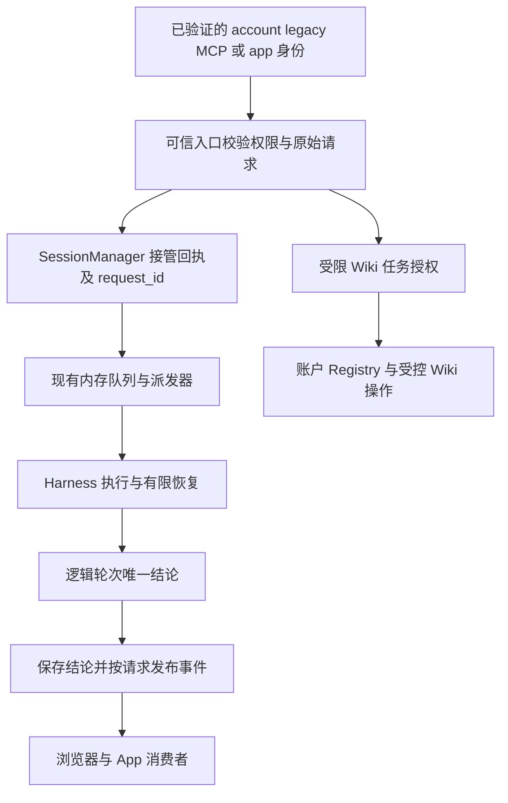

# Octopus 框架与 Wiki 审查及修复计划

> **Status:** in-progress — 本次确认范围已修复并通过本机验收，发布验收进行中；R06、R08、R14 与检索扩展按用户要求暂缓。

当前需要先收紧 Wiki 授权、请求归属、账户接管和异常清理，再评估检索与同步的性能。Octopus 仍沿用 FastAPI、SessionManager、Harness、账户作用域和 Wiki Registry 的组织方式；已发现的问题发生在这些模块的交界处，适合在现有框架内修复。

本文同时处理前一轮的九条审查意见，以及本机 `octopus_review_bundle/` 提出的发布、启动、Store 生命周期、配置并发、同步预算和证据问题。参考包用于提出核验线索，结论以当前源码和实际回归为准。文档完成不代表缺陷已修复，也不代表当前版本可以发布。

## 1 审查基线与执行范围

源码核对基线为本地 `main` 的 `9e1b9224d182540764d98b63684152b40a6feedc`，提交题名为 `fix(sessions): sync model settings in replacement events`。随后本机发布文档提交 `e597a096b6a7a16ce7f5c035cd6d54c1d22c67ce` 更新了 AGENTS 和运行说明，相关 `server/`、`web/`、`scripts/` 与上述源码基线相同。本文的发布合同按这份新说明核对，工作区其余未提交 Wiki 文档仍单独保留。

证据按以下含义使用：

| 状态 | 含义 |
| --- | --- |
| 源码吻合 | 当前真实入口与控制流支持审查所述触发条件；仍需回归测试锁定行为。 |
| 条件风险 | 代码存在相关结构，但影响取决于部署前提、操作交错或下层语义。 |
| 待测量 | 需要真实工作量和隔离实验，不能由循环、容量常量或方法名推断性能故障。 |
| 已关闭 | 最终修复版本通过原场景回归和本机门槛，且相关边界没有退化；当前选定范围已通过代码验收，发布结果单独记录。 |

初次审查交付限于文档与文档检查。用户随后通过 §1.1 的 Q1–Q3 确认本次修复，现已修改产品代码并进入最终本机验证；生产账户认领与 Library 维护仍未执行。参考包中的两个机制测试演示的是通用控制流，不是本仓库缺陷的回归测试；历史验收数字也不能替代修复版验收。

既有 Library 维护和应用开发范围继续遵守[当前暂停交接](../plans_new/local-shared-wiki-handoff-20261014.md)与[Wiki v2 规格](../plans_new/local-shared-wiki-spec-v2.md)。本文不恢复暂停的工作，不将 Sapphire 或 SmartReader 开发变成本轮隐含任务。

### 1.1 2026-10-14 修复范围访谈

用户通过 `grill-with-docs` 启动修复范围讨论，明确 Wiki 具体逻辑先留着，R06 的 Claude 问题也暂不处理。R06 和直接涉及 v2 整理、原始材料身份与跨 key 复用的 R08 暂缓；保留发现与验收合同，不将暂缓标为已关闭。

用户已回答 Q1“是”：暂缓范围为 R06、R08、R14 和检索扩展；Wiki 授权、账户接管及 Registry 基础设施仍纳入。本次范围按以下划分执行：

| 范围 | 条目 | 本次决定 |
| --- | --- | --- |
| Wiki 正文整理与材料复用 | R08 | 按用户要求暂缓。 |
| Claude 继承控制项 | R06 | 按用户要求暂缓；R07 的 Codex 有效 reasoning 校验纳入。 |
| Wiki 授权及框架接入 | R01、R03、R05 | 纳入修复；涉及身份来源、首账户状态接管、可信原始请求，不改变正文整理规则。 |
| Wiki Registry 基础设施 | R12、R13 | 纳入交错核验和必要修复；它们属于 Wiki 生命周期及注册一致性，不能称为纯通用框架问题。 |
| 通用框架与交付 | R02、R04、R07、R09、R10、R11、R15 | 纳入；条件风险先按合同核验，不能把每条都认定为已发生故障。 |
| Wiki 同步性能及检索改进 | R14、§7 的扩展评测与优化 | 用户确认本次暂缓；R14 尚待测量，不把未证实的成本风险当作已定位 bug。 |

**Q1 — 暂缓的边界（已答：是）：** 将“Wiki 具体逻辑先留着”限定为 R08 的正文整理与材料复用，并暂缓 R06、R14 及检索扩展；本次保留 R01、R03、R05、R12、R13 的授权、接管与基础设施核验/修复，以及表内通用框架与交付项。

范围及下述行为已经确认，产品实现已开始。领域术语继续使用现有 GLOSSARY，并补充已明确的“Wiki 任务授权”；具体实现及验收证据保留在本计划，不写入词汇表。

**Q2 — 拒绝后的草稿恢复（已答：是）：** 同时保留被拒绝请求的原文本、附件和 Wiki 模式，提供恢复入口，且不覆盖后来新写的草稿、不自动重发。归档后入口仍可见；恢复到另一可写会话时重新上传原附件，不复用旧会话附件 ID。

**Q3 — WebSocket 的身份边界（已答：是）：** 将 `/ws` 限于 account 与安装未认领时的合法 legacy 身份，直接拒绝 MCP 身份连接。未发现产品 MCP 客户端借此发送、停止、恢复派发、审批工具或回答人工问题；MCP 工具走 streamable HTTP 与作用域 REST。现有 MCP WS 合成测试验证的是身份撤销，不是产品用途，已调整为拒绝连接回归并保留真正 legacy 的账户接管撤销测试。

用户回答 Q2、Q3“都是”，并确认 `/ws` 限制用于保护人工权限，访谈 frontier 已为空，共同理解已确认。随后用户要求继续并授权本次后续操作；按 AGENTS 的本机门槛完成验证后提交、推送、部署与退役旧运行快照。具体锁、借用、请求关联、迁移补偿和测试交错由源码合同及回归决定。

### 1.2 修复版的当前实现与证据

实施基线为 `c0fb2696b11fc9e149297f755761bd8e47729a16`。原先未提交的 Wiki 规格、检索、评估与 prompt 文档仍单独保留，本次没有恢复 Library 业务维护，也没有修改 v2 normalization 的材料复用算法。

| 条目 | 本次落地与主要回归 |
| --- | --- |
| R01、R09 | 人工 WS 身份限制、带 client request identity 的接管回执；拒绝草稿及附件恢复。`test_ws_delivery.py`、ChatView / useWebSocket 测试、`rejected-draft.spec.ts`。 |
| R02、R05 | App 在接管前绑定 request ID，全事件及 receipt completion 按请求消费；App / schedule 原请求独立传入 Wiki grant。`test_framework_wiki_fixes.py`、`test_app_agent.py`、scheduler 回归。 |
| R03 | 排空实际 writer、SQLite backup 与完整状态文件核验；持久迁移阶段、首账户登录后核验/继续、精确 root 权限；原主库正文留在原位置。`test_wiki_upgrade.py`、bootstrap 回归、AccountPage 恢复入口。 |
| R04 | manager 拥有释放任务，执行取消不取消释放 owner；容量直到退休确认才释放，队列自动唤醒。并发删除共享一个 owner，调用方断开不取消清理。真实双会话配额门控、dispatch / retirement 回归。 |
| R07 | 每字段独立解析有效配置，Agent 编辑及调用 preflight 校验 reasoning 与适用 speed，保留重试配置快照与自由模型名规则。`test_model_settings.py`。 |
| R10 | `scripts/validate-release.py` 校验候选 HTML / JS / CSS 及服务资产 hash；临时源码中的真实应用构造证明模块和资源来自候选。`test_release_assets.py`。 |
| R11 | 从资源获取开始注册补偿；MCP 生命周期由同一 owner 进入/退出，进入尚未完成时的外部取消也会等待补偿，保留原始异常。独立资源失败不阻止其他可安全清理的资源。真实 lifespan 分阶段失败/取消回归。 |
| R12、R13 | Store 操作/跨线程租借保护观察器，退役拒绝新操作；账户注册锁与配置 flock 覆盖读、校验、写、发布。`test_wiki_registration_races.py`、Wiki sync / history / app writer 回归。 |
| R15 | 最终八项检查、pure UI、Codex real/browser、候选和实际服务版本证据逐项记录；当前未以局部回归宣告发布通过。 |

新增浏览器场景已验证拒绝后保护新编辑、归档后保留草稿、另一会话恢复 Wiki 模式并重新上传相同附件字节。迁移和关闭回归也验证删除回执写入完成后才释放 journal，晚到的回执不能重建已退役 journal。初轮失败已作为实现反馈修正，不计为通过；以下只记录最终通过结果。

### 1.3 2026-10-15 定稿验收

| 本机检查 | 最终结果 |
| --- | --- |
| `./scripts/check.sh` 八项门槛 | 全部通过；hermetic backend 2,751 项、frontend unit 407 项，无测试失败。 |
| `bun run test:e2e:fast` | 78 项通过，无跳过。 |
| `real and (real_codex or codex_bin) and not real_claude` | 21 项通过，无跳过；使用现有登录的临时符号链接入口。 |
| `playwright test e2e/codex.spec.ts --workers=1` | 1 项通过，无跳过。 |
| `bun run build`、候选 HTML / JS / CSS 核验 | 通过；服务切换后仍须验证实际资源与浏览器。 |
| Claude real tier 与依赖 Claude 的 LLM 浏览器用例 | 按本机验收约定未运行，未计作通过。 |

定稿源码、测试、脚本、前端 E2E / 配置、`pyproject.toml` 与前端 package / lock 文件共 478 个文件的指纹为 `f5a31af5b52e16c3877dfc348f3f1d8bc96e5d17cdcd6dca9179954f083ec51a`：先对各文件计算 SHA-256，再对按路径排序、紧凑编码的 JSON 映射计算 SHA-256。文档、凭据、运行状态和忽略的构建产物不在此源码指纹内；提交及运行快照在发布后补录。

验收环境为 Python 3.14.4；FastAPI 0.136.3、Starlette 1.7.0、MCP 1.30.0、AnyIO 4.15.1、Pydantic 2.14.0、aiosqlite 0.22.1、APScheduler 3.11.3、pytest 9.1.1；Node 24.21.0、Bun 1.4.2、Codex CLI 0.162.1、React 19.2.4、Vite 7.3.1、TypeScript 5.9.3、Vitest 4.0.18、Playwright 1.58.2。各次最终命令和结果已随本轮执行记录保留；未输出认证内容。

## 2 保留的架构与必须成立的边界

保留现有管理器分工：SessionManager 拥有接管、队列和逻辑轮次；HarnessRun 拥有 CLI 执行；AppAgentManager 消费所属请求的事件；WikiTasks 拥有短期授权；Registry 管理账户注册和 Store；History 与 Jobs 管理受控发布和恢复。相关概念见[术语](../../GLOSSARY.md)、[逻辑轮次 ADR](../adr/0003-logical-turn-owns-terminal-outcome.md)及[接管与记录 ADR](../adr/0004-admission-recording-and-notification.md)。



这条链路必须满足以下合同：

- 同一账户的身份不等于同一种权限。MCP bearer 可以代表正在执行的 agent，但不能仅因它能连接 WS 就新建人工 Wiki 授权。
- 接管、开始执行、记录完成和通知到达是不同事实。`accepted` 的请求可以等待；`closed` 的请求必须明确拒绝。
- 会话是长期容器，`request_id` 才区分本次请求。消费者不能把同一会话中下一次出现的终态自动归给自己。
- 可信请求与模型看到的文本分别保存。App context、检索正文、恢复历史和 schedule 包装不能选择文件或扩大授权。
- 释放执行容量、迁移账户状态和清理生命周期资源都必须覆盖异常、取消与部分完成。
- Wiki 正文、身份、历史和回执有不同恢复责任，不能把整个状态数据库视为可删除的缓存。

本轮没有理由替换数据库、引入 Redis、拆分微服务或另造通用工作流引擎。接口是否优雅，应看调用方能否通过少量明确输入获得完整保证，而不是新增了多少抽象层。

## 3 问题清单与优先级

R01～R09 对应前一轮九条审查意见；R10～R15 对应参考包六项发现。P1 表示优先处理的授权或生命周期风险，P2 表示必须处理的正确性问题或需要证据决定的改进。条件风险的优先级不是已发生生产故障的证明。

本节及 §4～§8 的缺陷描述与控制流判断保留审查基线的事实和验收合同；修复版行为及最终结果见 §1.2～§1.3。

| 编号 | 优先级 | 当前判断 | 用户可见影响或需验证的风险 |
| --- | --- | --- | --- |
| R01 | P1 | 源码吻合 | MCP 身份通过 WS 新建 Wiki 授权。 |
| R02 | P2 | 源码吻合 | App 请求排队时收到了人工纠偏请求的回答。 |
| R03 | P2 | 源码吻合 | 首账户接管后旧 Wiki 注册、身份、历史和任务不可达。 |
| R04 | P2 | 源码吻合 | 活跃派发器被删除或归档取消后，其他队列未被唤醒。 |
| R05 | P2 | 源码吻合 | App 与 schedule 包装遮住可信请求首行，维护选择返回 403。 |
| R06 | P2 | 源码吻合；用户暂缓 | Claude 会话因继承 Codex 控制项而不能改模型。 |
| R07 | P2 | 源码吻合 | Agent reasoning 编辑使覆盖模型的会话得到不支持的 effort。 |
| R08 | P2 | 源码吻合；用户暂缓 | v2 新 Markdown 整理后，跨幂等键的相同材料未按原始字节复用。 |
| R09 | P2 | 源码吻合 | WS 丢弃关闭回执，输入被清空且没有拒绝提示。 |
| R10 | P1 条件风险 | 挂载前提存在，发布合同已有部分保障 | 干净快照缺少 dist 时，后建资源不能补注册 SPA 路由。 |
| R11 | P1 | 启动清理缺口有源码依据 | 部分资源启动后发生错误或取消，尚未进入的 finally 不清理它们。 |
| R12 | P1 核验 | Store 借用期不明确，原数据库结论需收窄 | 配置变更或淘汰关闭观察器后，已取得的 Store 继续使用。 |
| R13 | P2 | 并发入口与无锁检查有源码依据 | 并发首次注册可各自成功，后写覆盖前写；坏配置没有统一诊断。 |
| R14 | P2 | 待测量；用户暂缓 | 冷建、慢账户及超过缓存容量的访问是否拖延同步或主服务。 |
| R15 | P2 交付门槛 | 需要绑定最终修复版 | 无法把测试、源码、依赖与服务资源作为同一版本核验。 |

## 4 九条代码审查意见的修复合同

### R01 限制人工 Wiki 授权的身份来源

[WS 入口](../../server/routers/ws.py)调用 `resolve_principal` 后只比较目标会话的 `user_id`，未检查 `credential_kind`，随后以默认 `source='human'`、`steerable=True` 和 `explicit_mode(...)` 调用 `start_message`。[身份解析](../../server/deps.py)明确接受仍有效的 MCP principal；[WikiTasks](../../server/wiki/tasks.py)随后可为该消息打开新授权。

触发场景是一个没有 Wiki 授权的 live MCP bearer 向同账户另一会话发送 `/wiki maintain Library/note.md`。账户隔离仍成立，但 agent 可以绕过 Wiki API 已要求的显式任务授权。

**修复要求：** 在 WS 的可信入口区分 account、legacy 与 MCP。只有 account 或安装尚未认领时的 legacy 身份可以建立新的人工 Wiki 授权。MCP 路径必须继续执行自身 live scope 与既有 Wiki grant 检查；不能通过目标会话、`wiki_mode`、`source` 或内容中的 `/wiki` 把自己升级为人工。若没有实际用途需要 MCP 在 WS 发消息，直接拒绝该身份的发送动作比复制一套授权传播规则更清楚。

**验收：** 使用真实 principal 解析和 WS handler，证明无授权 MCP 对自己的会话与同账户其他会话均不能取得新 Wiki grant；read grant 不能升级 maintain，失效 bearer 被拒绝。account 与合法 legacy 的显式 `/wiki` 仍可用，普通消息和 `off` 不授予权限，另一账户始终不可达。

### R02 App 回答绑定接管请求

[AppAgentManager.begin_turn](../../server/app_agent.py)先登记 `_Turn` 再调用 `start_message`，顺序正确；但它未保存 receipt 的 `request_id`，`_on_broadcast` 只按 `session_id` 找等待者。

复现顺序为：暂停 App 会话，接管一个 App 请求，提交新的人工纠偏请求并让它优先执行。现有 subscriber 会把纠偏的文字和终态交给 App，App 的实际请求还在队列中。

**修复要求：** `_Turn` 绑定本次接管身份，所有 delta、message、tool、question、recording failure 和终态事件均按该身份过滤。保留[既有 App 合同](app-agent-access.md)要求的开始前登记：可以在接管前分配请求 ID，或在 receipt 返回前暂存候选事件、绑定后只重放匹配项。不能先启动、后注册，也不能在身份未绑定时放行整个会话的事件。

使用 receipt completion 处理排队请求被撤回、删除、关闭或记录失败的结局，避免等待一个永远不会产生模型 result 的请求。HTTP 超时、SSE 断开只结束等待，不撤销已接管执行；旧 waiter 清理不得删除更新的 waiter。

**验收：** 真实 SessionManager 的暂停、纠偏优先与 resume 场景中，App 只能得到自己的回答，纠偏文本和 cost 不混入。覆盖极快开始、receipt 返回前事件、自动恢复的非终态、请求撤回及删除。只用手工广播同一 session 的 mock 不能证明排队归属正确。

### R03 首账户接管包括 Wiki 状态和主库权限

[Registry.state](../../server/wiki/registry.py)在 legacy 时读取 `settings.wiki_dir`，有账户后改读 `user_root(user_id)/wiki`。[bootstrap_first_account](../../server/bootstrap.py)接管孤儿行、live Session、工作目录和 agent memory，却没有对应 Wiki 状态迁移。

安装认领前已注册 Wiki，随后以 `adopt=True` 创建首账户时，新 owner 会查到空目录。注册主库即使没有被旧 session 用作工作目录，也必须保留原有合法访问范围。

**修复要求：** 将 Wiki 纳入[首账户的一次性接管](multi-tenancy.md)，迁移完整状态并保持 vault、document、agent、app、job 和 change 的身份关系。主库正文继续留在原权威位置；接管的是注册与状态，不是复制一份新主库。现有路径授权需保留注册根目录的合法权限，合并并规范化 `extra_roots`，不能放宽到任意父目录。

迁移前封闭 legacy 写入口并排空 Wiki worker、Registry 同步和 App 文件写入，确认旧 Store 不再操作将迁移的状态。使用一致的数据库备份或关闭后的完整迁移；不能在仍有 writer 时只复制 `index.sqlite3` 而遗漏 WAL 或 journal。

首账户会关闭 legacy 登录入口，因此失败恢复必须与账户创建一起设计：提前校验目标与空间、记录阶段、校验迁移结果，并提供可认证的继续或核验路径。目标已有不同 Wiki 状态时明确冲突，禁止覆盖或混合两个 vault。`adopt=False` 不移交旧库；没有旧 Wiki 时正常完成。

**验收：** 在临时安装中先创建注册、稳定 ID、历史、回执、snapshot 和未完成 job，再认领账户；新 owner 经 API 能看到同一主库和原状态，旧凭据失效，第二账户不可见。注入复制、提交、权限设置与重开失败，证明不丢状态、不双写且能恢复。已有 memory 和 live Session 接管回归仍通过。

### R04 取消派发器也释放容量并唤醒等待队列

[SessionManager._drive_messages](../../server/sessions/turns.py)在 `finally` 中清除当前 `_active_task`，但唤醒其他会话的循环位于 `finally` 之后。driver 因删除、归档或关闭被取消并重新抛出异常时，不会执行后面的循环。

复现顺序为：每用户并发上限设为一，A 占用容量，B 接管自动返回并排队，随后删除或归档 A。B 已被接管，却等不到容量释放通知。

**修复要求：** 把释放后的重新派发放入有执行保证的清理路径；唤醒发生在当前请求和 backend retirement 的必要清理完成之后。二次取消不能让唤醒永久丢失，清理任务须由既有 owner 管理。复用 `_schedule_dispatch` 的暂停、关闭、记录阻塞和 quota 检查，不额外维护另一份容量计数，也不误恢复用户 Stop 后的队列。

**验收：** 对删除、归档、正常完成和异常退出分别控制交错，B 在容量真正可用后无需新消息或手工 resume 即可开始。暂停的 B 继续暂停，关闭中的系统不启动新工作，并发运行数始终不超上限。测试使用事件门控制，不靠长时间 sleep 猜调度顺序。

### R05 可信原始请求独立于 App 和 schedule 包装

[AppAgentManager._compose_turn](../../server/app_agent.py)添加首轮 preamble、`[app:…]` 和 context；[ScheduleRunner._compose_prompt](../../server/scheduler.py)添加 `[scheduled:…]` 与无人等待说明。[执行入口](../../server/sessions/turns.py)把这个包装后的 `prompt` 传给 `WikiTasks.open`，而 `require_selection` 只检查 grant request 首行中的 shlex 路径。

因此，已授权的 `/wiki maintain Library/note.md` 在 App 或 schedule 中无法完成已有文件选择。改成搜索整段模型 prompt 虽能找到路径，却会让 App context 或引用正文扩大权限。

**修复要求：** 在可信边界保存原始 request 或等价的结构化 selection，随 QueuedPrompt、执行和重试传递。Wiki grant 使用这一输入；模型仍看到完整 App preamble、context 和 scheduled marker。schedule 使用创建或更新时经现有授权校验的原始 prompt，不从运行时报告反推授权。[schedule_wiki_mode](../../server/routers/schedules.py)的 MCP grant 校验继续保留。

**验收：** 同一合法维护请求经原生 composer、App 首轮、App 后续轮和 schedule 都能选择准确路径；模型确实看到 `[scheduled:…]`。只出现在 App context、第二行材料、旧 transcript 或模型描述中的额外路径仍返回 403；`off` 继续优先撤销 Wiki 模式。

### R06 Claude 忽略不适用的继承控制项

[会话更新](../../server/routers/sessions.py)把 session override 与 agent reasoning、tier 合并后无条件校验。Claude 的目录不提供这些控制项，所以一个附着 Codex agent、继承 `service_tier='default'` 的 Claude session，仅修改 model 为 `sonnet` 也可能得到 400。

**修复要求：** 区分字段来自明确 session 设置还是 agent 继承，并以会话的实际 backend 判定控制项是否适用。backend 不消费的继承值不参加有效配置校验；明确提交的非空不支持值仍拒绝。字段省略保持绑定，`null` 恢复继承，不能通过清除 agent 默认值或破坏已有 transcript 绕开问题。

**验收：** Claude session 继承 Codex agent 的 default、fast 和 reasoning 时可以正常改 model；明确给 Claude 设置非空 reasoning 或 tier 仍得到 400。Codex 的模型特定校验、独立字段覆盖、清空和持久化行为继续符合[模型设置合同](model-reasoning.md)。

### R07 Agent 编辑校验受影响会话的有效 reasoning

[Agent 更新](../../server/routers/agents.py)检查自身有效设置后，遍历现有 session，但只有有效 tier 为 `fast` 才继续，并且只校验 speed。session 覆盖模型、继承 reasoning 时，agent effort 从 low 改 high 可能使下次调用不合法。

**修复要求：** 在现有 configuration lock 下计算每个受影响会话的 backend、credential、model、effort 与 tier，分别按 session override 优先于 agent default 的规则解析。校验实际受影响且适用的 reasoning 和 speed；不能用 Fast 判断是否需要检查 reasoning。校验失败时 agent、live Session 与数据库均不部分更新，错误指出冲突会话和字段。

保存与调用前检查应复用一致的有效设置语义。当前调用 preflight 只防守 Fast；必须覆盖可消费的 reasoning，以应对保存后目录变化和内部调用。一个逻辑轮次的配置快照继续跨自动重试保持不变。

**验收：** 目录中 A 模型支持 low/high，B 仅 low/medium；覆盖 B、继承 low 的会话存在时，将 agent 改 high 被拒绝。session 自己覆盖合法 effort 时不误拒绝；归档会话、credential 覆盖、跨 backend 继承和运行中编辑均有回归。自由输入模型名的既有规则仍保留，不把 picker shortlist 改成白名单。

### R08 v2 整理保留可验证的原始材料身份

[v2 normalization](../../server/wiki/normalize.py)会新增 YAML、Key note 与结构标题，再调用 `operations.management`。[management](../../server/wiki/operations.py)没有旧 `managed_notes` 行时返回 `None`；[materials.index](../../server/wiki/materials.py)因此用整理后的整个文件计算 original hash。

新材料经 v2 整理后，再以不同 idempotency key 提交同样的原始字节，可能创建重复 note。现有 legacy reuse 测试不能单独证明 v2 路径具备同样保证。

**修复要求：** 受控 normalization 同时提交可信的原始材料身份与生成结构归属，使当前文件仍能验证原始字节。可以扩展现有 ownership 或引入必要的持久来源记录，但必须与 History journal、publication、operation receipt、索引和恢复一起提交。仅保存一个输入 hash，不校验当前正文是否仍对应原输入，不足以安全复用。

不能按标题名、YAML 外观或任意注释剥离内容：用户原有 YAML、Key note 和同名标题也是材料。外部人工修改改变了原材料时失效或重新验证；移动保持稳定身份，旧路径被替换不能继承复用资格。保留编码、BOM 与换行等原始字节语义，不另建永久原稿正文副本。确需新增 durable schema 时提供迁移，不能删除混有身份与历史的数据库来重建。

**验收：** 真实 job ingest → v2 normalize → 再 submit 的链路中，不同 key 的相同材料只产生一个当前文档，不再次执行模型整理；重启、派生索引重建与恢复后仍成立。并发跨 key、用户原有 YAML/Key note、CRLF/BOM、人工修改、伪造标记、改名及同路径替换分别核验。已有 legacy reuse 回归继续通过。

### R09 关闭回执必须送达 composer

[WS handler](../../server/routers/ws.py)没有使用 `start_message` 返回值。[SubmissionReceipt](../../server/sessions/submission.py)规定 `closed` 不属于 accepted。归档期间 session 尚在 live map、admission 已关闭时，发送动作通过所有权检查，但消息没有入队或保存。[ChatView](../../web/src/components/ChatView.tsx)在发送后立即清空文本和待用附件。

**修复要求：** WS 检查 `receipt.accepted`，对 closed 发送带 `session_id` 的明确拒绝错误，复用现有错误显示路径。不要将 refused 输入广播成已接受消息。若验收要求用户能直接重试原草稿，前端还需保留本次发送内容与附件并提供恢复；单独收到 error 不会自动恢复当前已清空的输入。使用请求关联避免恢复旧草稿覆盖用户刚输入的新内容，不自动重发被拒绝的消息。

**验收：** 用事件门暂停归档，关闭接管但保留 live session，此时通过真实 WS 发送得到拒绝提示，数据库和队列没有该请求。accepted、queued、duplicate 与合法 steered 不误报关闭。浏览器验证错误可见；若实现草稿恢复，文本、附件与新的编辑不会丢失或互相覆盖。

## 5 参考包问题的当前判断与实施合同

### R10 静态挂载和候选发布一致性

参考包 F-01 的机制与[main 静态挂载](../../server/main.py)吻合：只有应用构造时 `_dist_dir.is_dir()` 为真才注册 SPA。干净快照先启动、随后生成 dist，不能补注册旧 app 的路由。`/health` 成功不能证明 HTML 与入口资源可用。

不过，当前[本机自动发布说明](../local-wsl.md)已经要求新快照先“准备可用的前端资源”，再切换、重启、健康检查与构建。只要准备阶段落实并校验资源，参考包描述的缺目录前提就不成立。因此保留条件风险，不宣称现行生产页面已发生 404，也不机械倒置 AGENTS 要求的原位更新顺序。

**实施合同：** 新快照进入应用构造前必须有可用的 dist 与入口资产；缺少、构建失败或校验失败就不切换。同目录更新继续遵守先后端重启、健康检查、再重建前端的本机规则。候选准备与对运行目录原位重建分开；当前流程若使用暂时的旧资产，还必须验证切换窗口的兼容性，最终源码与资源归属于同一候选。

**验收：** 从无 dist 的临时快照完成真实应用构造和请求验证；分别覆盖准备失败、缺入口资源和候选启动失败。检查 `/health`、HTML、JS/CSS、关键 API 与实际导入模块路径；editable 安装和共享 venv 不能令进程加载开发目录。失败保持或恢复旧快照，验收成功前不删除它。资料库和数据库不会被源码回滚覆盖。

### R11 启动失败补偿覆盖已启动资源

参考包 F-02 在当前[真实 lifespan](../../server/main.py)中仍有依据：scheduler、bg worker、reaper、metrics 等先启动；进入 MCP 后又启动 Registry、历史清扫和 Wiki worker；清理用的 `try/finally` 仅包围之后的 `yield`。delegation restore 有局部补偿，不能代替其余启动阶段的保证。

这里应区分实际异常传播。[历史清扫](../../server/wiki/cleanup.py)会捕获每账户的普通异常并记录，因此不能把任意单库清扫错误都写成整个服务退出。未捕获初始化错误、外部取消及 Wiki worker 恢复失败仍可能在保护区之前终止启动；worker 还可能已为前面的账户创建任务。

**修复要求：** 从开始获取资源时建立失败补偿，每个成功启动或部分启动的 owner 都有对应清理。可使用局部 helper 或 ExitStack，但保持停止接管 → 停生产者 → 排空执行及记录/文件 writer → 停观察器及通知 → 关依赖的顺序。慢连接、独立监控等可安全释放的资源不能仅因另一 owner 失败全部遗留；仍被 writer 使用的数据库不能提前关闭。保留原始启动异常和清理失败的诊断。

**验收：** 对真实 lifespan 中 delegation、scheduler、bg、metrics、MCP enter、Registry、Wiki worker 的各阶段注入失败和取消，记录已启动任务、观察器、进程与连接的最终归属。包括启动了部分账户 worker 后失败、正常 stop、重复 stop 和清理失败。取消 `to_thread` 的等待不算取消底层写入，必须确认 writer 结束。

### R12 Store 的借用和观察器退役

参考包 F-03 正确指出 Registry 的锁只保护容器，没有定义返回 Store 的使用期。[store](../../server/wiki/registry.py)在配置绑定变化和超过 32 个缓存项时关闭旧实例；后台 `_run` 也会先取 Store 快照，再逐个在线程中使用。

当前下层提供了关键反证：[WikiStore.close](../../server/wiki/store.py)只关闭 `VaultEvents`，每次 `connect` 独立创建并关闭 SQLite connection。因此不能直接认定这是“查询使用已关闭数据库连接”。实际要验证的是旧句柄的事件新鲜度、观察器退役、重复实例的同步，以及新授权是否始终在入口生效。[VaultEvents.close](../../server/wiki/events.py)关闭 fd 并清空事件状态；取得对象并不保证它继续被 Registry 周期补偿。

**实施合同：** 先用真实 Store 控制取得 → 配置变化或淘汰 → 操作的交错，确定受影响语义。若不能保证操作期间有效，采用账户级操作边界或短期借用计数：退役对象不接新借用，已有使用结束后关闭。锁不能跨账户包住慢查询和 writer 排空；不默认引入通用连接池。缓存优化不得缓存或复活过期授权。

**验收：** 覆盖查询与配置变更、后台同步快照与淘汰、32 项全忙及两个账户同名文件；修改后的正文有明确新鲜度状态，无跨账户混淆和观察器泄漏。如果下层已经满足要求，用这些行为测试关闭风险，而不是为了形式增加资源层。

### R13 配置注册必须有语义事务

参考包 F-04 的并发前提在当前入口可达：[configure_wiki](../../server/routers/wiki.py)通过 `anyio.to_thread.run_sync` 执行注册。Registry 的读取旧配置、检查 root、保留或生成 vault ID、替换文件没有被同一个账户锁覆盖；`self._lock` 仅在后续 `store` 管理缓存时使用。

两个首次注册可以都读到无旧配置、各生成身份并返回成功，最后一次替换决定实际绑定。原子 rename 防止半份 JSON，不保证只有一个注册获胜。`config()` 也直接 `json.loads`，未统一检查字段及配置结构。

**修复要求：** 对同账户的完整读、校验、写、发布 Store 流程串行化；不同账户可独立执行。多进程部署若受支持，选择现有跨进程锁或明确单 writer 约束，不能把线程锁当跨进程保证。首次注册与合法重配区分，仍禁止普通配置操作改变主库 root；确有并发编辑需求时再加入 expected revision。

配置读取验证 root、vault 身份、绑定及兼容字段，损坏或新版本配置返回可诊断错误并保留原文件。失败时清理临时文件，明确配置已提交但 Store 初始化失败的状态，不能返回误导性的成功或覆盖旧注册。路径权限继续由可信入口 `confine` 和账户绑定检查确定，存在目录本身不代表有权注册。

**验收：** 真实配置 API 在受控线程交错中同时首次注册不同 root，至多一个生效，另一个明确冲突；重复相同注册不会改变 vault ID。覆盖坏 JSON、缺字段、不合法路径、磁盘写失败、Store 初始化失败和并发重配，核对最终配置、返回值及有效 Store 一致。

### R14 同步成本和账户间等待先测量

参考包 F-05 的串行结构仍存在：Registry 启动等待 reconcile，周期工作逐个同步缓存实例，reconcile 按账户逐个 refresh；stop 等待正在进行的操作。这同时保留了正确的线程化与 writer 等待语义。

当前读路径会消费已知文件事件，完整补偿扫描属于后台 reconcile；不能说成每次查询全库扫描。32 是 Store 缓存容量，与一个库内有多少文档不同。冷建、慢磁盘和访问超过容量的账户是否造成用户可见问题，需要工作量数据。

**测量合同：** 区分冷启动、无变化补偿、单文件增删改、查询、关闭等待和活跃 vault 超过缓存容量六类操作，记录耗时、文件读取量、索引代际、观察器数和并发主 API/WS 延迟。使用临时语料或现有私有评测入口，不改生产库，不公布原文和账户路径。

只有结果证明某账户拖延其他账户，才在现有同步机制上增加有限批次、游标、公平调度或可协作停止。复用现有 `index_status`、错误与 checked time 表达新鲜度；普通问库不触发 curator。Wiki 是否允许尚未 ready 时带旧索引服务，是需要明确的产品选择，不在本轮擅自改变。任何优化仍等待实际线程完成，不能用超时包装假称 writer 已停止。

### R15 交付证据对应同一源码和运行版本

参考包 F-06 与 G0 的要求应分开。修复已定位的本地行为，需要冻结本地源码与实际回归；评价 Fork 相对上游的全部兼容性，还需要固定双方历史、共同祖先和差异。后者不是阻止已证实局部修复的前置条件，也不是生产 P0。

**交付合同：** 每次验收记录完整 SHA、未提交补丁摘要、关键指南与测试版本、依赖版本或约束摘要、检查命令、退出码、时间、失败与跳过原因。发布后记录实际工作树、模块来源、前端入口资产摘要、迁移状态与浏览器结果。共享依赖的事实应明确，源码快照不能冒充依赖快照。

需要完整原框架一致性审查时，先用本地已有 Git 对象或受控采集取得固定 fork/upstream SHA、merge-base、双方相对祖先的 diff 和头对头 diff；不能把浮动 main 或短 SHA 当已冻结的完整证据。将变化归为本地引入、上游继承、上游更新或无法归因。参考包采集脚本只是一条可选采集路线，本轮未执行，不取代现有仓库维护流程。

仓库保存可复核的脱敏摘要；正文、token、完整私有会话和生产数据库保留在私有证据目录。记录“Claude 不可用”与“通过”分别列出，当前失败不被历史成功覆盖。

## 6 Wiki 读写与数据恢复合同

参考包 K1 与数据分类建议需要对照已有实现验收。当前已有[受限 Wiki API](../../server/routers/wiki.py)、[任务范围](../../server/wiki/tasks.py)、[History journal](../../server/wiki/history.py)、[稳定身份](../../server/wiki/store.py)、[发布回执](../../server/wiki/operations.py)及[事务迁移](../../server/wiki/schema.py)，不应从零再建同名协议。

| 数据 | 当前责任与修复约束 |
| --- | --- |
| 主库 Markdown、必要资产和用户维护知识页 | 权威内容；原位维护，保留正文表达，受版本与路径授权约束。 |
| config、vault 身份、curator/app 绑定 | 注册状态；账户接管和恢复必须保留并核验，不属于搜索缓存。 |
| document identities、uid aliases、可信 ownership | 决定身份和来源关系；不能仅凭当前正文重新猜出原身份。 |
| changes、管理状态、快照、任务和 operation receipts | 支撑回滚、恢复与验收；按现有保留规则处理，不随派生重建删除。 |
| documents、提取文本、章节、FTS 与材料检索索引 | 只有来源、身份及固定解析规则足够时才可重建；重建不得破坏上述 durable 状态。 |
| 观察器事件与运行时缓存 | 可重新建立；丢失时明确补偿和新鲜度，不能悄悄当作已同步。 |

`index.sqlite3` 混合持久账本和派生表；“删除索引后重建”不能等同“删除整个数据库”。备份必须包含注册、主库、必要状态及可用历史，恢复时核对账户、绑定、schema 与解析版本。

接口验收沿现有语义进行：

- **检索前授权：** REST、WS、MCP 和 App 均从验证后的上下文取身份。App token 的自身绑定不等于任意 agent 的权限，MCP 使用同一 handlers 时仍检查短期 task grant。
- **受控读取：** 指定文档和读取范围生效，批量工具有整体预算与明确分页/截断；长文不能以读到开头代替完整评估。普通非 Wiki turn 不加载知识正文。
- **受控写入：** expected revision、完整读取、明确 assignment 与 publication receipt 共同生效。人工编辑造成冲突时保留当前文件，有限重试不变成最后写入者覆盖。
- **可信引用：** 引用携带稳定身份、版本和具体位置。移动后指向当前路径，删除或替换后明确失效；失败不静默跳到相似段落。
- **内容与授权分离：** 材料中的 `/wiki`、伪造系统消息、工具描述和正文路径不能打开授权，也不能扩大已经选定的文件集合。
- **恢复可核验：** 崩溃或取消后的正文、身份、ownership、历史和 receipts 对得上；no_change 必须有真实读取及适用验收，文件存在或 job done 本身不算完整入库。

双账户测试应覆盖直接 API、WS、MCP、App、引用和缓存，不仅测试列表过滤。优先扩展[Wiki API](../../tests/test_wiki_api.py)、[写入边界](../../tests/test_wiki_write_gates.py)、[身份](../../tests/test_wiki_identity.py)、[历史](../../tests/test_wiki_history.py)和[任务恢复](../../tests/test_wiki_jobs.py)现有测试。

## 7 检索质量与性能改进的选择依据

参考包 K2 提出的评测思路保留，但它当时没有读到检索实现，不能据此断言项目缺少词法检索、中文处理、结构检索或知识页。当前[search_index](../../server/wiki/search_index.py)使用 SQLite FTS5、中文分词与章节结构，派生版本为 `sections-v7`；已有[检索回归](../../tests/test_wiki_search.py)、[表示选择](../../tests/test_wiki_representation_selection.py)、[真实问库验收](../../tests/test_wiki_query_real.py)及[评测脚本](../../scripts/evaluate-wiki-search.py)。

先复用这些入口建立固定版本基线，再针对失败类型比较改进。必须保持[现行检索规格](../plans_new/local-shared-wiki-retrieval-v2.md)与[评估合同](../plans_new/local-shared-wiki-evaluation-v2.md)，不能为了较高分数删除困难问题或降低完整阅读要求。

| 维度 | 应记录的指标与样例 |
| --- | --- |
| 召回与排序 | Recall@k 或等价命中率；中文概念、英文缩写、精确路径、改写和混合语言。 |
| 答案与引用 | 回答支持率、引用定位正确率、无答案误答率、指定文档与当前版本遵守率。 |
| 表示与内容 | 原稿和摘要选择、正文与生成说明区别、同源表示、资产、引用/列表/代码/内嵌 HTML。 |
| 查询成本 | 冷热查询 p50/p95、读取字节、工具轮次、输入/输出 token、并发 API/WS 响应。 |
| 更新与恢复 | 无变化补偿、单文件修改/移动/删除、重建耗时、旧引用失效和冲突处理。 |
| 容量 | 文件数、总字节、章节数、索引大小、活跃 vault、内存和观察器；分别报告。 |

语料使用可共享合成资料和经允许的私有样本，包含无答案、多文档、人工编辑、移动、删除及版本变化。性能阈值依据本机与既有基线确定，不在未测量时承诺毫秒 SLA。

知识页是已经约定的可阅读、可维护内容，不能把所有材料强制重新蒸馏为另一份总结。需要继续核验来源版本、人工编辑保护、实际跨问题复用和纠正能力。语义检索或混合排序仍按 V2-07 的条件启动：真实、稳定的词法缺口及成本收益证据，而不是材料数量达到某个数字。

## 8 回归矩阵与关闭标准

下表是实施后的必测矩阵，不是本轮已通过的测试记录。新增测试必须到达真实 bug seam：WS 用真实身份解析，App 与 dispatch 用真实接管队列，Wiki reuse 走 ingest 与 v2 normalization，启动清理走真实 lifespan。受控模型替身可以保持 hermetic，但不能把要验证的管理器和协议本身 mock 掉。

| 范围 | 必须锁定的断言 | 复用入口 |
| --- | --- | --- |
| R01、R05、R09 | agent 不新建人工 grant；原始首行选择正确；closed 明确拒绝 | `test_wiki_composer.py`、`test_wiki_api.py`、`test_runtime_review_races.py`、`test_ws_delivery.py`、`web/e2e/wiki-composer.spec.ts` |
| R02 | 暂停后纠偏先运行，App 只收自己 request 的事件及终态 | `test_app_agent.py`、`test_session_dispatch.py` |
| R03 | 首账户接管同一 Wiki 身份、历史、jobs 与 root 权限；失败可恢复 | `test_bootstrap.py`、`test_wiki_identity.py`、`test_wiki_jobs.py` |
| R04 | 取消 driver 后其他可执行队列自动开始；暂停和 quota 不退化 | `test_session_dispatch.py`、`test_session_retirement.py`、`web/e2e/paused-dispatch.spec.ts` |
| R06、R07 | backend 适用性、字段来源、model 优先级与 reasoning/tier 校验一致 | `test_model_settings.py`、`test_harness_codex.py` |
| R08 | v2 整理后相同材料跨 key 复用，外部编辑不误复用，恢复不丢来源 | `test_wiki_jobs.py`、`test_wiki_curation.py`、`test_wiki_history.py` |
| R10、R11 | 无 dist 候选不错误切换；每个部分启动失败正确释放已启动资源 | 新增真实 main/lifespan 故障注入测试，复用服务隔离 fixture |
| R12、R13 | Store 退役交错语义明确；并发首次注册仅一个生效 | `test_wiki_sync.py`、`test_wiki_api.py` 与真实线程门控 |
| R14、R15、K1、K2 | 固定版本质量/成本记录，接口合同与生产版本可核对 | `evaluate-wiki-search.py`、Wiki query 测试、私有部署验证 |

修复版继续执行 [AGENTS](../../AGENTS.md) 的本机门槛，动态记录测试数量，不照抄旧文档库存：

```bash
export PATH="$HOME/.nvm/versions/node/v24.21.0/bin:$HOME/.local/bin:$PATH"
export NO_PROXY="${NO_PROXY:+$NO_PROXY,}127.0.0.1,localhost,::1"
export no_proxy="$NO_PROXY"
export PLAYWRIGHT_HOST_PLATFORM_OVERRIDE=ubuntu24.04-x64

# 八项快速门槛包含 hermetic backend、frontend、类型、lint、契约与文档索引。
./scripts/check.sh

# 两个 E2E 桶分开执行；本机必需项为 pure UI 与可用 Codex browser。
cd web
bun run test:e2e:fast
bunx playwright test e2e/codex.spec.ts --workers=1
```

可用 Codex backend real tier 按[本机测试步骤](../local-wsl.md)选择 `real and (real_codex or codex_bin) and not real_claude`，使用临时目录入口复用现有登录，不复制凭据、不修改 `CODEX_HOME`。当两个 backend 都可用时，执行完整 backend real tier 与 `test:e2e:llm`，LLM 桶使用一个 worker。Claude 不可用单列，不计通过；任何本机必需项失败仍要解决。

一个问题只有在最终源码上满足以下条件才关闭：原触发场景失败转为通过、相关边界通过、适用门槛无失败、没有降低原断言，并能指出对应 commit 与证据。条件风险可以通过真实测试证明已由现有实现保证而关闭，不要求一定产生代码改动。提交完成、上线完成、Library 业务验收仍分别记录。

本轮文档检查已完成：生成并核对 `docs/README.md` 索引，`git diff --check` 通过，56 个本地链接目标均存在，R01～R15、F-01～F-06、G0、K1、K2 均有对应内容，代码围栏和状态行结构检查通过。这些结果只验证文档完整性，不作为上表产品回归的通过记录。

## 9 实施顺序与交付拆分

先处理 R01 授权绕过。R01、R05、R09 在可信入口和接管合同上相邻，可共享必要输入定义，但各自有独立回归。R02 与 R04 随后分别收紧请求消费者和容量释放，不以“拒绝所有暂停期间的新工作”绕开既有纠偏优先规则。

R03 在用户需要首账户认领的部署前完成，迁移不能由普通路径查询顺便触发。R07 单独验证受影响会话的有效配置，不将 R06 的 Claude 修复作为本次前置条件。R06、R08 按用户决定暂缓，恢复对应范围时仍须完成原验收合同；R08 未关闭前不以本次框架修复声称新增材料入库已具备跨 key 复用保证。

R11 启动补偿与 R13 配置并发进入同一轮修复收口；R10 验证现有候选准备确实满足挂载前提，R12 用交错测试决定是否需要借用接口。最终实施集合见 §1.1；R14 和检索对照实验按 Q1 暂缓。

提交按行为边界聚焦：可信入口、App 请求匹配、dispatch 清理、bootstrap Wiki 接管、R07 模型设置、生命周期/配置及发布保障。必要的持久迁移和其回归随所属行为提交，不拆成无人负责的后续事项；避免批量格式化和无关 UI 改写。

R15 从第一个修复就记录证据。最终本机门槛完成后才按既有授权提交、推送和发布代码；文档提交不重启服务。发布遵守当前本机自动发布流程，验收通过后才退役旧服务快照。本文作为文档交付可以先入库，其 `in-progress` 状态保留到相关实施与验证完成。

## 10 本计划暂不实施的条件项

这里仅保留真正依赖后续用例、外部条件或用户决定的工作，不容纳为了省时留下的半套修复：

- R06 的 Claude 继承控制项：用户于 2026-10-14 明确暂不处理；保留原修复及验收合同。
- R08 的 v2 原始材料身份与跨 key 复用：按用户“Wiki 具体逻辑先留着”的要求暂缓；Wiki 授权、账户接管及 Registry 基础设施按 Q1 纳入。
- R14 的同步性能测量及 §7 检索扩展评测与优化：用户在 Q1 确认本次暂缓；保留测量合同，不将其称为已修复性能故障。
- 语义检索、混合重排与扩容：等待现有词法检索的可复现缺口及成本基线，按 V2-07 决定。
- Sapphire、SmartReader 新 UI 和客户端能力：等待用户启动相应 feature，核心 API 修复不自动授权应用开发。
- 核心 ready 与可选 Wiki ready 分离、旧索引服务策略：等待启动/同步测量与明确产品决定。
- 完整 Fork 对上游的兼容性签核：等待固定双方历史和完整差异；本轮局部源码核对不能给出该结论。
- 跨服务重启的持久 pending queue/outbox：继续遵守[既有运行时决策](runtime-interface-repair.md)，当前内存接管回执不承诺重启恢复。

其余条目的实施范围已由 §1.1 的 Q1 确认。凡纳入并开始实施的行为修复或关键验证，都必须连同适用回归完整收口；暂缓项不能计入已关闭或本次验收通过。

## 参考包问题对照

| 参考包条目 | 本计划处理位置 | 当前处理方式 |
| --- | --- | --- |
| F-01、R1 | R10、R15 | 核验新快照 dist 准备与源码/资产一致性，保留当前本机更新顺序。 |
| F-02、R2 | R11 | 扩大启动失败补偿；区分被捕获清扫错误和实际传播失败。 |
| F-03、R3 | R12 | 收窄数据库连接判断，验证观察器与旧 Store 使用期，再决定接口。 |
| F-04、R4 | R13、§6 | 当前线程池并发可达，补配置语义事务、诊断和备份分类。 |
| F-05、R5 | R14、§7 | 复用事件与补偿机制测量，按结果处理公平性与 readiness。 |
| F-06、G0 | R15、§8 | 固定版本与脱敏证据；全量上游归因另需历史差异。 |
| K1、§6.2～6.3 | §2、§4、§6、§8 | 对照已有授权、冲突、身份、引用、恢复与预算合同验收。 |
| K2、§6.4～6.5 | §7、§10 | 复用现有 FTS、质量回归和评测；条件满足后选择检索增强。 |

参考来源为本机 `octopus_review_bundle/octopus_fork_review_and_spec.md` 及其 `support/` 材料。该目录不作为产品运行依赖；本文已经列出实施所需的事实、触发条件和验收合同，无需把参考包全文导入规格。
