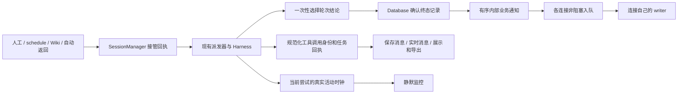

# 运行时接口修补：接管、记录与调用身份

> **Status:** completed — Q13–Q30 中已确认实施的修补全部通过本机验收，包括原生助手事件、调用身份与真实结束状态；Q25 脱敏未纳入，main 合并和服务发布由用户决定，尚未部署。

## 1. 依据和判断

结合用户工作区 `octopus_runtime_audit/{audit,plan,spec,evidence}.md`、最新运行日志审计及当前源码核对。源码基线为 main `74eab95`，上一轮运行时部署为 `b083efe`；相关运行时路径在两者之间没有变化。上一轮已经完成的规则见[运行日志修复计划](runtime-log-repair-20261013.md)，本方案补充其边界，不改写已经交付的验收结论。

| 问题 | 本次证据 | 修改判断 |
| --- | --- | --- |
| UI1：相同命令的 bg 卡可能指向另一项任务 | 最新真实记录重放生产组件：实时和 REST 顺序不同会改变关联，旧卡的取消目标可变成新任务 | 统一调用身份和明确回执，删除命令匹配 |
| UI2：委派续问缺卡、重复原生工具 ID 关联到旧回执 | 最新真实记录中的三条 continuation，以及实际组件重放 | 不依赖输入中必须有 name；按精确调用关联回执 |
| A01：新建 schedule 绕过派发器 | 真实 ScheduleRunner/SessionManager 方法的隔离探针：来源 human，未登记 driver/current request，drain 未捕获执行 | 两种 schedule 路径都通过统一接管入口 |
| 第二个生产旁路：Wiki worker | 源码确认直接迭代 send_message | 同步迁移调用方式，保留 Wiki 的业务验收和已有 job 恢复规则 |
| A02：终态追加不是提交确认，慢网络可能拖住结算 | 隔离 DB/慢订阅者故障注入；不是本次线上阻塞事件 | 明确保存完成；浏览器发送不占住核心生命周期 |
| A03：单次普通账户帧鉴权重复读取和记账 | SQL 操作探针：4 次 SELECT、2 次 UPDATE；未测延迟或 fsync 次数 | 主体解析一次，读取与活动记账分离 |
| A04：None 返回混淆 accepted/duplicate/closed | 真方法探针；closed bg 投递返回 True，但未入队 | 提交返回明确回执，投递方按实际接管状态记账 |
| A05：failed 委派指标误记成功 | 真方法探针；failed 对应 ok=True | completed 才成功，指标结算与返回接管分别记录 |
| A06：清理/记录任务无完整 owner，取消有全历史扫描 | 源码事实；尚无全历史扫描成本测量 | 本轮补任务所有权；不据此引入大 registry 或裁剪关闭记录 |
| R01：Vera 持续无摘要推理却三次静默终止 | 新调查、白名单原生活动元数据、真实 parser/HarnessRun/watchdog 的确定性红复现；同版本 CLI 导出省略空推理 | Harness 内独立活动信号，校验当前尝试及原生轮次，不只修改文本解析 |

fork 和原生导入/导出也有仅按原生工具 ID 配对的消费者，重复 ID 风险经合成记录复现，尚不是最新日志中的新增事故。身份修补必须覆盖这些消费者，避免只修卡片留下相同歧义。

整体保持单进程 FastAPI、SessionManager、Harness、BgTaskManager、DelegationManager、SQLite 和现有浏览器重连。架构上的改进是把责任交给拥有状态的模块，通过少量接口表达真实事实；不以新增层数、搬函数或替换框架作为完成标准。

R01 新证据为用户工作区 `vera-idle-timeout-investigation-20261014.md`，属于新的调查窗口。三次终止距离最近原始推理完成约 10.5、19.4、24.4 秒；历史 stdout 没有保存，不把合成输入复现说成历史 stdout 重放。本机及原记录均是 Codex 0.162.1，其[同版本导出源码](https://github.com/openai/codex/blob/rust-v0.162.1/codex-rs/exec/src/event_processor_with_jsonl_output.rs#L328-L342)明确省略空摘要推理的开始和完成，所以只让 Octopus parser 接受空文本还不能覆盖该版本。

红反馈已执行：`.venv/bin/python /tmp/octopus-idle-activity-debug/repro.py`，exit=1。每 0.25 秒发送无文本 reasoning，idle=1 秒仍在模拟 1.25 秒被停止；非空对照 2 秒存活，真正无活动对照停止一次。三个独立进程结果一致，根代理也复跑确认；未修改产品代码或调用模型。

## 2. 已确定的行为

| 决策 | 行为 |
| --- | --- |
| 已交付的 Q1–Q12 | 保留唯一轮次结论、有限恢复、普通 Stop 暂停队列、人工纠偏优先、明确恢复、按委派轮次级联取消及现有凭据校验 |
| Q13：结果保存失败 | 保留选定的执行结论，明确显示保存失败/未确认，暂停该会话自动派发；存储恢复并核验原记录后才能继续。不自动重跑模型，不产生相反的第二终态 |
| Q14：慢浏览器 | 单连接有界发送队列满或发送超时后断开，用现有重连、历史和状态快照同步。尚未保存的实时文字可能暂时不完整；不静默丢控制事件 |
| Q15：用户最终澄清 | 今后的任务继续使用现有可读卡片，新增调用身份和准确任务回执用于内部关联；不为旧日志/旧记录开发兼容、回填或专门静态展示。旧数据可在上线验收后清理 |
| Q17：真实活动与静默 | 是。属于当前执行尝试的真实运行活动，包括无可读文字的推理，也刷新 300 秒静默计时。持续真实活动时不因无文字终止；保留 Stop、累计恢复预算和默认关闭的整轮总时限 |
| 重启边界 | 不增加运行时持久 pending queue/outbox，不恢复积压、暂停或未执行工作，不自动重放。已有 Wiki 业务 job 持久化不因此删除 |
| CLI 和超时 | 保留 Codex exec --json、模型五分钟静默及 bg 首次输出后的默认六十秒；长任务继续显式设置 idle=0 和正总时限 |
| Codex 修改边界 | 用户再次明确 Codex 代码不能改：不修改源码、安装文件或 exec --json 协议。活动观察和生命周期修补只在 Octopus 中实现 |
| 验收与发布 | 按本机 Codex 约定验收，Claude live 不计通过也不作为本机提交阻塞；保留 hermetic Claude 协议测试。保全并行 Wiki 工作，本设计确认不等于发布授权 |

## 3. 三个接口和状态所有者

| 接口 | 所有者及保证 |
| --- | --- |
| 请求接管 | SessionManager 决定接受、重复、关闭抑制及 steering 路径；登记稳定请求和受管执行。不把网络通知成功当作接管条件 |
| 最终记录 | 轮次选择结论；Database 确认同一终态已提交。记录故障不重新选择结论，网络故障不撤销提交 |
| 工具身份与回执 | 规范化事件边界生成身份并保留来源；任务管理器返回真实任务/轮次身份；展示和历史消费者只使用这些事实 |

SessionManager 继续拥有队列和派发状态，DelegationManager 拥有委派图，BgTaskManager 拥有独立进程，HarnessRun 拥有 CLI 子进程，连接拥有发送任务。只有确实消除重复可变状态时才抽模块；不新建统管这些对象的万能运行注册表。

## 4. 调用身份与前端可读性

### 4.1 新消息的身份合同

在 Harness 事件进入会话消息的边界生成一次不可变 `tool_call_id`，同时捕获 `request_id`、`attempt_id` 和原始 provider `tool_use_id`。回执结构明确表示 bg task，或 delegation child session 加具体 `work_id`；续问不需要凭 name 推断轮次。

同名工具、相同 command、不同请求或恢复尝试中重复的 item_N 都不构成相同调用。use/result 配对限定于捕获的尝试，禁止扫描整段历史寻找第一个或最近一个相同原生 ID。原生 ID 保留用于 CLI 协议、问题应答和原生格式，不拿它直接授予产品控制权限。

元数据在保存消息和实时消息中采用同一有类型形状，前端只维护一处投影。bg、委派和 native subagent 卡片，以及重载、分页合并、rewind 副作用说明、fork 拷贝、JSONL 导入/导出都遵守相同身份合同。工具尚未回执或回执失败时显示相应事实，不猜 task_id。

消息表增加可空的运行元数据字段即可，不给旧行补身份。导出能携带来源元数据时保留它；没有可靠来源的原生导入仍可读，但不能由旧 raw ID 推导当前控制权限。fork 中复制的历史只描述原操作，不产生新任务或继承当前取消权。

取消和查询仍验证账户、会话、任务/轮次归属；浏览器字段不是授权证据。新卡的运行状态只来自精确关联的权威快照。快照未保留某个轮次时显示已知回执和状态不可用，不虚构 running，不为此新增永久委派历史表。

### 4.2 Q15：现有卡片保持可读，身份用于内部关联

新增记录继续使用现有 bg、委派和 native subagent 卡片及通用工具展示，不为增加身份信息另做一套产品界面：

- 默认显示人可读的工具名、命令/说明、agent 名称、任务内容、状态与结果摘要，长参数和输出可展开查看。
- `tool_call_id`、`request_id`、`attempt_id`、`work_id` 等关联元数据默认不新增展示，仅用于框架内部关联和诊断。
- 回执按实际含义显示“后台命令已启动”或“委派已创建/已接管”，不能显示已完成或暗示排队委派已经执行。
- 失败、退出码、原因、stdout/stderr 和委派回复保留可读摘要及完整详情；已有时间照常显示，缺失字段不编造。
- 同一个命令启动多次、委派继续同一子会话、刷新和重连时，卡片仍指向各自的准确任务/轮次。

用户明确不要求旧数据兼容，旧日志和旧记录可以清理：不做旧身份推断、关联回填、旧动态卡片或旧记录专门静态摘要。这不是一项旧数据显示需求，不能为它增加适配器、额外状态或验收矩阵。现有通用消息展示自然能读的内容可以继续存在，不以恢复旧数据能力为本次目标。

例如今后运行测试，用户仍看到“运行后端测试”及正在运行/完成/失败状态，展开查看命令、错误和输出；框架内部按唯一调用身份找到对应任务。可读性来自现有展示层，关联正确性来自新增元数据。没有身份时不猜测或授予取消权限，这条防错控制规则也适用于导入和 fork，不需要旧数据兼容逻辑。

## 5. 统一接管与调用方迁移

保留 `start_message` 作为公开接管入口，返回内部 `SubmissionReceipt`：disposition 为 accepted、duplicate、closed 或 steered；含稳定请求身份及受 SessionManager 管理的完成等待方式。底层执行迭代器改为私有，生产中只由派发器调用。

短临界区内完成权限/工作开放校验、投递去重、队列登记和必要 driver 所有权登记，不执行数据库、网络或 stdin I/O。接管完成后通知的阻塞、异常或等待者取消不能使调用方误判未接管。`delivery_id -> receipt` 保留重复投递的原请求和完成状态；closed 是有意抑制，不是假成功。

完成等待隔离等待者取消，不暴露可被随手取消的执行 Task。完成值区分实际执行结论、已选结论但保存失败，以及未开始就撤回/过期/关闭；后者没有模型 TurnOutcome。所有 accepted 路径都必须结束等待，包括 Stop、work cancel、过期问题跳过、会话删除和服务停机。

steered 只说明输入已被 steering 接管，不宣称模型已读取。实际 stdin 写成功后归属于当前逻辑轮次；写失败/窗口关闭转入队列则沿用其已接管身份并完成独立请求。完成值明确实际归属的逻辑请求 ID；inline 输入不另立终态，不能拿它的输入身份写第二条 terminal record。等待对象必须跟随这个最终归属，不能悬空或编造额外终态。

| 调用方 | 迁移要求 |
| --- | --- |
| ScheduleRunner | 新建和返回原会话都显式 source=schedule；保留 last_run_session_id、分支既有 last_run_at 时机、一次性触发和归档。overlap 检查含 queued/claimed/running；需要等待的分支等待回执。recording_failed 单列存储问题，不按模型 failed 自动重跑或提前归档 |
| WikiWorker | submit(source=wiki, wiki_mode=maintain) 并等完成；完成值分别保留执行结论与记录状态，最终 typed outcome 取代中间 error 收集作为执行判定。recording_failed 阻断本次发布放行，不转成可重试的模型失败；恢复只核验同一记录及既有 publication/revision/index，不绕过存储门另起模型调用 |
| Wiki 取消与 grants | shield 等待后，worker/API 取消必须显式取消捕获的 request/work，并等必要 teardown 后撤销 grants、归档；不能因只取消等待者留下仍有权限的模型 |
| bg/delegation/research | accepted/duplicate 才记已接管；closed 单独记抑制，真正拒绝明确诊断。不因未抛异常就声称 delivered |
| AppAgent/application/人工 WS | 已走接管的入口继续使用它；结果跟踪和业务总线保留。不再调用私有执行器 |

委派一次轮次的指标只结算一次，`completed=True`、`failed/cancelled=False`；running 不作为终态计数。指标已结算与父会话已接管返回分别记录；父工作关闭导致返回被抑制，也不能隐藏子工作已发生的终态指标。

Wiki 已有独立业务存储：已知发生 recording_failed 时，在现有 job/items 诊断中保留保存状态与原 session/request 引用。restart recover、reread 和人工 retry 都先识别这项保存故障并核验原终态，不能清掉关联后把同一执行误作未开始。只核验已有产物或转待核验，不重新生成内容；普通未完成任务的既有恢复规则保留。不增加 Wiki 运行时 outbox 或持久 pending outcome；若业务存储也不可写，或进程在诊断提交前崩溃，明确报告跨重启状态无法证明，不承诺识别该故障并阻止其后的所有自动恢复。

## 6. 唯一结论、确定提交及保存恢复

### 6.1 记录边界

轮次在任何 await 前一次性选定不可变结论，同时保留固定记录身份、seq 和 created_at；内容和消息计数只预留一次，存储核验不再经过会重新递增计数的普通追加路径。后到 Stop 观察同一结论，不因写入或通知失败重新选 failed/interrupted。状态区分 selected、writing、committed、recording_failed；失败另注明确定未记录或提交未确认。

在现有 messages 增加可空 `terminal_request_id` 和 `(session_id, terminal_request_id)` 的唯一索引，条件为 `WHERE terminal_request_id IS NOT NULL`，只约束新终态。它表达一次逻辑请求只有一条终态记录，不回填旧终态，不增加待处理队列表。与 §4 的运行元数据一起做向前可读的列扩展，历史 NULL outcome 的原有显示继续保留。

`record_terminal` 重用固定身份写入并明确 flush，只有提交得到确认才返回可发布的 committed record。已有同键记录必须核对内容一致；不能靠 INSERT IGNORE 隐藏相反结果。普通流式文本继续批处理。

Database 自身统一管理写入记账、提交和关闭的并发规则；所有修改批处理状态的路径遵守同一约束，避免 commit 返回后清掉同时到达的新写 dirty 标志。只给终态加外部锁不足以成立。共享连接的提交可能包含其他会话，禁止为单个失败结果做宽泛 rollback，丢掉他人的未提交消息。

### 6.2 Q13：恢复的是记录，不是模型执行

记录失败时保留同一结论和待核验记录，在服务内存状态与日志明确暴露保存问题。该会话停止自动派发；新输入可以接管排队，但不能在存储核验之前启动新模型工作。这个存储门与普通 Stop 的暂停标记分开，修好存储不会暗中恢复 Stop 留下的积压。

存储恢复后，现有恢复派发操作先完成保存核验：串行确认现有提交，通过独立已提交读视图查询固定键；同连接能读到行不是 durable 证明。若记录存在且一致，复用它；若确认缺失，用同一键、seq、时间和结论完成保存。再次失败或无法确认则继续阻断并报告，不盲目追加另一条记录。

保存确认后才发布正常终态业务事件。记录是否已提交、通知发布是否已开始及关键消费者是否已接管分别记账；重复结算或恢复不能再次生成同一终态事件，投递回执负责去重。某订阅者失败要明确观察和报告，不把它宣称为已成功送达，也不承诺任意回调故障下的 exactly-once 副作用；通知故障不能改记录或重新运行 CLI。

整个过程不提供跨进程恢复 pending outcome 的承诺；数据库仍不可用时无法保证完整历史，服务停机要明确报告未确认记录。

## 7. 浏览器发送与鉴权

每个连接有一个按帧数和字节数同时限额的 FIFO 发送队列、一个 writer。总线回调只做范围筛选和非阻塞 offer；控制回复、普通消息、错误及 close 统一由连接 owner 协调，避免多个协程交错写 socket。限制和发送期限由实现配置，测试验证有界性，不把初始数值包装成实测性能结论。

满队列或慢发送结束该连接并使用可恢复 close 语义；现有自动重连从 REST 消息及运行状态同步，包括唯一结果、bg 身份、当前委派、有效问题、队列暂停。不能继续保持连接却偷偷丢 Stop/结果/问题等控制帧。文本增量尚未提交的部分允许短暂不完整，最终按已保存消息收敛。

内部 DelegationManager、ApplicationManager、AppAgent 等业务订阅仍保持必要的顺序和等待；只把网络 I/O 移出核心路径，不把全部回调无序 create_task。接管和最终记录完成的含义独立于这些通知。

主体解析返回 principal 和凭据种类一次。普通账户授权读合并 token/user 有效性检查；出站帧不 touch last_seen，入站真实活动使用独立有界节流记账。保持实际发送前撤销/禁用/owner 检查，不增加授权 TTL 缓存。

已排队帧不能跨首次账户接管暴露 ownerless 数据。legacy token 轮换作为服务端可信控制交接，writer 的授权状态必须在该交接入队时安全更新，避免旧排队帧先因旧 token 失效而截断客户端收到新 token；保持帧顺序。普通撤销、账户接管不能获得这项例外。MCP scope/lease/work 验证保持独立，不以 user_id 代替活权限。

## 8. 取消、停机与活动监控

SessionManager 持有并观察 driver、执行、旧 backend 清理、尚未结束的最终记录/通知任务；连接持有 writer；BgTaskManager 和 HarnessRun 继续持有各自进程和清理。复用现有受管任务集合模式即可，异常可见、完成摘除、停机可等待。

普通 Stop 只取消捕获的当前请求并暂停队列，不能把独立 bg/child 塞进 request-local TaskGroup 一并取消。委派 cancel 捕获旧轮次分支，再取消所属 bg/后代；晚到 callback 或旧清理不能读取已经被新轮替换的 current backend/work。

停机先关闭接管/领取，再终止执行、关闭问题和运行权限，排空必要记录与旧 backend 清理，结束后台进程及连接发送任务，最后 flush/close DB。无法在受限时间确认退出或保存时报告实际未确认状态，不声称已完成，不在 DB 已关闭后留下正常可达写任务。

审查补齐了三个同边界缺口。普通 attempt 收尾也走捕获 backend 的受管退休屏障，失败不得丢掉句柄或启动替代 CLI。显式归档/agent eviction 先结束已接管等待并排空执行，结果保存未确认则保留原会话暂停供核验；HTTP 等待者取消不能取消归档 owner。停机排空超时会拒绝关闭数据库并保留未结束任务；成功清理的 close hook 摘除，失败的 hook 可重试。

全量离线和 Codex 实机均复现了 Wiki worker 显式归档与通用 schedule 自动归档竞争。维护会话使用已有自由字符串来源 `origin="wiki"`，归档由 worker 在完成回执核验与权限收尾后负责；派发器不抢先归档，保留通用归档并发保护。固定本次 Wiki 源码基线，仅完成运行时交界修补，不同步正在快速迭代的 Wiki 功能或 prompt。

共享 SQLite 连接的消息写入、终态提交和密钥重加密使用同一个写入 owner。重加密先提交既有消息，再用本操作的 savepoint 回滚，不能用连接级 rollback 抹掉其他会话的批量写入。取消中的临时环境文件恢复也纳入既有轮换操作的异常收尾。

保留关闭 work 的 tombstone：当前“未关闭即开放”的定义下，TTL 删除会重新开放旧 work。本轮不裁剪它，也不因为看见扫描代码就新增另一套可变工作所有者。

### 8.1 R01：Harness 拥有独立活动通道

运行活动与展示事件分开。parser 输出可包含已识别活动，即使没有可显示文本；Harness 的读取/观察边界更新捕获尝试的活动时钟，不等消息存储、业务回调或浏览器发送。未知 JSON、stderr 噪声、文件 mtime、进程仍存在、定时器 tick 都不算模型进展。

保留同一个 HarnessRun 引擎，Codex profile 仅提供其原生活动来源，不新建另一套轮次管理器。0.162.1 的 stdout 不含空摘要推理，需要由 Octopus 在实际 spawn 环境解析出的 CODEX_HOME（凭据覆盖或宿主回退）中观察准确 thread 的 rollout 完成元数据；源事件携带 thread_id、native turn_id、item 身份和完成时间，不发布或另存推理正文。

活动绑定同时捕获 Octopus request/attempt/run 和原生 thread/turn。当前 CLI 的 stdout turn.started 没有原生 turn ID；不能把第一条新增 task_started 当作当前尝试。必须获得当前子进程的明确原生轮次身份，并与 rollout 对照；未能证明归属时拒绝活动，不凭当前 session、相同 thread 或读到的新行猜测。

采用当前 CLI 已有的 stderr 诊断作为准确身份入口：[0.162.1 exec 源码](https://github.com/openai/codex/blob/rust-v0.162.1/codex-rs/exec/src/lib.rs#L1187-L1226)从 `TurnStartResponse.turn.id` 输出固定 INFO 消息。仅在 Octopus 拉起的该子进程环境中启用 `codex_exec=info`，其它目标维持 error 并关闭不需要的 telemetry 诊断，不改用户配置文件、登录身份、模型或 JSON stdout。reader 严格匹配目标、级别、固定消息及合法 UUID，保存到捕获的 HarnessRun；再与 stdout thread.started、rollout session_meta 和当前完成事件交叉校验。

新增 INFO/WARN 在 stderr reader 入口消费或丢弃，不进入 `_stderr_lines`、原始 debug 日志、数据库或聊天；原有 ERROR 与既有 CLI 诊断继续走其路径。只保留关联元数据，初始化线程名/路径、任意错误详情不能随新增诊断扩散。身份 INFO 只用于启动关联，不算持续运行活动。身份日志缺失、变形或产生不同 ID 时显式报告观测不可用，不回退到“首个新轮次”推断；准确 ID 不依赖 rollout 保存成功，所以也不会把外部 writer 的轮次当作本次执行。

此入口已经完成同版本源码审查、安装二进制常量核对和最终集成版本的 Codex 真 CLI 格式验收：子进程诊断的 thread/turn 与 rollout 原生活动元数据准确一致。原生身份关联验收已经通过，不只依赖合成 parser 测试。

观察者只增量读取，文件定位限制在捕获的 home/thread，目录查找、单次读取、未完成行及去重状态都有边界。已确认的完成活动按当前轮次的原始完成时间判新；历史积压、重复事件、写入时间变化不能重新赠送五分钟。文件替换/截断、格式不支持、绑定冲突或读取失败显式记观测问题；不能用本地心跳掩盖。

Q19 收敛删除两处“累计 4096 条后永久停用”活动逻辑，不改成更大的数量阈值或整轮无界历史集合。原生来源只保留当前准确绑定轮次的最大已接受 `completed_at_ms`，使用本次观察启动时捕获的 wall/monotonic 对照换算原始完成时刻；相同或更早的完成时间不能推进计时，同毫秒完成只需一次更新。此规则不是假设来源事件全局有序，也不声称识别“同一 item 被重新赋予更新完成时间”的不同记录。删除额外的 30 秒活动年龄截断，迟到记录仍使用原始发生时刻，不因读取而获得新的五分钟。

stdout 使用本机已验收格式中按分配顺序递增的 `item_N`，保留最大已见编号与当前未完成 item，完成或终态后释放当前状态。工具可以在较新 item 之后结束，因此不能仅凭最大编号拒绝仍在进行的旧工具完成。没有时间或版本号的 `item.updated` 不用于续命，原展示解析继续执行；未支持的 item 身份格式发出脱敏提示并退回原有可展示事件判断，不推断编号或活动身份。

目录发现统一为同一个可暂停遍历，优先已有 UUIDv7 日期提示并保留 UUIDv4 fork 的查找路径。每次读取仅处理一批目录项，下次接着处理；删除超过目录项累计数量便永久停用的逻辑。已确认子进程的 thread/turn 后，目录扫描尚未完成不会误报身份超时。只有完成查找仍找不到对应原生日志时才明确回退；发现迭代器随读取 owner 排空并关闭。保留单批字节和单行大小限制、文件身份校验及取消收尾，这些限制不按任务累计活动量终止观察。

按用户“类似这种 4096 的代码不允许”的补充要求，同步删除工具身份跟踪中的累计条数降级、pending call 数量淘汰和 child 数量上限，以及 Codex parser 对 child → spawn 关联按 64 项淘汰的逻辑；迟到的 wait/result 仍落到原 spawn 卡片。普通调用只保留当前待配对结果；native spawn 使用单一来源声明表，只有实际 spawn 身份保留跨当前进程的归属/歧义证据，普通工具不进入历史集合。重复或未接管的 spawn 身份保持不可关联，已有 child 的原始调用身份继续有效，不因经过若干普通工具后永久禁止所有新 child 关联。此状态由 HarnessRun 生命周期拥有，不增加新的持久表或全局注册表。

旧观察者在 Stop、取消、正常结束、恢复或停机时先同步失效，再由 Harness owner 取消和 drain。活动回调引用捕获的尝试，不能读取后来替换的 session.current；同一热进程的新轮次也必须重新绑定活动代次。

同一原生 thread 再启动前，等待捕获旧运行的完整退休，包括在途 spawn、其补偿清理和真正进程回收；只等 interrupt 协程返回不够。等待在新 attempt/watchdog 建立之前，有界并遵守显式剩余整轮总时限；未确认退休时不启动新的同 thread CLI，明确诊断且保留清理 owner。Stop 本身继续快速接管暂停，人工纠偏优先级不变，只有同 thread 实际启动等待旧进程清理。不能先启动新 CLI 再确认旧 writer 退出，也不能让取消等待者遗失清理 owner。

保持 idle=300、默认 overall=0、每逻辑轮次累计 idle recovery=2、有效问题豁免及 bg 默认静默=60 的原规则。仅更新活动来源和归属，不靠提高时限、降低 max 推理或清零恢复预算规避 bug。超时文案改为“指定时间未检测到有效运行活动”，不把工具或子任务卡住当作已证实原因；观测不可用时单独说明。

### 8.2 Q20–Q24：服务停机先关闭接管，再确认各 owner 收尾

2026-10-14 最新审计在真实停机中发现：CLI 先停止、接管仍开放，使未完成轮次误记为失败，委派终态还能启动另一个请求。真实 lifespan 和合成 CLI 已复现。用户确认按以下范围实施，仅针对新版本之后运行的工作，不兼容、迁移或回填旧记录；只读 WSL perf 镜像不需处理。

- 在 lifespan 收尾入口同步关闭接管，保持 MCP、业务订阅和数据库可供当前清理使用。
- Wiki、调度、研究、bg 等已有后台模块先封住新工作并发起取消；各模块通过原有任务和进程 owner 确认结束。取消已发起与清理已完成分别处理，不能串行等待 shielded Wiki 保存后才开始 session drain。
- 当前请求首次停止的原因由其捕获的结算/task owner 保存。用户 Stop 与服务关闭竞争时保留首次原因；服务关闭显示 `interrupted` / `service_shutdown`，不冒充用户 Stop、模型失败，也不改写已选定结论。
- 复用原有清理预算；不把 session 的 5 秒预算套到原先允许更长收尾的应用进程。超时或失败明确报告未确认，进程仍存活时保留 owner；不能为返回成功取消 writer、提前关闭其数据库或重新运行模型。
- 模型及后台 owner 收尾确认后再移除业务订阅、连接、监控和数据库。保留数据库 close hook 作为兜底；完成 task 不等于结果已经确认提交。
- Codex 提示仅增加简短工具使用指引：大段内容使用文件编辑工具或较小写入，命令过长时改短命令并校验结果。这是减少复发的指引，不提供强制拦截、自动拆命令、截断或新的累计上限；Codex 源码、安装、持久配置和 `exec --json` 不变。

回归以真实 `app.router.lifespan_context(app)`、现有后台管理器、SQLite 和合成子进程为 seam：停机中的委派返回不能二次启动；Wiki/研究/bg/调度及进程 owner 结束后再释放依赖；用户 Stop 的原始原因与已经选定的成功保持；保存阻塞/清理失败可有界报告未确认并保留连接/owner。完成后按本机约定运行全量门禁和 Codex 实机，双轴审查基线固定为 `c07b3d4`，追加独立提交，不部署。

### 8.3 Q26/Q27：未来委派跨重启显式续问

用户确认未来新建的委派在服务重启后仍可由原父会话显式续问，沿用原子会话及 transcript；未完成旧轮显示服务中断，已确认完成、失败和取消结论保留。重启不自动执行工作或重投旧返回。Q25 日志认证参数脱敏按本机风险降为可选，不纳入此修补，不轮换 token。

- 复用 sessions 行保存最近一轮必要状态；不新建委派表、持久队列或运行框架。旧行没有状态便不恢复、不回填、不猜测。
- 从真实父子会话、账号及目标 agent 行验证归属；归档仍可显式续问，父/子删除、跨父及跨账号不授予控制。
- 启动只恢复只读身份和末轮结论，关闭旧 work，不恢复 run lease。显式续问创建新的 work/lease，旧取消和旧工具作用域不能命中新轮；并发续问仅接管一轮。
- 一个子会话 turn 的 success 不代表整个委派完成，必须保留嵌套委派/relay 的归属。存储结论与委派快照之间的窗口通过准确 work/request 和已提交终态核验，不能选择相反结论、自动重跑或补发旧结果。
- 完整快照条件更新防止迟到旧保存覆盖新轮；保存失败或提交未确认保持选定结论并阻止进一步状态变更，原写入 owner 与数据库在收尾未确认时保留。明确的删除不冒充存储失败。
- interrupted 沿用现有任务卡展示，旧轮保持可读；新轮仍按准确调用回执和 work ID 提供控制。

沿用已确认的测试 seam：公开 DelegationManager/SessionManager、真实文件 SQLite 的 close/reopen、REST 账号隔离和合成子进程，以及生产任务卡。按红→绿逐项验证，再运行本机完整门禁和 Codex 实机；Claude 实机不跑，合并/发布仍由用户决定。双轴审查固定点为 `7449f12`，追加独立提交并推送。

### 8.4 Q28–Q30：原生助手生命周期与交付范围

新证据为 `runtime-log-review-20261014/subagent-review/report.md`。用户确认在最新修补分支独立修补，不修改 Codex 源码、安装或持久配置，保留 `codex exec --json`、bg/命名委派及现有生命周期；Claude 实机不跑，合并发布由用户决定。

- 父 CLI 结束而未确认助手完成时，显示中断／未确认及父轮结束、用户 Stop、错误恢复、服务关闭等真实原因；保留调用身份、已有结果和历史步骤，并使当前浏览器与 REST 刷新一致。不改写已确认父轮结论，不自动重跑助手。
- 原生助手在当前父轮内收齐必要结果或明确取消、说明未交付；跨回合长任务使用既有 bg/命名委派。补工具指引和真实状态，不以延长进程、强制自动续跑或新增框架代替该使用合同。模型自主创建的临时助手与用户明确请求的助手使用同一路径。
- 空 receiver 的邮箱 wait 只是工具调用，不建立匿名助手；没有真实子状态的 wait 不覆写完成。errored、interrupted、shutdown、not_found 等真实状态单独规范化，助手执行完成不冒充父模型已收取其结果。
- 当前真实 CLI 0.162.1 的隔离采集显示：一名助手先后完成两轮，stdout 只有两次空目标 wait、父回答及父终态，没有 spawn 或新生命周期项。原生父记录包含准确的 Started/Interacted/Completed 元数据；Started.id 等于真实 spawn call_id，Completed.id 的固定前缀后是源码确认的 child turn UUID。证据位于 `/tmp/octopus-native-subagent-probe-20261014/`，不能用猜测的 stdout 拼写代替实际格式验收。
- 复用现有 Codex 适配器的准确父 thread/turn 与 attempt 绑定、增量游标和受管读取任务，将已验证的调用身份、子线程及状态投影到现有工具消息与卡片。仅传必要元数据；不复制诊断行、原生回复、推理或完整原生日志。没有准确关系时明确未确认，不猜 item_N、不伪造调用或心跳，不新增观察循环、队列、运行框架或数量上限。
- 原生调用与 JSON item_N 是不同身份，必须依据同一子线程的已验证来源建立关系。真实新执行可以更新其状态；一般 interacted 或缺省 wait 不能擅自宣布新执行。重复、旧轮、取消后及终态后的观察不改变当前工作；必要的终态前已写记录通过原有受管读取收敛，不让诊断读取越过取消。

沿用已确认的公开验收 seam：HarnessRun/SessionManager 的真实合成子进程与 SQLite、REST/广播和生产 SubagentCard；补当前 CLI 真实事件格式、无目标 wait、正常收尾未完成、错误恢复、Stop/关闭、重复/错身份、完成保护、明确续接和前端刷新回归。按红→绿逐项实施；双轴审查固定点 `2319324`，最终运行本机完整门禁、可用 Codex 实机和浏览器验收，再提交推送，保留并行 Wiki 文档。

## 9. 实施顺序与验收

整体已确认，按以下五个边界实施和审查；相互依赖的运行时改动可组成完整的基础提交，R01 保持独立提交，每部分完成必要清理和验证：

1. 调用身份、类型回执和所有身份消费者；新卡片保留现有可读展示，去掉猜测关联，不开发旧记录兼容。
2. 接管回执、私有执行器、全部生产调用方适配；完整处理完成等待/steering/Wiki 取消，修正委派指标。
3. 幂等终态保存、确定提交与存储失败核验恢复；受管记录任务和 DB 并发记账同时完成。
4. 连接有界 writer、鉴权去重、剩余清理 owner；验证重连、撤销、账户接管和 legacy 轮换。
5. R01 活动通道、Codex 原生轮次绑定与观察者；复用已完成的运行清理 owner，验证活动、真实静默及旧尝试隔离，不修改 Codex。

具体回归先证明修复前失败，再验证修复后契约；使用真实 manager、生产组件和 SQLite 边界，脚本化 CLI 控制竞态，不 mock 掉正在验证的接口：

| 验收组 | 必须覆盖 |
| --- | --- |
| 身份 | 真实重复命令/委派 continuation 记录；不同请求、自动恢复中重复 item_N；use/result/native child 都不跨调用；实时/REST/分页/刷新一致 |
| Q15 可读性 | 新任务沿用现有卡片，名称/命令/任务内容与状态可读，结果和错误可展开；内部 ID 不取代用户摘要；重复命令、续问、刷新和重连不改变关联；不添加旧数据兼容测试矩阵 |
| 历史消费者 | 新元数据数据库往返、fork、rewind、JSONL 进出；复制旧事实不授予新控制；没有元数据的记录不启动猜测逻辑 |
| 接管 | 真实 schedule/Wiki 路径计入配额和 Stop/drain；duplicate 同请求；closed 不入队；接受后的阻塞/取消通知不造成第二请求 |
| 完成与 Wiki | 正常、失败、Stop、未执行撤回、过期、删除、停机均结束等待；取消等待者不隐式取消工作；Wiki 显式取消后才撤 grants；中间 error 后恢复成功不误判；已知保存故障的 job 恢复/retry 不另跑模型，普通未完成 job 恢复保持原规则 |
| 存储 | append 失败、append 后 commit 失败、commit 成功但包装报错、Stop 竞争；只有一项选定结论和一条终态；存储核验不重跑模型、不丢其他会话写入 |
| 网络与安全 | 一个 ASGI send 永久阻塞，另一连接和 Stop 继续；队列字节/帧有界；满队列重连同步；排队时 revoke/disable/adopt 拒绝，轮换可信交接可达 |
| 生命周期 | 捕获旧 backend 后新请求开始不被旧清理误停；停机 owner 排空且 DB 不被迟到写；普通 Stop 保留独立 bg，委派 cancel 只影响旧轮分支 |
| R01 活动 | stdout 无文字活动、实际原生元数据超过 idle 仍存活；工具返回后推理不被误杀；真实无活动仍停止；DB/WS 处理阻塞不拖延时钟；同一 request 恢复/新纠偏/热复用的旧活动不延长新尝试；历史积压和重复事件不续命 |
| R01 来源与清理 | 当前进程明确的 native turn ID 与文件一致；外部 writer、多候选、原生保存失败、旧 spawn 迟到、元数据缺失/变形、文件截断/替换拒绝假活动；取消/停机观察者排空，单次读取与去重有界；不新增推理正文日志 |
| R01 既有规则 | 最后问题解决后重新计 idle，显式 overall 包含等待和恢复；Stop 不启动恢复，恢复预算不因活动清零；正常结果仍唯一结算；bg 60 秒独立不变 |
| 指标与鉴权 | completed/failed/cancelled 精确映射且每轮一次，closed-parent 不隐藏终态；普通出站鉴权至多一次 SELECT、零活动 UPDATE，计数不冒充延迟提升 |

2026-10-14 已完成本机要求的全量 hermetic 后端、前端单测、`bun run typecheck`、纯 UI E2E、可用 Codex real-CLI/browser、lint、生成契约、文档索引和前端 build。验收 checkout 为 `/tmp/octopus-runtime-repair-20261014`，独立基础提交投影为 `/tmp/octopus-runtime-core-split-20261014`。

| 检查 | 最终结果 | 证据 |
| --- | --- | --- |
| 完整版本后端 hermetic | 2546 passed，45 real deselected，262.63 秒；零失败、零跳过 | `/tmp/octopus-runtime-final-hermetic-green.log` |
| 独立基础提交后端 hermetic | 2529 passed，44 real deselected，260.96 秒；零失败、零跳过 | `/tmp/octopus-runtime-core-final-hermetic-green.log` |
| 前端单测 | 45 个文件、390 项通过；基础提交与完整版本前端一致 | `/tmp/octopus-runtime-commit-split-20261014/core-offline-gates.json` |
| 纯 UI E2E | 76 passed，41.4 秒，零跳过 | `/tmp/octopus-runtime-final-e2e-fast-green.log` |
| Codex real-CLI | 20 个不同用例全部覆盖并通过，包括原生 thread/turn 格式与归属验收；首次 17 passed、3 failed，修复后相关 4 项复验全部通过，其中 1 项重复 | `/tmp/octopus-runtime-final-codex-real.log`、`/tmp/octopus-runtime-final-codex-recheck.log` |
| Codex 浏览器 | 1 passed，14.5 秒 | `/tmp/octopus-runtime-final-codex-browser.log` |
| Ruff / Mypy / ESLint / TypeScript / build | 基础提交和完整版本均通过；完整版本 Mypy 检查 161 个源文件 | `/tmp/octopus-runtime-final-ruff-green.log`、`/tmp/octopus-runtime-final-mypy-green.log`、`/tmp/octopus-runtime-commit-split-20261014/core-offline-gates.json` |
| 生成契约 / 文档索引 | 通过；最终状态文档更新后再次核对索引 | `/tmp/octopus-runtime-final-contracts-green.log`、`/tmp/octopus-runtime-final-docsindex-green.log` |
| Claude 实机 | 按用户要求未运行，不计作通过 | 用户明确“claude依旧不测，发布由我来定” |

初次全量检查和 Codex 实机暴露的失败均已调查并修正。Wiki worker 两种真实执行路径与离线回归共同验证了归档竞争修复；职业回答检查原先误判“个人资料里没有记载你的职业”，现补齐明确职业缺失表述及拒绝据教育背景推断职业的离线回归，仅调整测试判断，不改变 Wiki 产品或 prompt。最终全量离线和受影响实机复验均通过，没有将失败视为随机或既有问题而忽略。

交付保留在 `fix/runtime-interface-repair` 修补分支，分为完整运行时基础提交与独立 R01 提交，不混入并行 Wiki 功能或 prompt 改动。用户明确发布和部署由本人决定，本轮不合并发布 main、不重启正式服务、不创建版本标签。Claude 实机测试依用户要求不运行，离线协议回归已纳入本机门禁。

### 9.1 Q19 活动与身份收敛验收

本次收敛沿用三个现有 Harness 模块，生产代码净减少 10 行。删除累计活动上限和重复的来源历史，不将阈值调大；单次读取/单行边界继续保护观察者的资源使用，不限制整个任务能产生多少活动。子任务归属是必须保留的事实，不能按累计数量淘汰再猜测。没有新框架、依赖、持久表或 Codex 安装/配置文件修改。

先用回归复现长任务失去活动、迟到记录获得新时间窗、目录查找提前停用和工具/child 来源丢失，再完成修正。最终源码和测试的 SHA-256 在验收后再次核对一致。

| 检查 | 结果 | 证据 |
| --- | --- | --- |
| 最终全量离线门禁 | 后端 2556 passed、45 real deselected，261.24 秒；前端 390 passed；Ruff、Mypy（161 个源文件）、ESLint、强制 TypeScript、生成契约和文档索引全部通过 | `/tmp/octopus-activity-cleanup-final-complete-offline.log` |
| 最终受影响模块回归 | 172 passed；涵盖 5000 次活动/普通工具调用、旧工具迟到完成、200 个子 agent 后回报归属、重复/过期/无版本更新、目录分批查找、Stop、恢复、终态及隐私边界 | `/tmp/octopus-activity-cleanup-final-affected.log` |
| Codex 全量可用实机 | 20 passed，888.78 秒；无失败和跳过；随后针对最终 parser 的启动去重与关联淘汰删除，另行完成以下原生格式复验和浏览器验收 | `/tmp/octopus-activity-cleanup-final-codex-real.log` |
| 最终原生身份/格式复验 | 1 passed，27.50 秒；实际子进程 thread/turn 和原生完成元数据绑定成功，新增诊断不泄露到错误文本 | `/tmp/octopus-activity-cleanup-native-final-recheck.log` |
| 纯 UI E2E / 最终 Codex 浏览器 | 76 passed，41.9 秒 / 1 passed，13.6 秒；无失败和跳过 | `/tmp/octopus-activity-cleanup-final-e2e-fast.log`、`/tmp/octopus-activity-cleanup-codex-browser.log` |
| 前端构建 | 通过，只构建修补 checkout，未部署正式服务 | `/tmp/octopus-activity-cleanup-build.log` |
| Vera 历史元数据回放 | 原事件中三段 12/11/10 条推理完成均被接受；原停止时刻距最近真实活动 10.454/19.421/24.414 秒，均未达到 300 秒 | `/tmp/octopus-vera-historical-metadata-replay-result.json` |
| Claude 实机 | 按用户要求未运行，不计作通过 | 用户明确“claude依旧不测，发布由我来定” |

历史验收使用原始原生日志的身份与时间白名单，在虚拟时钟中注入已知轮次绑定；它验证了原记录的活动能否被新观察者识别，不冒充历史 stdout 重放或完整模型任务重跑。真正子进程身份绑定由独立的 Codex 实机用例验收。即使活动观察不兼容，也保留既有 stdout 判断、五分钟真实静默重启、每逻辑请求最多两次累计续接及手动 Stop。

交付为已有修补分支上的追加独立提交，不改写此前已推送的两个提交。main、正式服务和并行 Wiki 开发工作区仍由用户决定何时合并和发布。

### 9.2 Q20–Q24 停机与命令指引验收

2026-10-14 在包含最新 main `74eab95` 的修补 checkout 完成。停机入口先同步封住请求接管和现有生产者，再并行确认各模块自己的取消、记录及进程收尾；最后释放依赖和数据库。首次 Stop 原因保存在当前结算 owner，已选定结果不改写。保存失败、迟到 spawn、未完成回调、研究叶子及缓存 CLI 退休均保留原 owner，并有界报告未确认。Wiki 停机清理失败不会继续领取下一项作业。

沿用现有框架与清理预算，未添加运行框架、持久队列或累计数量淘汰。共享取消保护归入现有 `server/aio.py`，保留首次取消原因。命令过长仅补充简短 Codex 工具使用指引；Codex 源码、安装、持久配置及 `exec --json` 不变，WSL 只读 perf 镜像不处理。五分钟静默、每逻辑请求最多两次续接、手动 Stop 暂停队列和 bg 的默认静默规则不变。

真实 lifespan 的六项回归覆盖停机期间委派返回、Wiki 中断、Stop 竞争、阻塞保存、已结束但未确认保存，以及 reaper 已开始的退休；各现有管理器另有启动、第二次取消、输出排空、迟到句柄和失败收尾的确定性回归。审查发现的五处 owner 缺口全部修正。Standards 未解决发现 0；Spec 未解决发现 0，固定比较基线为 `c07b3d4`。

| 检查 | 最终结果 | 证据 |
| --- | --- | --- |
| 完整离线门禁 | 8 个检查全部通过；后端 2605 passed、45 real deselected，277.25 秒，零失败、零跳过；前端 390 passed；Ruff、Mypy（161 个源文件）、ESLint、强制 TypeScript、生成契约和文档索引通过 | `/tmp/octopus-shutdown-final-offline-green.log` |
| 纯 UI E2E | 76 passed，41.6 秒，零跳过 | `/tmp/octopus-shutdown-final-e2e-fast.log` |
| Codex 全量可用实机 | 20 passed，1033.12 秒，零失败、零跳过；包括 native thread/turn 元数据、65 秒问题等待、研究、调度、fork 及两种真实 Wiki worker 路径 | `/tmp/octopus-shutdown-final-codex-real.log` |
| Codex 浏览器 | 1 passed，16.8 秒，零跳过 | `/tmp/octopus-shutdown-final-codex-browser.log` |
| 前端构建 | 通过，只构建修补 checkout | `/tmp/octopus-shutdown-final-build.log` |
| 实际 lifespan / session / DB 回归 | 123 passed；先复现 unconfirmed 保存和 reaper 退休误报成功，再验证修正 | `/tmp/octopus-shutdown-held-green.log` |
| 源码核验 | 最终 29 个改动的源码/测试文件 SHA-256 与完整验收时一致 | `/tmp/octopus-shutdown-final-source-sha256.json` |
| Claude 实机 | 按用户要求未运行验收，不计作通过 | 用户明确“claude依旧不测，发布由我来定” |

首次完整离线检查的失败全部调查并修正：保存故障测试必须恢复并核验原结果后再关闭数据库；bg 启动阻塞测试必须先报告未确认，再释放门并确认补偿清理；真实 lifespan 测试必须隔离前面测试所属旧 event loop 的登录 owner。保留故障断言和真实数据库/子进程验证，未将失败视为随机问题或跳过。随后重新运行完整 8 个门禁并全部通过。

交付追加到 `fix/runtime-interface-repair`，不改写已推送历史。用户并行迭代的七份 Wiki 开发文档只同步到临时 checkout，不进入本次提交；main 与正式服务保留由用户决定合并、发布和部署。

### 9.3 Q26/Q27 未来委派跨重启续问验收

未来委派在已有 sessions 行保存末轮快照；恢复只读回执与结论，关闭旧 work，不恢复 lease、不重跑模型或补发旧返回。原父会话显式续问复用同一子会话和原生 transcript，创建新 work/lease；旧取消不能影响新轮。未完成工作显示服务中断，已提交成功、失败和取消保持结论；嵌套首轮成功只说明已委派，不能冒充后续 relay 的完成。

接管前取消先确认快照回滚，再恢复旧轮内存记录。写入确认丢失时只保留那一次准确的尝试值，以独立已提交读取核验，不猜测存储状态；保存失败不能把已选定取消改成失败。已确认删除显示 404/409，存储未确认保留 owner 和数据库。启动恢复失败同样关闭接管，清理确认后才解绑；取消启动不取消已有 writer，也不改变原取消原因。实现集中在现有委派、会话生命周期和 SQLite 模块；没有增加委派表、持久队列、运行框架、旧数据回填或数量上限。

双轴审查比较基线为 `7449f12`，Standards 未解决发现 0，Spec 未解决发现 0。审查定位的取消/确认丢失、相反终态覆盖、嵌套已提交失败和启动清理边界均先复现再修正，并通过公开管理器、实际 SQLite、真实 lifespan 与合成子进程验证。

| 检查 | 最终结果 | 证据 |
| --- | --- | --- |
| 完整离线门禁 | 8 项全部通过；后端 2653 passed、45 real deselected，287.68 秒，零失败、零跳过；前端 391 passed；Ruff、Mypy（161 个源文件）、ESLint、强制 TypeScript、生成契约和文档索引通过 | `/tmp/octopus-delegation-final-offline.log` |
| 纯 UI E2E | 76 passed，40.4 秒，零跳过 | `/tmp/octopus-delegation-final-e2e-fast.log` |
| Codex 全量可用实机 | 20 passed，1169.62 秒，零失败、零跳过 | `/tmp/octopus-delegation-final-codex-real.log` |
| Codex 浏览器 | 1 passed，16.7 秒，零跳过 | `/tmp/octopus-delegation-final-codex-browser.log` |
| 前端构建 | 通过，仅构建修补 checkout | `/tmp/octopus-delegation-final-build.log` |
| 委派及相邻回归 | 138 passed；最终启动、嵌套、安全和实际 lifespan 组合另有 22 passed；新增后端用例总计 48 项，全部包含在最终离线门禁 | `/tmp/octopus-delegation-final-targeted-20261014.log`、`/tmp/octopus-delegation-restart-lifespan-validation.log` |
| 源码核验 | 最终 17 个源码/测试文件 SHA-256 与完整验收开始时一致 | `/tmp/octopus-delegation-final-source-sha256.json` |
| Claude 实机 | 按用户要求未运行，不计作通过 | 用户明确“claude依旧不测，发布由我来定” |

最终核验 `origin/main` 仍为 `74eab95`，修补分支包含该提交；用户并行更新的七份 Wiki 文档只保留在开发工作区，不进入本次提交。提交与推送沿用 `fix/runtime-interface-repair`，main 合并和服务发布继续由用户决定。Q25 日志认证参数脱敏未纳入范围，没有轮换 token 或修改 Codex 安装和持久配置。

### 9.4 Q28–Q30 原生临时助手的事件、调用身份与真实结束状态

本轮修补同样覆盖模型自动创建和用户明确要求创建的临时助手。它们仍属于一次 `codex exec --json` 的生命周期；跨回合 bg 和 Octopus 命名委派的规则保持原样。提示补上收齐必要结果或取消并说明未交付的要求，不新增框架自动续跑。

真实 Codex 0.162.1 验收确认，新原生助手的 Started/Interacted/Completed 记录不出现在 exec JSON 主通道，而无目标 mailbox wait 会出现在该通道。复用现有准确 thread/turn 绑定、增量读取任务与游标锁，补读取经过身份、新鲜度和去重校验的最小调用头与生命周期元数据；参数采用词法跳过，正文、推理和诊断不进入聊天、历史或恢复提示。完成仅证明子执行完成，不冒充父模型已消费结果。正常结果或进程 EOF 前消费已写入的有限前缀，Stop、取消和终态后拒绝补充观察。

同一助手的明确后续调用使用新调用身份，旧卡的已确认摘要与步骤保留。重叠或无法可靠归属的执行显示未确认；无目标 wait 不造匿名助手。开始时捕获 wait 所观察的调用身份，迟到旧 wait 只保留可读工具结果，不修改旧卡或新卡。未完成助手随父轮结束标中断，区分正常收尾、父错误、静默超时、Stop、服务关闭和委派取消。现有受管通知独立发布已选定状态，CLI 清理阻塞时浏览器和 REST 仍一致。

双轴审查固定点为 `2319324`，Standards 与 Spec 未解决发现均为 0。审查发现的已完成助手清理覆盖、旧 wait 串到新调用、迟到旧 wait 改写旧结果、目标不可用误建新轮和清理阻塞期间浏览器未更新，均通过公开 HarnessRun/SessionManager、实际合成进程、SQLite、REST/广播与生产组件先复现再修正。子执行只维护一张身份/状态表，没有新增观察循环、运行框架、队列或固定数量上限。

| 检查 | 最终结果 | 证据 |
| --- | --- | --- |
| 完整离线门禁 | 8 项全部通过；后端 2713 passed、46 real deselected，301.86 秒；前端 399 passed；Ruff、Mypy、ESLint、强制 TypeScript、生成契约和文档索引通过 | `/tmp/octopus-native-final-check.log` |
| 纯 UI E2E | 76 passed，41.5 秒，零失败、零跳过 | `/tmp/octopus-native-final-ui.log` |
| 真实原生助手格式 | 创建一个助手、收取后续两轮，公开流中两次独立调用准确关联同一子线程；1 passed，56.98 秒 | `/tmp/octopus-native-real-acceptance.log` |
| Codex 全量可用实机 | 21 passed、2738 deselected，1299.93 秒，零失败、零跳过 | `/tmp/octopus-native-final-codex-reviewed.log` |
| Codex 浏览器 | 1 passed，18.7 秒，零失败、零跳过；与实机套件串行执行 | `/tmp/octopus-native-final-codex-browser.log` |
| 前端构建 | 通过，仅构建修补 checkout | `/tmp/octopus-native-final-build.log` |
| 源码核验 | 最终 24 个源码/测试/fixture 文件 SHA-256 与完整门禁和实机验收开始时一致 | `/tmp/octopus-native-final-source-fingerprint.json` |
| Claude 实机 | 按用户要求未运行，不计作通过 | 用户明确“claude依旧不测，发布由我来定” |

当前 `origin/main` 为 `7db94a9`，相对原基线只新增 Wiki 文档，没有运行时代码变化；分支合并树预检无冲突。七份并行 Wiki 开发文档保留在工作区，不进入本次提交。提交和推送沿用 `fix/runtime-interface-repair`，不合并 main、不发布、不重启服务。Claude live 按约定未验收，不计为通过。

## 10. What this defers

- 运行时持久队列、outbox、跨重启 pending outcome/暂停恢复：用户已明确撤回，不属于本次范围。
- 旧日志/旧记录兼容、身份推断、关联回填、旧专用展示及控制：Q15 最终澄清为无需支持，旧数据可清理；今后卡片的可读性在本轮完成。
- closed-work TTL、历史轮次裁剪、永久完整轮次状态、新的公平派发：需要不同生命周期/产品合同及实测压力，不借维护名义改变已接受行为。
- children/leases 的额外反向索引或通用 WorkRegistry：先测实际扫描成本或找到重复写入责任；现有 owner 内的正确取消和受管清理本轮完成，不以未测性能为由增加状态副本。
- Codex 协议迁移、自动换模型、新队列服务、Wiki 业务架构变化、Claude live 本机验收：均超出本次已确定范围。
- Codex 源码/安装文件修改，以及无原生轮次身份情况下猜测活动：不实施。Q17 的已验证活动通道、归属校验和完整清理属于本轮，不能只做 parser 就宣称修复。

本节不用于搁置当前合同必需的清理、错误处理、可读性或验收。
