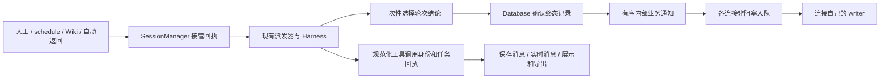

# 运行时接口修补：接管、记录与调用身份

> **Status:** completed — Q13–Q15 与通用运行清理已实施并通过独立基础验收；R01 活动修补另行提交，尚未部署。

本基础提交完成请求接管、终态记录、调用身份、连接发送和通用资源清理。Q17/Q18 的独立活动通道、Codex 原生轮次绑定与观察者由后续 R01 提交承载，不包含在基础源码投影中。第 9 节将独立基础提交和完整联合栈的验收证据分别标明，不把联合栈的原生活动验收当作基础提交单独运行的结果。

## 1. 依据和判断

结合用户工作区 `octopus_runtime_audit/{audit,plan,spec,evidence}.md`、最新运行日志审计及当前源码核对。源码基线为 main `74eab95`，上一轮运行时部署为 `b083efe`；相关运行时路径在两者之间没有变化。上一轮已经完成的规则见[运行日志修复计划](runtime-log-repair-20261013.md)，本方案补充其边界，不改写已经交付的验收结论。

| 问题 | 本次证据 | 修改判断 |
| --- | --- | --- |
| UI1：相同命令的 bg 卡可能指向另一项任务 | 最新真实记录重放生产组件：实时和 REST 顺序不同会改变关联，旧卡的取消目标可变成新任务 | 统一调用身份和明确回执，删除命令匹配 |
| UI2：委派续问缺卡、重复原生工具 ID 关联到旧回执 | 最新真实记录中的三条 continuation，以及实际组件重放 | 不依赖输入中必须有 name；按精确调用关联回执 |
| A01：新建 schedule 绕过派发器 | 真实 ScheduleRunner/SessionManager 方法的隔离探针：来源 human，未登记 driver/current request，drain 未捕获执行 | 两种 schedule 路径都通过统一接管入口 |
| 第二个生产旁路：Wiki worker | 源码确认直接迭代 send_message | 同步迁移调用方式，保留 Wiki 的业务验收和已有 job 恢复规则 |
| A02：终态追加不是提交确认，慢网络可能拖住结算 | 隔离 DB/慢订阅者故障注入；不是本次线上阻塞事件 | 明确保存完成；浏览器发送不占住核心生命周期 |
| A03：单次普通账户帧鉴权重复读取和记账 | SQL 操作探针：4 次 SELECT、2 次 UPDATE；未测延迟或 fsync 次数 | 主体解析一次，读取与活动记账分离 |
| A04：None 返回混淆 accepted/duplicate/closed | 真方法探针；closed bg 投递返回 True，但未入队 | 提交返回明确回执，投递方按实际接管状态记账 |
| A05：failed 委派指标误记成功 | 真方法探针；failed 对应 ok=True | completed 才成功，指标结算与返回接管分别记录 |
| A06：清理/记录任务无完整 owner，取消有全历史扫描 | 源码事实；尚无全历史扫描成本测量 | 本轮补任务所有权；不据此引入大 registry 或裁剪关闭记录 |

fork 和原生导入/导出也有仅按原生工具 ID 配对的消费者，重复 ID 风险经合成记录复现，尚不是最新日志中的新增事故。身份修补必须覆盖这些消费者，避免只修卡片留下相同歧义。

整体保持单进程 FastAPI、SessionManager、Harness、BgTaskManager、DelegationManager、SQLite 和现有浏览器重连。架构上的改进是把责任交给拥有状态的模块，通过少量接口表达真实事实；不以新增层数、搬函数或替换框架作为完成标准。

## 2. 已确定的行为

| 决策 | 行为 |
| --- | --- |
| 已交付的 Q1–Q12 | 保留唯一轮次结论、有限恢复、普通 Stop 暂停队列、人工纠偏优先、明确恢复、按委派轮次级联取消及现有凭据校验 |
| Q13：结果保存失败 | 保留选定的执行结论，明确显示保存失败/未确认，暂停该会话自动派发；存储恢复并核验原记录后才能继续。不自动重跑模型，不产生相反的第二终态 |
| Q14：慢浏览器 | 单连接有界发送队列满或发送超时后断开，用现有重连、历史和状态快照同步。尚未保存的实时文字可能暂时不完整；不静默丢控制事件 |
| Q15：用户最终澄清 | 今后的任务继续使用现有可读卡片，新增调用身份和准确任务回执用于内部关联；不为旧日志/旧记录开发兼容、回填或专门静态展示。旧数据可在上线验收后清理 |
| 重启边界 | 不增加运行时持久 pending queue/outbox，不恢复积压、暂停或未执行工作，不自动重放。已有 Wiki 业务 job 持久化不因此删除 |
| CLI 和超时 | 保留 Codex exec --json、模型五分钟静默及 bg 首次输出后的默认六十秒；长任务继续显式设置 idle=0 和正总时限 |
| 验收与发布 | 按本机 Codex 约定验收，Claude live 不计通过也不作为本机提交阻塞；保留 hermetic Claude 协议测试。保全并行 Wiki 工作，本设计确认不等于发布授权 |

## 3. 三个接口和状态所有者

| 接口 | 所有者及保证 |
| --- | --- |
| 请求接管 | SessionManager 决定接受、重复、关闭抑制及 steering 路径；登记稳定请求和受管执行。不把网络通知成功当作接管条件 |
| 最终记录 | 轮次选择结论；Database 确认同一终态已提交。记录故障不重新选择结论，网络故障不撤销提交 |
| 工具身份与回执 | 规范化事件边界生成身份并保留来源；任务管理器返回真实任务/轮次身份；展示和历史消费者只使用这些事实 |

SessionManager 继续拥有队列和派发状态，DelegationManager 拥有委派图，BgTaskManager 拥有独立进程，HarnessRun 拥有 CLI 子进程，连接拥有发送任务。只有确实消除重复可变状态时才抽模块；不新建统管这些对象的万能运行注册表。

## 4. 调用身份与前端可读性

### 4.1 新消息的身份合同

在 Harness 事件进入会话消息的边界生成一次不可变 `tool_call_id`，同时捕获 `request_id`、`attempt_id` 和原始 provider `tool_use_id`。回执结构明确表示 bg task，或 delegation child session 加具体 `work_id`；续问不需要凭 name 推断轮次。

同名工具、相同 command、不同请求或恢复尝试中重复的 item_N 都不构成相同调用。use/result 配对限定于捕获的尝试，禁止扫描整段历史寻找第一个或最近一个相同原生 ID。原生 ID 保留用于 CLI 协议、问题应答和原生格式，不拿它直接授予产品控制权限。

元数据在保存消息和实时消息中采用同一有类型形状，前端只维护一处投影。bg、委派和 native subagent 卡片，以及重载、分页合并、rewind 副作用说明、fork 拷贝、JSONL 导入/导出都遵守相同身份合同。工具尚未回执或回执失败时显示相应事实，不猜 task_id。

消息表增加可空的运行元数据字段即可，不给旧行补身份。导出能携带来源元数据时保留它；没有可靠来源的原生导入仍可读，但不能由旧 raw ID 推导当前控制权限。fork 中复制的历史只描述原操作，不产生新任务或继承当前取消权。

取消和查询仍验证账户、会话、任务/轮次归属；浏览器字段不是授权证据。新卡的运行状态只来自精确关联的权威快照。快照未保留某个轮次时显示已知回执和状态不可用，不虚构 running，不为此新增永久委派历史表。

### 4.2 Q15：现有卡片保持可读，身份用于内部关联

新增记录继续使用现有 bg、委派和 native subagent 卡片及通用工具展示，不为增加身份信息另做一套产品界面：

- 默认显示人可读的工具名、命令/说明、agent 名称、任务内容、状态与结果摘要，长参数和输出可展开查看。
- `tool_call_id`、`request_id`、`attempt_id`、`work_id` 等关联元数据默认不新增展示，仅用于框架内部关联和诊断。
- 回执按实际含义显示“后台命令已启动”或“委派已创建/已接管”，不能显示已完成或暗示排队委派已经执行。
- 失败、退出码、原因、stdout/stderr 和委派回复保留可读摘要及完整详情；已有时间照常显示，缺失字段不编造。
- 同一个命令启动多次、委派继续同一子会话、刷新和重连时，卡片仍指向各自的准确任务/轮次。

用户明确不要求旧数据兼容，旧日志和旧记录可以清理：不做旧身份推断、关联回填、旧动态卡片或旧记录专门静态摘要。这不是一项旧数据显示需求，不能为它增加适配器、额外状态或验收矩阵。现有通用消息展示自然能读的内容可以继续存在，不以恢复旧数据能力为本次目标。

例如今后运行测试，用户仍看到“运行后端测试”及正在运行/完成/失败状态，展开查看命令、错误和输出；框架内部按唯一调用身份找到对应任务。可读性来自现有展示层，关联正确性来自新增元数据。没有身份时不猜测或授予取消权限，这条防错控制规则也适用于导入和 fork，不需要旧数据兼容逻辑。

## 5. 统一接管与调用方迁移

保留 `start_message` 作为公开接管入口，返回内部 `SubmissionReceipt`：disposition 为 accepted、duplicate、closed 或 steered；含稳定请求身份及受 SessionManager 管理的完成等待方式。底层执行迭代器改为私有，生产中只由派发器调用。

短临界区内完成权限/工作开放校验、投递去重、队列登记和必要 driver 所有权登记，不执行数据库、网络或 stdin I/O。接管完成后通知的阻塞、异常或等待者取消不能使调用方误判未接管。`delivery_id -> receipt` 保留重复投递的原请求和完成状态；closed 是有意抑制，不是假成功。

完成等待隔离等待者取消，不暴露可被随手取消的执行 Task。完成值区分实际执行结论、已选结论但保存失败，以及未开始就撤回/过期/关闭；后者没有模型 TurnOutcome。所有 accepted 路径都必须结束等待，包括 Stop、work cancel、过期问题跳过、会话删除和服务停机。

steered 只说明输入已被 steering 接管，不宣称模型已读取。实际 stdin 写成功后归属于当前逻辑轮次；写失败/窗口关闭转入队列则沿用其已接管身份并完成独立请求。完成值明确实际归属的逻辑请求 ID；inline 输入不另立终态，不能拿它的输入身份写第二条 terminal record。等待对象必须跟随这个最终归属，不能悬空或编造额外终态。

| 调用方 | 迁移要求 |
| --- | --- |
| ScheduleRunner | 新建和返回原会话都显式 source=schedule；保留 last_run_session_id、分支既有 last_run_at 时机、一次性触发和归档。overlap 检查含 queued/claimed/running；需要等待的分支等待回执。recording_failed 单列存储问题，不按模型 failed 自动重跑或提前归档 |
| WikiWorker | submit(source=wiki, wiki_mode=maintain) 并等完成；完成值分别保留执行结论与记录状态，最终 typed outcome 取代中间 error 收集作为执行判定。recording_failed 阻断本次发布放行，不转成可重试的模型失败；恢复只核验同一记录及既有 publication/revision/index，不绕过存储门另起模型调用 |
| Wiki 取消与 grants | shield 等待后，worker/API 取消必须显式取消捕获的 request/work，并等必要 teardown 后撤销 grants、归档；不能因只取消等待者留下仍有权限的模型 |
| bg/delegation/research | accepted/duplicate 才记已接管；closed 单独记抑制，真正拒绝明确诊断。不因未抛异常就声称 delivered |
| AppAgent/application/人工 WS | 已走接管的入口继续使用它；结果跟踪和业务总线保留。不再调用私有执行器 |

委派一次轮次的指标只结算一次，`completed=True`、`failed/cancelled=False`；running 不作为终态计数。指标已结算与父会话已接管返回分别记录；父工作关闭导致返回被抑制，也不能隐藏子工作已发生的终态指标。

Wiki 已有独立业务存储：已知发生 recording_failed 时，在现有 job/items 诊断中保留保存状态与原 session/request 引用。restart recover、reread 和人工 retry 都先识别这项保存故障并核验原终态，不能清掉关联后把同一执行误作未开始。只核验已有产物或转待核验，不重新生成内容；普通未完成任务的既有恢复规则保留。不增加 Wiki 运行时 outbox 或持久 pending outcome；若业务存储也不可写，或进程在诊断提交前崩溃，明确报告跨重启状态无法证明，不承诺识别该故障并阻止其后的所有自动恢复。

## 6. 唯一结论、确定提交及保存恢复

### 6.1 记录边界

轮次在任何 await 前一次性选定不可变结论，同时保留固定记录身份、seq 和 created_at；内容和消息计数只预留一次，存储核验不再经过会重新递增计数的普通追加路径。后到 Stop 观察同一结论，不因写入或通知失败重新选 failed/interrupted。状态区分 selected、writing、committed、recording_failed；失败另注明确定未记录或提交未确认。

在现有 messages 增加可空 `terminal_request_id` 和 `(session_id, terminal_request_id)` 的唯一索引，条件为 `WHERE terminal_request_id IS NOT NULL`，只约束新终态。它表达一次逻辑请求只有一条终态记录，不回填旧终态，不增加待处理队列表。与 §4 的运行元数据一起做向前可读的列扩展，历史 NULL outcome 的原有显示继续保留。

`record_terminal` 重用固定身份写入并明确 flush，只有提交得到确认才返回可发布的 committed record。已有同键记录必须核对内容一致；不能靠 INSERT IGNORE 隐藏相反结果。普通流式文本继续批处理。

Database 自身统一管理写入记账、提交和关闭的并发规则；所有修改批处理状态的路径遵守同一约束，避免 commit 返回后清掉同时到达的新写 dirty 标志。只给终态加外部锁不足以成立。共享连接的提交可能包含其他会话，禁止为单个失败结果做宽泛 rollback，丢掉他人的未提交消息。

### 6.2 Q13：恢复的是记录，不是模型执行

记录失败时保留同一结论和待核验记录，在服务内存状态与日志明确暴露保存问题。该会话停止自动派发；新输入可以接管排队，但不能在存储核验之前启动新模型工作。这个存储门与普通 Stop 的暂停标记分开，修好存储不会暗中恢复 Stop 留下的积压。

存储恢复后，现有恢复派发操作先完成保存核验：串行确认现有提交，通过独立已提交读视图查询固定键；同连接能读到行不是 durable 证明。若记录存在且一致，复用它；若确认缺失，用同一键、seq、时间和结论完成保存。再次失败或无法确认则继续阻断并报告，不盲目追加另一条记录。

保存确认后才发布正常终态业务事件。记录是否已提交、通知发布是否已开始及关键消费者是否已接管分别记账；重复结算或恢复不能再次生成同一终态事件，投递回执负责去重。某订阅者失败要明确观察和报告，不把它宣称为已成功送达，也不承诺任意回调故障下的 exactly-once 副作用；通知故障不能改记录或重新运行 CLI。

整个过程不提供跨进程恢复 pending outcome 的承诺；数据库仍不可用时无法保证完整历史，服务停机要明确报告未确认记录。

## 7. 浏览器发送与鉴权

每个连接有一个按帧数和字节数同时限额的 FIFO 发送队列、一个 writer。总线回调只做范围筛选和非阻塞 offer；控制回复、普通消息、错误及 close 统一由连接 owner 协调，避免多个协程交错写 socket。限制和发送期限由实现配置，测试验证有界性，不把初始数值包装成实测性能结论。

满队列或慢发送结束该连接并使用可恢复 close 语义；现有自动重连从 REST 消息及运行状态同步，包括唯一结果、bg 身份、当前委派、有效问题、队列暂停。不能继续保持连接却偷偷丢 Stop/结果/问题等控制帧。文本增量尚未提交的部分允许短暂不完整，最终按已保存消息收敛。

内部 DelegationManager、ApplicationManager、AppAgent 等业务订阅仍保持必要的顺序和等待；只把网络 I/O 移出核心路径，不把全部回调无序 create_task。接管和最终记录完成的含义独立于这些通知。

主体解析返回 principal 和凭据种类一次。普通账户授权读合并 token/user 有效性检查；出站帧不 touch last_seen，入站真实活动使用独立有界节流记账。保持实际发送前撤销/禁用/owner 检查，不增加授权 TTL 缓存。

已排队帧不能跨首次账户接管暴露 ownerless 数据。legacy token 轮换作为服务端可信控制交接，writer 的授权状态必须在该交接入队时安全更新，避免旧排队帧先因旧 token 失效而截断客户端收到新 token；保持帧顺序。普通撤销、账户接管不能获得这项例外。MCP scope/lease/work 验证保持独立，不以 user_id 代替活权限。

## 8. 取消、停机与资源所有权

SessionManager 持有并观察 driver、执行、旧 backend 清理、尚未结束的最终记录/通知任务；连接持有 writer；BgTaskManager 和 HarnessRun 继续持有各自进程和清理。复用现有受管任务集合模式即可，异常可见、完成摘除、停机可等待。

普通 Stop 只取消捕获的当前请求并暂停队列，不能把独立 bg/child 塞进 request-local TaskGroup 一并取消。委派 cancel 捕获旧轮次分支，再取消所属 bg/后代；晚到 callback 或旧清理不能读取已经被新轮替换的 current backend/work。

停机先关闭接管/领取，再终止执行、关闭问题和运行权限，排空必要记录与旧 backend 清理，结束后台进程及连接发送任务，最后 flush/close DB。无法在受限时间确认退出或保存时报告实际未确认状态，不声称已完成，不在 DB 已关闭后留下正常可达写任务。

审查补齐了三个同边界缺口。普通 attempt 收尾也走捕获 backend 的受管退休屏障，失败不得丢掉句柄或启动替代 CLI。显式归档/agent eviction 先结束已接管等待并排空执行，结果保存未确认则保留原会话暂停供核验；HTTP 等待者取消不能取消归档 owner。停机排空超时会拒绝关闭数据库并保留未结束任务；成功清理的 close hook 摘除，失败的 hook 可重试。

全量离线和 Codex 实机均复现了 Wiki worker 显式归档与通用 schedule 自动归档竞争。维护会话使用已有自由字符串来源 `origin="wiki"`，归档由 worker 在完成回执核验与权限收尾后负责；派发器不抢先归档，保留通用归档并发保护。固定本次 Wiki 源码基线，仅完成运行时交界修补，不同步正在快速迭代的 Wiki 功能或 prompt。

共享 SQLite 连接的消息写入、终态提交和密钥重加密使用同一个写入 owner。重加密先提交既有消息，再用本操作的 savepoint 回滚，不能用连接级 rollback 抹掉其他会话的批量写入。取消中的临时环境文件恢复也纳入既有轮换操作的异常收尾。

保留关闭 work 的 tombstone：当前“未关闭即开放”的定义下，TTL 删除会重新开放旧 work。本轮不裁剪它，也不因为看见扫描代码就新增另一套可变工作所有者。

## 9. 实施顺序与验收

整体已确认，按以下四个边界实施和审查；相互依赖的运行时改动组成完整的基础提交，每部分完成必要清理和验证：

1. 调用身份、类型回执和所有身份消费者；新卡片保留现有可读展示，去掉猜测关联，不开发旧记录兼容。
2. 接管回执、私有执行器、全部生产调用方适配；完整处理完成等待/steering/Wiki 取消，修正委派指标。
3. 幂等终态保存、确定提交与存储失败核验恢复；受管记录任务和 DB 并发记账同时完成。
4. 连接有界 writer、鉴权去重、剩余清理 owner；验证重连、撤销、账户接管和 legacy 轮换。

具体回归先证明修复前失败，再验证修复后契约；使用真实 manager、生产组件和 SQLite 边界，脚本化 CLI 控制竞态，不 mock 掉正在验证的接口：

| 验收组 | 必须覆盖 |
| --- | --- |
| 身份 | 真实重复命令/委派 continuation 记录；不同请求、自动恢复中重复 item_N；use/result/native child 都不跨调用；实时/REST/分页/刷新一致 |
| Q15 可读性 | 新任务沿用现有卡片，名称/命令/任务内容与状态可读，结果和错误可展开；内部 ID 不取代用户摘要；重复命令、续问、刷新和重连不改变关联；不添加旧数据兼容测试矩阵 |
| 历史消费者 | 新元数据数据库往返、fork、rewind、JSONL 进出；复制旧事实不授予新控制；没有元数据的记录不启动猜测逻辑 |
| 接管 | 真实 schedule/Wiki 路径计入配额和 Stop/drain；duplicate 同请求；closed 不入队；接受后的阻塞/取消通知不造成第二请求 |
| 完成与 Wiki | 正常、失败、Stop、未执行撤回、过期、删除、停机均结束等待；取消等待者不隐式取消工作；Wiki 显式取消后才撤 grants；中间 error 后恢复成功不误判；已知保存故障的 job 恢复/retry 不另跑模型，普通未完成 job 恢复保持原规则 |
| 存储 | append 失败、append 后 commit 失败、commit 成功但包装报错、Stop 竞争；只有一项选定结论和一条终态；存储核验不重跑模型、不丢其他会话写入 |
| 网络与安全 | 一个 ASGI send 永久阻塞，另一连接和 Stop 继续；队列字节/帧有界；满队列重连同步；排队时 revoke/disable/adopt 拒绝，轮换可信交接可达 |
| 生命周期 | 捕获旧 backend 后新请求开始不被旧清理误停；停机 owner 排空且 DB 不被迟到写；普通 Stop 保留独立 bg，委派 cancel 只影响旧轮分支 |
| 指标与鉴权 | completed/failed/cancelled 精确映射且每轮一次，closed-parent 不隐藏终态；普通出站鉴权至多一次 SELECT、零活动 UPDATE，计数不冒充延迟提升 |

2026-10-14 独立基础提交已完成全量 hermetic 后端、前端单测、lint、类型、生成契约、文档索引和前端 build。完整联合栈另外完成包含 R01 的全量 hermetic、纯 UI E2E 和 Codex real-CLI/browser 验收。下表明确两种范围：联合栈 checkout 为 `/tmp/octopus-runtime-repair-20261014`，独立基础提交投影为 `/tmp/octopus-runtime-core-split-20261014`。

| 检查 | 最终结果 | 证据 |
| --- | --- | --- |
| 完整联合栈后端 hermetic | 2546 passed，45 real deselected，262.63 秒；零失败、零跳过 | `/tmp/octopus-runtime-final-hermetic-green.log` |
| 独立基础提交后端 hermetic | 2529 passed，44 real deselected，260.96 秒；零失败、零跳过 | `/tmp/octopus-runtime-core-final-hermetic-green.log` |
| 前端单测 | 45 个文件、390 项通过；基础提交与完整版本前端一致 | `/tmp/octopus-runtime-commit-split-20261014/core-offline-gates.json` |
| 联合栈纯 UI E2E | 76 passed，41.4 秒，零跳过 | `/tmp/octopus-runtime-final-e2e-fast-green.log` |
| 联合栈 Codex real-CLI | 20 个不同用例全部覆盖并通过，包括原生 thread/turn 格式与归属验收；首次 17 passed、3 failed，修复后相关 4 项复验全部通过，其中 1 项重复 | `/tmp/octopus-runtime-final-codex-real.log`、`/tmp/octopus-runtime-final-codex-recheck.log` |
| 联合栈 Codex 浏览器 | 1 passed，14.5 秒 | `/tmp/octopus-runtime-final-codex-browser.log` |
| Ruff / Mypy / ESLint / TypeScript / build | 基础提交和完整联合栈均通过；基础 Mypy 160 个源文件，联合栈 161 个源文件 | `/tmp/octopus-runtime-final-ruff-green.log`、`/tmp/octopus-runtime-final-mypy-green.log`、`/tmp/octopus-runtime-commit-split-20261014/core-offline-gates.json` |
| 生成契约 / 文档索引 | 通过；最终状态文档更新后再次核对索引 | `/tmp/octopus-runtime-final-contracts-green.log`、`/tmp/octopus-runtime-final-docsindex-green.log` |
| Claude 实机 | 按用户要求未运行，不计作通过 | 用户明确“claude依旧不测，发布由我来定” |

初次全量检查和 Codex 实机暴露的失败均已调查并修正。Wiki worker 两种真实执行路径与离线回归共同验证了归档竞争修复；职业回答检查原先误判“个人资料里没有记载你的职业”，现补齐明确职业缺失表述及拒绝据教育背景推断职业的离线回归，仅调整测试判断，不改变 Wiki 产品或 prompt。最终全量离线和受影响实机复验均通过，没有将失败视为随机或既有问题而忽略。

本基础提交保留在 `fix/runtime-interface-repair` 修补分支，R01 活动来源、绑定与观察者由独立提交交付；两个提交不混入并行 Wiki 功能或 prompt 改动。用户明确发布和部署由本人决定，本轮不合并发布 main、不重启正式服务、不创建版本标签。Claude 实机测试依用户要求不运行，离线协议回归已纳入本机门禁。

## 10. What this defers

- 运行时持久队列、outbox、跨重启 pending outcome/暂停恢复：用户已明确撤回，不属于本次范围。
- 旧日志/旧记录兼容、身份推断、关联回填、旧专用展示及控制：Q15 最终澄清为无需支持，旧数据可清理；今后卡片的可读性在本轮完成。
- closed-work TTL、历史轮次裁剪、永久完整轮次状态、新的公平派发：需要不同生命周期/产品合同及实测压力，不借维护名义改变已接受行为。
- children/leases 的额外反向索引或通用 WorkRegistry：先测实际扫描成本或找到重复写入责任；现有 owner 内的正确取消和受管清理本轮完成，不以未测性能为由增加状态副本。
- Codex 协议迁移、自动换模型、新队列服务、Wiki 业务架构变化、Claude live 本机验收：均超出本次已确定范围。

本节不用于搁置当前合同必需的清理、错误处理、可读性或验收。
