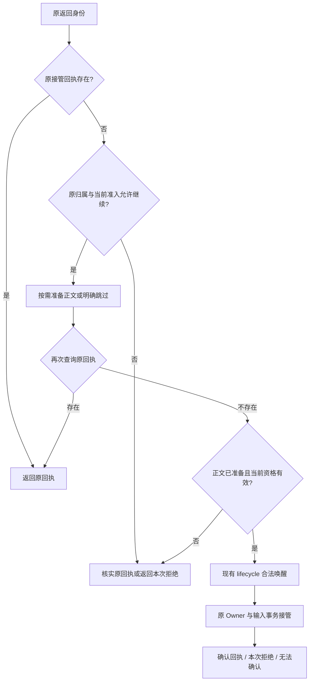

# 待处理返回接管设计

> **Status:** in-progress — 公共接管与 BG 接入已实现；Research 和委派接入待完成。

当前行为见[执行合同](../implemented/architecture-contract.md#输入完成与资源退休)。

### 返回接管设计与剩余接入

状态：公共 `admit_return` 与 BG 已实施；下列合同继续约束 Research、委派终态及
问题接入，三来源整体统一尚未验收。当前公共操作归执行合同，本文保留剩余接入设计。
最初设计的源码依据为 `0df8b78ec470c0186c0ef6bd758a3695f1e686d1`，
对比基线为 `before-takeover` 的 `88d2284b2b2493001be2e945df375d7a228ccc1f`。
本设计只覆盖 BG、Research、委派终态及委派问题的返回接管。

#### 问题与选择

早期基线的三个来源主要直接调用 `start_message`。之后加入持久接管回执、稳定
返回身份和原工作归属校验，`b19f6f9` 集中合法返回的归档唤醒。第一阶段又完成
BG/委派停止与 unknown 有限观察、来源诊断和原 writer 保责，沿用 Research 的
既有分类。当前表示及恢复差异以[执行合同](../implemented/architecture-contract.md#输入完成与资源退休)
为准。公共操作已收回 BG 的接管协议；剩余工作在保留这些保障的同时，收回
Research 和委派仍重复编排的接管顺序。

当前入口见 [BG](../../server/sessions/turns.py) 的 `deliver_bg_result`、
[Research](../../server/research/manager.py) 的 `_inject_report` 与
[委派](../../server/delegations.py) 的 `_inject_terminal` / `_inject_question`。
[admit_return](../../server/sessions/turns.py) 已拥有公共接管，BG 只作材料转换。
[resolve_task_return](../../server/sessions/lifecycle.py) 暂保留给 Research 和委派；
这些调用者仍需迁移其回执查询、Owner 判断、提交和确认丢失处理，共用资格读取
及原生命周期等待行为继续保留。

采用一个接管入口与按需正文准备函数。两阶段入口会让调用者继续承担调用顺序；
正文/正文引用联合类型则会让会话接管模块认识来源材料的不同读取方式。按需函数
保留材料读取的来源归属，同时让共同模块拥有完整接管顺序。

#### 责任、权威与提交点

| 责任 | 所属模块与可观察事实 |
| --- | --- |
| 本次返回的接管协议 | 现有会话模块；查询原回执、判断资格、按需准备、合法唤醒及提交 |
| 正文、是否仍需返回 | BG / Research / 委派；只准备自己的材料，不决定会话是否具有当前接管资格 |
| 重试节奏、放弃条件、来源结果结算 | 各来源现有交付任务；共同入口不循环重试、不启动后台观察任务 |
| 归档成员关系 | 现有 lifecycle；恢复原会话，保留派发暂停，不重放已取消输入 |
| 输入接管与去重 | 原 SessionOwner 与运行数据库的输入事务；完整输入和接纳事实提交后才确认 |
| 后续处理、结果记录、通知、执行退役 | 各自现有权威；继续观察原 `SubmissionReceipt`，不新增完成 Future |

会话唤醒与输入接管仍是两个提交点。本次没有新接管输入，不证明此前没有发生
合法唤醒；不得自动回滚归档成员关系，也不得将两者描述为一个原子事务。

Wiki 返回继续拥有请求组聚合、派发代次、原输入终态和 outbox 交接协议；schedule、
App、人工输入继续使用现有入口。本设计不引入通用任务框架、执行表、持久队列、
新恢复流程或 provider 传输变更，也不恢复下方暂停项目。

#### 接口与调用合同

下列为接口草图，名称可随实现约定微调；所有值只在本次调用内使用，不另行持久化。

```python
@dataclass(frozen=True)
class ReturnTarget:
    session_id: str
    source: Literal["bg", "research", "delegation"]
    delivery_id: str
    work_id: str | None
    owned: OwnedTaskContext | None

@dataclass(frozen=True)
class ReturnBody:
    prompt: str
    question_session_id: str | None = None
    question_id: str | None = None

async def admit_return(
    self,
    target: ReturnTarget,
    *,
    prepare: Callable[[], Awaitable[ReturnBody | ReturnSkipped]],
) -> SubmissionReceipt | ReturnRefused | ReturnUnconfirmed:
    ...

# 来源只描述原身份与材料准备，不查询会话内部准入状态。
result = await sessions.admit_return(original_return, prepare=prepare_reply)
```

`ReturnTarget` 由可信来源按原记录构造，不能直接承接外部请求字段。现有 delivery
命名保留：`bg:{task_id}`、`research:{job_id}`、`agent-terminal:{work_id}`、
`agent-question:{work_id}:{question_id}`。目标会话、work 和 owned binding 必须相符；
缺失 binding 不妨碍确认已有回执，但不能用于创建新输入。

`prepare` 每次调用至多执行一次；已有回执或确定无法新接管时可以不执行。它可以
异步读取并构造正文，但不得提交来源结算、启动执行、发送通知或修改授权。并发
调用与来源重试可能重复准备，因此它必须允许重复读取。运行时不持有 Owner
mailbox、生命周期锁或数据库事务来等待这个回调。

`ReturnSkipped(reason)` 明确表达来源不再需要新投递，例如问题已经关闭；空正文
不代表跳过。问题关联字段必须成对提供，仍由 Owner 在实际执行前检查有效性。
委派的子会话已删除时，准备函数沿现有语义产生 `reply_unavailable` 正文；子轮次
成功结论不变。会话仍存在但精确 terminal 缺失属于完整性错误，不伪造空回复。

#### 一次调用的顺序



1. 先用原 `session_id/source/delivery_id` 查询回执。已确认的原接管优先于当前
   Owner 失败、来源关闭或材料缺失；该快路径不运行回调、不唤醒会话、不重开输入。
   已撤销输入的原回执仍只供观察，不能重新入队。
2. 未找到回执才检查原归属与当前准入。准备前的检查不授予跨 `await` 的许可。
   调用 `prepare` 后再次查询原回执，覆盖准备期间另一次调用已经接管的情况。
3. 准备结果为跳过时，完成上述回执确认后返回本次拒绝。正常正文沿现有 lifecycle
   校验并恢复原目标；在恢复等待之后再次确认原身份与资格，提交由原 Owner 最终裁定。
   慢准备结束前不预留执行资源，也不提前持久化新的输入。
4. 接管只使用既有输入事务。并发唯一性和实际提交正文的 digest 冲突仍由该事务及
   Owner 裁定，不新增每 delivery 的锁、队列或注册表。普通重复回执查询无需重新
   生成正文；实际提交遇到 `SubmissionConflict` 时则必须保留冲突，不能回查后吞掉。
5. 拒绝、跳过及可确认的交接异常出口在存储可信时核实原回执；查询不到只代表
   当前观察中没有证据，不是另一在途提交不会成功的证明。回执查询不是新的接管。

#### 结果与错误语义

| 返回或异常 | 判定依据与调用者合同 |
| --- | --- |
| `SubmissionReceipt` | 只返回已确认接纳的原 receipt；不推断其执行成功，来源继续使用原 completion 观察后续结果 |
| `ReturnRefused(reason)` | 有证据表明本次没有新接管；原因限定为 `source_withdrawn`、`binding_unavailable`、`destination_unavailable`、`admission_closed`、`capacity`、`busy` |
| `ReturnUnconfirmed(cause)` | 可靠的原回执观察暂时不可用，或进入提交交接后未取得确认；保留原身份与原因，不推断未接管 |
| `SubmissionConflict` | 实际提交正文与原身份冲突，原样传播；不能转为 duplicate 或普通重试 |
| 准备函数的程序/完整性错误 | 原样传播，不转成 skipped、refused 或接管成功 |
| `CancelledError` | 原样传播；只停止等待，已交给 Owner 的 Submit 继续由原 Owner 负责 |
| 存储失信 / `ServiceUnavailable` | 沿现有 fail-stop；不在同代读取回执猜结果，不转换成普通 unconfirmed 重试 |

分类必须结合发生阶段。已知容量拒绝沿 `SessionMailboxFull` 识别；归档/fork 忙和
生命周期资格拒绝在其产生点使用明确业务分类，可用兼容现有捕获的 `ValueError`
子类，但不能匹配异常文案或把任意 `ValueError` 当拒绝。初始读取的已知临时容量/
期限失败可表示无法确认，不能据此推断没有输入。

在提交交接处，`SessionOwnerUnavailable` 或确认链路中断先尝试核实原回执；有
可靠回执就返回它，否则保留无法确认。其他未分类异常原样传播，不建立
`except Exception -> success/refused` 的兜底规则。普通异常未被包装也不证明未接管。

来源根据拒绝原因保留原有重试策略：容量和暂时忙可以再次尝试；资格或来源决定
是否放弃由其原交付任务判断。它们不得用后一次调用的拒绝抹掉此前未确认尝试。
停止观察时保留原材料与准确的未确认说明，不改变来源业务结论、不更换 delivery
身份、不重新执行原任务。这里的“接管无法确认”不是 `RequestCompletion` 的执行
结果未知，也不是新增的数据库状态。

#### 来源接入与旧路径删除

| 来源 | 保留的职责 | 替换与删除 |
| --- | --- | --- |
| BG | 已完成输出、prompt 组织、交付循环及停机条件 | 已接入：`deliver_bg_result` 作来源转换，回调使用三类结果，bool 与外部共同接管编排已退出。 |
| Research | 报告状态、是否仍投递、queued/processing/processed 投影、原 receipt 的完成观察 | `_inject_report` 改用单入口，删除自行查询回执、恢复会话和读取 `_admission_closed` 的接管分支 |
| 委派终态/问题 | 精确正文读取、问题是否有效、原轮次结算、`_terminal_injecting` 的来源重入保护 | 两个入口共用 `admit_return`，删除 `_return_context` 及重复的 Owner/准入/确认编排 |

入口放在现有 `sessions/turns.py`，值类型与 receipt 放在 `sessions/submission.py`；
`SessionManagerBase` 补齐所属调用合同。`resolve_task_return` 及其归属、唤醒检查
转为会话模块内部实现；保留被 Wiki/schedule 使用的 `source_receipt` 和通用
`start_message`。不顺便迁移 Research 的进度观察或完成消费者。

实现完成的删除标准：三个来源不再需要按顺序调用 `source_receipt`、
`resolve_task_return`、`start_message`，也不再通过 `_admission_closed` 等内部字段
解释一次接管。来源仍有重试循环是预期职责，不以抽取循环代替这项标准。

#### 验收与实施界限

依赖属于 local-substitutable：使用现有临时 SQLite 和可控本地执行替身，通过
同一接管入口观察真实输入行、原回执、模型启动与来源记录。不新建 Repository
或 mock 掉最终接管事务。以下是拟实施时的验收，不是本次已通过的测试结果。

| 注入场景 | 必须观察的事实 | 已有覆盖入口 |
| --- | --- | --- |
| **首个反证：接管提交后丢失确认，随后 Owner 失败，再投递同一返回** | 返回原 receipt；仅一个输入；来源结论不变；重复确认不准备正文、不唤醒 | `test_durable_independent_returns.py`、`test_source_return_owner_failure.py`、`test_delegation_return_retry.py` |
| 两个同身份调用并发准备 | 准备允许重复，接管只有一次；实际提交的不同正文冲突不被吞 | 前述持久返回测试与新的公共入口竞争场景 |
| 已有回执，委派正文随后删除 | 只确认原接管；不存在原回执时仍按原规则发送正文不可得说明 | `test_delegation_text_deletion.py` 与公共入口场景 |
| 准备/恢复期间归档、撤权或 work 关闭 | 原身份不变，最终资格复核生效；合法恢复保留 Stop，取消输入不重放 | `test_research_session_return.py`、`test_bg_session_return.py` |
| 容量拒绝、来源跳过、问题在等待中关闭 | 本次结果准确；来源决定重试；失效问题不启动回答 | `test_delegation_return_retry.py` 与公共入口场景 |
| 等待者在提交交接后取消 | 取消不撤销 Owner 命令；以后观察仍关联同一输入 | `test_submission_recovery.py` 与公共入口场景 |
| 正文错误、明确冲突、提交失信分别出现 | 不吞错误、不猜结果；失信保持 fail-stop，重启不自动重放 | `test_submission_recovery.py` 与公共入口场景 |

保留各来源的实际接入与结算断言；公共接管场景集中到一个测试面后，才删除被
完整替代的 helper 形状测试。每项检查只安排一个执行者，受影响检查与提交门禁
遵循 [testing.md](../testing.md)。公共接管和 BG 的当前行为及已验证边界见
[执行合同](../implemented/architecture-contract.md#公共返回接管)；Research 与委派
接入仍须各自完成真实消费者、失败路径和旧编排退出，不能以公共入口通过代替验收。

暂停的执行扩展另见[范围与恢复条件](runtime-execution-scope.md)。
