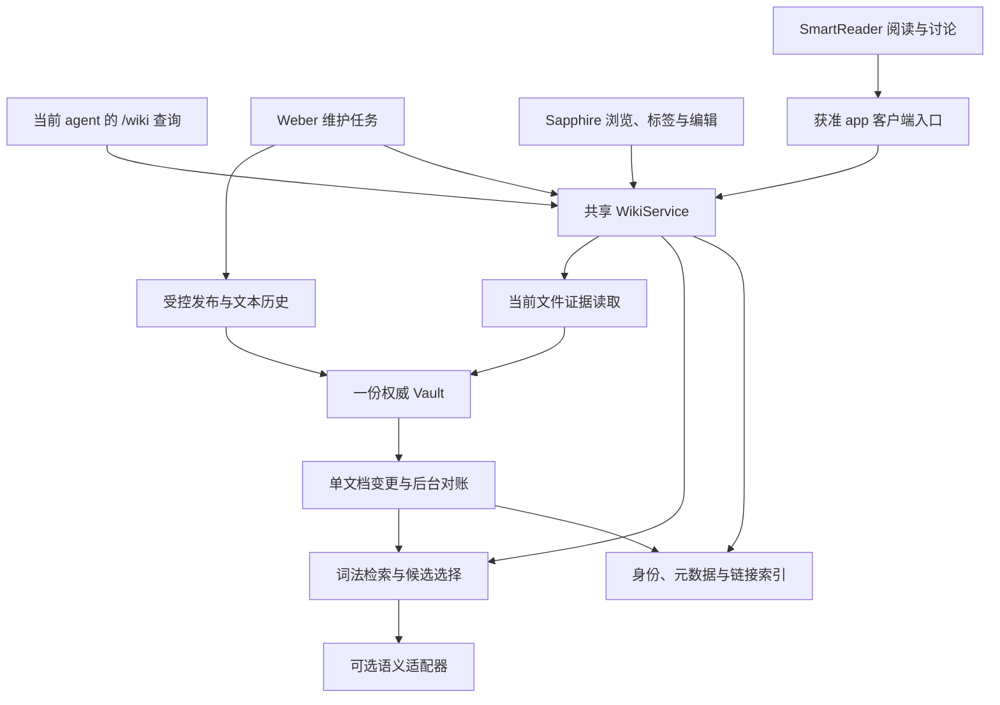

# Octopus 本地共享 Wiki v2：协同设计与实施总纲

> **Status:** in-progress — 核心与既有 Weber 配置已上线，首两篇真实试点通过；完整试点和 Library 全量未放行，当前修复仍有两项 Codex 实机失败；见[当前进度](local-shared-wiki-progress-v2.md)。\
> **修订：** v2.1，2026-10-13（Asia/Shanghai）；保留 v2 文件名与开发票编号。\
> **审阅基线：** Octopus commit `453a7995bd6c54df33b0fc41dec09d370b4b40aa`；用户于 2026-10-12 提供的 `.octopus.zip`。\
> **适用对象：** Octo 开发，Vera 验证，Weber 作为智者与知识库 curator；SmartReader 作为阅读讨论入口，Sapphire 作为库浏览与编辑应用。\
> **决策：** 以可理解、可查证、可复用、可持续维护的个人知识为目标；保留 SQLite 检索底座，补知识积累闭环。先完成核心和小样本入库，再分批整理旧材料；应用新功能列后续计划，语义后端按实测缺口引入。

**本版阅读顺序：** 接手先读[当前进度与执行计划](local-shared-wiki-progress-v2.md)及[当前 spec](local-shared-wiki-spec-v2.md)，再按本总纲与[知识积累](local-shared-wiki-knowledge-v2.md)理解设计；开发按[任务票](local-shared-wiki-tickets-v2.md)，旧材料整理按[迁移计划](local-shared-wiki-migration-v2.md)。原设计专题文件及最初核心交付保留为依据，事实时间与适用范围分别标注。

**本轮设计访谈（2026-10-13）：** 用户指定本目录为最新拟实施方案，本文件为总览；App 相关开发作为后续 feature plan。旧版 Q53 已确认约束继续作为设计依据，新增或改变旧规则的取舍在[设计访谈与决策树](local-shared-wiki-grill-v2.md)中逐项收束；设计正文之外，另维护访谈记录与根目录 [GLOSSARY.md](../../GLOSSARY.md)。既有接口兼容仍属核心责任，后续 Sapphire/SmartReader 功能不成为核心验收前提。

**Q54–Q60 最新结论：** 以现有 pika_vault 文章模板为参考，按最新需求原位模板化，保持当前正文措辞，开头元数据用于维护、普通阅读隐藏；正式文章不另存原稿副本，当前 sources 可空。以后维护不按 AI／人类作者或人工编辑历史分类，保护核心思想、论证和有风格的观点，允许局部纠错与补充，不重写正文。来源只要求可选出处、回查、已知直接依赖提醒及明确重复归并，完整来源根和自动证据计数不作核心门槛。复核后无需改字也可完成，至少一个真实问题验证知识建立→复用→纠正。落实合同见[定点维护](local-shared-wiki-maintenance-v2.md)，整体共同理解记录在访谈中。

**后续交接范围确认（2026-10-13）：** 用户明确要求将当前主库 `Library/` 下所有 Markdown 递归纳入整理、入库及检索验证；`Library/pika_vault` 是优先批次，最终覆盖 Me、Research、课程笔记、导航、模板及其余目录。Octo 统一组织，既有 Weber 执行内容维护，现有 Vera 从试点前参与验收讨论、核对实际产物并检查最终覆盖。按实际类型原位整理并保全正文；无需修改也须有真实复核与 no_change 回执。每篇均验证身份、当前索引、精确定位及当前内容读取，领域内容另验证内容检索，导航/模板按相应角色和明确范围检查。批次仍明确到具体文件，未处理、冲突或失败项不能计为已完成。

## 1. 问题与当前事实

这次优化的对象是一条完整链路：文件组织决定可检索的身份与概念，索引决定候选是否可靠，接口决定模型看到多少内容，任务 prompt 决定读什么与何时停止，SmartReader 与 Sapphire 让人阅读、核对、选择沉淀并持续维护。单独换一个 embedding 或重写 Weber persona，无法解决现有链路里的问题。

### 1.1 已经具备的能力

当前实现已具备 SQLite FTS5、jieba 中文预分词、连续中文 bigram 兜底、标题/路径/别名/标签/Key note/章节索引、按文档去重、跨章节命中定位、当前文件读取与 revision 核对。原文、生成区 ownership、持久任务、写入范围及有限文本历史也已有实现。普通聊天不自动注入全库内容，查询由当前 agent 执行，维护交给有效 curator worker。应保留这些能力；旧 ownership 记录用于历史兼容与恢复，正文编辑资格按新的定点维护合同判断。[S1][S2]

**当前没有 QMD 集成。** QMD 是候选语义适配器，不是当前系统的事实前提。既有 `docs/plans/local-shared-wiki-*` 文档含目标、历史验收与未完事项；不能把计划中的保证全部当作已运行事实。

设计审阅时的代码基线为上述 `453a799`，不是最新 HEAD。LLM-Wiki 的可取之处是将有用的综合与联系持久化；my-wiki 把 Reference、Concept、工作流与应用连接起来。本项目吸收这些结构，不复制全局目录预读、固定原子化数量或整套应用。[S4][S5]

### 1.2 设计审阅时的发现

以下表格定位最初改造问题，部分已经由 v2 核心解决；当前源码、部署和未完成检查以[进度表](local-shared-wiki-progress-v2.md)为准，不重复按旧行号开发。

| 观察 | 证据位置 | 对设计的影响 |
| --- | --- | --- |
| 每个 API 请求重新构造 WikiStore，构造时遍历已有 documents 做 identity backfill | `registry.py:63–65`、`store.py:64–98` | 单篇 read 也携带全库初始化开销；先把迁移移出请求路径 |
| search/list/graph 同步 refresh，遍历文件并逐条查询数据库 | `store.py:337–369, 456–566` | 查询时延随库规模增长；改为事件增量与后台对账 |
| search 对每个候选调用 public，读取原文件并核对来源 | `store.py:408–490` | 候选发现做了最终证据读取的工作；拆导航卡与证据读取 |
| YAML 当前只消费 tags/aliases | `store.py:259–266` | 上一版 OKF 的 title/description/type/sources/uid 尚未发挥作用 |
| Template 会被归为 original；来源快照 TXT 也可能进入默认检索 | `store.py:32–44, 267–305`、`extract.py` | 模板示例与重复原稿会污染结果；需要内容角色 |
| graph 每次读取全体文档并重新解析链接 | `store.py:565–612` | 链接应在单文档变更时解析，查询只读邻接边 |
| Sapphire 的独立 search 做子串扫描，最多取前 80 项 | 附件 `sapphire/server.py:307–325` | 搜索排序与 /wiki 不一致，必须共享后端 |
| Sapphire 与框架有不同的链接解析实现 | 附件 `note_links.py`、`links.js`；框架 `wiki/links.py` | 同名、大小写、块锚点可能出现两套答案 |
| Weber 的常驻 persona 已短且有用，worker 却总加载完整 query+maintenance+writing | 附件 agents 非敏感配置；`workflow.py` | 保留人格，压缩任务规则并按任务加载 |
| SmartReader 已有材料对话、SSE、选区与摘录，但每轮 context 附带最多 150,000 个 JS 字符串单位正文 | 附件 `smartreader/lib/content.js::readingContext`、`app.js` | 后续采用问题相关片段/按需阅读，不把整篇反复送入上下文 |
| SmartReader 材料使用浏览器 UUID、localStorage/IndexedDB，没有 Wiki id/revision 绑定 | 附件 SmartReader 源码 | 浏览器材料、app 草稿和已入库文章要明确映射 |
| Wiki 配置目前只有一个 app_id，app_wiki 要求匹配；AppAgent 的 wiki_mode 入口另建任务 | `registry.py`、`routers/wiki.py`、`app_agent.py` | 多 app 共库需要真实客户端权限适配，不能直接换掉原 app_id 或只放行一个路由 |

### 1.3 附件内容与审阅限制

Sapphire 主库工作副本位于 `applications/sapphire.data/vaults/obv/repo`。附件里整个 Vault 有 578 个文件，其中 `Codex Skills` 占 421 个；`Library` 有 133 个文件、37 篇 Markdown。37 篇中包含两份 assets 项目说明，不能等同于 37 篇默认知识候选。资料还包括 HTML、PDF、TXT；现有 PDF 不提取约定保留。

设计附件中的 `Library/Me/information.md` 仅记录院校、在读身份和学科，未明确记录职业、研究课题、联系方式或个人偏好。这是旧输入的事实；生产 Me 后续已变化，每次执行从当前文件重建 gold，不把旧缺字段列表当永久答案。库中收藏的数学作者文章也不是用户的个人资料。

附件没有 Wiki 的 `config.json`、`index.sqlite3`、ownership 或任务状态；因此本次不能证明线上 /wiki 的实际绑定和索引状态。仓库代码、附件内容、已有计划、下面的目标行为各自独立标注。

### 1.4 已做的隔离诊断

用仓库原代码、从附件抽取的 40 篇 Markdown、628,455 字节原文建立临时索引；未运行真实 agent，未读写线上 Wiki 状态。5 次热操作的中位数如下：

| 操作 | 中位耗时 | Vault stat 调用次数 |
| --- | ---: | ---: |
| 重复构造 Store | 31.47 ms | 276 |
| 复用 Store 后 refresh | 42.90 ms | 335 |
| 复用 Store 读取 1,200 字符 | 5.25 ms | 18 |
| 按 API 现有习惯：新建 Store 再读取 1,200 字符 | 33.80 ms | 294 |
| 按 API 现有习惯：新建 Store 再搜索 Vidu | 约 74 ms | 623 |

这组数值包含探针开销，来自当前临时机器，不代表用户 WSL 的延迟，也不是 v2 已实现后的加速结果。它证明了请求路径上的重复工作；HTTP、MCP、CLI、模型和网络延迟未计入。

检索诊断：

- `Vidu`、`Vidu TTFF`：技术报告位于第一位，原后端已有实际价值。
- `Vidu`：也召回旧导航和文章模板，模板的示例路径产生噪声。
- `数字人`：只召回旧导航，没有直接形成报告覆盖。
- 直接将个人问句送进全库 search 会召回转载/课程材料；现有 query prompt 已要求先定位 Me，这项探针不是对实际 agent 回答的失败判定。
- `implicit warping` 出现 partial 命中，不能据此声称已找到相应研究证据；`隐式形变` 未命中也不能证明完整库不存在资料。

## 2. 目标、取舍与总体架构

目标按顺序是：**帮助用户理解和推进问题 → 留下可查证、可改正、可复用的知识 → 以可接受的时间和维护成本持续使用。** 提速、省 token、可扩展性是必要工程指标；只优化这三项，仍可能得到一个很快但没有积累价值的文件搜索器。

| 目标 | 可观察结果 |
| --- | --- |
| 个人相关性 | 先解决正在研究、阅读或决策的问题；不以文章和标签数量作为价值 |
| 理解与复用 | 后续相似问题可复用已有解释、比较和研究问题，不从零拼所有原文 |
| 可查证与可改正 | 主体、条件、出处清楚；新材料能指出旧结论的适用变化 |
| 用户控制 | 能选择保存什么、改什么；普通聊天与阅读不会自动堆积知识页 |
| 持续成本 | 统计入库、更新、查询、人工纠错的总成本，并保持查询流畅 |
| 可迁移 | Markdown 原文、来源和必要元数据可带走，不依赖某个 app 的私有数据库才能理解 |

图中 WikiService 是对现有 `registry/store/search_index/curation/history/tasks` 的共同边界命名，不要求新建微服务。SQLite 仍可放在当前状态目录。SmartReader 对库外材料的阅读缓存与写作草稿还未成为 Wiki 内容；明确入库后才取得主库身份。多 app 入口是拟议功能，不能认为当前已经支持。

### 2.1 保留、替换、按条件加入

| 决策 | 内容 |
| --- | --- |
| 保留 | 当前主库、文件路径、原文、现有受控写入、Me 路由、章节搜索、中文处理、显式 Wiki 任务 |
| 优先替换 | 每请求构造迁移、同步全库 refresh、候选全文/来源校验、全库 graph 解析、Sapphire 独立搜索 |
| 核心计划 | OKF 适配、文档角色、已有来源副本分类、compact、批量证据读取、实际出处与直接依赖、主题覆盖、定点维护与知识复用 |
| 后续应用计划 | SmartReader 引用定位、阅读对话、草稿/入库；Sapphire 共享搜索与标签筛选；二者不阻塞首批旧材料整理 |
| 有证据再加 | 多语言 embedding、有限 reranker、QMD 适配器、更大候选池 |
| 当前不增加 | 每问自动三 agent 接力、每次全库总结、强制逐段 QA 生成、无限查询改写、GraphRAG 全库建图 |

## 3. 组件分工与信息契约

| 组件 | 负责 | 输出给下一组件 |
| --- | --- | --- |
| Octo | 框架、索引、接口、prompt 装配及后续 SmartReader/Sapphire 集成 | 代码、迁移、可重复测试与部署说明 |
| Vera | 独立验证真实行为、回归、来源归属、代价 | 可复现失败与通过记录；不默认加入每个用户查询 |
| Weber | 理解文章、发展想法、按需写作、有限范围内整理与综合 | 可修改草稿、有用的长期知识页、原文保留的 OKF 文章和实际发布回执 |
| /wiki | 本次任务入口、当前 agent 的查证工作流 | 有范围和证据的回答，或持久维护任务 |
| WikiService | 身份、内容分类、检索、证据位置、读写一致性 | 小型导航卡、当前证据片段、变更与索引状态 |
| SmartReader | 文章/选区阅读、与 Weber 讨论、引用定位、按需写作与入库 | 有范围的阅读上下文、草稿或明确维护提交；不默认反复注入全文 |
| Sapphire | 库目录、标签、搜索、正文编辑、来源与版本查看 | 可定位文档、过滤结果与单次保存；需要深读时打开 SmartReader |

**普通查询不转发给 Weber 再转 Vera。** 当前接收问题的 agent 直接调用同一个 WikiService；只有显式维护建立 Weber job。复杂研究的独立复核可沿既有协作机制发起，但不作为读一份 Me 文件的固定步骤。

## 4. 三种主要检索路径

### 4.1 个人事实

用户问“我是什么专业”时，直接使用受范围约束的 Me 入口定位。当前只有一份短资料，完整读它即可。将来有多份履历、计划、身份记录，再按字段与时间挑选；索引缓存文档位置，不把个人事实复制进 system prompt。

用户问“我的职业是什么”时，应明确说明资料未记载职业；在读身份不能替代这个字段。用户问“我收藏的文章怎么看职业选择”则属于内容查询，不限定 Me。**主语判断先于关键词相关性。**

### 4.2 指定文章或具体事实

完整路径 → 直接 read。可靠题名/别名 → 精确元数据查找 → 少量命中章节 → 当前正文。

例如“Vidu 的 TTFF 和 FPS 有什么区别”，先选中 `Library/Research/vidu_realtime_report/技术报告.md`，读取指标定义及限定条件。不要读整篇 4 万多字节报告，更不要为该问题调用全库 graph。“完整评价这份 Vidu 报告”则必须从 0 连续分页阅读整篇；省 token 的办法是去掉无关库内容和重复元数据，不省略论证后半部分。

这份文档是本地技术报告。问其观点时它本身就是证据；问某篇原始论文的实验结论时，应标清报告的转述身份，能在本地取得原始来源才继续追溯，缺失时说明，不能把报告改称论文原文。

### 4.3 宽泛研究主题

“数字人方面我有哪些研究资料”首先是覆盖问题。先返回不同方向的文档卡与可解释分组，再读各方向代表材料。

当前已知可用方向至少包括：

- 单目 MetaHuman 模型、rig/control 语义与 NNE 运行边界；
- Vidu 实时视频蒸馏、时延指标、训练数据可用性及消融设计；
- 其他方向只有在当前库文件真实存在时才能列入。

Vidu 可以作为数字人实时视频能力的相关研究材料，但不能因此把 Vidu 与某个数字人专用驱动模型设为同义词。旧导航是候选提示，不是权威目录；不存在的目标和“已读/已确认”等历史措辞不作为事实。

主题检索要保持双路发现：已有 Topic/导航入口可以提出候选，同时检索当前文档索引补充未被导航收录的资料。逐步完善文档 description、可靠标签与主题关系，解决“正文没写数字人”造成的漏召回；仍有稳定的同义表达缺口时，启用语义腿。方法见[检索协议](local-shared-wiki-retrieval-v2.md)。

### 4.4 让已经理解过的知识真正复用

持续阅读后，可按实际用途建立少量 Concept/Topic/Synthesis，例如“实时视频的延迟指标”“单目驱动的可观测性限制”或“本轮实验待验证的问题”。这些是拟议示例，不声称当前已存在。

回答一般概念、已有研究地图或比较框架时，可以先读当前知识页并复用其适用内容；不要求每问重新读完所有 Reference。问精确数字、原作者措辞、争议、版本变化或知识页未覆盖的条件时，再定点回到来源。知识页有独立解释价值，摘要副本却不增加独立实证数量。详见[知识积累方案](local-shared-wiki-knowledge-v2.md)。

这种复用配套[正文定点维护](local-shared-wiki-maintenance-v2.md)：在明确任务和最新版本上局部纠错、补充条件或解释，保留原思想、论证与风格表达。内容由人还是 AI 写、曾否被人修改，不决定能否编辑；服务端保存未涉及字节，工作流和验收检查含义与长期保全。V2-02 补 revise 与原始位置协议，复用历史和任务恢复，替代未实现的 region_updates 草案。来源实际复核仍适用时可不改字，已符合任务时可有真实无变化回执；不借维护重新生成正文。

## 5. 内容格式与 AI 总结膨胀

沿用已确定的 **OKF v0.2 + article-v1**，不重新发明一套 Markdown。OKF 是交换格式，本项目的文章小节、uid、aliases 与 x_wiki 是本地约定。[S3]

必须补齐以下消费端能力：

1. YAML `title/description/type/sources/generated/status/uid/aliases` 有明确映射；未认识字段保留，旧文无 YAML 仍可检索。sources 按实际出处选填，当前文章不要求回溯补齐，缺失不阻塞整理或使用。
2. 对 `Key note`、正文、相关笔记、整理说明、代码示例区分 section_role；元数据和模板示例不伪装成论据。
3. `generated` 表示生成/整理记录，不能直接推导“整篇是 AI 二手总结”。正文保留的 Reference 和纯 Synthesis 是不同角色。
4. 原位模板化文件即正式入库文章，不要求另存 `.source.md.txt`。确实已有或明确需要的来源副本应分类并退出重复候选，仍可按路径读取；不能笼统排除 TXT 或名为 references 的所有研究资料。
5. 实际出处和已知直接总结/表示关系用于回查、变化提示及明确重复归并；综合引用 A+B 不合并两个作品，也不自动算第三份实证。本期不要求完整 root_source_ids 闭包或自动证据计数。
6. 摘要可以选读，也可以作为“该摘要说了什么”的证据；关键外部事实优先回到实际可读的来源。十份同源总结不能形成十票支持。
7. 正常问答不自动写回；新建 synthesis 要有独立用途。没有新价值的再次摘要不堆出一串默认搜索候选。

具体规则与迁移见[内容合约](local-shared-wiki-content-v2.md)。

另区分三种进度：文件已登记并可检索、文章已按约定整理、已有可复用的跨文知识。它们不要求一次完成，也不是三个必须写进每篇 YAML 的新状态。旧文可先用兼容索引，不等待全库套模板；不是每个 Reference 都必须产生 Concept。

## 6. 时延与 token 的预算

### 6.1 后端与模型分别计量

`总时延 = 服务端定位 + 文件证据读取 + 工具往返 + 模型处理/生成`。

本轮隔离测量只覆盖前两项的局部。不能拿 SQLite 50 ms 推断用户将从 20 秒缩到 1 秒。Vera 应同时记录 tool rounds、工具输出字符/实际 token、prompt tokens、reasoning/输出 usage（提供方可见时）、首段回答时间和完整回答时间。

还应按一段使用周期计算：`总成本 = 首次采集与整理 + 后续维护 + 多次查询 + 人工纠错`。提前生成大量无人复用的 Concept，可能增加总成本；有用的长期解释能减少后续重复综合。优化必须同时看复用价值，不能把昂贵工作挪到入库阶段后只报查询 token 降低。

### 6.2 先减少不必要的工作

- 初始化、身份迁移与全库对账离开正常请求路径。
- 候选卡只返回足够选文的字段；所有 sources/quality/debug 放按需详情。
- 单篇证据一次返回公共元数据；批量读相关小节并合并重叠范围。
- 中文/英文可靠别名入库时维护；不要每问生成二十个改写。
- 个人事实和精确定位默认零额外模型调用。
- 简单维护任务只给当前文件与必要工作流；worker 不常驻个人问答和全篇评价指南。
- 维持 Weber 简短 persona，移除任务规则重复注入。

起步批量大小、候选数和字符预算是可调整的读取窗口。它们不改变用户要求完整评价、穷尽列表或多篇比较时的覆盖义务。

### 6.3 模型配置

附件三个 agent 均使用 codex、gpt-6.1-sol、max reasoning。此次不修改它们的模型或全局设置。框架当前支持 agent 默认与 session reasoning override；若要按任务自动选择推理强度，需要新增明确的任务级策略并验证。可试验“简单定位低推理、复杂分析保留高推理”，但先比较输出质量和实际用量，不新增一个固定分类模型调用。

prompt 默认采用便于用户维护的中文语义/写作规则，参数名、术语与代码保持原语言；不常驻两份中英重复规则。英文是否更好属于特定模型与任务的实测问题。语言对照是可选优化，不是启动旧材料迁移的前置门槛，见[prompt 方案](local-shared-wiki-prompts-v2.md)与[评估方案](local-shared-wiki-evaluation-v2.md)。

## 7. prompt、SmartReader 与 Sapphire 协同

prompt、工具描述和代码各管一层：

- system prompt：角色、思考与表达原则；
- workflow：本次如何选择材料、读取与停止；
- schema：真实参数与返回值；
- 服务端：范围、revision、原始位置、未涉及字节保全、定点提交与真实历史。

同一约束只保留一个详细权威位置，其余引用简短契约。任务卡携带真实 capabilities；新 prompt 不能指挥旧接口调用尚不存在的参数。[prompt 方案](local-shared-wiki-prompts-v2.md)给出可替换稿与过渡办法。

**写作指南按任务加载。** 解释和阅读一般不需要写作模块；明确写读书笔记、润色、起草比较或生成 Key note 时使用。同一份指南可服务 SmartReader、普通 Octopus 写作请求和 curator，不限于 app 位置。加载写作规则不产生文件写权限，生成草稿、修改 app 材料和 Wiki 入库分别执行各自真实协议。

SmartReader 是引用直达、“问这篇/选区”和阅读中与 Weber 讨论的后续主入口；Sapphire 保留库浏览、标签、编辑、PDF/图片预览、Git 和回收站。计划中的 `tags + tag_match` 与标签列表由共同服务提供，按文档统计，先过滤再分页/排名。两套应用继续使用同一知识身份和内容，不各建索引或聊天后端。详见[SmartReader](local-shared-wiki-smartreader-v2.md)与[Sapphire](local-shared-wiki-sapphire-v2.md)。

## 8. 验收与回归

验收分为代码机械保证、检索质量、真实 agent 行为和用户体验，不能用字段断言替代后两者。

核心必须覆盖：Me 缺失字段、Vidu 精确定位、宽泛主题覆盖、模板噪声、同源摘要放大、未收录导航的新增文章、改名/删除/用户小修、旧 revision、来源失效、重复 UID、长文完整阅读，以及当前知识页的复用和纠正。Sapphire 标签、SmartReader 跨应用身份/引用/写作触发列为后续功能验收，不用未实现 UI 阻塞核心交付。

性能先要求结构保证：未变库的普通 search/read 无全库 walk；单篇保存不读其他正文或附件；候选选择不逐篇现读。硬件上的 P50/P95、模型 token 降幅随后用相同问题与配置测量。建议目标和语料见[Vera 验收方案](local-shared-wiki-evaluation-v2.md)。

## 9. 开发顺序与交接

建议按以下完整变更集推进，每个变更集完成自身迁移、兼容和验收后再合入：

1. **V2-01 请求热路径与索引更新：** Store 生命周期、一次性 schema migration、增量 job、后台对账、精确读取。
2. **V2-02 OKF、内容角色与定点维护：** parser、metadata registry、实际出处/直接依赖、模板/副本分类、原始坐标映射、revise 局部编辑、旧管理记录兼容及持久任务回执。
3. **V2-03 检索与证据协议：** exact→lexical、宽泛覆盖、compact、read_many、稳定分页、错误/新鲜度语义。
4. **V2-04 prompt 联动：** 按 capability 切换，保留 Weber persona，缩短 worker briefing。
5. **V2-06 核心集成与小样本试点：** 上述核心代码、Weber 配置和任务指南上线、对应检查通过后，由真实 Weber 在约 6 份代表材料上完成入库→检索→回答→修正；这是开始现有文章少量模板化的节点。保留不同文体，Me 不套 Reference。
6. **V2-08 旧材料分批迁移：** 先处理 pika_vault，再覆盖当前 `Library/` 下所有 Markdown；各类型做原位兼容整理、入库与逐篇检索验证，已符合要求的文件真实复核后记录 no_change。另行获准的库外材料明确采集，重复表示分类；有用途才沉淀少量长期知识页。
7. **V2-05 / V2-09 后续应用：** Sapphire 共享搜索/标签，SmartReader 阅读讨论/引用/草稿/入库；包括真实多 app 客户端适配。用户明确列为后续计划，不阻塞上面两步。
8. **V2-07 可选语义检索：** 只有质量缺口达到验收文档阈值后实施；保留词法基线与独立关闭开关，不要求先完成应用界面。

当前 `Library/` 的分批整理从 V2-06 真实 Weber 试点通过、V2-08 启动时开始，pika_vault 优先。Key note 与必要关联由既有 Weber 理解后形成或复用，`/wiki` 维护提交同一 durable job；服务端负责范围、版本、原文保全、历史、回执与索引。现有普通 MD 可先兼容检索，最终仍须完成全量清单中的整理复核及检索验证，具体放行条件见[迁移计划 §3.1](local-shared-wiki-migration-v2.md#31-真实-weber-链路与模板化放行)。

具体文件级任务与退出条件见[开发票](local-shared-wiki-tickets-v2.md)。

这套设计正文可以放入仓库 `docs/plans/`，再在 `docs/README.md` 增加入口。无需先把所有 persona 调到“完美”：先稳定格式、来源、写入与引用契约，用小样本校准，再开始可恢复批次。文本历史与明确范围保证继续保留；原文保全按本轮对当前 pika_vault 模板化和未来维护的分别约定执行，不能将旧阶段要求永久泛化。上线后按实际证据更新 Status，不提前把 proposed 改成 verified。

## 10. What this defers

- 原设计阶段仅交付设计文件；其后的核心实现、上线和真实首批见[当前进度](local-shared-wiki-progress-v2.md)，不能继续称全部尚未实施。
- 不启动附件中的程序、不恢复认证/会话数据，不将旧计划中的部署/GC 记载视为本次执行动作。
- PDF OCR/抽取、视频蒸馏、跨账户知识共享及操作系统级强制隔离仍需要独立需求。
- 大规模语义检索不是遗漏的基础保证；其启动条件是可测的检索缺口，而非文档数量达到一个任意数字。
- 完整来源根闭包、深层依赖传播和自动独立证据计数按 Q57 不作为核心门槛；实际出处与确知的直接依赖先满足回查、提醒和重复控制。
- 旧导航维护、文章模板落地和来源补全必须对当前文件再次核对；索引适配可以先覆盖旧格式，不等待整库重写。
- SmartReader 与 Sapphire 新功能、跨 app 授权配置保持后续任务；Library 全量整理已获用户授权，由 Octo 按真实试点放行和明确批次推进。

### 参考与证据

- [S1] [Octopus 当前审阅 commit](https://github.com/Danuvius152/Octopus/tree/453a7995bd6c54df33b0fc41dec09d370b4b40aa)；具体代码：[registry.py](https://github.com/Danuvius152/Octopus/blob/453a7995bd6c54df33b0fc41dec09d370b4b40aa/server/wiki/registry.py)、[store.py](https://github.com/Danuvius152/Octopus/blob/453a7995bd6c54df33b0fc41dec09d370b4b40aa/server/wiki/store.py)、[search_index.py](https://github.com/Danuvius152/Octopus/blob/453a7995bd6c54df33b0fc41dec09d370b4b40aa/server/wiki/search_index.py)。
- [S2] [任务指南装配](https://github.com/Danuvius152/Octopus/blob/453a7995bd6c54df33b0fc41dec09d370b4b40aa/server/wiki/workflow.py)、[既有规格](https://github.com/Danuvius152/Octopus/blob/453a7995bd6c54df33b0fc41dec09d370b4b40aa/docs/plans/local-shared-wiki-spec.md)、[既有交接](https://github.com/Danuvius152/Octopus/blob/453a7995bd6c54df33b0fc41dec09d370b4b40aa/docs/plans/local-shared-wiki-implementation-handoff.md)。计划状态按原文保留，不视为本次验收。
- [S3] [OKF v0.2 固定版本 SPEC](https://github.com/GoogleCloudPlatform/open-knowledge-format/blob/ad30107c31c06aec8a7d5636e0d1058118604e6f/SPEC.md)。
- [S4] [Karpathy 原始 LLM-Wiki idea file](https://gist.github.com/karpathy/442a6bf555914893e9891c11519de94f)：采用作者正文中的持久知识积累思想，不将评论区产品陈述当作者建议。
- [S5] [my-wiki README](https://github.com/NimaChu/my-wiki/blob/main/README.md)、[工作流](https://github.com/NimaChu/my-wiki/blob/main/my-wiki-skill/references/workflows.md)：本轮核对 2026-10-13 可见版本，具体采用与取舍见知识积累文档。
- 附件证据：`.octopus.zip` 中 Sapphire 源码、主库文件及 agents 的非敏感配置。仅用于本次审阅，不包含在设计包中。
- 隔离诊断：本次对 40 篇 Markdown 的直接 Python 探针；范围与限制见 §1.4 及验收文档。不是线上基准或 v2 成果。
