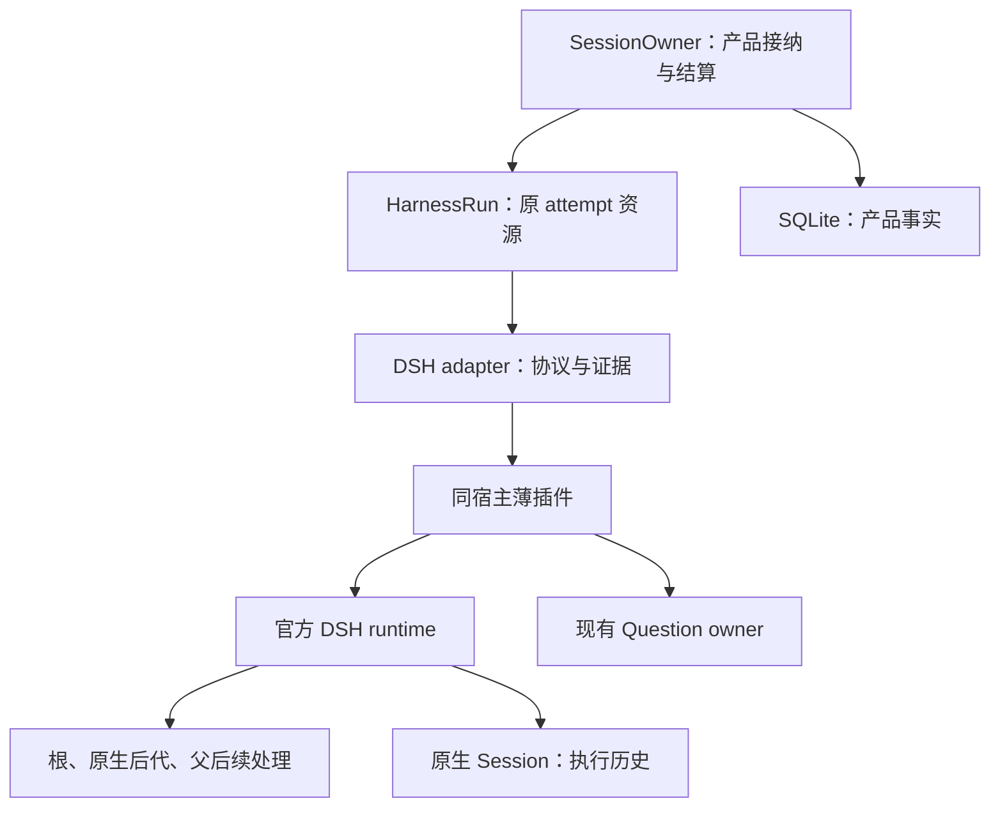

# 阶段 4：DeepSeek Harness 接入与完整交付

> 日期：2026-10-31，Asia/Hong_Kong。\
> 状态：实施设计；本次没有修改产品代码、安装 DSH、调用模型、运行产品验收或发布。\
> Octopus 核查基线：`d3e90499713f91e2c2a5aecace9c6f153528c810`。\
> DSH 推荐调查基线：官方 npm `@deepseek-ai/dsh@0.2.1-rc.5` 及精确锁定的配套依赖；本次独立下载 13 个相关发行包并验证 npm SRI，只读取源码与类型。\
> DSH 升级候选调查：官方仓库 `ce7073d51254c26cd63b22a60835b8f948deb447`；相关 package manifest 为 `0.2.2-alpha.2`。源码快照不等于已验收发行组合。

导航：[总方案与决策](00_Overview_and_Decisions.md) · [阶段 1](../../plans/engineering-runtime-roadmap.md#phase-1) · [阶段 2](02_Phase_2_Architecture_Contracts.md) · [阶段 3](03_Phase_3_Codex_App_Server.md)

## 1. 目标、顺序与总体判断

本阶段使 `deepseek` 成为 Octopus 的正式后端：现有 Agent、普通会话、命名委派、计划任务、App、Wiki 和 Research 可以在已验证的能力范围内使用它；输入、权限、业务结算、用户问题及资源退休仍遵循同一套产品语义。

**推荐保持现有 Python 产品框架，以一个 attempt 一个 Node 宿主的方式，使用 DSH 官方 SDK server 加同宿主薄插件接入。** DSH 自己拥有模型循环、工具执行、原生历史和原生子任务；Octopus 拥有用户输入、独立工作回流和产品完成。无需将 Python 改成 Cordis，也无需重写工具循环。

产品开发严格在 G3 通过后开始。可提前完成的是公开资料、发行包、类型以及无模型的协议反证调查；这些调查不能偷偷变成第二条并行产品迁移。阶段依赖是交付纪律：共同接口先经 Codex 的真实复杂生命周期验证，再由 DSH 验证其扩展价值；DSH 在技术上并不依赖 Codex 的 JSON-RPC 方法。

### 1.1 G3 必须交给本阶段的东西

| 前序产物 | 本阶段如何使用 | 不满足时怎么办 |
| --- | --- | --- |
| G2 的 C1–C8 实际类型与实现位置 | 直接接入现有 owner 和证据模型 | 回到缺失合同，不在 DSH adapter 中补产品状态机 |
| 首输入与人工 steer 的未确认处理 | 同一 input 不因根成功而被无条件标为 done | 不允许 DSH 先上线再补此语义 |
| 最终根回答的持久消息引用 | 委派、App、Wiki 等读取相同完成投影 | 不按整个 attempt 拼接全部正文 |
| 结构化问题结果 | 保留人类答案、系统到期指导、关闭三种来源 | 不从 `Q:/A:` 文本解析回结构化答案 |
| 已验证的退休、排空和停止入口 | DSH 仅补原生事实，复用资源 owner | 不让 SDK client 再拥有一份子进程生命周期 |
| G3 真实反例与发布证据 | 更换原生 fixture，复用产品断言 | “普通聊天能回答”不能替代完整 G4 |

阶段 4 的范围完整性，指已选产品行为连同真实消费者和失败路径一起交付。跨请求常驻池、跨后端原生历史转换、远程原生子任务和 DSH 原生 Goal/Schedule 接入均没有必要顺带启动；它们具有独立所有权和产品语义，属于真正的范围选择。

## 2. 先修订旧附件中的假设

附件《Octopus_Phase_4_DeepSeek_Integration.md》主要基于 Octopus `0ca897e…` 和 DSH rc.5。它对输入证据、原生尾部、问答到期与资源所有权的要求有价值；实施时应继承这些行为约束，删除已过时的缺口清单和过早固定的类名。

### 2.1 当前 Octopus 已经具备什么

| 当前事实 | 本次源码位置 | 对计划的修订 |
| --- | --- | --- |
| 后端仍只有 `claude-code`、`codex`，没有 DSH 注册 | `server/models.py:16–18`；`server/harness/__init__.py:78` 起 | 新增后端仍要贯穿类型、配置、凭据、API、UI；不能只加 `deepseek.py` |
| `ToolPolicySupport` 已声明并拒绝不支持的工具限制 | `server/harness/profile.py:201–215`；`assembly.py:35` | 不再将通用 tool-policy 校验重新立项；DSH 只兑现并声明其实际能力 |
| one-shot 已有 `authorize_spawn`，真实 spawn 前会调用 | `profile.py:118–128`；`harness.py:243–250` | 保留现有授权责任，不根据旧文档新增第二个授权中心 |
| Research web/reason leaf 已传入授权回调 | `server/research/leaf.py:58–82、126–144` | 逐消费者核对最终 C1 配置传递；不能继续声称这些入口完全没有授权 |
| 现有问题接受阶段仍将结构化答案转成文本 | `owner_questions.py:136–148、286–324` | 这是 G2 的公共改动，本阶段只消费交接结果 |
| 正式合同已归 `docs/implemented/` | `docs/AGENTS.md`；`docs/implemented/harness-layer.md` | 完成后将真实合同写入相应 owner；不继续向历史 review 堆长期现状 |
| DSH 计划顶部已推荐 rc.5 SDK 与同宿主插件 | `docs/plans/deepseek-harness-backend.md:1–24` | 下方 rc.2 的 ACP/headless 内容仅作为历史比较，不再视为三条并行待建路线 |

### 2.2 保留、修改与删除

**保留：** 一个公共 Harness；每 attempt 独占宿主；自动返回逐条派发；公开 API 组合；原输入与原问题身份；根、子任务、父后续处理构成的执行范围；完整 final 引用；one-shot 真正没有工具执行器。

**修改：** 将“固定复制 rc.5 wrapper 设计”改成“锁版后按缺口组合”；先判断官方接口是否已覆盖，再保留必要的自有桥。将 C1–C8 作为语义索引，不能机械生成八套持久表、八个 manager 或一套通用工作流引擎。活动标识、消息映射、原生任务观察只存在于原 attempt，能从可靠事件推导的事实不重复存储。

**删除：** ACP/headless/SDK 自动 fallback；DSH 单独的返回队列、完成表和配置管理中心；通过私有 `server.sessions` 获取根 Agent；把 `root idle`、非空正文、`run().finalResponse` 或 `wait()` 返回直接当产品成功；用巨大 timeout 假装无限等待；为了后端名称整齐而迁移既有数据库字段。

## 3. 版本选择：保留可复核基线，不盲追 alpha

本次查询官方 npm registry 得到以下分发标签。它们是 **2026-10-31 的查询事实**，开工时需要重新记录，但不能在同一验收过程中自动变化。

| 包 | `latest` | `next` | `alpha` |
| --- | --- | --- | --- |
| `@deepseek-ai/dsh` | `0.2.1-rc.5` | `0.2.1-rc.5` | `0.2.2-alpha.2` |
| `@deepseek-ai/dsh-sdk-jsonrpc-server` | `0.0.1-rc.5` | `0.2.1-rc.5` | `0.2.2-alpha.2` |
| `@deepseek-ai/dsh-sdk-protocol` | `0.0.1-rc.1` | `0.2.1-rc.5` | `0.2.2-alpha.2` |

**不能分别安装各分包的 `latest` 来组成运行时。** 应选一个完整、可安装、能重建的发行组合，记录 Node 版本、顶层版本、完整解析依赖锁、官方 profile、桥接包及构建摘要。本次 13 个包的 SRI 核验只证明下载内容符合 registry 摘要，不证明已覆盖整个依赖闭包，更不证明 loader 或模型行为通过。

### 3.1 两个合理方案

| 方案 | 适用条件 | 优点 | 代价与裁决 |
| --- | --- | --- | --- |
| **A：精确 rc.5 组合，加必要薄桥；推荐起点** | 可安装组合通过 D0，公开 API 能满足完整范围与交互 | 与附件证据一致；新增代码的理由明确；避免版本变化和产品迁移同时发生 | 自有 steer、问题和部分观察桥需维护；必须写删除条件 |
| **B：选择更新的正式候选发行组合，优先原生 wire** | 某个可安装候选已提供必要能力，且通过同一 D0 反例与供应链锁定 | 可减少桥接代码，沿用官方问答、审批和新协议 | 不能以“有 alpha 包”或 main 源码更新作为通过条件；升级须形成独立版本决策和完整证据 |

在源码 `ce7073d5…` 中，官方 SDK 已新增 `user-question/ask`、`user-question.cancelled`、`approval/request` 和 `session/query`。因此“DSH SDK 永远没有原生问答和审批”是错误结论；但 rc.5 包中确实还没有这些 wire 接口。更新源码的问答仍主要返回 `answers` 或 `cancelled`，没有 Octopus 的系统到期指导来源，也没有在 ask 请求中携带 tool-call ID。**新接口存在，不等于已满足 C7。** [D9]

推荐先以 A 做 D0。只有当 B 能具体删除自有机制、保持所有已选行为，并在相同反例上通过时才切换。问答、控制、输出和工具策略都应绑定选定组合；不要按每个请求临时猜测版本并切换协议。

## 4. 接入方式的架构取舍

| 接入方式 | 结论 | 主要理由 |
| --- | --- | --- |
| **官方 SDK server + 同宿主薄插件 + stdio** | 主推荐 | 保留原生事件与 Agent API；Python 继续拥有宿主；能补上实际缺失的控制和 C7 语义 |
| 直接使用官方 SDK stdio，无插件 | 优秀的简化目标 | 若锁定版本原生 wire 已覆盖全部选定行为，应删除薄桥中的对应能力；rc.5 尚不具备 |
| ACP stdio | 有条件的替代方案 | 当标准协议已能满足原生任务身份、交互、结果与取消时，适配面可能更小；当前要证明必要信息没有被投影丢失 |
| headless JSON | 仅适合明确限定的批处理产品 | 交互和原生尾部观测不足以满足本阶段已选范围；不能为了复用旧 exec 引擎而降格交付 |
| Python 直接请求模型并实现工具循环 | 不选 | 重建历史、工具、子任务和恢复责任，违背接入 DSH 的目标 |
| 将整个 Octopus 嵌入或迁移到 Node/Cordis | 不选 | 产品 owner、存储、账户、Wiki 和 UI 无需改变；范围与收益不匹配 |
| 跨请求共享 DSH daemon/进程池 | 本阶段不做 | 需要额外解决身份切换、授权撤销、持久宿主 drain 和历史单写者；先测冷启动成本再决定 |

“使用 SDK”不等于必须使用其高层 client。高层 client 若自动启动、关闭进程，会与 `HarnessRun` 争资源所有权；本方案直接消费低层 wire，并组合公开 server 类。新增 Node 包属于后端运行依赖，不混进 React 前端依赖树。

## 5. 所有权、提交点与 C1–C8 映射



SQLite 和 DSH 原生历史记录的是不同层面的事实。不要再建立第三套“统一执行真相”；wire 关联表只是当前 attempt 的观察索引，失去证据后不能凭正文相同重建成功。

| 责任方 | 唯一可写事实 | 提交点 | 禁止越界 |
| --- | --- | --- | --- |
| SessionOwner | 输入接纳、派发、问题结算、唯一业务 terminal | 现有 receipt 与 terminal 事务 | 不代替 DSH 调度原生工具和子任务 |
| HarnessRun | 准备资源、宿主、管道、lease、临时秘密、退休责任 | 接管原资源；实际退出与清理事实 | 不因正文存在推断成功 |
| DSH adapter | 原生事件到 C4/C5/C6 的观察与映射 | 原发送/确认/持久事件到达 | 不直接更新产品完成表或来源工作结果 |
| 薄插件 | 精确根绑定、缺失控制入口、必要事件与问题桥 | 同一调用中准入后调用公开 API | 不持有独立产品队列或重试模型 |
| DSH runtime | 原生 inbox、模型循环、工具、历史、原生后代 | provider 自己的事件和持久化边界 | 不接管 Octopus BG/Research/命名委派的业务调度 |
| 独立来源 owner | BG/Research/命名委派业务及其回流投递 | 各自既有结算与投递记录 | 不直接向 DSH next-turn inbox 堆自动返回 |

| 共享合同 | DSH 需要提供的具体事实 |
| --- | --- |
| **C1 原绑定** | account/session/request/work/attempt/backend 不变；关联 connection、native root、精确 Agent 对象、原生 turn/step/runId |
| **C2 返回接管** | 继续使用 G2 的类型化接纳与拒绝；自动返回按接纳顺序逐条派发，人工纠偏保留既定例外 |
| **C3 有效配置** | 每请求捕获模型、凭据、cwd、工具、MCP、指令与 memory；spawn 前复核当前授权；不改变活动请求 |
| **C4 输入证据** | 本地接纳、写出、原生入队、claimed、持久 user/message、实际处理分开；首输入和 steer 都适用 |
| **C5 完成证据** | 执行范围闭合、最后相关根 outcome、可靠输入与必要父处理证据、完整 final 的持久引用 |
| **C6 退休证据** | 原宿主及受管后代退出、原协议 I/O 与资源回调收束、临时资源释放；不包含产品 publisher/subscriber 交付，该责任由 C8 单独组合；cancel 或 shutdown ACK 本身不足以 retired |
| **C7 问题绑定** | 原 attempt/root/原生活动/tool-call/反向 RPC 与产品 question 一一关联，保留答案来源 |
| **C8 排空事实** | 准备中任务、未完成 RPC、问题、后代、事件交付、退出失败和秘密生命周期仍由原 owner 持有 |

不将 `threadId`、`expectedTurnId` 或 Codex 特有审批枚举塞入共同协议。C1–C8 的公共语义保持不变，provider 细节留在 DSH adapter 的私有结构中。

## 6. 组件与文件设计

以下是拟议改动位置，最终以 G3 实际实现为准；同一行为已有 owner 时直接扩展，不机械创建新文件。

| 位置 | 改动与验收重点 |
| --- | --- |
| `server/harness/deepseek.py`（拟新增） | profile 注册、能力声明、启动配置、DSH adapter；不得包含产品队列或业务结算 |
| `server/harness/deepseek_bridge/`（拟新增） | 独立 Node 包、精确 lock、公开 API 薄插件、构建与测试入口；没有模型循环 |
| G3 形成的运行时驱动/传输接缝 | 复用 stdio RPC、准备与退休 owner；不要让业务 manager 解析 DSH method |
| `profile.py`、`assembly.py` | 只增加真实需要的 provider collaborator；中立 MCP entries 和捕获配置继续一份 |
| `models.py`、`harness/__init__.py`、`registry.py` | 新增固定后端值 `deepseek`，不再增加同义值 `dsh` |
| `sessions/credentials.py`、`credential_bindings.py`、凭据路由 | 按账户/backend 解析 API key，原地更新和重新授权，保留活动请求捕获值 |
| `routers/backends.py`、模型配置 owner | 从实际后端能力提供模型/effort/tool-policy；未知或不支持设置明确拒绝 |
| `sessions/owner_questions.py` 与 G2 问题结果类型 | 复用既有结构化结果；DSH 不另建问答数据库或 timer |
| `research/leaf.py`、one-shot 边界 | 普通 agent、web-only leaf、tool-free 文本三个用途分别验证 |
| `portability.py`、账户目录 owner | 新历史根与认证目录的收集、排除、恢复、校验同时更新 |
| `AgentFormPage.tsx`、`HarnessPage.tsx`、能力与会话组件 | 去掉二后端硬编码，按能力显示登录/模型/steer/限制；生成 API 契约 |
| `docs/plans/deepseek-harness-backend.md` | 实施期唯一未完成 owner；完成后将当前合同整合到 `implemented/` 并删除被替代计划 |

当前 `AgentFormPage.tsx:468–506` 确实写有二后端选择列表；`contracts.ts:3448` 是生成出的二后端联合类型。更新源模型和 UI 后重新生成契约，不手工修生成文件掩盖后端遗漏。

### 6.1 薄插件只承担六类职责

1. 将首个受信请求绑定到一个预期 root，拒绝第二 root 和错误 attempt。
2. 复用官方 `HarnessSdkJsonRpcServer`，补缺失的活动内 steer 与停止入口。
3. 转发官方 wire 缺少、但 C4/C5 必需的公开原生事件；保留原始身份和顺序。
4. 用唯一问题工具保留 C7 的结构化答案与结算来源。
5. 明确 loader readiness、stdout 协议纯净、EOF/信号与 shutdown 的生命周期交接。
6. 兑现连接的字节上限、错误传播和有界失效；无法保证时让原 attempt 失败并退休。

删除条件随代码记录：选定的新发行组合正式提供其中一个能力且通过相同反例，就删除对应自有桥及其私有方法。不要为迁移保留两套可同时活动的问答或控制入口。

## 7. 原生协议、输入与人工 steer

### 7.1 rc.5 低层方法的真实含义

| 官方方法 | 已核验含义 | adapter 可以推断什么 |
| --- | --- | --- |
| `initialize` | 设置 cwd/provider/model/effort，并等待实际组合初始化 | 运行时准备成功；没有业务输入已处理的含义 |
| `session/resume` | 打开已有原生历史，不发送 prompt；缺失和重复打开会拒绝 | 原历史就绪；不能默认补发旧输入 |
| `session/prompt` | 调 `Agent.followup()`，返回新 `messageId` | 已向原生 inbox 入队；不等于轮内 steer 或处理完成 |
| `session/wait` | 等 root idle、正在推进的受管后代，再复核 root idle 和 seq 稳定 | 当前观察范围静止；仍须检查 outcome、输入和必要返回 |
| `shutdown` | 关闭 SDK 所持资源并排空受管后代；wrapper 再处理完整 runtime 退出 | 原生关闭事实；仍须 Harness 确认实际宿主退休 |

rc.5 高层 `HarnessSession.run()` 在观察到下一次 root idle 后停止收集，不能作为完整产品请求的完成 API。[D1] [D2] [D3] [D4]

### 7.2 拟议自有 wire

自有方法放在 `octopus/` 命名空间；这些名称是设计提案，不是 DSH 官方能力。

| 方法或通知 | 用途 | 必需身份 | 是否持久事实 |
| --- | --- | --- | --- |
| `octopus/steer` | 合资格人工纠偏进入当前活动的 next-step | 原 attempt/root/input/expectedActivityId | 响应为接纳证据；实际处理看原生事件 |
| `octopus/cancel` | 请求停止原 root，并启动完整 shutdown | 原 attempt/root | 取消请求事实，不是退休完成 |
| `octopus/question` | 问题工具到现有 Owner 的反向请求 | 原 tool-call/活动/反向 RPC | 产品问题由 Owner 持久；DSH tool result 由原生 runtime 持久 |
| `octopus/activity` | 公布可用于控制准入的当前原生活动 | connection/root/turn/signal 对应活动标识 | 连接内观察，不能用于重连后重放 |
| `octopus/input-observed` | 补充 inserted/claimed/discarded 等事件 | input/nativeMessageId/turn/seq | 依据事件性质保存必要证据，不新增输入账本 |
| `octopus/subagent` | 补充 runId、provider、local、parent 等身份 | 原生 activation 身份 | 观察投影，不能代替任务 owner |

官方 methods 只在预期生命周期阶段转交官方 server。首版只允许 `initialize/resume/prompt/wait/shutdown`；`session/query`、cwd 动态修改、原生 Goal/Schedule 等需要独立产品决策，不能盲目 pass-through。即使是 rc.5 `working-directory/get` 也可能创建 root，不应作为无副作用探针放开。

initialize 只接纳一次；resume 只打开本次预期历史且在首输入前；首个 prompt 进入异步官方方法前就关闭首输入准入。并发两个 prompt 不能同时越过门。写后未确认不重新打开门。

### 7.3 为什么 `status == running` 还不够

rc.5 的 `Agent.steer()` 将消息放入 next-step；idle 时它会唤醒一个新 turn，而活动已 abort 时 waking input 会被改投 next-turn。公共 API 没有 Codex 式 `expectedTurnId` 条件写入。[D3]

薄插件的准入必须在同一同步调用中完成：

1. 验证连接仍属于原 attempt，原根对象仍是 registry 中的同一实例。
2. 验证 `expectedActivityId` 与已捕获活动一致、停止门未关闭、该活动 signal 未 abort。
3. 验证活动仍允许 next-step；尚未获得可靠活动身份或正处于维护/停止边界时明确拒绝。
4. 立即调用公开 `Agent.steer()`；中间不跨 `await`，不重新按 ID 找“最新的” Agent。
5. 以原生 inserted/claimed/user-message 事件逐级确认；调用返回不等于消息已被模型处理。

活动可从公开 `agent/pre-step`、`agent/turn-stopping`、Session turn/step 边界及 cancellation signal 形成连接内观察。`agent/created` 提供精确对象，监听器在创建返回前被等待，可用于根绑定。不要读取私有 phase。若这些公开事实仍不能排除取消后转 next-turn 的竞态，应收窄合法 steer 窗口，并在 D0 证明；必要行为不可实现时重新裁决选型。

`expectedActivityId` 是本连接的关联标识，不是 provider 原生 CAS，也不是跨重启幂等键。拒绝的 steer 只能按 G2 既定输入语义处理，不能悄悄变成新的普通请求。

### 7.4 C4 的最小证据链

按先后区分六层事实：**产品接纳、原通道写出、原生 inbox 接纳、claimed、持久 user/message、相关执行终态**。

这是事实之间的关系，不要求实现一套新状态机。相邻步骤不能互相代替：

在首次写出 `session/prompt` 或 `octopus/steer` 前，先由 G2 原输入 owner 将发送开始、原生接受未确认的事实可靠提交；失败则不发送。纯控制宿主 spawn 不自动等于业务输入发送。分别验证“记录后写出前”和“可能写出但响应未记录”两个硬崩溃夹点：恢复保守保留原 unknown，不能因为原生日志查无记录而重发。反向问题答复使用 C7 原问题/消息记录，不另造普通输入或产品问答表。

- pipe drain 只说明本地写通道推进，不说明 provider 接纳。
- `messageId` 响应或 inserted 表示入队，不能说明进入模型请求。
- rc.5 pre-step 可以拒绝已 claimed 的消息；因此 claimed 也不必然产生 user/message。
- 根请求结束不能把所有关联输入一起标 done；未确认首输入与未确认 steer 都保留各自事实。
- 已写出、ACK 丢失时不可自动 resend、换协议或换后端；正文相同不是去重键。

公开事件应优先关联原 nativeMessageId。不能让 UI 文本、到达时间相近或“最新运行中的 request”决定归属。

**区分运行时记录与磁盘恢复保证。** Session event 进入原生日志模型，不自动证明对应文件已完成可靠 flush。rc.5 子任务结尾的 `flushFinalState()` 在失败时可能只写 warning；因此升级实验必须观察原生持久化失败，不能把一条通知解释成已经获得跨崩溃 exactly-once。产品输入证据按实际已知层级保留；需要 native resume 的能力另行证明其资料可恢复。

## 8. 完整原生执行范围与最终回答

### 8.1 一个产品请求可以包含多个原生 turn

典型路径是：首输入进入 root；root 派子任务并短暂 idle；子任务返回驱动 root 继续；root 可能再派验证子任务；最后生成最终结论。中途第一个 `turn/end` 或 root idle 都不能自动结算产品请求。

DSH 官方 `wait()` 会交替等待 root 和正在推进的受管后代，这是重要基础，但存在两个已核验边界：idle 且有 parked inbox 的子树不一定延迟 wait；`notifySettlement()` 的父投递失败可能仅写 warning。因此不能把 wait 成功当作完整成功。[D1] [D4]

### 8.2 本阶段选定的范围

正式范围包括本 attempt 根、其受管本地原生后代，以及必要子结果驱动的父后续处理。独立 Octopus BG、Research、命名委派继续由各自 owner 管理和按 C2 回流，它们不是这棵原生子树。

推荐在首次正式接入中禁止未验证的远程原生 provider、原生长期 Goal/Schedule 和超出所选范围的后台执行组合。这个限制应体现在实际 profile/工具装配，不能仅写在说明里。之后若增加，必须补其取消、返回和退休证据，而不是只增加一个 UI 卡片。

### 8.3 C5 成功条件

Owner 只能在以下事实全部成立时提交 success：

1. 所需首输入与已接纳人工追加都具有相应的可靠处理证据。
2. 所选执行范围通过低层 wait 与有序事件观察闭合，必要工作没有被 parked 状态掩盖。
3. 必需的原生子结果已经进入父处理，或按 provider 明确的 caller-delivery 通道被原调用消费；不能凭“子任务结束卡片”推断。
4. 最后相关根终态的真实 outcome 满足成功规则；失败、取消、max-tokens、缺失终态不能因已有正文变 success。
5. 最终根回答的完整 item 已持久化，并可用原生消息身份及 turn/step/seq 引用；不是从整个 transcript 拼接出来的近似答案。

原生身份用于确认选取对象；Owner 将其映射为 Octopus 已持久消息的 G2 `FinalAnswerRef`，随原 terminal 的提交关系保存。业务消费者读取这一引用，不直接读取 DSH 私有历史文件；不增加结果表或第二份正文权威。原生日志的可靠落盘与冷 resume 能力仍按实际证据单独判断。

薄插件构造 `HarnessSdkJsonRpcServer` 时显式设置 **`maxTokensAsSuccess: false`**，不继承 `sdk-app` 默认把 max-tokens 视为成功的配置。adapter 仍保存和校验原始 `stopReason`，不能只看已投影的 `status=ok`。D0 加入“已有正文但 max-tokens 终止”的反例，预期 partial 保留、业务不报完整 success；这一选择来自本阶段完成合同，不改变原生原因。[D1] [D8]

子任务曾失败不必然导致产品失败：如果父模型明确获得失败事实并完成了恢复或替代处理，根可成功。反之，父 success 不能掩盖未观察到的必要子结果、范围缺口或未处理输入。

### 8.4 必要的子结果关联

rc.5 settlement message 的 source 带 `kind: subagent-settled` 和 `senderSessionId`；公开 subagent 事件另有 activation/run 身份。桥接层用这些原生关系关联父输入，不扫描日志字符串。[D4]

同一个 child session 可能被复用，不能只拿 child ID 做任务身份。D0 必须覆盖“同 child 连续两个 run、快速完成、父复用”的反例；若 settlement source 缺 runId，只能在已证明单激活约束和事件顺序下关联，不能随意配给最新任务。

父投递失败时报告必要返回未证实，由原请求按失败/中断规则收束。不要由 Octopus 再发一份“子任务已完成，请总结”来补偿：原生通知可能随后到达，形成双驱动，也把 provider 行为悄悄变成产品调度。

### 8.5 最终内容选择与业务状态

测试必须明确构造：root 初答 A → child 输出 B → root 中间说明 C → root 最终 D → usage-only 尾项。所有内容按各自身份保留展示，完成投影只引用协议证明的最终根 D。必要正文缺失时可保留 partial，但不能用 A+B+C 充当 D。

业务状态沿用现有 `success/failed/interrupted`，unknown 是输入或证据状态，blocked/max-tokens 等保留原生 reason，不另建平行的产品业务状态机。请求必须终止但证据不完整时，使用现有失败原因描述具体缺口；已经提交业务 terminal 也不能抹掉 C4 未确认事实。

## 9. 用户问题：保留无限等待、系统到期和原通道

### 9.1 不能直接复制 MCP timeout

当前 Octopus 对关闭 ask deadline 的 MCP entry 使用 `2**31 - 1` 秒 sentinel；DSH rc.5 的 MCP `toolCallTimeoutMs` 是毫秒 number，默认 60000，并转给 MCP 调用 timeout。把前者直接乘 1000 不构成“无限等待”合同，省略该配置也只会落回默认值。[O3] [D6]

本阶段对用户问题选用 **同宿主公开工具桥**，而普通 MCP 工具仍按自己的实际 timeout 规则装配。工具通过公开 `defineTool()` 注册，省略工具本身的 `timeoutMs` 表示不安装工具 deadline；等待与取消都绑定 `ToolExecution.signal`，不依赖一个超大数字。[D7]

### 9.2 唯一问题入口与结构化结果

关闭该运行组合中的重复 `ask` MCP 和原样 `tool-ask-user` 入口，仅暴露一个语义明确的问题工具。替换时同时更新实际 tools blurb 和 capability，防止模型仍被指示调用已删除工具。

问题桥调用现有 Question owner，并返回以下语义联合；字段名以 G2 的实际类型为准：

```ts
type QuestionResolution =
  | { kind: "human"; answers: StructuredAnswer[] }
  | { kind: "system_expiry"; text: string; source: "system"; auto: true }
  | { kind: "closed"; reason: string };
```

这不是给官方 `AskUserQuestionAnswer` 塞额外字段。桥的公开 output schema 和 renderer 必须显式支持这个联合，DSH 继续负责正常的 tool/result 记录。人类多选、自由文本和题目 ID 保真；系统到期使用既有 `AUTO_ANSWER_TEXT` 及 auto/source，不能写进 `custom` 伪装成人类答案。

Owner 是唯一到期和答案竞争的裁决者：有限 deadline 到期后返回系统指导；无 deadline 持续等待真实答案或 Stop；attempt 已结束返回 closed。晚到答案不会开启新 turn。使用 DSH timed 问答的“超时继续、以后 steer 补答案”会改变现有产品语义，本阶段不采用。

### 9.3 原身份与权限范围

C7 至少保留原 connection、attempt、精确 root、活动、`ToolExecution.callId`、可能的 `rootCallId`、反向 RPC 和产品 question。嵌套工具调用不能统一绑定“最近一个问题”。

rc.5 官方 question service 对 runtime child 有 root-only 限制；自有 `defineTool` 不会自动继承它。因此主方案显式实现同样的 exact-live-root guard。原生 child 需要问题时返回给父，父再询问；Octopus 的命名委派会话是独立 root，继续使用现有委派转发语义。不要宣称“公开 tools API 天然禁止 child 问答”。

新发行版若提供原生 `user-question/ask`，优先判断它能否保留所有上述语义和准确身份。满足则直接复用并删除桥；仍缺 system_expiry 等事实时，仅保留必要转换，不能两条入口同时工作。

### 9.4 审批与普通问题分开

审批是某个具体操作的一次许可，不是一般文本问答。选定版本和 profile 若需要原生审批，必须映射到 G3 已验证的结构化批准/拒绝通道，保留原调用和取消；无已验证通道时拒绝相应能力或在准备期阻断，不能默认批准。

当前源码候选已有 `approval/request`，但 rc.5 发行包没有该 wire。不要因为新源码存在方法，就给 rc.5 的 UI 宣称支持。也不要为 DSH 接入顺带新增全局权限中心；继续使用现有账户、授权范围和实际工具执行限制。

## 10. 配置、账户、MCP 与三种执行用途

### 10.1 有效配置与凭据

新增后端值固定 `deepseek`，使用已有凭据体系的 API-key 路径。以 account/backend/credential 身份解析秘密；不按 cwd、key 字符串或机器默认登录推断账户。换 key 复用现有 PATCH 和失效状态清除，不要求用户“新建凭据再删旧凭据”。

请求启动前捕获配置，在真实 spawn 前复核授权；活动请求保持原模型、key 和工具集合。Agent 默认值可以合法修改，旧会话按 G2 的实际有效配置校验和修复；不能重新恢复“所有旧会话都兼容才允许保存”的门禁。切换后端创建对应后端的新执行，不把 Codex resume ID 交给 DSH。

DSH_HOME、认证与原生历史按账户隔离。临时含秘密 patch 由 Harness 准备资源持有，限定权限，进程实际使用期间保留，退休后释放。`build_turn_argv()` 保持纯渲染，不在返回前创建又删除启动文件。诊断只记录不含秘密的版本和配置摘要；不要把完整 environment、API key 或 bearer 写进计划证据。

### 10.2 模型和能力目录

模型、reasoning effort、tool-policy 和 web 能力从实际后端实现提供给现有 API；前端按能力展示，不创建另一份静态模型真相。不能因为 DSH 使用 DeepSeek provider 就照搬 Codex 的 `service_tier` 或 effort 枚举。

未支持的显式设置在保存和执行边界明确拒绝；后端可执行文件存在、凭据合法、版本组合已验收和某项模型能力可用是四件事。现有 `is_available()` 只代表二进制可解析，不修改它的含义来暗示完整可用。

### 10.3 MCP 逐 entry 装配

每个 entry 保留 `key/url/credential/installation_id` 与已捕获 run lease、work、Wiki scope。HTTP URL直接取 entry；bearer 逐 entry 使用，不能重建一个全局 token。stdio connector 保留其命令、参数和环境，不将所有服务器强行转为同一种 transport。

DSH MCP 以 `mcp__<serverName>__<rawName>` 生成公共名称，特殊字符或长度可能进入规范化路径；装配时用原 key，验收所有 prompt 中被引用的实际工具名称。连接失败是否允许继续要按已选工具的必要性决定；关键授权工具初始化失败不能静默变成“没有工具也成功启动”。

跨账户、同账户两个 connector installation、不同 Wiki task 的 MCP 调用必须分别验证；原 lease 撤销后不再承认旧调用。cwd 校验提供授权路径入口，不是 OS 级沙箱，不得对工具任意文件访问做未经实现的承诺。

### 10.4 三种用途分开兑现

| 用途 | 实际组合 | 必须验证 |
| --- | --- | --- |
| 普通 agent | 选定 SDK profile、原生工具/子任务、授权 MCP、项目规则与 memory | tool allow/deny 既影响可见 schema，也约束强制调用；捕获配置和权限不漂移 |
| Research web leaf | 显式 web 工具组合；无无关 MCP、memory、shell、写入和 fan-out | 不靠只读 cwd 或提示词；检查模型可见集合、强制调用结果与外部副作用 |
| tool-free one-shot | DSH LLM service 与 provider adapter 的单次文本 worker | 不加载 agent-loop、工具 dispatcher、MCP 或 subagents；强制 tool-call 无执行效果 |

rc.5 的 `sdk-minimal` 仍带 shell 等工具，不能改个名字当 tool-free。推荐 one-shot 通过官方 `LlmRuntime.prepareCall()/stream()` 以及薄文本入口完成一次模型调用，`tools: []`，绑定原 AbortSignal，聚合公开流，验证唯一 finish 的真实原因。该 worker 不重试工具、不再 prompt、不写持久 Session，也不 fallback 到普通 agent profile。[D8]

one-shot 是现有独立用途，不是第二条 DSH 普通会话主路线。调用结束、超时和取消仍由既有 Harness 资源 owner 收束；写后结果未知时沿用共享策略，不因“只是生成文本”就静默重复调用。

### 10.5 指令与 memory

稳定 controller、请求指令、项目原生 AGENTS/skills、canonical agent memory 分别处理。普通请求保留 DSH 原生项目规则发现；不要误认为 Octopus 已经完整注入项目 AGENTS，从而关闭它。

自定义文本采用公开不插值路径，保留 `{{x}}` 等字面量。DSH resume 后，要验证新的请求级 Wiki 权限和指令确实生效；实际 MCP 服务端授权仍是最终权限判断。不要覆盖用户自定义 persona 来完成集成。

## 11. Stop、背压、退休与排空

### 11.1 原宿主停止顺序

Stop 先由 SessionOwner 关闭原请求继续接纳的门，关闭原问题并使其等待返回；adapter 请求原 Agent 取消，随后调用完整 shutdown；Harness 持有原进程组和未完成 I/O，必要时按已有有界升级策略终止，直到退休事实明确。

root 已 idle、child 仍运行时，`Agent.cancel()` 可能没有活动可取消，所以必须继续 shutdown/drain。反向 RPC 失败、shutdown ACK 或 Python iterator 关闭都不等于原子任务已经停止。同 thread/root 未退休时不能安装下一个 writer。

| 停止时刻 | 必须保留的事实 | 正确结果 |
| --- | --- | --- |
| prepare/spawn 尚未返回 | 原启动任务与迟到句柄 | 迟到宿主仍由原 owner 退休，不能漏进程 |
| 首输入写出但 ACK 未到 | 原 input/RPC/attempt | unknown 保留，不重发 |
| root idle、后代运行 | 原范围与 child 身份 | 子任务被停止，整个请求最终收束 |
| 等待问题 | 原 C7 与 RPC | 只关闭一次，晚答案无效 |
| shutdown 返回但进程未退 | 原宿主、管道、临时资料 | C6 仍 pending/unknown，不能准入新 writer |
| 子进程退出、资料清理失败 | 已有业务结果与失败资源 | 不重跑成功业务；按共同退休失败路径处理 |

DSH 作为独立宿主发生模型/协议失败，先按已知 attempt 范围结束；只有共享状态失去可信性或共同退休合同要求的失效范围才进入相应 fail-stop。不要把每个普通 provider error 都升级成整服务重启，也不要在共享写入未知时在线猜测补偿。

### 11.2 协议读写与慢消费者

当前 rc.5 官方 line transport 直接 `output.write()`，没有完整累计字节上限；输入 buffer 也可能持续增长。采用官方类本身并不能证明 C8 有界。[D2]

优先复用 G3 已验证的独立协议 reader 和控制/展示分离：UI 慢不能阻塞问题回答、取消和 response 关联。Node 侧组合必须有明确字节预算、超限错误归属和退出交接；必要时只在 `JsonRpcTransportPeer` 的边界实现有界发送器，不复制 SDK server。若同步 notification 接口无法施加真正背压，明确采用达到硬限后使原 attempt 失败并退休的策略，不无限排队，也不静默丢正文、终态或问题。

预算由实际预期最大输入/输出和 G2 合同确定；大正文应该完整成功或明确失败，不能为通过测试截断。D0 通过实际 pipe 阻塞和慢读测试验证，不用固定 sleep 或假 heartbeat 证明 drain。

### 11.3 发布排空

G4 复用 C8 的原始责任集合：有准备任务、活动宿主、未确认 RPC、未关闭问题、原生后代、未交付关键事件、未退休资源或清理失败时，不宣称 drain 完成。业务已经成功但通知尚未完成的请求保留该区分，不重复运行模型。

## 12. 输出、历史、UI 与全部真实消费者

### 12.1 输出与用量

流式 delta 用于展示；持久正文用完整原生 item 或 G2 已规定的完整范围，不同时持久化 delta 拼接和完整正文造成重复。failed/interrupted 的 partial 与成功 final 有不同身份；Native child 正文不能覆盖根最终回答。

usage 按所选版本声明的 step/attempt/root 汇总口径记录；未知是 null/缺失，不填零。不能同时累加已含子任务的 root total 和 child 明细。价格计算使用实际可得目录，不在本阶段写死将来必然过时的价格。

### 12.2 历史与账户资料交接

原生 resume 仅用于同账户、同 backend 的已知历史。缺失历史是明确失败，不能自动创建同名 root 后伪装续接成功；经过产品明确选择的历史重放使用既有 fork/replay 接口。

普通 fork/rewind 可评估现有 HISTORY_REPLAY 策略，但原生完整复制、handoff/pull 是独立能力，未经验证不展示为支持。旧字段 `claude_session_id` 当前承担中立 native identity；本阶段不为改名迁移数据库。

新增 DSH 历史和认证根时，同步更新账户 export/import：哪些原生资料随账户携带、哪些认证/cache 排除、缺失历史如何显示、导入后如何修复绑定，必须是一个完整改动。不得只在本机创建新目录而遗漏搬迁，亦不得擅自把凭据和机器级配置一起打包。

### 12.3 消费者矩阵

| 消费者 | 正式交付必须观察的行为 |
| --- | --- |
| 普通会话 | 新建/resume、文本/工具、人工纠偏、Stop、后代与父最终回答、首输入未确认 |
| 命名委派 | 独立会话可追问；业务结果与回流投递分开；只用同一完成投影 |
| BG/Research 返回 | 继续走 C2，一次接纳逐条派发；不塞入 DSH 第二条 inbox 队列 |
| 计划任务 | 捕获配置、正确凭据、one-shot 解析、执行与通知分别结算 |
| App 构建/运行会话 | 根真正完成才消费结果；失败 partial 不触发成功部署或重开旧响应 |
| Wiki 维护 | 正确 task scope/lease；工具授权切换；最终报告来自最终根回答 |
| Research web/reason leaf | 分别兑现 web-only 与 tool-free；取消清理和错误归属正确 |
| 凭据与 Agent UI | 创建和原地换 key、能力驱动模型设置、旧会话有效配置修复 |
| 问题与原生任务 UI | pending 问题唯一；root idle/child running 时仍可 Stop；不提前展示整个任务成功 |
| 账户迁移 | 新增持久根有收集/排除/恢复/验证的完整闭环 |

## 13. D0：先做能推翻方案的验证

D0 不需要真实模型即可先解决大部分公共 API 和实际 loader 问题；它不是运行产品代码的替代验收。所有测试使用隔离目录、假 provider、真实管道，禁止沿用用户日常 DSH_HOME。

| 编号 | 反例 | 通过标准 |
| --- | --- | --- |
| D0-01 | 精确锁安装组合；真实 loader 加载替换插件 | 只有一个 stdin reader/dispatcher；stdout 纯协议；初始化等必要插件就绪 |
| D0-02 | 双 first-prompt、错误 root、迟到创建、同 ID 对象替换 | 原根精确绑定；准入只一次；未绑定对象绝不被控制；迟到资源不泄漏 |
| D0-03 | steer 与 idle、turn-stopping、abort、maintenance 竞争 | 合法输入进入当前活动；其他明确拒绝且不唤醒新 turn |
| D0-04 | response 丢失、claimed 后 pre-step reject、取消丢弃 | C4 每层准确；无可靠证据的输入不因根 terminal 变 done |
| D0-05 | 根先 idle、子晚回、父再派子、最终 D | 不提前产品终态；final 引用只选正确根消息 |
| D0-06 | 子返回投递失败、parked 必需消息、同 child 多 run | wait 成功不能掩盖缺口；不补发报告；关联不串任务 |
| D0-07 | 有限/无期限问题，用户回答与到期/Stop 同时发生 | Owner 一次结算；人类与 system_expiry 保真；晚答案无新轮 |
| D0-08 | child 直接问答、命名委派 root 问答、嵌套 tool-call | root-only guard 如实；独立 root 正常；C7 关联准确 |
| D0-09 | 输出阻塞、满 UI 队列、超长 UTF-8 帧，同时 Stop/回答 | 内存有界；控制能推进或原 attempt 有界失败；关键事实不静默丢失 |
| D0-10 | 普通/leaf/one-shot 强行调用禁用工具 | 可见工具集合、执行拒绝和真实文件/命令/MCP 效果全部符合范围 |
| D0-11 | 两账户、两个 connector、resume 更换配置、原 lease 失效 | 真实配置与身份隔离；权限不会继承错账户或旧请求 |
| D0-12 | shutdown 报错、EOF、flush 失败、子进程不退 | 原资源仍被持有，升级停止和清理可证明；ACK 不冒充 retired |

D0 任一必要行为只能依靠私有字段、猜日志、sleep、额外模型 prompt 或自动跨协议重试实现，说明设计假设被推翻，应回到选型。不要在失败路径上累积补丁直到“多数时候通过”。

rc.5 官方 stdio wrapper 在 shutdown 之后以 `Promise.allSettled` 等待 flush 与 root disposal，再退出 0；该退出码不能单独证明这些操作全部成功。所选薄插件须把真实失败交给原请求/资源 owner，或者明确承认缺失的持久化证据。修正这一边界不需要重写 SDK 的 session 管理。

## 14. 串行 PR 计划

这些 PR 是可评审的设计单元，依赖前一项的完整行为；不是要求固定提交次数。相邻 PR 若共同实现一次所有权切换，应合成一个完整改动，不能让线上出现两位 owner 的过渡状态。

| 顺序 | 工作包 | 改动与退出条件 |
| --- | --- | --- |
| **D0-A** | 发行组合与设计裁决 | 固定完整依赖、官方 profile、能力矩阵；比较 rc.5 与更新候选；仅调查可提前 |
| **D0-B** | 公开 API/loader 反证 | D0-01～12 的关键无模型证据；确认薄桥确能完成所选行为；G3 前不开展产品切换 |
| **D1** | 后端身份、配置和资源装配 | `deepseek` 类型/注册、模型与凭据、启动资料与账户根、真实授权；不可用状态解释完整 |
| **D2** | 普通执行与控制的完整纵向切片 | 首输入/resume、事件、人工 steer、unknown、Stop、资源退休；接入 G2 owner 并删除临时旁路 |
| **D3** | 完整尾部与问题 | 原生后代/父处理/final 引用、唯一 C7 问答、无期限/到期/取消；不把这部分当可选后续打磨 |
| **D4** | 全消费者、工具用途与 UI | one-shot/web leaf、委派/App/Wiki/计划、凭据/Agent/任务/问题 UI、账户搬迁、生成契约 |
| **D5** | 真实候选验收与正式交接 | 隔离凭据环境的真实模型和浏览器流程、Codex 受影响回归、共同离线门禁、排空切换与合同归档 |

D1 可以有未公开的候选后端配置，但不能向用户宣布正式可用；D5 前必须完成全部已选范围，不交付“聊天先上线，生命周期以后补”。版本升级是独立候选，不与 D2 同时随机追 upstream。

## 15. G4 硬条件与验证证据

G4 完成时，以下全部条件应有可复核证据：

- [ ] 安装组合可重建，全部依赖已锁定；核心行为来自已验收版本，不依赖漂移的 dist-tag。
- [ ] 一个公共 Harness、一个产品 owner、一个 attempt 宿主；SDK client 未另建资源 owner。
- [ ] 首输入、人工 steer、拒绝与未确认符合 C4；自动返回仍遵循 C2。
- [ ] 根/后代/父后续范围闭合，最终根回答引用准确；partial、usage、原生 reason 保留。
- [ ] 有限和无 deadline 问题均通过，system_expiry 来源未伪造；旧答案不会重启工作。
- [ ] Stop 与 shutdown/真实退出分开；迟到 spawn、子任务、RPC、秘密资源均可退休和排空。
- [ ] 所选工具限制在执行侧成立；one-shot 无 dispatcher；web leaf 的实际工具集合符合范围。
- [ ] 账户、凭据、模型与 MCP 正确；新持久根已纳入账户资料合同。
- [ ] 全消费者矩阵完成；既有 Codex/Claude 共同合同没有退化，受影响离线覆盖通过。
- [ ] DSH 真实模型与浏览器验收通过；最终文档明确实际版本、能力、限制和证据。
- [ ] 唯一普通执行主路线；重复 ask、旧候选旁路、临时 fallback 和过时正式叙述已退出。

证据至少区分四层：源码/类型核查、假 provider 与真实 pipe、真实模型、产品浏览器与消费者。源码支持不能冒充行为测试；离线全部通过不能冒充真实 key 和 provider 通过。没有 DSH 真实凭据时可完成实现与离线验证，但 G4 的正式可用状态仍不能通过。

适用检查遵循仓库 `docs/testing.md`、`scripts/check.sh` 和当前安装的发布规定；只给每项检查一个执行者，代码/配置/依赖/环境未变时复用成功证据。保留 Claude 的受影响离线覆盖，不把额外安装或登录 Claude 设为本机 DSH 验收前提。Wiki 大规模性能和检索评测仍按其独立 opt-in 条件执行。

建议每组证据保留：Octopus commit、完整 DSH 版本锁摘要、Node/OS、profile/bridge 摘要、输入序列、关键原生事件、产品状态与最终引用、退出事实、命令和结果。不要在多个阶段文档里复制测试数量库存。

## 16. 失败、回退和停止实施的边界

### 16.1 局部修正

字段拼写、公开配置装配、生成契约、UI 能力遗漏和确定的事件映射问题，在所属 adapter/consumer 修正并运行被影响反例即可。不要因局部问题重做共同框架。

### 16.2 必须回到设计裁决

以下任何一项成立，暂停该接入路线的正式启用：公开 API 无法形成精确控制绑定；必要父处理不可观察；无法保留问题系统到期来源；无法落实实际工具限制；原生关闭不能在既定 failure model 内退休；版本组合必须读取私有结构或维护第二套产品真相才能运行。

先说明缺失的是哪项事实和保证，再比较新版本原生 wire、ACP 或范围调整。不能自动改用 headless 后还声称交付了同样的交互和完整尾部，也不能把缺口藏在普通 success 中。

### 16.3 发布和软件回退

沿用现有候选构建、自然排空、后端与 assets 一致切换、退休旧版本的流程。未退休的 DSH writer 存在时，不启动另一版本同时写同一原生历史；保留旧软件快照和对应配置，数据不能随软件回退盲目逆迁移。

回退不自动重跑已写后未知的请求，不改用 Codex/Claude 接管它；保留原 input/attempt/native history 和 partial。已成功业务但通知或清理失败，只恢复对应投递/退休责任。后端默认值变化也不能移动现有 DSH 会话到别的原生历史。

## 17. 文档交接与后续优化边界

实施期间由 `docs/plans/deepseek-harness-backend.md` 持有未完成范围、版本决策与门槛。本阶段完成后，将已验证合同和必要理由整合到相应 `docs/implemented/` owner，更新架构与指南、API 生成契约、测试和账户搬迁说明；删除被替代的混合旧计划，并修复索引/链接。

当前 review 及本文件是设计输入，不能仅移动目录就变成“已实施”。用户偏好保留在对应角色 memory；后端权威语义放在工程合同，不同步复制到每个 agent prompt。

后续只有出现具体测量或新产品需求才考虑：宿主池、DSH 原生 Goal/Schedule、远程子任务、child 直接问答、原生完整历史复制。每项需要重新解释 owner、完成范围与失败模型；不会因为 SDK 本身暴露一个 method 就自动纳入产品。

## 18. 固定来源与复核索引

### Octopus 源码

统一基线 `d3e90499713f91e2c2a5aecace9c6f153528c810`，本次读取了下列源码和当前合同；行号用于定位该固定快照，不要求未来行号保持不变。

- **[O1]** [后端类型](https://github.com/Danuvius152/Octopus/blob/d3e90499713f91e2c2a5aecace9c6f153528c810/server/models.py#L16)、[profile](https://github.com/Danuvius152/Octopus/blob/d3e90499713f91e2c2a5aecace9c6f153528c810/server/harness/profile.py)、[注册](https://github.com/Danuvius152/Octopus/blob/d3e90499713f91e2c2a5aecace9c6f153528c810/server/harness/__init__.py)。
- **[O2]** [Harness one-shot](https://github.com/Danuvius152/Octopus/blob/d3e90499713f91e2c2a5aecace9c6f153528c810/server/harness/harness.py#L220)、[Research leaf](https://github.com/Danuvius152/Octopus/blob/d3e90499713f91e2c2a5aecace9c6f153528c810/server/research/leaf.py#L58)。
- **[O3]** [MCP 与配置装配](https://github.com/Danuvius152/Octopus/blob/d3e90499713f91e2c2a5aecace9c6f153528c810/server/harness/assembly.py#L204)，尤其 218–221 的 ask timeout。
- **[O4]** [Question owner](https://github.com/Danuvius152/Octopus/blob/d3e90499713f91e2c2a5aecace9c6f153528c810/server/sessions/owner_questions.py#L136)，结构化转文本 148、问题结果 286–324。
- **[O5]** [账户搬迁](https://github.com/Danuvius152/Octopus/blob/d3e90499713f91e2c2a5aecace9c6f153528c810/server/portability.py#L164)、[当前 Harness 合同](https://github.com/Danuvius152/Octopus/blob/d3e90499713f91e2c2a5aecace9c6f153528c810/docs/implemented/harness-layer.md)、[文档 owner 规则](https://github.com/Danuvius152/Octopus/blob/d3e90499713f91e2c2a5aecace9c6f153528c810/docs/AGENTS.md)。
- **[O6]** [Agent UI](https://github.com/Danuvius152/Octopus/blob/d3e90499713f91e2c2a5aecace9c6f153528c810/web/src/components/AgentFormPage.tsx#L468)、[Harness UI](https://github.com/Danuvius152/Octopus/blob/d3e90499713f91e2c2a5aecace9c6f153528c810/web/src/components/HarnessPage.tsx)、[现有 DSH 计划](https://github.com/Danuvius152/Octopus/blob/d3e90499713f91e2c2a5aecace9c6f153528c810/docs/plans/deepseek-harness-backend.md)。

### DSH rc.5 官方发行包

以下链接指向官方 registry 的固定版本元数据；具体证据来自其 `dist.tarball` 解出的公开类型与编译源码。本次校验了这些包及相关 companion 包的 npm SRI，未执行它们。

| 编号 | 包来源 | 核查位置 |
| --- | --- | --- |
| **D1** | [SDK server rc.5](https://registry.npmjs.org/@deepseek-ai/dsh-sdk-jsonrpc-server/0.2.1-rc.5) | `lib/index.js:153–205` prompt/wait；239–300 shutdown/dispatcher；366–402 wrapper |
| **D2** | [SDK protocol rc.5](https://registry.npmjs.org/@deepseek-ai/dsh-sdk-protocol/0.2.1-rc.5) | `lib/index.js` 的 `onData/write/flush`；235 为直接 output.write |
| **D3** | [Agent rc.5](https://registry.npmjs.org/@deepseek-ai/dsh-agent/0.2.1-rc.5)；[Agent loop rc.5](https://registry.npmjs.org/@deepseek-ai/dsh-agent-loop/0.2.1-rc.5) | `runtime-types.d.ts:176–209、214–231、257–309、371–390`；loop `lib/index.js:800–820` |
| **D4** | [Subagent rc.5](https://registry.npmjs.org/@deepseek-ai/dsh-subagent/0.2.1-rc.5)；[SDK client rc.5](https://registry.npmjs.org/@deepseek-ai/dsh-sdk-client/0.2.1-rc.5) | subagent `lib/index.js:1291–1328、2048–2069`；client `800–838` |
| **D5** | [User questions rc.5](https://registry.npmjs.org/@deepseek-ai/dsh-user-questions/0.2.1-rc.5)；[Ask tool rc.5](https://registry.npmjs.org/@deepseek-ai/dsh-tool-ask-user/0.2.1-rc.5) | questions `lib/index.js:531–535、668–690`；tool legacy/timed 定义 |
| **D6** | [MCP client rc.5](https://registry.npmjs.org/@deepseek-ai/dsh-mcp-client/0.2.1-rc.5) | `lib/index.js:96–100、131–145、781–800`；工具名与 timeout |
| **D7** | [Tools rc.5](https://registry.npmjs.org/@deepseek-ai/dsh-tools/0.2.1-rc.5) | `lib/types/index.d.ts:120–158、216–241`；公开 defineTool、callId、signal 与无 deadline 合同 |
| **D8** | [LLM rc.5](https://registry.npmjs.org/@deepseek-ai/dsh-llm/0.2.1-rc.5)；[SDK app rc.5](https://registry.npmjs.org/@deepseek-ai/dsh-sdk-app/0.2.1-rc.5)；[SDK minimal rc.5](https://registry.npmjs.org/@deepseek-ai/dsh-sdk-minimal/0.2.1-rc.5) | LLM `index.d.ts:381–433` prepareCall/stream；app `cordis.patch.yml` maxTokens 默认；minimal 实际工具集合 |

### DSH 更新源码与分发标签

- **[D9]** [更新源码的问答桥](https://github.com/deepseek-ai/deepseek-harness/blob/ce7073d51254c26cd63b22a60835b8f948deb447/packages/sdk/server/src/user-questions.ts#L34)、[wire types](https://github.com/deepseek-ai/deepseek-harness/blob/ce7073d51254c26cd63b22a60835b8f948deb447/packages/sdk/protocol/src/types.ts#L17)、[SDK server](https://github.com/deepseek-ai/deepseek-harness/blob/ce7073d51254c26cd63b22a60835b8f948deb447/packages/sdk/server/src/server.ts#L130)、[package manifest](https://github.com/deepseek-ai/deepseek-harness/blob/ce7073d51254c26cd63b22a60835b8f948deb447/packages/sdk/server/package.json)。这些源码用于识别升级机会，不替代选定发行包的验收。
- 分发标签查询来源：[dsh registry](https://registry.npmjs.org/@deepseek-ai/dsh)、[server registry](https://registry.npmjs.org/@deepseek-ai/dsh-sdk-jsonrpc-server)、[protocol registry](https://registry.npmjs.org/@deepseek-ai/dsh-sdk-protocol)。标签会变化，实施证据应保存当次响应及最终依赖锁。

本文件中的代码路径和上游行为为本次只读核查事实；组件划分、RPC 名称、PR 顺序和验收门槛为本方案设计判断。没有把“源码支持”写成“产品已通过”。

[O1]: https://github.com/Danuvius152/Octopus/blob/d3e90499713f91e2c2a5aecace9c6f153528c810/server/models.py#L16
[O2]: https://github.com/Danuvius152/Octopus/blob/d3e90499713f91e2c2a5aecace9c6f153528c810/server/harness/harness.py#L220
[O3]: https://github.com/Danuvius152/Octopus/blob/d3e90499713f91e2c2a5aecace9c6f153528c810/server/harness/assembly.py#L204
[O4]: https://github.com/Danuvius152/Octopus/blob/d3e90499713f91e2c2a5aecace9c6f153528c810/server/sessions/owner_questions.py#L136
[O5]: https://github.com/Danuvius152/Octopus/blob/d3e90499713f91e2c2a5aecace9c6f153528c810/server/portability.py#L164
[O6]: https://github.com/Danuvius152/Octopus/blob/d3e90499713f91e2c2a5aecace9c6f153528c810/web/src/components/AgentFormPage.tsx#L468
[D1]: https://registry.npmjs.org/@deepseek-ai/dsh-sdk-jsonrpc-server/0.2.1-rc.5
[D2]: https://registry.npmjs.org/@deepseek-ai/dsh-sdk-protocol/0.2.1-rc.5
[D3]: https://registry.npmjs.org/@deepseek-ai/dsh-agent/0.2.1-rc.5
[D4]: https://registry.npmjs.org/@deepseek-ai/dsh-subagent/0.2.1-rc.5
[D5]: https://registry.npmjs.org/@deepseek-ai/dsh-user-questions/0.2.1-rc.5
[D6]: https://registry.npmjs.org/@deepseek-ai/dsh-mcp-client/0.2.1-rc.5
[D7]: https://registry.npmjs.org/@deepseek-ai/dsh-tools/0.2.1-rc.5
[D8]: https://registry.npmjs.org/@deepseek-ai/dsh-llm/0.2.1-rc.5
[D9]: https://github.com/deepseek-ai/deepseek-harness/blob/ce7073d51254c26cd63b22a60835b8f948deb447/packages/sdk/server/src/user-questions.ts#L34
