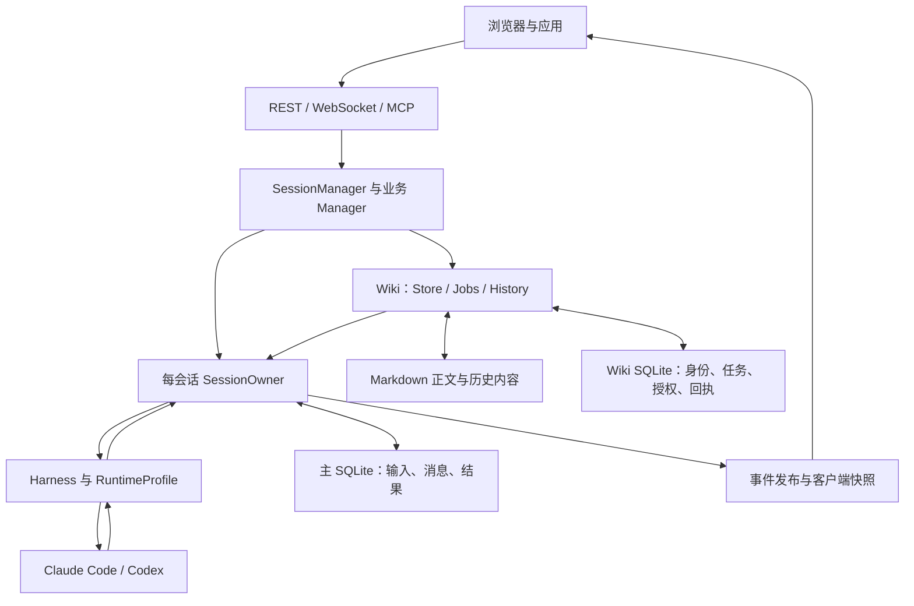
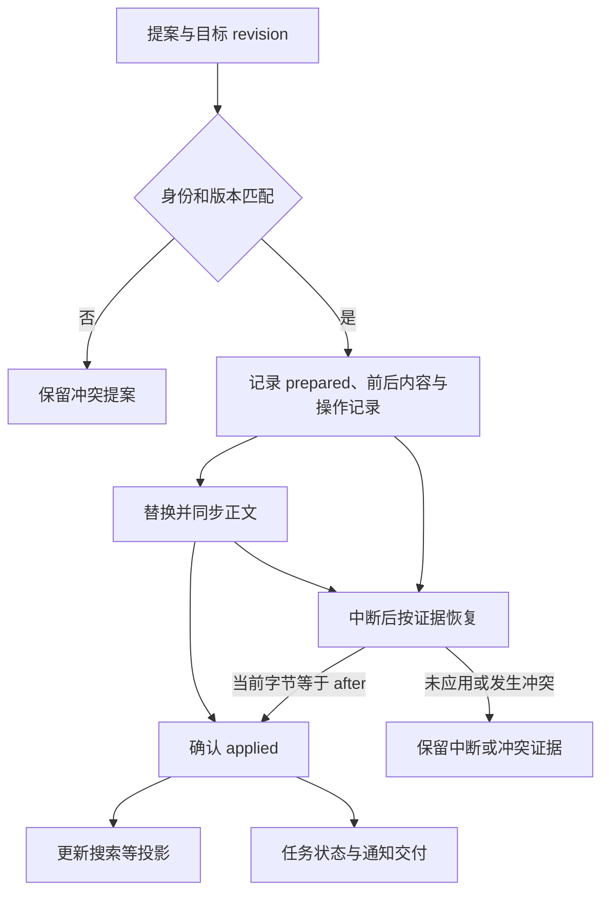

# Octopus 当前架构设计与上游对比

> **审阅日期：2026-10-25（Asia/Shanghai）。**  
> **你的版本：** Danuvius152/Octopus，`main@a4e7072e9809828f6fa8230e2b4691f5b9aab244`。  
> **上游版本：** archeryue/Octopus，`main@d8669d55f1482fe7cf3ef6f63910bf0474ba1f9c`。  
> **历史参考：** 你提供的《Octopus设计.md》。本文是独立的新报告，按当前源码重新核对，不覆盖原文。

## 阅读结论

**你的版本保留了上游“单机个人 Agent 控制平面”的基本结构，但已经发展为一个更强调执行责任、知识资产和交付可追踪性的个人工作台。** 它的主要进步并非多了多少工具，而是逐步明确了：谁有权接受工作、谁可以改变运行状态、什么算已经完成、结果如何回到原请求、哪些资料能被哪个任务修改。[F01][F02][F07][F35][F39]

我的整体评价是：

1. **执行正确性的设计明显进步。** 每个活跃 Session 的运行、问题和生命周期状态交给原始 SessionOwner；经 Session 入口接纳的工作输入有持久记录与接收回执；业务结果、记录完成、通知和资源回收不再被一个“结束”事件混为一谈。
2. **知识管理已成为真正的产品领域。** Wiki 包含共享知识、文档身份、版本、搜索、维护权限、历史和恢复，能够支撑长期研究资料的积累。
3. **若评价“是否最精简”，答案是有条件的。** 对持续委派、并发控制、受控自动改库和失败恢复，这些额外机制多数有真实用途；对只想远程使用两个 CLI 的人，上游更容易理解和维护。
4. **若评价“是否更通用”，目前不能直接肯定。** 核心执行模型更明确，但公共上下文已经承载 Wiki 语义，应用桥接包含 Sapphire 专属协议；运行时接口也仍带着现有两种 CLI 的假设。
5. **最值得继续做的是收拢边界与兑现能力合同。** 尤其是后端工具策略、oneshot/Research 的执行边界、Codex 协议迁移、投递重试分类和当前文档一致性。继续增加状态副本、通用恢复层或插件框架，不是优先方向。

下文把**代码事实**、**架构判断**和**待验证的风险**区分开。本文评价的是固定提交中的实现，不能据此断言这些提交已经部署在你的机器上。

---

## 1. 比较方法与版本关系

### 1.1 本次到底比较了什么

| 项目 | archeryue/Octopus | Danuvius152/Octopus |
| --- | --- | --- |
| 默认分支 | `main` | `main` |
| 固定提交 | `d8669d55f1482fe7cf3ef6f63910bf0474ba1f9c` | `a4e7072e9809828f6fa8230e2b4691f5b9aab244` |
| 提交时间 | 2026-10-11 17:24:57 +08:00 | 2026-10-25 18:49:34 +08:00 |
| 提交标题 | `chore: MIT license` | `Optimize Wiki efficiency and streamline verification` |

本次实际取得了两个 Git 仓库，读取源码、相关设计文件和测试中的行为约束，并比较两端快照。共同祖先是 `88d2284b2b2493001be2e945df375d7a228ccc1f`；从共同祖先算，上游侧独有 1 个提交，你的版本侧独有 107 个提交。上游独有的提交是 MIT license。因此使用两个固定 HEAD 的差异，可以避免把共同祖先误称为当前上游。

**一个重要事实：你附件分析的上游提交，恰好就是本次取得的上游当前 HEAD。** 所以原总结仍然能作为上游基线；需要重写的是“你的当前架构”和“旧问题在你的版本中是否已改变”，而不是无依据地假设上游也同步演化了。

可复核的比较口径：

```bash
git merge-base upstream/main main
git rev-list --left-right --count upstream/main...main
git diff --shortstat upstream/main main
git diff upstream/main main -- server web/src docs
```

这里的 `upstream/main` 和 `main` 在审阅时分别指向表中的固定提交；今后复核应使用完整 SHA。

### 1.2 验证边界

本次完成了源码与 Git 差异审阅、源文件规模统计、关键调用链核对，以及一项针对委派重试控制流的最小隔离验证。**没有启动整套服务，没有调用真实 Claude/Codex 模型，没有运行完整测试套件、浏览器端到端测试或负载测试。**

因此：

- 可以确认某个接口、状态转换、授权检查或重试分支存在。
- 可以据此判断设计上的收益、成本和可触发风险。
- 不能据此声称当前版本无 bug、吞吐提升多少、一定节省多少 token，或两个后端已经通过同等实机验证。
- 仓库中的历史“测试通过”“shipped”记录，只是对应历史版本的记录，不自动成为本次提交的验收证据。

### 1.3 变化规模：已经是实质演化

以下统计来自两个固定提交的 Git 跟踪文件。行数是物理行数，包含注释和空行；前端手写源码排除 `*.test.*` 和生成的 `web/src/api/contracts.ts`。

| 口径 | 上游 | 你的版本 | 应如何理解 |
| --- | ---: | ---: | --- |
| `server/**/*.py` 文件数 | 122 | 226 | 后端职责与维护面显著增加 |
| 后端 Python 行数 | 33,541 | 61,854 | 增长约 84.4%，不是几个外围功能 |
| `server/sessions/` 行数 | 4,974 | 8,331 | 输入、Owner、完成与回收模型成为主要改动 |
| `server/harness/` 行数 | 3,543 | 5,727 | 后端观测、控制与协议适配成本增加 |
| `server/wiki/` | 无 | 66 个 Python 文件，15,640 行 | 约占后端新增行数的 55.2% |
| 前端手写 TS/TSX 行数 | 15,478 | 17,103 | 视觉骨架大体延续，主要加强状态处理 |
| `tests/` 中 Python 文件数 | 93 | 355 | 包含测试及辅助代码，不是测试用例数 |
| `docs/` 中 Markdown 文件数 | 36 | 58 | 设计资料更多，也增加同步成本 |

整个仓库两端快照的差异为 756 个文件、131,013 行新增和 15,705 行删除，其中含大量测试和文档。**这些数字只能说明维护规模，不能单独证明过度工程，也不能证明质量更高。** 后面按每项机制换来的保证评价它是否值得保留。

---

## 2. 总体架构：哪些继承，哪些改变

### 2.1 共同的基础结构

两个版本都保持以下路线：

- 一个 FastAPI 服务承载 REST、WebSocket、MCP、调度及后台管理。
- React、TypeScript、Zustand 构成浏览器单页应用。
- SQLite 存产品数据；文件系统保存工作文件、Agent memory 和应用内容。
- Claude Code/Codex 负责实际模型交互与原生工具执行。
- Harness 是产品业务与模型运行时之间的适配边界。
- Agent 是持久助手定义，Session 是具体会话；应用、定时任务和委派复用会话能力。[U01][U02][U10][U11][F01][F17]

因此，你没有把上游改成分布式 Agent 平台，也没有在 Python 中重写一整套模型推理循环。**部署形态仍是单机模块化单体；复杂度主要增加在进程内部的领域与状态协议。**

### 2.2 当前结构图



图中双向箭头表示读写或事件返回关系，不表示跨数据库存在一个总事务。Wiki 文件、Wiki SQLite、主 SQLite 各自有明确提交与恢复边界。[F01][F10][F32][F33][F37][F38]

### 2.3 “保留上游框架”与“保持上游实现不变”是两回事

你保留了 Agent、Session、Harness、MCP、Applications、Memory 等主要产品对象和技术路线；但 Session 执行与 Wiki 维护已形成新的内部合同。

所以我的判断是：

> **你的版本没有丢掉上游最有价值的骨架，但已经进行了核心执行模型的改造。把它描述成“只是上游加一个 Wiki”会明显低估改动。**

这也意味着未来合并上游改动不能只看文件冲突。上游若继续直接操作 Session 的 task、queue 或结束标志，机械合并到你的 Owner 模型可能恢复多写者问题。

---

## 3. 当前领域模型与状态所有权

### 3.1 这些对象为什么必须区分

| 对象 | 当前职责 | 不应该混同的对象 |
| --- | --- | --- |
| Account | 用户身份、数据归属、凭据、工作目录及知识库归属 | 不是一个独立 OS 沙箱 |
| Agent | 人格、backend/model、凭据、工具、connector、长期记忆 | 不是一次执行任务 |
| Session | 一段会话、消息、工作目录、所属 Agent、原生续聊 ID | 不是一个 request 或一个子进程 |
| 输入记录 / client submission | 服务接纳的原始输入、来源、幂等身份、送达与执行状态 | 不等于已经交给模型 |
| Request | 本次逻辑处理及其最终结果 | 不等于每次重试 |
| Attempt | 为该 request 发起的一次 Harness 尝试 | 不等于另一个用户请求 |
| Run lease | 当前物理运行的授权与生命周期身份 | 不应在进程退役后继续代表权限 |
| Work round | 委派等业务的一轮工作，继续同一子会话时可以产生新 round | 不等于整个子 Session 的生命期 |
| SubmissionReceipt | 对原提交的接收与完成观察句柄 | 等待者不是执行的所有者 |
| Wiki Job | 可包含多个文档项的维护任务及其授权、执行、发布责任 | 不等于普通聊天输入 |
| Provider thread / resume ID | CLI 自己的历史标识 | 不等于 Octopus request/attempt ID |

证据主要来自 SessionOwner、运行模型、submission、delegation 和 KnowledgeContext 的实际结构。[F02][F04][F06][F07][F15][F39]

例如，一次用户输入遇到临时 provider 错误，可能有两个 attempt，但仍只有一个逻辑 request；同一委派会话经过三轮修改，仍是一段子 Session，却对应不同工作轮次。若只用 `session.status = completed` 表示这些事实，迟到结果、Stop 和继续输入就容易互相影响。

### 3.2 SessionOwner 是实际结构改进

上游通过 Session 上的锁、活动 task、内层 task、pending queue 等字段协作。拆成多个 mixin 改善了文件组织，但这些 mixin 仍然操作同一个对象。[U02]

你的版本中：

1. `start_message()` 将提交交给对应 Owner。
2. Owner 串行处理普通命令、控制命令、问题与原 I/O 任务的完成。
3. 耗时 Harness I/O 在受管理的 task 中执行，并向 Owner 返回事实。
4. `_require_session_writer()` 检查修改活跃运行状态的是否为原 Owner task。
5. Owner 失败后，不另建一个替身继续猜测原工作；Manager 负责显式失败收尾。[F02][F03][F05]

**收益：** 关键问题从“所有异步路径有没有记得加锁、await 后有没有再次检查”，转成“这个状态转移是否由唯一的合法写者执行”。这比单纯增加防御性判断更有结构价值。

**范围：** 单写者约束针对活跃 Session 的执行、问题和生命周期状态。整个服务并没有全面 actor 化，业务 Manager、数据库事务和 Wiki 仍有各自的写入责任。

### 3.3 当前仍不是完全解耦的小组件集合

`SessionManager` 仍由多个 mixin 组合；OwnerRuntime 也会调用 Manager 方法、读取 Session 结构。它们在语义上收拢了写权，却没有变成彼此只依赖极窄接口的组件。[F57]

当前较大的执行文件包括：

- `owner_runtime.py`：1,823 行；
- `turns.py`：1,386 行；
- `delegations.py`：1,392 行。

这不是“文件超过多少行就不合格”，而是提醒：**单写者已经改善并发推理，但核心维护者仍需要同时理解命令、准备、重试、通知和回收。** 后续应优先缩小跨模块必须知道的事实，按状态权威划清边界；仅把长文件切成更多 mixin，收益有限。

---

## 4. 一次请求现在如何执行

### 4.1 接收输入与开始执行已分离

当前普通浏览器输入携带 `client_request_id`，用于确认和去重。WebSocket 先验证会话归属，再走统一客户端提交路径；缺少身份的旧形式不再被静默当作正常提交。[F45]

持久输入记录让客户端可以分清：

- 服务是否接纳了输入；
- 输入是否仍在等待；
- 是否已经开始执行；
- 某个原请求是否已被另一次明确恢复操作接替；
- 当前效果是否未知，是否需要用户检查。

`SubmissionReceipt.wait()` 用 shield 观察原 completion。调用方离开、HTTP 等待被取消，不自动拥有取消底层工作的权力。[F06][F07][F76]

**与上游相比，这是产品语义上的进步。** 上游把文本加入内存队列，足以实现普通连续聊天，但浏览器断线或服务崩溃后，“发送过”“被接受”“已经执行”更难区分。

### 4.2 执行阶段显式化

OwnerRuntime 的 `Execution.phase` 明确列出：

`claim → input → prepare → start → stream → retire / retry → terminal`

这是一份帮助理解的主流程；实际异常和重试分支以 `advance()` 为准，不能把这行简写当作完整转移表。[F04][F08]

几个重要设计点：

- **配置捕获有边界。** 受管 I/O 使用已捕获配置，避免执行到一半因另一操作改 Agent 而混用两套配置。
- **配额在派发边界判断。** 调度任务的新建会话和原会话路径进入同一 Owner 接纳与派发边界。周期任务经 `start_message`；一次性任务由 `start_one_shot` 协调，必要时直接提交 `Submit`。旧版本绕过治理边界的路径已被收拢。[F05][F47]
- **取消保留原资源责任。** 即使启动子进程的等待者先收到取消，也必须确认实际 spawn 是否发生并收回原进程组。
- **重试保留原 request 和独立 attempt。** 当前仍有有限的 provider 恢复策略，而不是出错后无限重新执行。[F08][F19][F22][F47]

需要限定的是：这里统一的是**会话请求派发**。直接 Harness oneshot、Research leaf 等辅助调用并没有自动获得完全相同的账户与准入合同，详见第 7 节。

### 4.3 “完成”至少包含四件不同的事

| 事实 | 当前含义 | 为什么必须分开 |
| --- | --- | --- |
| 业务结果 | 模型或业务工作成功、失败或中断 | CLI 输出了最后一段文字，不等于所有副作用已确认 |
| 记录状态 | 最终结果是否提交为权威记录 | 成功运行与成功落盘可能分离 |
| 通知状态 | 应用、委派等消费者是否收到需要的通知前缀 | 慢客户端不能改写业务事实 |
| 资源退役 | 本轮受管 I/O 与必须退出的 writer 是否收束；可安全复用的 backend 可继续被持有 | 已给用户答复，不代表旧 writer 已不可能再写 |

`RequestCompletion` 显式携带 outcome、recording_state、notification_state；SessionPublisher 和退役机制保留各自责任。[F07][F09][F24]

**原 receipt 的完成不替代独立的资源退役证明。** Owner 失败时，完成观察与资源清理可能先后发生；需要关闭旧 writer 的操作仍须等待原资源。正常可安全保留的复用进程则继续由 Session 持有。此外，notification_state 的 delivered 表示相应交付路径已完成，不是用户浏览器已读确认。[F03][F24][F44]

这个方向优于把浏览器收到的一个 `result` 事件当成所有业务的唯一完成来源。它也要求消费者真正使用**原 request 的 receipt**，而不是等待 Session 下一次变 idle 后读取“最新一条结果”。

### 4.4 Stop、问题答复和 dismiss 更精确

Stop 和问题答复通过关联命令携带 request/attempt 等目标身份；Owner 内再次核对当前目标。这样能拒绝迟到点击，避免用户想停止上一轮却误停刚开始的新一轮。命令身份被同样 payload 重用时可以返回原回执，换 payload 则拒绝。[F46]

这类控制命令的去重回执目前保存在 Session 的有界内存缓存中，最多 256 条，不承诺跨服务重启保留；它与 `client_submissions` 的持久工作输入幂等是两个不同合同。[F46]

dismiss 的数据库操作与后续运行态通知分开：原恢复记录已提交后，通知失败不会把它伪装成“数据库尚未成功”，也不需要为一个显示动作触发全服务重启。[F05]

**这是你强调少机制、明确所有权的一个好例子：** 解决问题靠定位哪一层拥有事实，而不是让每层重复检查、补写和回滚同一状态。

### 4.5 持久化的边界：保留事实，不承诺自动续跑一切

当前启动恢复把普通 `pending` 输入收束为 withdrawn，把在运行的输入标为 unknown；委派 restore 明确不自动重放原结果，保留 `not_replayed` 等处置事实。[F06][F15]

所以准确表述应是：

> **当前框架能够保存接纳与执行证据，在不确定时停止并要求明确恢复；它还不是一个所有聊天任务都能跨重启继续完成的持久工作流引擎。**

Wiki jobs 有自己的持久维护协议。不能因为 Wiki 可恢复部分任务，就把这项保证推广到普通聊天、bg、Research、全部委派和原生子代理。

---

## 5. 多 Agent 协作与异步结果

### 5.1 必须区分两种“子 Agent”

| 类型 | 谁创建与管理 | 当前能依赖的完成机制 |
| --- | --- | --- |
| Octopus 命名 Agent 委派 | `DelegationManager`，目标 Agent 的独立子 Session | 工作轮次、原提交 receipt、已提交消息与父会话回注 |
| CLI 原生 subagent | Claude/Codex 自己的运行时 | 后端提供的事件和当前适配器能够观察的生命周期 |

两者可以同时存在，但不共享相同的身份、权限和完成合同。**UI 都显示一张“子任务卡片”，不代表框架对两者拥有相同的控制权。**[F15][F20][F23][F25]

### 5.2 命名委派的改进是真实的

上游 `_inject_terminal()` 先设置内存“已注入”标志，再尝试向父会话提交；失败时日志记录，随后仍自动归档子会话。[U06]

你的版本改成：

- 以不可变工作轮次追踪当前委派；
- 消费子请求原 receipt；
- 从对应已提交 request/attempt 的消息中提取回复；
- 使用稳定 `agent-terminal:{work_id}` 作为父输入的投递身份；
- 回注前查询是否已经有接收记录，避免因 ACK 丢失而重复执行；
- 父 Owner 已不可用时，保留子结果并明确结束该回注责任。[F15][F16]

这明显改善了“子任务完成了，但父会话可能不知道”“重复回注导致重复执行”等边界。不过它仍不是跨主 SQLite、任意模型副作用和进程崩溃的端到端 exactly-once。

### 5.3 正常委派完成后不再自动归档

当前 `_AUTO_ARCHIVE_ORIGINS` 只有 `schedule`，普通 named delegation 的终态投递路径也不再自动归档子会话。**正常委派完成后的 child 与普通 user parent 会保留。**[F58][F16]

仍有两个例外不能混淆：

- 未成功建立的委派会话可能在失败清理中归档；
- schedule 来源的会话仍遵循定时任务自己的自动归档策略。

这直接修正了上游“委派结束即归档”的交互取舍，同时保留同一子会话继续迭代的价值。

### 5.4 当前一个具体缺口：回注重试没有充分分类

`delegations.py:1335–1363` 对 `start_message()` 抛出的所有普通异常采用每秒重试。它能处理暂时未确认的接纳，却没有在此处区分暂时拥塞与持续的权限/业务拒绝。[F16]

一个可推导的组合场景是：子结果准备回传时，父账户已被禁用，但父 Session 仍存在、Owner 未失败。父输入准入会拒绝“账户不可用”，而回注循环的现有结束条件未必覆盖这个状态。[F59][F74]

本次最小验证直接提取原方法，以持续拒绝的 fake admission 执行，观察到同一 delivery_id 连续重试三次且未产生终态处置；该验证证明**重试分支的行为**，不是完整禁用账户场景的端到端复现。

**建议：** 保留稳定投递身份和 ACK 查询；对明确暂时错误继续重试，对当前不允许回注的业务/授权结果保留子回复并显式结束或挂起投递。如果产品确实要在账户重新启用后自动恢复，应把“暂停待启用”建模成可观察状态，而不是长期每秒捕获同一种异常。

---

## 6. Harness、提示词与运行时扩展能力

### 6.1 值得保留的上游设计

一个 `Harness` 实例配一个 `RuntimeProfile`，由 profile 提供 argv 构建、事件解析、凭据、登录、fork、transcript 等协作者。业务层使用统一的 create_run、oneshot 等入口，不自行拼接 Claude/Codex 命令。[U10][F17][F18]

这种组合设计比为每个 backend 复制整套 SessionManager 更合适。你的版本保留它，是正确的延续。

但**统一入口不等于能力相同**：例如 Codex 没有 handoff/pull 所需 transcript codec；能创建独立会话，也不意味着能实时 steer 或完整接收原生尾部。[F20]

### 6.2 当前真实能力矩阵

| 能力 | Claude Code | Codex 当前实现 |
| --- | --- | --- |
| 主执行协议 | `claude --print`，stream-json 输入输出 | `codex exec --json` |
| 活动轮中追加输入 | 有 STREAM_JSON 路径，仍受 Owner 当前阶段裁决 | 当前按排队处理，不具备同等 stdin 交互 |
| 物理进程复用 | 引擎支持；实际复用还受配置与请求权限限制 | 每次 exec 尝试为独立执行 |
| 原生历史续聊 | resume | exec resume |
| 稳定控制指令更新 | 后端对应 system prompt/进程配置路径 | 续聊前短时 app-server 检查并按需注入 developer 指令 |
| 原生子任务展示 | Task/Agent 等事件归一 | collaboration 事件及补充观察 |
| 完整原生尾部交付 | 有现有 idle 事件路径，不能与任意后端一概等同 | 尚未实现完整“等子任务、父汇总、再结算”合同 |
| Agent memory | 指向共享的每 Agent memory 目录 | 注入目录说明，由文件工具读写 |
| handoff / pull | 有 transcript codec | 无对应 codec |
| 新后端 | 需要实际 profile/协议/认证及能力验收 | DeepSeek 当前仍是设计候选，未注册成可用 backend |

依据：[F18][F19][F20][F21][F22][F28][F51][F52]。表格描述仓库的实现，不代表本轮对真实安装 CLI 做过能力验收。

### 6.3 代码里有 app-server，但主协议尚未迁移

这是当前版本最容易被误读的一点。

`codex_control.refresh_instructions()` 会：

1. 启动短时 app-server；
2. initialize 并恢复目标 thread；
3. 读取当前历史中的 controller checkpoint；
4. 指令有变化时通过 `thread/inject_items` 注入；
5. 关闭并回收这个 writer；
6. 主执行路径随后启动 `codex exec --json`。[F19][F21]

所以：

- “当前完全没有使用 app-server”不准确；
- “当前已完成 app-server 主对话迁移”也不准确。

当前方案避免不变的稳定指令每次都重复注入，并能修正原生续聊历史中的旧控制指令。但代价是续聊前有一个额外协议准备过程，还依赖 controller checkpoint 与原生历史结构。本轮没有测量其启动延迟或 token 成本，不能据代码就报节省比例。

### 6.4 为什么原生尾部仍未解决

Codex parser 将 `turn.completed` 转为 result 与 end_of_stream；补充观察器只读取已经写出的有限观察记录；Owner 对不可复用的 Codex 执行进行退役，再按父 attempt 结果结算。退役时仍未结束的原生卡片会被标为 interrupted 等状态。[F23][F24][F25][F72][F73]

因此，当前实现并没有一个已验收的屏障来保证：

> 主模型先答复 → 所有原生子任务继续完成 → 父模型收到结果并进一步汇总 → 原 request 才最终结束。

仓库迁移设计也把“请求内双向交互”和“完整原生尾部交付”分成 A/B 两种范围，并明确二者尚未实施验收。[F51]

**架构判断：** 你已有 Owner、receipt、输入账本和资源回收基础，迁移时可以继续使用；困难集中在 Harness 协议、输入确认与真实完成语义。不能只把命令名替换掉，也不需要为新协议再建一套业务 Owner。

### 6.5 目前的抽象何时会限制扩展

`Harness.create_run()` 直接返回具体 `HarnessRun`；`StdinMode.STREAM_JSON` 同时影响 stdin 编码、轮内输入、跨轮复用和部分权限绑定。共同引擎的 `_make_context()` 还直接分支判断 `backend == "codex"`。[F17][F18][F22][F60]

对现有两个 CLI，这仍可理解；加入 app-server、ACP 或 SDK 时，这些能力就不再天然一致。

建议按真实差异拆开：

- **传输：** 有限进程 JSONL、双向 RPC、SDK 回调。
- **能力：** 活动轮追加输入、问题答复、取消、原生尾部观察。
- **生命周期：** 一次 attempt 一个宿主，还是可以安全跨轮复用。
- **业务合同：** 谁接受输入、谁记录终态、谁退役原资源，继续由现有 Owner 负责。

这是一项有限的运行时接口演进，不能演变成“每个 backend 自己管理整套请求状态”。

### 6.6 记忆与 Wiki 指南的分工

每 Agent Markdown memory 是上游已有能力，用于积累该助手的稳定用户偏好与项目信息；账户共享 Wiki 是你新增的知识资产领域。两者不应互相复制整份材料。[U11][F29][F30]

Wiki 的普通会话只加载简短入口，再按需加载检索、提交或维护指南；worker 根据真实 task/grant 获得不同工具与说明。这个设计在结构上有利于减少不必要上下文，但其效果仍需要实际 token 和任务成功率测量。[F30]

---

## 7. 后端能力与治理中仍需修正的合同

### 7.1 tool_allow / tool_deny 尚非后端等价能力

Claude 的 argv renderer 消费 `tool_allow` 和 `tool_deny`；当前 Codex renderer 没有消费这两个字段。字段存在于公共上下文，不代表实际后端执行了对应策略。[F19][F28]

**影响：** 用户看到统一 Agent 配置，可能以为切换 backend 后限制仍等价。当前服务端 MCP 对象授权仍然有作用，但它不能替代 CLI 原生工具策略。

**建议：** 对后端不支持的限制在配置或展示边界明确说明/拒绝；只有在真正接线并验证后，才宣称支持。不要用另一段 prompt 冒充同等强制限制。

### 7.2 oneshot 的“无工具”注释比实现保证更强

`Harness.run_oneshot()` 的说明称其为无工具调用，但 Codex 的 `build_oneshot_argv()` 使用 bypass-approvals-and-sandbox，未显式关闭原生工具、宿主 MCP、skills 或项目规则。[F17][F26]

这说明的是**当前代码没有建立可验证的 tool-free 保证**；本轮没有真实调用模型，不能据此断言某次 oneshot 已执行了不应执行的工具。

类似地，Research leaf 的空 Octopus MCP 列表与 read-only 配置，不自动等于模型只剩 web 工具。应分别验证模型可见工具、实际可执行操作和宿主配置继承。[F27][F52]

### 7.3 会话统一准入不覆盖所有辅助调用

`OneShotContext` 没有账户 owner 字段；Research leaf 创建的 RunConfig 也没有与普通 Session 等价的账户和 spawn 授权回调。[F18][F27]

这是进一步接入第三后端时必须补齐的共同合同。建议补齐实际需要的身份与准入信息，并复用已有授权逻辑；不要为了统一而再发明一个与 SessionOwner 平行的执行平台。

### 7.4 CLI 内部细节依赖比上游更深

你的版本新增 Codex 活动、性能、原生协作观察以及 controller checkpoint。它们提升了可观测性，也增加对 stderr、rollout 和本地模型元数据的依赖。[F20][F21][F61]

这类适配应保持在 Harness 内部，辅以固定协议样本和必要实机验证。**兼容性风险不能仅靠大量 mock 测试消除，也不能把补充观察当成 provider 的权威完成协议。**

---

## 8. Wiki：当前架构中最大的新增领域

### 8.1 定位与所有权

每账户注册一个主库，登记 root、`curator_agent_id`、app_id、vault_id 和 registration_generation。已绑定 root 不能被当成普通设置直接换掉，代码要求经过迁移。[F31]

curator 权限依赖配置中的 Agent ID、当前 assignment 和任务范围。**名字叫 Weber 本身不授予写权限。** 普通聊天中的 curator Agent 与被分配维护任务的 worker，其权限上下文不同。[F35][F36]

相比上游只提供每 Agent memory，这使资料可以作为账户共享知识被多个助手检索和维护，而不必分别存进每个 Agent 的记忆目录。

### 8.2 存储分工：正文权威与业务事实权威不同

| 数据 | 主要责任 | 是否可以随意删除重建 |
| --- | --- | --- |
| Markdown 正文 | 当前可编辑内容 | 不可以 |
| 稳定 document ID、路径/UID 关联 | 文档身份及移动连续性 | 不可以当缓存删除 |
| revision | 当前原始字节 SHA256 | 可重新计算，但历史 revision 关系不能随意丢失 |
| 搜索、章节、材料和目录投影 | 加速查询与导航 | 仅按各投影 owner 的重建协议处理 |
| 历史、内容 blob、来源、operation receipt | 证明曾发生什么与写入了什么 | 不可以 |
| Job、grant、creation reservation、execution refs | 维护任务的范围与执行事实 | 不可以 |
| filesystem inbox/state | 已观察文件事件及其处理进度 | 不可以靠重扫伪造完整历史 |
| 通知 outbox、subscriber、delivery | 维护结果的可追踪交付 | 不可以当 UI 缓存删除 |

除正文文件和内容 blob 等磁盘资料外，文档身份、历史记录、任务、授权、操作回执与派生投影共同存在于 `index.sqlite3`。**文件名包含 index，不意味着整个 SQLite 文件是可丢弃缓存。** 当前代码只允许指定投影重建；已注册库丢失权威数据库会拒绝继续。[F32][F33][F38][F62]

这是维护和备份文档必须讲清的一条规则。否则，“Markdown 都还在，删除索引重建一下”可能把身份、历史、授权和任务证据一并删掉。

### 8.3 当前是章节级词法检索

实现采用：

- 统一文本规范化；
- jieba 分词与中文连续 bigram；
- SQLite FTS5；
- 对标题、路径、别名、标签、Key note、章节标题、正文加权；
- BM25 排序和整篇词项覆盖判断；
- 精确 lookup、章节位置及版本相关的读取导航。[F34]

**没有发现已接通的向量数据库、embedding 索引或语义 reranker。** 这是轻量本地检索路线，适合明确文档、术语、项目名和章节定位。

其优势是可解释、基础设施简单、搜索本身不需要模型调用；局限是跨语言、同义表达和隐含关联的召回没有语义索引保证。应先用真实问题测量漏检类型，再判断是否需要可选语义检索。添加向量服务不应成为“知识库升级”的默认动作。

读取接口提供 compact 导航、read/read_many、实际返回范围和 continuation，减少一次把整库或整篇无差别塞入上下文的需要。[F63]

检索与新维护的主要合同面向 Markdown。已明确选中的 HTML/TXT 有读取路径，但不能由此宣称 Wiki 已具备 PDF 全文索引和维护；应用能预览文件与 Wiki 支持该文件类型是两回事。[F64]

### 8.4 原始意图与维护权限分开

`KnowledgeContext` 在可信入口保留原请求、用户、来源要求、Wiki 模式与维护限制。子任务派生上下文只能收窄约束；读到的文章正文、子任务返回或普通文本不能自行变成授权。[F39]

工具和权限进一步分层：

| 当前角色 | 可以承担的主要行为 |
| --- | --- |
| 普通查询会话 | 搜索、定位、读取相关材料 |
| 合法 submitter | 提交范围明确的维护请求 |
| 获派 curator worker | 在当前 assignment 内整理或修改指定文档 |
| 持有新页 reservation 的 worker | 发布被允许创建的新文档 |
| 已结束或失效 worker | 不继续拥有原写权限 |

真实写入校验包含 account/vault、注册 generation、job、request、attempt、当前 worker、稳定 document ID 或新页 reservation。路径被另一个文件占据，不自动继承旧文档授权。[F30][F35]

这比仅在 prompt 写“不要改其他文件”更可验证。不过程序能证明权限、版本与字节被交付，不能证明模型理解准确、摘要无误或来源充分。

### 8.5 维护任务有独立的持久协议

当前流程是：

1. 在事务中检查幂等 request key 与 payload，固化 job、items、grant、订阅关系。
2. Worker 使用注册的 curator，按有限 item 批次创建独立 Wiki 会话。
3. 启动模型前保存精确 session/request/attempt/work 关联。
4. 读取材料时记录实际返回的版本与范围。
5. 通过受控写入口发布，消费原 request receipt。
6. 结果不明确时保留 unknown/attention，不根据后来某条会话结果猜测成功。
7. 原执行资源收回后，再撤销 assignment。[F35][F36][F65][F75]

这是一块有意引入的持久维护业务，并非普通 queue 上再多加几个状态。它的复杂度来自多文档自动修改、人工编辑、文件/数据库不同提交点和通知重试等真实场景。

### 8.6 写入不是“文件和数据库一笔事务”

发布路径检查 `expected_revision`，冲突时保留 proposal；随后保存 prepared journal、before/after 内容与操作记录，执行同步与原子替换，再确认 applied、更新投影，最终返回已有操作回执。**receipt 存在本身不代表正文已成功写入，需要结合 applied、输出 revision 与索引证据判断实际效果。**[F37]



图中恢复不是承诺所有中断都能自动得到确定答案；遇到无法证明的效果，需要保留证据并停止猜测。

这里不能用“简化”为理由删除 journal：文件系统与 SQLite 没有共同原子事务，恢复机制承担的是实际的一致性缺口。可以简化的是重复状态、重复协调者和没有具体场景的保护层。

### 8.7 两项不能扩大宣传的保证

**第一，受控 API 授权不等于 OS 文件隔离。** 普通 Codex 全功能执行仍采用绕过审批与沙箱的模式；同 OS 用户程序能直接接触文件。Wiki grant 约束的是经过 HTTP/MCP 受控入口的操作。[F19][F35]

**第二，合作式文件锁不等于对任意外部编辑器的强一致 CAS。** `history.py` 明确承认，不遵守 flock 的外部编辑器仍可能在最终检查与替换之间竞态。[F37]

对于可信个人环境，这些边界可以是合理取舍；若要支持不互信租户或任意程序并发编辑，需要升级执行/文件写入边界，不能靠更多 prompt 或数据库 user_id 解决。

---

## 9. 应用、前端与知识库的关系

### 9.1 Applications 的基础能力来自上游

应用代码、应用数据和运行依赖分目录管理；应用构建使用真实 Session；应用可通过作用域 token 与 Agent 对话。这些是上游已有的产品路线，你主要加强了与原 completion 的连接、状态确认和知识库协作。[U01][F01]

因此应把“继承的良好设计”与“新增改进”分开评价，而不是把全部功能都算为当前改造收益。

### 9.2 Wiki App bridge 有实用价值，也有耦合

当前 `/apps/{app_id}/wiki/{operation}` 复用 Wiki 查询、历史、维护等 handler，并检查注册 app_id。Sapphire 的保存、移动、删除、恢复和 Git 变化也有桥接与历史对账。[F40][F41]

优点是应用无需再实现另一套知识库事实、搜索和维护执行器。

成本有两个：

- 当前只有注册里的 app_id 获得相应桥接能力，尚非多 App client 授权模型。
- `app_bridge.py` 理解 Sapphire 的具体 endpoint、vault 目录和 trash 结构；`routers/wiki.py` 还通过 FastAPI APIRoute 内部结构转发调用。

**判断：** 这是一个实用的集成，但通用扩展边界还不够干净。出现第二个真实应用时，适合提取显式的 Wiki service 调用与小型应用 mutation adapter；不需要提前建设大型插件平台。

### 9.3 前端最重要的变化是状态可信度

你的版本增加或强化了：

- 账户切换的 generation，阻止旧账户请求结果进入新账户视图；
- HTTP response 与 body 读取后的身份检查；
- request/attempt、dispatch snapshot 和录制失败投影；
- Wiki job/vault/state_version 对应的权威快照；
- 断线后重新查询未结算任务；
- 区分“正文已保存但索引待恢复”“原执行未确认”等维护卡片。[F42][F43][F66][F70][F71]

这种改进直接影响用户是否能理解真实状态，比仅增加 loading 动画有价值。

但前端仍以集中的 `sessionStore` 与 WebSocket 事件分发组织多个领域，导航仍基于 `mainView`，不是完整 URL 路由。核心界面主要展示 Wiki 任务，具体阅读编辑仍依赖应用。[F67]

如果未来要让 SmartReader、Sapphire 与聊天互相跳转到文章和选区，稳定 URL、文档版本、段落坐标及页面恢复将成为真正的架构要求。

### 9.4 已实现与未来计划的边界

| 内容 | 当前判断 |
| --- | --- |
| 账户主库注册、Markdown 搜索、文档读取、历史、维护任务 | 已有实现 |
| 受控创建新文档与任务发布回执 | 已有实现 |
| 注册 App 的 Wiki 接口与 Sapphire 文件变化桥接 | 已有实现 |
| 普通会话的 Wiki 查询与维护提交 | 已有实现 |
| 多 App owner/client 授权体系 | 仍在未来计划 |
| SmartReader“问这篇”“问选区”的完整身份与权限闭环 | 仍在未来计划 |
| 引用跳转到版本化段落、DOM/UTF-16 坐标映射 | 仍在未来计划 |
| 语义检索或 QMD adapter | 仍在未来计划 |
| DeepSeek backend | 设计候选，未成为当前注册后端 |
| Codex app-server 主执行迁移与完整原生尾部 | 设计候选，不能计为已交付 |

依据：[F31][F35][F40][F51][F52][F53]。仓库没有包含所有动态生成应用的部署源码，本报告不据核心桥接推断你的实际 SmartReader/Sapphire 页面已完成到哪一步。

---

## 10. 数据库、故障处理、启动与迁移

### 10.1 从跨调用批提交转向明确短事务

上游 SQLite 使用 WAL、单连接及批量提交；你的版本把 BEGIN、SQL、cursor、commit/rollback 纳入显式事务及统一期限，禁止在同一公共操作中递归进入另一公共事务。当前主数据库还验证 `synchronous=FULL`。[U09][F10][F11]

**收益：** 对“这一操作到底提交了吗”的回答更局部、更清楚；不再依赖若干调用之后某处 flush。

**成本：** 更多同步持久化和串行事务可能增加延迟；有 WAL 不代表所有写入能并行。未测量之前，不能声称更快。个人部署下优先换取可解释的持久性通常合理，但应保持事务短，并避免把模型等待、网络调用或长文件处理放进事务。

### 10.2 fail-stop 是有作用域的取舍

| 情况 | 当前处理方向 | 架构含义 |
| --- | --- | --- |
| 配额、无效请求、正常权限拒绝 | 返回业务拒绝或等待处理 | 不因正常业务结果终止服务 |
| 普通通知失败、慢浏览器 | 独立交付状态、有界缓冲、断线重同步 | 不改写已提交的业务结果 |
| SessionOwner 异常 | 关闭该 Session admission，结束原 completion，回收原资源 | 不创建替身继续猜原状态 |
| 权威存储失败、提交/回滚无法确认 | ServiceHealth 进入 fatal，退出进程 | 接受整台安装的会话共同中断 |
| 原资源退役无法确认 | 必要时升级到服务故障边界 | 不允许旧 writer 与新一代重叠 |

实际 `ServiceHealth.fail()` 默认调用 `os._exit(70)`；这是明确而强的行为，不是“设置一个 unhealthy 标记然后继续运行”。[F03][F10][F11][F12]

对单机个人服务，这能减少“运行中不断猜测和补写”的复杂度。代价也很清楚：**一个权威存储故障可以中断所有会话，可用性依赖外部 supervisor。** 若只是某个可以局部恢复的业务错误，却被错误归入 fatal，影响面会很大。因此故障分类本身必须保持窄且有证据。

### 10.3 可靠性保证包含部署条件

当前受管部署使用安装独占、systemd cgroup 检查、`KillMode=control-group`、重启和启动前检查。服务先检查存储、恢复旧责任，暂停 scheduler/Wiki 生产者；恢复完成后才打开 admission 并启动生产。[F01][F13][F14]

这说明当前保证是**代码与受管部署共同提供**的。不能假设：

- 再加几个 Uvicorn worker 就能扩容；
- 任意手工运行模式都拥有相同的旧 writer 退出证明；
- 只复制数据库就能完整恢复应用、原生历史、密钥和 Wiki。

相比上游，你对故障边界更严谨，但运行与排障的门槛也更高。

### 10.4 旧格式兼容从在线启动路径退出

当前主数据库格式为 4，Wiki 格式为 15，都使用 `PRAGMA user_version`。正常启动接受当前格式或真正空的新库；保留格式的验证与有限转换由发布准备承担。[F48][F33][F56]

这是一个合理简化：不让每次启动永久背负所有历史迁移分支。

不过它把责任移到了发布过程：部署前必须保全存量、准备正确基线、使用匹配程序。不能只删除运行时迁移代码，却把“启动失败怎么办”留给用户猜测。

### 10.5 新的账户导出是有限迁移，不是任意恢复

你的版本已实现账户归档导出/导入：按领域收集账户、Agent、凭据配置、connector、应用和 Wiki 的持久资料，核验清单、相对路径与程序 fingerprint，并在停止或受管交接条件下获得稳定副本。[F49][F50]

明确限制包括：

- 不迁移旧聊天、消息、schedule、运行中的执行记录；
- 不将 provider 原生登录当作可直接移植的通用凭据；
- 导入要求匹配程序 fingerprint；
- 不是任意旧版本到新版本的通用转换平台。

它改善了你的实际搬家和资料保全需求，属于有价值的运维能力；也意味着“导出账户”和“完整备份并恢复原会话现场”应在产品中使用不同名称。

---

## 11. 回看原总结：旧问题到底改变了什么

| 原总结中的问题 | 上游当前状态 | 你的当前版本 | 结论强度 |
| --- | --- | --- | --- |
| Connector 单值 token 缓存超出 installation scope | 旧路径仍在 | 删除重复缓存，每次按当前 installation 从 host 获取权威 token | 具体旧问题已从该实现路径移除 |
| WebSocket 入站未校验目标 Session 所有权 | 旧路径仍在 | 输入及控制入口校验 owner；发送时再次核对令牌/对象归属 | 具体旧路径已补齐，不等于全系统安全审计通过 |
| schedule 绕过 start_message 配额入口 | 新建 schedule session 直接执行的旧路径仍在 | 周期任务经 start_message，一次性任务经 start_one_shot；汇入统一 Owner 接纳和配额边界 | 旧绕行已消除；辅助模型调用仍有独立边界 |
| 委派先置内存 flag，再回注，失败仍归档 | 旧行为仍在 | 原 receipt、已提交输出、稳定 delivery ID、父接纳确认；正常 child 保留 | 明显改善，但不是跨重启自动必达 |
| 慢 WebSocket 拖住广播 | callback 直接等待 socket | SocketDelivery 有界队列与独立 sender | 慢浏览器已隔离；内部订阅者仍顺序 await |
| CLI 协议和错误字符串依赖 | 仍存在 | 补充错误码与更多观测，但也增加 rollout/controller 适配 | 风险仍在，不能说“已有 app-server 所以解决” |
| 单机共享状态难以直接多 worker | 仍存在 | 强化安装独占与受管恢复 | 边界更明确，不是横向扩容已经实现 |
| 多租户不等于 OS 沙箱 | 仍成立 | 业务权限更细，普通运行仍为可信同 OS 用户执行 | 根本边界未改变 |

主要证据：[U03][U04][U05][U06][U07][U08][F16][F44][F45][F46][F47][F68]。

特别需要避免一句过度乐观的话：“原总结提出的 inbox/outbox 已全部实现，所以所有异步任务现在都可靠必达。”当前真实情况是：输入持久接纳与特定业务的交付证据得到加强；不同业务仍有不同的重启合同。

---

## 12. 按软件工程原则评价优劣

### 12.1 优势：哪些复杂度确实换来了价值

| 原则 | 你的改进 | 实际收益 |
| --- | --- | --- |
| 状态所有权 | 原 SessionOwner 串行管理活跃执行 | 减少跨协程争夺终态与迟到写入 |
| 单一事实来源 | 输入账本、原 request receipt、已提交消息 | 少依赖内存 bool 或“最后一条消息”猜结果 |
| 明确失败模型 | 业务拒绝、Owner 失败、权威存储 fatal 分开 | 避免所有错误都被混成重试或成功 |
| 受控副作用 | Wiki 文档身份、revision、assignment 与发布回执 | 自动改库范围可核对、冲突可保留 |
| 可观察交付 | 业务结果、记录、通知、资源退役分离 | 用户和消费者知道究竟哪一步未确认 |
| 组合复用 | 保留 Harness、Session、MCP 与应用基础 | 新增知识业务不必重写整个执行系统 |
| 有限兼容 | 当前格式启动，发布时有限转换 | 减少在线长期兼容分支 |
| 验证分层 | 实机、离线、知识质量、性能不同层次 | 有机会避免每次改动都重复昂贵全套检查 |

这不是对每一行实现的背书；它说明当前主要机制的方向和需要解决的问题能够对应起来。[F02][F06][F07][F10][F12][F35][F37]

### 12.2 劣势：上游仍有哪些真实优势

**第一，主链路更容易读懂。** 上游 Session、队列、Harness、结果的关系更短；你的版本要求理解多种身份、接纳、通知、退役和恢复。对较弱交付要求，上游的维护成本确实更低。

**第二，通用领域负担更少。** 上游没有把 Wiki mode、maintenance scope、document assignment 带入共享执行上下文。你的集成对个人知识工作台合理，对通用 Agent 框架则是领域耦合。[F39][F60]

**第三，升级运维更轻。** 你的全服务 fail-stop、当前格式准入、安装独占与 fingerprint 迁移要求更多部署纪律。代价换来了更清楚的保证，但不能说没有成本。

**第四，外部协议适配更少。** 新的 Codex 观测与控制路径增加了可维护面；只保留有限 exec 协议的上游更简单，只是能力也更有限。

**第五，上游更容易快速试验外围功能。** 你的功能若涉及执行、权限或知识资产，必须接入相应合同。这个约束保护已有资料，也使新功能不能随意绕过框架落地。

### 12.3 你当前“优雅”的地方与不够优雅的地方

我认为最优雅的改动是：

- 删除 Connector 的错误共享缓存，让原 token owner 回答；
- 用原 receipt 观察工作，等待者不拥有执行；
- 用稳定身份关联 Stop、问题、委派回传；
- 不把通知失败改写成内容未保存；
- 对明确的不确定权威状态停止，而不在线反复猜测。

这些改动都在**减少某个事实的解释者数量**。

当前不够优雅的地方则是：

- 一个具体 stdin 枚举同时承担过多能力含义；
- 公共运行代码直接知道 Codex 和 Wiki 特例；
- Wiki App 路由依赖框架内部反射、Sapphire 协议进入核心桥接；
- 部分失败仍用宽泛 Exception 捕获进入无分类重试；
- “当前架构”与历史执行记录存在多个不一致入口。[F16][F18][F22][F40][F41][F54][F55][F60]

所以不能简单给出“完全符合最佳实践”或“过度工程”的标签。更准确的判断是：**核心方向更严谨，但实现边界还需要收拢；新增概念中，大部分有需求依据，少部分耦合和重复解释成本可以继续去掉。**

### 12.4 性能与安全应如何评价

| 维度 | 可以从代码判断 | 本次不能判断 |
| --- | --- | --- |
| 延迟 | Codex 续聊多一个准备过程；同步提交更强；有按需读取优化 | 整体快了还是慢了、具体毫秒 |
| token | 分段读取、短 Wiki 入口减少无关材料进入 context 的机会 | 总 token 减少百分比、每类任务净收益 |
| 稳定性 | 状态权威、回执、失败收尾更明确 | 线上故障率降低多少 |
| 检索质量 | 中文词法与章节定位有具体实现 | 同义/跨语言召回率、答案质量 |
| 安全 | 特定旧权限缺口被修正，受控写入范围更细 | 任意不互信租户隔离、系统不存在其他漏洞 |
| 扩展性 | 后端适配与业务 Owner 可继续复用 | 任意新运行时“只加配置”即可接入 |

---

## 13. 当前值得优先改进的内容

### 13.1 优先级与验收标准

| 优先级 | 建议 | 为什么先做 | 完成标准 |
| --- | --- | --- | --- |
| P1 | 对齐 backend 工具策略与 oneshot/Research 合同 | 当前配置/注释容易承诺超出实现的能力 | 不支持的能力明确展示或拒绝；实际工具面、owner 和 spawn 授权有相应证据 |
| P1 | 给委派回注错误分类 | 当前宽泛重试可能长期驻留 | 暂时错误用原 ID 重试；业务拒绝有明确终态或可观察暂停；保留原结果 |
| P1 | 统一当前架构文档 | 已有可确认的 schema、MCP、归档描述漂移 | 一个当前入口与代码一致；历史 spec 保留历史日期和状态 |
| P2 | 按明确 A/B 目标推进 Codex 协议迁移 | 决定实时交互与原生尾部的真实产品能力 | 请求输入 ACK、问题、Stop、未知送达、结果与资源回收均验证；A 不冒充 B |
| P2 | 收拢 Wiki service 与 App adapter | 减少路由反射和 Sapphire 结构泄漏 | 第二入口复用同一授权/业务方法；具体 App 协议只在适配器内 |
| P2 | 建立真实资料的检索与维护质量样本 | 工程正确性已经不能替代语义质量评估 | 按来源版本评估召回、引用位置、摘要保真、重复生成与用户修订 |
| P3 | 第二个 App 到来时实现有限 client grants 与引用深链 | 解决实际 SmartReader/Sapphire 协作 | 文档 ID、revision、选区坐标、客户端权限能贯穿请求与跳转 |
| 条件项 | 增加第三后端 | 需要真实新增能力或成本收益 | 先选适合的 SDK/ACP/headless 合同，再接入现有 Owner；不复制业务状态机 |

这里的 P1/P2 是本报告的建议顺序，不是仓库原票据编号，也不表示本次已授权或实施这些代码改动。

### 13.2 哪些机制值得明确保留

建议保留：

- 原 SessionOwner 与受管 I/O 的分工；
- 持久输入身份、原 receipt、request/attempt 区分；
- 接纳确认、资源退役与通知结果的独立事实；
- Wiki 的稳定文档身份、revision、写入 journal 与实际操作回执；
- 明确区分权威账本和可重建投影；
- 慢 socket 的有界队列和重同步；
- 每个 backend 继续复用同一业务生命周期。

这些机制对应可说明的竞争、崩溃或副作用场景，删除它们只会把显式规则重新变成隐式假设。

### 13.3 哪些“扩建”暂时不值得做

目前没有从本次证据中看到必须立即：

- 把服务拆成微服务；
- 引入 Kafka、Redis 或通用事件溯源平台；
- 把所有后台任务统一成一个新的大工作流引擎；
- 为全库默认加入 embedding 和向量数据库；
- 承诺任意程序副作用的 exactly-once；
- 为所有历史格式与旧客户端保留永久兼容；
- 为每个未来 backend 或 App 预建大量抽象。

这些选择只有在具体规模、故障或第二个实现证明现有边界不足时才应进入设计。当前优先级是把已存在的模块边界做清楚。

---

## 14. 文档漂移：本次确认的三个例子

| 位置 | 文字容易造成的理解 | 当前代码事实 |
| --- | --- | --- |
| `docs/architecture.md` 的 MCP 段落 | 每轮注入一组 stdio MCP server | 带 session 的实际路径是主服务进程内 Streamable HTTP，stdio 只保留有限无会话构建路径 |
| `wiki-development-summary.md:134` | 当前完整格式 14，版本权威是 wiki_schema 最大版本 | 当前 `VERSION=15`，使用 PRAGMA user_version，正常启动仅接纳当前或空新库 |
| `sessions/base.py` 中旧 delegation 注释 | 委派来源会话仍自动归档 | 自动归档 origins 当前只有 schedule；普通委派完成保留 |

依据：[F54][F55][F56][F58][F69]。

这些是当前文档/注释不一致，不能直接当作运行时 bug。但它们会误导下一轮 AI 开发：如果模型先读到旧合同，很容易“修复”掉已经完成的新语义。

建议让 `docs/architecture.md` 成为当前模块与合同入口，历史 spec/ticket 只承担决策记录；当前入口链接到历史原因即可，不再复制多份“当前状态”。

---

## 15. 最终评价

### 15.1 对你的使用目标

对于持续运行助手、让不同 Agent 协作、积累研究资料、通过应用读写知识库的目标，**你的方向比上游更合适**。尤其是执行责任、输入可恢复性、受控维护、历史与结果交付，已经有代码层面的改进，而不只是规划。

但你接受的交换是：更高的维护成本、更严格的部署前提、更重的 Wiki 领域模型，以及需要持续核验的 CLI 适配合同。

### 15.2 对通用软件工程质量

| 问题 | 评价 |
| --- | --- |
| 是否保留了上游合理架构？ | 是，核心产品对象和运行时复用路线保留 |
| 是否只是外围加功能？ | 否，执行状态与知识领域已实质改变 |
| 状态所有权是否更清晰？ | 是，这是最主要的进步 |
| 是否更精简？ | 对同等可靠性目标更有结构；整体概念和代码显著更多 |
| 是否更可扩展？ | 业务生命周期更稳，协议与 App 接口仍需进一步拆分真实差异 |
| 是否已经强保证恢复、尾部交付和安全隔离？ | 否，不同领域仍有明确边界 |
| 是否值得退回上游的执行方式？ | 对你的现有需求，不建议；应保留新合同并减少耦合 |
| 下一步最有价值的工作？ | 对齐能力合同、修正明确缺口、收拢领域接口、验证知识质量 |

**我建议把你当前系统正式理解为“带有明确执行与知识维护责任的个人 Agent 工作台”。** 这比“任意模型的通用框架”更贴合现有实现，也能帮助后续选择：优先完善真实用户工作流，同时维持简单部署和少量清楚的权威边界。

---

## 附录 A：建议的源码阅读顺序

| 想理解的问题 | 推荐入口 |
| --- | --- |
| 服务何时 ready，谁先恢复、谁后生产 | `server/main.py` |
| 请求如何进系统 | `server/routers/ws.py` → `server/sessions/client_submissions.py` → `turns.py` |
| 谁能改运行状态 | `owner.py` → `owner_runtime.py` → `ownership.py` |
| 接收与完成代表什么 | `submission.py` → `db/client_submissions.py` → `publication.py` |
| Stop 与问题答复如何关联 | `commands.py` → `owner_questions.py` |
| 委派如何保证读对那一轮结果 | `delegations.py` → 原 receipt 与已提交消息 |
| backend 能力如何进入产品 | `harness/profile.py` → `harness.py` → `run.py` → 各 profile |
| 当前 Codex 为什么仍是 exec | `codex.py`、`codex_control.py` |
| Wiki 哪些状态不能删 | `wiki/store.py`、`schema_ddl.py`、`schema.py` |
| Wiki 如何检索与读取 | `search_index.py`、`retrieval.py`、`mcp_servers/wiki.py` |
| Wiki 为什么需要这么多授权身份 | `knowledge.py` → `wiki/tasks.py` → `grants.py` |
| Wiki 实际写入与恢复 | `history.py`、`recovery.py`、`jobs.py`、`job_events.py` |
| App 与 Wiki 如何耦合 | `routers/wiki.py`、`wiki/app_bridge.py` |
| fail-stop 的真实影响 | `db/transaction.py`、`service_health.py`、`service_installation.py` |
| 前端如何避免迟到状态污染 | `accountFetch.ts`、`useWebSocket.ts`、`wikiJobs.ts`、`sessionStore.ts` |

## 附录 B：证据使用说明

正文中 **U** 开头的链接指上游固定提交，**F** 开头指你的固定提交。所有源码链接都带完整 SHA，避免未来 main 变化后行号指向不同内容。

源码统计由固定提交的 Git 跟踪文件计算，属于本次分析结果；架构收益、适用性与建议属于基于这些代码事实的判断。历史规格文件只用于说明当时意图与当前未实施范围，不替代实际运行代码。

### 重点证据导航

| 主题 | 直接证据 |
| --- | --- |
| 系统启动与分工 | [F01] |
| Owner 与状态权威 | [F02]、[F03]、[F04]、[F08] |
| 输入、回执与发布 | [F05]、[F06]、[F07]、[F09]、[F76] |
| 数据库与 fail-stop | [F10]、[F11]、[F12] |
| 受管部署 | [F13]、[F14] |
| 委派与重试边界 | [F15]、[F16]、[F58]、[F59]、[F74] |
| Harness 与当前 Codex | [F17]、[F18]、[F19]、[F20]、[F21]、[F22] |
| 原生尾部 | [F23]、[F24]、[F25]、[F72]、[F73] |
| 辅助执行和工具策略 | [F26]、[F27]、[F28] |
| Prompt 与知识上下文 | [F29]、[F30]、[F39] |
| Wiki 身份、存储与搜索 | [F31]、[F32]、[F33]、[F34]、[F62]、[F63]、[F64] |
| Wiki 授权、任务和发布 | [F35]、[F36]、[F37]、[F38]、[F65]、[F75] |
| App 桥接 | [F40]、[F41] |
| 前端与浏览器交付 | [F42]、[F43]、[F44]、[F66]、[F67]、[F70]、[F71] |
| 原授权/配额问题修正 | [F45]、[F46]、[F47]、[F68] |
| 当前格式与账户迁移 | [F48]、[F49]、[F50]、[F56] |
| 尚未实施的后端/应用计划 | [F51]、[F52]、[F53] |
| 文档与耦合观察 | [F54]、[F55]、[F57]、[F60]、[F61]、[F69] |
| 上游基线与旧问题 | [U01]、[U02]、[U03]、[U04]、[U05]、[U06]、[U07]、[U08]、[U09]、[U10]、[U11] |

[F01]: https://github.com/Danuvius152/Octopus/blob/a4e7072e9809828f6fa8230e2b4691f5b9aab244/server/main.py#L81-L203
[F02]: https://github.com/Danuvius152/Octopus/blob/a4e7072e9809828f6fa8230e2b4691f5b9aab244/server/sessions/owner.py#L75-L350
[F03]: https://github.com/Danuvius152/Octopus/blob/a4e7072e9809828f6fa8230e2b4691f5b9aab244/server/sessions/ownership.py#L38-L119
[F04]: https://github.com/Danuvius152/Octopus/blob/a4e7072e9809828f6fa8230e2b4691f5b9aab244/server/sessions/owner_runtime.py#L292-L355
[F05]: https://github.com/Danuvius152/Octopus/blob/a4e7072e9809828f6fa8230e2b4691f5b9aab244/server/sessions/turns.py#L72-L526
[F06]: https://github.com/Danuvius152/Octopus/blob/a4e7072e9809828f6fa8230e2b4691f5b9aab244/server/db/client_submissions.py#L66-L197
[F07]: https://github.com/Danuvius152/Octopus/blob/a4e7072e9809828f6fa8230e2b4691f5b9aab244/server/sessions/submission.py#L1-L57
[F08]: https://github.com/Danuvius152/Octopus/blob/a4e7072e9809828f6fa8230e2b4691f5b9aab244/server/sessions/owner_runtime.py#L933-L1115
[F09]: https://github.com/Danuvius152/Octopus/blob/a4e7072e9809828f6fa8230e2b4691f5b9aab244/server/sessions/publication.py#L1-L120
[F10]: https://github.com/Danuvius152/Octopus/blob/a4e7072e9809828f6fa8230e2b4691f5b9aab244/server/db/base.py#L203-L300
[F11]: https://github.com/Danuvius152/Octopus/blob/a4e7072e9809828f6fa8230e2b4691f5b9aab244/server/db/transaction.py#L45-L85
[F12]: https://github.com/Danuvius152/Octopus/blob/a4e7072e9809828f6fa8230e2b4691f5b9aab244/server/service_health.py#L18-L85
[F13]: https://github.com/Danuvius152/Octopus/blob/a4e7072e9809828f6fa8230e2b4691f5b9aab244/server/service_installation.py#L531-L561
[F14]: https://github.com/Danuvius152/Octopus/blob/a4e7072e9809828f6fa8230e2b4691f5b9aab244/server/service_scope.py#L27-L67
[F15]: https://github.com/Danuvius152/Octopus/blob/a4e7072e9809828f6fa8230e2b4691f5b9aab244/server/delegations.py#L243-L434
[F16]: https://github.com/Danuvius152/Octopus/blob/a4e7072e9809828f6fa8230e2b4691f5b9aab244/server/delegations.py#L1265-L1379
[F17]: https://github.com/Danuvius152/Octopus/blob/a4e7072e9809828f6fa8230e2b4691f5b9aab244/server/harness/harness.py#L31-L235
[F18]: https://github.com/Danuvius152/Octopus/blob/a4e7072e9809828f6fa8230e2b4691f5b9aab244/server/harness/profile.py#L82-L283
[F19]: https://github.com/Danuvius152/Octopus/blob/a4e7072e9809828f6fa8230e2b4691f5b9aab244/server/harness/codex.py#L287-L330
[F20]: https://github.com/Danuvius152/Octopus/blob/a4e7072e9809828f6fa8230e2b4691f5b9aab244/server/harness/codex.py#L1091-L1124
[F21]: https://github.com/Danuvius152/Octopus/blob/a4e7072e9809828f6fa8230e2b4691f5b9aab244/server/harness/codex_control.py#L93-L182
[F22]: https://github.com/Danuvius152/Octopus/blob/a4e7072e9809828f6fa8230e2b4691f5b9aab244/server/harness/run.py#L513-L667
[F23]: https://github.com/Danuvius152/Octopus/blob/a4e7072e9809828f6fa8230e2b4691f5b9aab244/server/harness/codex.py#L443-L458
[F24]: https://github.com/Danuvius152/Octopus/blob/a4e7072e9809828f6fa8230e2b4691f5b9aab244/server/sessions/owner_runtime.py#L1397-L1595
[F25]: https://github.com/Danuvius152/Octopus/blob/a4e7072e9809828f6fa8230e2b4691f5b9aab244/server/sessions/processes.py#L159-L194
[F26]: https://github.com/Danuvius152/Octopus/blob/a4e7072e9809828f6fa8230e2b4691f5b9aab244/server/harness/codex.py#L780-L801
[F27]: https://github.com/Danuvius152/Octopus/blob/a4e7072e9809828f6fa8230e2b4691f5b9aab244/server/research/leaf.py#L48-L120
[F28]: https://github.com/Danuvius152/Octopus/blob/a4e7072e9809828f6fa8230e2b4691f5b9aab244/server/harness/claude_code.py#L267-L330
[F29]: https://github.com/Danuvius152/Octopus/blob/a4e7072e9809828f6fa8230e2b4691f5b9aab244/server/harness/assembly.py#L225-L286
[F30]: https://github.com/Danuvius152/Octopus/blob/a4e7072e9809828f6fa8230e2b4691f5b9aab244/server/wiki/workflow.py#L25-L161
[F31]: https://github.com/Danuvius152/Octopus/blob/a4e7072e9809828f6fa8230e2b4691f5b9aab244/server/wiki/registry.py#L164-L250
[F32]: https://github.com/Danuvius152/Octopus/blob/a4e7072e9809828f6fa8230e2b4691f5b9aab244/server/wiki/store.py#L117-L178
[F33]: https://github.com/Danuvius152/Octopus/blob/a4e7072e9809828f6fa8230e2b4691f5b9aab244/server/wiki/schema.py#L63-L97
[F34]: https://github.com/Danuvius152/Octopus/blob/a4e7072e9809828f6fa8230e2b4691f5b9aab244/server/wiki/search_index.py#L18-L407
[F35]: https://github.com/Danuvius152/Octopus/blob/a4e7072e9809828f6fa8230e2b4691f5b9aab244/server/wiki/grants.py#L195-L347
[F36]: https://github.com/Danuvius152/Octopus/blob/a4e7072e9809828f6fa8230e2b4691f5b9aab244/server/wiki/jobs.py#L1532-L1745
[F37]: https://github.com/Danuvius152/Octopus/blob/a4e7072e9809828f6fa8230e2b4691f5b9aab244/server/wiki/history.py#L214-L499
[F38]: https://github.com/Danuvius152/Octopus/blob/a4e7072e9809828f6fa8230e2b4691f5b9aab244/server/wiki/job_events.py#L12-L130
[F39]: https://github.com/Danuvius152/Octopus/blob/a4e7072e9809828f6fa8230e2b4691f5b9aab244/server/knowledge.py#L18-L156
[F40]: https://github.com/Danuvius152/Octopus/blob/a4e7072e9809828f6fa8230e2b4691f5b9aab244/server/routers/wiki.py#L42-L158
[F41]: https://github.com/Danuvius152/Octopus/blob/a4e7072e9809828f6fa8230e2b4691f5b9aab244/server/wiki/app_bridge.py#L247-L346
[F42]: https://github.com/Danuvius152/Octopus/blob/a4e7072e9809828f6fa8230e2b4691f5b9aab244/web/src/lib/accountFetch.ts#L3-L29
[F43]: https://github.com/Danuvius152/Octopus/blob/a4e7072e9809828f6fa8230e2b4691f5b9aab244/web/src/lib/wikiJobs.ts#L23-L91
[F44]: https://github.com/Danuvius152/Octopus/blob/a4e7072e9809828f6fa8230e2b4691f5b9aab244/server/ws_delivery.py#L25-L188
[F45]: https://github.com/Danuvius152/Octopus/blob/a4e7072e9809828f6fa8230e2b4691f5b9aab244/server/routers/ws.py#L76-L119
[F46]: https://github.com/Danuvius152/Octopus/blob/a4e7072e9809828f6fa8230e2b4691f5b9aab244/server/sessions/commands.py#L22-L83
[F47]: https://github.com/Danuvius152/Octopus/blob/a4e7072e9809828f6fa8230e2b4691f5b9aab244/server/scheduler.py#L199-L242
[F48]: https://github.com/Danuvius152/Octopus/blob/a4e7072e9809828f6fa8230e2b4691f5b9aab244/server/db/schema.py#L12-L48
[F49]: https://github.com/Danuvius152/Octopus/blob/a4e7072e9809828f6fa8230e2b4691f5b9aab244/server/db/portability.py#L15-L55
[F50]: https://github.com/Danuvius152/Octopus/blob/a4e7072e9809828f6fa8230e2b4691f5b9aab244/server/portability.py#L265-L308
[F51]: https://github.com/Danuvius152/Octopus/blob/a4e7072e9809828f6fa8230e2b4691f5b9aab244/docs/review/codex-app-server-feasibility-20261023.md#L3-L70
[F52]: https://github.com/Danuvius152/Octopus/blob/a4e7072e9809828f6fa8230e2b4691f5b9aab244/docs/plans/deepseek-harness-backend.md#L49-L115
[F53]: https://github.com/Danuvius152/Octopus/blob/a4e7072e9809828f6fa8230e2b4691f5b9aab244/docs/plans/wiki-future-plan.md#L16-L135
[F54]: https://github.com/Danuvius152/Octopus/blob/a4e7072e9809828f6fa8230e2b4691f5b9aab244/docs/architecture.md#L203-L238
[F55]: https://github.com/Danuvius152/Octopus/blob/a4e7072e9809828f6fa8230e2b4691f5b9aab244/docs/plans/wiki-development-summary.md#L128-L138
[F56]: https://github.com/Danuvius152/Octopus/blob/a4e7072e9809828f6fa8230e2b4691f5b9aab244/server/wiki/schema.py#L1-L12
[F57]: https://github.com/Danuvius152/Octopus/blob/a4e7072e9809828f6fa8230e2b4691f5b9aab244/server/sessions/__init__.py#L45-L67
[F58]: https://github.com/Danuvius152/Octopus/blob/a4e7072e9809828f6fa8230e2b4691f5b9aab244/server/sessions/base.py#L326-L644
[F59]: https://github.com/Danuvius152/Octopus/blob/a4e7072e9809828f6fa8230e2b4691f5b9aab244/server/sessions/lifecycle.py#L45-L54
[F60]: https://github.com/Danuvius152/Octopus/blob/a4e7072e9809828f6fa8230e2b4691f5b9aab244/server/harness/run.py#L274-L331
[F61]: https://github.com/Danuvius152/Octopus/blob/a4e7072e9809828f6fa8230e2b4691f5b9aab244/server/harness/codex_activity.py#L1-L145
[F62]: https://github.com/Danuvius152/Octopus/blob/a4e7072e9809828f6fa8230e2b4691f5b9aab244/server/wiki/schema_ddl.py#L1-L143
[F63]: https://github.com/Danuvius152/Octopus/blob/a4e7072e9809828f6fa8230e2b4691f5b9aab244/server/mcp_servers/wiki.py#L75-L129
[F64]: https://github.com/Danuvius152/Octopus/blob/a4e7072e9809828f6fa8230e2b4691f5b9aab244/server/wiki/store.py#L47-L80
[F65]: https://github.com/Danuvius152/Octopus/blob/a4e7072e9809828f6fa8230e2b4691f5b9aab244/server/wiki/job_execution.py#L39-L76
[F66]: https://github.com/Danuvius152/Octopus/blob/a4e7072e9809828f6fa8230e2b4691f5b9aab244/web/src/hooks/useWebSocket.ts#L38-L140
[F67]: https://github.com/Danuvius152/Octopus/blob/a4e7072e9809828f6fa8230e2b4691f5b9aab244/web/src/stores/sessionStore.ts#L132-L145
[F68]: https://github.com/Danuvius152/Octopus/blob/a4e7072e9809828f6fa8230e2b4691f5b9aab244/server/mcp_servers/connectors/_shared.py#L28-L83
[F69]: https://github.com/Danuvius152/Octopus/blob/a4e7072e9809828f6fa8230e2b4691f5b9aab244/server/harness/assembly.py#L61-L84
[F70]: https://github.com/Danuvius152/Octopus/blob/a4e7072e9809828f6fa8230e2b4691f5b9aab244/web/src/stores/sessionStore.ts#L467-L486
[F71]: https://github.com/Danuvius152/Octopus/blob/a4e7072e9809828f6fa8230e2b4691f5b9aab244/web/src/components/WikiJobCards.tsx#L29-L65
[F72]: https://github.com/Danuvius152/Octopus/blob/a4e7072e9809828f6fa8230e2b4691f5b9aab244/server/harness/run.py#L934-L962
[F73]: https://github.com/Danuvius152/Octopus/blob/a4e7072e9809828f6fa8230e2b4691f5b9aab244/server/harness/codex_activity.py#L563-L595
[F74]: https://github.com/Danuvius152/Octopus/blob/a4e7072e9809828f6fa8230e2b4691f5b9aab244/server/users.py#L335-L344
[F75]: https://github.com/Danuvius152/Octopus/blob/a4e7072e9809828f6fa8230e2b4691f5b9aab244/server/wiki/jobs.py#L217-L291
[F76]: https://github.com/Danuvius152/Octopus/blob/a4e7072e9809828f6fa8230e2b4691f5b9aab244/server/sessions/owner_runtime.py#L558-L693
[U01]: https://github.com/archeryue/Octopus/blob/d8669d55f1482fe7cf3ef6f63910bf0474ba1f9c/server/main.py#L71-L164
[U02]: https://github.com/archeryue/Octopus/blob/d8669d55f1482fe7cf3ef6f63910bf0474ba1f9c/server/sessions/base.py#L190-L288
[U03]: https://github.com/archeryue/Octopus/blob/d8669d55f1482fe7cf3ef6f63910bf0474ba1f9c/server/mcp_servers/connectors/_shared.py#L36-L90
[U04]: https://github.com/archeryue/Octopus/blob/d8669d55f1482fe7cf3ef6f63910bf0474ba1f9c/server/routers/ws.py#L65-L147
[U05]: https://github.com/archeryue/Octopus/blob/d8669d55f1482fe7cf3ef6f63910bf0474ba1f9c/server/scheduler.py#L174-L191
[U06]: https://github.com/archeryue/Octopus/blob/d8669d55f1482fe7cf3ef6f63910bf0474ba1f9c/server/delegations.py#L956-L1027
[U07]: https://github.com/archeryue/Octopus/blob/d8669d55f1482fe7cf3ef6f63910bf0474ba1f9c/server/sessions/base.py#L561-L568
[U08]: https://github.com/archeryue/Octopus/blob/d8669d55f1482fe7cf3ef6f63910bf0474ba1f9c/docs/plans/multi-tenancy.md#L23-L58
[U09]: https://github.com/archeryue/Octopus/blob/d8669d55f1482fe7cf3ef6f63910bf0474ba1f9c/server/db/base.py#L338-L364
[U10]: https://github.com/archeryue/Octopus/blob/d8669d55f1482fe7cf3ef6f63910bf0474ba1f9c/server/harness/harness.py#L1-L101
[U11]: https://github.com/archeryue/Octopus/blob/d8669d55f1482fe7cf3ef6f63910bf0474ba1f9c/server/agent_memory.py#L1-L55


