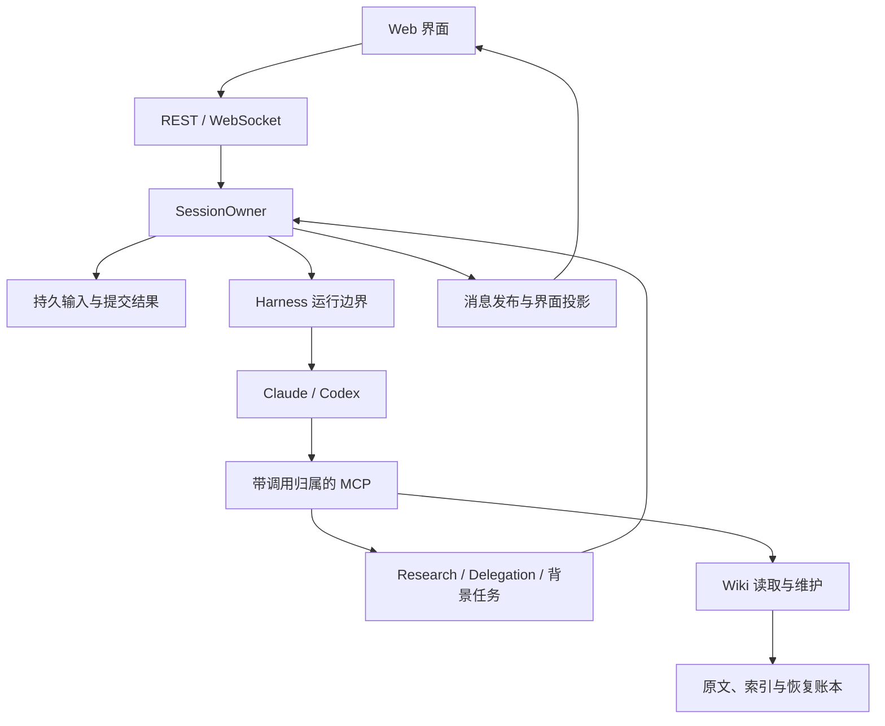

# Octopus 代码审查与 Future Plan：架构、Wiki、缺陷及 DeepSeek Harness 接入

> 审查日期：2026-10-27（北京时间）。  
> 审查对象：Danuvius152/Octopus，`main`，固定提交 `cf98ecb75d1aa741c31292977ac9d83e727d366f`。  
> DeepSeek Harness 参考基线：`22ddee3792402c3e70ec5f86a63c3e3e895a2f60`。  
> 本文是代码审查和实施建议。事实依据来自上述固定源码、现有测试及隔离复现；所有后续工期与方案收益均为估计或待验证目标。

## 阅读结论

**这份代码值得继续演进，整体方向符合软件工程原则；当前最需要解决的是不同子系统对“工作完成”的定义不一致，以及 Harness 接口对单一 CLI 协议的过度假设。建议沿现有框架演进，重点收敛状态与运行接口。**

当前已经具备有价值的基础：SessionOwner 单写者、持久输入和原始提交回执、数据库短事务、独立的结果/通知/资源退休状态、账户与 MCP 调用归属，以及 Wiki 的增量索引和有版本的引用。这些机制解决了具体的并发和恢复问题。真正的简化应减少重复的状态判断、共享可变状态和隐式协议假设，而不是把这些已有保证删掉。[O01] [O02] [O03] [O04]

审查确认了 **5 项实现缺陷**，另有若干明确的能力限制与改进项。优先处理定时会话过早归档、研究任务取消竞争、异常研究叶子被视为成功；随后修复 OAuth 取消/过期校验和 Wiki 已完成取消任务的内存保留。DeepSeek Harness 可以独立接入，并不以 Codex 全面迁移 app-server 为前提。[O05] [O06] [O07] [O08] [O09]

| 维度 | 判断 | 最有价值的下一步 |
| --- | --- | --- |
| 整体架构 | 单进程模块化设计适合当前个人 Agent 平台；关键基础已相当完整 | 沿现有所有者收敛跨子系统生命周期 |
| 是否精简 | 基础机制有理由，部分接口和历史说明仍有重复/耦合 | 减少同一事实的多处判断，避免继续增加 mixin 和状态补丁 |
| 接口扩展性 | Agent、MCP、业务层可复用；运行时接口仍偏向 Claude JSONL/Codex exec | 分离协议、复用、steer 和完成语义 |
| Wiki 效率 | 已有 FTS5、中文分词、增量观察、compact 响应，不是每次搜全盘 | 优化错误状态重复查询、live read 的冗余写，建立端到端成本基线 |
| 正确性 | 定向测试基础较好，但完整功能组合仍有边界遗漏 | 用少量跨模块场景覆盖真实失败路径 |
| DeepSeek 接入 | 可行，有现成官方 SDK wire/ACP/headless 可选 | 沿既有 T0 比较两条强候选，选定一种主协议 |
| 多账户 | 产品数据归属有边界，执行环境仍是可信用户共用 OS 身份 | 文档准确说明；真正多租户隔离另作独立项目 |

---

## 1. 审查范围与验证方法

### 1.1 固定版本，而不是泛读 README

本次取得两个仓库源码，并固定到：

| 仓库 | 分支 / 提交 | 提交时间 |
| --- | --- | --- |
| Octopus | `main` / `cf98ecb75d1aa741c31292977ac9d83e727d366f` | 2026-10-27 00:47:42 +08:00 |
| DeepSeek Harness | `master` / `22ddee3792402c3e70ec5f86a63c3e3e895a2f60` | 2026-10-23 19:48:59 +08:00 |

Octopus 最新提交说明是 `fix(wiki): return maintenance results to the current dispatcher`。DeepSeek 被检查的 headless package 版本为 `0.2.1-rc.3`；Octopus 已有 DeepSeek 计划注明的安装包基线为 `0.2.1-rc.2`，二者不是同一版本。本文按新源码更新判断，不把版本差异直接说成旧文档当时写错。[D01] [O10]

重点覆盖：

- `server/sessions`：提交、执行、问题、广播、资源退休、归档；
- `server/harness`：配置装配、CLI 启动、事件解析、恢复、复用、模型能力；
- Research、Scheduler、Delegation、背景任务与相应数据库边界；
- Wiki 的索引、检索、读取证明、维护任务、取消和引用导航；
- Connector OAuth 与前端会话同步、账户切换、后端选择；
- 现有架构说明和 DeepSeek/Codex 可行性计划。

这不是所有路径的形式化验证，也没有把既有计划中的未实施能力当作当前功能。仓库源文件未作产品改动。

### 1.2 代码规模：用于判断维护成本，不作为质量分数

对固定提交做物理行数统计，包含空行与注释：

| 范围 | 文件数 | 行数 |
| --- | ---: | ---: |
| `server/**/*.py` | 234 | 63,166 |
| 其中 `server/wiki` | 72 | 16,738 |
| 其中 `server/sessions` | 20 | 8,368 |
| 其中 `server/harness` | 17 | 5,818 |
| `tests/**/*.py`（含测试辅助代码） | 373 | 100,812 |
| `web/src` 的 TS/TSX（含测试与生成契约） | 158 | 38,883 |
| 其中生成的 `api/contracts.ts` | 1 | 11,827 |

最长的业务文件包括 `wiki/jobs.py` 1,856 行、`sessions/owner_runtime.py` 1,823 行、`delegations.py` 1,392 行、`sessions/turns.py` 1,386 行。它们提示修改的认知成本较高，却不能单独证明设计错误。把一个共享状态很重的类再拆成更多 mixin，未必降低实际耦合。

### 1.3 证据分级

- **已复现缺陷**：源码调用链明确，并在隔离程序中观察到错误行为；
- **源码确认的能力限制**：可以由实现证明，但未宣称真实模型端到端验证；
- **设计或性能改进项**：存在可定位成本或维护风险，不能等同于已发生故障；
- **Future Plan**：建议的交付、依赖、验收和工期，不是当前代码能力。

后文每一项都按这四类解释，避免把“接口还不支持 DeepSeek”“文件比较长”“我更喜欢另一种写法”混进 bug 清单。

---

## 2. 当前架构是否符合软件工程原则

### 2.1 架构主体是可保留的模块化单体

当前基本关系可以概括为：



这里值得保留的方向是：**产品负责用户、任务、知识库和交付；原生 runtime 负责模型循环与原生工具；Harness 负责两者的接口。** 新后端不应该在产品层重新实现一套会话管理、调度、Wiki 或数据库。[O01] [O02] [O11]

### 2.2 已经做对的部分

#### A. SessionOwner 让可变执行状态有明确的写者

Owner 持有命令队列、问题处理、运行状态和消息发布协作者。外部请求通过命令移交，等待方使用 shield 观察结果，避免浏览器断开连接就取消已经接纳的内部操作。这是具体的所有权设计，不只是把一个类改名为 Owner。[O01]

它的价值尤其体现在：用户中断、问题回答、后端退出、数据库提交和 WebSocket 通知同时发生时，可以追溯是谁决定了状态迁移。

**建议保留这种模型。** 后续修复 Research 时，应让 Research 的终态选择遵守同样的原则，而不是在每一个 await 后添加一遍“现在是不是 cancelled”的检查。

#### B. 结果、记录、通知、资源退出没有被混成一个 done

`RequestCompletion` 明确区分 `outcome`、`recording_state`、`notification_state`，`SubmissionReceipt.wait()` 绑定原始提交。模型回答完成、结果已经提交、发布/订阅路径已确认交付、子进程已经不可能再写文件，是四种不同事实。其中通知路径交付不等于浏览器已确认，更不等于用户已阅读。[O02]

这些字段不能简单合并。可以优化它们的使用接口，但不能因为字段较多就取消语义区分。研究取消竞态恰好说明：当旁路绕开同一完成合同，最终会重新出现互相矛盾的状态。

#### C. 短事务与存储故障边界有明确理由

`Database.transaction()` 持有一个连接上的短事务，禁止同任务递归进入公共事务，显式执行 BEGIN/COMMIT/ROLLBACK；SQLite worker 操作的确认与调用方取消分开处理。在权威写入结果不可确认时进入统一故障出口，比通过反复回读或重新执行有副作用的业务来猜结果更可靠。[O03]

但这不意味着所有异常都应该 fail-stop。参数错误、权限撤销、模型限额、某个研究来源失败，应有局部且确定的结果；只有状态真实性或资源退休无法保证的情形，才需要停止依赖它的工作。当前已有区分基础，后续应继续沿这个边界工作。[O03] [O12]

#### D. MCP 的权限跟随实际执行上下文

装配时的 bearer 携带 session、installation、user、Wiki task、run lease 和 work 关联；人工问答有专门的超时合同。第三后端能否正确接入，取决于是否保留这些信息，而不是能否启动一个可输出文字的命令。[O04]

#### E. 前端已经处理了相当多的真实异步问题

代码已有账户 generation、服务 generation、revision、消息序号和快照合并，防止旧账户响应、旧服务响应或较早快照覆盖新事件。`accountFetch` 还在读取响应正文之后再次检查账户身份。这些机制应围绕真实异步边界保留。[O13] [O14]

本次 89 项定向前端测试通过，涉及会话 store、WebSocket 收据、快照、Wiki 卡片及后端配置页面。不过，这并不证明所有后端组合都正确，Research 与定时归档的缺陷就在跨模块组合中。

### 2.3 还不够精简的地方

#### A. 文件拆分尚未完全变成接口拆分

`SessionManager` 由多个 mixin 组成，方法仍集中挂在同一个对象上。Research、Scheduler 等还能读取 `_run`、`_admission_closed`、`_pending_queue` 等内部状态。对两个后端的适配尚可管理，新增一种跨轮工作时，却很容易漏掉自动归档或回传条件。[O11] [O06]

改进重点应是少量稳定的业务合同：

- 接纳一次输入，并返回原始 receipt；
- 取消一个明确的 work / attempt；
- 读取或等待这个输入的真实结果；
- 保持和释放原回传目的地；
- 判断一个会话是否可以自动归档。

不建议为此建立通用插件总线、跨进程消息队列或新的工作流引擎。

#### B. 不同任务类型重复定义“结束”

主会话要求 terminal result，Research leaf 却可在 EOF 时返回成功；Research 的完成和取消分别修改同一状态；定时会话又把当前 turn 空闲视为可归档。这三者是同一类架构问题的不同表现：**重复维护了完成判断，却没有共享一致的语义。**[O05] [O06] [O07]

优先统一这一小块合同，收益高于继续把某个长文件拆成几个工具模块。

#### C. 静态类型检查的边界还较宽松

当前 mypy 配置全局关闭 `union-attr`、`arg-type`、`misc`，并不检查未标注函数体。因此“mypy 通过”只能说明通过了当前规则，不能称作严格类型安全。[O15]

可行的改进是先把新增 Harness driver、完成结果和命令关联写成明确类型，再逐步把全局豁免缩到具体模块。没有必要全仓切 strict 之后才接 DeepSeek，也不需要只为满足类型工具而重写所有字典映射。

#### D. 部分说明仍在维护历史假设

例如已有 DeepSeek 计划对旧版 SDK 和 headless 输出的说明，与本次固定的新源码存在差异；one-shot 准入回调也已在当前实现中补上。后续方案应更新这些事实，避免按照过期问题再建一层机制。[O10] [O16] [D02]

---

## 3. 已确认的 5 项缺陷

### 3.1 总览

优先级按当前个人平台的实际影响评估。P1 建议在扩展长期自动化和第三后端之前修复；P2 应进入近期修复批次。本次未确认必须立即停止整个安装的 P0。

| 编号 | 优先级 | 缺陷 | 证据类型 | 影响 |
| --- | --- | --- | --- | --- |
| F1 | P1 | 定时父会话在异步研究未结束时自动归档 | 真实 SQLite/Manager，受控研究 pipeline | 研究报告保留，但回传与父 Agent 后续动作中断 |
| F2 | P2 | Research 取消与完成竞争 | 真实数据库更新前插入可控挂起点 | 用户收到 cancelled，随后同作业变 completed 并继续投递 |
| F3 | P2 | Research web leaf 缺少终结证据校验 | 真实 Harness/Codex parser，本地假进程 exit 23 | 异常退出后的文字仍可参加有效核验 |
| F4 | P2 | OAuth callback 接受已取消或本地已过期的登录 | 真实路由/登录管理器，假 provider/storage | 取消后仍可完成绑定；声明的 TTL 未在回调执行 |
| F5 | P2 | Wiki 已完成 cancellation Task 直到 worker stop 才清理 | 现有用例后只读观察 | 长期运行过程中已完成取消条目持续保留 |

### F1：定时会话自动归档遗漏异步研究

**触发场景**

一个 fresh schedule-origin 会话启动异步 Research，当前模型 turn 随后结束，等待研究完成后回传。自动归档判断只检查当前 execution、暂停、队列、fork、归档预留等状态，没有检查已经入场的 Research 回传责任。会话因此从 live sessions 移除。[O05]

**调用链**

1. `scheduler.py` 的 finally 调用 `auto_archive_scheduled_session`；正常 turn idle 路径也会触发它。[O34] [O50]
2. `OwnerRuntime.AutoArchive / FinishAutoArchive` 没有活动研究这一阻挡条件。
3. Research 完成后，`_inject_report` 要求目的会话仍可取得。
4. 原父会话已经不存在于 live manager，投递被明确抑制。[O05] [O06]

隔离复现结果：

```json
{
  "archived_with_research_running": true,
  "parent_available": false,
  "research_status": "completed",
  "injection_status": "failed",
  "error": "delivery suppressed: original request contract is missing, closed or mismatched"
}
```

**影响边界**

这不是研究文件丢失，也不是所有用户会话都会自动归档。问题落在 schedule-origin 父会话：研究结果虽保留，但父 Agent 无法继续汇总或执行依赖研究结果的后续动作。普通 user-origin 会话不走同一自动归档规则。背景任务、委托应做相同组合验收；本次只对 Research 组合做了完整隔离复现，不宣称其他组合已经逐一复现。

**修复建议**

让已入场的异步工作保持原回传目的地的生命周期，直到结果已成功进入目的地队列，或明确终止回传。自动归档应在一个入口判断执行、队列和未结算回传；不要在 Scheduler、Research、BG、Delegation 各自再维护一份 busy 布尔值。

验收场景应是完整链：

`schedule → 启动 research → 当前 turn 结束 → 研究回传 → 父 Agent 汇总 → 归档`。

手动归档的用户意图、任务失败、停止与重启恢复应分别验证，不能简单把所有归档统一改成“永远等待”。

### F2：取消与完成没有共享唯一终态选择

研究 pipeline 返回后，`_complete_report` 由 `complete_cleanup` 保护，外层取消不会停止已经选择的完成写入。与此同时，`cancel()` 独立读取 running，再写 cancelled、广播，最后取消任务。完成路径随后又无条件写 completed。数据库当前更新只有 `WHERE id=?`，没有约束允许的前一状态。[O06] [O17]

复现结果：

```json
{
  "cancel_response": "cancelled",
  "final_status": "completed",
  "injected_after_cancel": true,
  "events": ["research_started", "research_failed", "research_completed"]
}
```

这里的“继续投递”通过替换投递函数为观察器确认，未调用真实父模型。复现中的挂起点位于完成更新进入真实数据库之前，模拟实际 I/O 等待。

**两种合同都可以接受：**

- 完成先取得终态，取消返回已经完成、无法取消；
- 取消先取得终态，完成不得覆盖，也不得继续触发报告投递。

目前的问题是先明确确认取消，再明确确认成功。

**修复建议**

由同一 owner 决定终态，并通过带前置状态的事务迁移保存结果、返回真正的胜出状态。只允许已确认的 completed 触发投递。不应在两个独立写路径上各自增加多次状态回读，或新增一个“可能取消了”的旁路标志。

### F3：研究 web leaf 把异常 EOF 当作成功

`run_web_leaf` 收集文本，并在看到 error event 或错误 result 时设置 error；它没有要求至少收到一个有效 terminal result。`HarnessRun` 可以在 stdout EOF 时结束 stream，所以“异步迭代结束”不等于成功。[O07] [O18]

使用真实 Harness 和 Codex 事件解析器，让本地 Python 进程输出格式正确的 agent_message，然后 exit 23，不发送 `turn.completed`，得到：

```json
{
  "provider_exit": 23,
  "terminal_event": false,
  "leaf_result": {
    "text": "{\"verified\":true,\"refuted\":false,\"note\":\"Checked\"}",
    "cost": null,
    "error": null
  }
}
```

核验逻辑会使用 error 为空且可解析的 verdict，因此这类没有完整执行证据的结果可能进入有效投票。这里不能推断真实答案一定错误，但系统确实缺少支持“成功核验”的终结证据。[O19]

**修复建议**

让 leaf 复用最小的标准终结合同：缺少有效成功 terminal 时，EOF 或非零退出必须得到明确失败结果；协议记录不完整需要显式标记，并按明确策略排除相应核验票。已经确认的业务结果与随后发生的资源回收失败应分开记录，有效 terminal 后的正常 EOF 不应再次判失败。保留 partial text 用于诊断，但不能仅凭它生成成功结果或有效验证票。无需复制主会话整套重试状态机。

### F4：OAuth 取消与过期状态没有在回调准入中执行

`ConnectorLoginManager.resolve_callback` 只校验 login id 和 state，没有检查：

- 登录是否仍为 pending；
- 是否超过 15 分钟 TTL；
- 是否已被其他回调领取或已完成。

`cancel()` 只是把 status 写成 cancelled；清理过期记录只在下一次 start 时触发。因此取消旧登录后，若用户仍在原 provider 窗口完成授权，回调仍可执行 token exchange 和 complete_install。[O08] [O35]

本次用真实 callback 路由逻辑、假 provider 和假存储调用计数复现，没有实际连接外部账号：

```json
{"case":"cancelled","before":"cancelled","after":"success","exchange_calls":1,"complete_install_calls":1,"connected_page":true}
{"case":"expired_without_another_start","before":"pending","after":"success","exchange_calls":1,"complete_install_calls":1,"connected_page":true}
```

第二条证明本地 TTL 没有被执行；真实 provider 的授权码可能另有较短有效期，因此不能夸大成“任何过期授权码都能兑换”。

**修复建议**

在同一个登录管理入口验证 TTL 和状态并领取 pending callback，使取消、回调和完成遵守一套有限状态迁移。被取消/过期/已消费的登录直接返回对应失败结果，不能继续交换 token。并发回调也应只有一个拥有者。无需建立新的 OAuth 服务或复杂分布式锁。

### F5：Wiki cancellation map 长期保留已完成 Task

`WikiWorker.cancellations` 是类级字典，键是 state、job、attempt；`cancel_attempt` 创建 Task 后写入。完成回调只读取并记录异常，没有移除已完成条目，清理目前集中在 `worker.stop()`。[O09]

运行两条现有取消所有权用例，并在结束后只读观察：

| 观察点 | 字典条目 | 已完成 Task |
| --- | ---: | ---: |
| 第一个用例结束后 | 1 | 1 |
| 第二个用例结束后 | 2 | 2 |

两项原用例仍通过。这里能够确认的是已完成条目累积；没有测量生产环境的内存增幅，也没有证据宣称已经导致 OOM。失败 Task 还可能通过 traceback 保留额外对象，这是需要控制的保留路径。

**修复建议**

原取消责任已完成并持久结算后，释放对应 Task 引用；重入/重试通过现有 attempt 和持久 settlement 判断。未确认退休的操作仍必须保留其 owner，不能为清理内存直接删除正在进行或尚需恢复的执行证据。避免再增加一个永久完成 Task 缓存或新的影子状态表。

---

## 4. 必须与 bug 分开的能力边界

### 4.1 Codex 尚未迁移为完整 app-server 主执行

当前主执行仍是 `codex exec --json`。`codex_control.py` 会在恢复前短暂使用 app-server 更新 controller/developer instructions，随后关闭；这不等于完整的双向运行控制已经接入。[O20] [O21]

当前收到 `turn.completed` 即产生 result，不可复用的 exec 随后退休。原生 subagent 卡片是事件展示，不能单独证明“父答复之后继续等子任务，最后唤醒父模型汇总”的交付保证。源码自己的工具说明也要求父模型在同一 turn 收齐子任务结果。[O22] [O51] [O52] [O53]

这应明确写进支持范围。若要达到完整尾部交付目标，应在协议中区分：

- 正文已可展示；
- 当前原生 turn 结束；
- 受管后代与后续父汇总已经结束；
- 资源可以退休。

但不能据此认定“一次运行 CLI 必定不支持后代收尾”：DeepSeek headless 自身就有受管后代等待逻辑。最终要读具体协议和 runner 语义，不能只看进程是否一次性启动。[D03]

### 4.2 多账户目前是产品数据归属隔离，非 OS 执行沙箱

README 的“fully isolated”容易使人理解成安全多租户；实际两个主要 CLI 使用 bypass/skip permission 模式，同一 OS 身份下运行。仓库自己的 multi-tenancy 设计文档明确选择了 Level A：适合相互信任的人共用安装，不构成恶意租户之间的安全边界。[O23] [O20] [O54]

这不是本次新发现的未记录漏洞，也不要求为了个人使用立即上容器。建议准确收敛产品说明。只有当部署目标变成不互信用户或公开托管服务，才启动独立的 OS 身份/容器/网络隔离项目。`DSH_HOME` 的分离同样只提供配置和数据归属，不能替代执行沙箱。

### 4.3 Research 模型选择与会话选择的关系需要产品定义

Research 目前读取 agent model，普通 turn 有会话 override 与有效设置合并；Research 是否应该继承当前会话的 model/effort/tier，需要明确。已有设计使用 agent model，因此本次不把它列成已确认 bug。[O24]

DeepSeek 接入时应确定一条可解释规则：沿用当前会话的有效设置，或者提供独立且明确的 Research 配置。避免第三后端再新增隐式例外。

---

## 5. Wiki：当前效率与正确性评价

### 5.1 已有设计比“搜文件后塞给模型”完整得多

当前 Wiki 的主要组成是：

1. 原始文件和管理笔记；
2. 文件身份、revision 和来源关系；
3. Markdown/HTML 等解析投影与分段；
4. SQLite FTS5 检索、中文分词与字符组合；
5. compact 导航、片段和后续精确读取；
6. 基于实际读取内容与版本的维护授权；
7. 文件效果历史、job、event inbox/outbox 和恢复记录。

因此，文件名为 `index.sqlite3` 不意味着其中所有数据都可随意删除重建。里面既有可重建索引，也有维持维护和恢复正确性的持久记录。优化之前必须分清事实来源。[O25] [O26]

### 5.2 检索路径做对了什么

**正常查询走索引。** 文件变更由观察与同步路径维护；查询不需要每次重新递归扫描和解析全部原文。本次小样本暖缓存探针中，search 没有再次读取原文文件；SQLite 自身仍会读取索引，这是正常 I/O。[O25]

后台仍有周期性 reconcile，会遍历目录并检查文件变化；它与用户查询是两种成本。大库评估应单独记录后台 stat/扫描规模、索引延迟及前台尾延迟，再决定是否需要更好的忽略目录和分批调度。[O42]

**中文检索已有明确处理。** 使用 jieba、规范化和中文连续 bigram 等词项机制，配合 FTS5；不是单靠英文空格分词，也不是向量检索。[O27]

**导航与事实阅读分开。** compact 返回身份、revision、路径、标题、短摘要与有限片段，并标明 indexed freshness；要做更强结论或写入，仍需读取实际版本。这同时控制模型输入体积和来源错误。[O28]

compact 已限制描述与片段长度，read 响应也有 32 KiB UTF-8 封包预算和真实 continuation。字符、UTF-8 字节、模型 tokens 是不同指标，不能据此直接换算出 token 节省比例。[O28] [O40]

**检索意图有差异。** lookup、question、overview、compare 的选择逻辑不同，精确 doc id/path/UID 优先解析，避免已退役或被过滤的身份被同名标题误替代。cursor 绑定过滤条件和 index epoch，索引变化时显式要求重新分页。[O28]

这些应保留，不建议先换成外部向量数据库再重新补正确性。

### 5.3 已实测的效率边界

本次做的是成本探针与 SQL 路径验证，**没有可靠的生产 P95、真实数据集 Recall@k 或模型 token 节省百分比**。

| 检查 | 观察结果 | 正确解释 |
| --- | --- | --- |
| 暖缓存 search | 探针记录的原文文件读取为 0 | 支持“正常查询不重读全部原文”，不能推成零磁盘 I/O |
| `read(length=1)` | 示例原文 1,544 字节仍被完整读取/哈希 | 返回一字符不代表只读一字符；live revision 需要真实内容证明 |
| 同一次 search 的 index state | 两次错误数量查询、两次错误记录枚举 | 存在重复工作，可把 epoch 与完整健康摘要分开 |
| SQL EXPLAIN | 错误状态查询使用 `maintenance_document_errors` 部分索引 | **不是每次普通搜索对全部 N 篇做 metadata 全表扫描** |
| 短 live read 的数据库操作 | 仍有 identity、raw_materials、documents signature 写 | 应评估不变版本的冗余写，不应取消读取真实性验证 |
| `C++` / `C#` / `C` 查询 | 均产生词项 `c`；三份相关样例都会召回，精确标题仍排第一 | 技术标识符区分度存在边界，不能说 C++ 搜不到 |
| 取消任务 owner | 完成条目直到 stop 清理 | 属于 F5 的长期保留问题，不是已测 OOM |

### 5.4 优先优化点

#### A. 分页只取 epoch，不顺便构造完整错误清单

`pagination()` 为取 `index_epoch` 调用 `_index_state()`；search 末尾又取一次完整状态。`_index_state()` 会计算错误统计并加载错误行，compact 随后才缩减展示。可以让分页读取最小 epoch 字段，结果头仅生成一次摘要。[O28] [O29]

错误记录查询已有部分索引，成本主要随错误数量 E 而变，不能写成对全部文档数 N 的线性扫描。若要进一步只取前三条错误，应保留真实总数和“更多错误”的入口，避免把截断列表当完整健康状态。

#### B. 保留 live bytes 校验，减少无变化的写回

读取同一版本时，数据库 identity/material/signature 的重复写可以评估为条件更新或在明确版本未变化时跳过。权衡是：不能只用可能落后的索引或 mtime 替代必要的原文确认；对引用、授权和维护而言，当前内容真实性更重要。[O30]

此外，`location` 分支先后调用两次 `store.read`，可以在同一次请求内复用已经核验的快照，再根据位置裁出最终片段。这是静态调用路径确认，本次没有专门测量双读耗时。现有 `batch_read` 已有请求内缓存、区间合并、文档/字符预算和同版本已送达片段复用，应沿这些机制优化。[O38] [O39]

建议分别测：

- 文档实际读取字节；
- 全文 hash 次数；
- SQL 写事务数和 WAL 增量；
- 索引命中到最终回答的总耗时；
- 模型最终使用的正文与片段长度。

不要用“返回长度更短”作为主机侧成本已经降低的证据。

#### C. 先用查询集定位召回失败，再决定是否加入向量

FTS 对明确术语、文档名、代码标识符通常很合适；同义改写、跨语言概念、表达差异较大的问题值得单独评估。代码结构说明了能力范围，不能直接给出生产召回率。

可建立一个小而稳定的个人知识库评测集，覆盖：

| 查询类 | 示例 | 主要验收 |
| --- | --- | --- |
| 精确定位 | doc id、路径、标题、UID | 身份正确率、歧义处理 |
| 技术词 | `codex app-server`、`SessionOwner`、含横线/下划线的标识符 | 分词后是否保留可检索词项 |
| 中文术语 | 所有权、回传、取消、事实来源 | Recall@k 和排序 |
| 语义改写 | “不要重复执行已经提交的操作” | 能否找到事务与恢复资料 |
| 跨语言 | 中文问英文原文 | 是否需要 query expansion 或 embedding |
| 多文档对比 | 两种架构的取舍 | 覆盖不同来源，避免重复同源片段 |
| 版本/删除/移动 | 引用对应内容已修改 | 是否拒绝冒用旧定位并给出可恢复反馈 |

只有确认语义召回是主要瓶颈后，再试同义词扩展、轻量 rerank 或 FTS+embedding 混合召回。新增向量应仍以现有 doc id/revision 为身份，沿已有更新和失效路径维护，不能成为另一套来源真相。

建议第一批准备 100–300 条独立真实查询，固定语料 revision，并人工标注相关文档/段落。分别测 Recall@5/10、MRR/nDCG、无答案误召回、冷/暖 P50/P95、实际文件读取与 SQL 写入、索引延迟，以及真实 provider usage。这个规模是实施建议，本次并未取得或标注这份查询集。

### 5.5 Wiki 的总体判断

**现阶段最适合保留 SQLite 和现有增量机制，在真实成本与召回证据上做局部改进。** 主要收益来自：减少重复健康摘要和不变版本写入、控制返回预算、提高检索意图匹配、完善引用导航，以及修复长期任务引用保留。直接引入独立向量服务、Redis 或大而全知识图谱，目前没有本次测量支持。

---

## 6. 接口扩展性：哪里已经好，哪里会卡住第三后端

### 6.1 已有可复用接口

`RuntimeProfile` 把 argv、事件解析、凭据形式、模型能力、fork/login 等差异集中起来；业务通过 `get_harness` 解析后端。对于当前两种 CLI，这是合理的组合设计，优于复制完整 SessionManager。[O31]

Agent、调度、MCP、Wiki、业务 receipt 和数据库的很多代码不需要知道模型属于哪一家，这使第三后端接入具备现实可行性。

### 6.2 现有抽象里隐藏了三个不同问题

目前 `StdinMode.STREAM_JSON` 同时意味着：

1. stdin 接收某种消息；
2. 输入帧就是 Claude 风格的 `type/user/uuid/message`；
3. 进程可以跨 turn 复用，且产品宣称支持 can_steer。

`send_user_frame`、`reusable` 和 `session_info.can_steer` 分别把这些关系写进代码。SDK/ACP 虽然也使用 JSON 行，却不能直接使用同样的用户帧，更不自动意味着“正在执行的输入被 steer”。[O32] [O43]

**这是接入 DeepSeek 最关键的公共接口改进点。**

建议让 Profile 选择一个小型协议协作者，处理真实的握手、请求、通知和 server request；公共启动层继续拥有 subprocess、授权、lease 和退出确认。能力分别表达：

| 能力 | 应回答的问题 |
| --- | --- |
| 原生历史恢复 | 新进程能否恢复同一个原生 session |
| 同进程复用 | 前一请求结束后，能否继续使用当前宿主 |
| 忙时输入 | 是立即 steer、原生 inbox 排队，还是只允许外部排队 |
| 取消 | 停某个请求、某个 session，还是整个独占宿主 |
| 完成边界 | 一个 turn、root idle，还是受管后代与父后续汇总均结束 |
| 历史分叉 | 原生 fork、文本 replay，或不支持 |
| 工具限制 | 能否在实际执行层拒绝被禁止工具 |

字段可以保持少量而明确；无需预先设计几十个从未有调用方的能力开关。

### 6.3 UI 仍然有“双后端”假设

当前 enum、配置 Literal、部分页面后端列表和显示三元表达式都只认识 Claude/Codex；第三后端必须同步更新。特别是 `Claude Code : Codex` 这样的显示逻辑，会把新后端误标为 Codex；effort 控件也存在 `backend === "codex"` 分支。[O33] [O44]

这不是当前只有两个后端时的功能 bug，也不意味着每个 enum 都违反开闭原则。应在增加第三个后端的交付内，把可展示元数据和实际支持的模型设置来源收敛到服务器；可以继续保持有版本的明确 BackendKind，不必立即建立动态插件市场。

## 7. DeepSeek Harness：可行性、选型与建议接法

### 7.1 接入目标与责任边界

**建议接入，定位为第三个 Agent runtime 后端。** “调用 DeepSeek 模型 API”和“接入 DeepSeek Harness”不是同一项工作：后者还包括模型循环、原生工具、原生子代理、历史持久化、取消、人工问答和运行资源。

Octopus 继续负责账户、Agent 配置、请求排队、提交回执、Wiki、调度、跨 Agent 委托与界面；DeepSeek Harness 负责它自己的模型执行和原生 Session。适配层负责把两边的身份、指令、工具和执行结果准确连接起来。

本次固定源码已有 `web`、`headless`、`sdk`、`sdk-minimal`、`acp` profiles，官方 Python/TypeScript SDK 也已存在。SDK 和 ACP 的主要执行接口是 **stdio 上的双向 JSON-RPC**，不需要另外发明一个 `dsh app-server` HTTP 服务。[D04] [D05]

### 7.2 三条官方路径的实际取舍

| 维度 | Headless JSON | SDK 原生 wire | ACP |
| --- | --- | --- | --- |
| 请求接纳 | 每进程运行一个任务，可恢复精确 Session | `session/prompt` 返回持久消息的 messageId | `session/prompt` 响应在活动区间结算后返回 |
| 完成边界 | runner 已等待受管后代与父后续活动 | 必须调用 `session/wait`，不能仅看 root idle | prompt 会等待受管后代，并保证更新先于响应 |
| 原始结果分类 | rc.3 的 final 有 reason | 原始 Session event 保留 `turn/end.reason` | blocked/aborted 折叠成 end_turn；error 另行抛错 |
| 取消方式 | 关闭或终止独占进程 | 无单独 session cancel/close；有 shutdown | 有 session cancel/close |
| 原生人机交互 | 不适合实时 native approval；可验证 Octopus MCP ask | 有 approval 与 user-question 桥，但覆盖范围不同 | 有 request_permission，不能替代一般问答 |
| 事件与子代理展示 | 提交后文本/思考和工具的有限投影 | 原始事件、status 与本地子代理通知较完整 | 根文本/思考、工具与配置更新；缺少同等子代理通知 |
| MCP 配置 | profile patch | profile patch | 可传标准 mcpServers，但会丢 Octopus 每条 MCP entry 的调用超时 |
| 当前主要代价 | 中间投影的边界、身份及聚合 | 双向 RPC、显式 wait、独占宿主退休 | timeout、原始 reason 和原生 UI 信息缺口 |

表中“受管后代”仅指该 runtime 实际拥有并等待的工作，不保证任意 shell 中自行脱离的后台进程。SDK 的子代理通知也有本地范围限制，不能宣传成所有 remote provider 子任务的完整事件流。[D03] [D06] [D07] [D08] [D09] [D10]

**选型建议：以“SDK 原生 wire + 每 attempt 一个受管 DSH 进程”为优先候选，保留 ACP 作为 T0 对照。** 这是源码审查后的推荐，尚未通过真实 DSH 联调。若 ACP 在目标发行版已解决原始 reason 和 MCP 超时传递，可以重新比较适配代价。选定后保持一条主执行路径，协议失效时明确失败，避免运行中换协议后重复执行已经接纳的工具任务。

Headless 可以作为受限批处理候选；新版 final 已有完整正文与 reason，不能再引用旧版“final 只有 text”的结论。不过它仍不自然提供完整的双向控制与消息身份，第一版完整产品接入优先比较 SDK/ACP。[D11]

### 7.3 四个必须在选型时解决的具体问题

#### A. Python Session.run 返回，不代表所有原生后代都已收尾

当前 Python 高层 `Session.run()` 在确认自己的 inbox receipt 后，遇到第一次根 Agent 的 idle 就返回；它没有替调用方执行 wire 的 `session/wait`。根 Agent 可能先 idle，之后又收到子代理结果并继续汇总。[D12]

SDK server 的 `wait` 则明确执行：

1. 等根 Agent idle；
2. 记录当时 Session 序号；
3. 等待受管子代理；
4. 再确认根仍 idle 且序号未变；
5. 将响应放在期间的 Session 通知之后。[D07]

因此适配器应在 prompt 前开始接收事件，以 prompt receipt 确认入场，再通过 wait 和本次根终态决定完成。界面可提早显示正文，业务完成必须使用更强的边界。子代理的答案不应覆盖父 Agent 的最终回答。

#### B. 直接把官方同步 SDK 放入 to_thread，会引入两个进程管理者

官方 Python SDK 的 `HarnessClient.start()` 自己调用 `subprocess.Popen`，继承并修改环境变量；close 自己执行 shutdown/terminate/kill。这适合独立 SDK 使用，但不认识 Octopus 的 `authorize_spawn`、run lease、work revoke 和原始进程组。[D13]

简单用 `asyncio.to_thread(Session.run)` 包装，取消外层 await 并不能证明线程和进程已停止。建议保留 Octopus 现有资源 owner，由它启动 DSH，再由小型异步 driver 处理 wire。若未来使用官方库，应有一个公开、明确的唯一资源拥有者方案；不要通过 SDK 私有字段拼接进程控制。

#### C. ACP 的默认 MCP 超时会改变 Octopus 的人工问答合同

Octopus 为 MCP ask 设定 `host_timeout + 60` 的工具超时；无限 host 等待也有明确表示。DSH 当前 ACP 的 mcpServers 映射没有保留这个字段，底层 MCP client 默认 `60_000 ms`，并把它实际应用到工具调用。[O04] [D14] [D15] [D16]

所以仅把 URL 和 bearer 填入 ACP mcpServers，仍可能使等待用户超过一分钟的问题提前失败。

可接受的实现有：

- 独占宿主通过受管 profile patch 直接挂载 MCP，并传入准确的 `toolCallTimeoutMs`；ACP new/resume 不再重复挂载这些条目；
- 为 ACP 桥维护一个明确的超时配置扩展；
- 选择 SDK wire，同样通过受控 patch 保留超时。

应在 T0 用“超过一分钟后用户仍能回答”验证整条路径，并检查取消后晚答案不会进入下一次工作。

#### D. ACP 的 end_turn 丢失一部分原始终态

ACP codec 将 `completed`、`aborted`、`blocked` 映射成 `end_turn`。外层会对 error 另行抛错，但 aborted/blocked 仍无法单靠标准响应区分。[D17] [D09]

如果 Octopus 需要对委托、应用任务与普通会话保留这些状态，必须通过受控扩展取得原始 reason，或者选 SDK wire。不能把所有 end_turn 都当作“原生成功完成”，也不能根据回答文字猜结果。

### 7.4 建议的最小完整运行流程

下面是待实施设计，不是当前仓库已有的 DeepSeek API：

1. **捕获归属。** 固定本次 user、agent、session、request、attempt、work、credential、Wiki task 和 connector installations。
2. **复用装配。** 由现有 assembly 生成稳定 controller、当轮规则、MCP entries 和工具限制。
3. **准备受管资源。** 公共启动层创建私有 patch、受控环境和账户私有 `DSH_HOME`；所有异步准备后，在真实 spawn 前执行准入授权。
4. **启动并握手。** 唯一执行 owner 启动 `dsh --profile sdk --patch <owned-file>`，持续读取 stdout/stderr，完成 initialize。
5. **接纳原生输入。** 恢复精确 native Session，或创建新 Session；订阅先于 prompt。异步握手/恢复后、发送 prompt 前，仍由原 owner 确认本 attempt 未被 Stop 或撤权。messageId 只记录“已经接纳”，不等于完成。
6. **收集完整结果。** driver 按 request id 关联响应，处理 notification/server request，调用 wait；分开根消息、工具调用和子代理事件。
7. **提交一次终态。** 依据本次根事件区间与真实 reason 形成标准结果，交给现有 Owner 持久化和发布。
8. **撤权并确认资源退出。** 进入 Stop/退休时，先关闭新工作准入并撤销原执行 lease；保留原始资源句柄，完成 shutdown/取消与进程组回收。确认退出后，再释放 patch 和资源句柄。授权撤销与资源回收是不同阶段。
9. **后续输入排队。** 第一阶段继续由 Octopus 排队；SDK 的 inbox 接纳能力不直接标成产品的 mid-turn steer。

公共 Harness 接口保留；driver 不创建第二个 SessionManager，也不维护另一套业务队列。读取 stdout 的责任只有一个，避免 parser 与 RPC client 竞争消费同一条流。

`每 attempt 一个宿主` 在这里有实际好处：SDK 缺少 per-session cancel 时，停止独占进程不会误停其他会话；每次身份、凭据和 Wiki 模式变化也容易准确捕获。代价是冷启动和 resume 成本，应先测量，再决定是否做每会话复用。暂不建议跨账户或跨 Session 的共享进程池。

### 7.5 配置桥必须保留的合同

| 项目 | 必须做到 | 验收重点 |
| --- | --- | --- |
| 凭据与 home | 每账户配置/历史目录明确；控制环境与 credential store 优先级 | 两账户互换 key、恢复会话、退出后无秘密留在日志 |
| system prompt | 区分稳定 persona 与每轮规则；保持字面文本 | prompt 中的 `{{x}}` 不被意外模板展开 |
| MCP | 保留每条 entry 的 bearer、installation、timeout 与 scope | 两个 connector 权限不合并，撤权后旧调用不能继续 |
| Wiki | 复用现有 run/task、mode、revision、read proof 与维护回执 | 读/维护模式切换，旧 revision、旧 generation 明确失败 |
| memory | 继续使用 Octopus 的 canonical Agent memory | 恢复后仍指向同一授权目录 |
| 工具限制 | 普通 turn、tool-free oneshot、web-only research leaf 分开配置 | 模型强行请求禁用工具时，执行层拒绝且无副作用 |
| 原生问答 | 区分 permission approval 与一般用户问题 | SDK native questions 当前仅 owned roots；子代理路径另验 |
| 原生子代理 | 使用 DSH 自己的工具/事件，但保留父子归属 | 父先答、子后完、父再汇总，不提前完成 |
| 模型设置 | model/effort 由真实能力驱动，tier 无支持就不显示 | resume 后新设置实际到达执行端 |
| 历史与 fork | 精确 resume；replay 与 native fork 分开标示 | 历史缺失直接反馈，不能静默启动空历史 |
| 调度与持久副作用 | Octopus 仍为产品调度的权威入口 | 默认 profile 不激活另一套无归属的提醒/自主工作 |
| usage/cost | 保留 runtime 实际报告值与缺失状态 | 不把缺失 usage 显示成 0，也不固定未知价格 |

DSH 当前 SDK 的 approval 桥可覆盖其拥有的同进程后代，而 native user-question 桥明确针对 owned roots；不能把两者覆盖范围混为一谈。full SDK/profile 可能读取 home 中的 credential/settings，也不能仅设置 API key 就假定其他凭据来源已失效。[D18] [D19]

`DSH_HOME` 分离提供数据与配置归属，不提供 OS 文件沙箱。沿当前可信多账户部署模式即可实施；如果产品目标升级为不互信用户托管，需要另外落实执行隔离。

### 7.6 预计改动面

| 位置 | 建议改动 | 控制范围 |
| --- | --- | --- |
| `server/harness/profile.py`、`run.py` | 分离协议、资源持有、复用与 steer 能力 | 现有 Claude/Codex 通过相同 public Harness 继续工作 |
| `server/harness/deepseek.py`（新增）及必要的小型 driver | DSH 配置、wire 事件/错误映射、准确 completion | 不复制整个 HarnessRun |
| harness registry / 初始化 | 注册第三 backend | 保持显式类型和受控注册 |
| `server/models.py`、`config.py` | 增加 backend、home 与必要设置 | 不做任意字符串后端或无限配置透传 |
| 现有 credential / model settings 模块 | 接入凭据形式、私有目录、有效设置 | 复用账户授权，补齐 one-shot 的 owner 身份 |
| HarnessPage / AgentFormPage / Session UI | 服务器能力元数据、登录/可用性、模型控件与准确名称 | 避免第三后端落入默认 Codex 分支 |
| 现有运行监控 | 识别 DSH 进程与当前 work | 继续引用原资源 owner，不反向用进程名猜归属 |
| 业务回归与协议 fixtures | 普通 turn、oneshot、leaf、delegation、schedule、BG、应用 | 每条验证真实业务合同，避免只测字段拷贝 |

其中 `OneShotContext.authorize_spawn` 和 `Harness.run_oneshot` 的准入回调已经存在，实施时应复用。尚需解决的是 DeepSeek 的 owner/home 等信息如何贯通，不能再把“增加 authorize_spawn”当作缺失功能重复实现。[O16] [O47]

### 7.7 更新现有 DeepSeek 计划，而不是另写一份互相冲突的规格

建议直接维护 `docs/plans/deepseek-harness-backend.md`：

- 把实施基线锁定到实际可安装、已验证的发行版本；本报告的 rc.3 源码不自动代表已安装包。
- 更新 SDK 原生审批/问答矩阵，标出后代覆盖差异。
- 更新 headless final 的 `sessionId/reason/text`。
- 删除“one-shot 尚无准入回调”的过期判断。
- 把 ACP timeout、reason 分类和 SDK wait 放入 T0 的必测项目。
- 明确 UI 的 reuse/steer/fork 能力与协议类型分离。
- 将 SDK wire 独占宿主作为强候选，保留“选择一种主协议”的决策纪律。[O10] [D11] [D18]

本次没有安装或运行 DSH，没有真实 DeepSeek 请求，也没有给出联调已通过的结论。

---

## 8. Future Plan：建议顺序、可加功能与可行性

### 8.1 推荐交付顺序

优先顺序按用户影响、已有基础和扩展成本判断。工期均为熟悉当前代码的开发者的**粗略人日估计**，不是项目承诺，不包含外部账号等待和未知平台故障；并行阶段的人日不能直接当日历天数相加。

| 顺序 | 交付 | 可行性 | 完成标准 | 估计 |
| --- | --- | --- | --- | --- |
| 第 1 批 | 修复本文 F1–F5 | 高，位置已明确 | 五条复现不再出现，同时保留 receipt、退休与 read proof 合同 | 3–6 人日 |
| P1 | 生命周期接口收敛 | 高，但须局部推进 | 自动归档与异步回传只在一个合同里判断；终态只有一个决定者 | 随修复实施，额外 2–4 人日上限供规划 |
| P1 | DSH T0 选型 | 高，需目标发行包与假 provider | 原始 reason、后代收尾、Stop、ask 超时、resume 全部取得证据 | 2–4 人日 |
| P1 | DSH 公共接缝、后端与业务贯通 | 中高，主要风险已定位 | 见 8.2 与 8.3 | T0 在内共 12–21 人日 |
| P1，可并行 | Wiki 读路径精简 | 高 | 只读 epoch、错误摘要有界、无变化写减少、location 单次快照 | 3–5 人日 |
| P2 | Wiki 真实检索基线 | 高，依赖授权语料与标注 | 固定语料/query gold、Recall/延迟/成本指标可重跑 | 工具 2–4 人日，另计标注 |
| P2 | 统一/扩展跨 App 引用跳转与当前文档/选区提问，补齐标签筛选 | 中高 | doc/revision/location 合同统一，过滤/分页/权限正确 | 4–8 人日 |
| P2，独立项目 | Codex app-server 主执行迁移 | 中，需专门核实原生完成与取消 | 父子收尾、请求关联、原生状态和资源退出完整 | 先做 2–3 人日可行性验证，再定实现 |
| 条件触发 | DSH 每会话复用、混合语义检索、PDF、执行隔离 | 见下表 | 有相应性能、检索或部署需求证据 | 分别评估，暂不捆绑 |

路线图的交付顺序与缺陷严重度分开管理：第一批修复仍保留 F1 的 P1 与 F2–F5 的 P2 标签。

### 8.2 DeepSeek 的完整交付拆分

| 阶段 | 交付 | 验收 | 估计 |
| --- | --- | --- | --- |
| D0 | 固定版本，比较 ACP/SDK wire，修订现有方案 | 四个集成陷阱都得到协议证据；选出一种主路径 | 2–4 人日 |
| D1 | 小型 protocol driver 与公共资源 owner 接缝 | Claude/Codex 不回归；准备/启动/停止均不丢原资源 | 3–5 人日 |
| D2 | DeepSeek 普通会话完整链 | 凭据→新建/恢复→工具→人工问题→继续→Stop→重启恢复 | 4–7 人日 |
| D3 | 跨业务贯通和错误处理 | delegation、BG、application、schedule、research、oneshot 使用同一合同 | 3–5 人日 |
| D4，可选 | 基于实测优化复用与原生子卡片 | 冷启动 P95/RSS 有收益，授权更新与资源退休仍正确 | 额外 3–6 人日 |

第一版完整第三后端的估计为 **12–21 人日**。单纯启动 DSH 并显示一句回复可以更快，但不构成本仓库需要的完整后端交付。Codex 主协议迁移不必与它绑定；可共享双向传输和能力元数据的改进。

### 8.3 DeepSeek 验收的十条关键场景

这些是实施验收建议，不是本次已运行的测试：

1. **接纳不确定性：** prompt 已发出而回复丢失，不能自动按“未发送”重试有副作用任务。
2. **真实尾部完成：** 父先出正文、子继续、父再汇总，只有正确边界产生 completion。
3. **失败分类：** blocked、aborted、max-tokens、error、无 terminal 的 EOF，不因存在正文就全部成功。
4. **全阶段 Stop：** 初始化、入队、模型运行、MCP ask、子代理、shutdown 时停止，原宿主确实退出。
5. **人工等待：** ask 超过 60 秒仍可回答；取消后的晚答案不能影响下一代工作。
6. **权限与身份：** 两账户、两个 connector、不同 Wiki mode 的 bearer/home/tool scope 不混用。
7. **恢复与设置：** resume 后 history 保留，新的 persona、Wiki 规则、model/effort 和 credential 实际生效。
8. **消息完整性：** 长正文、两条内容相同但身份不同的消息、先回答后失败，都按真实事件处理。
9. **工具实际限制：** tool-free oneshot 与 web-only leaf 强行请求被禁止工具时，外部副作用为零。
10. **精确历史：** 重启使用准确 native id；历史不存在或读取失败时明确报错，不静默开新对话。

固定协议 fixtures、受控 fake-provider integration tests 与少量真实 smoke 足以覆盖这些风险。不要仅用“能聊天”和“页面显示 deepseek”作为验收。

### 8.4 后续可增加什么，哪些值得先做

| 功能 | 用户价值 | 可行性 / 依赖 | 建议 |
| --- | --- | --- | --- |
| 统一并扩展跨 App 引用跳转、当前文档/选区提问合同 | 让答案与原文之间可核查、可继续操作 | 高；已有导航与位置解析基础，需统一 location 与 Unicode offset | 优先 |
| 标签 all/any + 目录交集 + counts | 管理中型个人知识库更直接 | 高；已有 tags 索引，仍需 API/UI 过滤契约 | 优先 |
| 任务诊断时间线 | 看清提交、执行、记录、通知、退休卡在哪 | 高；复用 request/work/attempt/receipt 事件 | 优先做可解释状态，不另建一套任务账本 |
| Sapphire / SmartReader 等受限 Wiki 客户端 | 同一知识库被不同阅读/写作流程使用 | 中；需真实 client capability、账户授权与撤权合同 | 在引用合同之后；不能只放宽 app_id 相等检查 |
| FTS + 语义召回 / 轻量 rerank | 改善同义改写与跨语言检索 | 中；必须先有独立 gold 和成本数据 | 检索基准证明收益后再做 |
| PDF 入库与页码证据 | 支持论文、报告等非 Markdown 内容 | 中；需抽取版本、页码、阅读顺序与原件身份 | 独立切片，不沿用 Markdown offset 冒充完成 |
| DSH 每会话复用 | 降低重复启动成本 | 中；需更新 bearer、credential、Wiki mode 与设置 | 冷启动实测成为瓶颈后再做 |
| 原生子代理卡片增强 | 更易理解长任务和父子关系 | 中；协议必须提供真实 edge/message/tool id | SDK 主链稳定后做，不靠文本猜测 |
| 公开多租户部署 | 服务更多不互信用户 | 低至中；需 OS/容器/网络/秘密隔离与运营工作 | 作为独立产品阶段 |
| 分布式队列、微服务、大型插件市场 | 当前收益尚不明确 | 实施可行，但显著增加部署与恢复复杂度 | 当前没有必要投入 |

Wiki 已有未来计划对标签、多 App、引用定位、语义 adapter 和 PDF 列出方向；应以现有实现与计划为基础继续推进，区分“目前可用”和“计划中”。[O48] [O49]

### 8.5 用什么判断重构是否真的更精简

建议在改造后回答五个问题：

- 一个后台结果为什么没回到用户，能否沿唯一 request/work/receipt 找到明确原因？
- 新增一种 runtime，需要改哪些业务文件？是否仍要给各 manager 添加 backend 判断？
- 一个任务何时结束，是否只由一个拥有者决定，再通过持久结果供其他模块观察？
- 正常不变的 Wiki 读取，是否仍反复写同样的索引和材料记录？
- 新加的接口是否有真实第二个调用方或明确第三后端需求？

如果结果是更少的状态决定者、清楚的权限传递、更短的修改路径和可观测的完成边界，即使总行数小幅增加，也可能是有效简化。只追求文件变短或新增很多抽象类型，不足以证明架构改善。

---

## 9. 本次实际验证与局限

### 9.1 执行结果

以下是本次实际执行的定向检查，数字不包含诊断重跑：

| 范围 | 结果 | 说明 |
| --- | --- | --- |
| Backend core：Harness、事务、持久输入、恢复、WS 身份/投递、workspace、auth/account | **258 passed** | 12 个测试文件，47.97 秒 |
| Research manager/API/orchestrator | **43 passed** | 3 个文件，6.65 秒 |
| Wiki search/navigation/parse/read response/HTTP | **90 passed** | 6 个文件，29.38 秒 |
| Wiki 原取消 owner 用例 | **2 passed** | 两个独立用例，2.31 秒；附只读 teardown 观察 |
| **后端定向测试合计** | **393 passed** | 去重后的本次选定集合 |
| 前端 store、WS、快照、Wiki 卡片、配置页面 | **89 passed** | 8 个文件，4.55 秒 |
| TypeScript 构建类型检查 | **通过** | `tsc -b --force` |
| Ruff | **通过** | `ruff check server` |
| mypy | **通过** | 当前配置，234 个源文件；不是 strict |

前端 AgentFormPage 有一条 React `act(...)` 警告，没有失败断言。本次没有把这条警告提升为产品 bug。

测试结果与五条隔离复现并不矛盾：原测试覆盖了许多局部合同，新增复现针对的是局部组合遗漏、终态竞争和资源保留。更有价值的后续测试是将这些复现转为少量稳定的回归用例。

### 9.2 可重跑的主要命令

在固定提交、已安装仓库测试依赖的环境中运行。以下展示本次选定范围，不要求每个文档或 UI 修改都执行全套。

后端核心：

```bash
.venv/bin/pytest \
  tests/test_harness_core.py \
  tests/test_harness_codex.py \
  tests/test_harness_claude.py \
  tests/test_harness_flow_control.py \
  tests/test_database_transactions.py \
  tests/test_durable_input_dispatch.py \
  tests/test_submission_recovery.py \
  tests/test_ws_current_identity.py \
  tests/test_ws_delivery.py \
  tests/test_workspace.py \
  tests/test_auth_routes.py \
  tests/test_account_setup.py \
  -m 'not real and not knowledge_eval and not wiki_perf' -q
```

Research：

```bash
.venv/bin/pytest \
  tests/test_research_manager.py \
  tests/test_research_api.py \
  tests/test_research_orchestrator.py \
  -m 'not real and not knowledge_eval and not wiki_perf' -q
```

Wiki：

```bash
.venv/bin/pytest \
  tests/test_wiki_search.py \
  tests/test_wiki_search_evaluation.py \
  tests/test_wiki_markdown_navigation.py \
  tests/test_wiki_parse_projection.py \
  tests/test_wiki_read_response.py \
  tests/test_wiki_navigation_http.py \
  -m 'not real and not knowledge_eval and not wiki_perf' -q

.venv/bin/pytest \
  tests/test_wiki_cancel_owner.py::test_confirmation_waits_for_original_unused_path_release \
  tests/test_wiki_cancel_owner.py::test_cancel_waiter_timeout_and_repeat_join_one_original_retirement \
  -m 'not real and not knowledge_eval and not wiki_perf' -q
```

最后两条原用例本身验证原有行为；本次 Task 留存证据来自额外的只读 teardown 观察器，单独重跑原用例不会自动打印缓存数量。

前端（在 `web` 目录）：

```bash
node node_modules/vitest/vitest.mjs run \
  src/lib/hydrateSession.test.ts \
  src/lib/cardSnapshots.test.ts \
  src/lib/wikiJobs.test.ts \
  src/stores/sessionStore.test.ts \
  src/hooks/useWebSocket.delivery.test.tsx \
  src/hooks/useWebSocket.receipts.test.tsx \
  src/components/AgentFormPage.test.tsx \
  src/components/HarnessPage.test.tsx

node node_modules/typescript/bin/tsc -b --force
```

静态检查（仓库根）：

```bash
.venv/bin/ruff check server --output-format concise
.venv/bin/mypy
```

### 9.3 复现方法摘要

| 缺陷 | 最小受控输入 / 时序 | 观察 |
| --- | --- | --- |
| F1 | 真实 DB/Manager，研究 pipeline 暂停；父 schedule turn 结束后调用真实自动归档；再放行研究 | 父 session 已不在 live manager，研究 completed 但 injection failed |
| F2 | 真实 DB，完成路径在 UPDATE 前暂停；先执行 cancel，再恢复完成 | cancelled 被 completed 覆盖，投递观察器仍被调用 |
| F3 | 真实 Harness/Codex parser；本地进程输出可解析 verdict 后 exit 23，无 terminal | LeafResult.error 仍为 null |
| F4 | 真实 callback manager/route，假 provider/storage；分别先 cancel、或把 created_at 提前一小时且不再 start | token exchange 与 complete_install 仍各执行一次 |
| F5 | 跑两条原取消测试；在各自 teardown 后读取 class map | 已完成 Task 数从 1 增至 2 |

上述 probe 使用临时数据和受控假依赖，没有连接用户真实账户或向模型发送实际任务。其目的是验证指定竞态和边界，不以假 provider 推断真实服务的吞吐量或质量。

### 9.4 验证边界

- 没有跑整个后端/前端全量套件，也没有调用 real、knowledge_eval、wiki_perf 类测试。
- 没有运行 Claude、Codex 或 DSH 的真实模型任务；没有浏览器到真实 provider 的全链路 E2E。
- Wiki 探针只有 **8 篇合成 Markdown**，测的是文件读取和 SQL 行为，没有可靠的生产延迟与 token 数据。
- 仓库的 `evaluate-wiki-search.py` 本次仅审读，**未运行**。脚本已有小样本、暖测量与 `real_model_behavior_verified=False` 的边界；它不能替代真实知识库的 Recall@k 和答案支持度评测。[O41]
- 测试环境为 Python 3.12.14，pytest 9.1.1、pytest-asyncio 1.4.1、aiosqlite 0.22.1；前端按现有 lockfile 安装。Python 依赖范围较宽，重跑环境应记录解析版本，不能假定未来结果完全可复现。
- 初始受限执行环境出现异步线程唤醒超时；相同代码和同一测试在获准的隔离执行环境中正常通过。这被判断为审查环境问题，未列成仓库缺陷。

---

## 10. 建议直接建立的实施事项

为了把报告变成可执行工作，可按下列粒度拆 issue/PR：

| 事项 | 主要修改点 | 必须保留的合同 | 验收证据 |
| --- | --- | --- | --- |
| 1. 定时回传目的地存续 | owner 的自动归档入口与 Research 回传归属 | 原始请求 receipt，手动归档语义 | F1 完整流程，失败/Stop/restart 分支 |
| 2. Research 唯一终态 | Research owner 与数据库条件迁移 | 取消确认与完成确认不能相互覆盖 | F2 两种胜出时序 |
| 3. Leaf 终结合同 | leaf 的结果收集边界 | partial text 可诊断，但不算核验成功 | F3、明确错误 result、正常 terminal |
| 4. OAuth callback 准入 | 登录管理器统一 claim/TTL/state | 已取消/过期/消费不得再 exchange | F4 加并发重复 callback |
| 5. Wiki 取消引用释放 | cancellation owner 结算和退休 | 重复等待同一 owner；waiter 超时不取消 cleanup | F5、超时、重复取消、退休失败 |
| 6. Wiki 读路径精简 | epoch、错误摘要、相同 revision、location snapshot | 当前 bytes/revision/read proof | SQL/字节计数与已有正确性用例 |
| 7. DSH T0 决策记录 | 既有 DeepSeek 方案 | 选定一个主协议，记录版本与未支持能力 | 8.3 中关键协议 fixtures |
| 8. DSH 完整后端交付 | 小型 driver、配置/身份桥、UI 元数据 | 原 Owner、MCP、回执、资源退休 | D1–D3 验收，必要真实 smoke |
| 9. 真实 Wiki 评测 | 查询集、语料版本、指标脚本 | 原件/索引/账本的分工 | Recall/延迟/usage 与失败案例 |
| 10. 文档对齐 | README 多账户说明、当前能力矩阵 | 功能与计划有明确区别 | 与固定源码和实际验证一致 |

合并顺序建议是 **1–5 → 6/7 并行 → 8 → 9 支撑后续 Wiki 扩展**。文档对齐随相关改动完成。这样先补正确性，再用较小的接口改动获得第三后端，最后由测量推动性能和知识库功能演进。

---

## 11. 源码索引与证据使用说明

所有下列链接固定到本次审查的 commit，避免 main/master 后续变化影响定位。行号锚点只是阅读入口，某些判断需要结合正文列出的跨文件调用链。隔离 probe 与测试数量是本次审查观察；链接提供对应实现，不能当作这些 probe 已被仓库测试覆盖的证明。

### Octopus 主要入口

| 主题 | 固定源码 |
| --- | --- |
| Session 所有权与提交 | [Owner][O01]、[提交回执][O02]、[Manager 组成][O11] |
| 数据库与故障边界 | [事务][O03]、[ServiceHealth][O12]、[mypy 配置][O15] |
| 自动归档 | [Owner 条件][O05]、[Scheduler][O34]、[turn 等待][O50] |
| Research | [Manager][O06]、[状态更新][O17]、[leaf][O07]、[verdict 消费][O19] |
| OAuth | [登录管理][O08]、[callback 路由][O35] |
| Wiki 取消 | [cancellation owner][O09] |
| Wiki 索引与读取 | [Store][O25]、[Schema][O26]、[FTS/tokenizer][O27]、[Retrieval][O28]、[IndexState][O29] |
| Wiki 读路径优化 | [live read][O30]、[部分索引][O37]、[location][O38]、[batch read][O39]、[响应预算][O40] |
| Wiki 更新与评测 | [后台观察][O42]、[评测脚本][O41]、[未来计划][O48]、[App 授权][O49] |
| Harness 接口 | [Profile][O31]、[Run 帧/复用][O32]、[EOF][O18]、[MCP 装配][O04] |
| one-shot | [Context 准入][O16]、[执行准入][O47] |
| Codex | [exec 启动][O20]、[短控制通道][O21]、[子任务说明][O22]、[结果解析][O51] |
| 前端 | [账户响应校验][O13]、[快照合并][O14]、[AgentForm][O33]、[HarnessPage][O44] |
| 能力/计划 | [steer 判定][O43]、[DeepSeek 计划][O10]、[多账户设计][O23] |

### DeepSeek Harness 主要入口

| 主题 | 固定源码 |
| --- | --- |
| 版本与结构 | [package][D01]、[架构][D04]、[API 说明][D05] |
| SDK 协议 | [初始化/用户问题][D02]、[方法表][D06]、[server wait][D07]、[子代理通知][D08] |
| SDK 高层与资源 | [Python Session.run][D12]、[Python client][D13]、[原生交互说明][D18] |
| ACP | [完成等待][D09]、[能力说明][D10]、[MCP 映射][D14]、[终态映射][D17] |
| MCP 超时 | [默认值][D15]、[实际调用][D16] |
| Headless | [运行与输出说明][D03]、[final 格式][D11]、[凭据优先级][D19] |

[D01]: https://github.com/deepseek-ai/deepseek-harness/blob/22ddee3792402c3e70ec5f86a63c3e3e895a2f60/packages/bundle/headless/package.json
[D02]: https://github.com/deepseek-ai/deepseek-harness/blob/22ddee3792402c3e70ec5f86a63c3e3e895a2f60/packages/sdk/protocol/src/types.ts#L16-L58
[D03]: https://github.com/deepseek-ai/deepseek-harness/blob/22ddee3792402c3e70ec5f86a63c3e3e895a2f60/packages/bundle/headless/README.md#L94-L126
[D04]: https://github.com/deepseek-ai/deepseek-harness/blob/22ddee3792402c3e70ec5f86a63c3e3e895a2f60/docs/architecture.md#L15-L43
[D05]: https://github.com/deepseek-ai/deepseek-harness/blob/22ddee3792402c3e70ec5f86a63c3e3e895a2f60/packages/api/README.md
[D06]: https://github.com/deepseek-ai/deepseek-harness/blob/22ddee3792402c3e70ec5f86a63c3e3e895a2f60/packages/sdk/protocol/src/types.ts#L176-L208
[D07]: https://github.com/deepseek-ai/deepseek-harness/blob/22ddee3792402c3e70ec5f86a63c3e3e895a2f60/packages/sdk/server/src/server.ts#L297-L320
[D08]: https://github.com/deepseek-ai/deepseek-harness/blob/22ddee3792402c3e70ec5f86a63c3e3e895a2f60/packages/sdk/server/src/server.ts#L171-L197
[D09]: https://github.com/deepseek-ai/deepseek-harness/blob/22ddee3792402c3e70ec5f86a63c3e3e895a2f60/packages/acp/acp/src/session.ts#L478-L522
[D10]: https://github.com/deepseek-ai/deepseek-harness/blob/22ddee3792402c3e70ec5f86a63c3e3e895a2f60/packages/acp/acp/README.md
[D11]: https://github.com/deepseek-ai/deepseek-harness/blob/22ddee3792402c3e70ec5f86a63c3e3e895a2f60/packages/bundle/headless/src/json-stream.ts#L324-L327
[D12]: https://github.com/deepseek-ai/deepseek-harness/blob/22ddee3792402c3e70ec5f86a63c3e3e895a2f60/python/sdk/src/deepseek_harness/api.py#L184-L212
[D13]: https://github.com/deepseek-ai/deepseek-harness/blob/22ddee3792402c3e70ec5f86a63c3e3e895a2f60/python/sdk/src/deepseek_harness/client.py#L77-L149
[D14]: https://github.com/deepseek-ai/deepseek-harness/blob/22ddee3792402c3e70ec5f86a63c3e3e895a2f60/packages/acp/acp/src/mcp.ts#L45-L70
[D15]: https://github.com/deepseek-ai/deepseek-harness/blob/22ddee3792402c3e70ec5f86a63c3e3e895a2f60/packages/mcp/mcp-client/src/index.ts#L36-L37
[D16]: https://github.com/deepseek-ai/deepseek-harness/blob/22ddee3792402c3e70ec5f86a63c3e3e895a2f60/packages/mcp/mcp-client/src/tools.ts#L138-L140
[D17]: https://github.com/deepseek-ai/deepseek-harness/blob/22ddee3792402c3e70ec5f86a63c3e3e895a2f60/packages/acp/acp/src/codec.ts#L14-L33
[D18]: https://github.com/deepseek-ai/deepseek-harness/blob/22ddee3792402c3e70ec5f86a63c3e3e895a2f60/packages/sdk/server/README.md#L30-L67
[D19]: https://github.com/deepseek-ai/deepseek-harness/blob/22ddee3792402c3e70ec5f86a63c3e3e895a2f60/packages/bundle/headless/README.md#L53-L71
[O01]: https://github.com/Danuvius152/Octopus/blob/cf98ecb75d1aa741c31292977ac9d83e727d366f/server/sessions/owner.py#L75-L159
[O02]: https://github.com/Danuvius152/Octopus/blob/cf98ecb75d1aa741c31292977ac9d83e727d366f/server/sessions/submission.py#L12-L57
[O03]: https://github.com/Danuvius152/Octopus/blob/cf98ecb75d1aa741c31292977ac9d83e727d366f/server/db/base.py#L216-L266
[O04]: https://github.com/Danuvius152/Octopus/blob/cf98ecb75d1aa741c31292977ac9d83e727d366f/server/harness/assembly.py#L200-L221
[O05]: https://github.com/Danuvius152/Octopus/blob/cf98ecb75d1aa741c31292977ac9d83e727d366f/server/sessions/owner_runtime.py#L513-L534
[O06]: https://github.com/Danuvius152/Octopus/blob/cf98ecb75d1aa741c31292977ac9d83e727d366f/server/research/manager.py#L215-L507
[O07]: https://github.com/Danuvius152/Octopus/blob/cf98ecb75d1aa741c31292977ac9d83e727d366f/server/research/leaf.py#L75-L105
[O08]: https://github.com/Danuvius152/Octopus/blob/cf98ecb75d1aa741c31292977ac9d83e727d366f/server/connectors/oauth.py#L140-L217
[O09]: https://github.com/Danuvius152/Octopus/blob/cf98ecb75d1aa741c31292977ac9d83e727d366f/server/wiki/jobs.py#L1317-L1455
[O10]: https://github.com/Danuvius152/Octopus/blob/cf98ecb75d1aa741c31292977ac9d83e727d366f/docs/plans/deepseek-harness-backend.md
[O11]: https://github.com/Danuvius152/Octopus/blob/cf98ecb75d1aa741c31292977ac9d83e727d366f/server/sessions/__init__.py#L1-L78
[O12]: https://github.com/Danuvius152/Octopus/blob/cf98ecb75d1aa741c31292977ac9d83e727d366f/server/service_health.py#L17-L80
[O13]: https://github.com/Danuvius152/Octopus/blob/cf98ecb75d1aa741c31292977ac9d83e727d366f/web/src/lib/accountFetch.ts#L1-L30
[O14]: https://github.com/Danuvius152/Octopus/blob/cf98ecb75d1aa741c31292977ac9d83e727d366f/web/src/lib/hydrateSession.ts#L153-L207
[O15]: https://github.com/Danuvius152/Octopus/blob/cf98ecb75d1aa741c31292977ac9d83e727d366f/pyproject.toml#L79-L155
[O16]: https://github.com/Danuvius152/Octopus/blob/cf98ecb75d1aa741c31292977ac9d83e727d366f/server/harness/profile.py#L119-L128
[O17]: https://github.com/Danuvius152/Octopus/blob/cf98ecb75d1aa741c31292977ac9d83e727d366f/server/db/research.py#L67-L81
[O18]: https://github.com/Danuvius152/Octopus/blob/cf98ecb75d1aa741c31292977ac9d83e727d366f/server/harness/run.py#L916-L938
[O19]: https://github.com/Danuvius152/Octopus/blob/cf98ecb75d1aa741c31292977ac9d83e727d366f/server/research/orchestrator.py#L165-L170
[O20]: https://github.com/Danuvius152/Octopus/blob/cf98ecb75d1aa741c31292977ac9d83e727d366f/server/harness/codex.py#L287-L330
[O21]: https://github.com/Danuvius152/Octopus/blob/cf98ecb75d1aa741c31292977ac9d83e727d366f/server/harness/codex_control.py#L90-L182
[O22]: https://github.com/Danuvius152/Octopus/blob/cf98ecb75d1aa741c31292977ac9d83e727d366f/server/harness/codex.py#L117-L122
[O23]: https://github.com/Danuvius152/Octopus/blob/cf98ecb75d1aa741c31292977ac9d83e727d366f/docs/plans/multi-tenancy.md#L28-L70
[O24]: https://github.com/Danuvius152/Octopus/blob/cf98ecb75d1aa741c31292977ac9d83e727d366f/server/research/manager.py#L215-L238
[O25]: https://github.com/Danuvius152/Octopus/blob/cf98ecb75d1aa741c31292977ac9d83e727d366f/server/wiki/store.py
[O26]: https://github.com/Danuvius152/Octopus/blob/cf98ecb75d1aa741c31292977ac9d83e727d366f/server/wiki/schema_ddl.py
[O27]: https://github.com/Danuvius152/Octopus/blob/cf98ecb75d1aa741c31292977ac9d83e727d366f/server/wiki/search_index.py#L11-L107
[O28]: https://github.com/Danuvius152/Octopus/blob/cf98ecb75d1aa741c31292977ac9d83e727d366f/server/wiki/retrieval.py#L13-L122
[O29]: https://github.com/Danuvius152/Octopus/blob/cf98ecb75d1aa741c31292977ac9d83e727d366f/server/wiki/index_state.py#L27-L53
[O30]: https://github.com/Danuvius152/Octopus/blob/cf98ecb75d1aa741c31292977ac9d83e727d366f/server/wiki/store.py#L1035-L1085
[O31]: https://github.com/Danuvius152/Octopus/blob/cf98ecb75d1aa741c31292977ac9d83e727d366f/server/harness/profile.py#L218-L307
[O32]: https://github.com/Danuvius152/Octopus/blob/cf98ecb75d1aa741c31292977ac9d83e727d366f/server/harness/run.py#L469-L566
[O33]: https://github.com/Danuvius152/Octopus/blob/cf98ecb75d1aa741c31292977ac9d83e727d366f/web/src/components/AgentFormPage.tsx#L469-L546
[O34]: https://github.com/Danuvius152/Octopus/blob/cf98ecb75d1aa741c31292977ac9d83e727d366f/server/scheduler.py#L256-L268
[O35]: https://github.com/Danuvius152/Octopus/blob/cf98ecb75d1aa741c31292977ac9d83e727d366f/server/routers/connectors.py#L253-L304
[O37]: https://github.com/Danuvius152/Octopus/blob/cf98ecb75d1aa741c31292977ac9d83e727d366f/server/wiki/maintenance_inputs.py#L39-L51
[O38]: https://github.com/Danuvius152/Octopus/blob/cf98ecb75d1aa741c31292977ac9d83e727d366f/server/wiki/reading.py#L20-L50
[O39]: https://github.com/Danuvius152/Octopus/blob/cf98ecb75d1aa741c31292977ac9d83e727d366f/server/wiki/batch_read.py#L33-L110
[O40]: https://github.com/Danuvius152/Octopus/blob/cf98ecb75d1aa741c31292977ac9d83e727d366f/server/wiki/read_response.py#L1-L76
[O41]: https://github.com/Danuvius152/Octopus/blob/cf98ecb75d1aa741c31292977ac9d83e727d366f/scripts/evaluate-wiki-search.py#L117-L203
[O42]: https://github.com/Danuvius152/Octopus/blob/cf98ecb75d1aa741c31292977ac9d83e727d366f/server/wiki/registry.py#L620-L639
[O43]: https://github.com/Danuvius152/Octopus/blob/cf98ecb75d1aa741c31292977ac9d83e727d366f/server/sessions/presentation.py#L18-L34
[O44]: https://github.com/Danuvius152/Octopus/blob/cf98ecb75d1aa741c31292977ac9d83e727d366f/web/src/components/HarnessPage.tsx#L407-L417
[O47]: https://github.com/Danuvius152/Octopus/blob/cf98ecb75d1aa741c31292977ac9d83e727d366f/server/harness/harness.py#L240-L257
[O48]: https://github.com/Danuvius152/Octopus/blob/cf98ecb75d1aa741c31292977ac9d83e727d366f/docs/plans/wiki-future-plan.md
[O49]: https://github.com/Danuvius152/Octopus/blob/cf98ecb75d1aa741c31292977ac9d83e727d366f/server/routers/wiki.py#L45-L141
[O50]: https://github.com/Danuvius152/Octopus/blob/cf98ecb75d1aa741c31292977ac9d83e727d366f/server/sessions/turns.py#L528-L547
[O51]: https://github.com/Danuvius152/Octopus/blob/cf98ecb75d1aa741c31292977ac9d83e727d366f/server/harness/codex.py#L443-L458
[O52]: https://github.com/Danuvius152/Octopus/blob/cf98ecb75d1aa741c31292977ac9d83e727d366f/server/sessions/owner_runtime.py#L1400-L1413
[O53]: https://github.com/Danuvius152/Octopus/blob/cf98ecb75d1aa741c31292977ac9d83e727d366f/server/sessions/processes.py#L171-L193
[O54]: https://github.com/Danuvius152/Octopus/blob/cf98ecb75d1aa741c31292977ac9d83e727d366f/server/harness/claude_code.py#L290-L344
