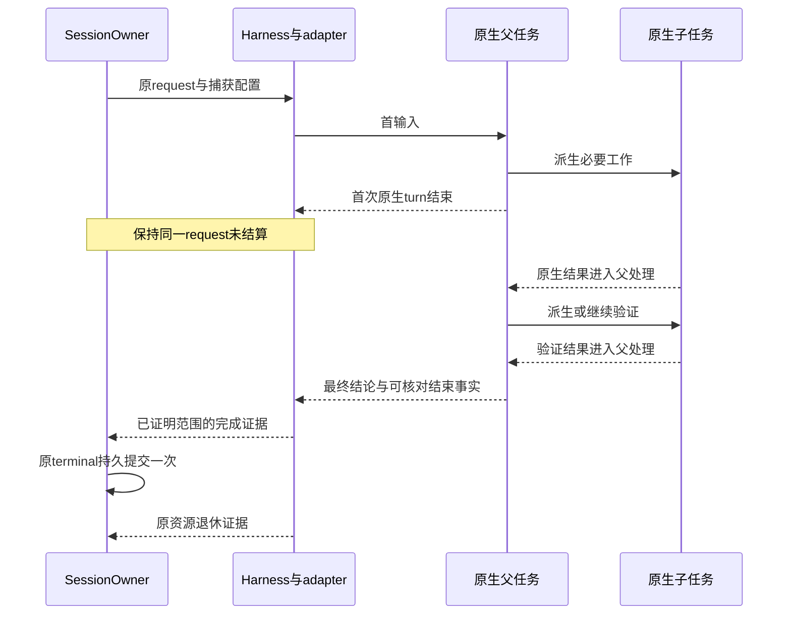

# Octopus 第三阶段实施方案：Codex app-server 与完整原生请求

> 文档日期：2026-10-30（Asia/Hong_Kong）。状态：实施设计，尚未实施、运行产品测试或部署。
>
> Octopus 核查基线：`0ca897e97189c5f213a658d986cbd67f4d69c5e3`。输入依据：用户附件《Octopus 工程收敛与运行时路线》§1、§3、§4、§6。
>
> 本轮另行只读核查了官方 Codex `rust-v0.165.0` tag 对应源码 `360319d8dee62d87e2d59fc0c21805d79519cfed`。这不是用户机器上二进制、配置、账号及完整协议实验的验收证据。

**阶段目标：让一次 Octopus 请求覆盖其必要原生后代、父后续处理及最终结论，再由原 SessionOwner 结算一次。普通 Codex 执行切换到 app-server 与完整尾部一起验收。**

## 0. 阅读顺序与串行边界

按以下文件顺序实施；不能以第三阶段需要接口为由绕过第二阶段，直接在消费者里补 Codex 分支。

| 阶段 | 文档 | 必须交给下一阶段的成果 |
| --- | --- | --- |
| 1 | [正确性、Wiki 与工程约定](../plans/engineering-runtime-roadmap.md#phase-1) | 已验证的投递分类、配置规则、Wiki 等价性与文档权威 |
| 2 | [架构与公共合同](Octopus_Phase_2_Architecture_Contracts.md) | C1–C8 语义合同及已迁移的真实消费者；G2 通过 |
| 3 | **本文** | 锁版 Codex 对完整 scope 的真实证据；全部消费者切换；G3 通过 |
| 4 | [DeepSeek 正式接入](Octopus_Phase_4_DeepSeek_Integration.md) | 复用同一产品请求与资源责任，提供另一种真实协议实现 |

协议只读调查可以提前。第三阶段的产品实现从 G2 开始，第四阶段的产品实现从 G3 开始。若 C0 发现上游缺能力，保留 G1/G2 已交付收益，第三阶段标记具体阻断；不得将“app-server 普通聊天可用”写成 G3 通过。

本文中的 `NativeScopeObservation` 等名称是建议的局部实现表达；C1–C8 只是第二阶段的语义索引，不要求新建同名大类、八张表或第二套执行账本。实施时沿第二阶段已经落地的类型和模块修改。

## 1. 已核实的现状，以及需要改变的具体责任

### 1.1 Octopus 当前实现

| 当前事实 | 核查入口 | 本阶段动作 |
| --- | --- | --- |
| 普通 Codex 仍解析 `exec --json`；收到 `turn.completed` 即返回 `result`、`end_of_stream=True` | [codex.py](https://github.com/Danuvius152/Octopus/blob/0ca897e97189c5f213a658d986cbd67f4d69c5e3/server/harness/codex.py) 中 `CodexEventParser.parse` | 普通路径换成 RPC adapter；原生 turn 结束改为事实事件，不能直接成为 Octopus terminal |
| native observer 的 drain 以一次捕获的 EOF 为边界 | [codex_activity.py](https://github.com/Danuvius152/Octopus/blob/0ca897e97189c5f213a658d986cbd67f4d69c5e3/server/harness/codex_activity.py) 中 `drain_observations`、`_poll` | 不再把日志观察当完整尾部权威；只保留仍有独立价值的被动诊断 |
| 回归明确允许父 success，同时未完 helper 变成 `interrupted/parent_done` | [test_native_subagent_retirement.py](https://github.com/Danuvius152/Octopus/blob/0ca897e97189c5f213a658d986cbd67f4d69c5e3/tests/test_native_subagent_retirement.py) | 新运行时必须改变此语义；保留“原身份、已完成结果保全、停止可见”的独立断言 |
| 恢复时先用短时 app-server 更新 controller，再启动普通 exec | [codex_control.py](https://github.com/Danuvius152/Octopus/blob/0ca897e97189c5f213a658d986cbd67f4d69c5e3/server/harness/codex_control.py) 中 `refresh_instructions` | 准备、恢复、指令安装和业务执行在本 attempt 的同一宿主完成 |
| `HarnessRun.reusable` 与 stdin 模式有关，已有 Claude 风格发送与 idle handler | [run.py](https://github.com/Danuvius152/Octopus/blob/0ca897e97189c5f213a658d986cbd67f4d69c5e3/server/harness/run.py) | 消费第二阶段已拆开的能力、发送、完成、退休合同；不把 RPC 双向通信解释为跨请求复用 |
| 已有独立 tool-free 文本 worker | [codex_text.py](https://github.com/Danuvius152/Octopus/blob/0ca897e97189c5f213a658d986cbd67f4d69c5e3/server/harness/codex_text.py)、[harness.py](https://github.com/Danuvius152/Octopus/blob/0ca897e97189c5f213a658d986cbd67f4d69c5e3/server/harness/harness.py) | 保留，不替换回可执行工具的 agent 循环 |
| `SubmissionReceipt`、`RequestCompletion` 已区分原输入、执行结果、记录与通知 | [submission.py](https://github.com/Danuvius152/Octopus/blob/0ca897e97189c5f213a658d986cbd67f4d69c5e3/server/sessions/submission.py) | 扩展其证据来源，不另造一个 app-server receipt 或下游任务调度器 |

这些是源码阅读结论。本轮没有运行上述测试，也没有证明用户历史上的每次子任务返回都发生丢失。

### 1.2 本轮补充发现：不能默认“子完成就唤醒父”

官方 0.165.0 源码提供了比附件更明确的约束：

1. [原生终态回报](https://github.com/openai/codex/blob/360319d8dee62d87e2d59fc0c21805d79519cfed/codex-rs/core/src/agent/control/completion.rs) 将相应 child 结果按 `trigger_turn=false` 发送，并区分排队成功和发送失败；这条路径的投递是 best effort。
2. [功能定义](https://github.com/openai/codex/blob/360319d8dee62d87e2d59fc0c21805d79519cfed/codex-rs/features/src/lib.rs) 中 `wake_on_agent_messages` 是默认关闭的开发中功能。
3. [唤醒准入](https://github.com/openai/codex/blob/360319d8dee62d87e2d59fc0c21805d79519cfed/codex-rs/core/src/session/turn_input.rs) 还检查 interrupted、运行模式、pending mailbox，以及是否为 root；开启该开关不能被解释为所有层级都自动续跑。
4. [任务收尾](https://github.com/openai/codex/blob/360319d8dee62d87e2d59fc0c21805d79519cfed/codex-rs/core/src/tasks/mod.rs) 里原生 turn 完成后仍可能推进待处理消息。`turn/completed` 因而不是整个 Octopus 请求范围的天然闭合屏障。

以上是特定源码路径的事实，不是对所有 Codex 模式作同一推断。选定的 multi-agent 模式、功能开关、root/child/孙任务路径必须作为 C0 固定配置的一部分验证。

**设计决策：首选由已验证的原生唤醒机制驱动父续跑；不同时安装宿主自动 continue。只有原生能力不足且公共协议确实支持可关联、可取消的继续操作时，才在 C0 裁决一种宿主驱动方案。两种驱动不能同时启用。** 若无法证明必要层级的唤醒和处理，停止迁移，不用提示词“必须 wait”、加长超时或轮询日志冒充保证。

## 2. 从第二阶段接收什么

| 合同索引 | 本阶段直接使用 | 不得在 adapter 内重新承担 |
| --- | --- | --- |
| C1 原身份 | account/session/request/work/attempt/backend 与原资源绑定 | 不从当前会话的最新 backend、credential、work 反推迟到事件归属 |
| C2 接纳结果 | 原 receipt、本次明确拒绝、接纳 unknown | 不把 RPC ACK 当 Octopus 入库回执，不改变 BG/Research/委派的来源重试 |
| C3 配置捕获 | 不可变有效配置、原凭据及逐操作授权 | 不建立新的全局配置管理器；不把捕获时许可延长成永久权限 |
| C4 输入证据 | 本地接纳、写出、provider 接受、实际处理分别记证据 | 不将 `stdin.drain()`、响应到达、父最终成功混为同一 ACK |
| C5 完成证据 | 声明的范围、范围闭合、完整输出和 outcome | 不直接写业务 terminal，不从 UI 卡片数量裁决成功 |
| C6 原执行退休 | `retired / pending / unknown` 与原资源引用 | 不以 session idle、找不到 PID 或收到 interrupt ACK 代替退出 |
| C7 问题原通道 | 既有 Question owner、问题答案与关闭语义 | 不建 RPC 自己的另一份产品问题状态 |
| C8 排空事实 | 所属 owner 推导的准备、RPC、等待、退休责任 | 不让 `main.py` 重新读取 Codex 私有任务和字典 |

进入本阶段前，G2 必须已经迁移实际消费者并删除旧公共旁路。允许 C5 的旧 exec 实现如实声明其历史范围；它并不能证明本文的完整原生范围。C0 用目标 runtime 验证接口需要的真实事实，不能只测试假 runtime 后直接切换生产。

## 3. 资源模型：固定为一个 attempt 一个宿主

### 3.1 身份与生命周期映射

| 对象 | 身份与基数 | 生命周期 owner |
| --- | --- | --- |
| Octopus session | 多个逻辑请求共享会话历史 | SessionOwner / session 模块 |
| Octopus request | 原输入及被合法接纳的人工追加组成一次逻辑责任 | SessionOwner |
| attempt | 原请求的一次执行尝试；若已有 unknown，不能自动再开副作用尝试 | 原执行 owner |
| app-server 宿主 | 一个 attempt 独占一个；可跨多个原生 turn | HarnessRun |
| root thread | 新建或精确 resume；跨请求可复用历史 ID，不能复用旧授权 | Codex runtime；Octopus 保存原 backend handle |
| 原生 turn / child turn | 一个 request 中可以有多个；用 thread、turn 及因果关系关联 | 私有 Codex adapter 观察，provider 负责执行 |
| RPC connection / item | connection 内相关，不能仅用裸数字 ID 跨代定位 | 原协议 adapter |

**跨请求不建进程池。** 旧 attempt 的资源责任确认退休后，下一个请求创建新宿主、使用新捕获配置、精确恢复原 thread。这样先排除旧 lease、新输入与旧 pending RPC 在同宿主交错的问题；启动成本在实现完成后测量。

在现有 Harness 内放置 Codex 的私有协议协作者即可。可以新增 `codex_app_server.py` 承担装配与领域映射，并在确有独立责任时拆出 RPC 流处理模块；不同时创建“CodexSessionManager”“AgentTreeManager”和新的通用执行引擎。

### 3.2 必须保留的局部状态

只保存无法从当前权威安全重建、且本执行确实需要的状态：

- 原 binding、捕获配置和资源引用，贯穿 spawn 迟到、取消和故障交接。
- 待响应的出站 RPC；其 key 包含 connection 与本地方向。入站 server request 单独关联，数字 ID 可以重号。
- 原生 thread/turn/item 到本 attempt 的关联和有限观察证据；历史 thread 的全部后代不能自动纳入当前 request。
- 未完成的问题、关键输入的不确定性以及完整 item 的去重身份。

原生任务树仍由 provider 拥有。adapter 的关联表是观察和关联用途，不持久化成第二份任务真相，不为 child 再创建 Octopus 请求，也不在本表里管理 BG/Research/命名委派。

`thread/list` 的 `parentThreadId` / `ancestorThreadId` 在锁定源码中存在，但属于实验接口，列表是线程级发现结果，不能自动证明当前 attempt 的成员集合或原子闭合。引用：[ThreadListParams](https://github.com/openai/codex/blob/360319d8dee62d87e2d59fc0c21805d79519cfed/codex-rs/app-server-protocol/src/protocol/v2/thread.rs)。

## 4. C0：先验证最可能推翻方案的协议事实

### 4.1 固定证据包

在现有临时任务目录内记录，不建立另一个长期状态系统：

| 证据 | 必须包含 |
| --- | --- |
| Runtime 清单 | 实际二进制版本/来源/摘要、OS、配置、multi-agent 模式与功能开关、MCP 入口种类；秘密只保留字段名和不可逆标识 |
| 协议清单 | 由该二进制生成的 schema、生成命令、摘要；官方 tag 源码只是补充 |
| 场景记录 | 原身份、发送/响应/事件次序、根与后代关联、每个结论的证据层级 |
| 资源记录 | 原进程组、准备与 I/O 结束、lease 撤销、Stop/自然退出是否确认 |
| 裁决 | 支持的真实范围、缺口、采用哪一种父续跑驱动、缺口是否阻止 G3 |

可用的只读起点是 `codex --version` 与 `codex app-server generate-json-schema --out <临时目录>`。不能把附件的“本机 0.165.0”当作实施机器现在的版本，也不能用本轮公开源码 SHA 替代实际 binary/schema 的固定。

不要为协议调查申请新登录。离线优先采用真实 pipe 和脚本 provider；需要原生运行时行为的实验再使用用户已有 Codex 登录和隔离目录。不得读取生产工作内容作为测试材料，且本次文档任务本身不执行这些实验。

### 4.2 C0 的问题必须有可反证答案

| ID | 实验 | 正面证据 | 否定后的处理 |
| --- | --- | --- | --- |
| C0-01 | 旧 exec 历史冷 resume，再发送首输入 | 返回精确 thread；controller 生效；旧上下文可用 | 显式历史错误，不新建空 thread 继续 |
| C0-02 | 首个根 turn 结束，child 延迟结束 | 后代仍受管；结果进入父可处理输入；父能继续 | 定位投递、唤醒、权限或范围能力缺口 |
| C0-03 | 父处理 child 后再派验证 child，再汇总 | 第二次派生仍属同 Octopus request；最终结论含两次必要结果 | 不以第一轮 child 数归零就收尾 |
| C0-04 | child 自己派孙任务、child 先 idle；孙结果晚到 | 必要中间父继续处理，或有明确且已验证的等价原生机制 | root-only 唤醒不足；该缺口阻止完整范围上线 |
| C0-05 | 同一 child 被再次调用；极快 child 在订阅前结束 | 按原生 turn/run 区分两次执行；通过权威记录补足快事件 | 不按 child ID 一次 completed 永久标完成 |
| C0-06 | 回报排队失败、通知缺失、待处理消息与 root idle 交错 | 无证据时不能完整 success；不会双触发/重发副作用 | 查明可观察的因果或承认依赖缺失 |
| C0-07 | 在 root idle、child 活动、父续跑、等待问题分别 Stop | 准入关闭、原 scope 停止、晚消息不重启、资源退出可证 | 不能仅看根 interrupt 响应 |
| C0-08 | 本次 root 完成，同时历史 child/其他 thread 还有活动 | 只管理本 request 的所选范围，原 thread 无第二 writer | 明确因果绑定，不能把全 home 线程算到本请求 |
| C0-09 | 根失败或被取消，child 已输出部分结果 | partial 和来源保留，整体 outcome 准确 | 禁止“有 final text 就成功” |
| C0-10 | provider 已接受输入但 RPC 响应丢失 | 维持原输入 unknown，原权威可查时才确认 | 禁止换协议、重新 start 或发 continue 掩盖未知 |

C0-02 至 C0-06 至少要使用目标原生 runtime 的可控场景取得证据；一个人为安排正确顺序的 Python 假服务只证明 Octopus reducer 能处理该顺序，不能证明 Codex 会发出所需事实。

C0-10 还必须跨本 attempt 的失败记录与服务恢复验证：**即使已记录一条 failed/interrupted 结果，首输入的 provider 接受 unknown 也不能被改成 done 或从恢复展示中消失。** 此持久语义由 G2 的 C4/S2b 先交付；P3 只接上真实 RPC 的发送证据。C0-06 则包含“原生回报失败、父/child 看似 idle”的假阳性反例，不能把 wait 或状态正常当作父已经处理。

### 4.3 C0 的出口

只接受两类结论：

1. **可实现**：列明所用公共接口、选定功能配置、父续跑驱动、因果证据和闭合依据，进入 C1。
2. **具体阻断**：说明缺少的是成员枚举、投递确认、处理关联、续跑还是闭合屏障，给出失败轨迹和最小上游能力需求。G3 保持未完成。

第二类不是要求用户批准一个空泛方案，也不自动授权维护 provider fork。先完成其他已授权的设计和独立工作，只有确需改变路线时再提出具体裁决项。

## 5. C1：协议传输、控制活性与事件归一化

### 5.1 单 reader，不在 reader 中等待业务

stdout 只由一个协程读取完整帧。它负责 schema 检查、相关 ID 分派和有界投递；不等待用户答案、UI 消费、数据库长操作或某个 RPC 调用的完成。stderr 独立读取，按既有安全诊断规则保留有界内容。

writer 负责完整帧序列化及写入；锁只覆盖一帧，不能持锁等待该 RPC 的响应。入站 server request 的回复使用原 connection 和原 request ID，不复用出站 pending 表。控制消息可在帧边界优先，不能打断半个 JSON 帧。

`turn/started`、item 等通知可以先于 `turn/start` 响应。adapter 根据已经发出的原 thread 与 pending start 建立暂定关联，再用响应核对；遇到冲突不能把事件送到“当前最新请求”。取消后返回的 start 响应仍交给原 owner 退休，不能在 callback 中静默丢掉句柄。

### 5.2 有界输出不能牺牲 Stop

双向 RPC 与旧单向 exec 的一个重要差异：若 stdout reader 阻塞在满展示队列上，同一条流里的响应、问题和完成事实也会停住。因此不能只原样搬用“满队列就 await”的路径。

推荐在原 Harness 预算内实施以下有界策略：

- 控制关联、原生因果事实和关键 item 先进入有界内部处理路径；UI delta 允许合并相邻片段，由完整 item 校正。
- 完整 item、错误、结果和问题不能静默丢弃。为结束/失败保留有限控制容量，大小按现有合法帧上界计算，而非凭空扩大到无限。
- 若持续生产超过预算，明确进入输出容量失败，停止新发送与工具准入，关闭本 attempt 并退休资源；标记输出不完整，保留已接收正文和诊断。此路径不宣称成功，也不靠无界内存继续收流。
- Stop 必须能够通过原资源 owner 的取消及进程组停止路径推进；不能为了发 interrupt 而永远等待一个堵住的 writer 锁。

首版不新增持久事件 spool。若实测证明现有预算在正常合法负载下无法工作，再以具体吞吐和恢复需求决定是否需要临时 spool；它也不能变为第二份业务执行日志。

### 5.3 归一化的稳定边界

| Provider 事实 | 公共层表达 | 约束 |
| --- | --- | --- |
| 文本 delta | 实时投影 | 不作为已持久完整回答 |
| 完整 agent item | 完整正文与 item 身份 | 同 item 只记录一次；父/子、commentary/final 分开 |
| 工具开始/结束 | 工具名、参数、结果、错误、原调用身份 | 原生错误不能被字符串 flatten 丢失 |
| root turn 终态 | 原生 turn 结束事实 | 状态要区分完成、失败和中断；不能自动触发产品 result |
| child 活动/终态 | 原生任务观察及因果证据 | UI 卡片是投影，不是完成裁决者 |
| usage | 当前 attempt 的计量观察 | 缺失为未知；累计/本次、父/子不能重复相加 |
| server question / approval | 原通道请求分类 | 普通问题、审批、动态工具不能混同 |
| EOF / 断连 | 连接事实和已发送输入的不确定性 | EOF 不证明请求成功或整个资源 scope 退出 |

只把具有共同语义的事件交给公共层；Codex 方法名、schema、`rootTurnId` 解释和多代理差异留在私有 adapter。业务消费者不解析 RPC。

## 6. C2-A：同宿主准备、指令与输入

### 6.1 准备顺序

1. 接收第二阶段捕获的原 binding、有效配置和授权引用；保留准备任务 owner。
2. 生成本 attempt 的临时配置及逐 entry MCP 参数。每个 bearer 保留原 installation/task/work/attempt/lease 绑定；配置文件活到真实资源退休。
3. 在现有 spawn 授权边界复核权限，启动原进程组；启动被取消而句柄晚到时仍由同一个 owner 清理。
4. 完成 initialize/initialized；验证所需能力，必要时显式开启经 C0 选定的实验接口。
5. 精确 `thread/start` 或 `thread/resume`。恢复得到的 thread ID、历史位置与所有权必须一致。
6. 在同宿主核对 controller checkpoint；稳定 controller 只有变化时更新，当轮上下文独立安装。compaction、fork 和恢复后的检查走同一责任。
7. 指令安装确认后才发送首业务输入。写出后确认丢失时核查原 checkpoint；不能把“可能成功”当成功继续。

当前 `codex_control.refresh_instructions` 的语义需保留；它的短时宿主实现和另开 exec 的组合被替代。认证或 tool-free worker 仍需独立控制操作时，保留其真实用途。

### 6.2 首输入与人工 steer

首输入先有 Octopus receipt，再按原 attempt 发送。`turn/start` 的响应或通知给出原生 turn；它们只是 provider 层证据，不能反向补造本地接纳。

人工追加允许 steer 的必要条件：当前原生 turn 明确活动、原 request 仍接受追加、配置兼容、当前权限有效、后端能力允许。准备中、根已结束而子仍活动、收束中或目标不明确时，按既有 Owner 规则排队。

锁版协议的 `turn/steer` 要求 `threadId`、`input`、`expectedTurnId`，响应给出 `turnId`。不提供当轮模型/cwd/sandbox 等任意替换；`clientUserMessageId` 不应未经证明当作幂等执行键。依据：[TurnSteerParams/Response](https://github.com/openai/codex/blob/360319d8dee62d87e2d59fc0c21805d79519cfed/codex-rs/app-server-protocol/src/protocol/v2/turn.rs)。

BG、Research、命名委派的独立返回仍逐条进入 Octopus 队列。不能因为 app-server 支持 steer，就将这些来源预装进 provider inbox 或同时开一个 provider 级产品调度器。

### 6.3 发送失败矩阵

| 时点/证据 | 本地处理 | 明确禁止 |
| --- | --- | --- |
| 尚未写出且明确未发送 | 在原请求、原预算内重试准备或保留排队 | 重建来源工作身份 |
| provider 明确拒绝且能证明未接受 | 根据原 Owner 规则回队/报错；保留原输入 | 仅凭通用错误文本推断所有异常都未执行 |
| 写出后失联/超时/ACK 丢失 | 标记原输入接受状态 unknown；只按可靠原权威确认 | 自动再 start、换 exec、换 backend、发 continue |
| ACK 已接受但实际处理未证实 | 保留 accepted，等待处理/失败证据 | 父 success 后把全部追加输入一律 done |
| provider 内部正在重试 | 观察同一执行 | Octopus 同时启动第二次副作用尝试 |
| Stop 后响应/句柄晚到 | 更新原尝试的证据并退休它 | 影响下一请求或借新 lease 继续 |

所有适用 transient/re-auth 恢复都必须重新审查接受边界。现有按错误字符串自动重试的逻辑不能未经分类直接用于 RPC 已接受的执行。

### 6.4 首输入 unknown 的数据库与 receipt 约束

本轮交叉审查发现当前 [record_terminal](https://github.com/Danuvius152/Octopus/blob/0ca897e97189c5f213a658d986cbd67f4d69c5e3/server/db/sessions.py) 会将普通 root 输入置为 `execution_state='done'` 并清除 `reason_code`；而 [client_submissions](https://github.com/Danuvius152/Octopus/blob/0ca897e97189c5f213a658d986cbd67f4d69c5e3/server/db/client_submissions.py) 的追加输入完成路径已有保留 `delivery_state='unknown'` 的区别。现有 Owner 的 completion 分类也主要从是否存在 settlement outcome 推出 completed。

因此，P3 进入前必须确认 G2 已将 C4 应用于**首输入和人工追加**：在现有输入行保存原发送观察；terminal 事务不得清除尚未知的接受事实；`RequestCompletion` 对每条输入按真实证据分类，原 failed terminal 已持久化不自动证明这条输入已被 provider 处理。可能出现“本尝试的失败说明已记录，而该输入接受状态仍 unavailable/unknown”，这是两种事实同时成立，不是数据库损坏。

服务恢复和浏览器恢复列表必须继续展示该原输入的不确定性；恢复展示不授予再次提交权。实现中沿 G2 选定的公开方法更新现有字段，不能继续把 `set_steer_delivery` 只用于追加、让首输入走未覆盖的旁路，也不新增一份 app-server 输入表。以真实 SQLite + 丢 ACK + failed terminal + 重启读取证明 unknown 保留且模型调用次数不增加。

## 7. C2-B：完整原生尾部与唯一结算

### 7.1 先定义“完成”具体覆盖什么

本阶段所选范围是：本 Octopus request 引起的根活动、必要原生后代、这些后代的结果进入相应父处理、父由此产生的后续活动，直到可证明没有本范围内尚待推进的必要责任。

不纳入独立 BG/Research/命名委派；也不承诺任意未来定时触发、另一个用户的新请求或全账户所有原生线程都完成。对自主 scheduler、durable sleep 等未来触发能力，C0 必须明确是否装配；未纳入范围的自主触发不能悄悄存在于宿主里。

需要分别取得以下事实：

| 事实 | 必要证据 | 错误替代物 |
| --- | --- | --- |
| 成员属于本请求 | 创建/父子/turn 因果或原生可核对的 attribution | 相同 cwd、相同账号、同一 root thread 的全部历史 child |
| child 有结果 | 原生完整终态/输出 | 卡片显示 completed |
| 结果已到父 | 原生投递/历史/消息因果 | child 自己结束或本客户端显示了正文 |
| 父已处理 | 该输入进入父实际步骤并有后续结果关联 | 父后来恰好又输出了一段话 |
| 范围闭合 | 所选原生合同中的闭合或可验证一致屏障；无未决必要输入、后代、父活动和问题 | 两次空列表、静默几秒、root success、模型说“结束” |
| 业务记录已提交 | 原数据库 terminal 提交确认 | WS 发送完成 |
| 原资源已退休 | 原 Harness 的进程组/I/O/lease 事实 | EOF、根 PID 退出、interrupt ACK |

这里“父已处理”是协议层的消费和后续执行证据，不是声称可以从日志证明模型主观理解。输出是否满足任务内容还需场景中的可检查结果；两者不能混淆。

### 7.2 建议的观察状态与推进规则

沿第二阶段单轮 owner 的状态机实现，以下仅描述 adapter 的局部观察，不再建平行产品状态机：

| 观察阶段 | 允许发生的事件 | 推进条件 |
| --- | --- | --- |
| 准备/首发送 | 握手、恢复、controller、早到事件 | 首输入原绑定确定，安装和接受证据满足 |
| 根活动 | 文本、工具、人工 steer、派生、问题 | 根终态仅转入范围检查 |
| 根暂歇且范围未闭合 | child 活动、回报、父原生续跑 | 继续保留宿主和原 request；不发最终 receipt |
| 父续跑 | 处理结果、再派生、最终文本 | 新原生 turn 继续属于同一原 request |
| 可结算 | 范围闭合、输入关联与必要输出成立 | 提交 C5，由 Owner 选择唯一业务 terminal |
| 停止/失败 | 取消、unknown、协议失信、输出溢出 | 保全 partial、准确 outcome、进入原资源退休 |

`NativeScopeObservation` 可以从本宿主保留的原生关联和事件推导 pending 集合，不存第二份活动计数。每次新 spawn、child 新 turn、父续跑、未确认发送或新问题都会使先前的闭合候选失效。**局部 generation 比较只防止客户端自己的过期计算；它不能补出 provider 从未提供的全局一致屏障。**

### 7.3 目标因果轨迹

图中的“结果进入父处理”和“已证明范围”是 C0 要证明的节点，不是因为画了箭头就已实现。若上游只提供 best-effort 回报而没有足够可观察证据，adapter 必须报告缺口。

### 7.4 业务结果和资源退休分开处理

沿用当前 `TurnOutcome.status = success / failed / interrupted`。`unknown` 是发送或证据状态，不应顺手新增第四种含混的业务终态。可以在现有 code/reason 位置使用经合同确认的 `native_scope_unconfirmed`、`input_acceptance_unconfirmed`、`output_capacity_exceeded` 等具体原因；这些名字为建议，不是现有实现。

一次成功必须有：目标 scope 成功依据、必要完整输出、被处理的输入关联以及已提交的原 terminal。child failed 不自动等于根 failed：若失败已进入父处理，父据此完成合理降级/替代并给出准确结论，可以成功。必要结果尚未处理、发送 unknown 或尾部截断则不能完整 success。

提交后通知失败不得倒写业务失败；提交未确认不得假装已记录。资源尚未退休必须继续保留原 owner 引用；Wiki/App 等需要文件 writer 消失的消费者继续调用 C6，不从 `receipt.wait()` 自行推断。

委派消费者必须等待这次完整结论后提取正文。不能先交付父首次回答，再靠 idle callback 追加正文而不补偿已交付结果。

### 7.5 最终回答的选取不能再按整个 attempt 拼接

当前委派返回路径会从原 attempt 的 assistant text 取得正文。迁移后一个 attempt 可含多个根原生 turn：第一次主回答、中间汇报、后续最终结论都可能持久化。仅延迟 receipt 完成仍可能把这些文本全部拼成一个“最终答复”。

因此直接消费 G2 C5 的结果选择合同：adapter 在确认 scope 后，给出**属于最后相关根执行的完整最终回答 item** 及其原生身份；Owner 的原结果投影将其映射到已持久化的本会话消息 seq/item 引用。完整 transcript 保留所有合法文本，但原 terminal 选择的结果范围只有一份。委派、App ask 等读取该选择，不重新遍历 attempt 或凭最后一个字符串猜结论。

具体选择规则由 C0 固定：优先使用已核实的原生 final phase/item 语义；phase 缺失时，只有目标协议能确认其终态最终消息时才使用对应完整 item。无法辨认时保留输出并报告证据不完整。不得为了“有一个答案”退回首次 root 输出、child 摘要或最后一条不明来源文本。

引用保存在既有结果/消息的最小结构化元数据中，不复制整份正文，不增建结果表；若改变持久语义，同工作包更新格式合同和读取验证。验证需同时断言全 transcript 仍含各轮正文，委派返回只包含最终选定根答案，重启读取该选择仍一致，通知失败不会重新选择答案。

## 8. C2-C：问题、审批、Stop 和资源退休

### 8.1 问题关联

一个产品问题关联到原 connection、server request、thread、turn、item 和 Octopus binding。Question owner 继续决定问题是否可回答、是否关闭、是否超时；adapter 只把结构化答案投递到原通道并报告发送事实。

| 情况 | 应有行为 |
| --- | --- |
| 多个选项/多个问题 | 保留问题 ID、选择集合和自由文本；不能先拼成字符串再猜回 provider schema |
| 产品有限 deadline 到期 | 保留系统自动处置的来源与既有超时语义；不把系统指导文本伪造成用户选项/custom 答案；协议无法表达时明确记录桥接缺口 |
| provider 已清除原 request | 关闭或拒绝原问题；晚答案不能转成新 prompt |
| 用户回答与 Stop 竞争 | 由原 Question owner/执行绑定裁决；已取消的通道不能复活 |
| 连接已断但页面仍可见问题 | 显示通道不可用；不能向下一宿主发送相同数字 request ID |
| MCP ask 与原生问题同时存在 | 复用一个产品 Question owner，各自保留原回调/原通道；不重复展示同一问题 |
| 未知 server request 类型 | 明确不支持或返回协议错误，不自动批准，不吞掉后继续报成功 |

审批应与普通问答分开。实际 sandbox、approval policy 和动态权限请求沿已授权的产品设置处理。不能把“用户写了一句同意”无条件翻译成扩大的文件/网络授权，也不能因用户不回答普通问题而默认允许工具执行。

有无产品 deadline 由既有 Question 合同决定。不能因迁移换了传输就为人工等待增加任意有限超时；协议本身的自动解题或 auto-resolution 需要被明确匹配到产品规则。问答期间 reader、Stop、lease 撤销和排空检查继续可推进。

G2 已选择在既有 `question_answer.tool_input` 等消息元数据保全结构化答案和 human/system-expiry/closed 来源，文本仅是兼容投影。这些历史证据不表示服务重启后可以恢复原 connection/server request 回调；P3 不重新发问或重放旧答案来制造这种能力。

### 8.2 Stop 的执行顺序

1. SessionOwner 对原请求关闭新发送与新工具准入，保留既有 Stop 暂停 backlog 的产品效果。
2. 撤销原执行 lease；取消未完成的准备和尚未提交的发送。准备已产生的资源仍归原 Harness。
3. adapter 对原活动目标和所选受管范围执行目标版本支持的原生取消；root idle 也需要处理 child、问题和待触发续跑。
4. 关闭/取消原问题并处理原 pending RPC；响应晚到仅更新原尝试的证据。
5. Harness 对原进程组进行既有有界停止、升级和 join，确认 I/O、连接、配置文件及授权资源可以释放。
6. C6 返回 `retired` 后才允许需要独占旧 thread/writer 的下一执行。仍有责任为 `pending`；证据失去为 `unknown`，保留原 owner。

第 3 步不能假设根 `turn/interrupt` 自动覆盖所有 child。C0 要确认原生取消范围；协议无法覆盖的本地受管资源仍由原宿主停止和进程组退休兜住。这里的资源保证限于实际部署中由本运行时持有的资源，并不声称能撤销已经完成的外部副作用。

Stop 的结果可以先向 UI 表明已请求停止；“停止已请求”“业务被中断”“资源已退出”不能显示为同一事实。原生宿主停止也不能连带取消拥有独立工作身份的 BG、Research、命名委派。

### 8.3 所有 await 都有原资源归属

| 异步操作 | 必须留下的引用 | 取消时的处理 |
| --- | --- | --- |
| spawn | 原 spawn task / 后续 process handle | shield/既有完整清理机制收回迟到句柄 |
| initialize/resume/controller | 原 connection + pending request | 未确认安装不能发送业务输入；退出原连接 |
| 模型执行/子树收束 | 原 attempt 与 scope 观察 | 不迁移至新请求，不自动重放 |
| 问题等待 | 原 Question 与原 server request | 关闭原等待；晚答不另开请求 |
| terminal 记录 | 原 settlement 与提交观察 | 已提交不能因 waiter 取消丢失；不重复 terminal |
| 退休 | 原资源引用与退出观察 | timeout 不代表资源消失，继续阻止冲突 writer |

这些责任应由 G2 的 owner 接口承接。消费者不得再读取 `owner.runtime.current` 或根据 session 的当前字段自行取消。

## 9. C3-A：历史、controller 与账户兼容

### 9.1 精确恢复

新建与恢复是不同入口。恢复失败时保留原 history ID、错误和材料；不能沿旧 stale-session fallback 静默创建新对话。这项要求必须覆盖用户聊天、命名委派、App 和 Wiki 等消费者。

冷恢复取得的历史既可能有旧 exec 格式，也可能有原生 child 记录。恢复基线应明确：哪些历史 item 已显示，哪些 native turn 属于本次输入，哪些旧 mailbox 内容只能作为既有历史而不能被误判为本次必要工作。

锁定协议的 `TurnStartParams` 接受 `rootTurnId` 与 `parentTurnId`；返回的 `Turn` 公布可空的 `rootTurnId`，不能据此假设它还完整回传 `parentTurnId`。客户端填入的父标识是关联输入，不是上游已经证明的父子关系。实际成员及因果需结合原生创建/来源/活动等可靠事实核对。它们能否覆盖冷恢复、自动唤醒与所选子任务模式，由 C0 证明；不能把字段“存在”当作跨版本记录必然齐全。依据：[TurnStartParams](https://github.com/openai/codex/blob/360319d8dee62d87e2d59fc0c21805d79519cfed/codex-rs/app-server-protocol/src/protocol/v2/turn.rs)、[Turn 返回类型](https://github.com/openai/codex/blob/360319d8dee62d87e2d59fc0c21805d79519cfed/codex-rs/app-server-protocol/src/protocol/v2/thread_data.rs)。

### 9.2 fork / rewind

保留当前 `session-fork`、`session-rewind` 合同中的目录、归属、消息位置、失败清理及引用规则。原生 turn ID 不等于 Octopus transcript 的消息位置；一次 request 可以包含多个原生 turn。

实施顺序是先读取旧合同与既有行为，再选择目标版本提供的历史接口或保留确有必要的现有历史适配。禁止为了迁移便利直接删除历史复制/回放能力，或把所有 rewind 位置都取整到最近根 turn。

对不支持的位置或损坏的原生历史明确失败。失败时只清理本次新建的 fork 资料，不能删除父历史。账户或 backend 不匹配的 native ID 不能跨 backend 使用。

### 9.3 controller 与配置变化

稳定 controller、当轮上下文和项目原生 AGENTS/skills 分开。应用新的 Agent 默认不重写正在执行的捕获配置；下一个请求重新计算并安装。人工换 model/effort、credential、工具或 Wiki 范围，不能借一次 steer 暗中更换运行上下文。

权限撤销仍作用于当前工具操作。恢复了历史也不能恢复旧 bearer、旧 Wiki grant 或旧文件写入许可。原生历史内残留的工具说明不是权限来源。

密钥轮换与同账号新凭据需要测试实际网络/工具路由；不能只检查配置对象不同。两个账户同时使用相同模型名、相同 cwd 或相同短工具名，仍须解析到各自 credential/home/bearer。

### 9.4 持久格式与搬迁

首选复用当前 backend handle、request/input/terminal 和消息身份，不为每个原生 turn 新建执行表。若完整 item 或原问题确实需要新的持久字段，要在同一工作包更新所属存储合同、完整行映射、资料保全与消费者。

代码回退和资料回退分开。不得运行不理解新格式的旧服务直接写新数据库。账户搬迁继续遵循当前 `backup-and-migrate` 的保留/排除范围；不能把“实例可保全”改成“账户导入所有会话及执行历史”。

## 10. C3-B：所有消费者必须走完整合同

以下矩阵是本阶段完成范围。只迁移普通聊天不足以切换默认路径。

| 消费者 | 输入入口 | 它需要的完成/退休事实 | 本阶段验收重点 |
| --- | --- | --- | --- |
| 普通聊天 | 既有人工输入与 Owner | 完整目标 scope 的结论；原输入状态；Stop | 不在父首次结束时显示完整成功；人工 steer 资格准确 |
| 命名委派子会话 | 原 delegation work 与 receipt | 完整父结论再返回来源；结果和交付分别取证 | 不提前截取回答；按原结果投影选择最终根正文，不拼全部 attempt 文本；来源身份不变 |
| BG/Research 自动回流 | G2 `admit_return` | 本地成功接纳次序和原 receipt | 一次派发一条；保持暂停/纠偏/显式恢复例外 |
| 计划任务 | 既有 scheduler 输入 | 原请求完成与通知合同 | 队列暂停不伪报完成，不新增 provider 自主调度 |
| App build | 既有应用构建会话 | 业务结果、既有 done 正文前缀、文件责任 | 原通知格式仍兼容；提前主输出不触发构建完成 |
| App ask | `app_agent` 的原调用 | 完整结果与通知状态；当前 App 授权 | 断连/通知失败准确返回；不影响后来会话 |
| Wiki worker | 原 assignment/job/receipt | C5 + C6 + Wiki 自己的文件效果/恢复 | writer 未退时不得提前宣告维护最终成功、允许冲突重试或释放原 writer；运行中的合法 History 文件提交继续按其合同取证 |
| Research leaf | 隔离 leaf 的原调用 | 真实 web/read-only/tool 策略与完整 leaf 结果 | 不把“不装 Octopus MCP”说成严格 web-only |
| tool-free one-shot | 既有文本 worker | 真正无可执行工具的文本结果 | 保持独立路径；不经过完整 app-server agent loop |
| 问题与浏览器 | C7 与 G2 会话投影 | 原问题关闭、迟到事件归属、完整 item/卡片 | 快照不能把已完成子任务改回运行，旧答案不能落到新请求 |
| Monitor / 运维 | 观测与 C8 | 新宿主形态、准备/问题/RPC/退休责任 | 观测不裁决业务完成；发布排空不漏新责任 |

源码入口：[delegations.py](https://github.com/Danuvius152/Octopus/blob/0ca897e97189c5f213a658d986cbd67f4d69c5e3/server/delegations.py)、[scheduler.py](https://github.com/Danuvius152/Octopus/blob/0ca897e97189c5f213a658d986cbd67f4d69c5e3/server/scheduler.py)、[applications.py](https://github.com/Danuvius152/Octopus/blob/0ca897e97189c5f213a658d986cbd67f4d69c5e3/server/applications.py)、[app_agent.py](https://github.com/Danuvius152/Octopus/blob/0ca897e97189c5f213a658d986cbd67f4d69c5e3/server/app_agent.py)、[Wiki job_execution.py](https://github.com/Danuvius152/Octopus/blob/0ca897e97189c5f213a658d986cbd67f4d69c5e3/server/wiki/job_execution.py)、[research](https://github.com/Danuvius152/Octopus/tree/0ca897e97189c5f213a658d986cbd67f4d69c5e3/server/research)。

### 10.1 Claude 的共同责任

迁移不能让公共层继续把 Claude 的帧格式、stdin 或 held process 当共同语义。保留 Claude 现有离线迟到事件归属、卡片和正文保全回归，按同一 C4/C5/C6 合同核对其能力与证据强度。

本安装的实机范围仍是 Codex，不为本文临时安装或登录 Claude。未做真实 Claude 联调的地方明确标记。若已有协议证据足以将 Claude 的尾部收束纳入原请求，则同工作包退出“先结算、idle 后补写”旁路；如果该保证尚未取得，不删除有独立保护作用的旧实现，也不宣称 Claude 具有已验证的完整 scope。

不能让需要完整 scope 的调用方把“provider 的 legacy 范围”当满足要求。能力不满足时应明确暴露限制或阻止该能力组合；这不是新增一个复杂消费者策略框架，而是既有能力校验对真实范围的应用。

## 11. 失败模型与持久提交矩阵

| 失败点 | 应保全的事实 | owner 的下一步 | 不得出现 |
| --- | --- | --- | --- |
| 准备失败且未发送 | 原输入仍在本地权威中、无 provider 接受 | 原预算内处理或报告失败，清理准备资源 | 自动更换 backend |
| controller 更新确认丢失 | 原 thread 与可能安装的指令 | 核对原 checkpoint；不能确认就停止业务发送 | 重复注入并把历史污染当幂等 |
| 首输入/steer 发送 unknown | 原 request/input 与写出证据 | 原身份确认或准确结束 unknown 原因 | 第二个 start/exec 重放 |
| child 已完成但回报失败 | child 真实结果，父未处理的事实 | 保持 scope 不完整，报告具体失败或缺口 | child completed 直接推动整体 success |
| 父处理 child 后再次派生 | 新 child 属于原请求 | 继续收束，原 receipt 仍未完成 | 新建来源返回、重开 receipt |
| 最终文本后 provider 失败 | 已有完整/partial 文本与失败状态 | 按失败结算，不抹除材料 | 仅以非空文本判断成功 |
| terminal DB 提交确认丢失 | 原 settlement；存储当前健康性 | 走既有原提交确认/fail-stop | 同代反复猜测提交再写 |
| terminal 已提交，WS 失败 | 已确定业务结果和记录 | 标注通知失败，保留原 completion | 将业务成功改为失败后再次结算 |
| result 已记录，资源退出未知 | 原资源/退休任务引用 | C6 unknown；阻止冲突 writer/文件效果 | 清空引用后让新请求继续 |
| 浏览器旧快照晚到 | 原事件代次与投影基线 | G2 S7 拒绝覆盖新状态 | 让 UI 状态反过来更改完成事实 |
| 发布排空时出现晚 spawn/RPC | 真实 owner 中尚未收束的引用 | C8 不放行，原服务继续持有 | main 仅看当前会话 idle 就切服务 |

## 12. 分步实施与每个 PR 的出口

拆分用于降低审查和定位成本；不是分批发布缺失尾部的产品替代。依赖中的箭头表示必须基于前一个工作包的完整结果。

| 工作包 | 依赖 | 实施内容 | 退出条件与删除项 |
| --- | --- | --- | --- |
| P3-00 / C0 | G2；调查可提前 | 锁 binary/schema/profile，完成关键反证，裁决父续跑与闭合 | 协议事实足够，或记录明确阻断；没有“默认假设通过” |
| P3-01 / C1 | P3-00 可实现 | Codex 私有 RPC 连接、单 reader、writer、ID、早通知、背压/失败 | 真 pipe 替身覆盖乱序/断连/满队列；不接产品默认流量 |
| P3-02 / C2-A | P3-01 | 同宿主准备/恢复/controller；首输入、人工 steer、未知分类 | 旧控制准备语义已迁移；没有第二 controller writer |
| P3-03 / C2-B、C2-C | P3-02 | 完整 scope、问题、Stop、原资源退休、唯一 C5 | 关键尾部与取消轨迹通过；不能先合“普通对话迁移完成”再补尾部 |
| P3-04 / C3-A | P3-03 | exec 历史冷恢复、fork/rewind、账户与授权；Claude 共享行为核对 | 所有改变的历史/输入行为有完整消费者及失败证据 |
| P3-05 / C3-B | P3-04 | 委派/App/Wiki/Research/计划/前端/Monitor/排空接入 | 业务消费者不读 RPC；全部使用 G2 公共责任 |
| P3-06 / 切换 | P3-05 | 统一默认路径、删除替代代码、更新当前合同、完成发布验证 | G3 全部满足，旧普通 exec 执行路径退出 |

P3-01 到 P3-05 可以在不对用户宣称已迁移的集成分支中逐步合并；不能在常规产品入口保留两个自动竞争的协议。开发时选择在首次发送前固定，一旦出现不确定接受，不自动切回另一条路径。

### 12.1 建议文件修改图谱

| 既有位置 | 改动责任 |
| --- | --- |
| `server/harness/codex.py` | 保留 profile、目录/认证/历史等真实能力；普通执行装配转到新 adapter |
| `server/harness/codex_app_server.py`（建议新增） | 私有 RPC 方法、原生事件、输入与 scope 证据；允许按实际责任进一步分文件 |
| `server/harness/run.py`、`profile.py` | 使用 G2 公共协作者，不加入遍地 `if codex`；资源 owner 保持不变 |
| `server/harness/codex_control.py` | 同宿主 controller 逻辑复用；删除已替代的普通对话前置短宿主路径 |
| `server/harness/codex_activity.py` | 删除被 RPC 取代的生命周期裁决，保留被动诊断时说明其非权威范围 |
| `server/sessions/owner_runtime.py` 及 G2 结算模块 | 接收原绑定的 C4/C5/C6；保持单轮串行裁决、异步 I/O |
| `server/sessions/submission.py` 与既有输入记录 | 必要时补证据映射；不重新定义另一套 receipt |
| 原 Question 模块和 WS/投影模块 | 结构化答案、旧答案拒绝、完整 item 与任务投影 |
| Monitor、安装交接各 owner | 新资源进入各自 C8；不是 main 猜私有字典 |

实际最终文件名以第二阶段形成的边界为准，不能为满足表格而机械增加所有建议文件。

## 13. 验证矩阵：分清每种证据能证明什么

### 13.1 四层证据

| 层级 | 执行者与工具 | 能证明 | 不能证明 |
| --- | --- | --- | --- |
| 映射/状态测试 | 一个指定执行者，fixture | RPC schema 到规范化事件、身份和结算反例 | 上游真实会发这些事件 |
| 真实 pipe/子进程替身 | 同一个受控本地 fixture | 半帧/乱序/背压/取消/晚 spawn/退出 | 原生子树语义及账号工具权限 |
| 锁版 Codex runtime | 实施环境既有登录或离线 provider | 原生完成、恢复、权限、子树与资源的真实行为 | 其他版本和未测试的 Claude/DSH |
| 浏览器与产品入口 | 既有 offline/live 分层 | 用户可见状态、问题、任务卡片、回流和消费者 | UI 不能单独证明存储/原生因果正确 |

每个检查只指定一个执行者。未变代码、配置、依赖和环境的有效证据可复用；新增反例或改动才触发相关重跑。正式命令和门禁引用 [testing.md](https://github.com/Danuvius152/Octopus/blob/0ca897e97189c5f213a658d986cbd67f4d69c5e3/docs/testing.md)，不在本文复制整套命令或测试数量。

### 13.2 必测组

| 组 | 必测内容 | 可以复用的现有入口 |
| --- | --- | --- |
| 协议 | initialize、通知早于响应、双向同数字 ID、未知方法、错误 JSON、截断/超大帧、EOF | `test_harness_core.py`、拟新增 app-server 协议测试 |
| 输入 | 明确拒绝、发送 unknown、重复关联、人工 steer 与 turn 结束竞争、配置不兼容排队 | `test_session_dispatch.py`、输入接纳回归 |
| 输入持久性 | 首输入 ACK unknown 后记录 failed/interrupted、重启并查看恢复项 | `client_submissions` 的真实 SQLite/Owner 路径；原 unknown 保留，不新增调用 |
| 输出 | delta+完整 item 不重复；工具错误；commentary/final；缺失 usage；背压时 Stop | `test_harness_flow_control.py`、`test_harness_codex.py` |
| 完成 | C0-02 至 C0-06，父成功/失败，child 失败已处理与未处理分别测试 | `test_native_subagent_retirement.py`、`test_native_subagent_stream.py` |
| 最终回答 | 同 attempt 首答/commentary/最终答均持久化；委派和 App 只消费原 scope 选择；重启选择一致 | 原 terminal/消息投影 + 真实委派/App 消费入口 |
| 问题 | 结构化多问题、旧答案、server request resolved、等待期间 Stop、无产品 deadline | Question 现有回归与 `test_question_codex_real.py` |
| 配置/历史 | controller 一次更新、compaction、冷 resume、fork、rewind、missing history 明确失败 | `test_codex_controller.py`、session fork/rewind 回归 |
| 授权/资源 | 双账户/两 bearer、撤权、取消时迟到 spawn、退出失败、旧执行未退新请求不得写 | `test_harness_authorization_stop.py`、`test_session_dispatch.py` |
| 消费者 | §10 全矩阵，特别委派完整正文、Wiki writer、App done 前缀 | 各领域已有 API/离线回归，避免只 mock receipt 结果 |
| 发布 | 准备/RPC/问题/退休任一尚存时拒绝切换，真实自然排空后允许 | C8 的安装交接行为检查 |

旧测试 `test_successful_parent_ends_unfinished_helper_without_reporting_helper_failure` 对新完整范围必须改变；不可只删除测试或把它改成 xfail。新的断言应证明未处理必要 helper 时原 receipt 不 success，处理并汇总后只有一次 terminal，Stop 后已确认 helper 结果仍保留。旧 exec 路径被删除时，相应专用 fixture 也退出，但独立正确性断言迁移到新入口。

### 13.3 性能测量与阈值

固定同一模型、effort、账号、任务、历史长度和权限，分别测准备、spawn、握手、resume/controller、首输出、必要后代/父续跑、整体完成、退休时间，以及峰值内存/进程数。

先报告每段成本和重复样本分布，再决定是否值得优化。去掉辅助 controller 宿主只减少一部分成本，不能声称已消除每请求 spawn/MCP 初始化。完整尾部本来扩大了正确完成的范围，不能把“等待必要工作更久”误判为同等语义下的性能退化。

性能记录不准改变完整范围、裁掉合法候选或引入进程池来追求好看数字。跨请求复用如果将来必要，应另议 lease、配置、残留问题和旧事件隔离；不作为本阶段的隐藏收尾。

## 14. G3 出口：必须逐项闭合

- [ ] G1/G2 的产品行为与公共责任没有回退，自动返回仍逐条派发。
- [ ] 实际 binary、schema、profile 和实验配置可重建；没有用线上滚动文档替代锁版证据。
- [ ] 旧 exec 历史冷恢复、父先结束、child 晚回、父处理后再派验证、最终汇总全部通过。
- [ ] 选定 scope 的孙任务、同 child 多 turn、快 child、发送/回报失败均有真实证据；缺口不被空列表或静默超时代替。
- [ ] 首输入及追加的接受 unknown 不会触发自动重放、协议 fallback 或新 writer；记录失败 terminal、服务恢复和 UI 重连均不抹去原不确定性。
- [ ] root idle/child 活动/父续跑/问题等待时 Stop 可完成；退休未知仍有 owner。
- [ ] 全部 §10 消费者取到正确的完成范围；不在第一次主输出后提前交付最终结果。
- [ ] 原结果投影持久指明最终根答案；全 transcript 与选定回答分别保全，消费者不拼接全部 attempt 文本。
- [ ] 结构化问题、审批和工具权限真实生效；旧答案不会污染下一请求。
- [ ] 通知失败、业务记录、资源退休保持独立事实；唯一 terminal 可经公开入口验证。
- [ ] 旧普通 exec 主执行、重复 controller 准备、已被替代的生命周期猜测实际删除。
- [ ] tool-free 文本 worker 的独立保证保留，Claude 共享/离线行为不回归且证据限制写清。
- [ ] Monitor、前端投影和安装排空包含新责任；本机适用的提交/发布门禁通过。
- [ ] 更新对应当前合同，实施/验证/部署状态分别记录。

有任一“必要尾部能力未证明”项时，G3 不通过，第四阶段产品切换不启动。不能把排期压力变成修改完成定义的理由。

## 15. 切换、回退与删除标准

### 15.1 切换

在候选版本中完成全部 G3，按现有安装流程等待自然排空后切换匹配的 backend/assets。原服务有准备、模型执行、独立返回交付、问题、关键 RPC、DB writer 或退休责任时，继续由原服务持有，不能为了部署强行结束用户工作。

切换后的后端仍叫 `codex`。app-server 是其实现方式，不新注册一个会话 backend 别名，不自动转换其他 backend 的历史，也不把本次文档交付说成已经切换。

### 15.2 回退

| 时点 | 允许的回退 |
| --- | --- |
| 业务输入尚未发送，候选准备失败 | 保留旧运行版本；不影响用户已有工作 |
| 集成分支尚未上线 | 整个责任单元回退，不能留新消费者配旧接口 |
| 已发送或接受状态 unknown | 继续持有原身份、原完成/退休责任；不在同请求内回落 exec |
| 原资源已退休，准备回退软件 | 核对资料格式与历史兼容性；在新的请求边界决定可用路径 |
| 外部副作用已经发生 | 诚实记录，不声称软件回退能撤销这些效果 |

不长期保留双主路径“以防万一”。若新路径未达到 G3，就不做正式切换；若达到并切换，替代的旧路径在同阶段移除。

### 15.3 删除清单

完成时逐项搜索并给出保留理由或删除证据：普通 Codex `exec --json` 发起、普通恢复前的额外 controller 宿主、以 `stdin_mode`/`reusable` 推 steer、首次 `turn.completed` 直接生成产品 result、日志 EOF 判断完整尾部、已被新事实替代的重复 retirement 判断，以及新旧 transport 自动 fallback。

不能连带删除认证控制、tool-free 文本 worker、仍有独立诊断价值的 observer 或 Claude 特有且尚未被等价责任替代的处理。删除标准是责任已经被完整接管，不是文件名含有 `codex` 或 `legacy`。

## 16. 交给第四阶段的明确产物

| 交接物 | 第四阶段可以依赖 | 第四阶段不能推断 |
| --- | --- | --- |
| C1–C8 已在真实 Codex 验证的实现 | 原输入、配置、问题、完成、退休和排空的公共责任 | DSH 具有 Codex 相同 ACK、expectedTurnId 或原生唤醒 |
| 消费者合同测试 | adapter 替换时验证完整请求效果 | 新后端只过普通聊天就可上线 |
| 规范化事件与完整 item 规则 | UI 不必理解 DSH wire | 可以把 DSH final_response 直接当完整成功 |
| 资源模型与停止反例 | 一个 attempt 一个受管宿主，晚句柄/晚回调有 owner | cancel ACK 等于线程/child/进程退出 |
| 能力与配置验证入口 | 注册 `deepseek`，使用真实能力表述 | 模型、effort、tier、问答范围跨后端完全一致 |
| 证据分层与发布过程 | 假 provider、真实 runtime、浏览器各自取证 | Codex 的绿色测试能替 DSH 的真实协议证明 |

最终决策回写 `docs/implemented/` 下既有的 `architecture-contract.md`、`harness-layer.md`、`codex-backend.md`、`native-subagents.md` 及有关当前合同；验证入口归 `docs/testing.md`，本机操作归 `docs/local-wsl.md`。本文保留实施设计与版本证据，不变成新的长期“当前实现”副本。

## 附：交给开发代理的阶段任务说明

> 在 G1、G2 已完成的提交上实施本方案。先执行 C0，固定目标 binary/schema/profile，证明旧 exec 冷恢复、父先结束、child 晚返回、父处理后再次派生、最终汇总，以及原 scope 的 Stop/退休。先写明哪些原生事实支持成员、投递、处理、闭合，不能用提示词或静默超时补保证。随后在既有 Harness 内实现私有 Codex RPC adapter，复用 C1–C8 与全部业务消费者，不新建输入账本、任务调度器或进程池。每个工作包同时处理真实调用方、失败路径、文档及替代旧路径的删除；G3 之前不宣称迁移完成。只在本次实际授权的实施/验证/发布范围内操作，未取得的协议能力或真实凭据证据如实报告。
