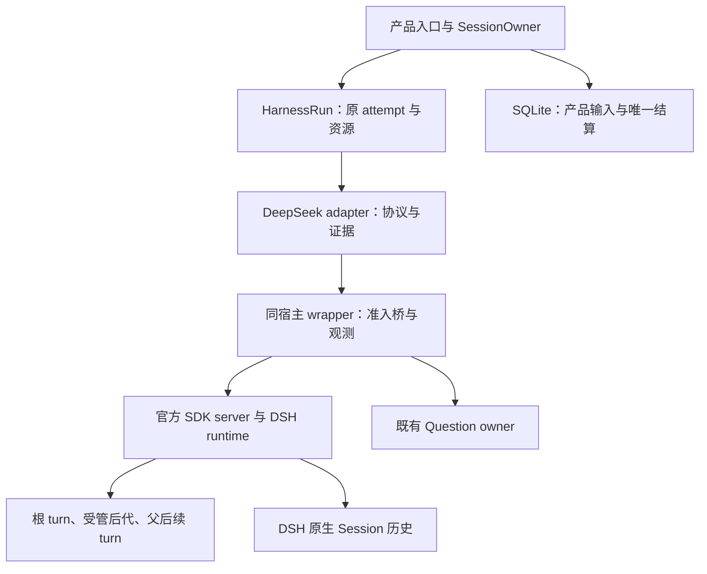

# Octopus 第四阶段实施方案：DeepSeek Harness 正式接入

实施顺序：[第一阶段](Octopus_Phase_1_Correctness_Wiki_Engineering.md) → [第二阶段](Octopus_Phase_2_Architecture_Contracts.md) → [第三阶段](Octopus_Phase_3_Codex_App_Server.md) → **第四阶段（本文）**。每阶段先达到自己的出口，再开始下一阶段产品改造。

> 日期：2026-10-30，Asia/Hong_Kong。
>
> 状态：**实施设计，尚未实施、联调或发布。** 本阶段在第三阶段 G3 验收完成后进入产品开发与切换；允许提前进行无模型的发行包和协议调查。
>
> Octopus 核查基线：`0ca897e97189c5f213a658d986cbd67f4d69c5e3`。本稿读取了该版本相关源码，并独立下载、按 npm SRI 校验了 DeepSeek Harness `0.2.1-rc.5` 的相关发行包，检查公开类型和编译源码。没有安装 DSH、执行其代码、调用真实模型、使用凭据、运行产品测试或修改仓库。
>
> 总体约束来自用户附件《Octopus 工程收敛与运行时路线》，特别是 §1、§3、§5、§6。附件中较旧的 `rc.2 / headless / ACP` 条件规格只作为历史依据；本稿给出一条正式主路线及其阻断条件。

## 1. 本阶段要交付什么，以及为什么最后做

本阶段的交付目标是：用户可在现有 Agent、会话、命名委派、App、Wiki、Research 和计划流程中选择 `deepseek`；Octopus 继续拥有输入接纳、产品调度、问题和业务结算；DSH 拥有其原生模型循环、工具执行、历史和子任务管理；公共 Harness 继续拥有一次 attempt 的全部运行资源。

这不是把 DeepSeek API 填入 Codex 配置，也不是在 Python 中重建一个工具循环。推荐主路线是 **一个 attempt 一个 DSH 宿主，官方 SDK server 加同宿主薄 wrapper，经既有 RuntimeProfile/Harness 接口接入**。首版不设常驻池，不实现 ACP、headless 与 SDK 的运行时自动切换。[R §5.1–5.2]

### 1.1 四阶段的串行关系

| 前序阶段 | 本阶段必须继承的产物 | 本阶段不能重新改变的规则 |
| --- | --- | --- |
| 第一阶段 G1 | 投递错误分类、默认配置变更规则、Wiki 语义与效率基线、文档 owner | 不把自动返回改为 steer，不把投递失败倒写成来源业务失败，不恢复旧会话兼容性保存门禁 |
| 第二阶段 G2 | C1–C8 共同语义、实际消费者迁移、旧旁路删除 | 不另建 SessionManager、输入账本、通用任务树或配置管理中心 |
| 第三阶段 G3 | 在实际 Codex app-server 上验证过的完整请求、输入证据、问题、Stop、退休及排空合同 | 不借新增 DSH 再把“首次 root idle”当作业务完成，不将 Codex 特有字段扩成公共协议 |
| 第四阶段 G4 | DSH adapter、薄 wrapper、账户与能力接入、全部消费者和真实运行证据 | 只在本阶段全部必要保证成立后称 `deepseek` 正式可用 |

DSH 技术上不依赖 Codex 的 JSON-RPC 方法。这里的依赖是工程交付顺序：先让共同接口经一个复杂后端验证，再让第二个后端证明这些接口具有实际扩展价值。G3 尚未通过时，可以完成 D0 调查和反证实验，但不能借“DSH 可以独立做”同时启动另一套产品迁移。

### 1.2 G3 到 G4 的开工输入

正式开工前，开发者取得下列材料即可，不再发明第二套阶段准入系统：

1. 已验收的 G3 commit、依赖及环境记录；尚未关闭的限制必须明确到能力，不能只有“整体可用”。
2. 第二阶段 C1–C8 的实际类型/接口位置，以及普通会话、委派、App、Wiki、Research、one-shot 的调用清单。
3. G3 的完整尾部、ACK 丢失、Stop、晚问题、退休、背压和排空反例。保留输入与断言，DSH 更换协议 fixture 后复用。
4. 当前产品问答语义：关闭 deadline 时持续等待用户，Stop 能取消，晚答案不得开启下一请求。
5. `docs/testing.md` 与安装环境的真实发布门禁。这里不再复制测试数量表或替代该文档。

如果 G3 只有新传输、缺少子结果被父处理的证据，G3 未完成，本阶段不得把这个欠账改成 DSH 专属限制。

## 2. 当前事实、选定设计与剩余假设

### 2.1 本轮独立核查到的事实

| 事实 | 源码依据 | 对实施的直接影响 |
| --- | --- | --- |
| Octopus `BackendKind` 只有 `claude-code`、`codex`，profile 注册也只有两者 | `server/models.py`；`server/harness/__init__.py` [O01] | 增加 `deepseek` 必须贯穿类型、配置、凭据、API 和前端，不能只加一个 adapter 文件 |
| 有效凭据既验证 owner/backend，也在实际执行路径复核 run authority | `server/sessions/credentials.py`、`server/credential_bindings.py` [O02] | DSH 复用同一凭据责任；不按 cwd/key 推断账户 |
| MCP entry 自带独立 URL、bearer、installation 和超时；无 ask deadline 当前用很大的秒数表达 | `server/harness/profile.py`、`assembly.py` [O03] | 必须逐 entry 装配；不能把原 sentinel 直接乘 1000 交给 Node 定时器 |
| SDK server 根导出 `HarnessSdkJsonRpcServer`；`JsonRpcLineTransport` 从独立 protocol 包根导出 | 发行包 exports、公开类型、`lib/index.js` [P01][P02] | 可组合公开组件，但没有“自动为原 dispatcher 注册任意方法”的公开服务 |
| wire 的 `session/prompt` 调用 `agent.followup()`，返回新 messageId；没有原生 steer/cancel 方法 | SDK server `prompt()`、`handleRequest()` [P01] | 轮内 steer 要通过薄 wrapper 调公开 Agent API；普通 prompt 不能冒充 steer |
| `steer()` 是同步调用；idle 时会唤醒新 turn；活动已取消时 waking input 会转为 next-turn | Agent 类型和 agent-loop 的 `send()` [P03][P04] | 不能仅检查 `status === running`；需原活动身份、未取消事实及本 wrapper 的关闭门 |
| `session/wait` 等 root idle、受管后代，再复核 root idle 与 seq 未变 | SDK server `wait()` [P01] | 比高层 SDK `run()` 更适合完整范围观察，但不是业务成功判据 |
| 高层 `run()` 在下一次 root idle 后停止收集 | SDK client `HarnessSession.run()` [P05] | 普通 Octopus 请求不使用它作为完成 API |
| child settlement 通知失败可能只记录 warning；已 idle 且有 parked inbox 的后代不被 wait 视为推进中 | subagent `notifySettlement()`、`waitForChildren()` [P06] | 还需证明必需结果确已进入父处理；不能只凭 wait 成功宣告完整成功 |
| `userQuestions.ask()` 可无截止等待，但legacy工具只返回human answers，不能表达Octopus系统超时指导 | question service、tool-ask-user；Octopus `_expire()` [P07][P08][O04] | 不能原样直通；正式路线用公开defineTool薄桥保留阻塞语义及三类问题结算来源 |
| 原生 question service 只允许 exact live runtime root，runtime child 得到 `DELEGATED_CALLER` | `assertLiveRoot()` [P07] | 必须如实声明根/原生子任务差异；不能把 child 伪装成 root |
| 公开ToolDefinition支持JSON输出schema与render，ToolExecution含callId/agent/signal；省略timeoutMs表示工具本身无deadline | `dsh-tools`公开类型与exports [P16] | 薄问题工具可返回人类答案、系统expiry指导或closed；具体组合仍须D0实验 |
| `sdk-app` 默认可将 max-tokens 映为 accepted，而 server 类默认值不同 | SDK profile patch 与 `successStatus()` [P01][P09] | 本 wrapper 显式设置 `maxTokensAsSuccess: false`，仍保留原始 stopReason |
| 官方 line transport 直接 `output.write()`，没有等待 drain，也没有累计 buffer 上限 | protocol `write()`、`onData` [P02] | 组合后必须验证并兑现 G2 有界交付合同；官方类名称本身不是背压保证 |

这些事实足以把设计做具体，但不足以证明 profile 替换、根绑定、取消、权限和问答已经联调通过。下文 D0 的实际 loader 与假 provider 实验仍是必要门槛。

### 2.2 本稿选定的设计

| 议题 | 选定设计 | 拒绝的替代路径 |
| --- | --- | --- |
| 普通执行 | `dsh --profile sdk --patch <captured-patch>`，替换原 stdio wrapper | 再启动一个 SDK client 自有进程与 Harness 争资源 owner |
| 原生轮内引导 | wrapper 调公开 `Agent.steer()`，严格核验原活动 | `session/prompt`、kill + resume 或 idle steer 冒充轮内引导 |
| 完整请求 | 官方低层 wait + 完整事件/输入/父处理证据，Owner 唯一结算 | `run().finalResponse`、root idle、非空正文即成功 |
| 用户问题 | 公开defineTool薄桥保留legacy式阻塞语义，回既有Question owner；有限/无deadline共用一条路径 | 原样legacy丢系统expiry来源、伪造用户custom、超大MCP timeout、timed新turn |
| 生命周期 | 一个 attempt 独占一个宿主；宿主内可含多个原生 turn 和后代 | 跨请求共享宿主、让后一个请求接管前一个未退休 writer |
| 独立工作回流 | 仍经 Octopus 的 `admit_return` 和逐条派发 | 将 BG/Research/命名委派预装进 DSH next-turn inbox |

若 D0 发现公开 API 不能实现所选合同，应记录具体缺口并调整设计决策；不能临时读取私有字段、补日志轮询，再称主路线已成立。

## 3. 责任结构与共享契约



图中两份持久材料记录不同事实：DSH 原生历史是 provider 执行事实；SQLite 是 Octopus 产品接纳与结果事实。wrapper 不再增加第三份“执行真相”。关联表只在当前宿主/attempt 内保存 RPC、输入、原生 item 和问题的对应关系，作用是解释事件；重启后无法证明的关联保留 unknown，不凭同正文重建成功。

### 3.1 所有者与提交点

| 所有者 | 可以决定什么 | 不可以决定什么 | 关键提交点 |
| --- | --- | --- | --- |
| SessionOwner | 接纳输入、选择派发/人工 steer、问题接受与关闭、唯一业务 terminal | 原生工具执行、原生子任务内部调度 | 原输入 receipt；原 completion 的数据库事务 |
| HarnessRun | 准备、spawn、连接、I/O、lease、临时文件、升级停止、退休证据 | 根据正文猜业务成功 | 原资源取得/接管；退出及清理事实 |
| DeepSeek adapter | 将原生事件转换为 C4/C5/C7 证据、原通道发送 | 重写产品队列、把 provider 结束直接写成业务终态 | 原发送事实、原生确认和原始 terminal 的观察 |
| 薄 wrapper | 精确根绑定、同步 steer 准入、公开事件桥和问题请求桥 | 维护另一条产品队列、重试模型、另存任务完成状态 | 调公开 API 前的同一步核验；原生返回/事件 |
| 官方 SDK/DSH | Session 创建/resume、inbox、模型循环、工具、后代、wait、dispose | 将 Octopus 独立 BG 当作原生后代 | provider 自己的 durable Session events |
| 来源 owner | BG/Research/命名委派各自业务与投递重试 | 在 DSH 里另排产品 backlog | 来源业务结果、原 delivery 和其结算 |

### 3.2 使用 C1–C8，不创建八套新类型

以下编号是第二阶段文档的语义索引，实际实现优先沿用已存在类型与 owner：

| 合同 | 本阶段映射 |
| --- | --- |
| C1 OriginalBinding | account/session/request/work/attempt/backend 固定；关联当前 connection、精确 Agent/Session 对象、native turn/step/runId；lease 由 Harness 持有 |
| C2 返回接管 | 继续使用 G2 的 `SubmissionReceipt / ReturnRefused / ReturnUnconfirmed` 等实际返回类型；DSH adapter 不另造 `admit_return` |
| C3 EffectiveConfig | 只安装捕获配置；保存默认值和当前执行授权分离；新 key/模型/工具配置进下一请求 |
| C4 InputEvidence | local receipt、写出、native inbox accepted、claimed、durable user message、实际请求步骤/结算分别记录 |
| C5 CompletionEvidence | scope、闭合事实、根 outcome、所选根最终回答的已持久item/消息引用、输入/子结果处理证据；wait success不等于outcome success |
| C6 RetirementEvidence | 原 binding 的 retired/pending/unknown；native cancel 和 shutdown 响应不替代资源退出 |
| C7 QuestionBinding | 原 connection/server-request/root/turn/tool-call 与产品 question；原结构化人类答案、system expiry指导及closed来源分别保留 |
| C8 DrainFacts | 准备、未完成 RPC、问题回调、事件交付、后代、退出失败和临时秘密生命周期由各 owner 提供事实 |

G2 必须保留结构化问题答案。当前基线的 `OwnerQuestions._answer()` 会格式化答案为文本；这是第二阶段应处理的共享边界，P4 不再解析 `Q:/A:` 字符串反推 `{id, selected, custom}`。MCP 既有调用仍可消费文本投影，原生桥消费结构化答案。[O04]

## 4. D0：先锁定可重建运行环境，再验证公开组合

### 4.1 锁版对象

主基线选 `@deepseek-ai/dsh@0.2.1-rc.5`。这只是本方案有依据的起点，不是宣称它在将来开工时仍是最新版本。升级候选可以单独评估，但不能把 `latest` 隐式装入同一证据记录。

一次可重建环境至少包含：DSH 顶层包和完整解析依赖锁、Node 版本、官方 bundle/profile 的确切内容、wrapper 源码及构建摘要、每次启动 patch 的不含秘密摘要、操作系统/进程组实现、所选 provider/model 能力目录。只记 `dsh --version` 或三个 SRI 不够。

安装/更新在候选环境进行，普通模型请求不运行包管理器。`is_available()` 只回答二进制可解析；“版本通过本合同验收”“凭据当前可用”“某项能力通过”是不同结果。版本失败在首个业务输入之前结束准备，不能自动切到别的后端。

### 4.2 同宿主 wrapper 的最小职责

建议放置一个可独立校验的 Node 插件包。路径可采用 `server/harness/deepseek_bridge/`，这只是拟议位置；实际应复用 G3 已形成的运行时资产与打包方式。该目录保留小型 package manifest、完整依赖锁、插件源码、构建产物生成方式和离线测试；不在前端依赖树中偷偷解决后端运行依赖。

公开导入边界明确为：

```ts
// 接口来源示意；完整源码须按锁版公开类型编译。
import { HarnessSdkJsonRpcServer } from "@deepseek-ai/dsh-sdk-jsonrpc-server";
import { JsonRpcLineTransport } from "@deepseek-ai/dsh-sdk-protocol";
// Agent、createUserMessage、Question 类型同样只从相应包公开导出使用。
```

插件必须替换原 SDK stdio wrapper，使整个进程只有一个 stdin reader 和一个 JSON-RPC dispatcher。采用显式allowlist，仅 `initialize / session/prompt / session/resume / session/wait / shutdown` 在本attempt的阶段与身份门通过后转交 `server.handleRequest()`；新增方法限定在 `octopus/` 命名空间。不能将所有未识别方法盲目pass-through。

initialize只接受一次；resume只允许精确预期root且只能在首输入前；prompt只允许本attempt首个输入，必须在调用官方server前同步关闭first-prompt准入门，避免并发两个prompt都越过检查。已写后unknown不能重新打开该门。`session/working-directory/get`与`set`首版均不对外暴露：get也会经`getOrCreateSession()`创建root，不能把“读操作”当作无副作用旁路；set还会修改目录及模型上下文。未知method/第二root在进入SDK前明确拒绝。[P01]

保留官方 wrapper 的生命周期责任：initialize 前等待 loader、stdout 只输出协议、shutdown 响应 flush 后才退根 runtime、EOF/信号归原 launcher 关闭。把这些责任“复制到新文件”不算完成；必须有 EOF、初始化失败、关停失败、响应 flush 失败和迟到创建的实际 pipe 测试。`maxTokensAsSuccess` 显式为 `false`。

### 4.3 精确根绑定，不读 private sessions

推荐的公开绑定路径：

1. 在接收第一个 `session/resume` 或 `session/prompt` 前，wrapper 已从受信启动配置取得 C1 和本次预期 native session ID，且注册公开 `agent/created` 观察。
2. 此宿主只允许一个预期根的打开/创建请求。未知根、第二个根、请求中的 attempt 不匹配在调用官方 server 前拒绝。
3. `agent/created` 提供精确 Agent 对象；listener 对照预期 session ID，并用公开 registry 验证其 exact live root 身份。官方创建 listener 在创建返回前被等待，可以在首次模型工作之前完成绑定与 scoped 插件安装。[P03]
4. 保留这一对象引用和所属 connection，后续每次控制再验证 registry 中仍是同一对象。不能收到任意 ID 就调用 `ctx.agents.get(id)` 控制它，也不能把替换后同 ID 的对象当原执行。
5. 失败的创建、取消中迟到的 `agent/created`、compaction/replacement 的对象变化都归原 attempt。未经明确重绑定协议不能自动改为最新 Agent；旧对象的责任先收束。

这里不接管官方 `AgentHandle.dispose`。创建 handle 仍由 SDK server 持有；wrapper 只取得必要的公开 Agent 操作引用，最终通过 server.shutdown 释放。若某个能力确实只能访问 `server.sessions` 私有表才能完成，D0 失败，不能用类型断言绕过。

### 4.4 D0 最小反证矩阵

| 编号 | 实验 | 通过条件 | 失败时的处置 |
| --- | --- | --- | --- |
| D0-01 | 真实 loader 启动替换插件，普通 initialize/new/resume | 无双 reader；纯协议 stdout；普通方法仍走官方 server；缺失历史明确拒绝 | 修正 composition；不进入业务接入 |
| D0-02 | 同名 Agent 替换、迟到创建、错误 session 控制 | 只控制本 attempt 精确对象；取消后句柄仍被原 owner 回收 | 补公开绑定合同，不能读私有集合 |
| D0-03 | steer 抵达时 root 刚 idle、正在停止或 signal 已 aborted | 明确未接受且没有新 turn；合法活动只追加 next-step | 收窄 advertised steer 阶段；必要能力无公开实现则阻断 |
| D0-04 | 先 accepted、后 claimed、pre-step reject、取消丢弃 | C4 分层正确；没有虚构 durable user/message 或 done | 修证据映射，不靠最终 root success 批量标 done |
| D0-05 | root idle→child晚回→父处理→再派child→最终汇总 | wait、父处理及必需输出证据闭合；中途没有产品 terminal | 缺哪项原生事实就记录哪项，不能 host 自动续 prompt 补齐 |
| D0-06 | 故意使 child settlement 父投递失败，或必需输入 parked | 即使 wait 返回，也不报完整 success；原事实和 partial 保留 | 完善检测/公开保证；不得把 warning 忽略为成功 |
| D0-07a | 薄问题工具无deadline，超过传统60秒等值虚拟时间，用户回答/Stop竞态 | 不装工具deadline；原结构化答案一次；Stop实际取消；晚答无新轮 | 先完成公开Question工具桥，不能加任意有限超时 |
| D0-07b | 有限deadline到期、用户同刻回答、原attempt已结束 | Owner只settle一次；system expiry保留原AUTO_ANSWER_TEXT及auto/source；已结束则closed；均不伪造human answers | 原样legacy返回型不够；defineTool输出/render若仍无法保真则D0阻断，不略过有限期限 |
| D0-08 | runtime child发本桥ask，命名委派root发ask | 本桥选定root-only guard明确拒绝child；独立root走既有转发；UI无挂死问题 | child直接ask是另需权限/原通道证据的扩展，不声称公开工具API天然禁止 |
| D0-09 | 满输出缓冲时wait/问题/Stop并行 | 有界内存；控制能推进或有界失效后可靠退休；不丢完整终态 | 修transport边界或拒绝此组合，不能“已采用官方transport”结案 |
| D0-10 | 普通/one-shot/web-leaf 强行发禁用工具 | 真实工具集合、执行拒绝和外部效果均符合策略 | 修composition与执行guard；prompt限制不算通过 |

D0 只有公开源码检查时，标记为“源码支持、实验待执行”；用 fake provider 通过后，仍不能替代真实 key、网络、模型和产品 UI 验收。

## 5. 薄 wrapper 的协议设计

### 5.1 方法集合与原身份

下列 `octopus/*` 是**拟议私有 wire 方法**，不应宣传为 DSH 官方 API。其 Python 消费者只能是 DeepSeek adapter。

| 方法/通知 | 方向与用途 | 必需关联 | 返回的最强事实 |
| --- | --- | --- | --- |
| 官方 `initialize` | Python→DSH，路由/目录初始化 | 原 connection 和捕获配置 | 初始化成功，不代表业务输入已发 |
| 官方 `session/resume` | Python→DSH，打开原历史 | 精确 native session ID | 原历史已打开，不发送新 prompt |
| 官方 `session/prompt` | Python→DSH，仅本 attempt 首输入 | 原 input + RPC 对应关系；预期 native root | `messageId` 已进入原生 followup，不代表处理完成 |
| `octopus/steer` | Python→wrapper，合资格人工追加 | attempt/root/input/expectedActivityId | 明确拒绝，或 inbox accepted + nativeMessageId |
| `octopus/cancel` | Python→wrapper，停止本 attempt | 原 attempt/root；取消原因 | 取消请求已调用，不是 retired |
| `octopus/question` | wrapper→Python，阻塞原工具问题 | 原Agent/活动/ToolExecution.callId与反向request ID | human answer、system expiry指导或closed的C7类型化结果 |
| `octopus/activity` | wrapper→Python，可靠活动范围观察 | 原 root、turn/step/活动标识 | 可供准入关联的原生事实，不是UI推断 |
| `octopus/input-observed` | wrapper→Python，补充输入证据 | inputId/nativeMessageId/turn/seq | inserted、claimed、discarded等原事件；各层不互相代替 |
| `octopus/subagent` | wrapper→Python，补足原生任务观测 | runId/provider/id/local/parent | 生命周期观测；完成仍需 C5 |
| 官方 `session/wait`、`shutdown` | Python→DSH，完整观察与关闭 | 原已接管 root | wait/drain事实；不直接提交Octopus业务结果 |

没有必要为了统一返回结构重写官方方法。对于 `octopus/*` 的**明确准入拒绝**，返回结构化的 accepted/rejected 结果及 reason，避免官方 transport 将任意 thrown Error 压成同一种 `-32603` 后丢失分类。程序错误仍作为程序错误，不伪装成可重试业务拒绝。

### 5.2 一个 steer 请求示例

```json
{
  "jsonrpc": "2.0",
  "id": "host-rpc-41",
  "method": "octopus/steer",
  "params": {
    "attemptId": "captured-octopus-attempt",
    "nativeSessionId": "captured-dsh-root",
    "inputId": "original-octopus-input",
    "expectedActivityId": "connection-local-native-activity",
    "contentBlocks": [{"type": "text", "text": "用户已接纳的纠偏内容"}]
  }
}
```

`expectedActivityId` 是 wrapper 根据可信原生事件发布的连接内准入标识，不是 DSH 原生 CAS，不是 Codex `expectedTurnId`，也不是重连后可以重放的持久幂等键。它不得由 UI 卡片生成；换 connection、换精确 Agent、换活动都失效。

accepted 只说明已调用原 Agent 并取得相应 inbox 证据。断连时没有 response 不能按“未接受”重发；同 RPC ID 也不能假定 DSH 去重。产品 original input/receipt 仍是 C4 的身份。

### 5.3 同步准入必须检查的条件

所有可能 await 的内容规范化、附件落盘、配置准备先完成，再执行最后一段同步检查与调用：

```ts
// 语义伪代码；不是可直接复制的已实现 API。
assertCapturedAttempt(params.attemptId);
const agent = boundExactRoot;
assertExactLiveRoot(agent, params.nativeSessionId);
assertSendGateOpen();
assertExpectedActivity(params.expectedActivityId);
assertNativeTurnStillOpenAndRunning();
assertCapturedTurnSignalNotAborted();
agent.steer(preparedUserMessage); // 检查到调用之间不 await
```

原活动信号可从公开 pre-step / turn-stopping 等事件取得；尚无可靠活动边界或信号时，不开放 steer。`status === running` 包含收束中的活动，且取消后的 send 可能落入 next-turn，因此单一布尔值不够。Stop 先同步关闭 wrapper 发送门，然后 cancel；外部 cancel 或原生失败也须通过公开 signal/terminal 更新准入事实。[P03][P04]

如果某条公开事件的时序无法保证检查早于调用，不允许读取 agent-loop 私有 `phase` 来补洞；将该窗口作为明确不支持 steer 的阶段，原人工输入按 Owner 规则排队。只要不改变已接纳输入身份，这种明确拒绝与回队是合法行为。

### 5.4 通知先于 ACK 与有界交付

注册订阅与原 input 的本地关联发生在发送前。`session.event` 可能先于 `session/prompt` response：adapter 暂存有界的原生身份信息，response 给出 nativeMessageId 后再建立精确关联。不能用文本相等把重复输入判成同一个，也不能把同连接里第一条 user event 无条件视为该输入。

官方 transport 的 `onData` 会继续派发请求而不等单个异步 handler，这有利于 wait 与 cancel 并行；它的写缓冲和输入行仍需额外预算。建议直接在 wrapper 的 stream 边界实现字节/帧上限、错误收束和控制推进，沿用 G2 的预算原则，不另建通用 RPC framework。[P02]

具体要求：

- Python 持续读 stdout，慢浏览器不阻塞协议 reader；根完整正文、terminal、问题、输入证据不因展示背压被丢弃。
- 可合并的 transient delta 使用有界展示投影，完整 Session item 按原 seq 进入可靠处理。coalesce 不得作用于工具调用参数和最终正文。
- Node 输出积压超过已选预算时，保持原 attempt 为失败/未证实，触发受管关闭。不能静默成功，也不能无界继续生产。
- 关键 terminal 大于普通展示阈值时使用已定义的完整 item 交付机制；如果只能因总大小限制而终止，应明确“输出未完整取得”。
- Stop 不等待显示队列腾空；原生 cancel 无法通信时，Harness 仍可升级终止原进程组。

预算参数以 G3 已验证的同类负载为初值，再测 DSH 事件体积。不要为了文档整齐随意规定另一套常量。

## 6. 一个 attempt 的完整生命周期

| 阶段 | 必须完成的动作 | 允许的输入/控制 | 失败的处理 |
| --- | --- | --- | --- |
| captured | 捕获C1/C3，确认原历史backend与凭据，创建原资源责任 | Stop；业务输入尚未发 | 准备失败可明确未发送；释放已取得资源 |
| preparing | 准备profile/patch/秘密/权限，spawn、握手、resume、根绑定 | Stop；人工追加由Owner排队 | 取消中迟到spawn仍归原attempt；未知创建须收束 |
| active | 首输入发出，映射原message/turn，接收完整事件 | 合资格steer、原问题答案、Stop | 写后断连保留unknown，不新建turn重跑 |
| native tail | 根曾idle，但后代/父后续turn/必要输入仍未闭合 | 仅有明确活动目标时可steer；原问题答案；Stop | 子结果缺失、parked必需输入或事件缺口不得success |
| settling | adapter提供C5证据，Owner持久提交原结果 | 关闭新业务发送；仍处理原结束/取消事实 | DB失败走原fail-stop；通知失败不推翻已提交结果 |
| retiring | shutdown、后代drain、handles dispose、launcher退出、管道/lease/临时资源收束 | 只允许原关闭操作 | pending/unknown责任保留；不启动同历史第二writer |
| retired | 原执行C6证据成立 | 下一逻辑请求可新建宿主精确resume | 再来的原事件仅归旧identity，不能结算新请求 |

这些是操作阶段，不能机械建成一张持久“DSH执行状态表”。优先把阶段映射到 G2/G3 已有状态；只在当前 adapter 内保存确实必要的协议状态。

正常完成后的新请求：旧 request 的必需资源门已经满足 → 新捕获 → 新宿主 → 精确 resume 同 native history。新宿主重新取得权限与 bearer；不把上一次 Wiki grant 或 lease 延长给下一请求。

## 7. 输入与完成证据：本阶段的核心正确性

### 7.1 输入事实必须逐级记录

| 观察 | 已证明什么 | 仍未证明什么 |
| --- | --- | --- |
| Octopus receipt | 产品已接纳原输入 | 已发送给DSH |
| 原帧写出 | 发送可能生效 | 原生接受或未接受 |
| prompt response / inbox inserted | DSH 已接纳该nativeMessageId | 模型已消费 |
| inbox claimed | 原生循环取走该消息并关联turn | pre-step进入模型请求；它可能被拒绝 |
| durable `user/message` | 原生持久历史记录该消息进入步骤 | 对应请求已成功或所有副作用已完成 |
| 本次request/step和terminal关联 | 可判断该输入参与了哪段执行及其结果 | 其他输入/子结果也已处理 |
| discarded/aborted | 原输入未继续或被取消的事实 | 可以安全复制新身份自动重跑 |

必须保留多个输入的不同状态：根本来成功，人工 steer 却在 pre-step 前被丢弃，不能统一标成 done。接纳 unknown 后再遇另一条明确拒绝，也不能倒推先前没有执行。wrapper 的诊断和连接内 map 不具备数据库原 receipt 的权威。

本阶段直接依赖G2已修正的首输入与steer统一证据结算：`record_terminal()`不得因根terminal已记录就把原输入无条件改成done或清除unknown reason；`RequestCompletion`按该输入证据保持unavailable，恢复列表保留unknown且不自动重放。根failed terminal持久化与该首输入的接受证据仍unknown可以同时成立，不新增表或第四业务status。

### 7.2 完整成功判据

一次 DSH 请求的成功结论至少需要同时成立：

1. 原 attempt 的发送集合明确，没有关键输入关联缺口；必要输入的 disposition 有证据。
2. 所选受管范围的官方 wait 成功，观察的 Session 通知顺序没有丢失关键项。
3. 本请求要求的子结果已进入父的原生处理；父可继续派生并最终形成根输出。
4. 没有仍必需但仅 parked 的输入/后代、阻塞问题、未知关键发送或未处理错误。
5. 根最后一个相关terminal的真实outcome满足成功规则；必要根正文完整、身份正确，并通过G2完成投影引用其已持久final item/消息范围，不能按整个attempt拼所有assistant text。
6. SessionOwner 已将原 completion 持久化。通知交付与资源退休另按各消费者原合同观察。

`session/wait` 是上述证据的一部分。它不是一个能直接转为 `HarnessEvent(type="result", is_error=False)` 的完成按钮。[P01][P06]

### 7.3 子结果进入父处理的具体证据

DSH settlement notice 的持久 source 包含 `kind: subagent-settled` 和 `senderSessionId`；主动 agent 间消息还有独立 source。wrapper 可以通过公开 Session events 和 `subagent/start/end` 的 runId 关联事实，不需要扫描日志文件。[P06]

必须验证以下链条：某个受管 activation → 原生结果可用 → 对应父 inbox/user-message 或该工具直接返回的结果 → 父后续 request/step 实际包含它 → 父最终 terminal。**通知已发、child卡片completed、父又输出了一句**都不能单独替代这个因果链。

同 child session 复用进行第二次工作时，卡片身份不能只用 child ID。保留 runId/provider/id/local/parent 及激活范围；如来源消息只有 senderSessionId，必须用原生单激活约束和事件顺序证明其关联。D0 中刻意复用同 child 两次，并让其快速结束，防止将第二次结果归入第一次。

`notifySettlement()` 捕获投递异常后可能仅 warning，因此缺少匹配父输入时，adapter应报告“必要返回未证实”，不自动向父补同样文本。否则既有原生报告可能稍后到达，形成双驱动。[P06]

### 7.4 outcome 映射

沿用第三阶段和当前`TurnOutcome.status = success / failed / interrupted`。下表中的blocked、unknown、max-tokens等是原生事实、证据状态或具体reason，不增加平行业务状态机。

| 原生事实 | 产品建议映射 | 处理要求 |
| --- | --- | --- |
| completed，必要范围闭合 | success | 完整根正文及输入证据都在；Owner一次结算 |
| child失败，父收到并明确处理，最终任务达成 | 可为success | 保留child失败和父处理；不能规则化为“任一child失败则全失败” |
| aborted / user stop | interrupted | 保留partial与取消原因；实际退休单独等待 |
| error / 未被terminal覆盖的agent error | failed | 先前非空正文不变成成功证明 |
| max-tokens / refusal / blocked | failed，并保留原stopReason/code | 不以SDK默认accepted映射吞掉；不得伪造不存在的统一枚举 |
| 必需消息parked、父未消费、事件缺口、发送unknown | 不完整证据；若请求必须结束，用failed及具体unconfirmed原因 | 仍可观察时不提前结算；明确缺少哪类证据，不补造success |
| wait或shutdown基础设施失败，但业务结果已提交 | 原业务结果保持；另报资源/交付问题 | 不用后来的异常覆写已确定结果 |

如果实施中证明现有产品状态不能准确表达必要行为，先回到共同合同裁决，并同步生成契约、数据库读取兼容和消费者；不能在本adapter里为每个provider stopReason顺手添加全局业务状态。

业务terminal已存在也不能抹掉任何原input的C4 unknown；本表的failed只说明请求已按现有业务合同结束，不能使该input的RequestCompletion从unavailable自动升级为completed。

## 8. 问答路线：保留有限期限、无截止等待及结算来源

### 8.1 timeout 问题的明确裁决

当前 Octopus 在关闭 ask deadline 时给 MCP entry 一个 `2**31 - 1` 秒 sentinel。DSH MCP 配置 `toolCallTimeoutMs` 是 number，直接传给 SDK `callTool(timeout)`，默认 60000；这里没有已核实的公开“无限”选项。[O03][P10]

另一个不能漏掉的事实是：当前Octopus有限deadline到期会执行`_answer(AUTO_ANSWER_TEXT, auto=True)`，给原调用返回系统指导，保持原问题结束语义；这不是用户选择。DSH原样legacy工具只把`AskUserQuestionAnswer.answers`映射为`{id, selected, custom}`，不存在system expiry/auto/closed字段。直接把系统文字填入`custom`会伪造人类答案，抛一个普通timeout异常也不能等价保留原指导。[O04][P08]

**正式选定路线因此是一个公开工具适配，保留legacy式阻塞语义，不直接使用原样legacy返回型：** 在同宿主wrapper插件中使用`@deepseek-ai/dsh-tools`的公开`defineTool()`和`ctx.tools.register()`注册唯一问题工具，替换原`tool-ask-user`配置行。工具从公开`ToolExecution`取得callId、exact agent与signal，经原连接`octopus/question`等待C7类型化结果；输出schema/render分别保留人类答案、系统到期指导和关闭。原生tool runtime仍拥有执行、取消与持久tool/result；Octopus原Question owner仍是唯一问题结算者。[P16]

本桥不创建产品timer、不另设Question表或第二套产品层答案Future，不实现模型循环。连接内等待原RPC响应的Promise不拥有问题结算权。工具定义省略`timeoutMs`，无deadline由原Owner不设expiry实现；有限deadline也由同一Owner触发system expiry。原生service的公开`ask()`是阻塞语义和root边界的参考证据，原样legacy直通不是第二条同时运行的方案。

不选 timed模式。其超时返回pending、后续 `answer()` 通过steer产生新用户消息，会改变既有问题生命周期和晚答语义。也不把 `timeout:-1` 的timed工具模式作为首版捷径，因为模型/插件仍可能选择有限timeout并引入自动续跑。

### 8.2 具体消息流

1. 薄问题工具的execute取得原ToolExecution.callId/agent/signal，明确检查本attempt精确root、当前活动、原授权及未取消signal。
2. wrapper用原tool-call与反向request ID建立连接内唯一关联，发送`octopus/question`；Python reader立即交给C7，继续读其他帧，不等待用户答案。
3. Question owner登记原question，发布UI和命名委派必要转发；deadline继续由Octopus当前产品设置解释。
4. Owner只settle一次并返回C7结果。真实用户提交包含原题目ID/多选/自由文本；expiry包含原系统指导与auto/source/reason；closed包含明确关闭原因。adapter不把这三者统一成answers。
5. 工具的canonical JSON值与render把该结果写回**原tool-call**，原DSH步骤继续处理；不发送`session/prompt`，不调用`agent.steer()`，不合成人类user/message。
6. Stop/撤销/原attempt结束按C7关闭，原signal取消时走工具取消/失败路径，保留closed原因；未被取消但产品明确关闭的问题返回带system来源的closed工具结果。晚答案得到已关闭，不产生新轮。

建议的wire结果是下表的判别联合；名称仅为示意，实施时沿用G2的实际类型。`origin`与`auto`来自Question owner，绝不从文本判断；人类回答与系统到期的持久结构沿既有`question_answer.tool_input`，关闭沿`question_closed`，均不恢复callback或重发答案。

| C7结果 | 原工具canonical值/模型可见内容 | 禁止映射 |
| --- | --- | --- |
| human_answer | `origin:human`、原结构化answers、问题关联；显示为真实用户回答 | 不丢多选/custom或改题目ID |
| system_expired | `origin:system`、`auto:true`、`reason:deadline_expired`、`user_answer_received:false`、原`AUTO_ANSWER_TEXT`作为guidance | 不创建answers；不填custom；不说用户同意/选择；不改timed模式 |
| closed | `origin:system`、关闭reason、没有人类答案；原signal已取消则保持工具取消语义 | 不把关闭提示当拒绝选项或新prompt |

工具output.schema用公开JSON schema联合声明上述值，render只做纯文本/JSON投影；不把不支持字段塞进官方`AskUserQuestionAnswer`再期待其保留。`ToolExecution.callId`解决原样legacy waterfall不总带tool-call的问题，同时PTC调用还需保留其原rootCallId/子callId，不能借“最近问题”关联。[P16]

D0必须通过实际注册、工具调用、输出校验、Session持久tool/result和父后续步骤核对system expiry。若公开工具输出/执行政策无法保留该联合值或取消边界，则记录具体公开适配缺口，有限deadline验收不通过；不能只证明无截止ask就放行G4。

### 8.3 只暴露一条用户问题路径

普通DSH profile只启用上述defineTool问题桥，禁用被替代的官方tool-ask-user行及重复的Octopus MCP ask entry/工具，并同步controller工具说明；其他MCP entries原样保留。不能同时保留原样legacy、timed和自定义桥三条路径，让模型随机选择。

这是DSH adapter的明确装配差异，不改变Claude/Codex现有问答工具。问题登记、权限、UI、命名委派转发、system expiry、Stop与问题关闭仍由同一Question owner裁定。其他可能直接发起UserQuestionService.ask的原生产品组件，首版不静默启用；若确需启用，先证明同一C7三类结果能经其公开调用边界表达，不能重新出现只支持human answers的旁路。

### 8.4 原生子任务问答范围

rc.5原生question service拒绝runtime child，这是所读官方service的事实。新defineTool桥不自动继承这个限制，**本方案选定沿原service语义保持root-only，由本桥显式实现guard**：exec.agent必须存在、等于本attempt捕获对象、仍是registry exact live root。child直接问答并非公开tools API天然做不到，而是尚未选入/验证的授权与原通道扩展。首版能力表写清：

| 发起者 | 首版行为 |
| --- | --- |
| 普通会话的DSH runtime root | 原生问题桥支持，有限/无deadline按Octopus设置 |
| 命名委派的独立DSH宿主root | 复用既有委派问题转发与来源结算 |
| 同宿主DSH原生child | 本桥root-only guard明确返回`DELEGATED_CALLER`，错误必须被父观察；不创建悬挂Question |
| Research web-only leaf / tool-free one-shot | 不装配普通问答能力；保持其既有受限用途 |

如果G2/G3已经确定“原生child必须直接向用户提问”是共同产品保证，则选定root-only范围不够，成为D0阻断：在同一个公开defineTool桥中设计并验证原child→本attempt祖先关系、child授权、原tool-call、Stop和晚答，不再新增问题owner。不能以prompt转述假装等价，不借不传agent绕过现有边界，也不把尚未验证说成上游绝对不能支持。

## 9. Stop、后代清理与发布排空

Stop首先处理准入，然后处理资源：Owner关闭本请求新的发送资格；wrapper同步关闭发送门；撤销原lease/实际工具准入；调用精确root的`cancel`；通过官方server.shutdown停止和drain受管后代，dispose根handle；launcher和Harness完成进程组、管道、回调与临时资源退出。

root处于idle但child仍活动时，`agent.cancel()`可能不改变任何事情，**仍须执行shutdown/drain路径**。不能看到root idle就直接释放整个attempt。[P01][P06]

### 9.1 停止边界矩阵

| Stop所在窗口 | 必须保留的责任 | 验收观察 |
| --- | --- | --- |
| patch准备或spawn尚未返回 | 原prepare任务、临时文件、迟到process handle | 一旦spawn迟到，进入原退休；无孤儿进程 |
| 首输入写出、ACK未到 | 原input unknown、原RPC和host | 不重发/切后端；partial与未知事实保留 |
| root忙、工具调用中 | 原工具signal、子进程和MCP lease | 新效果被拒；已有效果不被宣称撤销 |
| root idle、child活动 | 原后代/物化中的child | shutdown看到全部后代；Stop不依赖root active turn |
| 人工问题等待 | 原question与反向RPC | 问题关闭一次、等待解除、晚答无效 |
| 父后续turn正创建 | 原活动绑定及迟到事件 | 新活动仍归旧attempt，未越到下一请求 |
| shutdown响应已发、进程未退 | 原process group/I/O/清理失败 | C6仍pending/unknown；同thread无第二writer |

采用既有有界停止升级策略。协议超时可以升级终止原资源，不能据此重跑业务。Python取消await、取消`to_thread`、Node响应ACK、stdout EOF、直接PID退出均不是全范围退休证明。

### 9.2 排空事实

Harness/Session/Question原owner的C8必须覆盖：准备中的spawn、SDK未决RPC、反向问题、原生后代、尚未提交的关键事件、待交付通知、未退出进程组、未清理秘密、退出失败引用。main只组合这些事实并在同一安装级准入同步下封口，不再扫描DSH私有`Map`。

自然排空不能靠“所有session状态idle”。存在未退休原执行时，保留旧服务和原责任，不为发布强制取消用户工作。软件回退也不能撤销已经发生的外部文件/命令/网络效果。

## 10. 账户、配置、MCP与工具策略

### 10.1 后端身份和凭据

持久身份固定为`deepseek`；`dsh`只是CLI名称。新增API key绑定沿现有credentials创建、原地PATCH、失效诊断、owner/backend验证和加密存储；不新增第二份key数据库。[O01][O02]

新宿主同时需要secret与独立DSH home，这不应通过把`credential_style`强行伪装成Codex `home_dir`解决。G2捕获配置中明确区分credential选择、解析出的secret、provider资料根和业务cwd。资料根按账户/credential已选策略定位，key轮换不改变原history归属，不按secret哈希新建身份。

当前运行采用已捕获配置；用户保存新默认值仍允许，下一请求按新配置安装。撤销账户或credential权限对实际工具与spawn继续即时生效。新旧key交接用原authority/revision判断，禁止旧刷新结果覆盖新key。

### 10.2 启动资料与秘密生命周期

argv renderer保持无文件副作用。实际launch owner创建受限临时目录和patch，秘密优先使用合适的环境/受限文件接口；任何必须留在patch内的bearer都脱离日志、诊断、浏览器与备份。文件存活到真正资源退休；不能在`build_argv()`返回时删掉，因为CLI可能尚未读取。[O03]

startup patch选择已验收的profile和wrapper。DSH profile/home/per-launch patch有覆盖顺序，因此不能只看命令行`--profile sdk`就声称未加载用户覆盖。开工实验必须记录实际合成树并证明工具/权限配置在最终执行时生效；不默认继承宿主全局MCP、scheduler或cron。

### 10.3 MCP逐entry装配

| 中立字段 | DSH对应要求 |
| --- | --- |
| `key` | 保持稳定工具命名空间；检查DSH长度/字符规则，冲突在准备前失败 |
| `url` | 原样使用，不自拼`/mcp/ask`等路径 |
| `credential` | 独立Authorization bearer；不得合并成一个全局token |
| installation/task/work/attempt/lease | 服务端仍复核原身份与当前授权；child是否继承由显式profile决定 |
| stdio command/args/env | 无shell拼接，子进程纳入原资源责任 |
| 有限timeout | 单位明确且在目标timer范围内；非法值准备前拒绝，不静默clamp |
| 无deadline ask | 走§8选定原生桥，不能塞进数值timeout |

测试至少有两个账户、两个credential、两组不同MCP bearers，以及运行中撤权。检查真实接收HTTP头和实际操作结果，不能仅检查渲染出的字符串。

### 10.4 三种执行用途分别装配

| 用途 | 目标工具集合 | 必须证明的拒绝 |
| --- | --- | --- |
| 普通agent | 明确允许的本地工具、原生subagent、获准MCP、root问答 | 禁用工具不能经scoped注册/PTC/旧配置旁路执行 |
| tool-free one-shot | 只完成一次文本生成，无工具dispatcher和原生子任务 | 假provider强行发tool call也没有命令/文件/MCP效果 |
| Research leaf | 按原产品合同选择的web-only/受限工具，账户和spawn授权完整 | read-only与web-only分别验证；不得借未装MCP宣称全工具隔离 |

`sdk-minimal`默认仍有shell、read_image、working_directory，不能充当tool-free配置。[P11] one-shot沿G3的独立文本调用边界增加DSH实现，不把普通SDK profile改名为one-shot。

**one-shot 的具体推荐路线。** 本轮进一步核实，`@deepseek-ai/dsh-llm`公开提供`LlmRuntime.stream()`与`prepareCall()`；`GenerateOptions`支持request-only user input、独立system文本、`tools`和AbortSignal。官方README给出的最小组合只需要LLM service与API-key adapter。因此独立文本worker采用官方`dsh` launcher加载显式的LLM-only composition，加一个薄文本入口；不加载agents、agent-loop、tools dispatcher、MCP或subagents，不创建持久Session。[P14][P15]

该worker只做以下动作：捕获原账户/credential/model设置和spawn授权；用`prepareCall()`固定adapter generation和有效控制；发送一份`tools: []`的文本请求；用公开`BlockAssembler`聚合原stream；检查唯一`finish`的真实原因；只返回允许的文本及原usage。收到tool-call或其他未允许内容、error/aborted/max-tokens、缺terminal或异常EOF时返回one-shot错误，不调工具、不重新prompt、不构造自己的模型循环。它可以等待和取消一次provider请求，不能自动使用普通agent profile作fallback。

LLM service本身不执行重试；共享层按已有one-shot合同解释允许的失败，不能因它是文本用途就把写后未知响应自动重放。D0-10同时验证该最小composition真实不加载dispatcher、强行tool-call没有效果、取消signal传到原调用、退出由原Harness负责。此独立文本用途不构成第二条DSH普通agent主路线。

普通agent的tools policy至少做两层检查：提供给模型的工具schema和实际执行guard。仅隐藏工具名称不能约束scoped/PTC调用。能力目录只能报告通过的策略；不支持的effort/tier明确显示/拒绝，模型目录继续由后端API提供，前端不维护一套静态副本。[O05]

### 10.5 指令、memory和项目规则

稳定controller、当轮指令、项目原生AGENTS/skills、canonical agent memory分开。使用公开systemPrompt section的`interpolate:false`装配用户文本，保留`{{x}}`等字面量；不要“清理花括号”改变内容。[P12]

新建和resume都必须验证当前controller/工具说明/Wiki范围真实进入模型上下文。MCP服务端权限仍是实际执行权威；提示词中的授权不是授权。DSH的agent-instructions发现机制不能因为Octopus也有system prompt就整体关闭，当前assembly并不会替你加载所有项目规则。

## 11. 输出、usage、历史和前端投影

### 11.1 输出处理

流式`agent/assistant-stream`只承担实时展示；完整的`assistant/message`或`assistant/attempt`与Session seq提供可持久化正文及失败证据。[P03] 同一完整item记录一次，不能把每个delta再拼一次存入数据库。

root正文、child正文、工具结果、commentary、最终结论分别按原身份处理。命名委派消费者要等完整请求结论后再交付，不能取首次root idle前的最后文本。相同字符串在不同message里是不同消息；重连/resume历史和本attempt新事件的边界由native seq/身份决定。

**最终答案消费G2共同结果选择接口。** adapter以完整scope最后相关的根`turn/end`及其持久`assistant/message`、turn/step/seq关联确定本次最终item；原生最后消息选择规则必须在D0用“根首答A→child正文B→中间commentary C→父最终D→usage-only消息”验证，不能把SDK高层第一次idle时截取的`finalResponse`作为答案，也不能因最后一个字符串非空就选它。目标版本缺少必要final身份时，列为C5证据缺口，而不是拼出近似答案。[P05]

Owner的原completion投影保存最小有序消息引用/精确范围，必要正文仍只存transcript一次；delegation/App/Wiki等消费同一投影，不按attempt将A、B、C、D全部拼接。所有历史和中间输出仍可展示，失败时partial另有身份；final引用的正文未持久化时不能声称完整成功。terminal元数据兼容与读取责任已由G2 S2b交付，P4不新增另一份结果表或独立选择策略。

### 11.2 用量与监控

usage只按目标版本明确的step/attempt统计口径累计。未知用量保持null/缺失，不填0；不同时累加root total、last和child已包含统计。若一次结果有早期失败attempt和后续成功，保留相应原始事实并按共享计量合同解释。

Monitor识别DSH宿主和其受管进程，展示准备、首输出、tail、结算、退休等阶段事实；它不参与业务完成裁决。测量冷启动、loader、握手、resume/controller、TTFT、完整scope收束、shutdown、RSS、进程数和字节峰值，先证明实际成本，首版不因启动较慢就另开常驻池。

### 11.3 历史、fork和rewind

普通resume必须精确打开同账户/credential与原backend下的native session；缺失/不可读/不兼容明确失败，不创建同名空会话继续。DSH对自己的历史负责，Octopus不跨backend混用native ID。

首轮fork/rewind优先复用仓库已有`HISTORY_REPLAY`能力合同，保留消息位置、cwd、归属、删改失败清理和新的native session身份；这不是宣称DSH提供原生clone。是否提供provider原生fork是另一个经过证据选择的功能，不为了“功能对齐”读取未公开历史格式。[O06]

### 11.4 前端接入

第二阶段S7会话投影继续消费已规范化事件，不能识别`session.event`、DSH seq或`octopus/*` RPC。后端先完成能力与状态语义，再运行现有契约生成流程更新`web/src/api/contracts.ts`；手写组件只新增必需的`deepseek`名称/配置入口。[O07]

必须覆盖`AgentFormPage`、`HarnessPage`、模型/effort控件、凭据创建及原地换key、会话有效配置解释、question UI、native task卡片、Monitor和错误原因。root结束而child仍活动时，UI应仍能Stop；父最终汇总前不显示整个任务成功。

## 12. 全消费者实施清单

| 消费者 | 接入动作 | 首要反例 | 完成证据 |
| --- | --- | --- | --- |
| 普通聊天 | 新建/resume/人工steer/Stop/问答 | idle-steer竞争、写后断连、root早结束 | 原input与完整root结论正确；资源退休 |
| 命名委派子会话 | 复用原请求、问题转发和终态投递 | child输出初稿后再原生派生 | 父收到完整最终结论；不提前取回复 |
| BG/Research返回 | 使用G2接纳，继续逐条派发 | 本轮有DSH输入时同时返回多条 | 没有预装native next-turn inbox；原source/delivery/receipt不变 |
| 计划 | profile选择、账户和原触发身份 | 计划触发后配置变更/取消 | 原配置捕获与实际授权正确，不另建DSH cron |
| App build/App ask | 原App会话和done通知消费 | 正文已输出但尾部未完；删除等待退休 | done遵守原前缀合同；应用资源/文件效果分别判断 |
| Wiki worker | 原assignment、task grant、原执行退休 | 撤权、重绑、Stop后迟到spawn | 不读DSH私有集合，C6与Wiki文件效果分别闭合 |
| Research leaf | 显式账户、web工具能力和受限profile | 强行shell/原生child/未授权MCP调用 | 策略真实执行；结束后所有leaf资源回收 |
| one-shot | 新provider的真正文本调用 | 模型返回工具请求、取消中迟到response | 无工具循环/执行效果；原错误分类完整 |
| 浏览器 | 能力配置、问题和任务状态、重连投影 | 旧snapshot晚到、问答后Stop、换账户 | 无状态回退、跨账户信息或provider细节泄漏 |
| 发布/备份/搬迁 | 新持久根、原资源排空与安装识别 | 问题未答、pendingRPC、旧host未知退休 | 交接不丢运行责任；资料按既有保留/排除策略处理 |

“普通聊天可以回一句话”只覆盖第一行的最窄成功路径，不能代替本表验收。

## 13. 建议修改位置与删除项

这里列的是基线中真实存在的职责入口。G2/G3合并后先按符号重新定位，不为了遵守本表而恢复已删除文件。拟议新文件按仓库现有组织合并即可。

| 位置 | 具体责任 |
| --- | --- |
| `server/harness/deepseek.py`（拟议）及必要私有adapter模块 | profile、启动与协议适配、事件/能力、模型配置，不夹带产品调度 |
| `server/harness/deepseek_bridge/`（拟议） | 小型同宿主wrapper、公开API桥、scope观察、固定依赖和loader测试 |
| `server/harness/profile.py`、`events.py`、`run.py`、`harness.py` | 只使用/必要扩展G2接口；不复制DSH专属条件到共享消费者 |
| `server/models.py`、`harness/__init__.py`、`routers/backends.py` | backend注册、能力/API契约 |
| `server/sessions/credentials.py`、`credential_bindings.py`、`routers/credentials.py`、`workspace.py` | API key、私有资料根、实际权限；避免复用Codex专属auth.json规则 |
| `server/sessions/owner_questions.py`、`questions.py`及G2实际C7入口 | 原结构化答案与原native通道，不另造question状态 |
| `server/harness/assembly.py` | 逐entryMCP、原生ask装配差异、literal指令、当轮grant |
| `server/research/leaf.py`及现有one-shot入口 | 真实受限profile、账户/准入与资源退出 |
| `server/routers/monitor.py`及现有进程观测模块 | DSH进程识别和事实展示，不决定完成 |
| `server/portability.py`、备份相关owner、`server/main.py`的G2交接入口 | 资料与排空；main不读DSH私有字段 |
| `web/src/components/AgentFormPage.tsx`、`HarnessPage.tsx`、`web/src/lib/modelOptions.ts`、生成`contracts.ts` | 使用后端能力目录，新增真实配置与诊断入口 |
| `docs/plans/deepseek-harness-backend.md`等原owner | 用本文已选路线替换rc.2的条件主文，保留固定版本证据 |

必须删除/退出的内容：旧DSH headless/ACP的“正式候选并行主路径”叙述、二后端硬编码遗漏、把stdin/reusable当steer能力的剩余分支、把final/nonempty/root idle直接转成功的DSH旁路、重复问题入口、wrapper私有字段访问、自动protocol fallback，以及开发期绕过tool guard的分支。

有独立用途的既有文本worker、认证工具和provider诊断保留；“清理”不能删掉实际仍被one-shot或运维调用的路径。

## 14. 逐PR实施顺序

下列PR是review单元，不是可独立宣告产品完成的MVP。一个单元包含本次责任的实际入口、受影响消费者、失败路径和替代路径清理；不把必要收尾列成以后优化。

| 顺序 | 工作包 | 依赖 | PR出口 |
| --- | --- | --- | --- |
| D0-A | 固定发行包、公开API和profile组合记录 | G3输入清单；允许提前源码调查 | 可重建清单、源码事实/待证假设分开；旧rc.2路线裁决更新 |
| D0-B | 真实loader+假provider反证 | D0-A | §4矩阵通过；根绑定、尾部因果、无deadline问题、背压方案可行；否则阻断 |
| D1-A | backend身份、账户/凭据、home/launch资源、能力目录 | D0-B、G2 C1/C3/C8 | 新注册完整、默认保存/执行规则正确、无secret泄漏；尚不宣称用户可用 |
| D1-B | wrapper+adapter普通生命周期与输入证据 | D1-A | 首输入/resume/steer/unknown/错误/Stop在真实pipe测试中完整；不用高层run |
| D1-C | 完整尾部、Question、工具策略和one-shot/leaf | D1-B | C4/C5/C6/C7完整；§7–10全部首要反例通过 |
| D2-A | 全部业务消费者与前端契约 | D1-C | §12逐行有证据；上层不解析DSH RPC；旧旁路删除 |
| D2-B | 资料交接、Monitor、自然排空与性能记录 | D2-A | 新持久/运行资源都被现有owner覆盖；可恢复和可回退边界明确 |
| D3 | 真实凭据与浏览器验收、正式启用和文档交接 | D2全部完成 | G4通过；共同及Codex/Claude受影响回归满足；正式主路线唯一 |

D0-B是早期最高价值关口。先制作完整UI再发现无截止问答或steer活动检查无法实现，会让实施被迫依赖补丁；应先用最小可执行实验推翻或确认核心假设。

D1内部可以由不同开发者并行准备类型、fixture和UI契约，但不能越过G3切换产品，也不能在D0未通过时合并一个声称可用的DeepSeek后端。

## 15. 验收设计与证据格式

### 15.1 四种证据不可替代

| 层级 | 证明范围 | 不证明什么 |
| --- | --- | --- |
| 锁版源码/类型 | 方法、字段、局部顺序、明确限制 | 组合loader可用、真实权限或模型行为 |
| hermetic fixture | 事件映射和Owner行为 | 真管道竞争、进程退出 |
| 真实pipe/锁版loader+假provider | 本地时序、资源、有界输出、工具guard、问题等待 | 实际key/远端模型/网络可用 |
| 实机+浏览器 | 真实模型、产品入口、账号配置、UI与最终效果 | 未执行的其他provider或未来版本 |

每项记录：源码commit、包锁和wrapper摘要、fixture/命令、环境、原输入及事件身份、关键断言、失败摘要、执行者、实际结果。使用测试key时清晰标识，不把真实secret写进证据。

### 15.2 必须覆盖的行为组

**协议组。** 通知先于response；双方向相同数字RPC ID；unknown method；分片UTF-8与跨chunk换行；大正文；发送后断连；异常EOF；满展示队列仍Stop；shutdown response flush后才退出；标准错误不被错当明确未接受。

**输入组。** first prompt一次；accepted后ACK丢失；人工steer合法/idle/closing/aborted竞争；pre-step reject；claimed后未持久user message；cancel丢弃；两个同正文input；旧native消息不得结算新request。

**尾部组。** root先结束、child延迟、父收到并处理、父再派验证child；child失败父可处理；同child多runId；快child/孙任务；parked必需工作；父报告投递失败；wait成功但最后terminal为error/max-tokens；A/B/C/D transcript保全而共享final引用仅选协议证明的根最终D，usage-only尾项不触发字符串猜测；子正文不能覆盖根结论。

**问题组。** 唯一defineTool桥无deadline等待；有限deadline的system expiry保留AUTO_ANSWER_TEXT与auto/source而无伪造answers；同刻用户提交/expiry/Stop只settle一次；原attempt已结束返回closed；多问题/多选/自定义答案；旧答案遇新attempt；本桥root-only guard；命名委派root转发；审批类型明确拒绝或按已支持策略处理。

**权限与资源组。** 两账户/两credential/两bearer；原地换key；准备后撤权；resume后配置更新；取消后spawn/回调迟到；进程退出而孙进程仍在；shutdown失败；临时文件清理失败；发布检查到封口的竞争。

**消费者组。** §12每行都经公开入口执行，不能只mock adapter方法证明业务兼容。保留G1逐条回流与Stop积压规则、G2原receipt优先和原执行退休反例，以及G3完整尾部已有证据。

### 15.3 不扩大测试范围

只重跑本次变更及新反例影响的检查；成功证据在代码、配置、依赖和环境未变时复用。提交/发布完整门禁仍由`docs/testing.md`裁定。Claude保留共享与离线回归，不为本机验收额外安装/登录；DSH没有真实凭据时，可以完成离线实现，但G4产品可用一项保持未通过。

## 16. G4完成标准与交接

G4通过必须同时满足：

- D0公开API与真实loader实验成立，没有private sessions、内部src导入或重写agent loop。
- `deepseek`从BackendKind到真实消费者、凭据、配置、UI、Monitor和资料交接全部闭合。
- 首输入、人工steer、unknown和逐输入处理证据符合C4；自动返回没有进入DSH第二条派发队列。
- 完整原生尾部、父处理及再派生有证据，wait/first idle不被误作success；max-tokens等结果没有被默认配置吞掉。
- 唯一公开问题工具桥同时通过无deadline等待、有限deadline system expiry、真实用户回答和closed/Stop；系统指导作为原tool result保留来源，没有伪造human answers或新turn。本桥root-only范围明确，若与共同产品承诺冲突则阻断而非降级放行。
- Stop与原资源退休完整；未证实退出的责任阻止同历史第二writer和发布切换。
- 三类工具profile分别通过可见集合、执行guard和外部效果验证；MCP的当前授权与原bearer正确。
- §12全部消费者、关键浏览器路径和实际DSH凭据实验通过；受影响Codex与Claude共享/离线行为不回归。
- 只保留一条正式DSH主路线，替代路径与过时文档实际退出。

最终交接给原文档owner，而不是让四份实施方案长期成为第五套当前合同：

| owner | 需落入的长期内容 |
| --- | --- |
| `architecture-contract.md` | 新后端遵守的输入/完成/退休事实与保留差异 |
| `harness-layer.md` | provider-neutral接口实际形态与DSH适配边界 |
| `deepseek-harness-backend.md` | 唯一主路线、锁版范围、能力、限制、升级与真实证据 |
| `native-subagents.md` | DSH scope、runId关联、父处理、child问答限制与停止 |
| `current-storage-format.md`、`backup-and-migrate.md` | 只有实际新持久语义才更新格式；明确home/history/附件保留与秘密排除 |
| `testing.md`、`local-wsl.md` | DSH显式实机选择、依赖准备、运行与发布门禁 |

## 17. 失败、回退与停止开发条件

### 17.1 可以局部修正的失败

协议字段映射、错误分类、生成契约漏项、工具列表不一致等，在保持原所有者和提交点的前提下修复，重跑受影响反例。不要每遇一个异常就加新的retry flag或fallback transport。

### 17.2 必须回到设计裁决的失败

出现以下任一项，停止正式启用，提交一份具体缺口记录：

1. exact root/活动无法通过公开API确定，steer会误开下一turn。
2. 必需子结果没有可观察的父处理证据，wait只能证明部分范围。
3. 无deadline问答只能靠超大数值/timed续跑，或有限deadline的系统指导只能伪造成human answer；公开工具桥无法保持原tool result与C7来源。
4. 强行调用可绕过选定tool policy，或所需profile依赖不可关闭的第二调度器。
5. SDK shutdown无法使必要受管资源可被原Harness追踪和收束。
6. 真实buffer边界无法在保留必要完整事件的同时支持Stop或有界失败。

缺口记录须写“哪条公开能力缺失、哪个最小反例失败、影响哪个用户保证、可以选择的范围变更及维护成本”。不得默认批准self-maintained DSH fork、无限持久任务树或私有API反射。

### 17.3 发布与软件回退

发布前先构建已验证候选，在自然排空后切换。若DSH尚未进入任何真实请求，可撤销配置入口并回退候选；若已有新格式资料，先核对旧版本读取兼容，不删除未知资料。

若请求已写出而结果unknown，回退不得自动用Codex/Claude或旧DSH重跑。保留原input/attempt、部分正文、原native history和资源责任，让既有恢复路径处理。已确定业务成功但通知/清理失败时，恢复通知/退休，不重新执行业务。

备份保存被选定的持久home、history和附件；临时patch、秘密、socket、未决RPC不能搬迁成新授权。换机导入仍遵守现有账户搬迁范围，不能借新增后端把所有历史都强制导入。[O08]

## 18. 开发执行说明

交给开发模型时，使用以下顺序作为本阶段工作约束：

1. 读取已经验收的G3结果、G2 C1–C8实际实现和本稿，核对当前commit与本文基线差异。
2. 完成D0公开API/loader/假provider反证，特别是取消后steer、child结果父投递失败、有限deadline系统到期与无deadline问答、满buffer Stop。未通过先修改责任模型。
3. 每次改动先简述事实、writer、提交点、消费者、失败范围，再实现完整责任；普通局部编辑无需另建票据体系。
4. 按§14顺序完成真实入口、所有受影响消费者、失败路径和旧路径删除；不能以“后续统一收尾”跳过必要工作。
5. 复用有效证据，按原testing合同完成门禁。明确区分源码支持、离线验证、实机通过与已部署。
6. 最终报告说明增加了什么用户能力、保留哪些provider差异、哪些旧旁路已删除、哪些证据仍不足；没有真实DSH验证不称产品可用。

## 19. 来源与固定版本证据

### 19.1 Octopus来源

以下均固定到本稿核查commit。源码事实只说明该版本，不预言G2/G3实施后的文件布局。

- [R] 用户附件 `Octopus_Engineering_and_Runtime_Roadmap.md`，§1、§3、§5、§6、§7。本文的产品取舍以该附件为准。
- [O01] [BackendKind](https://github.com/Danuvius152/Octopus/blob/0ca897e97189c5f213a658d986cbd67f4d69c5e3/server/models.py)；[Harness注册](https://github.com/Danuvius152/Octopus/blob/0ca897e97189c5f213a658d986cbd67f4d69c5e3/server/harness/__init__.py)。
- [O02] [凭据解析](https://github.com/Danuvius152/Octopus/blob/0ca897e97189c5f213a658d986cbd67f4d69c5e3/server/sessions/credentials.py)；[绑定校验](https://github.com/Danuvius152/Octopus/blob/0ca897e97189c5f213a658d986cbd67f4d69c5e3/server/credential_bindings.py)。
- [O03] [Profile与中立MCP entry](https://github.com/Danuvius152/Octopus/blob/0ca897e97189c5f213a658d986cbd67f4d69c5e3/server/harness/profile.py)；[MCP与prompt装配](https://github.com/Danuvius152/Octopus/blob/0ca897e97189c5f213a658d986cbd67f4d69c5e3/server/harness/assembly.py)。
- [O04] [Question owner](https://github.com/Danuvius152/Octopus/blob/0ca897e97189c5f213a658d986cbd67f4d69c5e3/server/sessions/owner_questions.py)；[公开问题操作](https://github.com/Danuvius152/Octopus/blob/0ca897e97189c5f213a658d986cbd67f4d69c5e3/server/sessions/questions.py)。
- [O05] [模型与能力API](https://github.com/Danuvius152/Octopus/blob/0ca897e97189c5f213a658d986cbd67f4d69c5e3/server/routers/backends.py)。
- [O06] [现有fork策略](https://github.com/Danuvius152/Octopus/blob/0ca897e97189c5f213a658d986cbd67f4d69c5e3/server/harness/fork.py)。
- [O07] [前端生成契约](https://github.com/Danuvius152/Octopus/blob/0ca897e97189c5f213a658d986cbd67f4d69c5e3/web/src/api/contracts.ts)；[AgentFormPage](https://github.com/Danuvius152/Octopus/blob/0ca897e97189c5f213a658d986cbd67f4d69c5e3/web/src/components/AgentFormPage.tsx)；[HarnessPage](https://github.com/Danuvius152/Octopus/blob/0ca897e97189c5f213a658d986cbd67f4d69c5e3/web/src/components/HarnessPage.tsx)。
- [O08] [账户资料搬迁实现](https://github.com/Danuvius152/Octopus/blob/0ca897e97189c5f213a658d986cbd67f4d69c5e3/server/portability.py)；[搬迁合同](https://github.com/Danuvius152/Octopus/blob/0ca897e97189c5f213a658d986cbd67f4d69c5e3/docs/backup-and-migrate.md)。

### 19.2 DSH发行包来源

以下固定metadata提供tarball与integrity；本轮取回的tarball均比对SRI后才读取。npm发行包不等同官方仓库某个未确认gitHead，不把GitHub HEAD与这些包称为同一构建。

| 编号 | 固定包 | 核查位置 |
| --- | --- | --- |
| P01 | [dsh-sdk-jsonrpc-server@0.2.1-rc.5](https://registry.npmjs.org/@deepseek-ai/dsh-sdk-jsonrpc-server/0.2.1-rc.5) | `package.json` exports；`lib/types/server.d.ts`；`lib/index.js`的prompt/resume/wait/shutdown/dispatcher/stdio wrapper |
| P02 | [dsh-sdk-protocol@0.2.1-rc.5](https://registry.npmjs.org/@deepseek-ai/dsh-sdk-protocol/0.2.1-rc.5) | `lib/types/transport.d.ts`；`lib/index.js`的request/handleLine/write/flush |
| P03 | [dsh-agent@0.2.1-rc.5](https://registry.npmjs.org/@deepseek-ai/dsh-agent/0.2.1-rc.5) | `runtime-types.d.ts`、`types.d.ts`、registry类型与README |
| P04 | [dsh-agent-loop@0.2.1-rc.5](https://registry.npmjs.org/@deepseek-ai/dsh-agent-loop/0.2.1-rc.5) | `lib/index.js`的send/steer/cancel；仅作事实检查，不作为插件私有导入 |
| P05 | [dsh-sdk-client@0.2.1-rc.5](https://registry.npmjs.org/@deepseek-ai/dsh-sdk-client/0.2.1-rc.5) | `lib/index.js`的HarnessSession.run |
| P06 | [dsh-subagent@0.2.1-rc.5](https://registry.npmjs.org/@deepseek-ai/dsh-subagent/0.2.1-rc.5) | waitForChildren/drainDescendants/notifySettlement/createSettlementMessage；公开runId与source类型 |
| P07 | [dsh-user-questions@0.2.1-rc.5](https://registry.npmjs.org/@deepseek-ai/dsh-user-questions/0.2.1-rc.5) | ask/assertLiveRoot/askTimed/answer；公开waterfall类型 |
| P08 | [dsh-tool-ask-user@0.2.1-rc.5](https://registry.npmjs.org/@deepseek-ai/dsh-tool-ask-user/0.2.1-rc.5) | Config legacy/timed；legacy execute→userQuestions.ask |
| P09 | [dsh-sdk-app@0.2.1-rc.5](https://registry.npmjs.org/@deepseek-ai/dsh-sdk-app/0.2.1-rc.5) | `cordis.patch.yml`的sdk-jsonrpc-server与maxTokensAsSuccess；README的启动/EOF责任 |
| P10 | [dsh-mcp-client@0.2.1-rc.5](https://registry.npmjs.org/@deepseek-ai/dsh-mcp-client/0.2.1-rc.5) | toolCallTimeoutMs Config、syncTools→callTool；默认60000ms |
| P11 | [dsh-sdk-minimal@0.2.1-rc.5](https://registry.npmjs.org/@deepseek-ai/dsh-sdk-minimal/0.2.1-rc.5) | README与完整profile工具配置 |
| P12 | [dsh-system-prompt@0.2.1-rc.5](https://registry.npmjs.org/@deepseek-ai/dsh-system-prompt/0.2.1-rc.5) | PromptSection、interpolate、section公开类型 |
| P13 | [dsh@0.2.1-rc.5](https://registry.npmjs.org/@deepseek-ai/dsh/0.2.1-rc.5) | launcher README、profile覆盖顺序、package manifest |
| P14 | [dsh-llm@0.2.1-rc.5](https://registry.npmjs.org/@deepseek-ai/dsh-llm/0.2.1-rc.5) | `LlmRuntime.prepareCall/stream`、`GenerateOptions`、README的Minimal composition与单provider attempt边界 |
| P15 | [dsh-llm-deepseek-api-key@0.2.1-rc.5](https://registry.npmjs.org/@deepseek-ai/dsh-llm-deepseek-api-key/0.2.1-rc.5) | 公开Config、`inject:[llm]`、`apiKeyEnv`与provider注册 |
| P16 | [dsh-tools@0.2.1-rc.5](https://registry.npmjs.org/@deepseek-ai/dsh-tools/0.2.1-rc.5) | 根导出defineTool；ToolDefinition/ToolOutputDefinition；ToolExecution.callId/agent/signal；register与timeoutMs省略合同 |

关键SRI供开工时复核；正式依赖锁仍必须包含完整解析树：

| 包 | 已比对的npm integrity |
| --- | --- |
| dsh | `sha512-WkyJZv4zl9sCAxSzRctGm58m0rilGqwR6pniBiLOz5CPDfHfDuAUicg0AAazXI7oj/Cph6/cjNTncA/rpLTXpw==` |
| dsh-agent | `sha512-mHNbxag0rZVNHaXZvr4OhiveaTTGMNPEpzO4nS8ohOQiQL0MWqA7brwtjBbaAlB3aMZ13tbHGHINpFlXdu8J3Q==` |
| dsh-sdk-jsonrpc-server | `sha512-sNE9NqKXHpjVpZWr+ytlxrINqsURdKt4rY88Itgj6CBol1dEChr7j1B1LksK+yF6ffDcuYxkgw8KcwTVOSfjBQ==` |
| dsh-user-questions | `sha512-Yz4c6YO804nvJ6DVJGPZSAF3DCJ7HJgpylBL6KfbI7Au3a6MV49mLLEv5cWs67qL/tyQMsJO9DI2N/xPlczEXA==` |
| dsh-tool-ask-user | `sha512-tXRgNRIJsH0TJaLwIzju3kdU2C+Qi74r/+uHVCaEj5IOuFygG/PTRevLycAsIs51TDhgv6bOkkthd80jx7NIpg==` |
| dsh-tools | `sha512-tOEMsbG1jH4EV80xcGucfeWsKHLjnETjRLtSnyFrVl2oma95tzTHBjti5MK60IvT2ijcCWhx8CrUKcqRksfDPA==` |
