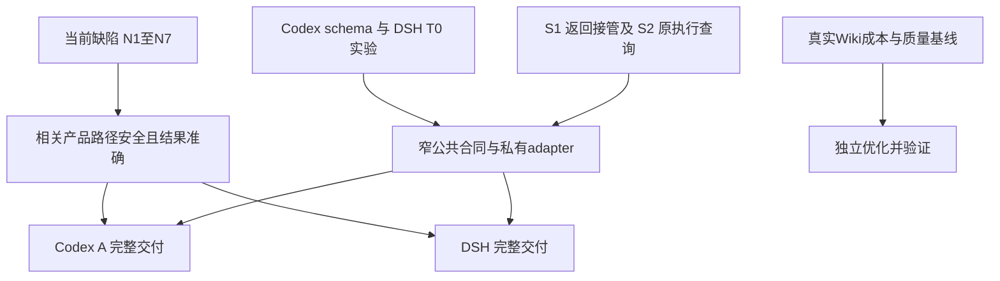

# Octopus 评审意见取舍与开发顺序指导

> 日期：2026-10-28（Asia/Shanghai）。源码基线：`bbadc28e23f312d180631f76585b914922efb8d0`。
> 更新：2026-10-29。N1、N2、N4–N7 的七张实施票已在 `b8e0f32811e41fa9fdbcf825c51c71c7ff378ec8` 完成并通过独立复核；实现与发布验收分别记录。
> 目标：区分现在值得修改的内容，以及适合随 Codex app-server、DeepSeek Harness 接入完成的内容。

## 1. 建议先做什么

**保留模块化单体、SessionOwner、Harness/Profile 和现有持久事实边界。N1、N2、N4–N7 已完成本次选定修复；N3、返回接管及运行时迁移仍需分别选定范围。运行时抽象由 Codex 与 DSH 的实际协议共同验证，不先做一轮全库架构重写。**

几份 review 的方向大体一致，但不能简单叠加成任务清单：旧 HTML 的部分建议已经实现；新 MD 和 DOCX 各自发现了对方没有覆盖的问题；DSH 的依据版本也不同。

| 时机 | 建议内容 | 现在做的理由／暂缓的原因 |
| --- | --- | --- |
| **代码修复已完成** | 应用写入者归属与安全删除、Wiki verify 校验、应用排序交错、会话列表旧快照、计划写入跨重连、Research 投递分类 | N1 拆为两票，其余各一票，共七票；提交 `b8e0f32`，不能据此宣称 N3 或 S1 已实施 |
| **下一批待选** | N3：Agent 默认配置影响旧会话 | 未纳入本次实施范围；保存前的有效配置校验仍待修复 |
| **现在收敛，迁移前完成受影响部分** | 三来源返回接管；基于原 execution 身份的退休查询；缺陷路径中的有效配置校验 | 已有真实消费者和重复规则，收益现在就成立 |
| **现在可以开展实验** | 锁定 Codex schema、DSH 安装产物与协议，验证取消、接受确认、问答和完成范围 | 实验可以与缺陷修复并行；实验通过不等于产品接入完成 |
| **随运行时接入一起改** | 私有双向协议实现、能力表达、发送未知、原生问题与审批、启动资源、监控、恢复历史和账户搬迁 | 这些变化依赖实际协议；提前定出“大统一接口”容易返工 |
| **独立优化，不作接入前置** | Wiki Registry 操作内聚、有界健康诊断、compact 投影和批量读取 | 与新后端关系较弱；性能工作需有成本基线 |
| **暂缓** | 全面 Owner 结算搬迁、全量会话投影重构、常驻宿主池、完整原生尾部、向量检索、全局任务框架 | 缺少当前必要性、协议证据或明确产品范围 |

后续建议顺序是：**N3 → 返回接管／窄接口 → Codex 请求内迁移 → DSH 正式接入**。协议实验可并行开展；Wiki 优化可单独穿插。先 Codex 后 DSH 是控制同时变化因素的工程安排，**不是 DSH 的技术依赖**。

本指导中的“现在做”表示开发优先级。后续 `$implement` 已明确授权并完成上述七票；本文剩余建议仍不因此获得实施授权。

### 1.1 本次实施出口

| 范围 | 已完成行为 | 当前合同与回归 |
| --- | --- | --- |
| N1（两票） | 保全当前及历史 builder 的确切归属；关闭相关准入，由原 owner 收齐并确认 writer 退休后才清理文件；失败持久禁写、显式重试，支持剩余资料导出／导入 | [应用合同](../plans/applications.md)、[退休合同](../plans/architecture-contract.md#输入完成与资源退休)、[应用回归](../../tests/test_applications.py)、[账户搬迁回归](../../tests/test_application_portability.py) |
| N2 | 普通与 App 入口共用操作正文合同；verify 必填、cancel/retry 保留可空及原授权 | [Wiki 合同](../plans/wiki-development-summary.md)、[两入口回归](../../tests/test_wiki_app_parameters.py) |
| N4 | 排序验证、提交及确切变化行由同一事务提供，广播只使用已提交结果 | [应用合同](../plans/applications.md)、[应用回归](../../tests/test_applications.py) |
| N5 | 会话列表统一接纳与冲突补读，覆盖真实写入者、归档防复活、跨重连成功及异步确认后的范围检查 | [协调合同](../plans/frontend-list-reconciliation.md)、[列表回归](../../web/src/lib/sessionList.test.ts)、[真实消费者回归](../../web/src/components/ChatView.fork.test.tsx) |
| N6 | 同账户跨重连写成功使当前计划列表失效补读；失败保留写成功与 stale，不重复原写入 | [协调合同](../plans/frontend-list-reconciliation.md)、[计划回归](../../web/src/lib/scheduleList.test.ts) |
| N7 | 永久完整性拒绝结束自动投递，暂忙沿原身份重试，ACK 未知核对原回执；报告完成与投递结果分开 | [Research 合同](../plans/native-deep-research.md)、[投递回归](../../tests/test_research_session_return.py) |

提交门禁完成一次全套运行，发现的失败已修复并复验受影响部分，未变检查按仓库规则复用。最终后端受影响组 129 项通过，另有 29 项及 967 项受影响检查通过（组间有重叠，不相加）；全前端 705 项通过后，后续消费者增量的 106 项通过，最终 4 项离线浏览器及类型、lint、文档检查通过。Vera 对最终固定树的 Standards、Spec 复核均为 0 项剩余缺陷及复杂度建议。此处是版本限定的提交证据，发布实机检查和部署结果另行验收。

发布准备又覆盖了首次服务代次建立与详情返回交错：同代次详情可继续接纳转录与队列，账户、连接及已知旧服务的保护保留。详情与选择两个真实入口先红后绿，82 项相关回归及原历史回溯浏览器场景通过；该补充不改变消息、问题与 Research 各自的合并职责。

N3、成功删除后的开发聊天永久只读、完整三来源返回接管、Codex app-server 和 DSH 正式接入均未实施。代码要求主库格式 5／Wiki 17；旧 writer 退休后才允许本次有限转换，普通启动不转换旧格式，见[存储交接](../plans/current-storage-format.md)。

## 2. 材料、版本与证据口径

### 2.1 本次实际读取的材料

| 简称 | 材料 | 应如何使用 |
| --- | --- | --- |
| A | [返回接管与架构分析 HTML](architecture-review-20261028.html) | 基于 `0df8b78`；返回接管完整设计及投影、配置候选 |
| B | [前后架构对照 HTML](architecture-before-after-20261028-131512.html) | 比较 `88d2284` 与 `0df8b78`；主要说明演进关系，不作为当前待办清单 |
| C | [全库审查 HTML](architecture-review-codebase-20261028.html) | 两项直接缺陷、七个架构候选；基于 `0df8b78`，保留报告内的证据与边界 |
| M／D／E | 原 Markdown、DOCX 评审及复现证据包，原件未纳入当前仓库 | 下文简称保留其历史观察来源；不能将未入库原件或旧报告结果计作当前版本验收 |

### 2.2 本文结论的强度

- **本轮源码核对**：核对生产分支、调用者、有关测试和当前合同；Vera 做独立只读核查。
- **原报告复现**：M/D/E 记录的执行结果，不能计作 `b8e0f32` 的通过证据；本次回归范围见 §1.1。
- **设计建议**：除 §1.1 明列的已实施范围外，仍是建议。
- **性能候选**：代码中存在对应工作量，尚无本轮真实负载收益证明。
- **外部协议资料**：已读取官方资料或固定上游提交；实际安装包兼容性仍须实验。

M 的五类问题与 D 的四类问题有两类重合，合并得到下文 N1–N7。D 对 N1 的 build 扩展，以及本轮核查提出的独立 BG 路径，不能被原来仅测 backend stop 的复现覆盖。

### 2.3 不应重复立项的旧建议

| 旧问题／建议 | 当前依据 | 本次处理 |
| --- | --- | --- |
| 应用／计划列表单一更新入口 | [applicationList.ts](../../web/src/lib/applicationList.ts)、[scheduleList.ts](../../web/src/lib/scheduleList.ts) 已存在 | 保留；补 N6，不重新建设两个模块 |
| BG 正常完成遗漏进程组退休 | [bg_tasks.py](../../server/bg_tasks.py) 已在结果投递前处理原进程组，失败保留责任 | 保留回归；这不等于“删除应用会取消独立 BG” |
| 应用启动容量竞争 | [app_backends.py](../../server/app_backends.py) 已有启动槽位与退休释放 | 保留；不要合并进模型全局调度器 |
| OAuth 首次同身份绑定竞争 | [connector_manager.py](../../server/connector_manager.py)、[db/connectors.py](../../server/db/connectors.py) 已有身份协调和业务事务 | 不再新增 Repository 或绑定状态账本 |
| DB 完整行映射、Research Task 重复登记 | [projection.py](../../server/db/projection.py)、Research `_register_task` 已实现 | 不重复整理；Task 登记修复不解决 N7 的投递循环 |
| 无数据库执行捷径 | 当前输入接纳与持久事务路径已经收敛 | 新后端继续走现有入口 |
| Codex one-shot 缺 spawn 授权、tool mask 静默忽略 | [OneShotContext](../../server/harness/profile.py) 已有 `authorize_spawn`；[Harness](../../server/harness/harness.py) 实际调用；[AgentManager](../../server/agent_manager.py) 已验证工具策略 | 修正文档时效，不重复新增机制；显式账户传递等剩余问题另审 |

“中文路径回退”必须区分两个主题：Git 特殊路径的处理已有修正；C 引用的 Wiki 中文路径旧反例缺原始输入和完整证据。不能据前者宣布后者已修，也不能直接把后者列为已确认缺陷。

## 3. 七类问题的裁决与实施状态

### N1 · P1：应用删除必须等原写入者退休

**裁决：第一优先级，独立完整工作包。** M §3.2、D §3.1、C 候选01重合，但 D 与本轮核对扩充了必要范围。

**状态：本次两票已完成，见 §1.1。** 以下缺陷描述对应原基线，当前行为以[应用合同](../plans/applications.md)为准。

基线中的 [ApplicationManager.delete_application](../../server/applications.py) 吞掉对话删除与后端停止异常，随后删除目录和行；[AppAgentManager.delete_conversations_for_app](../../server/app_agent.py) 也吞掉逐会话失败。后端 stop 存在进程组或 reader 退出未确认的错误出口；本次已删除这些吞错后继续清理的路径。

**必须分清四类受管资源：**

| 资源 | 如何找原身份 | 删除时的责任 |
| --- | --- | --- |
| 应用 backend | 原 `app_id` 对应的 supervisor state | 原 supervisor 停止并确认退出；失败不丢引用 |
| 应用对话 | `origin="app"` 与 `app_id` | 关闭新接纳，逐个退休；内部失败必须传播 |
| 应用 build 会话 | 当前 `applications.session_id` 与保存的 `sessions.app_id`；替换关联前保全仍可确认的旧归属 | 保留历史，停止活动执行并处置待执行输入；覆盖存量 NULL builder、已归档及恢复／替换交错，不凭 cwd 猜旧归属 |
| build 等原会话启动的独立工作 | 确切的来源、会话、任务／工作绑定及资源 owner | 核查是否仍可写删除目标；交原 owner 退休，或明确拒绝删除 |

build 的 cwd 就是应用目录，且已有[直接在 build 会话聊天的测试](../../tests/test_applications.py)。因此只锁住 `request_build` 不够：普通 `start_message` 也能启动写入。删除期间及失败后，重启、归档唤醒和迟到返回不能重新打开准入；未完成删除独立持久化，等待显式重试。用户在实施范围中取消了“成功删除后永久禁写”：成功时保留开发聊天原行为，后续新输入仍可能重建目录，不新增永久只读或自动 cwd 迁移。

独立 BG 是具体可达路径：[BG 路由](../../server/routers/bg_tasks.py) 传入会话 cwd，[BG 启动](../../server/bg_tasks.py) 使用 `start_new_session=True`。停止 build 的 CLI 进程组不会自动停止 BG 的另一进程组。应核查确切关联的任务，包括“build 本轮已结束但 BG 仍在写”的场景；不得取消所有 `work_id=None` 的任务，也不应新建扫描全机进程的注册系统。其他具有目标目录写入能力的受管独立工作按同一归属原则核查；任意外部程序的 OS 隔离不在此项承诺中。

**建议删除顺序：**关闭该应用及原 build 的新写入准入 → 捕获原资源 → 请求各 owner 退休 → 确认必要 writer 已退役 → 删除目标文件 → 删除记录 → 发布删除结果。HTTP 等待取消后，已开始的清理仍要有明确 owner。

退休失败时保留记录、文件和可重试身份，不广播 `application_deleted`。文件删除自身失败也应显式报告，不能以 `rmtree(ignore_errors=True)` 掩盖残留；文件系统删除不是原子事务，部分已删除的文件不能宣称自动恢复。`keep_files`、资源本来不存在、部分退休完成与重试都要有准确语义。

**本次已调整旧产品取舍。** [applications.md §10](../plans/applications.md#10-what-this-defers) 原先允许删除不中断活动 build；本次已同步更新所属合同，改为删除前退休 writer。成功后的开发聊天行为按上述缩窄范围保留；此项不恢复七张暂停执行票。

**完成标准：**真实临时目录／数据库下覆盖 backend stop失败、reader未退出、部分对话失败、build直接聊天、build结束后BG继续写、删除与新请求竞争、HTTP取消、重启后旧build接纳、成功删除、重复删除、文件删除失败和 `keep_files`。断言资料与记录、原资源引用及实际晚到写入，不能只断言调用过 stop。

### N2 · P2：Wiki verify 两入口遵守同一 body 合同

**裁决：现在修，先完成操作级校验；不以前置重写全部路由为条件。** 对应 M §3.3、D §3.3、C 候选04。

**状态：已完成。** App dispatcher 复用实际 FastAPI 操作的正文解析，required／nullable／默认值不再由模型类型猜测；原账户与 App 的授权边界保留，回归见 §1.1。下段描述原基线。

基线的 [App Wiki dispatcher](../../server/routers/wiki.py) 把缺正文改成 `{}`，并按 `JobControlRequest` 类型统一将 null 解释为 `None`；`verify_job` 要求必填模型并调用 `model_dump()`。原报告观察到普通入口422而App入口500，以及缺正文误执行的差异；这些分歧已修复，cancel/retry 的可空合同保留。

把 required、nullable、默认值和类型校验交回共同操作合同；保留普通账户与 App 各自的认证、白名单和 job/task grant。不要用 `body or {}` 掩盖错误，也不扩大 App 可调用操作。

**完成标准：**两个真实 HTTP 入口对 verify/cancel/retry 分别测试缺正文、null、空对象、合法值、错误类型、畸形JSON与字段；保留 query alias/default/bounds、bool解析及授权测试。先消除确切漂移，完整 adapter 收敛仅在能删除重复解释规则时继续。

### N3 · P2：Agent 默认配置变更不能搁置旧会话

**裁决：现在修有效配置验证；全面配置模块重构不必前置。** 对应 M §3.4。

**状态：未实施，明确排除在本次七票之外。** 下述优先级建议仍保留，不能由其他六类修复推断此项已完成。

[agents.py](../../server/routers/agents.py) 约179行在旧会话有效 effort/tier 都空时跳过校验；旧会话保留 Codex backend，却可能继承 Agent 新的 Claude credential。[实际凭据解析](../../server/sessions/credentials.py) 下一轮拒绝此组合是正确行为，问题在于此前配置保存已成功。

**推荐默认政策：**写入前验证所有受影响会话的有效 backend/credential，独立于可选 effort/tier；会搁置旧会话则拒绝保存，并指出需要处理的会话。另一种政策是在同一业务变更中保全旧会话原有效配置，但涉及额外写入和产品语义，不建议本次默认采用。两种政策都不能静默迁移原生历史或借用宿主凭据。

**完成标准：**无override／有override、归档会话、空模型参数、同backend换key、跨backend切换、正在执行的请求和下一请求；已有一致捕获与效果前授权检查保留。来源：当前路由及 M 的失败／对照记录；本轮没有重新调用模型。

### N4 · P2：应用排序不能假定前后集合相同

**裁决：现在局部修复，不新增全局锁或 Repository。** 对应 M §3.5。

**状态：已完成。** 排序及本次确切变化行已收回同一业务事务，旧 before／after 索引路径已删除，见 §1.1。下段描述原基线。

基线的 [reorder_pins](../../server/applications.py) 先读 before、提交排序、再读 after，最后用 after 的ID直接索引 before；新建／恢复交错可能在提交后产生 KeyError。

比较时明确处理新增ID；若接口需要“本操作改变的行”，让现有 DB 业务事务直接返回对应结果。不要通过忽略所有异常丢掉事件或伪称未执行。

**完成标准：**排序与创建、恢复、归档、删除交错，排序意图正确、返回不崩溃、广播与已提交事实一致、账户范围不变。

### N5 · P2：会话列表旧 HTTP 快照不能覆盖新 WS 事实

**裁决：现在给会话列表建立自己的合并入口。** 对应 M §3.6；与 A 的全面聊天投影候选区分。

**状态：已完成。** [SessionList](../../web/src/lib/sessionList.ts) 纳管读取与真实写入口，统一冲突补读和范围检查；成功表单关闭、确认后导航及账户切换边界已覆盖，见 §1.1。下段描述原基线。

基线的 [useWebSocket.ts](../../web/src/hooks/useWebSocket.ts) 重连读取直接 `setSessions`，[SidebarAgents.tsx](../../web/src/components/SidebarAgents.tsx) 另有读取入口。旧 running 快照可覆盖已收到的 idle，已归档会话可重新出现；本次已移除生产者的无保护整表覆盖。原 `accountFetch` 已有账户代次保护，原同账户时序反例不代表当时已证实跨账户泄漏。

统一会话列表的读取基线、事件合并、归档／删除保留及连接／服务代次。只加 HTTP 请求序号不能防 HTTP 与 WS 交错。复用应用／计划列表的设计经验，不把三个领域强塞入通用 reducer。

**完成标准：**旧GET晚于idle／归档事件、快照期间新增、两次重连响应倒序、旧socket、账户切换，以及所有会话列表写入口。此项不要求重写消息窗口、问题卡片和Research卡片。

### N6 · P2：计划写入跨重连成功后要补当前读取

**裁决：现在补齐 ScheduleList；已存在的模块继续保留。** 对应 D §3.4，M未列此反例。

**状态：已完成。** 同账户迟到成功使用当前范围补读，确认失败保留已成功事实；原请求不重发，见 §1.1。下段描述原基线。

基线的 [ScheduleList.write](../../web/src/lib/scheduleList.ts) 只在原连接仍 current 时 invalidate。反例为 disable PATCH在途 → 重连GET仍得到enabled → 旧PATCH确认成功 → WS通知丢失，最终旧列表却是 `stale=false`；服务端允许数据库写成功而广播失败。

参考 [ApplicationList.write](../../web/src/lib/applicationList.ts) 已有策略：**确认写成功且仍属同账户／token时，令当前列表失效并补GET**。不应用旧连接的行，不重复PATCH；账户切换、token变化或dispose后不产生该副作用。补读失败不能改写原写入已成功的事实。

**完成标准：**生产类受控交错覆盖PATCH、POST、DELETE，确认GET失败、重复重连、退出登录与账户切换；断言最终列表和请求次数，而不只断言invalidate被调用。

### N7 · P2：Research 应区分永久拒绝、暂拒和接纳未确认

**裁决：独立修复投递分类，不等待 provider 迁移。** 对应 D §3.2，M未列此反例。

**状态：已完成 N7，S1 完整返回接管未实施。** `AdmissionIntegrityError`、`SessionAdmissionBusy` 与 ACK 未知已有明确分类，报告完成和投递状态分开，见 §1.1。下段描述原基线。

基线的 [ResearchManager._inject_report](../../server/research/manager.py) 把接纳的所有Exception都按一秒间隔重试；研究计算的timeout不覆盖后续投递。[Owner接纳](../../server/sessions/owner_runtime.py) 对转录 `duplicate_seq` 会明确拒绝，重复同一报告不会修好它。原报告观察到 `completed / injection pending` 持续重试；报告正文已保存，不能写成报告必然丢失。本次已移除捕获任意异常后的无差别重试。

在拒绝产生处给出明确类型：永久完整性拒绝终止自动投递并保留原因；容量／fork／archive忙可沿原身份重试；提交后ACK未知先查原receipt。**不能把任意ValueError当永久错误**，当前暂时忙也用此类型。禁止通过随意限制重试次数代替分类。

现行返回接管设计的六种 `ReturnRefused.reason` 没有覆盖转录完整性拒绝。建议保留一个明确的接纳完整性异常，由来源处理为可见投递失败；若选扩展有限拒绝枚举，也须同步所属合同。无论哪种，`SubmissionConflict`、取消、未分类程序错误和存储失信都不进入通用refused/unconfirmed兜底。

**完成标准：**永久拒绝只产生有限处理、暂忙后同身份成功、ACK丢失后查到原输入、Owner不可用、停机、来源取消、重复恢复。保留研究completed、报告路径和原delivery，不重跑研究任务，不抹掉此前未确认发送。

## 4. 现在值得做的接口收敛

### S1 · 三来源返回接管：优先采纳现有设计

**状态：未实施。** N7 已按明确异常分类独立交付，不代表 BG、Research、委派的旧接纳编排已统一。

依据 A/B、M §6.5、D §5.3，以及当前[架构合同的待处理返回设计](../plans/architecture-contract.md#待处理返回接管设计未实现)。这已是三个真实来源共同需要的操作，不是为未来后端猜接口。

目标是在现有会话模块提供一次 `admit_return(target, prepare=...)`。BG、Research、委派终态／问题只提供原身份与按需材料；会话模块负责共同接纳顺序。**来源保留重试策略、是否仍需投递和自身业务结算。**

| 阶段 | 必须成立的事实 | 删除的调用方负担 |
| --- | --- | --- |
| 查原receipt | 已接纳时直接返回；不读缺失正文、不唤醒、不重新入队 | 每个来源自行处理确认丢失 |
| 判断资格 | 原会话、source、delivery、work及owned binding相符 | 各自读Owner私有状态判断可用性 |
| 按需prepare | 不持mailbox、生命周期锁或DB事务等慢I/O；可重复读取，无来源结算副作用 | 会话层认识每种材料的读取方式 |
| 准备后重验 | 再查receipt；唤醒等待后重新核对资格 | 调用者自己维护跨await顺序 |
| 原Owner提交 | 使用已有输入事务、去重与digest冲突规则 | 新增第二份输入队列或接管账本 |
| 返回结果 | 已确认receipt、本次明确拒绝、无法确认；特殊错误继续传播 | bool混合表达拒绝与未知 |

归档唤醒和输入提交仍是两个提交点；没有新增输入不证明此前没有合法唤醒。不得为追求“原子接口”伪造跨操作事务。此前未确认的尝试，也不能被后一次明确拒绝改写成“从未接纳”。

**删除标准：**三个来源不再分别拼装 `source_receipt → resolve_task_return → start_message`，不再读取 `_admission_closed` 解释接纳资格；已有通用入口供其他调用者继续使用。保留本次 N7 已实现的完整性分类及未知确认语义。

**验收：**同delivery并发、提交后ACK丢失再遇Owner失败、prepare期间归属变化、先命中receipt而正文已不存在、Stop保留待处理返回、已取消问题晚到、digest冲突和存储失信。保留真实SQLite接纳事务及每个来源自己的结算断言。

**边界：**Wiki的请求组聚合／outbox、schedule首次触发、App业务响应、人工输入不迁进此入口。不新增任务总线、完成Future或后台恢复循环。

### S2 · 原 execution 退休查询：在迁移前隔离业务消费者

C候选05的窄切片值得采纳。当前 [Wiki require_retired](../../server/wiki/job_execution.py) 直接检查 `_pending_queue`、`_run.request`、`_run.retirements`。替换运行对象后，Wiki不应被迫理解新的RPC内部结构。

由现有会话／执行owner提供按原 request、attempt、work及实际资源引用裁定的查询或等待；Wiki继续组合自己的assignment、job与文件效果。接口不能只返回“当前session idle”，也不能因当前没有对象而推断原执行已退出。

先明确如何将退休责任对应到原身份；保留证据不足时的保守拒绝，直到新接口能提供等价或更精确证据。不要仅封装几个字段就移除原保护。

**完成标准：**旧Wiki请求已结束但资源仍退休、后续人工请求正在运行、取消后spawn迟到返回、原session对象缺失、退出失败与重试。消费者不再依赖运行时私有布局；原执行资源仍只有一个owner。

### S3 · 配置校验先修，捕获内聚随接入推进

N3已证明有效配置验证值得现在修；不等于应新建全局ConfigurationManager。继续使用现有 `configuration_lock`、effective settings与请求捕获。

双向协议接入时再把“配置变更、关联校验、提交后刷新、一致捕获”的重复顺序收回所属业务入口。同步核验model、credential、cwd、工具和Wiki范围；慢prompt拼装、memory、connector准备不塞进同一个大锁或大模块。

验收观察**实际启动与实际下一请求使用的配置**，不能只查数据库值。配置快照回答“本次使用什么”，效果前授权回答“现在是否还能做”，二者都要保留。

### S4 · 这些重构不必现在全面做

| 候选 | 当前裁决 | 触发条件 |
| --- | --- | --- |
| OwnerRuntime → Manager → Owner结算回路 | 先做S2，全面搬迁延后 | 某条结果分类／提交路径确有重复维护或新协议无法局部接入 |
| 消息、问题、Research卡片全量投影模块 | 先修N5/N6，保留现有hydrate/seq/generation | 新原生事件出现明确乱序反例；以一种卡片完整验证 |
| 所有owner的installation idle接口 | 新资源接入时补相关owner，其他按需 | 新进程、pending response、退休任务会影响发布交接 |
| 所有配置、所有Wiki路由一次性搬迁 | 不作为前置 | 能指出删除了哪些重复规则，且范围可独立验收 |

## 5. 两个运行时共同需要的接口合同

### 5.1 保持现有权威，只扩展 Harness 内部协议

| 责任模块 | 应继续拥有 | 不应新增的第二权威 |
| --- | --- | --- |
| SessionManager / SessionOwner | 接纳、排队、原请求、问题生命周期、业务结算 | provider自建Octopus输入账本或调度器 |
| HarnessRun／原资源owner | 准备、spawn、reader/writer、取消、join及未退休引用 | SDK和Harness各自一套相互不可见的进程管理 |
| RuntimeProfile与私有adapter | 能力、装配、协议握手、原生身份／事件映射 | 在Wiki、Research、路由中识别原生RPC方法 |
| Database | 输入与terminal的真实事务 | 以原生session日志替代业务接纳事实 |
| 各返回来源 | 自身业务结果、交付重试、放弃原因 | 全局JobManager统一所有工作语义 |
| Wiki | 身份、revision、授权、文件效果和outbox | 用模型final代替文件发布证据 |

公共接口的意义是让调用者少知道规则。内部可有Codex RPC、DSH SDK wire／ACP、Claude stream-json不同实现；无需坚持所有差异只是argv或JSON序列化。

### 5.2 分开目前被 stdin 模式混在一起的能力

目前 [presentation.py](../../server/sessions/presentation.py) 的steer显示、[HarnessRun](../../server/harness/run.py) 的reusable等推导与 `STREAM_JSON` 有关。双向协议不自动等于可steer，也不自动等于可跨请求复用。

| 独立能力／事实 | 调用者真正需要知道的合同 |
| --- | --- |
| 双向控制 | 能持续接收response、notification、server request，并答复原请求 |
| 活动turn追加输入 | 是否支持；限定原活动身份及兼容配置；拒绝／未知准确返回 |
| 原生问题／审批 | 各自类型、原问题身份、结构化答案及过期规则 |
| 输入发送证据 | 未发送／明确拒绝、已接受、发送结果未知；写管道不等于接受 |
| 业务完成证据 | provider承诺哪个活动区间结束，是否有错误及未完成后代 |
| 资源退休 | 原进程／读写任务／受管资源是否确实退出 |
| 跨请求复用 | 独立产品与授权决定；首轮迁移不因此引入宿主池 |

能力由实际后端元数据和执行对象提供，不另养一份前端静态真相。操作不支持就明确拒绝；不要自动换provider或协议执行原任务。

### 5.3 控制与展示必须能分别推进

私有协议reader持续分派响应、通知和server request；不能在reader里同步等用户回答，也不能因普通展示队列满而无法接收取消。共享机制限于确有共同语义的完整帧写入、pending响应、方向分派和有界缓冲；方法名、握手、终态及问题语义仍归adapter。

缓冲必须有界。可等价合并的delta可以合并，最终item和终态不能静默丢失；确实无法保全时明确输出／记录不完整并收束执行。不用无限队列假装解决背压。stderr、EOF和退出始终有人收尾，取消后迟到的spawn句柄仍归原owner。

**最先做的反证：**填满展示通道时发Stop；发送完成但ACK丢失；通知先于response；两方向出现相同数字RPC ID；原问题取消后答案到达新宿主；已有正文后出现错误。只有短对话成功不足以验证设计。

### 5.4 请求内迁移与暂停范围的关系

建议新Codex请求内宿主、DSH隔离宿主分别拥有原凭据、配置、lease与资源；下一逻辑请求通过原生resume延续历史。这个**候选设计**不表示当前Claude held路径已经具备同样保证，也不恢复整库所有暂停票。

[架构合同](../plans/architecture-contract.md#暂停范围与恢复条件)仍暂停22、23、24、28、31、42、43。未来选定接入范围时，必须把本次必需的局部输入确认、取消和资源保证明确写入实施合同；不能一面依赖这些行为，一面以“暂停”免去相应验收。也不能反过来借局部接入自动承诺跨后端强送达、全部held切换或完整原生尾部。

## 6. Codex app-server：推荐请求内迁移，保持完成范围清楚

### 6.1 当前不是从零开始，也没有完成普通对话迁移

普通Codex对话仍是 `codex exec --json`。[codex_control.py](../../server/harness/codex_control.py) 已短时使用app-server更新controller；[codex_text.py](../../server/harness/codex_text.py) 的独立文本调用也使用控制接口处理配置／认证。这些已有用途应分别保留或被确切替代，不能因文件名包含app-server就全删。

官方文档确认连接握手后可以创建／恢复thread、开始turn、接收事件；`turn/steer` 要匹配 `expectedTurnId`，不接受turn级配置覆盖；`turn/completed` 还需检查完成、失败或中断状态。CLI可生成与本版本匹配的schema。以上是协议资料，不代表本机版本已验收。[OpenAI App Server 文档](https://learn.chatgpt.com/docs/app-server)

### 6.2 明确选择 A，不将 B 偷渡进来

| 范围 | 本文建议 | 完成含义 |
| --- | --- | --- |
| **A：请求内交互迁移** | 优先 | 本地stdio独占宿主；当前turn交互、事件、问答和取消；请求结束退休，下一请求resume历史 |
| **B：完整原生尾部** | 单独产品范围与实验 | 根turn结束后仍处理后代回报、父续轮和再委派，直到承诺范围真正完成 |

A允许活动turn内使用原生子代理，但不承诺根turn结束后的任意未来工作。已观察到的失败、未完成或退休中断必须如实呈现，不能把根成功显示为所有子任务成功。可靠跨请求工作继续使用BG、Research和命名委派。

此区分沿用[固定基线中的可行性设计](https://github.com/Danuvius152/Octopus/blob/bbadc28e23f312d180631f76585b914922efb8d0/docs/review/codex-app-server-feasibility-20261023.md)。该文件在当前工作树已删除，本文只引用Git快照作为历史来源，不恢复文件、不覆盖用户的文档整理。

### 6.3 同一个接入工作包中应完成的行为

| 工作面 | 应实现的结果 | 同步删掉的旧路径／知识 |
| --- | --- | --- |
| 宿主与controller | 握手、controller准备、thread恢复和turn由同一个原资源owner负责；spawn前授权覆盖辅助writer | 普通对话被替代的前置控制宿主与exec启动编排；独立文本调用所需控制代码保留 |
| 输入与steer | 绑定原turn，保留接受／拒绝／未知；只允许配置与权限兼容的内容追加 | 以stdin模式猜steer；kill+resume冒充追加 |
| 配置变更 | model/effort、credential、MCP或Wiki范围的新配置在下一请求安装；撤权仍在当前实际调用／效果边界立即校验 | 在旧lease下静默安装新grant、替换活动权限，或把撤权延迟到下一请求 |
| 问题与审批 | 原connection/server-request/thread/turn/item和产品question对应；过期答案不能串线 | 普通prompt模拟答案、未知审批类型自动允许 |
| 输出与结算 | 按item和原attempt合并，保留commentary、工具、最终答案与错误 | 最后非空字符串／exit0即成功的推断 |
| 取消与退休 | interrupt、流结束、原资源join分别确认；失败保留owner | ACK等于已退出、EOF等于所有writer退出 |
| 历史与产品入口 | 普通会话、App build、委派、计划、Wiki worker、Research调用均满足各自合同 | 某些入口继续偷偷调用旧普通exec主路径 |
| 监控与运维 | 识别新进程形态，指标绑定原请求；发布交接能看见在途准备／RPC／退休 | Monitor只识别旧argv、main遗漏新责任 |

当前Owner追加输入还会调整knowledge/Wiki任务上下文，接入时必须审核这条调用链：支持steer不意味着允许扩大当前执行授权。附件策略也按已选范围实现，不能因wire支持某种输入就自动扩大产品能力。

**one-shot另行保持tool-free合同。** 不把独立纯文本worker改回完整agent运行。Research leaf是否只允许web、是否有宿主工具继承，也须按真实配置验证；read-only和不装配Octopus MCP都不等价于完全无其他工具。

### 6.4 切换与回滚的规则

先锁定实际CLI版本及schema，保存当前exec的代表行为样本，再做目标协议离线与实机验证。若开发中需要传输选择，必须在发送新输入前决定；发送结果未知后不能切回exec重跑。

正式切换验收完成后删除被替代的普通exec主路径与专用重复准备逻辑，不长期维护两套半完成正式路径。发布回退使用已验证的旧版本／快照，并先处理原执行；回滚软件不等于撤销已发生的外部效果。独立one-shot或其他确有不同合同的路径不属于应删除范围。

## 7. DeepSeek Harness：先锁版裁定路线，再完整接入产品

### 7.1 三份材料的 DSH 依据不能混用

[现行DSH计划](../plans/deepseek-harness-backend.md)基于本机 `0.2.1-rc.2`；D基于上游 `f3803c96974ad4a94195fb97e5c637e9c2a3afe3`，manifest为 `0.2.2-alpha.2`；M另参考当日Python SDK文档。本轮读取了D所引固定提交的协议、client、server、ACP、headless、sdk-minimal说明及package.json，未安装或运行该DSH版本。

固定提交的SDK wire提供原生问答和可选审批；prompt回执表示入队，messageId不直接标识随后回答；wait有特定受管后代范围；没有逐session cancel/close。不能把旧计划“wire无原生审批”或高层run的idle区间直接当作新版完整任务完成合同。[固定版本 SDK 协议](https://github.com/deepseek-ai/deepseek-harness/blob/f3803c96974ad4a94195fb97e5c637e9c2a3afe3/packages/sdk/protocol/README.md)

Python SDK官方指南现在提供含匹配原生runtime的安装方式；因此“必须通过旧npm包安装”也不应成为永久前提。正式T0仍需固定**实际可安装产物**与版本／摘要，不能只记录master或文档访问日期。[Python SDK指南](https://deepseek-harness.github.io/deepseek-harness/en/guide/python-sdk)

### 7.2 对路线分歧的裁决

| 路线 | 选择理由 | 首先要证伪的风险 | 本文裁决 |
| --- | --- | --- | --- |
| SDK原生wire，由现有Harness驱动 | 原生身份、事件和交互信息较完整，资源可归现有owner | 入队到结果的归属；无session取消时整宿主退休是否完整且有界 | 与ACP并列进入T0；原生交互／谱系必要时重点评估 |
| 官方Python SDK | 可减少自己维护协议客户端的工作 | SDK进程、阻塞调用、callback和Harness是否形成双重owner | 不是禁止项；证明关闭／取消和身份桥接更简单后可选 |
| ACP | 标准自动化接口与session取消／关闭较明确 | 投影是否缺少必需的原生子代理身份、问答或展示信息 | 不因旧计划优先ACP就跳过能力核对 |
| headless JSON | 有限任务与退出边界较直观 | 无轮内交互、预览帧裁剪、终态含义是否满足产品范围 | 仅在选定需求确实允许时采用，不为迎合exec引擎而削弱产品 |

ACP的固定版本说明提供session取消／关闭与受管活动结算，同时明确其标准自动化表面不覆盖全部DSH交互扩展；原生信息是否足够必须按Octopus消费者验证。[固定版本 ACP 合同](https://github.com/deepseek-ai/deepseek-harness/blob/f3803c96974ad4a94195fb97e5c637e9c2a3afe3/packages/acp/acp/README.md)

**最终只保留一条正式DSH主执行路线。** 不预先决定必须Python SDK，也不预先决定必须自己实现wire；比较的是完整资源与行为责任的总成本。若同步SDK被包在 `asyncio.to_thread` 中，取消等待并不自动停止其线程或子进程，必须有可观察的有界关闭方案。

### 7.3 T0 的输出和停止条件

T0是选型证据包，不是已经可以上线的“最小后端”。建议覆盖：

1. 实际安装包、runtime、SDK、schema及配置profile的固定版本／摘要，区分源码版本与发布产物。
2. 按既有消费者列能力要求：普通会话、问题、审批、工具、原生子代理、Wiki、one-shot、Research、历史、附件。
3. 同一组协议实验：长答案、先正文后错误、异常EOF、忙时第二输入、原生子任务仍在推进、发送后断连、等待问题时Stop。
4. 凭据／账户隔离、两个不同MCP bearer、resume后新权限、工具限制、资源退出和同账户并发的观察记录。
5. 明确选中的路线、产品不支持范围、实现责任及需要补的上游能力。必要能力不满足就不注册为可用后端；不能靠提示词弥补缺失协议。

只跑SDK示例得到非空final_response不能通过T0。没有真实key／目标模型／安装版本的证据时，把对应项留为待验证，不将接口文档当作已验收。

### 7.4 两个容易误用的细节

固定版本headless允许stdin输入；判完成至少要结合 `final.reason.kind` 和进程退出，普通事件流是有裁剪的投影。旧计划关于argv-only及仅靠末次turn_end的条件设计应在选型后整体修订。[固定版本 headless 合同](https://github.com/deepseek-ai/deepseek-harness/blob/f3803c96974ad4a94195fb97e5c637e9c2a3afe3/packages/bundle/headless/README.md)

`sdk-minimal`默认仍有shell、read_image、working_directory，且省略部分项目规则／skills等组成。名字中的minimal不表示tool-free，也不表示满足Octopus普通agent产品配置。分别定义完整turn、one-shot、Research leaf的真实工具组合。[固定版本 sdk-minimal](https://github.com/deepseek-ai/deepseek-harness/blob/f3803c96974ad4a94195fb97e5c637e9c2a3afe3/packages/bundle/sdk-minimal/README.md)

### 7.5 正式接入必须覆盖的产品面

| 面向 | 完成要求 |
| --- | --- |
| 后端身份 | API／DB／生成前端类型使用既定 `deepseek`；保留 `codex`、`claude-code`；不另注册同义 `dsh` |
| 账户与凭据 | 明确账户与credential归属的home；原地换key、撤权、错误提示；不从cwd或key推导user |
| 启动资源 | 配置与临时秘密文件归实际launch owner，直到退出后清理；纯argv renderer不制造短命文件 |
| 配置与UI | 模型目录、effort、tier、认证方式、能力和不支持提示来自后端；不留二后端特判漏项 |
| MCP与Wiki | 每entry原URL和bearer完整保留；work/task/attempt/lease绑定、撤权、文件效果与返回都沿既有合同 |
| 项目指令与memory | 原生AGENTS/skills发现与Octopus controller各守来源；canonical memory不因provider而复制成两份 |
| 全部调用者 | 普通turn、自然语言计划的one-shot、Research leaf、App、委派、Wiki worker的各自限制与结果准确 |
| 历史与附件 | 精确resume；不兼容／不存在时明确失败；fork/replay、附件及handoff能力逐项声明，不伪造支持 |
| 数据搬迁 | DSH持久home／历史／附件进入账户导出、排除、恢复及验证；临时秘密与运行socket不得当持久资料复制 |
| 监控与退出 | 原身份、活动、错误、用量及进程可见；服务关停、发布排空覆盖新资源 |

同账户目录与MCP授权不提供同OS用户下不可信租户的执行隔离；接入DSH本身不改变现有信任范围。不同provider的native session ID不得互用，DeepSeek失败后也不得自动换Codex继续同一未知执行。

验收须分别证明现有Codex不回归、DSH达到选定合同；Claude保留共享与离线行为。本机不要求为此另行安装、登录或调用当前不可用的Claude。

## 8. Wiki：独立推进正确性与可测量的效率优化

### 8.1 Registry 内聚值得做，但不阻塞新后端

C候选03、M §9.2、D §9.5指出相同问题：[Registry](../../server/wiki/registry.py)、HTTP handler和[维护准入](../../server/wiki/maintenance_admission.py)之间外泄了Store借用、注册代次及锁序知识。

按真实操作类别提供“取得同代对象并完成受保护操作”的接口；冷准备不持业务锁等待，恢复完成才公开对象；撤权／重绑定后在效果或提交前重验；旧lease真实退出后才能退休。删除调用方的私有锁拼装，不把模型运行包进一把大锁。

现有证据支持耦合，**没有证明已经死锁**。验证准备期间撤权、取得Store后重绑定、并发幂等、提交失败不唤醒和旧借用退休。History、Store、Registry与jobs各自事实继续保留。

### 8.2 合并两份新报告的效率建议

| 优化 | 来源与代码依据 | 时机与完整验收 |
| --- | --- | --- |
| 使用compact／read_many／已有材料复用 | M W1；现有工具和响应预算 | **现在先检查调用方式**。固定任务比较工具轮数、响应字节、重复输入与证据完整性，不改协议就可能获益 |
| 健康诊断返回准确count＋有界样本 | D §8.3；[Store._index_state](../../server/wiki/store.py)先物化全部错误，compact再截取 | **优先测量的小优化**。在同一读取快照计算数量与样本；保留完整诊断入口，不另养计数缓存 |
| compact搜索少搬运最终候选全文 | M W2；[retrieval.search](../../server/wiki/retrieval.py)词法命中后逐项 `SELECT d.*` | **测量后独立交付**。批量取必要元数据／窗口，保持排序、中文坐标、revision；测SQL次数、内存及传输字节 |
| full导航当前页关系批量读取 | D §8.3；[Store.navigation](../../server/wiki/store.py)及catalog依赖 | **出现页大小相关成本后**。同一快照结果等价，减少逐文档查询；连接复用不等于查询数已减少 |
| 长文分页减少重复整文件读取 | M W3；[read_snapshot](../../server/wiki/store.py)、[raw_blocks](../../server/wiki/raw_blocks.py) | **先批读／调用策略**。确有多轮瓶颈再评估reader handle；修改、删除、重绑定、撤权时仍版本准确 |
| 宽查询／深分页重复候选计算 | M W4、D §8.3；[search_index.select](../../server/wiki/search_index.py) | **先EXPLAIN与规模测试**。不能为快而截断候选，破坏覆盖、去重、compare／overview多样性 |
| 写入风暴导致首次读取同步成本 | D §8.3；Store synchronize与事件消费 | **单独测安静读／单文改／批量导入／恢复**。不能用过期授权证据换低延迟 |
| 多库后台公平性／并发同步 | M W5；Registry后台任务 | **实际多库积压出现后**。保留每Store责任，不把缓存淘汰当退休 |
| 向量／混合检索 | M §9.5、D §8.4 | **真实词法召回缺口后**。新增可重建投影，不替代Markdown身份、授权和阅读证据 |

不能把上述候选写成“每次搜索全库文件扫描”。当前已有章节FTS5、中英文分词、增量同步和按文档去重；热导航、搜索与live正文阅读是不同路径。compact词法分支的问题是最终候选全文搬运，不是Python扫描整个库。

### 8.3 决定是否优化的证据

建立一组真实问题与预期证据，覆盖精确路径／标题、中文同义、跨语言、overview、compare、空结果、修改／退役／撤权。分别记录Recall@k、目标章节、revision正确性、响应和输入成本。性能分冷索引、热查询、live read、维护队列报告，避免混合成一个平均延迟。

合成规模可按100／1000／10000文档分档，加入高命中词、长文、坏frontmatter和并发修改；这些是建议实验档位，不是当前已验证容量。记录p50/p95、SQL数、文件读取次数与字节、队列延迟。

M引用的历史长文分页读放大、D的8文档／15查询实验，可帮助定位路径；**都不是本轮生产性能证据**。D的正例两种算法都14/14命中，不能写成召回提升；搜索阶段零次被计量的vault `read_bytes`，也不表示零SQLite或磁盘I/O。

## 9. 对所有主要 review 候选的最终裁决

| 原建议 | 最终时机 | 采取方式 |
| --- | --- | --- |
| A/B 返回接管统一 | 现在／迁移前 | S1；结合N7，保留三来源边界 |
| A 先查receipt再prepare | 与S1同批 | 不另立“读取优化”，它属于接纳正确性 |
| A 三类接纳结果 | 与S1同批 | 特殊错误不兜底；补N7完整性分类 |
| A 会话投影内聚 | N5已完成，全面投影按需 | 保留不同卡片、seq、generation规则 |
| A/B 配置变更与捕获 | N3先做，S3随接入 | 不扩大到全部Owner准备 |
| C01 删除前退休 | N1已完成 | 含build／独立BG、旧归属及失败保全；成功后永久禁写未纳入 |
| C02 应用／计划列表模块 | 已实现 | 保留；修N6与独立N5 |
| C03 Registry借用与代次 | 可独立做 | 按操作类别收回规则，不加全局锁 |
| C04 Wiki共用校验 | N2已完成，进一步内聚按需 | 两入口合同一致，权限白名单保留 |
| C05 Owner结算与退休 | 先S2，全面结算延后 | 原身份查询优先，不重写Owner |
| C06 OAuth完整事务 | 已实现 | 保留同身份并发、refresh／重授权回归 |
| C07 各owner裁定可交接 | 受影响部分随新资源接入 | 推导真实在途责任，不持久化第二份idle |
| C次级DB映射／Research Task | 已有相应实现 | 不重复立项 |
| C无DB执行与浏览器收讫简化 | 前者已收敛；后者另论 | 收讫语义涉及产品合同，不按无损清理删除 |
| B按行数解释演进 | 作为背景 | 不以文件／行数推断架构质量或重写必要性 |
| M五类缺陷＋D四类缺陷 | 六类已完成，N3待选 | N1拆为两票，实际七票；不把票数当作七类全部完成 |
| M/D Wiki效率 | 独立、先测量 | §8合并，保留现有证据与授权 |
| M/D测试与依赖可复现性 | 现在准备，接入时落实 | 固定安装基线，修真实受影响夹具，不盲目放宽断言 |

**本轮不建议启动：**微服务化、替换SQLite、通用Repository／ORM、全局JobBus、第二套执行表、重复completion Future、跨账户／跨请求宿主池、全项目双语文档镜像。完整原生尾部、强送达和更强隔离可有价值，但要先有明确产品目标和可证明的协议支持。

## 10. 可执行的工作包与依赖

### 10.1 推荐排期

| 工作包 | 内容 | 依赖／可并行项 | 出口与删除标准 |
| --- | --- | --- | --- |
| W0 版本与证据整理 | 固定当前代码、依赖、资料；登记已实现／未验证项 | 立即；不运行生产模型 | 不再引用不存在的工作树文件作为现行合同；旧证据可定位 |
| W1 应用安全删除（已完成） | N1原归属、受管writer、准入、失败保全、历史保留 | 独立于provider；成功后的永久禁写排除 | 无未退休writer仍删资料；删除失败不报成功；旧吞错路径退出 |
| W2 Wiki与排序缺陷（已完成） | N2、N4 | 两个可独立评审的改动 | 两入口参数一致；排序交错无提交后KeyError |
| W3 有效配置 | N3 | 与W2可并行 | 保存前发现不兼容继承；当前／下一请求正确 |
| W4 列表正确性（已完成） | N5、N6 | 与后端缺陷可并行，避免同文件并发写 | 所有实际写入口纳管，旧快照不能回滚新事实 |
| W5 返回接管（N7已完成，S1待实施） | 保留N7投递分类，再按S1统一三来源接纳 | 不依赖新协议；结合现有已确认设计 | 三来源旧编排删除才算S1完成；永久拒绝不重试，未知不重跑 |
| W6 协议实验与窄接口 | Codex schema、DSH T0、S2、受影响S3 | 实验可从W1开始并行；接口由实验反馈收敛 | 能力／结果／退休证据清楚，选定路线，无双重owner |
| W7 Codex A交付 | §5、§6及真实消费者 | 产品切换前完成相关当前缺陷和W6证据 | A完整验收；被替代普通exec／前置路径删除；one-shot独立保全 |
| W8 DSH交付 | §5、§7的正式后端 | 技术上只依赖选型和共同合同；建议在W7稳定后切换 | 账户／配置／工具／历史／UI／监控／搬迁闭合；只留一条主路线 |
| W9 Wiki优化 | §8逐项选择 | 独立；不与协议／存储大改捆绑 | 有测量收益、结果等价、身份和授权不退化 |

编号是交付单元，不是强制串行，也不是精确工期。W1影响生命周期与持久行为，W5影响多来源接纳，W7/W8影响外部协议及所有消费者，均需单独设计审查与最终验证。W2/W3/N6可更小范围交付，但各自失败路径不能留作“以后补齐”。

图中没有Codex→DSH技术依赖箭头。开发时尽量避免同时修改公共Harness所有权与两个adapter，减少故障定位和回归归因成本。

### 10.2 两个新运行时共用的验收矩阵

| 场景 | 必须观察到的结果 |
| --- | --- |
| 正常新请求／resume | 原账户、原历史、固定配置、输入和terminal准确关联 |
| 非空正文后失败／异常EOF | 正文保留，状态失败或明确未知，不能伪成功 |
| 输入写出但ACK丢失 | 原身份保留，不重复有副作用执行、不自动换协议 |
| 忙时输入／配置更新 | 按真实能力steer或排队；授权变化不借用旧lease |
| 问题／审批期间Stop | 原等待和资源收束；晚答不控制新请求 |
| 准备／spawn途中取消 | 无授权则不启动；迟到句柄仍有owner并退休 |
| 慢UI／满事件队列 | 控制有界可执行，正文完整性准确，缓冲有界 |
| 根结束但后代仍活动 | 按选定完成范围判断，已知失败不被根success掩盖 |
| 撤权／换key／多MCP bearer | 捕获与实际效果处授权均生效，不借其他账户凭据 |
| Wiki写入／取消／返回 | 原task/work/lease和文件效果正确，不以模型文字判发布 |
| one-shot／Research leaf | 实际工具能力符合各自合同，EOF不凭空变答案 |
| App／委派／计划等调用者 | 原receipt、来源结果和退休分别取证 |
| 服务关闭／发布排空 | 在途准备、RPC、等待问题及退休都进入原owner判断 |
| 账户导出导入 | 持久历史与附件完整，临时权限不被恢复成新授权 |
| UI／监控 | 能力、错误、未知状态和执行指标真实可解释 |

离线故障注入、锁版schema／事件样本、真实runtime、浏览器组合场景各有证明范围，不能互相代替。未变版本的有效证据复用；修复或新失败假设出现后只重跑受影响检查，再按[testing.md](../testing.md)完成提交／发布门禁。

### 10.3 测试和依赖建议的取舍

D记载的后端离线结果包含通过、失败和未完成，不能称全套绿色。FastAPI私有路由结构变化、全局替换Popen污染第三方导入、缺CLI后无期限等observer，属于具体需要核对的测试／依赖边界；不能据此放宽产品存储fail-stop或跳过取消验证。

对于PID已为Z但未被init回收的断言，要区分“没有活writer”和“PID已消失”，并另验资源所有权清理；不能简单删掉退出测试。M/D这些记录只证明各自环境中的结果，本轮没有重新归因运行。

建议保留可重建的Python resolved constraints／安装版本清单，以及Codex／DSH／schema基线。本次保留既有 pyproject 和测试分层调整：维护意图变体归显式 `knowledge_eval`，常规实机保留完整维护链路；选择规则由[测试合同](../testing.md)维护。前端继续使用既有锁文件，不顺带更换包管理工具。

## 11. 文档归属、核验范围与后续使用

### 11.1 实施时更新原有 owner

本文是一次版本限定的裁决记录，不替代长期工程合同。选定工作包后在原所属文档更新当前正文：

| 文档 | 应维护的决策 |
| --- | --- |
| [architecture-contract.md](../plans/architecture-contract.md) | 接纳、退休、返回错误语义与暂停范围；N7类型分类、S1/S2实际保证 |
| [applications.md](../plans/applications.md)、[application-backends.md](../plans/application-backends.md)、[app-agent-access.md](../plans/app-agent-access.md) | 删除时build历史与写入权、独立任务、失败和重试 |
| [native-deep-research.md](../plans/native-deep-research.md) | completed与投递结果分离，永久拒绝、未知确认和报告保全 |
| [frontend-list-reconciliation.md](../plans/frontend-list-reconciliation.md) | 同账户跨重连写确认、会话列表协调及其范围 |
| [harness-layer.md](../plans/harness-layer.md)、[codex-backend.md](../plans/codex-backend.md) | 公共职责、Codex已选范围、锁版协议、现有文本worker边界 |
| [deepseek-harness-backend.md](../plans/deepseek-harness-backend.md) | T0选定路线，替换过时的条件方案和能力断言 |
| [wiki-development-summary.md](../plans/wiki-development-summary.md)、[wiki-future-plan.md](../plans/wiki-future-plan.md) | Registry合同、效率证据及真正依赖条件的延后项 |
| [backup-and-migrate.md](../backup-and-migrate.md)、[current-storage-format.md](../plans/current-storage-format.md) | 新持久目录与账户聚合、恢复及发布格式交接 |
| [testing.md](../testing.md)、[local-wsl.md](../local-wsl.md) | 检查策略、实际环境、复用条件和发布程序 |

旧可行性、规范和票据已并入[综合评审](future.md)，当前入口见[文档索引](../README.md)。原始评审与当前工程合同分开使用，旧报告的行号、测试计数和设计建议不能代替当前源码核验。

### 11.2 评审与后续实施的证据边界

原评审完成：读取M/D/A/B/C/E；DOCX与HTML文本提取；核对关键生产路径、测试场景和当时合同；比较固定源码及证据manifest；读取OpenAI官方协议资料、DSH固定上游说明；取得Vera独立源码裁决与最终文档审查。原终审结论为可交付；这不是后续产品实现或部署的验收。

原文档终审覆盖当时515行完整稿；随后按用户要求移除M、D原文件及对应链接。2026-10-29 的实施进度以 §1.1 和 `b8e0f32` 为准，N1 已按实施裁决排除成功删除后的永久禁写，N3 与 S1 仍未实施。文档更新检查本地链接、锚点、生成索引和差异；历史终审不冒充新稿复核。

原评审阶段没有运行产品或实机套件、性能基准、OAuth 或生产操作。后续七票实施已执行 §1.1 所列验证，但未实施运行时迁移、性能优化或更新保存的 agent 配置。已完成项目的标准由对应回归证明，其余“完成标准”和运行时矩阵仍是后续范围的验收条件；生产操作与实机验证按发布回执单独记录。

### 11.3 用本文启动开发的方法

选择一个W工作包，在对应owner中明确行为和边界；先执行最可能推翻设计的反例；按完整行为实现并删除替代路径；核验该工作包的真实消费者、失败与取消路径。评审至少回答：

1. 哪个事实归哪个原owner，谁最终写入？
2. 哪些提交点确实独立，失败或ACK丢失后还能确认什么？
3. 哪些旧调用顺序、私有字段知识或重复路径被删除？
4. 用什么实际入口和可观察结果证明完成？

若答案只是“增加了一个类”“拆小了文件”“几个parser测试通过”，还不足以证明该建议已经落地。
