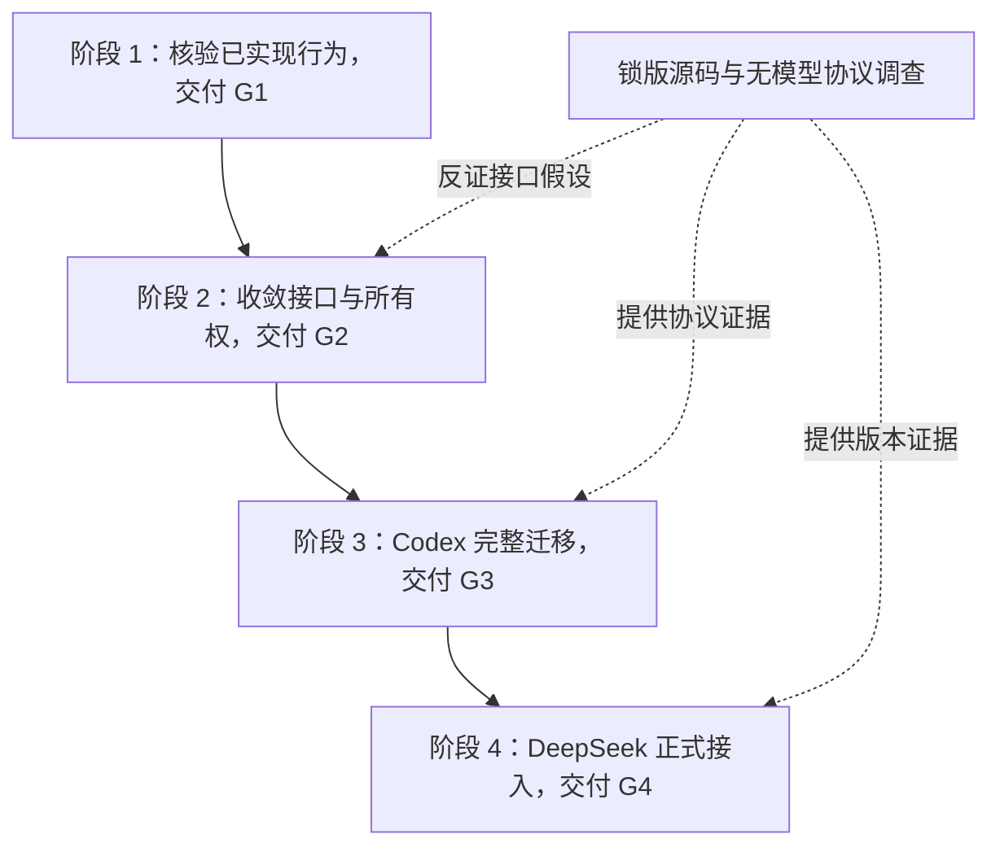

# Octopus 串行实施总纲与架构取舍

> 编制日期：2026-10-31，Asia/Hong_Kong。\
> 核查仓库：`Danuvius152/Octopus`，固定提交 **`d3e90499713f91e2c2a5aecace9c6f153528c810`**。\
> 交付性质：**设计与实施指导**。本轮只读审查源码、当前合同、历史评审及所需上游资料，未修改产品代码，未执行产品测试、真实模型调用、发布或生产资料操作。\
> 适用范围：用户附件 `review(2).zip` 中的阶段 2–4 方案，以及 `docs/review/architecture/` 的架构意见。附件旧基线 `0ca897e…` 的结论逐项重审，不直接当作当前事实。

## 1. 结论与阅读顺序

**保留模块化单体、SQLite、SessionOwner、Harness 和各业务领域的现有所有者；先完成接口与责任收敛，再迁移 Codex，最后接入 DeepSeek Harness。没有足够证据支持推倒重建。**

这次最重要的调整是：第一阶段已有实现，不能再按旧附件重做；第二阶段要交付真实消费者已经使用的公共操作；第三阶段的完成标准必须包含原生子任务回流后的父继续处理；第四阶段必须区分可安装发行包和最新源码，不能混用协议能力。

| 顺序 | 文档 | 本阶段产物 | 当前状态判断 |
| --- | --- | --- | --- |
| 0 | 本文 | 总体取舍、依赖、共同约束、评审意见映射 | 本轮建议 |
| 2 | [第二阶段：架构与接口收敛](02_Phase_2_Architecture_Contracts.md) | 九项责任收敛、C1–C8 语义合同、真实消费者迁移、G2 | 尚未完成统一接口 |
| 3 | [第三阶段：Codex App Server](03_Phase_3_Codex_App_Server.md) | 锁版协议证明、完整原生请求、正式传输切换、G3 | 普通执行仍为 `exec --json` |
| 4 | [第四阶段：DeepSeek Harness](04_Phase_4_DeepSeek_Harness.md) | SDK 同宿主适配、配置与产品入口、完整验收、G4 | 当前尚无正式 `deepseek` backend |

第一阶段状态依据当前路线 §2、来源投递实现、配置合同与 Wiki 实现；阶段二的返回接管计划仍明确标记 `proposed`。这些状态由固定源码与文档支撑，不等于本轮验证或当前生产版本。[R01] [R02] [R03] [R04]

### 1.1 串行指的是产品责任和验收依次交接

提前阅读协议、生成 schema、运行隔离的无模型替身实验有助于发现接口不可行；它们不允许提前迁移生产入口，也不能替代后续阶段的真实运行时证据。一个阶段内可以并行阅读或编写互不冲突的模块，但合并、全消费者接通和阶段验收按依赖顺序完成。

G1–G4 是四个交付条件，不建议为它们再建一套门禁数据库、审批服务或独立状态机。版本、检查与结果写在现有阶段计划及审查/发布回执中即可。

## 2. 为什么推荐沿现有架构深化

当前代码已经具有明确的 SessionOwner、持久输入回执、运行资源管理、业务短事务、Wiki 文件效果证明和受管发布流程。主要问题集中在**调用方仍需知道过多内部步骤**：BG、Research、委派各自拼接接纳流程；路由持配置锁；Wiki 判断运行时私有退休集合；Manager 回取 Owner 当前执行完成结算；main 汇总各领域私有活动集合。[R02] [R05] [R06] [R07]

因此，这一轮架构质量不看减少多少行或增加多少类，而看以下四个结果：

1. 一项规则只有一个实现归属。增加新的返回来源或后端时，现有来源不用再修改协议判断。
2. 调用方只表达业务意图。它不负责拼锁序、查询后再唤醒、读取当前运行对象或推断完成。
3. 原有必要事实仍可区分。业务结果、接纳、模型处理、落库、通知和退休不能压成一个 `done`。
4. 新接口通过真实入口和真实消费者证明行为，同时移除被替换的旧路径。

### 2.1 三种整体方案的取舍

| 方案 | 优点 | 主要代价/适用条件 | 本次裁决 |
| --- | --- | --- | --- |
| **A：现有 owner 内完成九项责任收敛，再迁移两个后端** | 一次解决已存在的多入口耦合；未来变化集中；保留现有数据和运行模型 | 第二阶段工作较多，需要按完整业务单元拆 PR | **推荐并作为后文默认主线**。用户强调整体设计，没有给出抢上线的期限 |
| B：只先收敛运行时直接依赖，Wiki/聊天视图深化另列后续独立工作 | 更短的 Codex 关键路径；每个被选择的模块仍可完整交付 | S5/S6/S7 的调用知识继续存在，需要明确调整原阶段范围 | 是合理的排期备选；本套文档不默认采用，避免阶段执行时随意缩减出口 |
| C：统一任务平台、通用持久任务树或全新调度器 | 当系统确有分布式、多机恢复或统一跨域工作流要求时可能有价值 | 新权威、新迁移、新恢复和大量双轨共存；当前需求不足以抵偿 | 当前不推荐。不能仅因接入第三个后端就引入 |

方案 A 不表示所有工作都技术上依赖上一项。S5–S7 之所以在 G2 前完成，是本次选择了完整的架构收敛范围；它们不是 Codex RPC 的协议前置。开发者不得把独立模块都绑成一个无法审查的大 PR。

### 2.2 具体设计裁决

| 决策 | 推荐 | 优秀备选及何时改选 | 理由 |
| --- | --- | --- | --- |
| 返回接管 | 原会话模块提供单个 `admit_return(target, prepare=...)` 操作 | 两阶段 API 只适用于来源确需显式持有准备成果的产品契约；当前没有此需要 | 单入口收回调用顺序，来源仍拥有材料与重试 |
| 结算组织 | OwnerRuntime 内，或由它唯一持有的私有协作者 | 私有协作者适合结算逻辑较大；不能升级成独立 CompletionManager | 两种组织都保持一个状态写者 |
| 配置 | 原配置边界内统一组合、保存与请求捕获 | 小型模块函数或局部对象均可；不新建全局配置平台 | 当前纯校验、锁和权威已有，缺的是操作完整性 |
| 新宿主生命周期 | 一个 attempt 一个宿主，原生根/子/父续跑可在同宿主内完成 | 每会话复用宿主须在明确性能瓶颈后，单独证明配置安装、授权撤销和资源隔离 | 双向 RPC 不要求跨请求共享进程 |
| 完成判断 | 由原生协议证据证明范围闭合，Owner 唯一结算 | 升级到有充分公开保证的发行版；或明确暂停切换 | 等待几秒、任务卡片全绿、列表为空均不能替代证据 |
| Wiki 入口 | 按查询、读取、任务、维护等业务族抽取操作 | 无需固定一个大服务类；领域函数与小协作者均可 | 消除 HTTP handler 互调，保留不同授权边界 |
| 前端 | 现有加载/投影模块拥有读取身份与基线 | 保留 transcript、问题、Research 的各自合并规则 | 一个通用 reducer 会抹平不同时间语义 |
| DeepSeek | 精确锁定可安装 SDK 包组合，同宿主薄插件补所需缺口 | 新版官方接口经同样反例验证后替换对应桥接 | 不把最新源码能力直接套在旧 npm 包上 |

备选说明用于解释设计边界，不是要求开发代理同时实现所有方案。每个工作包只实现本次选定路线；发现真实反例时回到该项裁决，不加自动 fallback。

## 3. 全阶段必须一致的产品约束

### 3.1 返回队列保持已选定的语义

BG、Research、命名委派的返回按**成功接纳顺序**逐条派发。多条返回排队是当前选择的行为；必须修正的是永久拒绝后仍无效重试、未知接纳后重放，以及身份归属错误。

普通 Stop 暂停派发并保留 backlog；暂停后新人工纠偏可以先执行，但不会隐式恢复积压；显式恢复才继续原顺序。人工 steer 需要产品资格、活动目标、配置兼容与真实后端能力，不能自动将返回改成 steer。[R01] [R02]

因此，本轮不恢复旧评审中的 collect-ready、自动合批、notification-only 或默认人工优先。这些是另一个产品调度选择，不能夹带进架构重构。

### 3.2 原生后代和独立工作有不同边界

| 工作 | 身份与完成边界 | 父请求需要等待什么 |
| --- | --- | --- |
| Provider 原生子任务 | 当前逻辑请求的受管原生范围；包含必要的父续跑 | 必需子结果已回流并被父处理，后续派生也已闭合 |
| BG / Research / 命名委派 | 各自独立 work，按原 delivery 返回 | 允许父先结束；后续返回成为新输入 |
| Wiki 维护任务 | 有任务、授权、文件效果、回执与 outbox 等领域责任 | 依 Wiki 结果/效果合同组合；不能只等模型文字 |

完整原生尾部不是“等待系统里所有工作”，也不应演变为通用任务树。原生范围的观察归 adapter/Harness，独立业务的调度仍归各自 owner。[R01] [R08]

### 3.3 分开记录事实，避免把未知变成成功

下列事实允许先后不同时出现：本地输入接纳、完整帧发出、provider 接受、provider 实际处理、业务终态提交、通知送达、资源退休。

例如输入已在 SQLite 接纳，RPC 帧写出后断连：本地接纳是真，provider 接受仍未知。即使本地记录了一条失败诊断，也不能把输入改成“已处理”，再用新 attempt 重发。又如 terminal 已提交、WebSocket 发布失败：业务结果已确定，通知失败不会授权重跑模型。

`unknown` 不是全系统的新任务状态，而是对指定事实证据不足的观察。来源返回 unknown 与 provider 输入接受 unknown 也不是同一层，二者各用原有权威保存。恢复只能核对原事实，不能因为后来会话关闭或查无记录便推定以前没有发生效果。

### 3.4 配置变化与权限撤销分开

合法 Agent 默认可以保存；旧会话保留 backend/历史，必要时修正有效配置后继续。一个逻辑请求捕获一致配置，其自动重试沿同一捕获；下一请求才采用新默认。配置快照不延长已经撤销的凭据、工具或 Wiki 权限，实际效果前仍由当前权威复核。[R04]

### 3.5 故障范围由真实故障决定

| 故障 | 处理范围 | 不应扩大的行为 |
| --- | --- | --- |
| 明确的容量/暂忙拒绝，保证尚无效果 | 原来源沿相同身份和既有策略重试 | 不重跑已完成来源任务 |
| 单会话 Owner 失败 | 原会话关闭准入，原责任被接管/退休 | 不一概升级成整服务重启 |
| provider 协议或连接失效 | 原 attempt 记录事实并退休资源；未知不重放 | 不自动换 backend 或传输 |
| 权威存储提交失信 | 既有统一 fail-stop 与受管恢复 | 不在同代循环回读猜 COMMIT |
| 通知/投影失败 | 保全已提交结果，报告交付事实 | 不抹掉 terminal 或再调用模型 |

保留已经采用的 fail-stop 和受管启动方案；本轮不另造补偿循环。fail-stop 的适用边界不能扩大到每个普通业务错误。[R02] [R09]

## 4. C1–C8：跨阶段语义索引

这些编号是查阅索引，**不要求新建八个类、八张表或八个服务**。优先复用当前输入记录、request/attempt、Question owner、RunConfig、HarnessEvent、原资源引用与 publisher。

| 索引 | 语义 | 阶段 2 必须交付 | 阶段 3/4 必须提供 |
| --- | --- | --- | --- |
| C1 原始绑定 | account/session/request/work/attempt/backend 与原资源关联 | 回调、取消和结算均携原身份 | native thread/turn/item/connection 的原映射 |
| C2 返回接管 | 原 receipt / 本次明确拒绝 / 接纳无法确认 | 三来源统一入口；unknown 只观察；原来源结论保全 | 不改变独立返回的消费政策 |
| C3 有效配置 | 组合、捕获与效果前当前授权 | 短锁内一致捕获，秘密不进入公共投影 | 按实际能力安装模型、工具、凭据和范围 |
| C4 输入证据 | 本地接纳到 provider 处理的分层事实 | 首输入与 steer 均能保留未知；terminal 不清掉未知 | 锁版协议实际提供的 ACK/输入认领/处理证据 |
| C5 完成证据 | 所声明范围、根最终回答、结果选择 | 假后端反例、原最终消息引用、逐输入结算与所有消费者 | 完整原生范围的真实闭合依据 |
| C6 退休证据 | 原资源 retired / pending / unknown | 精确查询原 execution；不含隐式通知保证 | 连接、I/O、进程组、迟到 spawn、lease 的实际退出 |
| C7 问题绑定 | 原问题、结构化结果、来源及原通道 | human/system-expired/closed 分开；晚答拒绝 | 原生 ask/approval/answer/cancel 的正确映射 |
| C8 排空事实 | 各 owner 从真实责任推导交接资格 | main 显式组合并同步封口，消除私有布局读取 | 新宿主/RPC/等待均纳入原 owner 的事实 |

其中三项是**阶段 2 的实质工作**，不能留到接 Codex 时临时补：

1. 首输入发出后接受未知，仍能穿过本地 terminal、恢复查询和前端投影而不被清除。
2. 保存原根最终回答的消息/item 引用，委派和 App 不再把同 attempt 所有 assistant text 拼成结果。
3. Question owner 保留结构化答案与来源；字符串只是展示和既有 MCP 消费的投影。

当前 root terminal 的写入、按 attempt 拼正文的消费者和问题字符串化路径仍能看到这些接缝。第二阶段文档给出具体改动位置及验收，不把它们包装成单纯搬文件。[R10] [R11] [R12]

## 5. 对全部架构评审意见的处置

下表将 `docs/review/architecture/` 的建议与本次交付对齐。历史评审的“当前”属于当时基线；本表不据旧票号重新打开已完成工作。[R13] [R14] [R15] [R16]

| 评审意见 | 最新核查与设计判断 | 本次归属 |
| --- | --- | --- |
| 模块化单体、Harness seam、账户与持久输入 | 已是架构基础，应保留 | 全阶段约束 |
| 返回接管重复编排 | 来源分类已实现；完整单入口未实现 | P2-S1 |
| 配置保存与捕获 locality | 纯校验和捕获已有；路由仍持锁编排 | P2-S3 |
| 原执行退休私有耦合 | Wiki 仍读会话内部运行集合 | P2-S2 |
| 单轮结算经 Manager 回绕 Owner | 仍存在；完成范围变化会放大耦合 | P2-S2b |
| 共同行为与 provider 能力分离 | 仍需分离 duplex、steer、reuse、completion | P2-S4，P3/P4 实证 |
| Wiki Registry 同代借用与锁序 | 多个真实入口重复安排，值得收回 | P2-S5 |
| Wiki App/HTTP/MCP 的业务入口 | null 校验已修；handler 互调仍在 | P2-S6 |
| 聊天详情加载与事件合并 | 与已完成的应用/计划列表不是同一项 | P2-S7 |
| 各 owner 提供排空事实 | main 仍读私有布局；要保留同步检查/封口 | P2-S8 |
| 应用删除前退休 | 已有删除阶段和失败保全；不重做 | P1 核验，后续资源沿原接口加入 |
| 应用/计划列表协调与排序 | 已有业务入口和事务规则 | P1 保留回归，作为 S7 参考 |
| Connector 首次绑定原子性 | 已有身份串行化与业务 upsert | 保留，不再造 OAuth 事务层 |
| DB 完整行映射 | 已有 `RecordProjection` | 保留，不升级为 ORM/Repository |
| Research Task 登记集中 | 已有 `_register_task` | 保留，不升级为通用 TaskManager |
| 前端发送/草稿恢复再封装 | 有价值，但本次没有修改发送体验的需求 | 触发条件：新增发送入口或改变接纳 UX 时评估 |
| 取消浏览器收讫账本 | 会取消独立可观察保证，缺少产品依据 | 本次不采用 |
| 大文件/mixin 全部拆类 | 文件大小不证明责任错误 | 只在有完整业务边界时局部调整 |
| 删除无 DB 执行旁路 | 执行准入已要求持久层就绪 | 不重复列新项目 |
| 全局任务树/总线、统一 reducer | 当前扩展不需要新权威 | 本次不采用 |
| Wiki 向量检索、额外缓存、SmartReader 产品 UI | 需要检索评测或独立产品需求证明 | 保留既有 Wiki 后续计划；不夹带进运行时迁移 |

这份映射解决的是“采纳哪些建议及原因”。当前行为正文仍由各主题 `docs/implemented/` 维护，不能把整张评审历史继续追加到 `architecture-contract.md`。

## 6. 跨阶段交接与阻断条件

| 门槛 | 下一阶段实际要拿到的材料 | 不能视为通过的情况 |
| --- | --- | --- |
| G1 | 源码版本、现有行为对应入口/测试、已发生验证及适用环境、文档 owner、发布状态 | 只有提交标题；用旧测试数量替代实际摘要；把未部署说成已部署 |
| G2 | C1–C8 实际落点、三来源迁移、两后端诚实能力表、三项持久语义、Wiki/前端/排空完整操作 | 只有接口空壳；消费者仍读相同私有字段；fake 证明被写成外部协议保证 |
| G3 | 精确 Codex 版本/schema、冷恢复与完整尾部轨迹、输入/问题/Stop/权限证据、全消费者验收及旧路径删除 | 父首次回答就算结束；线程列表空就算闭合；ACK 未知后 fallback；普通聊天仍有两条正式执行链 |
| G4 | 精确 DSH 包组合与校验、薄插件公共 API 证明、原生完成/问答/取消、配置/权限/UI/搬迁覆盖、真实凭据验证 | 只新增 backend 枚举；以 alpha 文档解释 rc 包；高层 run 返回即成功；分包分别装 latest |

如果 G3 的锁版协议不能证明完整原生闭合，正确结果是**G3 阻塞且保留已完成的安全改动**。可以选择升级到有证据的版本，或在明确改变产品目标后交付较小完成范围；不能自动降低当前用户目标，也不能让 G4 掩盖 G3 的欠账。

如果 G4 缺真实凭据或上游公开 API 无法满足语义，记录缺的是哪一个验证/能力，完成其余无模型工作，保持后端不正式可选。文档将阻断位置写清，不把不可验证的假设作为待开发的小细节。

## 7. 实施与验证方法

### 7.1 每个 PR 交付一个完整行为变化

一个 PR 或连续不可分割的 PR 组，应包括：操作入口、状态写者、真实消费者、失败路径、必要存储/搬迁调整、针对反例的测试、当前合同，以及被替换路径的删除。按这个边界拆分比按“先类型、再空实现、最后所有调用方”更容易控制风险。

阶段文档内的 PR 编号是建议合并顺序，不是已创建的 GitHub PR，也不要求一次提交所有阶段。对已有正确实现只核验；对明确独立的后续产品需求说明触发条件；对本阶段选择的行为不以“稍后补齐”结项。

### 7.2 四类证据各证明不同事实

| 证据 | 能证明 | 不能替代 |
| --- | --- | --- |
| 源码与固定 schema 阅读 | 当前实现与协议字段、控制流、版本差异 | 真实运行时事件是否按预期发生 |
| 临时 SQLite + 可控本地执行替身 | 接纳/结算唯一性、交错、取消、真实事务与资源责任 | 厂商实际服务语义 |
| 锁版运行时实验 | 原生输入/线程/子任务/完成/取消能力 | 浏览器、Wiki/App 等产品消费者的正确接入 |
| 产品入口与浏览器 | 真实交互、投影、权限错误和完整消费者体验 | 所有底层协议边界穷尽证明 |

测试命令与发布门禁只由仓库 `docs/testing.md` 拥有。优先目标反例和受影响检查；同一版本、配置、依赖和环境的成功证据可以复用，每项检查一个执行者。代码提交前执行现行提交门禁，发布前执行现行发布矩阵；专项 Wiki 性能/语义评测保持显式 opt-in，不把它们无条件塞进每次迁移。[R17]

### 7.3 存储变更与回退

阶段 2 的输入证据、最终回答引用和结构化问题会影响持久语义，即使用原 JSON 列也需同步存储合同和账户搬迁。阶段 3/4 新增 native 历史、控制元数据或受管目录同理。是否升格式号由现有完整格式规则决定，不为方便恢复而增加运行时历史迁移链。[R18] [R19]

发布先准备匹配的代码和 assets，再自然排空、确认原 writer 退出、执行必要的有限转换后切换。格式不兼容时，不能启动旧程序硬读新库；软件回退也不能撤销已经产生的文件、工具或外部效果。保全事实并前向修复优先于用旧备份覆盖新写入。

## 8. 文档落地：避免再次堆成一篇大合同

当前仓库已经采用 `implemented/`、`plans/`、主题指南和临时评审的分工，应直接沿用。[R03]

| 材料 | 建议正文 owner | 写入时机 |
| --- | --- | --- |
| 本次总顺序与范围裁决 | `docs/plans/engineering-runtime-roadmap.md` | 方案采纳时整合精简决策，不复制所有阶段细节 |
| 活跃阶段设计 | `docs/plans/` 中对应主题/阶段计划 | 保持 proposed/in-progress；本文可作为实施蓝图 |
| 返回接管 | 现有 `docs/plans/task-return-admission.md` | 实施时维护；完成后归当前合同并退出旧计划 |
| 输入、结算、退休共同不变量 | `docs/implemented/architecture-contract.md` | 代码真实兑现后更新 |
| Harness/Codex/DSH 各自行为 | 对应 `implemented/` 主题 | 协议与真实能力验证后更新 |
| 配置、Wiki、前端投影、存储 | 各主题现有 owner | 与改动同交付，不复制进根 AGENTS |
| 验证政策与本机运行 | `docs/testing.md`、`docs/local-wsl.md` | 仅在政策/环境变化时修改 |
| 评审过程、原始长日志 | 临时任务材料，必要结论归回正文 | 结项前提炼适用条件和必要证据 |

不引入 RFC/ADR 双轨，也不复制一套 Agent Notes。只有难以从现有主题理解、会反复被重新讨论的决定，才在其正文 owner 内保留一小段“选择与原因”。persona 与 memory 继续保存角色、偏好和短入口，不成为第二份架构规范。

## 9. 给开发代理的通用执行指令

> 先阅读本总纲和当前阶段文档，固定实际 HEAD，核对前序出口。只实施当前阶段已选范围。对所有权、并发、生命周期、授权、持久化和外部协议变化，先列原事实、writer、提交点、消费者和故障范围，再按文档首个反例实现完整业务单元。已有实现先核对，缺失才改。不能凭接口名称、任务卡片、模型自述、历史测试数量或“没有观察到活动”认定完成。发现公共合同无法兑现，先修订设计判断，不补无限重试、旁路或影子状态。保留当前产品队列语义、用户配置和资料。每个单元完成真实消费者、失败路径、必要持久/搬迁、验证、文档与旧路径删除。达到验收后停止无关扩展。当前阶段通过后再开始下一阶段产品改造。

## 10. 固定来源

链接均以本次源码 SHA 固定；行号用于定位，不要求未来保持。阶段文档各自补充相关代码与外部协议证据。来自旧报告的建议是评审输入，当前实现以所读源码为准。

[R01]: https://github.com/Danuvius152/Octopus/blob/d3e90499713f91e2c2a5aecace9c6f153528c810/docs/plans/engineering-runtime-roadmap.md
[R02]: https://github.com/Danuvius152/Octopus/blob/d3e90499713f91e2c2a5aecace9c6f153528c810/docs/implemented/architecture-contract.md
[R03]: https://github.com/Danuvius152/Octopus/blob/d3e90499713f91e2c2a5aecace9c6f153528c810/docs/AGENTS.md
[R04]: https://github.com/Danuvius152/Octopus/blob/d3e90499713f91e2c2a5aecace9c6f153528c810/docs/implemented/model-reasoning.md
[R05]: https://github.com/Danuvius152/Octopus/blob/d3e90499713f91e2c2a5aecace9c6f153528c810/docs/plans/task-return-admission.md
[R06]: https://github.com/Danuvius152/Octopus/blob/d3e90499713f91e2c2a5aecace9c6f153528c810/server/wiki/job_execution.py#L181-L208
[R07]: https://github.com/Danuvius152/Octopus/blob/d3e90499713f91e2c2a5aecace9c6f153528c810/server/main.py#L483-L559
[R08]: https://github.com/Danuvius152/Octopus/blob/d3e90499713f91e2c2a5aecace9c6f153528c810/docs/implemented/wiki-development-summary.md
[R09]: https://github.com/Danuvius152/Octopus/blob/d3e90499713f91e2c2a5aecace9c6f153528c810/server/service_health.py
[R10]: https://github.com/Danuvius152/Octopus/blob/d3e90499713f91e2c2a5aecace9c6f153528c810/server/db/sessions.py#L496-L529
[R11]: https://github.com/Danuvius152/Octopus/blob/d3e90499713f91e2c2a5aecace9c6f153528c810/server/app_agent.py#L291-L298
[R12]: https://github.com/Danuvius152/Octopus/blob/d3e90499713f91e2c2a5aecace9c6f153528c810/server/sessions/owner_questions.py#L127-L161
[R13]: https://github.com/Danuvius152/Octopus/blob/d3e90499713f91e2c2a5aecace9c6f153528c810/docs/review/architecture/architecture-before-after-20261028-131512.html
[R14]: https://github.com/Danuvius152/Octopus/blob/d3e90499713f91e2c2a5aecace9c6f153528c810/docs/review/architecture/architecture-review-20261028.html
[R15]: https://github.com/Danuvius152/Octopus/blob/d3e90499713f91e2c2a5aecace9c6f153528c810/docs/review/architecture/architecture-review-codebase-20261028.html
[R16]: https://github.com/Danuvius152/Octopus/blob/d3e90499713f91e2c2a5aecace9c6f153528c810/docs/review/architecture/Octopus-architecture-comparison-20261025.md
[R17]: https://github.com/Danuvius152/Octopus/blob/d3e90499713f91e2c2a5aecace9c6f153528c810/docs/testing.md
[R18]: https://github.com/Danuvius152/Octopus/blob/d3e90499713f91e2c2a5aecace9c6f153528c810/docs/implemented/current-storage-format.md
[R19]: https://github.com/Danuvius152/Octopus/blob/d3e90499713f91e2c2a5aecace9c6f153528c810/docs/backup-and-migrate.md
