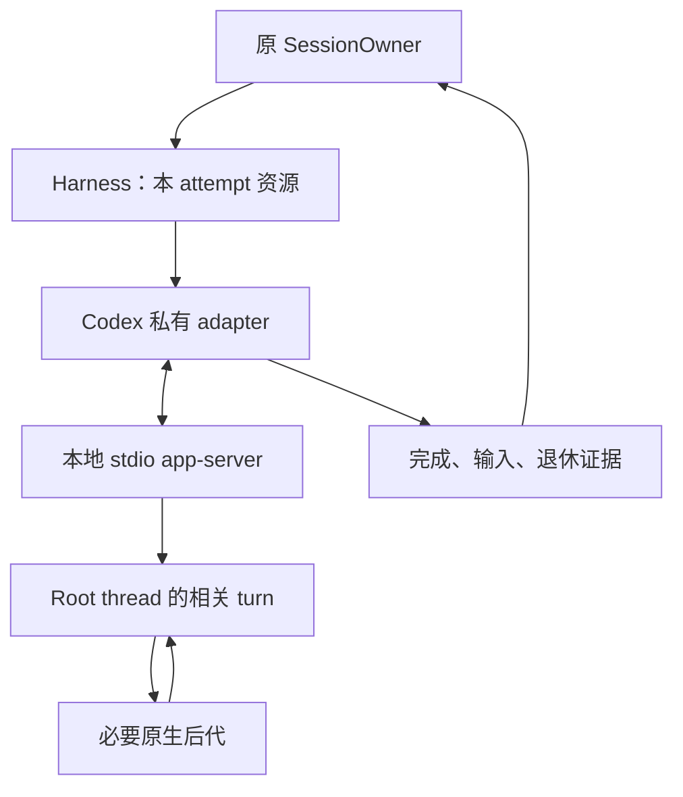

# 第三阶段：Codex App Server 与完整原生请求

> 日期：2026-10-31（Asia/Hong_Kong）\
> 状态：实施设计；本次未修改产品代码，未运行模型、真实 RPC 集成实验、完整测试或部署。\
> Octopus 核查基线：`d3e90499713f91e2c2a5aecace9c6f153528c810`。\
> 本阶段的入口：第二阶段 G2 已通过；出口：G3。第四阶段产品实现从 G3 后开始。

## 1. 本阶段的结论与阅读顺序

**推荐采用“一个 attempt 一个本地 stdio app-server 宿主”的实现，让一个 Octopus 请求在原宿主内跨越必要的原生 turn、子任务和父续跑，最终由原 SessionOwner 结算一次。** 历史通过原生 thread 精确恢复；跨请求先退休旧资源，再安装新配置和新授权。[O01] [O02] [O03]

最关键的风险并非 JSON-RPC 客户端难写，而是：**目标 Codex 版本是否给出足够的公共协议事实，证明必要子结果进入父处理，并证明本请求范围已经闭合。** 当前核查的官方源码仍存在 child 回报不直接触发 turn、默认关闭的唤醒能力、仅 root 的普通消息唤醒，以及原生 turn 结束之后继续启动 pending work 的行为。因此不能写成“换成 app-server 就自然解决完整尾部”。[C03] [C04] [C05]

本阶段先进行 P3-00 可行性裁决，再实施运输、输入和完整范围；不能先将普通聊天切换上线，随后把完整尾部留作优化。若所选版本缺少必须的证据，G3 保持未通过，保留前两阶段已经交付的收益，按第 5 节提出具体路线裁决。

文档导航：

| 顺序 | 文档 | 与本文的关系 |
| --- | --- | --- |
| 总体 | [总体设计与架构取舍](00_Overview_and_Decisions.md) | 跨阶段不变量、唯一主线与取舍依据 |
| 1 | [第一阶段：核验与交接](../../plans/engineering-runtime-roadmap.md#phase-1) | 当前行为与问题分类的已验证基线 |
| 2 | [第二阶段：架构与公共合同](02_Phase_2_Architecture_Contracts.md) | 本阶段复用 C1–C8，不另造产品账本 |
| 3 | **本文** | Codex 实现、完整原生范围和 G3 |
| 4 | [第四阶段：DeepSeek Harness](04_Phase_4_DeepSeek_Harness.md) | 复用公共合同，重新证明 DSH 的真实能力 |

协议只读调查可提前；改变运行时、产品消费者和默认路径的实施须等待 G2。本文提议的文件、类型或函数均标明为建议，不能据名称认定仓库中已存在实现。

## 2. 版本与现状：先避免按旧快照重复实施

### 2.1 本轮核查了什么

| 对象 | 版本 / 来源 | 可以支持的结论 |
| --- | --- | --- |
| Octopus 当前代码 | `d3e90499713f91e2c2a5aecace9c6f153528c810` | 当前入口、状态归属、消费者和测试期望 |
| 附件阶段3 | `Octopus_Phase_3_Codex_App_Server.md`；Octopus 基线 `0ca897e…` | 旧方案的目标与约束；不作为当前实施完成证明 |
| 附件引用的 Codex | `rust-v0.165.0` / `360319d8…` | 特定历史版本源码证据 |
| 本轮补查官方源码 | `67f0994b532b8740f14b5b738af7b7b2a915b1d6`，2026-10-31 00:12:17 UTC | 当前源码中的方法、字段和关键控制流 |
| 官方 App Server 文档 | [官方入口](https://developers.openai.com/codex/app-server) | 初始化、消息格式、steer、turn 终态与 schema 生成说明 |
| 实际安装二进制 | 本环境未发现可用 `codex` 命令 | 本轮不能宣称已验证目标发行版、账号、profile 或模型行为 |

**实现时锁定的是实际发行产物、完整配置和它生成的 schema。** GitHub main、旧 tag、本机安装版和在线文档不能拼成一个假想版本；升级任何一项，需重新评估受影响的协议证据。首版不追求同时支持所有历史 Codex 版本，也不私自维护 provider fork。

### 2.2 最新代码与待改责任

| 当前事实 | 当前代码证据 | 第三阶段应完成的改变 |
| --- | --- | --- |
| 普通 Codex 仍使用 `exec --json`，prompt 在 argv | `codex.py:288–331` [O01] | 普通路径使用 app-server 双向连接 |
| 首个 `turn.completed` 直接产生产品 `result` 并关闭 stream | `codex.py:444–481` [O01] | 转为原生 turn 事实；完整范围确认后才给公共完成证据 |
| `reusable` 从 `STREAM_JSON` 推导 | `run.py:569–609` [O02] | 消费 G2 的真实能力，不把双向 RPC 当跨请求复用 |
| observer 仅排空一次已写出的有限 native prefix | `run.py:887–915`、`codex_activity.py:479–498` [O02] [O04] | 保留诊断价值；退出完整尾部裁决链 |
| 恢复前临时启动 app-server 注入 controller，再关闭并启动 exec | `codex_control.py:93–182` [O03] | 同一宿主完成恢复、指令安装与业务执行 |
| 测试允许父 success，而未完成 helper 为 `interrupted/parent_done` | `test_native_subagent_retirement.py:157–177` [O05] | 在新范围下改变结算期望，保留身份、partial、停止原因的验证 |
| receipt 已区分业务、记录、通知，等待者不拥有执行 | `submission.py:15–60` [O06] | 扩展证据来源，沿用原接纳和结算机制 |
| 委派从原 attempt 的 assistant text 拼接返回正文 | `delegations.py:1593–1607` [O07] | 使用 G2 最终回答引用；避免多轮过程正文混成最终答复 |
| 已有独立 tool-free 文本 worker | `harness.py:220–231`、`codex.py:781–800` [O08] | 保留，不改成可执行工具的普通 agent loop |

`docs/review/architecture` 的意见应转成边界深化：SessionOwner 保有运行责任，Harness 保有原资源，adapter 保有协议差异；先消除消费者对内部字段布局的依赖。这里的收益不是把文件全部合并或再引入一个框架。[O09]

## 3. 从第二阶段接收的合同与交付物

C1–C8 是语义索引，**不要求八个新类、八张表或八个管理器**。本阶段应沿 G2 最终落地的接口实现，不能照本文的示例名字重新搭一层。

| 合同 | Codex adapter 接收 / 提供 | 必须仍由原 owner 负责 |
| --- | --- | --- |
| C1 原绑定 | account、session、request、work、attempt、backend、原资源关联 | 目标资格、接纳身份、迟到事件不能重绑 |
| C2 返回接管 | 已接纳输入和原 receipt | BG/Research/命名委派的原身份、来源重试和业务结算 |
| C3 有效配置 | 本次不可变配置、当前授权检查入口 | 保存规则、继承规则、凭据所有权、效果前授权 |
| C4 输入证据 | 首输入 / 人工 steer / answer 的原发送事实 | 持久投递状态、unknown 保全和原输入结算 |
| C5 完成证据 | 真实 scope、输入关联、最终根回答引用、准确 outcome | 唯一 terminal、记录提交和通知 |
| C6 退休证据 | 原进程、连接、I/O、准备、lease 的退休事实 | 退休 owner 的生命周期与失败接管 |
| C7 问题绑定 | 原 connection / RPC / thread / turn / item | 产品问题状态、结构化答案和来源 |
| C8 排空事实 | 准备、活动、问题、关键 RPC、退休责任 | 全服务排空判断，不能窥探 adapter 私有字典 |

### 3.1 G2 必须已经完成的三项容易遗漏的前置

1. **首输入 unknown 的持久保全。** 不能只给人工 steer 保存 unknown。首输入写出后失去 ACK，随后 attempt failed，重启读取仍须保留未确认接受的事实，不自动重发。
2. **最终根回答引用。** 同一 attempt 可以包含多轮文本。C5 要能选择对应最终根执行的完整 item / 消息引用；消费者不再遍历整个 attempt 拼接答案。
3. **结构化问题结果。** 问题回答需要保全选项、多问题 ID、自由文本及 human / system-expiry / closed 来源。字符串正文只是显示投影，不能成为协议回传的唯一依据。

如果三项中有缺失，返回阶段2完成相应所有权切换。不要在 app-server adapter 里新增独立输入表、最终结果表或产品问题状态机。

### 3.2 保持不变的产品政策

BG、Research、命名委派的独立返回继续按成功接纳顺序逐条派发；Stop 暂停派发；人工纠偏按真实能力处理。自动返回不会因 app-server 支持 steer 而转入 provider inbox，也不自动合批。原生 helper 属于本次运行范围，独立工作拥有自己的持久责任，两者不可混为同一个任务树。[O10]

## 4. 推荐架构：一个 attempt 一个宿主

### 4.1 对象映射与唯一 owner

| 对象 | 基数 / 生命周期 | 所有者 |
| --- | --- | --- |
| Octopus Session | 多个用户请求共享历史 | SessionOwner / 会话模块 |
| Octopus Request | 原输入与合法接纳的人工追加的一次业务责任 | 原 SessionOwner |
| Attempt | 该请求的一次执行尝试 | 原执行 owner |
| App-server 宿主 | 一个 attempt 独占一个；可跨多个原生 turn | HarnessRun / 原资源 owner |
| Root thread | 新建或精确恢复；历史 ID 可跨请求保留 | Codex 负责原生历史，Octopus 保存原句柄 |
| Native turn / child activity | 一个请求可包含多个；必须可关联 | Codex 执行；adapter 观察与映射 |
| RPC / Question | 原连接内有效，方向和代际不可省略 | adapter 关联；Question owner 裁决产品状态 |

建议只新增私有实现模块，例如 `server/harness/codex_app_server.py`，承接装配、RPC 方法及事件映射。若传输处理确实足够独立，可再拆一个私有 RPC 模块；不要同时增加 CodexSessionManager、AgentTreeManager、通用 RuntimeEngine。公共层继续使用 G2 的运行接口。

图中的返回箭头不证明 provider 已具备该保证；P3-00 须验证实际消息因果和闭合条件。

### 4.2 为什么暂不选每 session 长期宿主

| 方案 | 主要收益 | 额外责任 | 当前取舍 |
| --- | --- | --- | --- |
| 每 attempt 一个 stdio 宿主 | 原身份、配置、lease、退出边界清晰；复用现有进程组管理 | 每请求启动和冷 resume 成本 | **推荐主线** |
| 每 session 一个长期宿主 | 减少重复启动；适合持续高频交互 | 跨请求旧 child / RPC / 问题、配置与 bearer 切换、idle 退休、复用失败 | 实测启动成本确实影响体验时再评估 |
| 全局共享宿主池 | 可能减少并发启动数 | 多账户、不同授权、历史 writer、排空及故障域更复杂 | 当前不采用 |
| 每 turn 一个宿主 | 原生 turn 与进程边界接近 | 无法自然容纳父暂歇、子晚回和父续跑 | 不符合本阶段范围 |

“每 attempt 一个宿主”不等于每收到 `turn/completed` 就停进程。一个 attempt 可包含首轮父活动、子任务完成后的父处理以及再次验证；这些都留在原宿主中。只有 C5 结论已确定且原资源完成退休，下一请求才装配新宿主。故障恢复也不能在旧输入接受 unknown 时偷偷开启新的副作用尝试。

### 4.3 最小局部状态

保留原 binding、有效配置、资源引用、出站 RPC pending、入站 server request 关联、本 attempt 的 thread/turn/item 关系、必要完整 item 和未决输入证据。能从这些事实推导的活动数、完成候选、UI 状态不再另存一份。

关联表不是第二套原生调度系统：不为每个 native child 创建 Octopus Request，不替 provider 持久化所有历史任务，不把 BG/Research/委派放进这个表。凡是需要跨服务重启保存的事实，先明确现有持久 owner 和恢复用途，再纳入格式变更。

## 5. P3-00：先裁决完整原生范围的可实现性

### 5.1 已有源码证据支持与不支持什么

本轮官方源码确认：

- `turn/steer` 要求活动 `expectedTurnId`，响应包含接受的 `turnId`；`turn/interrupt` 接受 thread/turn 标识并返回空对象。这些字段提供关联和前置条件，不能替代输入消费或资源退出证据。[C01]
- `TurnStartParams` 可携带 parent/root attribution，但返回 Turn 的 `rootTurnId` 可空，不能假设所有父关系在所有路径完整回传。[C01] [C02]
- child 完成回报以非直接触发 turn 的方式投递；发送失败有独立处理分支。[C03]
- `wake_on_agent_messages` 在该源码版本默认关闭且处于开发阶段；普通消息唤醒还检查 root 身份、中断状态、pending mailbox 和运行模式。[C04]
- 原生 TurnComplete 发出之后，代码仍可能推进 pending work。[C05]
- `thread/list` 的父/祖先筛选属于实验接口；它描述线程关系，不能独立证明某次请求的原子闭合。[C06]

因此必须把以下问题列为实施前的决策点：目标版本能否观察“结果进入父处理”；必要的中间父是否会继续；同一 root 的历史 child 如何排除；自动唤醒与手动 start 是否会争用；何种事实意味着不会再产生本 scope 的必要活动。

### 5.2 Scope 的具体定义

本次成功范围包括：原请求触发的根活动、其必要原生后代、后代结果进入相应父的实际处理、该处理继续产生的必要活动，以及最终根结论。

不把独立 BG/Research/命名委派、其他用户请求、历史无关 child、未来任意定时触发、全账户所有线程纳入。对原生 scheduler、durable sleep 等自主触发能力，P3-00 必须确认所选 profile 是否装配及是否属于该 scope；不能一边宣称只负责本请求，一边放任未建模的自主触发持续存在。

“父处理”指可观察的消息消费和后续执行关联，不意味着从日志证明模型主观理解。任务内容是否完成，还要用测试场景中可检查的结果断言。

### 5.3 固定证据包

在既有临时任务目录生成一份协议证据清单，不新增长期运行账本：

| 清单 | 必须记录 |
| --- | --- |
| Runtime | 实际发行版、安装来源、二进制摘要、OS、完整依赖/启动参数、multi-agent mode 与功能开关 |
| Schema | 由该二进制生成的 JSON Schema / TypeScript schema，生成命令和摘要 |
| Profile | 账户类型、权限、MCP入口、工具配置；秘密只记录字段名和不可逆标识 |
| Trace | 原 request/attempt 与 thread/turn/item 关联，发送、响应、通知、读取的顺序 |
| Resource | 进程组、准备任务、I/O、Stop、lease、临时配置及真实退出证据 |
| Verdict | 可支持的范围、采用哪一种父续跑策略、否定轨迹、缺少的公共能力 |

只读起点为 `codex --version` 和 `codex app-server generate-json-schema --out <临时目录>`。本次文档任务没有执行这些命令，也没有申请新登录。实施实验先使用真实 pipe 与假 provider 验证宿主逻辑；需要原生行为的项目再用已有合法凭据和隔离数据验证。

### 5.4 必须先做的反例

| ID | 受控场景 | 必须观察的事实 | 推翻方案的信号 |
| --- | --- | --- | --- |
| C0-01 | 旧 exec 历史冷 resume | 精确原 thread、旧上下文及新 controller 生效 | 新建空 thread 继续或指令只在另一宿主生效 |
| C0-02 | 父先结束，child 延迟返回 | 同一 request 保持未结算，父处理子结果并产生关联输出 | 只看到 child completed，没有父处理 |
| C0-03 | 父收到结果后再派验证任务 | 新派生继续属于同一 request，最终答案包含必要结果 | child 计数归零的一瞬间提前完成 |
| C0-04 | child 派孙任务，child 先 idle | 必要中间父继续处理或有已证明的等价机制 | 仅 root 自动唤醒，孙结果无人处理 |
| C0-05 | 重用同一 child；child 极快完成 | 按 native turn/run 区分，多次活动不被一次 completed 覆盖 | task ID 永久 completed 或订阅前事件缺失 |
| C0-06 | 回报失败、ACK丢失或 mailbox 与 idle 交错 | 无证据不报告完整 success，无重复副作用 | 用静默、空列表或“有 final 文本”猜完成 |
| C0-07 | 根idle / 子活动 / 问题等待时 Stop | 所选 scope 不再推进、晚事件不复活、资源可退休 | 只取消根 turn，子或续跑仍能写入 |
| C0-08 | 历史 child 与本次 child 并存 | 本 request 成员可区分，同一原历史无第二 writer | 全 home 扫描结果直接当本次任务树 |
| C0-09 | 子失败，父明确处理失败并给替代结果 | 保存真实子失败，整体 outcome 可解释 | 子失败一律根失败或被父 success 隐藏 |
| C0-10 | 首输入已被接受，但 RPC ACK 丢失，随后重启 | C4 unknown 持久保留，执行次数不增加 | failed terminal 覆盖 unknown 或自动重发 |

假服务可以证明 Octopus 的 reducer、取消和资源管理；不能证明真实 Codex 会发出需要的因果事实。C0-02 至 C0-06 必须有选定原生模式的实际证据。版本、功能开关或模式不同，旧轨迹不能不加区分地复用。

### 5.5 原生推进与宿主推进：只选一个权威

**首选原生推进。** Provider 负责子任务及父继续执行，adapter 观察、关联和报告证据。前提是锁版协议能够证明所选 scope；开启某个 feature flag 本身不是证明。

**条件替代是宿主推进。** 只有公共 API 能关联已确认子结果、可靠判断父当前阶段、接受可取消的继续操作，且不会与原生自动唤醒竞争时，才考虑由 adapter 驱动一次父继续。需要先证明多层子任务、发送 unknown 和 Stop 的语义。不能一边保留原生自动唤醒，一边见 child 完成就再发 `continue`。

这两种都是可能的优秀设计，但前提不同。当前主线选原生推进；若它不满足范围，不在产品代码里临时混合第二种机制。

### 5.6 C0 失败后的真实取舍

| 路线 | 适用前提 | 代价与推荐 |
| --- | --- | --- |
| 更换到已证明支持该范围的正式版本 | 官方公开能力已补足，安装与验证成本可控 | **优先**；重新锁版并重跑受影响实验 |
| 公开 API 支持宿主推进 | 可以关闭竞争驱动，并证明因果、未知发送和取消 | 可选；先补一份具体协议裁决，再调整 adapter，不能构造第二通用调度器 |
| 显式收缩为有保证的同步范围 | Provider 有可强制的约束，用户接受产品范围变化 | 是真实范围变更；需修改 G3 和总体约定，不能写成完整尾部已完成 |
| 保留现有 Codex，暂停 G3 | 现版本无足够能力，替代路线不值得 | **当前无证据时的推荐**；前两阶段独立收益保留，第四阶段按原串行路线等待 |
| 私自修补 provider / 日志猜测 / 静默窗口 | 缺乏公开协议保证 | 不采用 |

“暂停 G3”不等于放弃所有已授权工作：仍可完成可行性报告、独立运输测试和具体上游能力需求，但不得把未完成能力变成默认路径。若未来确需改成“先接 DSH、后迁 Codex”，那是整体阶段顺序的重新决策，应在获得新的明确授权后调整，而不是实现者自行跨过 G3。

## 6. RPC 运输与控制活性

### 6.1 单 reader、分方向关联、整帧 writer

本地 stdio 使用按行 JSON 帧。每个连接只允许一个 stdout reader；它执行语法/schema 分类、关联和快速有界投递，不等待用户回答、UI消费、数据库长操作或某个 RPC 返回。stderr 独立读取，按现有诊断规则掩码并限制体量。[C00]

出站请求 pending 表与入站 server request 表分开。连接代际和方向必须参与定位；两端使用相同数字 ID 是合法情况，不能靠裸 ID 在一张表里区分。writer 锁只保护一帧完整写入，等待响应时必须释放；控制消息可在帧边界优先，但不能插进半个 JSON。

通知可以先于发起请求的响应。`turn/start` 发送后，adapter 用原 thread 与 pending start 建立暂定关联，再由响应核对；出现冲突交回原请求失败路径。取消后才返回的句柄仍属于原 owner，由原退休路径回收，不能因“现在已经是下个请求”而丢弃。

### 6.2 输出预算的实际策略

共享 stdout 同时承载展示和控制。如果 reader 因满 UI 队列永久阻塞，同流后面的取消响应、问题和终态也会卡住。建议在既有 Harness 预算中明确：

- 文本 delta 可以合并；完整 item 是正文权威，用于校正增量显示。
- 必要完整 item、协议错误、问题及终态不能静默丢弃。
- 关联与状态处理保持短小，不在 reader 中等待产品 I/O；展示按独立有界预算投递。
- 持续超过容量时，明确记录输出不完整，关闭新输入与工具准入，进入原 attempt 失败和退休路径。不要不断扩大内存。
- Stop 仍能由原资源 owner 直接推进取消与进程组停止，不能无限等待已堵塞的 writer。

首版不新增持久 spool。若合法负载下频繁触发容量失败，先用实际吞吐、最大帧和消费者延迟判断是否需要临时落盘。临时输出缓存也不能成为第二份业务执行日志。

### 6.3 事件映射

| 原生事实 | 公共层表达 | 不得推断 |
| --- | --- | --- |
| 文本 delta | 展示增量 | 已持久完整回答 |
| 完整 agent item | 完整正文、原 item / turn / phase | child 正文等于最终根回答 |
| 工具开始/完成 | 调用身份、参数、输出、错误 | 工具显示完成等于全部文件 writer 已退出 |
| `turn/completed` | 原生 turn 的完成/失败/中断事实 | Octopus request 已完整完成 |
| child 活动/结果 | 原生观察和因果关联 | UI卡片数量就是必要待办数 |
| usage | 本 attempt 计量观察 | 累计值与父子值可直接相加 |
| server request | 对应问题、审批或工具类别 | 所有请求都能当普通聊天回答 |
| EOF /断连 | 连接结束及未确认发送 | 成功、无遗漏输出或原进程组退出 |

方法名、字段版本差异和 native attribution 留在私有 adapter。SessionOwner、Wiki、委派、App 和前端不解析 RPC。

## 7. 同宿主准备、有效配置和真实输入证据

### 7.1 准备顺序及提交点

1. 捕获 C1 原绑定、C3 有效配置及授权入口；登记准备任务，以便 Stop 和排空能看到它。
2. 生成本 attempt 临时运行配置、MCP entry 和 bearer 绑定；文件持续到真实退休，不在 spawn 返回时提前删。
3. 在实际 spawn 边界复核当前授权，启动原进程组。取消先到、句柄后到时，原资源 owner 仍接管清理。
4. 完成 `initialize` / `initialized`，核对锁定能力及必要实验接口。
5. 新建或精确 `thread/resume`，核对 thread ID、原凭据 home、历史归属和唯一 writer。
6. 在同宿主安装稳定 controller 与当轮上下文。稳定内容只有发生改变才更新；恢复、fork、compaction 后走同一检查责任。
7. 安装被确认后，先由 G2 的原输入 owner 可靠提交该输入开始发送、provider 接受未确认的事实；确认提交且原准入有效，才写出首个 `turn/start` 业务帧。纯控制宿主 spawn 与真正输入效果边界分别处理。安装或发送已写出但确认丢失时，查原权威或保留 unknown，不另起宿主尝试掩盖不确定性。

这是多个真实提交点，不是跨 SQLite、pipe、provider 历史的一个总事务。各点明确事实即可，不增加双写补偿账本。

### 7.2 首输入与人工 steer

首输入使用锁版的 `turn/start`；人工 steer 只对已确认的原活动 turn 发送，必须携带正确的 `expectedTurnId`。原 turn 已结束时的拒绝应回到原输入政策处理，不能自动转成新的用户请求。Steer 不接受任意模型、cwd、sandbox 等当轮配置覆盖；需要改变配置的请求按 C3 和新 attempt 规则执行。[C01]

`clientUserMessageId` 可以是关联值，但只有目标版本的明确语义和实验才能证明其是否具有去重效果。Octopus 的持久接纳幂等性仍由 C2/原输入账本承担。

### 7.3 发送结果与可重试性

| 发送事实 | C4 表达 | 允许动作 |
| --- | --- | --- |
| 序列化、预算或授权检查失败，尚未写帧 | 明确未接受 | 原政策决定拒绝或稍后重试；无 provider 副作用 |
| 原连接明确拒绝 `expectedTurnId` 等前置条件 | 明确未接受 | 保留原因；不在 adapter 里自动 start |
| 完整帧写出，收到关联成功响应 | provider 已接受 | 等待真实消费/完成证据；不能直接结算 |
| 可能写出，连接断开或响应丢失 | unknown | 查询原权威时只观察；不能自动重发副作用输入 |
| 发送前 Stop 已关闭原请求 | 已关闭 / 未接受 | 不投给后来的 attempt |
| 已接受后 Stop | 接受事实仍在，业务被中断 | 停止及退休，不伪装从未发送 |

输入 unknown 不是新的混合业务终态。继续使用现有 success / failed / interrupted 表达业务结论，独立保全 delivery evidence。**数据库提交不确定**沿项目现有统一 fail-stop；**provider 接受不确定**首先限制本 attempt 的重发与结算，不能未经故障域分析就把所有未知都扩大成整服务停机。

首输入和人工 steer 都遵守 G2 的持久事实先于发送规则。验收必须分别在“已提交发送事实、尚未写帧”和“可能已写帧、尚未记录响应”硬崩溃；恢复允许保守 unknown，不自动重发。问题答案沿 C7 的原问题/消息记录保全发送观察，不因引用 C4 原则而额外创建普通输入行。

### 7.4 工具政策和授权不随迁移变强

App-server 提供双向协议不代表 Codex 自动获得任意 tool allow/deny 的执行保证。当前 profile 已用 `ToolPolicySupport` 明确能力边界；迁移后继续按实际可强制的能力验证，不能静默忽略用户保存的工具限制。[O11]

普通会话、Research 只读 web leaf、Wiki维护任务和 tool-free oneshot 的能力不同。分别核对最终装配的 sandbox、approval policy、MCP、credential 和工作目录。捕获时合法不意味着今后永久有效，实际 spawn、输入帧及每次 MCP 效果仍执行所属位置的授权校验。

## 8. 完整原生范围与唯一结果

### 8.1 四种“结束”分开

| 事实 | 含义 | 消费者 |
| --- | --- | --- |
| 根文本输出完成 | 某个根 turn 的某个完整回答 item 已到达 | transcript与实时展示 |
| 原生 turn 完成 | 该 turn 已给出终态 | adapter 的范围推进 |
| 必要原生范围闭合 | 本 request 需要的后代及父处理责任已满足 | C5 与原 SessionOwner |
| 原资源退休 | 进程组、连接、I/O、lease 等责任确认退出 | Wiki、App、下一请求、排空 |

四者可能不同步；任何一个字符串“完成”都不能代替另外三个。

### 8.2 必须成立的证据链

成员归属 → child完整结果 → 结果进入相应父 → 父消费并后续执行 → 必要范围闭合 → 原terminal持久提交。

链中的每段使用 P3-00 选定的公开事实。adapter 可从关联表推导 pending 集合，但不能用“两个空列表”“安静五秒”“活动计数为零”“模型说完成”作为最后闭合依据。局部 generation 能防过期计算，不能补出 provider 未暴露的一致屏障。

### 8.3 局部观察与推进

| 当前观察 | 事件 | 后续动作 |
| --- | --- | --- |
| 准备 / 首发送 | 安装完成、早到通知、发送确认 | 建立原生关联，进入原请求活动 |
| 根活动 | 工具、派生、人工追加、问题 | 更新本 attempt 事实，不改变业务 owner |
| 根暂歇、必要范围未闭合 | 子结果、父原生续跑 | 保留宿主和原 receipt，不结算 |
| 父继续处理 | 再派生、验证、最终根 item | 纳入同一 scope，先前闭合候选失效 |
| 已有可验证闭合事实 | 输入关联与完整输出也满足 | 向 Owner 提交一次 C5 证据 |
| Stop / 协议失信 / 输出超限 | 不再可信地推进 | 保留partial、准确原因，进入原资源退休 |

这张表描述 adapter 的观察，不要求再造一个持久产品状态机。SessionOwner 仍选择 terminal；adapter 不直接写业务结算。

### 8.4 最终回答选择

一个 attempt 内可能依次出现“我已派出任务”、第一次答案、收到子结果后的修正和最终结论。仅延迟 receipt 仍会让现有委派路径把所有 assistant text 拼起来。[O07]

G2 已提供的 C5 必须在这里实际填充：选出**最终相关根执行的完整最终回答 item 引用**，由 Owner 映射到持久消息/元数据。完整 transcript 保留所有合法过程正文；委派、App ask、Research结果消费和导出读取 C5 选择范围。

优先使用锁版协议中经过验证的 final phase/item 语义。字段缺失时，只能使用已证明等价的终态最终消息机制；不能退回“最后一条文本”、child摘要或首次root答案。如果选择无法确定，保留可读输出并报告证据不完整。

只存最小引用和身份，不复制整份正文、不另开结果表。若持久元数据语义变化，同工作包更新当前格式声明、读路径、账户搬迁与恢复验证。

### 8.5 成功、失败和部分结果

child失败不必机械决定根失败：父已处理该失败、完成合理替代并如实给出结果时，整体可以成功。必要子结果没有处理、输入接受unknown、最终输出缺失或尾部被截断时，不能报告完整success。

terminal提交确认后，通知失败只改变通知事实；不能把业务倒写为失败。terminal提交未确认则保留记录不可确认事实。退休仍未完成时，原资源owner继续存在；消费者按C6等待，不从`receipt.wait()`自行推断writer已经消失。

## 9. 问题、审批和 Stop

### 9.1 问题桥接

问题绑定包含原connection、server request、thread、turn、item及C1身份。Question owner决定是否可答、是否关闭、是否有产品deadline；adapter只转换schema、发送到原通道并回报证据。

| 场景 | 行为 |
| --- | --- |
| 多问题、多选项、自由输入 | 保留结构化键和值；展示文本不能反推完整协议答案 |
| 产品既有deadline到期 | 保留system-expiry来源；协议不能表达时记录桥接缺口，不伪造用户选择 |
| Stop与回答竞争 | 由原owner裁决；已关闭通道不再接受答案 |
| 连接断开但页面仍留问题 | 关闭原通道/显示不可用；不得投给新连接中的同数字ID |
| 原生问题与MCP ask共存 | 复用一个产品Question owner，各保留原回调，不重复展示同一问题 |
| 服务重启后读取历史答案 | 只读历史事实；不复活旧RPC、重发旧答案或重新发问 |

不能为了完成运输迁移擅自增加人工等待超时。长时间等待时reader、Stop、授权撤销和排空观察必须继续运行。

### 9.2 审批与工具请求分类

锁版协议分别定义了command approval、file change approval、普通user input、MCP elicitation、额外permission approval和dynamic tool call。[C07] 它们不是同一种问题。

按现有产品授权配置装配实际会触发的集合；迁移不自动创建新审批产品。已有策略允许自动执行的操作照真实配置执行；需要用户决策的操作走对应审批语义。不能把普通回答“同意”解释成扩大文件/网络授权，也不能把问题超时当批准。未知server request明确返回不支持/协议错误并维持真实outcome，不吞掉后继续报成功。

### 9.3 Stop的确定顺序

1. 原SessionOwner关闭新输入与工具准入，保留Stop暂停待处理队列的产品效果。
2. 撤销原lease，取消未完成准备和尚未提交的发送；资源引用继续留在原owner。
3. adapter对原活动目标及已定义scope发出目标版本支持的原生取消。根idle时也须覆盖必要child、问题和待触发继续执行。
4. 关闭原问题并处理pending RPC。迟到响应只更新原attempt证据，不复活请求。
5. Harness沿既有有界停止、必要升级和join路径确认进程组、I/O、连接及临时配置退出。
6. C6为retired后，才允许需要同一原历史writer独占的下一执行。pending继续等待；unknown保留责任并阻止冲突writer。

`turn/interrupt` 的空响应只表示取消请求被接受，不能证明child全部结束或进程组退出。[C01] 本地受管宿主可以作为资源停止边界，但不承诺撤销已完成的外部副作用，也不声称能追踪主动脱离已管理进程组的任意后代。

Stop原生宿主不等于取消独立BG、Research或命名委派工作。UI可以先显示“已请求停止”，之后分别显示业务中断和资源退出，不能合成一个虚假的即时事实。

## 10. 历史、权限与持久格式

### 10.1 精确resume及controller

旧exec历史必须在同一选定credential home下恢复到原thread；不把缺历史、权限不符或读取失败当作自动清空resume_id的理由。要兼容的字段、路径和行为以实际锁版格式验证。[O01] [O03]

稳定controller与当轮上下文分开安装。检查当前有效历史分支，避免把已回滚/分叉的旧checkpoint当作当前已生效。compaction、fork、rewind之后仍需按实际原生语义核对。指令版本变化不等于覆盖用户保存的persona；只替换真正由Octopus拥有的controller部分。

### 10.2 fork / rewind

复用现有产品入口和持久身份。原生API具有等价语义时可替代手工历史处理，但替代需要：精确目标分支、相关控制指令、附件/工作目录、用户上下文、失败清理和源历史不变。仅有“可以新建thread”的接口不等于现有fork功能已经兼容。

不要在迁移中暗加跨backend历史自动转换。新实现仍注册为`codex`；`codex-app-server`是运输实现名，不是第二种持久backend。

### 10.3 格式与账户搬迁

新持久字段只进入既有原输入、消息或terminal的最小元数据。格式有结构/语义变化时更新当前存储声明；旧writer退出后做受控转换和验证，不能旧新writer同时改数据。[O12]

被选择保留的历史、附件和必要运行配置依现有账户搬迁范围处理；临时秘密、socket、活动lease和旧连接pending不导入成新授权。导出能读取历史结果不意味着恢复机器可以继续旧进程或重放未知输入。

## 11. 所有真实消费者的迁移清单

| 消费者 | 必须使用的责任 | 关键行为验收 |
| --- | --- | --- |
| 普通会话/人工steer | C1、C3、C4、C5 | 首输入与追加不串代；显示过程但只结算完整结果 |
| 命名委派 | 原receipt + C5最终回答引用 | 不返回首次父答案或拼接所有过程文本 |
| App ask/build | C5及需要时C6 | 用户看到最终结论；读取构建产物前等待原writer退出 |
| Wiki维护 | 既有job/effect协议 + C6 | 模型文本不冒充文件发布；原资源退出后才释放相应责任 |
| Research web leaf | 实际只读web能力 + C5 | 保留受限工具装配，错误不被工具文本吞掉 |
| tool-free oneshot | 既有独立文本worker | 无MCP/工具dispatcher；迁移不得扩大能力 |
| Schedule | 原scheduled request/receipt | 按本次请求准确结算、既有会话保留政策不变 |
| 问题与浏览器恢复 | C7结构化结果和原绑定 | 旧问题晚答不投给新宿主，刷新不伪造可答状态 |
| Monitor | 事实投影 | 区分provider活动、等待用户、范围未闭合、退休 |
| 发布/服务关闭 | C8所属owner事实 | 准备、RPC、问题、原生尾部及退休未完成时不误判排空 |
| Claude现有路径 | 被改动的公共合同 | 离线回归覆盖共有行为；Codex成功不能替代Claude证据 |

Wiki的跨库/文件effect协议、outbox和聚合门禁保留原owner，不借运行时迁移统一成一个通用Job引擎。消费者无需知道Codex的RPC方法、thread列表或私有task集合。

## 12. 串行PR实施计划

以下每个PR是一段完整责任迁移，包含生产者、真实消费者、失败路径、文档和替代路径删除。允许为审查拆提交，但不应把同一次所有权切换拆成很多长期并存的新旧分支。

### P3-00：锁版与范围可行性

**依赖：** G2已通过；只读预研可提前。\
**工作：** 固定版本证据包，完成C0-01至C0-10中会推翻主线的实验，确定原生推进策略和闭合依据。\
**交付：** 版本/能力矩阵、关键轨迹、真实缺口、可实现裁决。\
**出口：** 证明所需公共能力，或明确暂停G3。不能以假provider演示代替实际原生证据。

### P3-01：私有RPC运输与事件映射

**依赖：** P3-00确认可实现。\
**改动：** 私有app-server adapter，单reader、分方向pending、整帧writer、stderr诊断、输入/输出预算、原资源引用；只对产品需要的事件集合做归一化。\
**重点验收：** 通知先于响应、双向同数字ID、截断/超大帧、未知方法、断连、满展示通道和Stop。\
**出口：** 控制活性与原身份成立；不默认启用未完整验证的产品路径。

### P3-02：同宿主准备、配置和输入

**依赖：** P3-01。\
**改动：** 原credential/MCP/config安装、握手、精确start/resume、controller checkpoint、首输入及人工steer、C4证据。\
**重点验收：** 安装未确认不启动业务；输入ACK丢失持久unknown；实际spawn授权变化；取消期间晚句柄回收。\
**删除：** 新普通路径不再依赖“临时controller宿主→exec”的组合，保留认证/文本worker的独立真实用途。

### P3-03：完整范围、问题、最终选择和退休

**依赖：** P3-02。\
**改动：** P3-00确定的唯一原生推进策略；本request成员/turn/item关联；C5最终回答选择；C7问题；全scope的Stop和C6退休。\
**重点验收：** 父先结束、子晚回、孙任务、父再派验证；重用child；根idle时Stop；子失败被父处理；正文后错误；关键输出容量失败。\
**出口：** 不能在首次root终态交付最终receipt；不把问题、Stop或完整尾部留给下一PR补齐。

### P3-04：历史、账户和共享合同兼容

**依赖：** P3-03。\
**改动：** 旧exec冷resume、fork/rewind、controller更新、两账户/credential隔离、数据格式和搬迁；核验Claude受影响的公共行为。\
**重点验收：** 精确历史恢复，不静默换thread；旧writer退休才安装新lease；持久最终回答引用在重启后选择一致；自定义persona不变。\
**出口：** 所有实际支持的历史入口都有成功和失败语义；格式转换不留下双writer。

### P3-05：真实消费者与产品贯通

**依赖：** P3-04。\
**改动：** 第11节全部消费者；前端事实投影、Monitor、服务排空、既有文档owner。\
**重点验收：** 委派与App只消费最终根答案；Wiki依据退休和文件效果；schedule准确结算；旧问题晚答；服务准备/尾部/退休期间不误排空。\
**删除：** 消费者里读取Codex私有RPC、`_run`或当前session字段反推原结果的路径。

### P3-06：G3、默认切换和旧路径退出

**依赖：** P3-05。\
**改动：** 完成G3检查，在候选版本中切换默认普通Codex实现；删除被替代普通exec入口、首次turn结束即产品result、自动运输fallback；更新当前实现合同。\
**重点验收：** 按`docs/testing.md`执行适用提交/发布检查，复用未失效证据；自然排空后切换匹配backend与assets。\
**出口：** 旧普通执行路径不再是长期备用分支，未通过G3的版本不正式切换。

### 12.1 文件责任图谱

| 文件/区域 | 预期改变 |
| --- | --- |
| `server/harness/codex_app_server.py`（建议新增） | 私有RPC、装配、原生事实与scope关联 |
| `server/harness/run.py` | 使用G2资源合同承载双向连接，不从stdin猜所有能力 |
| `server/harness/profile.py` / `harness.py` | 注册真实Codex能力与运行入口，保留独立文本路径 |
| `server/harness/codex_control.py` | 复用controller语义，退出普通恢复的额外writer路径 |
| `server/harness/codex_activity.py` | 保留有价值诊断；不再作为完整scope完成权威 |
| `server/sessions/owner_runtime.py`及G2公共接口 | 接收C4/C5/C6事实，仍由唯一Owner结算 |
| `server/delegations.py`、`app_agent.py`及相关消费者 | 消费最终回答引用和原资源事实 |
| `web/src` | 只展示公共投影；问题结构化结果、停止/退休差异 |
| `tests`与`web/e2e` | 见第13节，按真实边界验证 |
| `docs/implemented` | 回写当前合同，不把本文复制成另一份当前实现说明 |

## 13. 验证策略：每种证据只证明自己的范围

| 层次 | 验证什么 | 不能替代什么 |
| --- | --- | --- |
| 纯fixture / reducer | schema映射、身份、最终item选择、状态转换 | 原生runtime真的会发这些事件 |
| 真实pipe / 子进程替身 | 乱序、背压、取消、迟到句柄、进程组和I/O退出 | provider父续跑、账号能力、真实历史 |
| 锁版原生runtime | 唤醒、scope、输入确认、问答、历史与权限行为 | 浏览器消费正确、所有调用方已迁移 |
| 产品集成/浏览器 | 普通会话、委派、App、Wiki、问题、Monitor和排空 | 其他版本/功能配置也正确 |

### 13.1 强制验收组合

| 组合 | 必须断言 |
| --- | --- |
| 父先final→子晚回→父再验证→最终答案 | 同一request、一次terminal、全过程保留、消费者只取最终根引用 |
| 首输入接受后丢ACK→failed→重启读取 | unknown仍存在，模型调用次数不增加，原输入可人工核对 |
| 根idle且子活动→Stop→晚结果 | 不再执行新工具，不复活原请求，原进程组退出，独立工作不被误取消 |
| 旧child与新child并存/同child重复执行 | 按原生turn关联，不按task一次完成永久封口 |
| 问题等待→回答与Stop竞争 | 原通道唯一结算、结构化来源保留，旧答案不可投给新连接 |
| 输出持续超预算 | 完整item不静默丢弃，失败准确且仍能Stop，无无界缓冲 |
| terminal提交后通知失败 | committed结论保留，重连读取不重复执行或重新选择答案 |
| 原资源退休pending→新请求 | 新配置/lease不提前借旧资源生效，同一历史无冲突writer |
| 旧exec历史与fork/rewind | 恢复精确，controller实际生效，源历史和用户配置保全 |

优先扩展现有`test_harness_codex.py`、`test_native_subagent_retirement.py`、`test_runtime_followup_boundaries.py`、`test_session_owner_runtime.py`、`test_request_configuration.py`、相关委派/App/Wiki测试，并新增必要的app-server协议测试。正式命令及完整检查政策只由`docs/testing.md`维护；不在本文复制易失真的测试数量表。

### 13.2 性能如何判断

分别测量prepare、宿主启动、resume、首token、完整scope结束、Stop和资源退休；同时记录payload/事件量及用户等待阶段。用同输入、同版本、同模型和同环境与原普通exec比较。不得只比较首token而忽略尾部被提前截断，也不把人工等待计入“模型卡死”。

若进程启动占用明显，先检查重复配置扫描或可复用的只读元数据；需要长期宿主时再用第4.2节的完整成本做决策。不能先维护池，再寻找性能理由。

## 14. G3：进入第四阶段的门槛

只有以下各项具备对应证据，才可签署G3：

- [ ] 实际发行版、schema、profile、能力开关和依赖已固定；源码与运行版本没有混用。
- [ ] P3-00对本次必要scope给出可实现裁决，父处理子结果和闭合有真实依据。
- [ ] 首输入、人工steer和问题答案的C4证据成立；unknown跨失败/重启保存且不自动重发。
- [ ] 首个root turn结束不会过早交付receipt；多轮父续跑、再次派生仍为同一request。
- [ ] C5选择最终相关根回答引用；transcript完整，委派/App返回准确，重启读取一致。
- [ ] 根idle/子活动/问题等待等Stop场景可以停止所选scope，并证明原资源退休。
- [ ] 历史resume、controller、fork/rewind、账户与凭据隔离按实际支持范围验证。
- [ ] 真实消费者全部使用公共合同；没有新的任务账本、第二问题owner或provider级产品调度器。
- [ ] tool-free路径和受限Research leaf未被扩大权限；不支持的tool policy明确拒绝。
- [ ] 适用的Claude共享回归、产品集成和浏览器检查完成；未取得的证据如实列为未验证。
- [ ] 默认普通路径切换、被替代代码删除、存储/搬迁和implemented文档同步完成。
- [ ] 原服务能自然排空，版本回退边界明确，未通过G3不进入阶段4产品实现。

### 14.1 交接给第四阶段

交付：C1–C8的真实Codex实现和消费者合同测试；原生scope裁决与反例；最终回答引用；原通道问题；每attempt资源模型；未知发送及Stop/退休轨迹；真实版本证据及测试有效范围。

第四阶段不能推断DSH有Codex相同的ACK、`expectedTurnId`、root attribution或唤醒语义。DSH的首输入、steer/idle竞争、wait和子结果推进必须独立验证。公共层可复用，协议事实必须重新取证。

## 15. 切换、删除与回退

### 15.1 切换

在候选代码与隔离数据中完成G3；按现有运行流程等待旧服务自然排空，再切换匹配的backend/assets。准备、问题、活动RPC、原生尾部、DB writer或退休责任仍存在时，原服务继续持有；不要为了发布结束用户工作。

本阶段改变`codex`的普通运行实现，不新增同义backend，不自动改变用户Agent默认值，不把文档交付当作产品已经上线。

### 15.2 删除标准

应删除已被等价责任接管的普通exec发起、普通恢复前额外controller宿主、stdin推导steer/复用、首次turn结束直接结算、日志EOF判断完整尾部、消费者窥探内部状态、自动在新旧运输间fallback。

保留认证控制、tool-free文本worker、仍有独立诊断用途的observer、未被等价替代的Claude专属处理。按责任删除，不按文件名含`codex`或`legacy`批量删除。

### 15.3 回退是版本操作，不是输入重试

切换前失败，保留旧正式版本即可。切换后发现问题，先停止新接纳并让原责任收束；unknown输入不可因回退自动重放。无数据语义变化时可回退到兼容版本；有格式变化时须由已验证的转换/读取能力决定，不能直接启动不识别新数据的旧binary。

当前和候选版本不能同时写同一历史和运行数据。发布前保留的恢复材料须符合现有备份/搬迁合同，不能把旧活动lease或pending RPC恢复成新的授权。完成切换后不长期保留双主执行路径“以防万一”。

## 16. 给开发代理的执行任务

> 在G2已通过的提交上实施本阶段。先执行P3-00，锁定实际Codex发行版、schema、profile和功能配置，用父先结束、子晚回、孙任务、父再验证、回报失败及根idle时Stop证明必要scope。没有闭合证据时报告具体阻断，不用日志安静窗口、空列表或提示词补保证。采用每attempt一个本地stdio宿主，复用C1–C8；同一宿主完成准备、controller、精确resume和业务执行。首输入unknown、最终根回答引用和结构化问题结果由G2已有owner承接。每个PR同步处理真实消费者、失败路径、资源退休、文档及替代路径删除。完成G3后才进入DSH产品实现；不修改provider，不新增进程池、任务账本或第二调度器。未运行的实验和未完成的发布如实标注。

## 来源

以下均为本轮实际读取的固定源码或当前权威文档；行号仅定位审阅证据，实施时须随选定提交核对。

- [O01] [Octopus codex.py：普通exec与终态解析](https://github.com/Danuvius152/Octopus/blob/d3e90499713f91e2c2a5aecace9c6f153528c810/server/harness/codex.py#L288-L481)
- [O02] [Octopus run.py：复用、stream与资源路径](https://github.com/Danuvius152/Octopus/blob/d3e90499713f91e2c2a5aecace9c6f153528c810/server/harness/run.py)
- [O03] [Octopus codex_control.py：controller安装](https://github.com/Danuvius152/Octopus/blob/d3e90499713f91e2c2a5aecace9c6f153528c810/server/harness/codex_control.py)
- [O04] [Octopus codex_activity.py：有限native观察](https://github.com/Danuvius152/Octopus/blob/d3e90499713f91e2c2a5aecace9c6f153528c810/server/harness/codex_activity.py)
- [O05] [Octopus native retirement测试](https://github.com/Danuvius152/Octopus/blob/d3e90499713f91e2c2a5aecace9c6f153528c810/tests/test_native_subagent_retirement.py#L157-L177)
- [O06] [Octopus SubmissionReceipt与RequestCompletion](https://github.com/Danuvius152/Octopus/blob/d3e90499713f91e2c2a5aecace9c6f153528c810/server/sessions/submission.py)
- [O07] [Octopus委派最终正文读取](https://github.com/Danuvius152/Octopus/blob/d3e90499713f91e2c2a5aecace9c6f153528c810/server/delegations.py#L1593-L1607)
- [O08] [Octopus tool-free oneshot](https://github.com/Danuvius152/Octopus/blob/d3e90499713f91e2c2a5aecace9c6f153528c810/server/harness/harness.py#L220-L231)
- [O09] [仓库架构评审目录](https://github.com/Danuvius152/Octopus/tree/d3e90499713f91e2c2a5aecace9c6f153528c810/docs/review/architecture)
- [O10] [统一工程与运行时路线](https://github.com/Danuvius152/Octopus/blob/d3e90499713f91e2c2a5aecace9c6f153528c810/docs/plans/engineering-runtime-roadmap.md)
- [O11] [RuntimeProfile与ToolPolicySupport](https://github.com/Danuvius152/Octopus/blob/d3e90499713f91e2c2a5aecace9c6f153528c810/server/harness/profile.py#L201-L308)
- [O12] [当前执行与存储合同](https://github.com/Danuvius152/Octopus/blob/d3e90499713f91e2c2a5aecace9c6f153528c810/docs/implemented/architecture-contract.md)
- [C00] [官方App Server文档](https://developers.openai.com/codex/app-server)
- [C01] [官方turn协议：start/steer/interrupt](https://github.com/openai/codex/blob/67f0994b532b8740f14b5b738af7b7b2a915b1d6/codex-rs/app-server-protocol/src/protocol/v2/turn.rs#L180-L369)
- [C02] [官方Turn回传类型](https://github.com/openai/codex/blob/67f0994b532b8740f14b5b738af7b7b2a915b1d6/codex-rs/app-server-protocol/src/protocol/v2/thread_data.rs#L387-L410)
- [C03] [官方原生child结果回报](https://github.com/openai/codex/blob/67f0994b532b8740f14b5b738af7b7b2a915b1d6/codex-rs/core/src/agent/control/completion.rs#L109-L141)
- [C04] [官方消息唤醒准入](https://github.com/openai/codex/blob/67f0994b532b8740f14b5b738af7b7b2a915b1d6/codex-rs/core/src/session/turn_input.rs#L724-L796)；[默认开关](https://github.com/openai/codex/blob/67f0994b532b8740f14b5b738af7b7b2a915b1d6/codex-rs/features/src/lib.rs#L1634-L1638)
- [C05] [官方turn终态与pending work推进](https://github.com/openai/codex/blob/67f0994b532b8740f14b5b738af7b7b2a915b1d6/codex-rs/core/src/tasks/mod.rs#L894-L936)
- [C06] [官方thread父/祖先筛选](https://github.com/openai/codex/blob/67f0994b532b8740f14b5b738af7b7b2a915b1d6/codex-rs/app-server-protocol/src/protocol/v2/thread.rs#L1497-L1505)
- [C07] [官方双向问题、审批和工具请求](https://github.com/openai/codex/blob/67f0994b532b8740f14b5b738af7b7b2a915b1d6/codex-rs/app-server-protocol/src/protocol/common.rs#L1851-L1888)

[O01]: https://github.com/Danuvius152/Octopus/blob/d3e90499713f91e2c2a5aecace9c6f153528c810/server/harness/codex.py#L288-L481
[O02]: https://github.com/Danuvius152/Octopus/blob/d3e90499713f91e2c2a5aecace9c6f153528c810/server/harness/run.py
[O03]: https://github.com/Danuvius152/Octopus/blob/d3e90499713f91e2c2a5aecace9c6f153528c810/server/harness/codex_control.py
[O04]: https://github.com/Danuvius152/Octopus/blob/d3e90499713f91e2c2a5aecace9c6f153528c810/server/harness/codex_activity.py
[O05]: https://github.com/Danuvius152/Octopus/blob/d3e90499713f91e2c2a5aecace9c6f153528c810/tests/test_native_subagent_retirement.py#L157-L177
[O06]: https://github.com/Danuvius152/Octopus/blob/d3e90499713f91e2c2a5aecace9c6f153528c810/server/sessions/submission.py
[O07]: https://github.com/Danuvius152/Octopus/blob/d3e90499713f91e2c2a5aecace9c6f153528c810/server/delegations.py#L1593-L1607
[O08]: https://github.com/Danuvius152/Octopus/blob/d3e90499713f91e2c2a5aecace9c6f153528c810/server/harness/harness.py#L220-L231
[O09]: https://github.com/Danuvius152/Octopus/tree/d3e90499713f91e2c2a5aecace9c6f153528c810/docs/review/architecture
[O10]: https://github.com/Danuvius152/Octopus/blob/d3e90499713f91e2c2a5aecace9c6f153528c810/docs/plans/engineering-runtime-roadmap.md
[O11]: https://github.com/Danuvius152/Octopus/blob/d3e90499713f91e2c2a5aecace9c6f153528c810/server/harness/profile.py#L201-L308
[O12]: https://github.com/Danuvius152/Octopus/blob/d3e90499713f91e2c2a5aecace9c6f153528c810/docs/implemented/architecture-contract.md
[C00]: https://developers.openai.com/codex/app-server
[C01]: https://github.com/openai/codex/blob/67f0994b532b8740f14b5b738af7b7b2a915b1d6/codex-rs/app-server-protocol/src/protocol/v2/turn.rs#L180-L369
[C02]: https://github.com/openai/codex/blob/67f0994b532b8740f14b5b738af7b7b2a915b1d6/codex-rs/app-server-protocol/src/protocol/v2/thread_data.rs#L387-L410
[C03]: https://github.com/openai/codex/blob/67f0994b532b8740f14b5b738af7b7b2a915b1d6/codex-rs/core/src/agent/control/completion.rs#L109-L141
[C04]: https://github.com/openai/codex/blob/67f0994b532b8740f14b5b738af7b7b2a915b1d6/codex-rs/core/src/session/turn_input.rs#L724-L796
[C05]: https://github.com/openai/codex/blob/67f0994b532b8740f14b5b738af7b7b2a915b1d6/codex-rs/core/src/tasks/mod.rs#L894-L936
[C06]: https://github.com/openai/codex/blob/67f0994b532b8740f14b5b738af7b7b2a915b1d6/codex-rs/app-server-protocol/src/protocol/v2/thread.rs#L1497-L1505
[C07]: https://github.com/openai/codex/blob/67f0994b532b8740f14b5b738af7b7b2a915b1d6/codex-rs/app-server-protocol/src/protocol/common.rs#L1851-L1888
