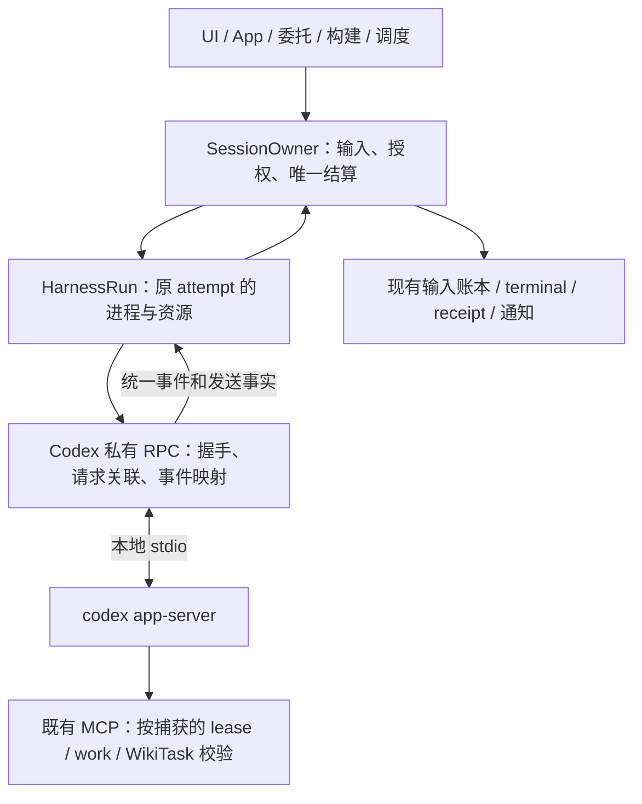

# Codex exec → app-server：基于当前代码的可行性与实施设计

> 日期：2026-10-23。状态：可行性设计，未实施。代码基线为本地
> `3d793d3326b749c171675d4349907a50b4f7b9b2`，同时参考当前未提交文档。
> 本机 `codex-cli 0.164.0` 的默认与实验 schema 已实际生成；没有执行模型调用、
> 生产 thread 操作或迁移验收。本文的“已确认”限于源码、schema 和明确列出的检查。

## 1. 结论及本次范围

**可行，但不是把 `exec` 换成 `app-server` 的命令修改。** 当前 SessionOwner、
输入账本、配置快照、receipt 和进程退役机制可以继续使用。主要工作集中在 Harness
内部的双向协议、输入确认、问题答复、事件归一，以及这些事实与 Owner 的连接处。
风险最高的是权限和完成语义，不是 JSON 编解码。

建议评估两个明确不同的交付范围：

| 范围 | 目标 | 当前可行性判断 |
| --- | --- | --- |
| A：请求内交互协议迁移，推荐首先选择 | Codex 对话改用本地 app-server；支持当前活动 turn 的追加输入、原生问题、流式输出和取消；保持当前“本次调用”完成范围；请求结束退役宿主，下一请求恢复历史 | 协议面基本具备，架构接缝明确；须完成本文基础验证后才能切换。不是已经验收通过 |
| B：完整原生尾部交付 | 主 turn 结束后继续接收原生子任务结果，让父代理继续处理、再委派，直到本请求范围完整结束才返回 receipt | 尚不能据现有材料证明；需要单独的运行合同和实验证据，可能需要上游能力，不能估作 A 的小补丁 |

A 是相对**当前生效合同**的完整升级方案，不以 A 验收替代 B。A 不禁止模型在活动
turn 内使用原生子代理；它不承诺根 turn 结束后仍能完成未来的原生工作。已观察到的
失败、未完成和退役中断必须如实展示，不能把根成功标成“全部子任务成功”。可靠跨
请求工作继续使用 Octopus 的 bg、Research 和 named delegation。

本次用户请求是先完善设计，因此 A/B 都未进入实施；不恢复暂停票、不改默认后端。
如果最终选择 B，A 的完成不能成为生产切换理由。

### 1.1 文档优先级与旧草案校正

1. [最小机制执行计划](../plans/minimal-architecture-execution-20261020.md)顶部及
   §10 是当前交付状态：22、23、24、28、31、42、43 整票暂停；当前仍为 Codex exec
   与 Claude stream-json/idle。新文档不覆盖这项事实。
2. [当前账户简化计划](../plans/architecture-simplification-20261023.md)规定保全当前
   数据、退出旧接口，不为任意旧客户端或旧版本建立永久兼容层。
3. [10 月 22 日 app-server 规范](octopus-app-server-spec-20261022.md)和
   [票据](octopus-app-server-tickets-20261022.md)是较早的 B 范围候选；其中“22 整票
   必须等待强尾部”、旧依赖和 25/30 等状态不能直接当作当前实施清单。25、30 等已
   交付责任只做回归，不重新实现，也不重新打开已完成的 50/51。
4. 本文负责当前代码到新协议的可行性、具体设计、未证实项和验证顺序。后续补充
   复核了固定提交的 Okou 执行入口、Claude 命令与 Codex RPC 实现，见 §4.4；它们
   是结构参考，不是 Octopus 的运行证据。
5. 用户明确要求保留多后端扩展性，**DSH headless 不是指定路线**。DSH 的 SDK、ACP
   与 headless 按实际适配度选择，见 §4.5–4.6 与
   [DeepSeek 选型方案](../plans/deepseek-harness-backend.md)。Codex 迁移不能以固定
   DSH 协议、削减 Claude 能力或重建第二套业务 owner 为代价。

同机升级要核验当前在用的 exec 历史能否 resume；这与换机计划“不要求搬运旧聊天
和原生线程”不冲突。也不由此恢复任意年代 transcript 的导入支持。

## 2. 当前代码真正依赖了什么

下面链接指当前工作树；符号名用于定位，基线以文首 commit 为准。

| 接缝及实现 | 已核对行为 | app-server 迁移的实际影响 |
| --- | --- | --- |
| [codex.py](../../server/harness/codex.py) `build_turn_argv`、`CODEX` | prompt 放 argv；`exec --json`；`CLOSE_AFTER_SPAWN`；续聊使用 `resume` | 交互启动改为 stdio RPC；不能继续关闭 stdin |
| [codex_control.py](../../server/harness/codex_control.py) `refresh_instructions` | 已使用短时 app-server：initialize → resume → 检查 controller checkpoint → inject_items → 关闭；随后另起 exec | 当前并非完全没有 app-server。应把更新并入同一执行宿主，退出临时进程路径，保留检查点语义 |
| [run.py](../../server/harness/run.py) `start`、`stop` | 持有 spawn reservation、进程组、reader、lease、活动 observer；处理 late spawn、退出和 pipe drain | 继续只有一个资源 owner；协议对象不能另造一套进程 supervisor |
| 同文件 `reusable`、`send_user_frame`、`_make_context` | `STREAM_JSON` 同时决定同轮输入、跨轮热复用和 run-bound Wiki scope；输入帧是 Claude 的 JSON 形状 | 这些维度必须拆开。把 Codex 标为 `STREAM_JSON` 会发送错误帧，并意外开启跨请求复用 |
| 同文件 `_emit`、`_handle_line` | stdout reader 直接等待有界展示队列；parser 的 EOS 关闭流并解除 run-Wiki 绑定 | 双向 RPC reader 若继续等待展示，将连 ACK、问题和终态一起堵住；EOS 也不能代表连接 EOF |
| [owner_runtime.py](../../server/sessions/owner_runtime.py) `_begin_attempt`、`_consume_runtime` | 依据 `reusable` 与 spawn signature 复用 held backend，并据此打开 steer 窗口 | app-server 交互能力不能借用 held 分支；能力与活动阶段须独立判断 |
| 同文件 `_steering`、`_write_steer` | 发送前可能合并 knowledge/Wiki 权限；`send_user_frame` 返回后将 delivery 标为 confirmed | RPC 接受与 pipe drain 不同；更不能先扩大原请求授权，再等待 provider 是否接受 |
| [turns.py](../../server/sessions/turns.py) `_after_attempt`、`_transient_decision` | 按错误文本、已输出内容和 resume ID 判断重试；无输出时可能重发原 prompt | “没看到输出”不能证明 RPC 未执行。发送未知必须阻断这条恢复路径 |
| [owner_questions.py](../../server/sessions/owner_questions.py)、[questions.py](../../server/sessions/questions.py) | 已有唯一问题 owner、计时、答复、关闭及通知；答复以格式化字符串保存 | 原生 RPC 答案需要 question ID → answers 的结构，不能丢失 ID 后拼回 prompt |
| [codex_activity.py](../../server/harness/codex_activity.py)、[codex_metrics.py](../../server/harness/codex_metrics.py) | 从 stderr/rollout 关联活动、原生观察和模型性能 | 新 RPC 不能与旧 observer 同时生成重复生命周期；Monitor 的 response 级指标也不一定能被 turn usage 替代 |
| [routers/sessions.py](../../server/routers/sessions.py) `_can_steer` | 由 `stdin_mode` 推导静态能力；前端据此显示实时发送 | 改为真正具备输入实现的能力；实际是否可发送仍由 Owner 在当前阶段裁决 |
| [research/leaf.py](../../server/research/leaf.py) | web leaf 使用 `create_run`；reasoning leaf 使用 `run_oneshot`；web leaf 收集完整 `text` | web leaf 会跟随迁移；mapper 若只发 delta，Research 会拿到空答案 |

公共会话中的 provider 历史 ID 仍存在 `claude_session_id` 字段，Codex 也使用它。
本次不为命名新增一份 thread ID 列。RPC `turnId`、`itemId` 是不同身份，不能复用
Octopus 的 request/attempt ID，也不能拿 `thread.sessionId` 替换用于 resume 的
`thread.id`。

## 3. 已核对的协议能力与证据边界

官方将 app-server 定义为面向产品集成的双向协议；stdio 使用逐行 JSON，线上消息
省略 `jsonrpc` 字段。连接先完成 `initialize`/`initialized`，再进行 thread/turn
操作。本文选择本地 stdio，保留 Octopus 对外 HTTP/WS，不暴露 provider RPC。
参见 [OpenAI Docs：Codex App Server](https://learn.chatgpt.com/docs/app-server)。

以下详细字段来自**本机 0.164.0 生成的 schema**，不是对在线文档最新版的推测。
“默认 schema 包含”不等于已经验证运行行为，也不是上游永不变更的承诺。

| 能力 | 本机 schema 事实 | 设计判断 |
| --- | --- | --- |
| start/resume | `thread/start`、`thread/resume`；支持 cwd、model、developerInstructions、config、sandbox、approvalPolicy；resume 必须带 threadId | 满足配置接入的形状；仍需核验实际生效值和旧历史 |
| 当前输入 | `turn/start` 要求 threadId/input；`turn/steer` 要求 threadId/input/expectedTurnId，返回 turnId | 可建立当前 turn 的接受证据；没有据此证明跨断连幂等 |
| 活动 turn 上 start | `TurnStartParams` 的 parent/root/trigger 等字段注明：请求成为活动 turn 的追加输入时忽略 | 不能把 start 当作无条件“另开一轮”；Owner 必须控制阶段 |
| 取消 | `turn/interrupt` 要求 threadId/turnId；`Turn.status` 有 completed/interrupted/failed/inProgress | 取消请求、turn 终态和实际资源退出分别观察 |
| controller | 默认包包含 `thread/inject_items`；items 是原始 Responses items；resume 支持 excludeTurns | 现有更新策略有协议落点，但必须保留去重与 compaction 后检查 |
| 问题 | `item/tool/requestUserInput` 带 threadId、turnId、itemId、questions、isBlocking；响应为 answers 映射 | 可接现有 Question Owner，需结构化答复与阻塞性适配 |
| 审批/扩展 | server requests 含 command/file/permissions approval、MCP elicitation、dynamic tool call、auth refresh 等 | 协议客户端必须回应或明确失败，不能只解析通知；不据此自动提供新审批产品 |
| 错误 | `ErrorNotification` 带 `willRetry` 与 thread/turn；turn 的 error 有结构化错误信息 | provider 正在内部重试的诊断不能直接转换为 Octopus 最终失败或再次重试 |
| usage | `thread/tokenUsage/updated` 带 threadId/turnId；tokenUsage 同时包含 last/total | 必须核验它们对应 response 还是 turn 的累积窗口，不能逐事件直接相加 |
| 原生代理 | ThreadItem 有 collabAgentToolCall 与 subAgentActivity；Thread 有 parentThreadId；Turn 有 rootTurnId | 有观察和因果字段，不等于完整树发现、结果消费或全树停止保证 |
| fork | `thread/fork` 支持 lastTurnId；另有破坏原线程历史的 `thread/revert` | 是可能的后续简化点，不能直接替代当前复制工作目录及按消息 rewind 的业务合同 |

默认包与 `--experimental` 的实际差异也已比较：`multiAgentMode`、
`experimentalRawEvents`、`dynamicTools` 在 ThreadStartParams 中只出现在实验包；
ThreadListParams 的 `parentThreadId`/`ancestorThreadId` 过滤同样是实验字段。
基础 RPC 不需要为了“以后可能用”统一开启 `experimentalApi`。B 如依赖这些字段，
必须明确版本、实际模式和失效后的行为；不能把 raw event 当稳定业务协议。

本次没有验证认证可用、模型权限、原生 wake、消息消费时点和实际进程退出。
schema 不能回答这些运行问题。§9 给出逐项实验，而不是把它们写成已支持。

## 4. 推荐结构：保留业务 owner，替换协议实现



### 4.1 一个 attempt 一个宿主

跨请求不保留 app-server 进程。新请求建立新 lease/bearer，使用同一凭据 home
恢复原 thread；历史持久性与进程持久性分开。同一 attempt 内的输入、问题及其 RPC
都属于同一宿主。协议支持长连接不构成引入全局 daemon、宿主池或多用户复用的理由。

绑定至少包含已有 session/user/request/attempt/work、backend handle、lease、
配置快照和 credential 引用；RPC 私有对象增加 connection 身份及 native thread/turn
关联。异步回报使用捕获的绑定，不读取 session 最新 backend 或 WikiTask。

配置冻结不代表权限永久有效；实际发送及 MCP 效果入口继续检查当前撤权。新
request 可以接纳排队，但必须在旧执行退役后才安装新上下文、grant 和 bearer。
不能只在 `turn/start` 前加屏障，而让新 WikiTask 已提前暴露给旧资源。

### 4.2 在现有接缝增加必要实现

- `Harness` 继续提供 `create_run`、`run_oneshot`、login、fork；backend 名仍是
  `codex`，不把协议版本变成用户必须选择的新 backend。
- `HarnessRun` 保留进程、lease、spawn/stop/join 的责任。通过 profile 的一个
  私有协议实现入口，选择原 JSONL 处理或 Codex RPC；不要在各业务 manager 中判断
  `method`。具体 factory 命名在实现时确定，不先建通用 Transport 层。
- Codex RPC 对象负责一个 reader、一个完整帧 writer、pending RPC futures、server
  request 关联和映射状态。它不持久化输入、不写 session、不另建业务队列。
- 同请求 steer 接口返回明确发送事实；`answer_question` 使用原问题关联，
  `interrupt` 使用原 turn；跨请求 reuse 独立裁决。不能为了支持 Codex steer 将
  `reusable` 改为 true，也不能把 RPC JSON 塞入 Claude `send_user_frame`。
- 默认实现只覆盖真实调用的方法、通知和 server request；生成 schema 用于 fixture
  与字段核对，不把全量协议类型或全部远程管理能力搬进项目。

预计增加约 2 个 Codex 私有模块（RPC 协调、事件映射），主要修改 Harness 与
Owner 接线。文件拆分服务于这两个不同测试面，不以新增层数衡量完成。

建议保留的小接口及其完成语义如下；名称可沿现有习惯，调用方不能只依赖“协程没抛
异常”推断更强的保证：

| 操作 | 完成语义 | 调用方 |
| --- | --- | --- |
| `start` | 准备、握手和首输入提交；回报该输入的发送事实及原生关联。通知读取可在响应之前进行 | Owner 的受管启动任务；Research 的直接调用也须能识别启动失败 |
| `stream` | 统一展示事件与当前调用结果；结果不自行提交业务 terminal；流结束不等于物理退出 | RuntimeReader、Research leaf |
| `steer` | 只向捕获的活动 turn 提交兼容输入，返回接受/明确未接受/未知，不开启新请求 | Owner 的受管输入任务 |
| `answer_question` | 回应捕获的原生 server request，报告本地发送结果；原 MCP 答案仍走原渠道 | Question Owner 决策后的受管 I/O |
| `interrupt` / `stop` | interrupt 是协议控制；stop 拥有物理退役和 join。Owner 最终以 stop 的退出证据判断资源退休 | 原请求取消、关闭及异常收尾 |

发送回报带原输入身份、connection/thread/turn 关联与证据等级；Owner 把需要恢复的
事实写进既有输入记录。协议对象里的 pending future 仅为 I/O 协调，不承担业务
成功判断。Claude 没有 provider ACK 时保留其实际证据等级，不伪造统一强保证。

### 4.3 生命周期及完成条件

以下是已有 Owner phase 中的行为顺序，不另存一套生命周期状态表：

1. **准备：** 捕获配置；退役旧持有资源；建立本请求上下文与授权；受管 spawn。
2. **初始化：** 启动 reader/writer，握手，start/resume，核对返回 thread 和有效配置，
   完成 controller/本轮指令更新。此时尚未发送业务输入。
3. **运行：** `turn/start`；记录接受的 turnId；展示事件；只在原 turn 的合法窗口
   接收兼容追加输入和问题答案。notification 可能先于对应 response，不能丢弃。
4. **结束输入：** 匹配 turn 终态到达即关闭 steer 窗口，收取已到达的正文、工具和
   usage；解析 completed/failed/interrupted。A 的范围到此不再启动父报告 turn。
5. **退役：** 封闭新的发送与工具准入、撤 lease，发起捕获宿主及受管 I/O 的停止，
   再 join；不能先等待必须靠停止才会结束的 RPC 或管道。Stop 可随时进入这一阶段。
6. **结算：** Owner 用完整事件前缀、发送事实和退役结果结算原输入与唯一 terminal，
   形成 receipt，再交付通知；通知失败单独反映，不重跑模型。

A 的成功条件是：匹配的 provider turn 明确 completed；当前合同内的输出完整；
没有影响判定的协议缺口或未确认关键输入；受管宿主已退役；Owner 的持久结算成功。
EOF、exit 0、最后一条文本、interrupt ACK 均不能单独满足这些条件。未知输入保留
unknown，不因同轮根结果成功变为 done。B 则还要满足§8的结果交付与闭合范围，
不能复用 A 的 turn 完成条件直接通过。

Claude 保留原协议和本机“未实机验证”范围。公共接口改动不能误关其当前同轮输入，
也不能把其 JSONL 写入伪装成 RPC ACK；跨请求热复用清理若纳入本次完整候选，按原
23 的责任单独验收，不在 Codex mapper 中顺手改语义。

### 4.4 旧计划与 Okou：应当借鉴哪一层

[inline-steering](../plans/inline-steering.md) §5 已参考 vm0（现名 Okou）的
Claude stream-json，§11 已记录其迁往 Codex app-server；当时 Octopus 仍选择 exec
排队。那里记录的 Codex 0.132.0 与阶段状态是历史依据，不能替代当前版本检查。

本次读取 Okou 提交 `328c79f29a81e44e454ff155cd2416e78ea7860d` 的三个源文件：

- [`command.rs`](https://github.com/okou-ai/okou/blob/328c79f29a81e44e454ff155cd2416e78ea7860d/crates/guest-agent/src/cli/command.rs)：
  Claude 仍使用 `--print --input-format stream-json --output-format stream-json`，
  可加 replay 与 resume；输入是带 uuid 的 Claude user frame。
- [`mod.rs`](https://github.com/okou-ai/okou/blob/328c79f29a81e44e454ff155cd2416e78ea7860d/crates/guest-agent/src/cli/mod.rs)：
  外部执行入口统一，内部将 Codex 交给私有 RPC 实现，Claude 留在 JSONL 路径；
  输出读取与慢速投递解耦。没有把 Claude 包装成 Codex server。
- [`codex_app_server_backend.rs`](https://github.com/okou-ai/okou/blob/328c79f29a81e44e454ff155cd2416e78ea7860d/crates/guest-agent/src/cli/codex_app_server_backend.rs)：
  Codex 持有自己的 thread/turn 关联；steer 携带 expectedTurnId，成功响应才记录
  backend 接受。这与 Claude replay 的确认机制不同。

可借鉴的是**统一外部执行语义、保留原生协议、明确发送证据、读取与展示解耦**。
Octopus 的 [Claude 实现](../../server/harness/claude_code.py) 已有 stream-json、
resume、partial 输出和 MCP 装配，可直接保留这些能力。无需先改用 Claude SDK，
也无需为 Codex 增加另一套 SessionManager。

不照搬其远程 sandbox 投递账本、heartbeat 体系或每条路径独立的完整进程管理；
Octopus 已有唯一资源 owner。该提交还设置 `CLAUDE_CODE_DISABLE_BACKGROUND_TASKS`，
这不能作为本项目削减 Claude 原生能力或证明完整尾部交付的依据。只读源文件没有
验证其部署行为，更没有完成本文 B 范围实验。

### 4.5 多后端共享合同，而非共享一种线协议

[原 Harness 计划](../plans/harness-layer.md)的一个 Harness + RuntimeProfile 仍
成立；“差异主要是 argv/parser、同一个 JSONL 引擎即可”的判断需要随新协议调整。
Profile 可以选择私有协议协作对象，公共 HarnessRun 继续唯一拥有实际运行资源。
这不是 provider Harness 子类层次，也不要求提前实现所有未来协议。

| 层次 | 三个后端应共享的义务 | 留在后端实现中的差异 |
| --- | --- | --- |
| 产品与 Owner | 输入账本、捕获配置/owner、权限、问题、取消、唯一 terminal/receipt | 不出现 Codex/ACP 方法名或 DSH 事件字段 |
| Harness 调用 | start、stream、stop；有实现才启用 steer/原生答复；oneshot/leaf 也服从相同授权 | 启动与握手、输入编码、发送证据、事件映射和 provider 完成判据 |
| 受管资源 | spawn 准入、进程组、读写任务、私有配置文件、退出和 join；迟到句柄始终有人负责 | argv/env/patch、native history、协议关闭方法；SDK 若自带进程管理，必须移交可退役句柄或不用其自动 spawn 路径 |
| 展示与消费者 | 完整正文、工具/问题/错误、usage、实际能力、不可用结果 | 原生工具身份及可观测性；未提供的信息如实缺省，不伪造事件 |

能力由 profile 中可执行的实现推导，运行中能否调用仍由 Owner 决定。至少拆开
“同轮追加”“原生问题答复”“跨请求复用”“完成证据”这四件事；`stdin_mode` 只
描述传输细节。未来支持 RPC 的 DSH 不因此自动支持 Codex 式 steer。缺少某能力时
明确排队或标示不支持，不能把整个平台降到所有后端的最小功能集合。

最容易写错的是完成顺序。Claude 可先给 result；Codex 给 turn terminal，连接仍
在，需要主动退役；DSH headless 候选要等 final、reason 与真实退出才可判结果。
SDK/ACP 又有各自的等待或 prompt 完成响应。公共层接收**执行结果与资源退出两类
事实**，不要求所有后端“等 EOF 才发结果”，也不允许“有结果就视为进程退出”。
前者会卡住需收到结果才发起 stop 的 RPC，后者会丢失资源责任。Research 等直接
消费者必须得到同一正确结果，不能只在 SessionOwner 内补判。

原生 session/thread ID 继续使用既有不透明 resume 引用；RPC 请求、turn、item 和
DSH message ID 在私有实现中关联到原 attempt。新后端不会自动获得跨后端历史转换。
凭据、MCP bearer、controller 与 memory 内容仍由共享 assembly 捕获，协议对象只
负责表达；不能复用 Codex 的 home、认证、工具名或默认安全策略。

### 4.6 DSH 选型与 Codex 迁移的关系

DSH 的 headless、SDK、ACP 都是同一个 `dsh` launcher 的不同 profile。SDK 并非
必须嵌入 Python 服务内的 agent loop：锁定包提供 `dsh --profile sdk` JSON-RPC
stdio 服务；ACP 使用 `dsh --profile acp`。以下来自本机 `0.2.1-rc.2` 的 README、
协议类型与 SDK/ACP 编译实现，详细比较和证据入口见
[DSH 方案 §1.4–1.5](../plans/deepseek-harness-backend.md)。

| 候选 | 与 Octopus 的主要适配点 | 必须解决的差异 |
| --- | --- | --- |
| ACP | prompt 返回相关 stopReason，支持 cancel/close、resume 和 MCP；标准语义事件 | 每 session 只允许一个活动 prompt；省略 DSH 专有展示、原始 delta 和部分身份；原生子代理展示与问题路径要验证 |
| SDK / 原生 RPC | 完整 Session 事件、子代理通知、精确 resume、受管后代等待 | prompt 只返回入队 messageId；wait 是 session 范围，不是每条输入成功；无独立 cancel/session-close 方法，取消需退役隔离宿主 |
| headless CLI | 有限进程、配置和部署直接，适合确实只需任务执行的范围 | 输出投影/截断、问题与轮内输入限制；final 本身不表示成功 |

**当前建议优先验证 ACP，SDK 同时作为保留更完整 DSH 语义的候选；headless 是
有明确适用范围的备选，不是必须经过的第一步。** 这是基于所读接口的适配判断，
不是选型验收。ACP 的标准化不自动证明能保留所需能力；SDK 更丰富也不自动解决
完成归属和取消。最终先通过 DSH §1.5 的同一组反证场景，再只实现胜出的路线。
不同时维护三条 DSH 执行路径，也不将 Codex/Claude 强行改造成 ACP。

Codex 迁移不会原则上阻塞 DSH，但确实会改动同一组接口：

1. `RuntimeProfile` 的协议实现与可选能力、`HarnessRun` 的输入/结果/退出接缝先
   统一含义，不能一边新增 RPC 分支，一边按 headless 假设重写全部 parser。
2. DSH 草案的中立 LaunchPlan、文件所有权与 owner 贯通是实际配置需求；它们尚未
   实现。需要时由公共执行器负责。headless 的“退出后归并”是私有终态策略，不能
   成为所有后端必经的完成规则。没有实际文件需求时不为 Codex 先造空的资源框架。
3. F0 明确这份公共合同，F1/F2 建立 Codex 与保留的 Claude 两种真实实现。DSH T0
   独立选型；T2 复用同一接缝。两项目无需互相等待完整交付，但共享文件应由一个
   变更统一修改，后来的方案删除已被替换的旧签名，不长期保留双接口。
4. 扩展验收穿过 start/stream/stop 与实际 Owner/Research 消费者：发送未知不重放、
   取消确实退出、错误不成功、完整正文、凭据隔离。新增 DSH 不应要求在调度、App、
   委托、Wiki 等业务 manager 中增加 `if backend == deepseek`；前端注册与能力
   展示仍需正常接入。Codex 回归验证届时实际使用的协议，不写死必须 exec。

## 5. 双向 I/O、输入与控制的详细设计

### 5.1 Reader 和 writer 的职责

reader 必须区分 response、notification 和 server request。客户端 RPC ID 与服务端
请求 ID 分开管理，保留其字符串/数字类型；最终关联包括 connection/attempt，防止
新连接复用数字 ID 时答复旧问题。pending 项在发送前登记；reader 不等待请求业务
完成，也不等待用户回答。

writer 只串行化整帧写入；等待 ACK 不占 writer。消息进入可取消的发送阶段后由原
attempt 持有，即使等待者取消也不能丢失发送未知的事实。Stop 不依赖 writer 或 ACK
成功才能启动物理退役；pipe 阻塞时有界升级停止原进程。

当前 `_emit` 的等待式背压不适合直接放在 RPC reader 中。建议复用原展示队列及
容量，改为 reader 非阻塞入队：可合并的正文 delta 按 item 合并；response 直接完成
原 future；server request 交给受管处理任务。完整正文、工具结果、关键身份或终态
无法保留时，令本 attempt 明确失败并退役，不静默丢事件，也不加无限缓冲。
writer、pending RPC、未回答问题和单帧都须有界；容量参数由实际 fixture 验证。

当前 stdout 单行上限为 4 MiB，展示队列为 256 项/约 1 MiB，允许单个合法大事件
独占。这是现有基线，不是 app-server 的官方上限。resume 使用 `excludeTurns` 避免
整份历史占用单帧；需要历史读取时分页。完整 UTF-8/JSON 编码大小和 OS argv/env
边界分别验收，不能以“prompt 已经移到 stdin”宣称 E2BIG 全部消失。

### 5.2 三种事实，仍然只有一本输入账本

| 事实 | 证据与 owner | 不代表什么 |
| --- | --- | --- |
| Octopus 已接纳 | Owner 提交现有 pending/running/done/withdrawn/unknown 账本 | provider 已收到 |
| provider 接受此次输入 | 对应 start/steer 成功响应、匹配 turnId；必要时核验原生输入项 | 已完成用户任务，或没有 hook 改写 |
| 请求完成 | 原 Owner 的持久 terminal/receipt，含实际输入集合 | 每个原生后代都已完成，或通知已送达在线客户端 |

RPC 私有发送结果需要表达“确定未发/明确拒绝”“已接受”“可能发送但未知”。这些是
操作回报，不另增第六种业务输入状态或第二份投递表。沿现有 delivery 字段表达证据；
若字段确需变更，只做当前基线前向升级，并说明与 execution_state 的区别。

`turn/steer` 始终带捕获的 `expectedTurnId`。明确 turn 不匹配且已证明拒绝时，
原输入才可按现有合同排下一请求；写出后 ACK 丢失、超时或连接断开均不自动重发。
`clientUserMessageId` 可用于关联，但本次未证明其是幂等执行键。不能拿新 RPC ID、
新 attempt、exec fallback 或 resume+continue 绕过 unknown。

发送状态在执行交接前先保守记录，ACK 后再确认，期间服务崩溃按原 unknown 恢复。
代际准入证明旧资源退役，只允许新请求进入，不能证明旧输入从未执行。

### 5.3 追加输入的权限边界

只有不改变原配置、来源、work 和工具授权范围的 human 追加输入可以 steer。
model/effort、凭据、MCP 集合、Wiki scope 或合同变化均排成下一请求。
当前 `_steering` 会先 `revise` knowledge 并替换活动 WikiTask；迁移必须审查这个
入口，不能因为 provider 支持 steer 就允许新 grant 借旧 lease 生效。请求内内容
修正与请求权限扩展是不同操作。

这里比较的是有效授权范围和固定执行配置；每条 human 输入仍保留自身 request ID。
不能按输入 ID 必须相同来判断兼容，否则所有合法追加输入都会被错误排队。

公共 `can_steer` 表达该 backend 实现的能力；实际发送资格由 Owner 的活动 turn、
停止状态和上下文兼容性决定。界面依据现有 dispatch 状态显示窗口，服务端再次裁决
竞争。初始化、终态收尾、问题专用答复及 B 的内部处理阶段，不用 `turn/start` 把
排队 human 输入偷偷混进原执行。附件仍按现有队列策略，首次迁移不扩大产品能力。

### 5.4 问题、审批与 Stop

原生 requestUserInput 绑定原 connection/server-request/thread/turn/item 和
Octopus question ID。保留问题级 ID 与结构化 answers，由 Question Owner 处理用户
提交和过期；RPC adapter 把答案写回原 server request，不当作新 prompt 或 steer。
原有 MCP AskUserQuestion 继续使用其回调渠道。

现有格式化字符串可继续作为历史展示，但不能成为原生答案的唯一表示。`isBlocking`
决定是否暂停等待用户期间的 idle watchdog；非阻塞问题不能冻结整个请求。答复与
turn 结束/Stop 交错时只允许原问题的一次结果，旧回答不得进入新 attempt。
server request 的 response 通常没有再一层 RPC ACK：本地写完不伪造“模型已消费”，
断连保留真实答复交付限制。

普通运行保持当前明确的权限策略，Research 保持其受限策略。未实现审批、MCP
elicitation 或 dynamic tool call 必须给合法拒绝/错误并准确结束，不能自动批准或
无限悬挂；普通问题的超时默认文字不能用于审批。若选定配置实际需要交互审批，应
在切换前补齐 typed 决策和 UI，不能靠启动参数放宽权限取得通过。

Stop 先封闭新发送，再对捕获的活动 turn 尽力 interrupt，并启动宿主退役。根 turn
已结束也须能停止剩余原资源。lease 撤销只拦 MCP，不控制所有 shell/文件效果；
进程组退出与安装级 systemd cgroup 各有覆盖范围，须用真实子进程测试，不能从根
PID 退出推导全部后代退出。停止不撤销已经发生的外部修改，也不取消独立 manager
拥有的 bg/Research/delegation 工作。

## 6. 输出、配置、历史与现有功能的保持

### 6.1 事件归一和持久化

所有公共消费者继续接收 HarnessEvent、历史消息和 receipt，不新增一套 app-server
浏览器协议。原始 RPC 身份在 adapter 边界校验；工具项按 thread/turn/item 关联后
进入既有 ToolIdentityTracker，不能只用连接内 item 序号。

| RPC 事实 | 进入当前系统的形式 | 必须避免的错误 |
| --- | --- | --- |
| thread/start/resume 响应与 thread/started | 一次 `session_started`，保存 `thread.id` | 同时回放历史 turns；误把 thread.sessionId 当 resume ID |
| item/agentMessage/delta | `text_delta` 供即时显示，按 item 聚合 | 将每个 delta 当完整持久消息；子线程正文混入根答案 |
| 完成的 agentMessage | 一次完整 `text`，用于持久化及 Research 等消费者 | 同一文本按“delta 累积 + final 快照”重复追加；commentary 和 final 混成一项 |
| reasoning、command/file/MCP/web 项 | 既有 thinking/tool_use/tool_result；保留原工具名、参数、错误和输出 | 把 command output delta 当作独立 tool result；result 后又重复生成结果 |
| collabAgentToolCall、subAgentActivity | 原生子代理观察和卡片，保留所属 turn 与可用执行身份 | 把 child thread 的上次 completed 当本次执行完成；从卡片为空推导全树结束 |
| error 且 willRetry=true | 保留诊断和活动事实，继续等待原 turn | 进入 `_capture_error_text` 后把 attempt 永久标失败，或同时启动宿主重试 |
| turn/completed | 解析其 status/error，形成匹配 turn 的结果事实 | 根据通知名称直接 success；把 interrupted 当 completed；响应晚到覆盖新 turn |
| tokenUsage/updated | 原生身份约束下的 usage 与 Monitor 数据 | resume 历史再次累加；last/total 双计；根与子重复计费 |

事件先于 start/steer response 时，由原 pending 操作关联并缓存必要的有界事实；
收到响应后核对身份。关键事件缺失、矛盾或不受支持导致无法判断执行结果时，局部
失败并保留 partial。未知可选通知记诊断即可，不因新增无关字段停止整个服务。

`turn/completed.turn.items` 不是可以盲目重播的完整事件流：schema 中有 `itemsView`
且历史采用分页。重连读取可以帮助诊断或读取已保存结果，不自行恢复未知执行、
重做外部效果或重放所有旧消息。公开 UI 重连仍从 Octopus 已提交历史恢复。

usage 推荐按实际验证的语义做当前 attempt 的末值/差值投影，保留原生 turn 身份与
去重键。验证前不决定“last 就是本轮总量”。当前 Monitor 使用 response 级生成窗口
估算 TPS；turn 耗时和 token 总量不足以等价替代。如果 RPC 缺少原指标，保留限定
用途的被动 observer，或明确该指标不可得；不能造出看似更稳定的新 TPS。

删除旧 observer 的条件应按职责判定：已由 RPC 覆盖的生命周期/活动事实退出重复
writer；仍有用途的性能观察和 oneshot 诊断保留。它不参与业务完成裁决，也不能变成
B 的隐式完成屏障。

### 6.2 配置与认证的逐项接线

| 当前配置 | 推荐接线与检查 |
| --- | --- |
| credential / CODEX_HOME | 沿原 credential resolver 与 home；让 Codex 继续管理已有登录和刷新。不要复制 auth.json、读取秘密内容或重建登录系统 |
| model、effort、正常/Fast | thread start/resume 和 turn 参数明确设置，核对服务端返回的有效配置；正常速度必须覆盖上轮 Fast，不只依赖省略字段 |
| cwd | 使用原已解析绝对路径，同时核验 thread/turn 返回值；工具实际 cwd 也须验证 |
| MCP / connector | 继续使用 assembly 选出的命名空间和 per-run bearer 环境引用；不能加载同 home 下意外继承的 MCP 后就声称与原选择一致 |
| sandbox / approval | 将普通运行与 Research 的原策略分别映射；不要照搬 exec 专属 flag。读取有效配置并用工具效果证明 |
| persona / memory | 继续使用 agent 自定义配置和 canonical memory 目录；不因 app-server 具备其他 memory 能力而迁移数据或启用第二份记忆 |
| subagents / feature flags | 使用当前 agent 与 CLI 模式，不擅自换模型/强度或启用实验 multi-agent；B 单独确认其模式 |
| attachments / 大 prompt | 先保留现有附件路径和增强 prompt 语义，RPC 使用当前支持的 input 形状；不混入上传、图像或音频产品重设计 |

认证差异是实机门禁：继承同一 home 并不证明 app-server 与 exec 的账号访问、模型
供应商和配置优先级完全相同。默认仍使用现有本机凭据模式；不因为协议提供
`account/*` 就采用外部 token 托管或改变登录 UI。

Research web leaf 的空 MCP/connector/memory、临时 cwd 和只读策略必须实际成立。
当前 read-only sandbox 不等价于“所有命令都无法执行”，oneshot 的“tool-free”
注释也不等价于已禁用原生工具。验证要比较实际允许范围，不能沿用这些注释作证明，
更不能在迁移中悄悄扩大权限。

### 6.3 Controller 只保留一个写者

当前 `refresh_instructions` 的短时宿主以 `mcp_servers={}` 初始化，恢复 thread，
读取最新 controller checkpoint，只有内容变化才注入稳定控制消息；本轮上下文另发。
迁移将这段顺序并入新宿主，确认完成后再发业务输入。

应优先复用现有 marker/digest 与 `retain_client_developer_messages` 的实际语义：
新 thread 一次安装；旧 thread 内容未变不重复注入；变化更新一次；compaction 后
仍识别有效版本；请求动态上下文不混入稳定 digest。不能仅因 resume 接受
`developerInstructions` 字段就删掉原检查点逻辑。

当前检查点读取依赖返回的 thread.path；0.164.0 schema 将 path 标为 unstable。
因此保留现行读取作为版本限定的兼容策略，列入升级门禁；只有公共历史读取能提供
等价证据时再替换，不新增另一份持久 controller 镜像。注入回执未知时不继续执行
用户输入，不由第二个宿主重试写同一 thread。

单宿主还会改变 MCP 初始化时点：原控制进程不装业务 MCP，新进程会装。须证明当前
授权在首次可能使用工具前已安装，而非等 `turn/start` 才建立；准备失败时照样撤销
lease 和退役所有已启动 MCP 子进程。

### 6.4 历史、fork 与轻量调用

同机当前 exec thread 直接通过 thread/resume 验证，不重写全部 rollout 或复制
Octopus 历史。保存原 thread ID、当前消息、附件和 memory；没有修改主库 schema
的需要时不为协议迁移新增 schema。

当前 `/fork` 不仅是 provider thread 的 fork，还复制工作目录、处理 git 与归属；
`/rewind` 按 Octopus 消息位置处理并可能回放历史。原生 `lastTurnId` 不天然等价于
消息 seq，`thread/revert` 还会修改原 thread。首版沿原 fork/rewind 实现验证其产物
可以恢复；未来替换原生复制前须证明历史身份、路径、父线程不变与失败清理全部等价。

`run_oneshot` 仍使用 exec，覆盖 schedule/showme 与 Research reasoning leaf。
它有独立用途，不是迁移失败的兜底。web leaf 随 create_run 迁移，必须保证完整 text、
错误、timeout/cancel 和退役。公共 UI、App ask/chat、委托、构建、scheduler 和 Wiki
worker 只消费原 receipt；不能各自根据 provider EOF 或第一条答案判定完成。

## 7. 失败、重试、恢复与发布

### 7.1 重试必须以发送证据为前提

当前 `_transient_decision` 的“没有输出 → 重发原 prompt”对 RPC 不成立：模型可能
已执行工具，而 stdout 尚未送达。现有 `continue` 提示词也不能证明副作用幂等。
应先判定发送/执行不确定性，再进入原错误分类；不能只给断连错误换个字符串。

| 失败时点 | 处理 |
| --- | --- |
| 尚未提交业务帧：spawn/initialize/配置准备失败 | 原输入未发送；清理已捕获资源；仅在已证明可重复且原预算允许时重试准备。controller 注入本身需独立核对 |
| 明确拒绝当前输入，且协议证明未接受 | 准确报告拒绝；按请求类型决定原输入排队或失败。认证/配额拒绝不忙重试 |
| 业务帧可能写出但缺回执 | 保留 unknown，退役原执行；不重发、不创建替代 thread、不自动切 exec |
| 已接受，之后断连/超时 | 保留 partial 和原身份；停止捕获资源；不以“可以 resume”推断可以自动续做 |
| provider error 标明 willRetry | 由 provider 继续当前尝试，受原总预算约束；Octopus 不同时开第二轮重试 |
| 明确 failed/interrupted 终态 | 按原结果结束；如要保留某类自动恢复，必须证明该类重试不会重复不确定效果，不能一揽子继承文本分类 |
| 数据库或权威存储失信 | 沿现有 fail-stop/安装代际恢复合同；RPC 客户端不补写业务事务 |

读型、确定无效果的协议请求可有独立短超时；业务 start/steer、答案、controller
注入不能使用通用“超时自动 retry”装饰器。超时结束等待，不证明 provider 未执行。

### 7.2 崩溃与重新启动

内存中的 RPC pending 表和 connection ID 不持久化为新的恢复数据库。进程死亡后，
原输入按已有账本和 generation/process 证据恢复；执行未知保留未知。历史读取只能
确认可取得的内容，不能从最后一条消息猜测外部工具是否完整成功。

无需重建“执行恢复表”、持久 native 任务树或自定义 CLI。schema 或配置不支持必要
能力时，在提交业务输入前明确失败；已开始的执行不换协议。未确认资源退出时保留
原 handle，并按既有隔离/fatal 边界处理，不丢引用后允许同 thread 第二个 writer。

### 7.3 切换与故障处置

开发阶段可以让新 adapter 单独接受验证，但生产只接收满足**所选完整范围**的候选。
切换时自然排空或明确停止旧 attempt，确认退役后，新请求使用新协议。不会在运行中
把某个 exec 进程换成 app-server，也不建立永久双协议协商或自动 fallback。

保留当前数据；故障处置沿当前格式可读的代码恢复或前向修复。旧二进制能启动不证明
它能读取新 app-server 已写的历史，不能承诺任意旧候选回退，更不能回灌旧 DB。
完成后删除已替代的交互 exec、临时 controller 宿主和专属测试分支；仍用于 oneshot、
当前历史读取和诊断的实现按实际消费者保留。

## 8. B 范围为何仍是独立可行性门槛

app-server 让宿主能观察更多事件和控制 turn，但不会自动提供 Octopus 所要求的
“整个原生工作已经完成并由父代理处理”的证明。当前 schema 的 rootTurnId、
parentThreadId、collabAgentToolCall 都有价值；本次没有证明它们组合后覆盖以下事项：

| 未证实项 | 必须取得的证据 | 不能代替它的现象 |
| --- | --- | --- |
| 范围发现完整 | 新建/旧 exec cold resume；快速 child、孙任务、同 child 再执行均可关联到本 attempt | 列表暂时为空；只订阅根 thread；某次测试恰好只有一个 child |
| 结果确实交给父处理 | 子结果进入父输入，父后续 turn 具有可核对因果身份；hook 拒绝/修改时不误判 | child completed；UI 卡片消失；RPC 接受了报告 |
| 唯一续跑驱动 | 明确由原生 wake 或必要的宿主报告驱动，只有一个 owner；父能再委派 | 原生 wake 与显式 start 并行碰运气；固定一次汇总 |
| 结束后不会再生工作 | 有已界定的完成范围及可靠关闭依据，覆盖仍可生成工作的主体 | 安静几秒、重复 list 为空、父输出“完成” |
| 全范围可停止 | 根已 idle、child/孙任务仍活动时，原资源和工具实际停止；不影响独立 work | 根 interrupt ACK；撤 MCP lease；根 PID 退出 |

首个实验应为：**从当前 exec 历史冷恢复，父先结束，child 延迟完成，父处理结果后
再委派一个验证任务，再汇总；分别在父 idle 和父续跑期间 Stop。** 先用可控的本地
文件效果和等待点取证，再验证模型驱动；单次生成了正确答案不证明通用生命周期。

如需要实验 raw events、后代列表过滤或本地源码补充解释，须锁定实际安装版本和
模式，说明实验依赖及更新成本。源码说明与录制共同支持运行合同，不以 main 分支
文档替代部署证据。本次未检查对应 Codex 源码，所以不写“上游绝对不支持”，只写
“尚未证明所需保证”。

若协议足以提供完整范围，就在同一 attempt 内保留原授权并让原生处理继续；若只能
提供观测，B 保持未解，不自动升级为自维护 CLI、全局 supervisor 或持久任务树项目。
必要宿主报告还须验证 `toolOutput` 的实际语义、工具数据身份、是否持久化、hook
处理和发送未知；不能伪造新的 human 授权。独立 bg/Research/delegation 的返回
继续形成后续输入，不作为 B 内等待的原生 child，否则可能等待只能由下一请求处理
的结果而互相阻塞。

## 9. 验证设计：先找最可能推翻方案的场景

本轮只做静态核查和 schema 生成，下面均为**未来实施的验收项**，没有标为通过。
测试替身能证明本地交错处理；真实 CLI 才能证明 provider 行为。两种证据都需要。

### 9.1 先行实验及准入门

| 顺序 | 实验 | 接受标准与失败后的决定 |
| --- | --- | --- |
| P0-1 | 隔离 home/output 的 start/resume、握手和实际有效配置；使用原选定凭据引用 | 身份、model/effort/tier、cwd、权限和 MCP 集合正确；不符则先修配置，不进入业务迁移 |
| P0-2 | 当前 exec 历史 resume；controller 相同/变化/compaction；fork 后首轮 | 原历史可继续、稳定指令不重复、本轮上下文生效、只有一个 writer；不符则不能默认切换 |
| P0-3 | start/steer 写出后截断响应；活动 turn 结束与 steer 竞争；有实际工具效果但无展示输出 | 不重复输入或工具效果；unknown 保留；旧恢复逻辑无法触发第二次模型调用 |
| P0-4 | 原生 blocking/nonblocking question、旧答案、Stop 与展示拥塞交错 | 原请求得到正确结构答案；控制可执行；无问题串答或 watchdog 永久暂停 |
| P0-5 | 已完成 turn、未退出宿主、MCP/命令仍持有 pipe；终态与 usage 顺序录制 | 退出有界且不死锁；完整正文/结果和可声明的 usage 有依据；未收完整不伪成功 |
| P0-B | §8 的冷恢复和两轮子任务反例，仅选择 B 时必需 | 归属、父处理、终止条件和 Stop 共同成立；否则 B 不通过，不能以 A 代验收 |

隔离实验使用临时数据库、workspace、账户/Wiki 路径和 provider 输出根；凭据按仓库
规定引用，不复制秘密、不修改生产 thread。普通 schema/help 检查不需要模型调用；
未来真实验证按任务选定配置执行，不因探索自动升级模型或调整 agent 默认。

### 9.2 行为回归矩阵

| 场景 | 最关键断言 | 已有测试接缝 |
| --- | --- | --- |
| 通知先于响应、多个 RPC 交错、server request 与本地 ID 相同 | 正确分派，无死锁或 ID 串线；未知核心事实准确失败 | 新私有 RPC 协议替身；`test_harness_core.py` |
| 文本 delta + final、重复 item、相同 child 再执行 | 原文只持久化一次，Research 获得完整正文，子结果不污染根答案 | `test_harness_codex.py`、`test_native_subagent_stream.py`、`test_research_orchestrator.py` |
| UI/App 不消费输出，队列达上限，再 Answer/Stop | 容量有界、控制不等待展示、失败保留 partial | `test_harness_flow_control.py`、`test_session_owner_stream_pressure.py`、`test_session_owner_control_capacity.py` |
| 已接受 steer、未知 steer、终态与提交中断 | 有证据的集合一次结算，unknown 不随根成功变 done | `test_session_owner_steer_cancellation.py`、`test_behavior_receipts.py`、输入账本测试 |
| R1 退出期间 R2 到达、旧 Stop/问题/MCP 晚到 | R1 退役后才安装 R2 权限；旧事件不能作用 R2 | `test_harness_authorization_stop.py`、`test_account_steer_revocation.py`、`test_session_retirement.py` |
| spawn 返回前取消、reader/writer 堵塞、异常 EOF、进程逃离根 PID 生命周期 | 引用不丢、受管范围退出；未知退出不放行新 writer | `test_harness_core.py`、`test_session_owner_failure_handoff.py`；必要真实 supervisor 场景 |
| MCP Ask 与原生 Ask、approval/elicitation 未实现 | 答复走原渠道；未知审批不会默认允许 | `test_session_owner_questions.py`、`test_question_codex_real.py` |
| willRetry 诊断后成功、断连、认证失效、配额拒绝 | 不双重重试；未知发送不恢复；错误类型准确 | transient/auth 现有测试及新 RPC 录制 |
| resume/fork/rewind 后 controller 与 token usage | 不重复注入、计数或回放旧消息，父线程未被破坏 | `test_codex_controller.py`、`test_fork_native_copy.py`、相关实机测试 |
| Research web/oneshot、正常/Fast、MCP/connector/memory | 实际配置等价，受限 leaf 不获取普通请求授权 | `test_research_real.py`、`test_harness_memory.py`、`test_backend_codex_real.py` |
| App/委托/构建/调度/Wiki 与 UI 重连 | 同一 receipt；前缀交付后 App done；后台返回一次接纳且会话保留 | `test_behavior_receipts.py`、消费者各自现有测试 |
| Claude 原 JSONL 和当前同轮输入 | 公共接缝未退化；held 改造若纳入则完整验收 | `test_harness_claude.py` 与 Owner 测试；本机不运行 Claude 实机 |

协议测试使用实际子进程/pipe 和可控等待来触发乱序、堵塞、退出；不能只 mock
`stop()` 或让 future 立即完成。真实 CLI 录制记录版本、功能模式、原始关键事件、
请求关联、效果及退出证据；fixture 仅裁掉实际密钥字段，保留诊断所需上下文。

完整代码候选按 [AGENTS.md](../../AGENTS.md) 执行受影响回归、提交门禁和本机发布
门禁。每项检查一个执行方，同版证据复用；本机不探测或计 Claude 实机通过，默认
不运行 knowledge_eval/wiki_perf。本文纯文档检查不触发这些代码或模型套件。

### 9.3 性能与成本只测实际变化

按同一 CLI、模型、effort、速度、凭据和代表性历史比较新建及续聊：准备、spawn、
initialize、resume/controller、首输出、总耗时、退役耗时、峰值内存与并发进程数。
记录冷启动/已缓存差异，样本数和失败样本，不先承诺 p95 或固定加速比例。

可能减少的是续聊时“控制宿主 + exec”两个进程的重复启动；不会自动消除每请求
spawn、MCP 初始化或历史加载。流式文本可能更早可见，不等于模型生成更快。
逐请求宿主同时意味着不享受跨请求常驻进程收益；这是当前权限隔离合同的明确取舍。

## 10. 实施单元、影响面与删除条件

### 10.1 顺序与独立出口

以下是新方案的评审/验收单元，不是恢复原票状态，也不是多轮生产半成品发布。

| 单元 | 内容 | 前置与出口 |
| --- | --- | --- |
| F0：选定范围与版本合同 | 确定 A 或 B；确认 §4.5 公共接缝；完成 P0 基础实验；B 再验证 P0-B | 先得到可执行运行合同；关键证据缺失时停止对应范围，不先搭管理平台；不要求等待 DSH 整体交付 |
| F1：协议实现与事件映射 | 单 reader/writer、typed 请求、server request、背压、完整 text/工具/usage | F0 的基础能力成立；协议替身与真实形状一致，旧消费者可用 |
| F2：固定 attempt 接入 | 单宿主配置/controller、start/resume、原资源 owner、退出与未知发送恢复阻断 | F1；新建与当前历史、异常退出、认证/Research 验证通过 |
| F3：公共输入与原子结算 | steer 能力与权限判定、typed answer、Stop、输入集合/terminal/receipt；必要跨请求隔离完整替换 | F2；竞态与消费者结果一致，旧并行发送/结算旁路退出 |
| F4：组合与交付 | 所选 native 范围、fork/rewind、Monitor、全部实际消费者、文档与删除项；同候选门禁 | F2/F3；B 必须已通过原生完成合同；自然排空后一次切换 |

先验证单 attempt，再验证跨请求，最后验证消费者组合。F2 不反向等待 F3 整体完成；
F3 使用 F2 的明确发送与退出接口，避免旧草案中“transport 局部完成”与“全请求
验收”互相等待。A 不增加内部报告调度；B 的必要实现只有在 P0-B 证明后才进入 F2/F4。

### 10.2 预计修改与验证触点

| 范围 | 文件/模块 | 工作性质 |
| --- | --- | --- |
| 必改核心 | `harness/profile.py`、`harness/run.py`、`harness/codex.py`、`harness/codex_control.py`，新增约 2 个私有模块 | 协议接入、资源单一所有权、能力拆分、controller 合并 |
| 必改协调 | `sessions/owner_runtime.py`、`sessions/turns.py`、问题相关模块、`routers/sessions.py` | 活动 turn、发送事实、重试屏障、问题答复与公共能力 |
| 按合同需要修改 | `harness/events.py`、`tool_identity.py`、`sessions/runtime_types.py`、两侧 client_submissions、前端问题/dispatch 消费 | 只增加真实缺失的身份或字段；不复制第二份状态 |
| 重点回归，未必改实现 | Research leaf、fork/rewind、MCP identity/WikiTask、Monitor、App、委托、应用构建、调度、登录 | 证明现有公共接缝可复用；发现问题回责任模块修正 |
| 文档 | harness-layer、inline-steering、native-subagents、Codex protocol notes、能力指南与实际选定范围 | 当前协议和限制一致，不把本方案提前写成 shipped |

基础范围预期涉及十余个生产文件及相邻测试，属于中等规模运行时改造。
steer/权限/恢复交叉处风险高；若选择 B，工作量取决于 provider 能力，现阶段不提供
确定工期。旧草案的文件数和旧测试数量不是本次成本承诺。

### 10.3 替换必须同时完成的删除

- 交互会话不再调用旧 `build_turn_argv` 的 exec 启动分支；保留明确的 oneshot exec。
- controller 不再先开临时宿主再开执行进程；保留其内容比较/检查点责任。
- Codex 不再依靠 `CLOSE_AFTER_SPAWN` 或 Claude 帧发送；steer 不再从 reusable 推导。
- RPC 已覆盖的活动/原生生命周期观察退出重复写入；未覆盖的 Monitor 用途明确保留。
- 发送未知不再进入“无输出重放”“自动 continue”或自动 exec fallback。
- 如本候选替换跨请求 held 机制，其动态 Wiki rebind、旧热复用、专属测试和指南一起
  退出；不把仍需验证的 Claude 行为藏在兼容分支永久保留。
- 不增加新的执行表、第二输入账本、宿主池、通用 Event Bus 或自动恢复管理器。

### 10.4 What this defers

A 不承诺 B 的原生跨 turn 完整交付；B 的缺口必须明确显示，不能靠提示词强制 wait
或静默窗口伪装。跨请求常驻宿主、远程/WebSocket provider 服务、定向子代理控制、
原生 fork/rewind 替换、新审批产品和 DeepSeek Harness 不因本次协议迁移自动进入范围。
这些均需要独立产品需求或上游证据；当前已承诺的输入、权限、问题、退出和实际
消费者回归不得以此为由推迟。

## 11. 本次证据、复核与交付边界

实际完成：

- 阅读当前 Harness、Owner 运行/问题/输入/结算、Research 消费及能力展示代码，
  对照当前执行计划、简化计划和两份旧 app-server 草案。
- `codex --version` 返回 `codex-cli 0.164.0`；读取 app-server/help 及 schema 生成帮助。
- 实际生成默认 schema 与实验 schema，核对方法、必要字段、状态和实验字段差异。
- 打开官方 [Codex App Server 文档](https://learn.chatgpt.com/docs/app-server)，将
  官方协议说明与本机 schema、当前项目行为分别使用。
- 补查 [inline-steering](../plans/inline-steering.md) 与
  [Harness 计划](../plans/harness-layer.md)，只读固定 Okou 提交的三个执行源文件，
  保留 Claude stream-json 与私有 Codex RPC 的结构证据，未运行外部项目。
- 补查本机 DSH `0.2.1-rc.2` 的 CLI、SDK server/protocol、ACP 与 profile 文档，
  SDK/ACP 的编译实现；比较原生结果、入队、等待与取消。已打开 DSH 官方仓库的
  SDK server/ACP 文档用于追溯，具体版本结论以本机包为准，未运行 DSH。

可重复生成命令（在临时输出目录执行，不操作生产 thread）：

```bash
codex --version
codex app-server generate-json-schema --out /tmp/octopus-app-server-schema
codex app-server generate-json-schema --experimental --out /tmp/octopus-app-server-schema-experimental
```

本次 `codex_app_server_protocol.schemas.json` 的 SHA-256：

```text
default       5f633ad1f0a07459a5f63ed5604f8a61e0366ac5c36a15d648b44c8de4ffafb1
experimental  92fe055424a3709999a05baae615be9e1e1e0b127e033cace6849b2ea785ea07
```

本次临时材料位于 `/tmp/octopus-app-server-feasibility-20261023/`，未纳入仓库；本文
已保留关键字段事实、版本和重建方法，不依赖临时目录长期存在。没有运行模型回合、
原生尾部实验、代码测试套件、认证刷新或生产操作；没有声称 P0/F0 已通过。

文档检查通过：相关七份文档的 178 个本地链接、本文列名的测试文件、代码围栏和
新增文件空白检查；`scripts/gen-docs-index.py --check` 与 `git diff --check` 通过。
旧执行计划中一处已退役开发指南的失效链接已改为固定提交引用。现有其他未提交
改动保留；本次仅修改文档，未提交、推送或部署。

设计完成的含义是：范围、责任、接口语义、失败路径、证据缺口、实施顺序与验收条件
已经明确。实施准入仍取决于选定范围及先行实验证据，生产切换还须完成同候选门禁。
