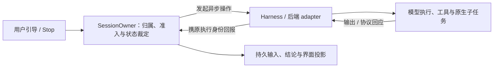

# Octopus 综合评审与后续规划

> 整合日期：2026-10-28（Asia/Shanghai）。
>
> 产品源码基线：`0df8b78ec470c0186c0ef6bd758a3695f1e686d1`。
>
> 合并来源：三份综合评审，以及 Codex app-server 可行性、规范与票据三稿；文件和原基线见§8。
>
> 本文保留仍有效的结论与设计约束，删除已失效的排期、旧票据依赖和重复说明，按当前实现重排后续工作。当前文档工作树另有未提交修改，文档已经对齐不表示保存的 persona、私人 memory 或运行服务也已更新。后续功能均为建议，不因列入本文而获得实施授权。

阅读入口：[建议顺序](#1-结论与建议顺序) · [旧问题的当前状态](#3-旧发现如何对应当前代码) · [运行时演进](#4-运行时演进以真实协议推动公共接口) · [Codex app-server 设计](#codex-app-server-scope) · [Wiki 规划](#5-wiki-与知识工作下一步做可验证的完整体验) · [规则与记忆](#6-agents文档与-memory-的持续维护) · [证据边界](#8-合并来源与证据边界)。

## 1. 结论与建议顺序

Octopus 适合继续沿模块化单体演进。SessionOwner、原始请求回执、独立的结果/通知/资源退休事实，以及 Wiki 的身份、来源和恢复记录都有真实消费者，应继续保留。架构改善的目标是减少同一事实的重复解释、协议泄漏和旁路，而不是按文件长度拆类或重写成插件平台。

原三份综合评审列出的主要产品缺陷已有后续修复，不能继续把它们作为下一阶段第一批待办。当前更有价值的工作是：让任务状态和成本容易解释；完善 Wiki 引用、标签及阅读器协同；在确有第三后端或轮内交互需求时，用协议证据决定运行时扩展。

建议按以下顺序选择完整交付范围：

| 顺序 | 后续工作 | 价值与可行性 | 启动前提 | 完成条件 |
| --- | --- | --- | --- | --- |
| 1 | 任务诊断、可恢复操作与分段耗时 | 高；已有 request/work/attempt/receipt 和 Monitor | 选定现有任务类型与用户操作范围 | 能说明排队、执行、记录、投递、退休卡在哪里；断线/重启后沿原请求追踪，恢复不重复执行 |
| 2 | Wiki 标签筛选与稳定引用 | 高；已有索引、标签、revision 和位置解析 | 复用现有 Wiki 计划，先定过滤与引用合同 | 过滤、分页、计数一致；引用遇到移动、旧版本、重复句和 Unicode 坐标仍可解释 |
| 3 | Sapphire / SmartReader 受限客户端 | 中高；依赖共享能力与账户/App 授权 | 先确定 owner 与 client 权限，再接应用入口 | 阅读、提问、草稿、单次提交和结果回传贯通；撤权覆盖全部入口 |
| 4 | 第三后端 DeepSeek 的 T0 协议选型 | 技术上可行，实际适配成本待验证 | 用户选择第三后端范围，锁定实际发行包与凭据来源 | SDK wire / ACP / headless 比较形成一个主路线；完成、取消、问答、工具限制有证据 |
| 5 | Codex app-server 主执行迁移 | 条件性；能否改善交互需实测 | 用户恢复相应暂停范围，目标 CLI 协议实验通过 | 请求内输入/问题/取消先闭合；完整原生尾部单独验收 |
| 随上述工作 | 类型、WS 合同、环境复现和文档归属 | 可局部推进 | 改动实际触及该接口，有真实消费者 | 收窄豁免、删除重复解释、保留失败语义；不顺带做全仓改写 |

运行时线与知识工作线可以独立选择。DeepSeek 接入不依赖 Codex 先完成 app-server 迁移；两者只在实际需要时共享公共 Harness 的小接口。旧稿的人日估算基于旧缺陷清单和旧协议，不再作为当前排期承诺；协议实验完成后再按选定范围估算。

## 2. 当前架构中应保留的边界

| 事实或责任 | 当前所有者与入口 | 后续改动必须保留什么 |
| --- | --- | --- |
| 账户、配置与执行身份 | 账户/凭据存储、配置捕获、执行前授权 | 保存时校验与实际启动时校验各有时间语义；one-shot 不能绕过 owner |
| 单会话输入与执行 | SessionOwner；Manager 管注册和跨会话配额 | 外部请求交给 owner；调用者断连不撤销已接纳工作 |
| 原请求完成 | 持久输入与原始 receipt | 业务 outcome、记录状态、通知状态分别可查；通知不等于用户已读 |
| 运行资源 | 公共 Harness 与原资源 owner | native terminal、EOF、进程退出、后代退休不能互相替代 |
| 独立异步工作 | Research、BG、Delegation 的工作身份与返回合同 | 回传沿原账户、session、work/request；旧结果不能改绑新请求 |
| 存储 | SQLite 短事务与存储健康边界 | 提交结果未知时不能猜回滚或重做副作用；停止依赖不可信状态的工作 |
| Wiki | 原文、身份/来源/回执、派生索引各有责任 | 索引库不全是可丢缓存；阅读证明只覆盖当前版本实际返回的内容 |
| 前端 | 后端事实的投影、账户/服务 generation、消息 revision/sequence | 晚响应不能覆盖当前账户和新状态；操作确认前保留原交互 |

组件关系见[架构概览](../architecture.md)，完成与退休见[架构约定](../plans/architecture-contract.md)。这些文档拥有当前合同；本文只说明评审结论和后续选择。

Fail-stop 应随失败影响范围使用：参数或 scope 错误拒绝当前请求；网络或 provider 暂时失败结束当前操作；会话状态不可信停止该会话的依赖工作；共享存储提交未知由存储 owner 关闭依赖写入。资源未确认退休要独立报告，不能因正文已经返回就释放所有责任。

当前部署面向相互信任的用户，共用 OS 身份。账户数据归属、私有 home 和 API 权限不构成恶意租户间的执行沙箱；公开托管或不可信应用需要独立的文件、进程、网络、秘密和配额隔离项目。参见[多账户范围](../plans/multi-tenancy.md)。

## 3. 旧发现如何对应当前代码

### 3.1 AGENTS / Memory 评审及最近收尾

产品修复主要在 `18fe07f` 与 `0df8b78`；规则与文档另有 `52651a7` 及当前工作树整理。

| 原主题 | 当前结论与保留边界 | 依据 |
| --- | --- | --- |
| B1：材料去重吞掉新维护意图 | pending 同材料而 scope/source 意图不同，显式返回 `maintenance_intent_conflict`；相同意图仍复用，跨 target 约定保留 | [jobs.py](../../server/wiki/jobs.py)、[Wiki 维护合同](../plans/wiki-development-summary.md) |
| B2/B3：Harness credential 并发刷新与暂时故障永久失效 | 同一账户/凭据共享刷新并校验 backend；按捕获的凭据状态条件提交，旧响应不能覆盖新授权；结构化 invalid_grant 与网络/5xx 分开 | [credentials.py](../../server/sessions/credentials.py)、[刷新回归](../../tests/test_credential_refresh.py)、[凭据合同](../plans/harness-credential-reauth.md) |
| B4：混合换行的行号漂移 | search/read/batch/裁剪共用原始换行坐标，支持 LF、CRLF、CR；不改正文或 revision | [line_coordinates.py](../../server/wiki/line_coordinates.py)、[Wiki 当前合同](../plans/wiki-development-summary.md#恢复存储与性能) |
| compact 回包虽短，数据库仍加载正文 | compact 列表投影必要列，筛选、排序、total、epoch 与健康摘要保持 | [retrieval.py](../../server/wiki/retrieval.py)、[Wiki 当前合同](../plans/wiki-development-summary.md#恢复存储与性能) |
| R1：one-shot 的 tool-free 承诺 | Codex one-shot 改为公共 Harness 管理的文本 worker，无工具 dispatcher；普通 turn 仍使用 CLI；成功必须有 `response.completed` | [codex_text.py](../../server/harness/codex_text.py)、[能力合同与实机边界](../plans/codex-backend.md#single-call-capability-verification-2026-10-27) |
| 新增 CLI 查找使离线渲染测试依赖宿主安装 | argv/模型设置测试局部模拟查找成功；缺失 CLI 的公共 `not_found`、worker 不启动回归保留 | [argv 测试](../../tests/test_harness_codex.py)、[设置测试](../../tests/test_model_settings.py)、[缺失路径测试](../../tests/test_codex_text_process.py) |
| 原始块定位产生无用正文切片 | locator-only 投影不再切出随后丢弃的正文；仍读取当前真实字节，坐标缓存不替代 live 核验 | [raw_blocks.py](../../server/wiki/raw_blocks.py)、[成本与权限回归](../../tests/test_wiki_raw_page_cost.py) |
| M1/D1：链接、规则正文归属与说明漂移 | 工作树已有根规则、docs 规则、Memory 归属与架构文档整理；以当前文件为准 | [文档规则](../AGENTS.md)、[Memory 合同](../plans/memory.md)、[架构概览](../architecture.md) |

Harness credential 的刷新分类不自动证明所有 Connector provider 都有相同故障分类。纯文本 one-shot 的能力证明也不外推到普通 turn 或 web-only leaf。附件 `agents.zip` 的28份文件属于原审查证据；本次没有重新取得并审计该附件，不能宣称其中每个私人链接和保存配置都已修复。

## 4. 运行时演进：以真实协议推动公共接口

### 4.1 当前限制与最小改动面

`RuntimeProfile` 已集中 argv、事件解析、凭据风格、模型能力、登录和 fork，是有效扩展点。当前仍有三处耦合：[HarnessRun](../../server/harness/run.py) 直接构造 Claude user 帧；`STREAM_JSON` 同时决定进程可复用；[session 投影](../../server/sessions/presentation.py) 据此推导 can_steer，[OwnerRuntime](../../server/sessions/owner_runtime.py) 的运行中 steer 开关也依赖 `backend.reusable`。JSON-RPC 同样可以走 JSON 行，但不具有相同输入帧、ACK 或取消语义。

第三协议实施时应分清以下能力，由 backend adapter 提供真实实现，再供产品与 UI 消费：

| 能力 | 必须回答的问题 |
| --- | --- |
| 输入与确认 | 输入何时 accepted、rejected 或 unknown？轮内 steer、原生 inbox 与 Octopus 排队分别意味着什么？ |
| 原生问题 | 是否保留 question ID、结构化答案和有效期？permission approval 与一般问题是否都支持？ |
| 完成 | 看到正文、根 turn 结束、受管后代完成、父模型再次汇总分别由什么证据支持？ |
| 取消与退休 | 停 request、session 还是独占 host？撤权后谁持有原资源并确认退出？ |
| 复用与设置 | 新模型、effort、凭据、persona、MCP 和 Wiki mode 如何生效？哪些变化要求新进程？ |
| 历史 | 能否精确 resume、native fork，何时只能 replay？缺失历史如何明确失败？ |
| 工具限制 | 普通 turn、tool-free one-shot、web-only leaf 各能强制什么限制？ |

公共 Harness 继续持有 spawn、授权、lease 与进程组；小型协议协作者处理握手、请求关联、通知和 server request，stdout 只有一个读取者。BackendKind、配置、credential/home、生成契约、模型元数据及 AgentForm/HarnessPage 等消费者要随新增后端一起更新。当前 `home_dir` 解析及双后端显示分支不能直接当作任意 runtime 接口。

`OneShotContext.authorize_spawn` 和实际调用点已经存在，`ToolPolicySupport.validate` 也已存在；后续应复用它们。新抽象只有在删除现有协议泄漏、让真实消费者独立变化时才成立，不为预想中的插件市场增加总线、注册 DSL 或第二套 SessionManager。

#### 4.1.1 SessionOwner：串行裁定状态，异步推进执行

**Codex app-server 或 DeepSeek Harness 接入仍适合保留 SessionOwner；需要演进的是其下方的协议接缝。** Owner 统一裁定单会话的活动执行、输入归属、问题和生命周期意图，不要求等模型整轮回答完才处理下一条消息，也不独占所有 Session 配置字段。Manager 仍负责注册、跨会话配额与原 Owner 的故障接管。

当前实现已有这一基础：[SessionOwner._run](../../server/sessions/owner.py) 交替推进运行状态与处理命令；[OwnerRuntime](../../server/sessions/owner_runtime.py) 将准备、读取和 steer 写入交给独立 task，完成后唤醒原 Owner，`advance` 在 `start / stream` 阶段同时推进输出消费与 `_steering`。Claude 的现有轮内追加正是走这条路径。后续接入应保持这种短步骤调度：长时间等待模型、RPC 回应、用户答案或资源退出不能占住 Owner 的命令处理；后台操作携捕获的原执行身份回报，由 Owner 更新所属状态。

后续能力表达必须拆开以下三件事，不能继续由 `stdin_mode` 或 `reusable` 相互推导：

| 能力 | 含义 | 对接入设计的约束 |
| --- | --- | --- |
| 双向通信 | 执行期间可发送输入或控制，并持续接收事件与回应 | 能写入同一通道不证明支持轮内 steer，也不证明模型已处理 |
| 轮内 steer | 向指定的活动轮次追加兼容输入 | 由真实后端能力、当前阶段和授权兼容性共同决定；保留每条输入身份与实际发送证据 |
| 跨请求宿主复用 | 请求结束后保留宿主服务下一请求 | 独立验证配置、权限和资源隔离；不是轮内 steer 的前提 |

因此，[Codex A 方案](#codex-app-server-scope)即使每个 request attempt 独占宿主、结束后退役，仍可在该请求的活动 turn 内 steer。Owner 决定输入能否追加及属于谁，adapter 实现 `turn/steer` 与原 turn 的回应关联；具体发送、未知结果和结算规则见[§4.6](#codex-app-server-input)。DSH 则按[§4.2 的版本实验](#42-deepseek-t0保留旧研究的关键问题重新锁定发行版本)选择能力，SDK 继续入队、ACP prompt 和 headless 执行不能统一冒充同一种 steer，也不能因支持双向 RPC 就宣称完成了交互接入。

Owner 保留 Octopus 的请求与业务责任；模型内部的生成、工具循环和原生子任务调度继续归后端，不在 Owner 内再实现一套模型运行时。若未来确需同会话多个独立活动请求，应重新审视当前单个 `current` execution 的表示及完成归属；若选择完整原生尾部，应按[§4.8](#codex-native-tail)验证父子活动与收束范围。这些需求可能推动内部状态模型演进，不能从“增加 steer”直接推导为重写 SessionOwner，也不因此恢复暂停范围。

### 4.2 DeepSeek T0：保留旧研究的关键问题，重新锁定发行版本

主题主文是[DeepSeek backend 可行性方案](../plans/deepseek-harness-backend.md)。它仍是 proposed，保留 rc.2 包的条件方案。旧评审检查的上游源码为 `22ddee3792402c3e70ec5f86a63c3e3e895a2f60`，其中 headless 标注 rc.3；两者不是同一版本。下表是该固定源码留下的核验问题，不表示本次重新检查了最新 DSH 或做过真实联调。

| 候选 | 旧固定源码的观察 | T0 必须验证的风险 |
| --- | --- | --- |
| SDK 原生 wire | stdio 双向 JSON-RPC；prompt 有接纳 messageId；`session/wait` 等根 idle、受管后代及后续父活动 | 高层 Python `Session.run()` 首次 root idle 返回不能代替 wait；原生 reason 与本次事件区间须对应 |
| ACP | prompt 等活动结算，支持 session cancel/close | aborted/blocked 曾折叠为 end_turn；标准 MCP 映射未保留每条调用超时；原生子代理信息不等同 SDK |
| Headless JSON | rc.3 final 有 sessionId/reason/text，runner 会等待受管后代 | 批处理结果可以完整，双向问答、忙时输入、取消和消息身份仍需验证；不能沿用旧“final 只有 text”结论 |

优先验证“SDK wire + 每 attempt 一个受管进程”，以 ACP 作对照，headless 保留为满足所选范围时的候选。独占宿主能在缺少 per-session cancel 时避免误停其他会话，代价是冷启动与 resume 成本。协议失效不得自动换路线重发可能已经接纳的副作用任务；选型后只维护一条主执行路径。

T0 需要取得五组证据：

1. **接纳与完整完成。** prompt 前开始订阅；父先回复、子继续、父再汇总，只在选定完成边界交出原请求结果。子文本不能覆盖父最终回答；无 terminal 的 EOF 不能当成功。
2. **Stop 与资源。** 初始化、恢复、prompt 接纳、MCP 等待、后代运行、shutdown 各阶段停止，原进程组均有明确 owner。用同步 SDK 加 `to_thread` 时，取消 await 不证明线程或 SDK 启动的进程已退出，不能形成两个资源管理者。
3. **人工等待。** MCP ask 超过60秒仍可回答；无限等待表示与取消后晚答案正确。旧 ACP 默认60秒超时不能悄悄替代 Octopus 的合同。
4. **终态与交互分类。** completed、blocked、aborted、error、max-tokens 和协议残缺有可解释结果；approval 桥和一般 user-question 桥对根/后代的覆盖分别验证。
5. **身份与能力。** 精确 native history、home、凭据优先级、MCP scope/timeout、工具限制、模型设置及 usage 缺失语义均落到实际执行端。

关键固定源码入口：[SDK wait](https://github.com/deepseek-ai/deepseek-harness/blob/22ddee3792402c3e70ec5f86a63c3e3e895a2f60/packages/sdk/server/src/server.ts#L297-L320)、[Python Session.run](https://github.com/deepseek-ai/deepseek-harness/blob/22ddee3792402c3e70ec5f86a63c3e3e895a2f60/python/sdk/src/deepseek_harness/api.py#L184-L212)、[ACP MCP 映射](https://github.com/deepseek-ai/deepseek-harness/blob/22ddee3792402c3e70ec5f86a63c3e3e895a2f60/packages/acp/acp/src/mcp.ts#L45-L70)、[ACP reason 映射](https://github.com/deepseek-ai/deepseek-harness/blob/22ddee3792402c3e70ec5f86a63c3e3e895a2f60/packages/acp/acp/src/codec.ts#L14-L33)。实施时按所选发行包重验，并把结论更新到已有方案。

### 4.3 第三后端的完整交付边界

| 阶段 | 完整交付 | 退出条件 |
| --- | --- | --- |
| D0 | 固定版本、协议实验、选择一个主路线 | T0 风险有证据；能力限制和替代路径退出方式明确 |
| D1 | 小型 driver 与公共资源接口 | 原 Claude/Codex 行为保留；准备、spawn、接纳、退出各阶段不丢原身份/资源 |
| D2 | 普通会话与配置/身份桥 | 新建、resume、工具、问答、Stop、重启恢复贯通；双账户及权限变更正确 |
| D3 | 产品消费者全链 | one-shot、Research、delegation、BG、schedule、application 和 UI 使用同一结果与退休合同 |
| D4，条件项 | 进程复用与原生子卡片增强 | 实测冷启动/内存成本值得优化；协议提供真实父子/消息/tool ID，授权更新仍正确 |

配置桥应复用现有 assembly，分别传递稳定 persona 与当轮指令，保持 `{{x}}` 等字面文本；MCP bearer、installation、tool timeout 与 Wiki task/read proof 不合并。Memory 继续指向 Octopus 的 canonical 目录；DSH_HOME 仅隔离配置和历史。产品调度仍归 Octopus，不能由默认 profile 顺带启动另一套无归属的自主工作。

第一批验收还须覆盖：发送后 ACK 丢失不自动重做；两条内容相同但身份不同的消息不被误去重；长正文完整；历史缺失明确失败；model/effort/tier 只显示真实支持项；usage 缺失不填零，未核实价格不硬编码；日志不泄露凭据。工具限制要诱导模型请求被禁止的工具并检查实际副作用，不能只看 argv 或 prompt。

Research 当前使用 agent model，与普通会话的有效 override 合并不相同。是否继承会话 model/effort/tier，应在接入或设置改动前明确产品规则；这仍是选择问题，不把现有设计直接定为 bug。

### 4.4 Codex：请求内交互与完整尾部分开交付

当前普通对话仍是 `codex exec --json`；恢复前[短 app-server 控制步骤](../../server/harness/codex_control.py)更新 controller，退出后再启动 exec。[one-shot 已改用文本 worker](../plans/codex-backend.md#single-call-capability-verification-2026-10-27)，也使用原生认证/配置控制。这些已有用途均不表示普通对话主执行已经迁移，旧稿“one-shot 继续 exec”的接线要求不再适用。

保留较新可行性设计的 A/B 区分，实施前选定完整范围：

| 范围 | 完整交付 | 仍需取得的证据 |
| --- | --- | --- |
| A：请求内双向协议 | 普通对话改用本地 stdio app-server；活动 turn 追加输入、原生问题、流式输出、取消、历史恢复及原消费者贯通；请求结束退役宿主 | 基础协议、有效配置、发送证据、完整输出与资源退出均通过；只承诺所选本次调用范围 |
| B：完整原生尾部 | 父 turn 结束后继续发现受管后代、接收结果、让父再次处理及派生，直到本请求的声明范围闭合 | 后代范围、父处理因果、唯一续跑驱动、结束依据和全范围 Stop 单独成立，见§4.8 |

A 可以作为相对当前合同的独立升级，但不证明 B；若选择 B，A 通过也不足以生产切换。A 不禁止活动父轮内使用原生助手，必要结果仍须在父轮内收齐或明确取消；已知失败、未完成或退役中断如实显示，根成功不等于所有子任务成功。可靠跨请求工作继续使用 BG、Research 与命名委派。

原执行票22、23、24、28、31、42、43的状态、完整责任和恢复依赖仍归[暂停范围与恢复条件](../plans/architecture-contract.md#暂停范围与恢复条件)。旧票包中的后台返回、普通委托会话保留等已有实现，仅作回归对象；不重新打开已完成工作，也不把旧整票依赖作为新方案的阶段图。此次合并没有恢复暂停范围。

### 4.5 Codex 接入：接口、资源与双向 I/O

保留一个公共 Harness/Profile 和一个实际资源所有者；在现有接缝增加 Codex 私有协议实现及事件映射。下面规定操作语义，具体命名随实现确定：

| 边界 | 必须交出的事实与责任 |
| --- | --- |
| SessionOwner | 沿[短步骤调度](#session-owner-concurrency)固定请求身份、配置与权限，决定输入准入、问题、取消、唯一 terminal/receipt；协议对象不写第二份输入或完成账本 |
| HarnessRun | 持有原进程、连接、lease、spawn/reader/writer/stop 任务及退出证据；迟到 spawn 句柄仍有人退役，不另建 supervisor |
| Codex 私有协议对象 | 握手、RPC 关联、response/notification/server request 分派；`start` 回报初始输入事实，`stream` 提供统一事件；不自行裁决业务成功 |
| 输入与控制接口 | `steer` 回报接受、明确未接受或未知；`answer_question` 回应原生原问题；`interrupt` 是协议控制，`stop/join` 才收束实际资源 |
| UI、Research 及业务消费者 | 使用现有 HarnessEvent、完整 text、历史及 receipt；不解析 RPC，也不各写一套等待完成循环 |

一个 request attempt 独占宿主，历史 thread 可恢复，宿主不跨已结束请求复用。捕获 session/user/request/attempt/work、原 backend handle、lease、配置和凭据引用，再关联 connection/thread/turn/item；异步事件、Stop 和晚答案不得读取 session 的最新绑定。新请求可排队，旧资源确认退休后才安装新 context、WikiTask、grant 与 bearer。配置冻结不免除实际操作时的动态撤权检查。

RPC reader 只做持续分派，不等待 UI 消费、RPC 业务完成或用户答案；pending 请求在发送前登记，客户端与服务端请求 ID 分开并保留类型。writer 只串行化完整帧，等待 ACK 不占 writer，控制不能被慢展示堵住。复用有界交付设施；正文、关键身份、工具结果或终态无法保留时，当前 attempt 准确失败并保留 partial，不静默丢失或增加无界缓冲。通知早于响应时保留有界关联事实，不能默认归到“当前最新 turn”。

已使用方法以目标发行版 schema 和真实录制建立必要的 typed 边界，不维护全量未使用协议镜像。现有帧、队列、UTF-8/JSON 大小及 argv/env 限制分别验证；prompt 移入 RPC 不消除 MCP 配置等仍经 argv/env 的大小边界。

旧 [Okou 固定提交](https://github.com/okou-ai/okou/tree/328c79f29a81e44e454ff155cd2416e78ea7860d)只保留为 facade、私有协议实现、事件映射及读取/展示解耦的结构参考。它的主 turn 结束方式不证明完整原生树；不移植其 sandbox 投递账本、认证默认值或禁用后台功能的选择。

### 4.6 输入、问题、取消与结算

Octopus 持久接纳、provider 接受输入、请求最终完成是三件事，沿现有输入与 receipt 合同记录。写完 pipe 不冒充 provider ACK，RPC 接受不冒充模型处理完成；Claude 继续报告其真实可得的证据，不伪造同等级 ACK。

首输入使用所选协议的 start 操作；活动追加须关联捕获的 turn，核验 `turn/steer` 与 `expectedTurnId` 的实际版本合同。只有内容修正且有效配置、来源、work、MCP/Wiki 授权范围兼容时才可追加；每条输入仍有自身身份，不能要求输入 request ID 相同。模型、凭据、权限范围变化以及附件沿下一请求策略处理，初始化、结束收尾与内部报告阶段的新 human 输入排队。公共 `can_steer` 由真实实现能力和当前阶段共同决定。

| 发送事实 | 处理要求 |
| --- | --- |
| 业务帧尚未提交，或明确证明 provider 未接受 | 清理已捕获资源；只有原预算和请求合同允许时重试准备或回队；controller 注入自身需单独判定 |
| 已写出但 ACK 丢失、超时或断连 | 保留 unknown，不重发、不换 thread、不自动 continue 或退回 exec；RPC ID 和消息关联 ID 不当作已证明的幂等执行键 |
| 已接受后失败或取消 | 保留原身份、partial 与准确原因，停止原资源；可 resume 历史不等于可自动重做不确定效果 |
| provider 正在内部重试 | 诊断与最终失败分开，不同时启动 Octopus 第二轮重试 |

原生问题保留 connection/server-request/thread/turn/item 及问题级 ID、结构化 answers，由现有 Question Owner 决定回答或关闭；adapter 回原通道，不拼成 steer 或新 prompt。MCP AskUserQuestion 保留原回调。阻塞性决定人工等待期间的 watchdog 行为，旧答案与 Stop/终态竞争只影响原问题。未支持的 approval、elicitation 或动态工具请求明确拒绝或失败，不悬挂、不自动批准；普通超时文字不能充当审批。若所选权限策略需要人工审批，应先完成对应决策和界面。

收束顺序须避免等待环：先封闭新发送和工具准入、撤原 lease，再对捕获活动 turn 尽力 interrupt 并启动原宿主及受管 I/O 的停止，随后有界 join、确认退休，最后由 Owner 按原事务结算输入集合与唯一 terminal/receipt，再交付通知。根 turn 已结束仍须能 Stop；MCP 撤权、interrupt ACK、根 PID 退出分别不证明全部受管后代已退役。无法确认退出保留 handle 和实际隔离状态，不启动同 thread 第二个 writer；停止不撤销既成效果，也不取消独立 manager 拥有的工作。

A 的成功要求匹配 provider turn 明确成功、合同内输出完整、关键发送可判定、资源已退休且持久结算成功；B 还须满足§4.8。EOF、exit 0、最后一段正文均不能单独证明成功。未知追加输入不因根结果成功而改成 done；App done 仍遵守正文前缀交付合同，通知失败不撤销业务结果或触发模型重跑。

### 4.7 配置、事件、历史及消费者兼容

| 主题 | 迁移时必须保留与核验的内容 |
| --- | --- |
| 配置与凭据 | 使用已选凭据 home、model/effort/tier、cwd、MCP/connector、sandbox/approval、persona 与 canonical memory；核对有效配置和实际工具权限，正常速度能覆盖上轮 Fast；不复制秘密或启用第二份记忆 |
| Controller | 将交互恢复所需检查点比较/更新并入同一执行宿主，确认后再发业务输入；相同内容不重复、变化更新一次、compaction 后仍有效，动态上下文不混入稳定 digest；注入未知不继续，不让两个宿主同时写 thread |
| 正文与工具 | delta 即时显示，最终完整 text 只持久化一次并供 Research 使用；保留原工具名、参数、错误和 thread/turn/item 身份，子文本不污染根答案；可选新通知可诊断忽略，关键事实缺失准确失败 |
| 原生终态与指标 | 按 status/error 判结果，不按通知名称默认成功；原生子卡片仅为观察。usage 区分恢复历史和当前执行，不重复相加 last/total、父子统计；response 级 TPS 不能直接替成 turn 平均速度 |
| 旧历史、fork/rewind | 同机当前 exec 历史能精确 resume，原不透明引用继续使用；不为命名再存第二份 thread ID。原生 turn ID 不冒充 Octopus 消息位置，原生 fork/revert 不直接替代目录复制、归属和失败清理合同；历史缺失明确失败 |
| 轻量调用与 Research | 保留现有 tool-free 文本 worker；web leaf 随 `create_run` 验证完整 text、只读/工具边界、空 MCP/connector/memory、timeout/cancel 与退休，不能沿旧“one-shot exec”草案改回去 |
| Claude 与公共消费者 | 保留 Claude JSONL、已有同轮输入及原生功能；UI/HTTP/WS、App、委托、构建、调度和 Wiki job 沿原事件/receipt。跨请求 held 隔离若纳入候选，完整替换其动态重绑并单独验证，不藏进 Codex mapper |

既有认证与配置控制的短时 app-server 仍有独立用途，不能按命令名全部删除；退出的是交互迁移后重复的控制 writer。controller 使用的本地历史读取若依赖版本限定字段，升级前重验其等价证据，不新增持久镜像。授权须在首次可能使用工具前安装，准备失败仍撤 lease 并退役已启动的 MCP 子进程。

同机升级的旧 thread 连续性与换机导入范围是两项不同合同，不由此新增任意年代 transcript 导入或跨后端历史转换。旧 observer 已由 RPC 覆盖的活动/生命周期写入应退出；仍有独立 Monitor 用途的被动观察可保留，不能再次裁决完成或暗中充当原生尾部屏障。

### 4.8 完整原生尾部的证据门

B 仍是未证实能力，不是 A 的小补丁。thread/turn 的因果字段或 UI 子卡片不能直接合成以下保证：

| 待证明事实 | 必须覆盖的反例与依据 |
| --- | --- |
| 范围发现完整 | 新建及旧 exec 冷恢复、快速 child、孙任务、同 child 再执行与晚到事件均归属原 attempt；不能只订阅根线程或靠列表暂空 |
| 子结果确实进入父处理 | 结果有实际输入、来源与因果关联，父后续阶段可核对；hook 拒绝/改变时不误判，child completed 或报告 ACK 不代替结果消费 |
| 续跑只有一个驱动者 | 根据真实协议选择原生 wake 或确有必要的宿主报告；父可以再处理、再委派，不预先关 wake、不设一次报告硬上限，也不并行双触发 |
| 完成范围可靠闭合 | 最后所需父阶段结束，仍可产生工作的主体已收束，无未确认关键发送或问题；静默窗口、重复 list 为空、父说“完成”不构成证明 |
| 全范围可停止 | 根 idle 而 child/孙任务仍活动时，捕获资源和工具实际停止；不影响独立 BG/Research/委派，也不以根 ACK 或根进程退出代替全部退出 |

首个反证场景保留：旧 exec 历史冷恢复 → 父先结束 → child 延迟返回 → 父处理后再派验证任务 → 再汇总，分别在父 idle 与父续跑时 Stop。先用可控等待和本地效果核对身份与退出，再验证模型驱动；一次正确回答不能证明通用完成合同。

若需要宿主报告，先证明必要性以及目标版本 tool-output/输入机制的实际语义，保留工具数据身份、来源和原授权，不伪造新 human 请求。只在协议及录制共同证明声明范围时实现；实验字段须锁版本与失效策略。证据不足则 B 保持未解，不靠延长超时、轮询日志或提示词补保证，也不自行扩成自维护 CLI、持久任务树或通用监督平台。独立 work 的返回继续作为后续输入，避免父请求等待只能由下一请求消费的结果。

### 4.9 实施单元与验收出口

以下是所选完整候选的评审单元，不是恢复旧票号或分批发布半套完成链。F0 先确认范围与协议，F1/F2 建立固定 attempt 接缝，F3 再接跨请求与公共输入，F4 验证组合；不增加互相等待整票的反向依赖。

| 单元 | 交付内容 | 出口 |
| --- | --- | --- |
| F0：范围与版本 | 选 A/B；锁实际 CLI、schema、配置和功能模式；完成握手、有效配置、旧历史、ACK 丢失、问题与退出实验 | 基础能力有运行合同；选 B 另通过§4.8，否则对应范围不准入；不要求等待 DSH 整体交付 |
| F1：协议与映射 | 单 reader/writer、请求关联、server request、背压、完整 text/工具/usage；共享层保留原资源责任 | 纯映射与真实子进程协议替身覆盖乱序、堵塞和退出；消费者不解析 RPC |
| F2：固定 attempt | 单宿主配置/controller、start/resume、资源退出及未知发送恢复屏障 | 新建及旧历史、认证与设置、取消/EOF、Research 行为成立；A 不增加父报告调度，B 只接已证明的续跑方式 |
| F3：公共输入与结算 | 阶段能力、权限兼容、typed answer、Stop、原输入集合与唯一结算；所需跨请求隔离 | 旧 ACK/答案/Stop/MCP 不改绑新请求，unknown 不重放；旧并行发送或结算旁路退出 |
| F4：组合与交付 | 所选原生范围、fork/rewind、Monitor、全部实际消费者、文档与删除项 | 同候选门禁和自然排空切换；选 B 必须具备完整尾部证据，不能以 A 代验收 |

跨阶段保留以下验收重点：

| 场景 | 必须成立 |
| --- | --- |
| A 运行中发送引导 B，与 Stop、旧 ACK 和 A 终态交错 | B 始终关联原 A；发送在途时 Owner 仍能处理 Stop，迟到回报不改绑新请求；明确未接受才按原合同考虑回队，接受未知不重发；停止与资源退休分别取证 |
| 通知早于响应、复用数字 ID、问题与 Stop 交错 | 原连接关联准确，持续分派，无串答或控制死锁 |
| 写出后断连、已有效果但无展示、turn 结束竞争 | unknown 不恢复 pending、不触发第二次模型或工具执行 |
| 慢 UI/App、队列满、delta/final 重复 | 容量有界，完整正文只记录一次；无法保全明确失败，控制继续可执行 |
| R1 尾部/退休、R2 入队与撤权交错 | 原 grant 不延长或转绑；R2 先排队，旧资源退休后再安装新授权 |
| 两账户/凭据切换、Research 受限调用 | home、bearer、memory 与权限不串；实际工具效果匹配各自范围 |
| spawn 晚返回、挂起管道、根先退子仍在 | 原句柄不丢，Stop/退出有界；未知退出不放行第二个 writer |
| resume、controller/compaction、fork/rewind、配置变化 | 原历史与用户设置保留，不重复注入、消息或用量，工具权限实际匹配 |
| 多消费者、独立返回、委托追问与显式归档 | 共享原 receipt，返回一次接纳；宿主退休不关闭独立 work，不重做已交付的会话保留机制 |
| B 的两轮子任务与根 idle 时 Stop | 范围、结果消费、后续父阶段与实际退出同时有证据 |

纯 fixture 只证明映射，真实子进程/pipe 替身证明本地竞争处理，目标 CLI 与公共入口才证明版本能力；不只 mock stop 或让所有 future 立即完成。记录原始关键事件、版本/模式、关联、效果和退出证据，按实际秘密字段脱敏。提交与发布门禁、证据复用及本机不运行 Claude 实机的限制仍归[验证政策](../testing.md)。

### 4.10 切换、删除与成本取舍

生产只接收满足所选完整范围的同一候选。旧 attempt 自然完成或明确停止并确认退休后，新请求才用新协议；活动执行不换协议，未知输入不自动回 exec。故障处置沿当前格式可读的候选或前向修复，旧二进制能启动不等于能读新历史，不回灌旧数据库覆盖新内容。

迁移完成同时退出以下被替代责任：

- 交互主执行的旧 exec 启动和先开临时控制宿主再开执行进程的重复写入；保留文本 worker、认证/配置控制、历史读取等仍有实际用途的路径。
- 从 `stdin_mode` 或 `reusable` 推导 steer，以及向 Codex 写 Claude 帧的旁路；若替换跨请求 held，旧热复用、动态 Wiki 重绑及对应测试/指南一起退出。
- RPC 已覆盖的重复生命周期写入，以及“无输出就重发”“自动 continue”或协议失败自动 fallback 的旧判定；不删仍承担独立指标或诊断职责的观察。

分别测准备、spawn、握手、resume/controller、首输出、总耗时、退休、峰值内存与进程数，固定 CLI、模型、effort、速度、凭据和代表历史，记录冷/暖条件、失败样本及原始成本。可能减少的是重复控制启动，不自动消除每请求 spawn、MCP 初始化或历史加载。跨请求复用、宿主池、远程 RPC、新审批产品与原生 fork 替换由独立需求或证据触发，不借本次迁移进入范围。

## 5. Wiki 与知识工作：下一步做可验证的完整体验

### 5.1 已有基础与性能证据

Wiki 已有 SQLite FTS5、中文分词/字符组合、增量观察、稳定身份、版本引用、compact 导航、批读、阅读证明、任务/效果回执与恢复。正常查询走索引；后台 reconcile 的目录扫描和前台搜索是不同成本。后续继续以现有 doc id/revision 为来源身份，不另建一套知识真相。

旧稿中的重复读取/写入建议已经部分落实。当前[开发总结](../plans/wiki-development-summary.md#恢复存储与性能)记录的确定性对照包括：同版短读的变更行数6→0，location 读取2→1，健康摘要每响应2→1；compact 列表已缩小 SQL 列投影；locator-only 已消除无用正文切片。这些不证明生产 P95、召回率或模型 token 节省。

长文分页仍可能反复读取整文件来证明当前字节。目录事件不能捕获所有外部硬链接修改，因此不能仅依据读次数就把 live 核验改成 mtime/缓存判断。原始块坐标复用可以减少解析与切片，但内容真实性、权限和实际返回区间仍逐次核验。响应字符数、UTF-8 字节、磁盘读取、SQL/WAL、模型 tokens、耗时分别测量，不能相互代换。

### 5.2 标签、引用与多 App 的实施顺序

详细范围继续归[Wiki 未来计划](../plans/wiki-future-plan.md)，本轮不新建第二份规格。

| 阶段 | 产品行为 | 关键验收 |
| --- | --- | --- |
| 共享引用与 client 能力 | 统一 vault/doc/revision/selector，区分库 owner 与受限 client | 直接网关、AppAgent、REST/MCP 与撤权一起覆盖；放宽 app_id 判断不构成授权方案 |
| Sapphire 搜索和标签 | 保留现有阅读/编辑体验，接共享搜索、紧凑卡、目录与标签 | all/any 标签与目录交集在分页/排名前执行；cursor 绑定过滤；facet/counts 按文档计数，不把多个章节重复计算 |
| 引用阅读和来源关系 | 答案直达原文；来源、反链与任务状态可查看 | 文件移动、同路径替换、旧 revision、重复句、中文/emoji、CRLF 坐标正确；未安装阅读器仍能预览，失效定位给出明确反馈 |
| SmartReader 按需上下文 | 局部问题读取片段，整篇任务可连续读全篇 | browser-only、capture/draft、Wiki-bound 三种身份分别可达；reader UUID 不冒充服务 doc id，不因一句“已读全文”认定覆盖完整 |
| 草稿与维护提交 | 讨论、草稿保存、明确入库或专题修订有各自边界 | 版本冲突可见；一次提交对应一个 durable job，来源/目标/结果明确，无重复创建；跨 App 不串任务 |

`read` 权限只开放获准发现、读取、引用及相应任务；不能把所有 GET 都当安全，也不附带 publish/restore/config 权限。`submit_maintenance` 允许在授权范围提交并查看本客户端任务，取消/重试仍按任务归属校验，不让阅读 agent 自己获得正文发布权。

### 5.3 召回与质量评测先于检索替换

旧小样本曾观察到 `C++`、`C#`、`C` 的词项区分度有限，但精确标题仍可排前；它说明评测应覆盖技术标识符，不能据此声称生产漏召回率或立即换向量库。现有[评测入口](../../scripts/evaluate-wiki-search.py)可复用，小合成样本不能替代真实问题集。

在用户授权语料和评测范围后，先固定语料 revision 与独立问题/相关段落标注。原建议100–300条可作为规模参考，不能把它变成每次发布必跑的门禁。查询应包括精确 ID/路径/标题、技术词、中文、同义改写、跨语言、多文档比较、无答案与移动/删除/旧版本。

同时观察 Recall@5/10、MRR/nDCG、无答案误召回、引用支持度、冷/暖延迟、实际 I/O、SQL 写入、索引延迟与真实 provider usage。记录首轮失败和成本；缓存输入不重复相加，缺失用量不填零。已有 `knowledge_eval`、`wiki_perf` 继续独立 opt-in；用户此前暂停的多账户压力测量不因本报告自动恢复。

若证据指向语义召回不足，再比较 query expansion、轻量 rerank、FTS+embedding。新增向量须沿现有身份、更新、删除和失效路径维护，并保留词法检索可用性；若主要成本在模型调用或 live 证明，应优化对应路径而非另加检索服务。

### 5.4 条件性功能与明确依赖

| 方向 | 何时值得做 | 完成条件 |
| --- | --- | --- |
| PDF/网页新材料入库 | 明确需要非 Markdown 来源进入 Wiki；应用能预览不代表已支持入库 | 保留原件身份、抽取版本、页码/文本坐标、可恢复失败；OCR 单独定范围，不用 Markdown offset 冒充页码证据 |
| 来源变化后的定向维护 | 用户需要跟踪原件更新影响，来源依赖已足够可靠 | 只列明受影响条目；修订有 diff、版本冲突与回滚，避免全库自主重写；取消不覆盖已提交人工修改 |
| 巨型文档与后台扫描治理 | 实测读取内存、解析、stat 扫描或索引延迟成为瓶颈 | 先定支持大小/失败反馈与分批策略，保留原文完整性、引用和恢复合同 |
| DSH/Codex 宿主复用 | 启动/恢复成本确实占主导 | 权限、凭据、配置、Wiki mode 更新与闲置退休已验证，再衡量收益 |
| 公开多租户/不可信 App | 产品使用者不再相互信任 | 独立威胁模型，文件/网络/进程/凭据/配额隔离及越界测试 |

当前没有证据要求增加 Redis、分布式队列、微服务、大型插件市场、全库知识图谱或第二套 Memory 数据库。出现真实需求时再评估，既有取舍不构成永久技术禁令。

## 6. AGENTS、文档与 Memory 的持续维护

### 6.1 一份解释有一个正文所有者

| 内容 | 现有所有者 | 后续维护方式 |
| --- | --- | --- |
| 每次工程任务都适用的范围、项目地图、命令和验证入口 | 根 [AGENTS.md](../../AGENTS.md) | 保留完整的 Do It Right The First Time 开头和高频入口；完整按授权行为、真实消费者、失败路径及旧路径退出判断 |
| 文档归属、写法、移动和链接 | [docs/AGENTS.md](../AGENTS.md) | 收拢完整规则；移动正文同时修入链，不只看生成索引是否通过 |
| 当前组件关系与工程/操作合同 | 架构、现有主题 plans、testing、local-wsl | 区分当前事实、条件提案和版本限定证据；API/config 全量清单优先从代码生成 |
| 角色、协作与交付行为 | 保存的 persona | 文档中的 [agent-prompts](../agent-prompts.md) 只是快照；实际应用需确认保存行与下一逻辑轮装配 |
| 稳定用户偏好、位置、短入口 | 负责角色的私人 Memory；真正跨角色约定放 shared-memory | 记录偏好来源/范围；工程正文回 owning doc，索引按任务读取，不全量递归注入 |
| 运行权限与本轮维护边界 | 当前工具、操作卡、授权和任务 | 记忆、检索材料、旧审查和委派回复均不能授予新权限 |

角色私有知识不因“其他角色也可能有用”而全部移为共享。删除 agent 会删除其私人 memory，真正共享的约定不能依赖某个私有目录；迁移时先完整保全正文，再替换入口并检查相对链接。账户导出/恢复按[Memory 合同](../plans/memory.md)和[搬迁指南](../backup-and-migrate.md)覆盖私人及共享文件。

### 6.2 保留 DeepSeek 文档方法中适合本项目的部分

综合评审资料支持以下原则，当前已有相应文档归属，不必再复制一套 skills 全文：

- 缩短文字保留 actor、条件、时序、必须/可以、例外、负面保证与失败后果。接口附近保留调用方必须知道的合同，长理由链接到主题主文。
- 删除实现会话的过程叙述，留下不变量、反例、取舍和证据。测试数量、旧错误清单、旧行数不能冒充长期保证。
- 简化按维护义务衡量：事实决定者是否减少，消费者是否获得明确结果，被替代代码、配置、测试和说明是否一起退出。
- 文档预算可提示结构问题，不能成为删合同的 KPI；双语/hash 检查不能证明语义一致。不照搬完整归档 manifest 或复杂生命周期分类。
- 普通局部改动不强制新增状态机、票据或通用框架；涉及所有权、并发、持久化、外部协议时先说明事实、写者、提交点与失败范围。
- 工具丢意图、误报完成或无法执行声明能力时，修复或收窄接口；不靠追加提示词让模型猜测补救。

本次合并只维护评审文档。后续若实际调整 persona 或 memory，应按已有 owner 修改，保全自定义设置；分别检查保存值、恢复会话的指令更新和受影响代表任务。代码审查、普通 Wiki 问答、小批维护可用于验证相关规则，不因文字变短就重跑所有发布实机套件。

## 7. 工程质量、验收与停止条件

### 7.1 仍值得逐步收敛的工程边界

当前 mypy 仍全局豁免 `union-attr`、`arg-type`、`misc`，且未检查未标注函数体；通过当前检查不等于 strict 类型安全。新增协议 driver、完成结果、凭据和 Wiki admission 等边界优先用明确 DTO/Protocol，随后把已知例外缩到模块或具体位置。不要为一次评审全仓开启 strict 并改变无关失败行为。

现有 WS 处理仍使用通用 record 和局部字段解释；在改动相关事件时，可逐步收敛为有限判别联合并复用后端契约。会话统一投影已经完成的部分应继续复用，避免再次建设一套列表/详情模型。跨模块读取私有状态时，先提炼真实业务事实接口，不把整个 Manager 换名后继续传递。

Python 依赖主要为范围约束，CLI 也是外部协议依赖。需要可重复验证时记录解释器、解析依赖、实际 CLI 及配置，以同一组输入构建/验证；直接依赖应直接声明。是否维护环境锁文件由实际复现需求决定，不把当前“未锁全量环境”说成已经安装失败。

### 7.2 每项未来交付的完成标准

1. 用户可见行为、真实消费者、失败/取消/恢复路径及旧路径退出都在本次范围内完成。
2. 一个事实由一个 owner 决定，原 request/work/attempt 贯通。展示、通知失败不倒写业务终态；接受未知不自动重发副作用。
3. 先验证最可能推翻设计的交界场景：配置改变后的实际进程、取消与提交交错、旧刷新晚回、归档后的原返回、真实工具拒绝。
4. 运行时改动覆盖 start/events/stop、历史、问答、授权、设置与相应产品消费者；知识功能覆盖权限、版本、引用、回执、恢复和浏览器体验。
5. 当前合同更新到已有主文，调用方迁完，被替代实现及其维护义务退出。没有新的必要行为或失败假设时停止扩大范围。

验证选择与证据复用以 [testing.md](../testing.md) 为准：代码提交执行适用门禁，发布增加本机离线 E2E、Codex 实机与浏览器；每个检查一个执行者，源码、配置、依赖和环境仍有效的成功证据复用。Claude 共享/离线行为须保留，本机未运行 Claude 实机不能记作通过。

本机实机测试按用户明确约束复用当前本地登录，不申请新设备授权，不请求 `auth.openai.com`。仅链接 auth.json 不能证明没有认证访问或自动刷新，应审计实际网络行为；新登录专项与既有登录下的模型验证分开记录。该测试约束不等于产品永久禁止原生认证刷新。最近 `0df8b78` 收尾已有无 Codex 宿主条件下39项回归通过、既有登录下13项实机和1项 Codex 浏览器通过且认证域名尝试为0的会话验收记录；这些均不是本次文档整合新跑的结果。

## 8. 合并来源与证据边界

| 原稿 | 原源码基线 | 本文保留内容与更新位置 |
| --- | --- | --- |
| `2026-10-25.md` | `a4e7072e9809828f6fa8230e2b4691f5b9aab244` | 已修复问题不再排期；授权/配置/投影/观察器边界→§2、§4、§7；任务中心、耗时、引用、导入与来源维护→§1、§5 |
| `2026-10-27.md` | `cf98ecb75d1aa741c31292977ac9d83e727d366f` | 已失效缺陷清单不再列作待办；DSH 协议取舍与关键陷阱→§4；Wiki 成本与评测→§5；后续路线与验收→§1、§7 |
| `Octopus_Code_Review_AGENTS_Memory_2026-10-27.md` | `c2bdeb1364049d9affd82cd5e70f786a22726aee` | 意图去重、刷新、换行、one-shot、列投影→§3；文档/规则/Memory 和选择性借鉴→§6；附件与实证限制保留 |
| `codex-app-server-feasibility-20261023.md` | `3d793d3326b749c171675d4349907a50b4f7b9b2` | A/B 范围、协议接缝、输入/控制、历史与配置、失败/退休、F0–F4 出口→§4.4–4.10；one-shot 接线按当前文本 worker 更新 |
| `octopus-app-server-spec-20261022.md` | `85b5b3c99192eb9a85b6bd923cd1be856492ded0` | 完整原生尾部、单一资源归属、结果消费与取消的有效约束→§4.5–4.8；旧方案编号、已被新范围取代的整票完成要求退出 |
| `octopus-app-server-tickets-20261022.md` | 同上；历史候选票包 | 仍有效的反例与验收→§4.9；不保留已完成责任的待办、过期依赖图、旧发布票排期或逐票复写 |

旧评审的定向检查只证明各自固定版本；局部通过与额外探针发现缺陷不矛盾，不保留旧检查次数作为当前套件清单。旧 Wiki 探针只覆盖8篇合成 Markdown，不能提供生产 P95、真实 Recall 或通用性能承诺；DSH 当时未安装联调，附件审读也不等于保存配置已修改。

Codex 旧研究的协议形状来自当时生成的 0.164.0 schema，没有证明真实原生尾部、认证等价或模型效果。这里保留其风险与反证要求，不再维护旧字段全集、实验开关清单、schema 哈希和过时文件数估算；F0 按选定发行版重新核验。Okou 固定提交只支持所注明的结构参考，不是本项目运行证据；DSH 的候选优先级以§4.2及其主题方案为准，删除旧 app-server 草案中的重复选型结论。

本次按当前源文件、修复提交、回归用例和主题合同核对状态，清除失效排期，保留未实施建议与暂停条件。合并只修改文档并检查受影响链接、锚点、索引和差异，没有执行新的模型调用、协议录制、压力实验、附件审计或产品全量测试。三份 app-server 旧稿由§4.4–4.10替代并从当前文档树删除，原已提交版本可从 Git 查阅；此次整理不表示 A/B 已验收或已获实施授权。
