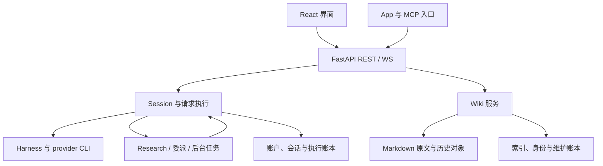

# Octopus 代码审查报告

审查日期：2026-10-20（Asia/Shanghai）\
仓库：[Danuvius152/Octopus](https://github.com/Danuvius152/Octopus)\
固定版本：`5d99de373921affd27fe307e5770ea397d4f04d6`（main，2026-10-19 23:45:18 +08:00，`refactor: simplify session and Wiki lifecycles`）\
配套文档：[octopus_implementation_spec_20261020.md](octopus_implementation_spec_20261020.md)\
审查方式：当前源码静态分析、三个领域并行复核、离线组合复现、定向既有测试。未修改仓库源码，未执行真实模型或真实 provider CLI。

Wiki 专项补审：同日基于上述后端版本补查，新增 CR-17～CR-20，并补充 CR-12 的 App 查询参数反例；本轮为单人源码检查、隔离连续使用及成本测量，未重复审查其他领域。可执行证据见 [行为复现](wiki_additional_repros_20261020.py)、[效率复现](wiki_efficiency_repros_20261020.py) 与 [App 参数复现](wiki_adapter_repros_20261020.py)，配套 Spec 已同步补充。保留工作树原有修改；指南字节测量包含原有 query-v2.md 文本修改，不冒称纯净 HEAD 的指南字节数。

## 1. 结论

**整体方向适合个人或可信小团队工作台，继续保留模块化单体是合理选择。当前最需要修复的是跨模块的状态、资源与事务合同，而非重写技术栈。**

已经存在的 Harness 抽象、请求单次结算、Wiki 文件权威内容、来源身份绑定、revision 校验、有限写入授权和任务回执都有实际价值。Wiki 也已采用按需加载指南；不能把这版实现描述成“每轮把整套 Wiki 规则塞进 system prompt”。这些机制值得保留。[架构与请求结算][S-SETTLE] [Wiki 指南入口][S-WORKFLOW] [Wiki 写入边界][S-HISTORY-WRITE]

但当前的模块划分尚未完全形成责任边界。会话的“本轮结束”被部分入口当作“全部工作结束”，Wiki 响应 helper 暗中另开数据库连接，App 路由通过动态 kwargs 调用其他 HTTP handler。以下缺陷说明，这些不是单纯的代码风格问题。

累计确认 **20 项问题：6 项 P1、14 项 P2**（原审查 16 项，Wiki 专项新增 4 项）。其中 P1 包括账户禁用未覆盖派生凭证、日志暴露敏感 argv、已接纳输入在重启后缺少可恢复执行状态、定时父会话过早归档、Claude 可复用后端在自动归档时失去资源 owner，以及 Wiki 移动后重读将历史前像错绑到另一文档。没有在本次范围内确认 P0；这不等于完成安全认证或证明不存在其他问题。

Wiki 的存储/维护、来源保全、移动身份、锚点校验和任务卡恢复问题，都应通过程序合同修复。继续加长 prompt、要求模型反复查询或读两遍，只会掩盖问题并增加成本。

### 1.1 优先级口径

| 级别 | 本报告含义 |
|---|---|
| P1 | 应优先修复的权限、隐私、请求可靠性或资源生命周期问题；通常进入下一次功能发布前的修复范围 |
| P2 | 在明确场景下产生错误、阻断操作或显著破坏工作流；纳入近期实施 |
| 设计建议 | 有源码依据的改进机会，尚不等于已发生的故障 |
| 待验证风险 | 仅有静态推导或尚未执行的边界实验，不计入 20 项确认问题 |

### 1.2 问题总表

| ID | 优先级 | 领域 | 已确认问题 | 关键触发条件 |
|---|---|---|---|---|
| CR-01 | P1 | 身份 | 禁用账户后，MCP/App 派生凭证仍能请求 API | 已签发凭证仍有效，owner 被禁用 |
| CR-02 | P1 | 隐私 | INFO 日志记录完整 argv，包含凭证或私有 prompt | 启动 Harness |
| CR-03 | P1 | 请求 | 重启撤销队列后，没有持久化执行终态与正文恢复路径 | 已 accepted、尚未执行的用户输入 |
| CR-04 | P1 | 生命周期 | 定时父会话在异步 Research 完成前归档 | fresh scheduled session 发起异步工作后结束初轮 |
| CR-05 | P1 | 资源 | 自动归档移除 Session，却未退役 held backend | 支持的 Claude STREAM_JSON 可复用进程路径 |
| CR-06 | P2 | 生命周期 | 委派子会话终态后不再自动归档 | terminal callback 先于 driver release |
| CR-07 | P2 | 调度 | 一次性任务因普通 human backlog 跳过并删除 | origin session 已有排队人类输入 |
| CR-08 | P2 | Wiki 恢复 | 普通历史恢复未验证历史 blob 哈希 | 备份对象已损坏，文件名仍是原哈希 |
| CR-09 | P2 | Wiki 维护 | 无关坏资产阻断健康笔记维护 | 被排除的 tmp asset 存在 YAML 错误 |
| CR-10 | P2 | Wiki 效率 | 未改变文档的 read 也让维护分页失效 | 列候选后读取未变化文件 |
| CR-11 | P2 | Wiki 一致性 | 单次 live read 混合新正文与旧来源关系 | read 自身发现 synchronize 尚未消费的修改 |
| CR-12 | P2 | App Wiki API | 控制请求丢 job_id；资产布尔筛选与主 API 不同 | App cancel/retry；include_assets=1/yes/非法值 |
| CR-13 | P2 | App 代理 | 转发 query 中的认证 token，丢失重复参数 | URL query token 认证或重复业务参数 |
| CR-14 | P2 | Wiki UI | 最后一次状态通知刷新失败后不会自动恢复 | REST 临时失败，WS 不断线且无后续事件 |
| CR-15 | P2 | Prompt | 提示词宣传本轮并未提供的工具 | web research leaf 或裁剪 MCP 能力 |
| CR-16 | P2 | Prompt/进程 | API 接受超长 persona，启动时触发 E2BIG | UTF-8/转义后的单个 argv 超过 OS 限制 |
| CR-17 | P2 | Wiki 来源 | 新增关联遮蔽原生来源，丢失来源变化提示 | 原生 YAML 有 sources，organize 省略 sources 并新增 relations |
| CR-18 | P1 | Wiki 身份/恢复 | 移动后重读错绑历史，结算又按旧路径误判 | 排队目标移动；旧路径被其他文档复用时可污染其恢复前像 |
| CR-19 | P2 | Wiki 引用 | 两套标题解析造成合法锚点拒绝、代码内伪锚点放行 | Setext 标题或带非空尾部的围栏代码行 |
| CR-20 | P2 | Wiki 效率 | 每个 raw block 从头扫描分节，分页及 no_change 放大计算 | 多分节长文、分块分页或无需修改确认 |

## 2. 架构设计是否符合软件工程原则

### 2.1 当前架构及合理的边界



这个结构能在单进程内集中管理执行、取消权和进程 ownership，适合当前部署目标。判断架构是否合理，应看状态归属和故障恢复能否被验证，不应以文件数量或是否使用微服务打分。

| 工程原则 | 当前评价 | 具体判断 |
|---|---|---|
| 分层与依赖方向 | 部分符合 | Harness 边界清楚；App adapter 调用 HTTP handler、Wiki helper 隐式取连接使业务边界泄漏 |
| 单一职责 | 局部过载 | Session 同时承载 dispatch、work、backend、archive 等状态；多个 manager 依赖其私有字段 |
| 依赖倒置与可测试性 | 基础较好 | RuntimeProfile/HarnessRun 能隔离 provider；manager 组合顺序的测试仍不足 |
| 状态与幂等性 | 有扎实基础，但不完整 | admission identity、单次 terminal、持久化核验已存在；排队执行与调度 fire 的生命周期仍有空白 |
| 事务一致性 | 局部违反 | 同一 Wiki read 返回不同事务版本的数据，维护失效触发器不区分业务变化与检查时间 |
| 最小权限 | API 层有设计，撤权不完整 | run/work lease 和 Wiki grant 有价值；owner 禁用检查未覆盖所有派生入口 |
| 故障隔离 | Wiki 需要改进 | 文档解析错误不应等价于全库身份或 journal 不可信 |
| 可恢复性与可观测性 | 尚未闭环 | receipt 和历史对象充分，但“已接受未执行”“状态同步失败”“需人工处理”缺少稳定产品状态 |

依据：[Harness 统一执行][S-HARNESS]、[Session 状态与 manager][S-SESSION]、[App adapter][S-APP-WIKI]、[Wiki read][S-READ]、[维护失效触发器][S-TRIGGERS]。

### 2.2 应保留的设计

**请求与进程层。** `SubmissionReceipt.wait` 使用 shield，HTTP 等待者取消不会直接取得执行取消权；`_settle_turn` 在首个 await 前选定终态，并对存储不确定情况阻止自动继续执行。DB 写入序列化、独立读取核验和 shutdown 保留未确认 owner 都是正确方向。修复自动归档时应复用这些能力。[单次结算][S-SETTLE] [持久化核验][S-DB-VERIFY] [关闭流程][S-DRAIN]

**Wiki 内容层。** 原始 Markdown 作为权威内容，原文保全与派生摘要分开；身份、tombstone、来源绑定防止同路径的新文件冒充旧证据。revision、读回执和有限 assignment 使“已读过什么、允许改什么”能被程序检查。仅靠一句“不要改坏文章”的 system prompt 无法提供这些保证。[历史写入][S-HISTORY-WRITE] [来源绑定][S-SOURCE] [任务授权][S-GRANTS]

**Wiki 查询层。** compact 检索、正文分页、重叠阅读区间合并、按需指南和受限响应体已经存在。索引卡用于定位，实际读取的摘要可以作为对应层级证据，全文评价则要求全文覆盖。这种按问题范围读取的设计，比所有问题一律整篇重读更合理。[读取规则][S-QUERY-GUIDE] [worker 规则][S-WORKER-GUIDE] [响应上限][S-RESULT-LIMIT]

**任务层。** Wiki worker 每次从同一个 job 取最多 3 个 pending 项目（文档或新页预留），使用独立 `origin=wiki`；已有 receipt、失败恢复和“保存成功但索引失败时只恢复索引”的语义。不应为了统一命名而把 Wiki worker 改回定时会话生命周期，也不应把全部失败都做成再次调用模型。[Wiki worker 启动][S-JOBS] [维护恢复规则][S-MAINT-GUIDE]

### 2.3 最值得收敛的复杂度

当前 server 有 202 个 Python 文件、58,218 个物理行；其中 Wiki 60 个文件、14,680 行，约占 25.2%。`sessions/turns.py` 2,675 行、`wiki/jobs.py` 1,616 行、`delegations.py` 1,447 行。这里包含空行和注释；前端统计还包含生成代码，不能当作纯业务复杂度指标。这些数字仅用于定位审查重心，实际问题仍由下面的可复现场景证明。

优先建立四条具体边界：

1. **request / work / session / backend 分别有 owner。** 一轮结果已提交，不代表异步 continuation 已结束，更不代表可以丢弃进程 owner。
2. **Wiki 响应投影显式接收事务。** 在事务内需要一致性的 helper 不得暗中开第二个连接。
3. **Wiki 业务服务与 HTTP adapter 分开。** 主 API、App API、MCP 使用同一组类型化业务调用，不互相调用 HTTP handler。
4. **静态指南与动态授权分开。** 文本和 digest 可缓存，当前 assignment、owner 状态、注册 generation 与 write grant 必须实时判断。

这是渐进整理方向，不要求大规模引入新的通用框架。

### 2.4 数据和部署边界应写清楚

| 数据 | 权威性质 | 恢复/重建原则 |
|---|---|---|
| Markdown / 原始材料 | 内容事实 | 原字节、路径变更与当前 revision 必须可追溯 |
| FTS / 分节等派生表 | 可重建索引 | 使用已有 rebuild 接口；不能把整份数据库当缓存删除 |
| doc identity、tombstone、source binding | 历史身份事实 | 不能仅凭扫描当前文件完整重建 |
| grant、job、receipt、history journal | 执行和授权账本 | 与文件/历史对象一致备份，保留恢复证据 |
| Session/request/schedule 状态 | 执行事实 | admission、执行结算及未知状态必须区分 |

`index.sqlite3` 内不全是可丢弃的索引。当前 `rebuild_search` 有意只重建派生表，应把这点写进运维文档；为了“命名更干净”立即拆成多个 SQLite DB 会增加跨库事务问题。[索引重建][S-REBUILD]

README 中“完全隔离”的表述过强。项目自己的 multi-tenancy 设计已承认同一 OS 用户、可信本机运行；CLI 使用宽权限，App 也具有本机能力。**当前提供的是账户数据/API 作用域，不能据此承诺不可信租户之间的 OS 执行隔离。** 这不是本次发现跨账户 HTTP IDOR 的结论。[README][S-README] [多租户边界][S-TENANCY] [CLI 启动参数][S-CODEX-ARGV]

单进程也是当前合理的运行边界：session/work registry 在内存中，Wiki observer 对同一状态有独占锁。直接增加 Uvicorn workers 不会自动获得协调后的取消、归档与文件写入语义。先明确部署约束，未来确有需求时再设计 durable lease/routing。[Session registry][S-SESSION] [Wiki observer][S-EVENTS]

## 3. 已确认缺陷及修复意见

### CR-01 · P1 · 禁用账户没有覆盖派生凭证

**位置。** `users.set_disabled` 更新 disabled_at 并撤销账户 token；MCP scope 核验只检查 work/run lease 与 identity era；App token 分支验证签名后直接返回 `_APP_ITSELF`。[账户禁用][S-DISABLE] [MCP 核验][S-MCP-AUTH] [App viewer][S-APP-AUTH]

**复现。** 临时真实 DB 中签发普通 token、live MCP token 和 App token，再禁用 owner：普通 token 请求从 200 变成 401；MCP 请求 `/api/applications` 仍是 200，App token 请求 Wiki config 仍是 200。

**影响与边界。** 管理员的禁用没有阻断该账户已有派生能力；这是撤权不完整，未证明它能访问另一个账户的数据。

**意见。** 所有入口在验签后统一解析真实 owner，并检查当前可用状态。禁用成功后停止新 admission、撤销派生 lease、启动受管工作退役；已经执行的工作按真实阶段结算，不能伪造“已取消”。重新启用不应自动复活被撤销的 lease。

### CR-02 · P1 · 完整 argv 进入默认 INFO 日志

**位置。** `HarnessRun.start` 直接记录 argv。Claude 的 MCP 配置含 bearer header，system prompt 也在 argv；Codex 的 developer/user prompt 同样通过 argv 传递。[启动日志][S-SPAWN-LOG] [Claude 参数][S-CLAUDE-ARGV] [Codex 参数][S-CODEX-ARGV]

**复现。** 用合成凭证和私有文本构造实际 argv，当前 logging 路径输出 bearer 和 prompt 原文。没有使用真实秘密。

**影响与边界。** 日志副本扩大了私有上下文和仍有效凭证的暴露面。Codex HTTP MCP bearer 使用环境变量传递，不能把 Claude 的具体 bearer 泄漏路径扩大为 Codex 的同一路径。

**意见。** 默认只记录 backend、model、请求标识、退出状态、命名空间和长度等允许字段。显式诊断也必须 profile-aware 脱敏；现有 safe_diagnostic 不能保护未经过它的日志。不要仅正则替换 `Bearer`，否则 prompt、stdio env 和未来参数仍会遗漏。

### CR-03 · P1 · 历史 admission 回执掩盖未执行输入的撤销

**位置。** client submission 只保存 payload hash、request ID 和首次 receipt；查询命中 receipt 即返回。排队正文尚未进入 transcript，shutdown 撤销并清空内存队列。[提交状态][S-CLIENT-SUBMIT] [提交持久化][S-CLIENT-DB] [队列与 shutdown][S-DRAIN]

**复现。** 第一条请求运行中，第二条被接纳并排队；优雅 shutdown 后重建 manager，查询或用同一个 client ID 重试第二条。结果仍 `accepted=true`，队列为空，保存的正文数为 0，terminal 为 null。

**判断。** `accepted=true` 可以忠实表示历史上曾接纳，不能只把它改成 false。不恢复内存队列也是已有设计选择。真正缺陷是：没有持久化“从未执行便撤销”的状态，没有正文恢复路径，旧 receipt 又使用户无法了解当前执行事实。

**意见。** 分离 immutable admission 与 mutable execution；接纳前保存可恢复输入及附件引用；优雅停机记为 withdrawn-before-start。硬中断只能按已知执行阶段分类；缺少 terminal 不能成为自动重放依据。

### CR-04 · P1 · 定时会话过早归档导致异步回传失败

**位置。** driver release 发现本地 idle 后自动归档 schedule-origin session；归档条件不看外部 Research/bg/delegation；Research 回传要求父 session 仍在 live map。[driver release][S-RELEASE] [自动归档][S-ARCHIVE] [Research 回传][S-RESEARCH-RETURN]

**复现。** fresh scheduled session 发起异步研究，初轮结束。父会话已归档时研究仍 running；随后研究 completed，但 injection failed，错误为原请求合同缺失、关闭或不匹配。报告文件仍保留。

**影响。** 计划任务的“研究后总结/继续处理/写入 Wiki”无法自动完成。bg/delegation 静态上有相同父会话依赖；本次动态实验确认的是 Research，不冒称所有变体都已实测。

**意见。** 定义 session quiescence，包含全部受管 work 及待投递回传。最后一个 work 结束与回传处理完成时重新评估归档。只加“有 research 就暂不归档”但不增加后续触发者，会造成相反的永久不归档。

### CR-05 · P1 · 自动归档丢失 held backend owner

**位置。** 自动归档直接 pop session；reaper 和 shutdown 只枚举 live sessions。正常可复用 backend 会由 turn 结束路径保留。[自动归档][S-ARCHIVE] [held 处理][S-HOLD] [reaper/shutdown][S-PROCESSES]

**复现。** 给合法 idle schedule session 安装记录 stop 调用的 reusable backend，执行真实自动归档、reaper、shutdown：session 已归档，stop 总次数 0，backend 仍 alive。

**影响与边界。** 符合当前支持的 Claude STREAM_JSON 路径，反复发生会绕过 held cap 并积累资源。当前 Codex 使用 CLOSE_AFTER_SPAWN，不能据此声称 Codex 也有这个 held leak；未测真实 Claude 的内存增量。[Claude 模式][S-CLAUDE-MODE] [Codex 模式][S-CODEX-MODE]

**意见。** 归档应先捕获并退役所有 backend owner，确认退出后才移除 Session；未确认退出时保留 owner 和重试责任。不能为了复用显式归档函数而误取消 CR-04 仍在等待的异步工作。

### CR-06 · P2 · 已完成委派 child 不再归档

**位置。** terminal callback 注入结果后立即尝试归档，此时当前 request/task 尚未释放；release 后又只自动重查 schedule origin。[委派终态][S-DELEGATION-END] [terminal listener][S-DELEGATION-CALLBACK] [release][S-RELEASE] [origin 设置][S-SESSION]

**复现。** 保留真实 admission、dispatch、DelegationManager、终态发布和 DB，将请求执行方法替为可控协程。delegation completed、terminal_injected=true、driver finished，但 child 仍 live、DB archived=false。

**测试缺口。** 既有测试把 start_message 替成 noop 并手动清空 active_task，绕过了 result-before-release 的真实顺序。[既有局部测试][S-DELEGATION-TEST]

**意见。** terminal 提出与 work/round 绑定的归档意图，release 后在无孙任务/回传/新 follow-up 时执行。不能简单把所有 delegation 放进 idle 即归档列表。

### CR-07 · P2 · one-shot 因人类 backlog 被静默消耗

**位置。** `_backlogged` 把任何 pending queue 视为已有 schedule fire；早退后 finally 仍删除 one-shot 定义。[调度 early return][S-SCHEDULE-BUSY] [无条件删除][S-SCHEDULE-DELETE]

**复现。** 同一会话正在执行且另有一条 human 消息排队，一次性任务到期。最终 schedule row 为 0，队列只含原 human，没有 scheduled input。

**意见。** 用 schedule ID + fire identity 去重，定义与执行记录分开。忙碌应排队或持久化 defer；确需跳过也应有可见原因和运行记录，不能用删除定义代替结算。

### CR-08 · P2 · 历史恢复信任对象文件名，不验证内容

**位置。** 普通 restore 只检查 blob 存在并读入，随后写回；历史列表将存在视作 recoverable。snapshot restore 已有哈希校验，普通恢复遗漏。[普通 restore][S-RESTORE] [snapshot 对照][S-SNAPSHOT]

**复现。** 保存 v1→v2，模拟 v1 历史对象损坏但保留原哈希文件名。历史列表仍显示 recoverable，普通 restore 成功，用损坏内容覆盖当前健康 v2。

**边界。** 需要预先存在损坏备份对象；不表示正常写入会自行损坏历史。

**意见。** 统一 verified blob reader，写入前核对实际 SHA256；对象不可信时保留现文件及证据，返回稳定错误。历史列表可区分存在/已验证，无须每次列表全量读取所有 blob。

### CR-09 · P2 · 局部坏资产被提升为全库维护故障

**位置。** index status 汇总全库文档错误；maintenance readiness 即便 exact doc 也要求全局 ready。[索引状态][S-INDEX-STATE] [维护健康度][S-MAINT-PROJECTION]

**复现。** 健康 `Library/good.md` 加上 YAML 损坏的 `tmp/extraction-output.md`。后者是排除维护的 asset，但 Library 列表和 exact good doc 都返回 ready=false、total=null、items=[]；只移除坏 asset 即恢复。

**意见。** 将全库身份/journal 安全屏障与单篇解析错误分开。按目标及直接证据依赖判断内容可用性，返回健康候选与有界排除摘要。不能直接把所有 partial 改成 ready，未知身份仍应阻止写入。

### CR-10 · P2 · 读取未改文档使维护 cursor 失效

**位置。** read 的索引 fast path 即使 signature 相同也 UPDATE；documents UPDATE trigger 无条件 bump generation/dirty。[索引 fast path][S-INDEX-FAST] [失效触发器][S-TRIGGERS] [cursor 校验][S-MAINT-CURSOR]

**复现。** Library 三篇笔记分页 limit=1；原 cursor 能继续翻页。只读未改变的 Other/unrelated.md 一字符，再翻页即 409。index_epoch 始终为 4，maintenance generation 从 32 变 33。

**影响。** “列候选→阅读→继续列候选”会被自己的读取打断，并产生无效的派生工作。refresh 更新 checked_at 也存在同类静态失效路径，但未作为独立动态实验计数。

**意见。** fast path 避免 no-op UPDATE，trigger 只监听影响维护语义的真实变化；signature/checked_at 等检查信息不驱动业务失效。真实删除、移动、来源变化和 receipt 状态变化仍须正确失效。

### CR-11 · P2 · 一个 live read 返回两个事务版本

**位置。** read 在外层事务内完成 _index 后构造返回值；public/dependencies 和 index_state 另开连接，外层直到 return expression 构造完才提交。[read][S-READ] [public helper][S-PUBLIC] [index_state helper][S-STORE-STATE]

**复现。** 通过 vault 外 hardlink 修改 consumer 的 sources：A→B，模拟目录 watcher 未捕获但 read 能发现的更改。第一次 read 返回新正文、新 revision、native sources=B，却附旧 source_refs=A、epoch=3；第二次相同 revision 才返回 B、epoch=4。

**意见。** 响应投影复用同一事务连接，或先提交再在受控一致性快照内组装。正文、坐标、来源关系和 index epoch 必须属于一个确定版本。不能要求模型每次读两遍来补偿。

### CR-12 · P2 · App Wiki 参数分派和解释与主 API 不一致

**位置。** App adapter 的 `elif schema` 解析 POST body 后，后面的 `elif operation.startswith("jobs/")` 无法执行，job_id 没传入 handler。[动态 adapter][S-APP-WIKI]

**复现。** `POST /apps/app-review/wiki/jobs/job-review/cancel` 与 retry 均返回 500，错误是缺少必需参数 `job_id`。主聊天 `/api/wiki/jobs/...` 路径不受这一分支缺陷影响。

**本轮追加的查询反例。** App 对 search/documents 的 include_assets 手工执行 `.lower()=="true"`，绕开主入口的布尔验证。同一隔离库包含 `Library/note.md` 和 `tmp/asset.md`：`include_assets=1` 或 `yes` 时，主 documents 返回两篇，App 只返回 Library；只在 asset 中命中的搜索，主 API 返回 1 条，App 返回空。`include_assets=invalid` 在主 API 为 422，App 却静默当作 false 返回 200。true/false 对照一致。最小 [App 参数回归](wiki_adapter_repros_20261020.py) 实测 4 failed、2 passed；新增的四个反例归入同一 adapter 合同问题，不重复增加编号。[App 参数解析][S-APP-WIKI]

**意见。** path/query/body 独立解析，App 与主入口共用同一类型验证与默认值；合法布尔形式解释一致，非法值返回 422。先补直接缺陷与真实路由回归，再让 App/主 API 共享类型化业务服务，避免在 HTTP handler 之间拼 kwargs。保留 App 自身的绑定和权限限制，不以结果一致为由扩大授权。

### CR-13 · P2 · App proxy 泄漏 query token 并折叠多值参数

**位置。** 代理有意删除 authorization/cookie header，但 `params=dict(request.query_params)` 原样传出 query token，并将重复键合并。[代理转发][S-APP-PROXY] [query 认证][S-APP-TOKEN]

**复现。** 合成请求 `?token=REVIEW_SYNTHETIC_ACCOUNT_TOKEN&tag=one&tag=two`；upstream 捕获 token 原文，tag 只剩 two。没有向真实 upstream 发送凭证。

**边界。** query token 路径有问题；默认 cookie iframe 请求不一定含 token。App 已有可信本机执行能力，本项不是新建立的 OS sandbox escape。

**意见。** 过滤仅由 Octopus 消费的认证参数，使用多值列表保留业务参数的重复、顺序、空值及 Unicode。

### CR-14 · P2 · 最后一次 Wiki 通知刷新失败后无自动恢复

**位置。** WS handler 对 refresh 的异常空 catch；loading 清理后不保留目标版本或 retry；卡片只在挂载/连接/身份等变化时重载。[WS handler][S-WS] [job refresh][S-WIKI-JOBS-CLIENT] [卡片 effect][S-CARDS]

**复现。** UI 为 running/v1，最后一个 changed/v2 事件到达，REST 暂时 503，WS 保持连接。服务随后可返回完成态，但没有更多事件。新增测试推进 120 秒后仍显示 v1，无提示；重新连接或重新打开会话可以刷新，但没有自动恢复。13 项原有前端测试通过，新增恢复回归失败。

**意见。** 保存“尚未同步到的目标版本”，有界退避+jitter，超过重试预算显示状态未同步和重试入口。snapshot 覆盖目标后才清除 dirty；身份/generation 改变时取消旧回调，不发起新模型 turn。

### CR-15 · P2 · Prompt 与实际能力集不一致

**位置。** MCP selection 和 prompt assembly 分开；compose 无条件插入 profile 的完整工具说明。web leaf 明确设 mcp_servers=[]、只用 web，仍得到 bg/ask/delegation/schedule 指引。[assembly][S-ASSEMBLY] [run context][S-CONTEXT] [web leaf][S-LEAF]

**复现。** 实际构造 web-only RunConfig，MCP entry 数为 0，system prompt 中四类工具的宣传均存在，UTF-8 体积 4,762 bytes。

**影响与边界。** 输入本身存在执行指引矛盾和多余成本；没有实测证明模型每次都会尝试幻觉工具调用。

**意见。** 由同一个 resolved capability set 同时生成 MCP entries 与 prompt。工具裁剪后的 leaf 只保留对应指引；未知或不可用能力不应由 persona 补造。

### CR-16 · P2 · 超长 persona 到启动阶段才失败

**位置。** AgentCreate/Update 的 system_prompt 无界；Codex 把开发者指令编码进一个 TOML argv；大 prompt spill 只覆盖用户消息，不覆盖 persona。[Agent 模型][S-AGENT-MODEL] [Codex 参数][S-CODEX-ARGV] [大消息处理][S-LARGE-PROMPT]

**复现。** API model 接受 45,000 个“文”（135,000 UTF-8 bytes）；最终最大 argv 元素 140,096 bytes。使用 `/bin/true` 代替 CLI 验证同一参数列表，Linux exec 返回 errno=7/E2BIG。没有运行 Codex。

**意见。** 对配置与最终序列化参数分别做字节预算检查，保留运行平台余量，启动前返回可解释错误。长期可采用 provider 正式支持的其他 instruction transport；不能把 persona 悄悄降成普通用户附件，也不能以“已有 stdin controller test”证明 exec 参数不受限。

### CR-17 · P2 · 新增关联时遮蔽原生来源，之后不再提示来源变更

**位置。** 不带 `frontmatter_patch` 的 organize 只从 `managed_notes.metadata` 继承省略的 sources；新增 relations 后又将 `refs + linked` 写入 managed sources，遮蔽仍保存在原生 YAML 的来源。[继承分支][S-ORGANIZE-SOURCE-INHERIT] [覆盖点][S-ORGANIZE-SOURCE-SHADOW]

**复现。** 笔记原生 YAML 引用 A。通过真实维护 assignment 阅读该笔记和 B，再调用 `/api/wiki/organize` 新增关联 B，省略 sources。请求返回 200，原生 YAML 中 A 仍在，但有效 `sources`、`source_refs` 都只剩 B。随后修改 A 并完成 refresh，再读该笔记得到 `stale=false`。同一输入加 `frontmatter_patch` 进入 normalize 时保留 A+B，修改 A 后 `stale=true`。[正常分支对照][S-NORMALIZE-SOURCE-MERGE]

**影响与边界。** 原文没有被删除；丢失的是有效来源关系、相应过期提示和维护依赖。问题经 fresh read 与 refresh 后仍存在，区别于 CR-11 的首次读取事务不一致。两条写入入口对“省略 sources 应保留”的解释不同，不能靠换一个 prompt 掩盖。

**意见。** 统一省略、显式空列表和显式替换的来源语义。省略时继承当前有效来源及其原有身份/版本证明，再追加本次关联；不得仅保住 YAML 字节却用 managed metadata 隐藏它，也不得把保留旧来源变成自动确认新版。

### CR-18 · P1 · 移动后仍用旧任务路径，重读可错绑历史并覆盖另一文档

**位置。** reread 按 `item.doc` 读当前 A，却将其字节记录到 `item.path` 的旧位置，未传实际文档身份；history 随旧路径推断另一当前文档的身份。publication recovery 也按输出旧路径读取，并把“输出路径不同”当成独立输出文档的证据。[重读记录][S-JOB-REREAD] [身份推断][S-HISTORY-IDENTITY] [发布恢复][S-PUBLICATION-RECOVERY]

**复现一：错误前像。** 为 A 入队后，将 A 从 `Library/a.md` 移到 `Library/moved-a.md`，让 B 移入原位置，再修改 A。两份稳定身份都保持正确。调用 worker 实际使用的 `jobs.reread`，生成的 conflict 却绑定 B 的 doc_id 和旧路径，before/after blob 都是 A 的当前字节。随后以 B 的正确当前 revision 恢复该 change 的 before 侧，返回成功，B 实际被覆盖为 A。全部步骤在临时 vault 内完成；没有篡改 blob 或手工制造错误账本。

**复现二：错误结算。** A 在写入前移动：真实 assignment 可在新路径成功 organize，但 recovery 对同一个已写入身份检查旧 input revision，报 `Document changed`。A 在写入后移动：输出身份与输出 revision 都正确，recovery 却读旧路径并报 `Document not found`。两种情况均产生 `attention/index_complete=false`；不移动的对照正常得到 done。

**影响与边界。** 首个场景跨文档污染恢复证据，并经普通 restore 实际覆盖 B，因此为 P1；后两个场景是同一旧路径依赖的结算表现，合并计为一项。即时 reread 本身没有改写 B，错误覆盖需要后续恢复操作。已知移动、内容变化、索引及身份均已落定，不是无法证明的并发竞态；不与 CR-08 的坏 blob 问题重复计数。

**意见。** 以稳定输入/输出 doc_id 区分原位维护与独立输出，以其当前路径定位。重读候选必须绑定实际读取的身份、路径、revision 和字节；不能从旧路径当前占用者推断身份。成功输出按记录的 output_doc/output_revision 核验，不能因同一身份改名而要求恢复旧 input revision。保留真实身份替换/版本漂移拒绝与当前 grant；已错绑候选须保留证据并禁止直接作为可信恢复版本。

### CR-19 · P2 · 标题双重解析既拒绝合法锚点，也放行代码内伪锚点

**位置。** 主格式解析使用 CommonMark tokens，`links.headings` 则手工逐行识别 ATX 标题和代码围栏；anchor_exists、source_span 使用后一套结构。[主解析][S-FORMAT-HEADINGS] [链接标题解析][S-LINK-HEADINGS] [写入校验入口][S-LINK-VALIDATION]

**复现一：误拒绝。** 目标正文为 `Topic\n=====\n\nOriginal section content.\n`。主解析已识别 Topic 为一级标题，但 publish 一篇含 `[Topic](target.md#topic)` 的新页返回 422：`New local anchor does not exist`。改为 `# Topic` 的对照可正常发布。

**复现二：误放行。** 围栏代码块中出现以三个反引号开头、尾随 `still-code` 的内容行，后跟 `# Fake`，最后才是真正关闭围栏的行。CommonMark 将 Fake 保持在代码块内；手工解析却提前结束围栏。publish 含 `target.md#fake` 的新页实际成功，新增不存在的章节链接。

**意见。** 从同一份当前 CommonMark 结构派生标题、章节范围及锚点校验，保留原字符坐标、重名标题和 slug 规则。来源章节定位也须复用该结构；不能通过跳过链接校验来解决合法标题误拒绝。本轮动态证据覆盖上述两种 publication，不宣称已遍历所有 Markdown 方言。

### CR-20 · P2 · 分块定位从头扫描分节，分页和 no_change 放大计算

**位置。** `raw_blocks.load` 在生成全部块时，为每一块从 `parsed.sections` 起点重新 `next(...)` 查找所属分节；分页在 load 完成后才切片。`revise` 在判断 no_change 前也无条件调用该 loader。[raw block 装配与分页][S-RAW-BLOCKS] [no_change 分支][S-REVISE-NO-CHANGE]

**实际复现。** 合成 1,000 个小节、2,001 个块，全文 73,805 字符/84,805 UTF-8 字节。每页 20 块读完 101 页，原文及所有返回块拼接正确，但解析同一正文 101 次、打开原文件 202 次、累计考察 **101,303,101** 个分节候选。单页也构建了全部块；一次 no_change 确认另做 **1,003,001** 次分节考察，虽然它无需任何块坐标。100/400/1,000 小节的对应成本及时间在 §5.4 列出。

**影响与边界。** 单次块装配的查找成本为 O(B×S)，B、S 分别为块数与分节数；逐页重复后为 O(P×B×S)。本输入族 B≈2S、P≈B/20，候选考察次数随规模近似立方增长。成本发生在 history 锁内，会延长相应操作的占用；本轮未测生产排队延迟，不宣称发生数据损坏、超时或支付了额外模型费用。与 CR-10 的 no-op UPDATE/维护失效是不同根因。

**意见。** 用有序区间游标或边界索引完成块到分节的匹配，避免每块重新扫描；no_change 只做其必要的当前身份、字节/revision、编码、授权、已读证据及持久回执核验。进一步减少跨页重复解析时，以确切版本约束不可变坐标投影，每次调用仍核当前授权和字节；不缓存可变 Markdown tokens。保留正常分页、坐标及原文保全合同。最小 [效率回归](wiki_efficiency_repros_20261020.py) 的 400 小节用例实际触发成本断言，20 小节对照正常。

## 4. Wiki system prompt 与效率的专项判断

### 4.1 当前注入链已经做了什么

当前大致为：角色 persona + provider 工具说明 + 已启用 connector 说明 + memory 指引 + 小型 Wiki bootstrap；具体指南由 load_guide 返回。[组合入口][S-ASSEMBLY] [按需指南][S-WORKFLOW]

Codex resume 已实现稳定 controller checkpoint 比较：读取当前 active transcript，对比稳定消息，只在变化时注入；compaction/rollback 会让 checkpoint 失效并按需补回。单轮约束独立处理。本次相关定向测试通过。[controller][S-CONTROLLER] [controller 测试][S-CONTROLLER-TEST]

因此应区分三个概念：

- **进程传输量**：argv/RPC 每轮传多少字节。
- **历史追加量**：是否把相同 developer message 反复追加到 transcript。
- **推理输入与缓存用量**：模型实际上下文及 provider 报告的缓存/计费用量。

第二项已有去重，不表示第一、第三项为零；仅看到 argv 内完整文本也不能推出第二项重复。没有真实 provider usage，本报告不编造节省百分比或账单 token 数。

### 4.2 可复算的静态体积

以下为当前源码文本/序列化 schema 的 UTF-8 bytes，**不是 tokens，也不等于模型实际计费输入**。示例不含用户自定义 persona、真实 connectors 或会话历史。

| 内容 | UTF-8 bytes |
|---|---:|
| Codex 内置工具说明 | 4,633 |
| Claude 内置工具说明 | 7,663 |
| Wiki bootstrap | 980 |
| memory 模板，合成路径 | 1,069 |
| Codex 无 persona、含 memory+Wiki 的组合示例 | 6,686 |
| access 公共规则 | 1,357 |
| query 指南正文 | 3,582 |
| worker 指南正文 | 3,351 |
| article 指南正文 | 4,071 |
| writing 指南正文 | 2,261 |
| auto 模式 15 个 Wiki 工具的 name/description/inputSchema 序列化 | 16,309 |

工具 schema 是否立即进入模型上下文，取决于 CLI 的发现/延迟加载实现，不能把 16,309 bytes 直接加入每轮账单。文本和 schema 统计基于 [provider 实现][S-CODEX-PROMPT]、[Claude 实现][S-CLAUDE-PROMPT]、[Wiki 工作流][S-WORKFLOW]、[指南目录][S-PROMPTS] 与 [MCP 工具][S-MCP-WIKI]。

冷查询单次 query guide 的公共规则+正文为 **4,939 bytes**，还不含操作卡/JSON。需要 worker、article、writing 三个模块时，三次返回的 access + 实际 content 合计约 **13,896 bytes**（含 worker 的 142-byte 框架前缀），同样不含操作卡/JSON。并非每个任务都需要这三个模块；纯元数据或 no_change 不应被强制加载 writing。

### 4.3 值得做的优化，按收益顺序

**第一，修正不必要的计算与错误恢复。** CR-10 会让正常读取制造失效；CR-09 会把无关坏资产变成全库阻塞；CR-14 会让用户反复手动刷新。这些成本不来自 LLM 推理，也不需要 prompt 技巧。

**第二，让 prompt 与实际能力一致。** CR-15 的 web leaf 是明确案例。角色只负责判断方式、沟通与领域职责；bg、schedule、delegation 规则由启用能力统一提供，避免角色文档复制一整套框架说明。

**第三，缓存不可变指南 bundle。** `workflow.view` 每次构造操作卡都会读取 9 个指南文件、重新计算 bundle/digest。可以在进程启动或明确版本失效时缓存正文和哈希。当前 grant、owner、注册 generation、available_tools 仍必须实时计算；不能缓存整个 PolicyView。[实际构造路径][S-WORKFLOW]

**第四，降低指南协议的重复。** 每次 load_guide 重复公共 access 和操作卡有成本。后续可让客户端明确声明仍可见的 digest，服务端只返回缺失模块；其他正常工具响应带紧凑 policy/guide 版本提示，减少只为核对 digest 发起的 info roundtrip。此项需要代码与协议一同修改。当前 bootstrap 明确要求已有指南先用 info 核对，不能仅改 persona 指示跳过。

**第五，保留短读与必要全文读的区别。** 局部问题读足上下文即可；整篇总结、全篇评价、模板化须覆盖同一 revision 全文。写后冷读覆盖本 job 全部新增/修改区段，不要求每个补丁重读整篇。当前 worker 规则已包含这些优化，重点是验证执行行为，不是再加一份重复说明。[查询规则][S-QUERY-GUIDE] [worker 规则][S-WORKER-GUIDE]

**第六，测量 Codex controller 准备成本。** 当前每个 resume 都启动 app-server，并扫描 active JSONL 找 checkpoint；即使不新增稳定指令也有进程与文件 I/O。记录 controller_prepare_ms、扫描字节和注入原因，确认瓶颈后再优化。不要为了省一次启动自行编辑 provider transcript，破坏 compaction/fork 的合同。[controller 实现][S-CONTROLLER]

memory 模板只是要求任务开始读取 MEMORY.md，并未将所有 memory 文件无条件拼入 system prompt。可进一步利用当前上下文中仍有效的索引，不能据此泛化为“每轮复制全量记忆”。

### 4.4 推荐的 prompt 分层

| 层 | 应放什么 | 应避免什么 |
|---|---|---|
| 角色 system prompt | 角色定位、判断原则、表达方式、知识整理职责 | 实时路径、job ID、grant、完整工具 schema、复制框架协作规则 |
| 按能力生成的稳定指令 | 本轮真的提供的工具、何时选用、异步返回语义 | 宣传已关闭的工具；默认调起大量子任务 |
| 本请求结构化合同 | 来源要求、写入意图、目标身份、返回绑定 | 依赖模型从长历史里猜当前授权 |
| 按需指南 | query/entry/worker 及具体操作细则 | 所有任务加载所有模块 |
| 工具结果 | 当前事实、读回执、revision、实际 job 状态 | 把旧操作卡或“已加载指南”当作授权 |

具体可粘贴的角色 prompt 与需要代码配套的 bootstrap 见实施 spec。没有证据支持“一律改成英文更准确/省钱”；应以清晰性、冲突减少和任务评测决定文本，而非语言偏好。

## 5. Wiki 的实际工作流审查

### 5.1 当前语义与建议

| 用户任务 | 合理工作流 | 应减少的浪费 | 不能省略的约束 |
|---|---|---|---|
| 普通讨论、查笔记 | 已知文档直读；否则 compact 搜索→必要证据→回答 | 不自动维护、入库或调深度 research | 如实说明已读范围与来源层级 |
| 显式 /wiki 开放问题 | 按当前合同综合本地+相关网页 | 已有适用版本可复用；不固定工具次数 | 不把工具失败/无命中解释为完成双源义务 |
| 整篇总结/评价 | 连续读完同一 revision，再按问点分析 | 不无条件展开无关关联文章 | 覆盖全文，保留条件、反例、判断强度 |
| 新材料入库 | 入口提交完整原材料与来源→稳定幂等 job→worker→receipt | 入口 agent 不先改写一次再让 worker 重写 | 原材料保全、目标范围、真实读写回执 |
| 现有文章局部纠错 | 读当前目标块+上下文→最小补丁→revision CAS→终稿核对 | 不默认重新模板化全文 | 不恢复用户删掉的内容，不把新摘要替换原文 |
| 日常增量维护 | 冻结选择→分批处理→保留 no_change/失败状态 | 不扫描后全部重写；纯移动不重新摘要 | 来源变化与字节未变分开判断 |
| 保存成功、索引失败 | 沿原 job 恢复索引→更新状态 | 不再生成正文，不新建重复任务 | 保留已有成果与错误证据 |
| 普通保存或移动 | 同步索引、身份和已知引用影响 | 不为每次 I/O 发起模型维护 | 路径重用不继承原文件身份 |

依据：[query][S-QUERY-GUIDE]、[auto entry][S-ENTRY-GUIDE]、[日常维护 entry][S-ENTRY-FULL]、[worker][S-WORKER-GUIDE]、[maintenance][S-MAINT-GUIDE]、[knowledge contract][S-KNOWLEDGE]。

显式 /wiki 默认 local+web 是当前产品合同，不是本次认定的 bug。若希望支持“仅查本地”“补充网页核验”等更清楚入口，应把 source policy 和 write policy 分成结构化字段，保留现有默认和用户更具体的限制，不能默默更改其意义。

“在阅读器里对这篇/这段提问”适合未来使用 doc_id+revision+range 的结构化引用，避免把整篇长文反复复制进聊天。但本仓库的审查不能冒充已验证了外部阅读器的完整实现；相关集成应独立验收。

### 5.2 最明显的人类处理闭环缺口

WikiJobCards 只把输出展示为路径文本；截断提示让用户去 task details，但卡片没有对应详情入口。后端已有 job 详情、完整证据及 readmit 能力，界面尚未把它们变成一致流程。[卡片展示][S-CARDS] [job endpoints][S-JOB-ENDPOINTS]

近期应补：

- 打开任务详情，看到当前阶段、完整错误、哪些已保存/未索引、哪些需人工处理。
- 打开实际输出文档并指向相应 revision；路径变化后仍用稳定身份定位。
- 根据状态提供取消、恢复索引、继续未完成项或重新准入；普通用户流程不要求理解内部 job ID、cursor 或 digest。
- 状态同步失败时保留上次结果，同时标记未同步并允许重试。通知只触发数据刷新，不制造模型 turn。
- 展示“无需修改”的真实审阅结果，避免用户误以为必须生成改动才算完成。

### 5.3 检索与索引效率：已经测到的事实

合成基准：每篇 4 个分节，所有文档包含同一相关词，`search("retrieval", view="compact", limit=12)`，每个规模测两次。结果为审查环境观察，不是生产 p95/SLA。

| 文档数 | 查询耗时，秒 | 近似 SQLite VM steps/次 |
|---:|---:|---:|
| 100 | 0.0588 / 0.0451 | 387,000 |
| 400 | 0.0929 / 0.0966 | 1,554,000 |
| 1,000 | 0.2070 / 0.1992 | 3,889,000 |
| 2,000 | 0.3651 / 0.3600 | 7,775,000 |

该输入分布上成本近似随命中数量线性增长，**未复现二次方检索灾难**。默认搜索重复执行 group_hits CTE 以求覆盖数、去重数和分页结果，补充分节可能再做查询，可在真实基准中评估合并计算。[搜索 SQL][S-SEARCH]

`materials.find` 在新材料哈希未命中时全库 refresh，是补偿 hardlink 等未观察修改的既有取舍。批量 M 份新材料与 N 个库文件可能产生 M×N 的 walk/stat 工作。可考虑一次批次补偿扫描后多哈希查询，并逐次验证当前字节；不能用短 TTL 缓存宣称完全保留原来的外部修改保证。[材料去重][S-MATERIALS]

当前先修无意义失效和 scoped health，再用真实问题评估 FTS 召回。只有发现明确的语义召回缺口，才考虑可选 embedding；不建议先换向量库或为了索引操作启动 LLM。

### 5.4 本轮连续使用之外的定向成本测量

下表通过实际 HTTP 分页读取同一固定 revision。计数器只包装分节列表迭代、源文件打开和 SQLite 连接，不改变分节或业务返回。耗时包含计数器成本，只是本机观察；不是生产 p95。所有正文拼接、locator 唯一性、文件字节与 no_change 回执校验均通过。

| 小节数 | 全文 UTF-8 字节 | 块/页数（20 块/页） | 整段分页的分节候选考察 | 同一正文解析次数 | 带计数器耗时，秒 |
|---:|---:|---:|---:|---:|---:|
| 100 | 8,305 | 201 / 11 | 113,311 | 11 | 0.4099 |
| 400 | 33,805 | 801 / 41 | 6,609,241 | 41 | 2.3512 |
| 1,000 | 84,805 | 2,001 / 101 | 101,303,101 | 101 | 14.8563 |

撤去包装后，各规模取尾部 1 块的两次 HTTP 观察分别为 0.0352/0.0359、0.0481/0.0458、0.1085/0.1267 秒。该短请求仍先完整构建所有块。no_change 在相同规模下分别考察 10,301/161,201/1,003,001 个分节候选；带计数器时间为 0.3245/0.3434/0.4459 秒。应先消除 CR-20 的重复遍历，不把关闭 revision/读取证明/授权核验当作提速手段。

另有两项已测冗余/放大现象，作为优化依据，不重复增加缺陷编号：

- **大 job 的进度持久化。** 50/200/800 个成员，每次仅把至多 3 项改为 done，分别做 17/67/267 次真实 `WikiJobs.update`。SQLite 累计 row changes 为 3,485/53,935/855,735，近似 VM steps 为 467,500/5,759,300/85,349,100；带计数器耗时为 0.3539/1.6011/9.2672 秒。members 在所有轮次均未变化，当前触发器仍每次删除、重建全 job membership 并标记全体 dirty；outbox 另重复聚合完整 items。此实验隔离进度写入，没有伪造维护已完成的验收结论，也不含模型、receipt 或正文写入成本。可区分成员变化、单项状态变化和 job 级变化后增量更新，保留旧/新身份失效、REPLACE 及回执结算合同。[membership 刷新][S-JOB-MEMBERSHIP] [状态快照][S-JOB-EVENT-SNAPSHOT]
- **静态指南 bundle。** 同一有效 query task 连续 50 次 `workflow.view`，读取 450 份指南文件、累计 1,253,550 UTF-8 字节；hash 均相同，本机共 0.0099 秒。证明存在重复 I/O/哈希，但当前绝对耗时很小，不能称主要瓶颈，更不能据字节估算 provider token。可复用仍有效的静态文本快照，实时操作卡、注册状态和授权仍逐次核验。[bundle 构建][S-WORKFLOW]

既有成本守卫也实际通过：513/1,025 文档共享 job 的投影，初建与失效重建都只累计加载相同文数的 items；目录外 dirty jobs 为 0/1,000/5,000 时，小目录 barrier 均约 1,800 SQLite VM steps，并使用 path/member/job 索引。因此不能把所有共享任务投影或全库后台状态都认定为二次方问题；§5.4 的进度写入放大发生在另一条持久化路径。

## 6. 验证、覆盖缺口与可信边界

§6.1～6.4 保留原审查的执行范围与证据；本轮 Wiki 专项复现、连续使用和成本测量单列于 §6.5～6.6，不回填为原审查已运行的检查。

### 6.1 本次实际运行结果

| 范围 | 既有测试结果 | 覆盖重点 |
|---|---:|---|
| 核心运行时 | 128 passed，32.14 秒 | scheduler、admission、dispatch、retirement、restoration、DB、Research、delegation |
| Wiki 引擎 | 151 passed，109.77 秒 | history、scan cost、maintenance state、source bindings、search |
| Harness / prompt / Wiki envelope | 85 passed，21.16 秒 | Codex controller、两 provider 离线 Harness、memory、workflow injection、read response、model envelope |
| 前端 Wiki 两个文件 | 13 passed | wikiJobs 与 WikiJobCards |
| 新增前端恢复回归 | 1 failed，符合缺陷预期 | 最后一次通知刷新失败后的恢复 |

合计 **364 项既有后端测试、13 项既有前端测试通过**。后端三组没有重复测试文件，前端失败项是本次新增回归，不是把原有 suite 的失败隐去。

另外运行 5 个核心场景、4 个 Wiki 场景、App/身份/日志/代理边界复现及 2 个 prompt/argv 探针。核心/Wiki 的断言复现和边界探针的实际 JSON 输出与对应源码相互核验；边界探针本身不对每个输出写 assert。退出成功**不表示缺陷已修好**。

核心组合复现保留真实临时 DB、admission、dispatch、结算发布与主要 manager，把请求执行方法和研究生成替为可控协程。账户禁用场景使用真实用户管理和鉴权；App 缺参场景替换应用身份/config，proxy 场景替换 viewer、配置、supervisor 和 upstream；日志探针运行实际 argv renderer 与同一条 logger 调用，未执行完整 Harness.start。初始沙盒存在独立 aiosqlite/asyncio 唤醒问题，已排除；最终三个后端测试组使用正常 asyncio、原始 pytest，无业务 patch。UI 边界复现的测试驱动使用定时唤醒辅助，不改变认证、路由和数据库逻辑。所有凭证均为合成数据。

### 6.2 重现测试选择

在具备项目依赖的隔离 checkout 中，后端选择条件为：

```bash
pytest -m "not real and not knowledge_eval"
```

本次只运行如下定向集合，而非上面命令代表的全库集合：

- 核心：test_scheduler、test_schedule_admission、test_session_dispatch、test_session_retirement、test_session_restoration、test_database、test_research_manager、test_delegation_state；另加 test_delegations 的两个归档相关用例。
- Wiki：test_wiki_history、test_wiki_scan_cost、test_wiki_maintenance_state、test_wiki_source_bindings、test_wiki_search。
- Prompt：test_codex_controller、test_harness_codex、test_harness_claude、test_harness_memory、test_wiki_workflow_injection、test_wiki_read_response、test_wiki_model_envelope。
- 前端：src/lib/wikiJobs.test.ts、src/components/WikiJobCards.test.tsx。新增恢复用例放在独立 shadow copy，未改仓库。

### 6.3 没有验证的内容

未运行完整后端全套、完整前端全套、TypeScript、lint、generated-contract、docs-index、浏览器 E2E 或真实 Codex/Claude CLI。没有登录、读取生产账户/知识库、调用付费模型，也没有生产负载或断电实验。因此不能称为全量发布门禁通过、两个 provider 实机验证通过或完整安全审计。

真正实施源码修改时，应按当前 AGENTS.md 的可用 provider 门禁执行；Claude 未配置时不为补检查而安装/登录，也不把未运行项记为通过。[项目验证规则][S-AGENTS]

### 6.4 不混入 bug 数量的静态风险

- 大型 Markdown/HTML 仍可能被整文件 read_bytes/解析，短 read 不等于恒定内存成本；未来接收巨型日志/网页存档时应定义单文件预算。本次未做破坏性大文件压测。[索引读取][S-INDEX-FAST]
- 历史删除使用 unlink 后标记 journal applied，未像 atomic 写入那样 fsync 父目录。若承诺断电持久性，应定义 durable unlink 和目录责任；普通进程 crash 测试不能证明断电保证。[删除与写入][S-HISTORY-WRITE]
- App bridge 对 Sapphire registry/路径结构有明确依赖，应标成具体 adapter。出现第二个真实消费者时再抽象，不必预先制造通用插件框架。[App bridge][S-APP-BRIDGE]

### 6.5 Wiki 专项补审的实际复现与覆盖缺口

新增证据保存在 [wiki_additional_repros_20261020.py](wiki_additional_repros_20261020.py)。从仓库根目录运行：

```bash
.venv/bin/python -m pytest -p tests.conftest -q -s \
  docs/review/wiki_additional_repros_20261020.py --tb=short
```

首批补审完整运行包含 **9 个用例：6 failed、3 passed，5.47 秒**。6 个失败断言要求的是正确行为，实际失败分别确认 CR-17 的来源丢失、CR-18 的两种移动结算及一种历史错绑、CR-19 的两种锚点错误；不能将这些红色回归记为实现已通过。3 个通过对照分别是 normalize 保留来源、未移动的 publication recovery、正常 ATX 锚点。历史错绑用例包含真实 restore，实际输出为 `restore_status=200`、`restore_changed_unrelated_b=true`、`restored_b_contains_a=true`。两份文档的本地链接、源码引用定义和问题编号检查通过，docs-index 检查通过，复现文件 Python 语法检查通过。

复现复用真实 HTTP/assignment/读回执、SQLite、history、索引和文件移动；只在临时路径使用合成材料，没有调用模型、修改实现或操作生产 Wiki。`reread` 用例直接调用 worker 使用的业务方法，不冒称完整模型 worker 端到端验收。原报告 §6.1 的测试数字属于原审查，不与本轮用例相加作为全量验证结果。

这些遗漏说明既有单模块验证没有锁住所有组合合同：原生与 managed 来源混用、移动授权之后的结算/重读、主格式解析与引用校验之间，都有独立实现路径。后续回归应同时验证保存字节、有效依赖、稳定身份、最终结算和恢复前像；增加重复正常路径测试或加长指南无法替代这些组合反例。

### 6.6 连续使用、组合边界与效率补审

本轮在隔离目录建立合成 vault，调用真实 ASGI HTTP 路由、WikiWorker、assignment/grant、读取证明、文件 watcher、SQLite、history 和索引。curator 的决策与终态由确定性替身提供，未调用真实模型。初始每组 32 篇笔记，使用四个固定随机种子（17/31/59/83），各连续 160 步，最终各有 53 个稳定文档身份。

各批结果、步骤序列、操作计数、成本样本、强杀与故障观察、移动来源状态、复现文件及临时 harness 摘要保存在 [结构化审查证据](wiki_usage_evidence_20261020.json)。该文件只含隔离合成数据及统计；临时 vault/数据库和测试日志不作为永久项目内容保留。

| 已完成批次 | 实际结果 | 耗时，秒 |
|---|---|---:|
| 四组连续使用 + 五组独立组合边界 | 9 passed；共 3,006 次显式 HTTP 接口请求 | 561.77 |
| 22 份既有 Wiki 机制测试 | 468 passed | 319.59 |
| 其余 54 份既有 Wiki/框架相关测试 | 1,685 passed、13 deselected | 530.10 |
| 3 份前端文件（含 ChatView 的非 Wiki 对照） | 53 passed | 约 3.67（命令墙钟） |
| Wiki 浏览器专项，桌面/移动输入与持久任务卡 | 3 passed；offline audit 的模型 dispatch 均为 0 | 12.90 |
| raw 分页/no_change/指南/进度持久化成本观察 | 10 passed（内容与测量路径校验，效率缺陷见 CR-20） | 37.80 |
| 新增效率成本回归 | 2 failed、2 passed（400 小节失败，20 小节正常对照） | 3.50 |
| 新目录移动边界探针，两轮 | 每轮 1 failed、1 passed（身份连续性期待失败，预观察目录对照通过） | 2.58 / 3.00 |
| 覆盖缺口补测：主 API/App、硬中断、存储错误与变序操作 | 17 passed、4 failed（四项均为 CR-12 布尔差异） | 116.10 |
| 最小 App 参数回归 | 4 failed、2 passed（已确认差异与 true/false 对照） | 1.92 |

两批既有后端测试文件不重叠，共 **2,153 passed、13 deselected**；选择条件为 `not real and not knowledge_eval`，排除项不算通过。本轮没有运行 Wiki 以外的完整后端或完整前端发布门禁。53 项前端与 3 项浏览器验证不能覆盖 CR-14 所有网络故障组合，也没有运行真实模型。

连续操作覆盖分页 read、预算与重叠 read_many、人工修改、直接文件移动、normalize、no_change、局部 patch、结构重排、新材料入库与重复提交、明确授权的新页发布、恢复、删除后恢复、并发 revision CAS、取消与重试。文件名含中文、空格、`#`、`%`，扩展名含大小写 `.md/.markdown`，部分材料使用 BOM/CRLF；长文包含中文与 emoji。12 次“重启”实际是关闭并重新打开 Wiki registry/store/observer、再核身份与 revision，不能冒称整个服务进程重启或断电验收。纯移动只核身份、字节及索引，不额外排模型维护任务。

五组组合边界另覆盖：来源发布→人工变化→移动→删除→旧路径新身份占用→原身份恢复→显式核验来源；冻结选择分页期间穿插读取并分批维护；24 份同材料并发提交及重复回放；有限 assignment 对其他笔记与新页的越权拒绝、旧 attempt/vault 控制拒绝；18 次人工修改/恢复循环后再整理及材料复用。四组连续操作各产生 74 次确定性 curator 执行，五组边界共 15 次，合计 311 次替身执行；不是 311 次真实 LLM 调用。

后续种子 107/211 各补 80 步：先打乱选定操作，再随机选后续操作，初始各 12 篇独立笔记，涵盖反复整理、局部修改、重排、恢复、移动及入库。两组各 308/273 次显式 HTTP 请求、38/28 次替身执行，没有未分类错误。与第一批合计 **800 步、3,587 次显式 HTTP 请求、377 次确定性 curator 执行**；HTTP 数只统计这些使用场景的显式调用，不冒称所有测试和内部存储调用的总数。这两组独立材料未包含发布相互引用页面，来源图仍按专门场景验证。

真正强杀了 4 个独立 Wiki writer 子进程（SIGKILL/退出 -9），位置分别为替换前、原子替换并完成目录 fsync 后但 applied 前、applied 提交后索引前、索引事务未提交。各场景均保留完整旧/新文件、单一 change/receipt、正确 blob 哈希及 `integrity_check=ok`，重新打开后 revision 与当前字节一致；另检查四个原文档身份均保留。该项没有杀整个服务或真实模型执行器，也不等于断电实验。

文件 fsync 的 ENOSPC、replace 的 EACCES、目录 fsync 的 EIO 各注入一次，三个场景均未静默成功。前两项保留原字节并恢复为 interrupted，第三项保留完整新字节并恢复为 applied；身份不变、各只有一条回执。12 组主 API/App 参数对照中 8 组一致、4 组命中 CR-12；读取范围、history 分页、blocks 上限及非法 view/intent 的对照未发现绕过。

新增 [效率回归](wiki_efficiency_repros_20261020.py) 从仓库根目录运行：

```bash
.venv/bin/python -m pytest -p tests.conftest -q -s \
  docs/review/wiki_efficiency_repros_20261020.py --tb=short
```

两个 400 小节路径均先验证当前 revision、返回内容/回执及原始字节正确，再因 161,201 次候选考察超过遍历预算而失败；不是功能崩溃。20 小节同路径各 461 次，正常通过。该断言定位 CR-20 的重扫成本，未用机器延迟阈值判定缺陷。

准备阶段保留了调用配置错误：首次从仓库外收集缺少项目 pytest 配置，修正调用时显式指定配置。另一次小规模试跑立即移入尚未被 watcher 观察的新目录，出现 503；正式连续使用的目标目录预先创建并被观察，不能把它描述成覆盖了新目录竞态或所有过程零错误。

随后专门启动真实 `registry.start` 周期同步，两轮重新核验该疑点。预先被观察的目标目录保留旧 id/revision；新建目录后立即 rename 的分支约 1.2 秒内经历 7 次 `id=503,path=503`，随后 `id=404,path=200`，目标字节/revision 相同但获得新身份。第二轮加入实际 publish 的来源消费者并做 full refresh，仍未恢复原身份，消费者的原来源为 `missing`。因此问题并非只要启动后台同步就消失。根因是新目录安装 watch 前缺失匹配的 MOVED_TO，未匹配 MOVED_FROM 到期按删除结算。[事件结算][S-MOVE-EXPIRY] 历史项目记录已将未 arm watch 的移动视为应保守拒绝的边界。[既有边界][S-MOVE-BOUNDARY]

这是已证实的使用限制，**不在缺少匹配证据时要求按字节/哈希猜回身份，也不重复计为 CR-18**。当前不能向用户承诺“任何库内移动都保持身份”。应明确支持的移动路径与事前观察条件，必要时使用受信移动 journal 或所有者确认的恢复；不能让用户靠补跑模型维护解决观察盲窗。该两轮失败结果作为行为证据保留，未改断言追认通过。整个服务的硬中断与断电仍未在本轮模拟。

上述测试批次均已结束，问题仍未修复。普通查询/自然维护的真实模型决策、内容质量及 provider usage 未测；Codex 实机未运行，Claude 未配置、实机未运行。通过数不证明 CR-12、CR-17～CR-20 已修复，也不证明所有行为组合没有问题。正式证据已归档；临时文件清理状态与范围记录在结构化证据的 cleanup 字段。

已按用户要求删除本次 `wiki-review-20261020`、`wiki-usage-audit-20261020` 两个工作区临时目录及其中的合成 vault、数据库、历史对象、批量测试脚本与日志，并删除本轮生成的 review 字节码。清理后核验两个目录均不存在，当前工作区剩余 0 项；隔离测试服务端口均已释放。正式报告、Spec、三份最小复现和结构化证据保留在 docs/review，原有 README/query-v2.md 修改保留。

### 6.7 从状态组合重新审视覆盖

640 步不是 640 个不同状态组合：四个种子的操作类型采用相同的 15 项循环，主要随机目标文档；正式移动目标目录已被观察，curator 也按固定策略执行。它适合检查连续积累与字节/身份不变量，不能替代异常时序、入口差异和真实决策验证。已有测试里包含相当多故障注入、作用域撤销、重启/恢复及独立进程控制；下面区分已有局部证据与仍缺的完整链路，不把它们一概称作“完全没测”。

| 维度 | 已有证据 | 尚缺的关键组合 / 本轮补测范围 |
|---|---|---|
| 操作顺序 | 固定循环连续使用、来源→移动→删除→恢复等定向场景 | 同一文档重复 normalize/patch/restructure/restore 的不同顺序；新增两组各 80 步，先打乱全部选定操作，再随机选后续操作。该组独立材料，不冒称覆盖任意来源图 |
| 硬中断 | 异常注入、对象重开、独立进程恢复事件证明 | 真正 SIGKILL 后丢失 finally/回滚机会；新增 4 个 writer 边界：替换前、替换后 applied 前、applied 后索引前、索引事务未提交。仅补 Wiki 存储 writer，完整服务/模型执行/通知链仍不能据此宣称已测 |
| 存储故障 | prepared/applied、恢复和 GC 的局部异常测试 | 新增文件 fsync 的 ENOSPC、replace 的 EACCES、目录 fsync 的 EIO 注入；核对失败不能伪装成功、原文件只能完整旧版/新版、恢复状态与实际字节一致。注入不证明真实磁盘耗尽或断电耐久性 |
| 主 API / App / MCP | 主 API 的大量读写；已有 App、MCP 权限及响应预算测试；CR-12 参数分派失败 | 同一合法/非法参数跨入口的解释差异；新增主 API/App 的 12 组读取、搜索、assets 布尔参数和分页对照。真实 CLI/MCP 传输及整个原任务闭环仍另列 |
| 多写入者 | 同 revision 双写 CAS；既有 prepare/replace 撤权及取消竞争 | 两个重叠维护 job 加人工改文/移动/删除，再交错 cancel/retry、旧终态迟到；不能只靠双 PUT 的 200/409 推断整条链安全 |
| 来源与多种表示 | 本轮单来源完整变化链；既有 typed reference、source binding、表示选择用例 | 多输入/多输出同时变动、引用图扇入/扇出及循环、来源位置失效后恢复、正文不变但来源证明变化；先依据直接依赖合同定义期待，不能凭空要求传递过期或把路径相同当作身份相同 |
| UI / 网络 / 交付 | 状态版本单调性、CR-14 的单次失败回归及 3 项 Wiki 浏览器用例 | 保存已提交但响应丢失→客户端继续操作；断网/重连加服务 generation 变化；outbox 已入账但 ACK/渲染失败。必须核字节、唯一副作用与最终卡片，不只看 HTTP 是否 200 |
| 规模与效率 | FTS 至 2,000 文、分节至 1,000、大 job 至 800 成员，以及既有 scoped projection 成本控制 | M 份新材料×N 个已有文件的补偿扫描、巨大历史/来源扇出/事件积压、冷缓存和并发争用；目前没有生产 p95、峰值内存、provider usage 或普遍性能结论 |
| 真实使用决策 | 可重复的确定性 curator，真实 HTTP/授权/存储/worker 机制 | 自然 `/wiki` 与普通聊天是否找对对象、少读后纠错、摘要是否保留条件、是否无必要改写/重复读；本轮未执行真实模型，机制通过不能充当内容质量验收 |

这些是有界、可证伪的检查方向，不是声称所有组合都应通过。拒绝旧授权、遇到无法证明的文件历史时保守关闭可能是正确结果；验收必须看拒绝是否准确、已保存事实是否保留以及用户能否安全继续。已补的变序操作、4 项强杀、3 项磁盘错误及 12 项主 API/App 参数对照结果见 §6.6；其余多写入者、网络、来源图、规模与真实模型完整链路没有因这些局部结果而自动关闭。

## 7. 修改顺序与交付判断

建议按以下工作包推进；每包必须同时交付正常、失败与恢复路径，避免只打补丁留下半个合同。

| 顺序 | 工作包 | 覆盖问题 | 完成标志 |
|---|---|---|---|
| 1 | 账户撤权、敏感日志、proxy 凭证过滤 | CR-01、02、13 | 禁用即时阻断派生入口，诊断不输出秘密，query 语义保留 |
| 2 | 临时会话与资源统一退役 | CR-04、05、06 | 异步结果可回传，最终能归档，进程 owner 不丢失 |
| 3 | durable request 与 schedule fire | CR-03、07 | accepted 后的每个请求都有可解释执行状态，one-shot 不静默消失 |
| 4 | Wiki 一致性、来源保全、移动恢复、引用校验与分块成本 | CR-08、09、10、11、17、18、19、20 | 首次 read 一致、no-op 不失效、健康目标可维护、来源保留、移动恢复正确、锚点一致、消除逐块从头扫描 |
| 5 | App Wiki 控制与任务卡恢复 | CR-12、14 | 路由正常，短暂故障后恢复，详情/输出可操作 |
| 6 | Prompt 能力装配与可测效率 | CR-15、16 及专项建议 | 能力与文案一致，超预算提前失败，指南复用不缓存授权 |

CR-12 是局部确定缺陷，可以并行提前修复；表中次序主要表达依赖和风险，不要求所有工作串行等待。

CR-18 的跨身份历史错绑应优先封住，并检查已有候选是否受影响；不应等待其他 Wiki 优化完成后才处理。该项不改变其余工作包的范围。

**最终判断：** 这份代码已经有较强的可靠性意识和可用的模块化基础。下一轮改造应把这些已有机制贯通：明确一次请求、整条工作链、一个会话和一个进程的不同生命周期；让 Wiki 返回一致证据；让局部故障只影响其必要范围；再针对实际测量减少 prompt、指南和索引重复成本。配套 spec 把这些意见转为状态合同、接口要求、验收矩阵和分阶段修改范围。

## 附录：固定版本源码索引

正文中的源码链接全部固定到本次审查 SHA，避免后续 main 变更使证据漂移。

[S-SETTLE]: https://github.com/Danuvius152/Octopus/blob/5d99de373921affd27fe307e5770ea397d4f04d6/server/sessions/turns.py#L263-L386
[S-WORKFLOW]: https://github.com/Danuvius152/Octopus/blob/5d99de373921affd27fe307e5770ea397d4f04d6/server/wiki/workflow.py#L20-L161
[S-HISTORY-WRITE]: https://github.com/Danuvius152/Octopus/blob/5d99de373921affd27fe307e5770ea397d4f04d6/server/wiki/history.py#L380-L513
[S-HARNESS]: https://github.com/Danuvius152/Octopus/blob/5d99de373921affd27fe307e5770ea397d4f04d6/server/harness/run.py#L160-L200
[S-SESSION]: https://github.com/Danuvius152/Octopus/blob/5d99de373921affd27fe307e5770ea397d4f04d6/server/sessions/base.py#L320-L659
[S-APP-WIKI]: https://github.com/Danuvius152/Octopus/blob/5d99de373921affd27fe307e5770ea397d4f04d6/server/routers/wiki.py#L87-L195
[S-READ]: https://github.com/Danuvius152/Octopus/blob/5d99de373921affd27fe307e5770ea397d4f04d6/server/wiki/store.py#L939-L991
[S-TRIGGERS]: https://github.com/Danuvius152/Octopus/blob/5d99de373921affd27fe307e5770ea397d4f04d6/server/wiki/maintenance_inputs.py#L180-L222
[S-DB-VERIFY]: https://github.com/Danuvius152/Octopus/blob/5d99de373921affd27fe307e5770ea397d4f04d6/server/db/sessions.py#L425-L564
[S-DRAIN]: https://github.com/Danuvius152/Octopus/blob/5d99de373921affd27fe307e5770ea397d4f04d6/server/sessions/turns.py#L486-L668
[S-SOURCE]: https://github.com/Danuvius152/Octopus/blob/5d99de373921affd27fe307e5770ea397d4f04d6/server/wiki/source_bindings.py#L1-L180
[S-GRANTS]: https://github.com/Danuvius152/Octopus/blob/5d99de373921affd27fe307e5770ea397d4f04d6/server/wiki/grants.py#L1-L210
[S-QUERY-GUIDE]: https://github.com/Danuvius152/Octopus/blob/5d99de373921affd27fe307e5770ea397d4f04d6/server/wiki/prompts/query-v2.md#L1-L13
[S-WORKER-GUIDE]: https://github.com/Danuvius152/Octopus/blob/5d99de373921affd27fe307e5770ea397d4f04d6/server/wiki/prompts/worker-v2.md#L1-L11
[S-RESULT-LIMIT]: https://github.com/Danuvius152/Octopus/blob/5d99de373921affd27fe307e5770ea397d4f04d6/server/mcp_result.py#L1-L83
[S-JOBS]: https://github.com/Danuvius152/Octopus/blob/5d99de373921affd27fe307e5770ea397d4f04d6/server/wiki/jobs.py#L1330-L1419
[S-MAINT-GUIDE]: https://github.com/Danuvius152/Octopus/blob/5d99de373921affd27fe307e5770ea397d4f04d6/server/wiki/prompts/maintenance-v2.md#L1-L15
[S-REBUILD]: https://github.com/Danuvius152/Octopus/blob/5d99de373921affd27fe307e5770ea397d4f04d6/server/wiki/store.py#L716-L753
[S-README]: https://github.com/Danuvius152/Octopus/blob/5d99de373921affd27fe307e5770ea397d4f04d6/README.md#L1-L60
[S-TENANCY]: https://github.com/Danuvius152/Octopus/blob/5d99de373921affd27fe307e5770ea397d4f04d6/docs/plans/multi-tenancy.md#L18-L58
[S-CODEX-ARGV]: https://github.com/Danuvius152/Octopus/blob/5d99de373921affd27fe307e5770ea397d4f04d6/server/harness/codex.py#L229-L335
[S-EVENTS]: https://github.com/Danuvius152/Octopus/blob/5d99de373921affd27fe307e5770ea397d4f04d6/server/wiki/events.py#L56-L96
[S-DISABLE]: https://github.com/Danuvius152/Octopus/blob/5d99de373921affd27fe307e5770ea397d4f04d6/server/users.py#L298-L307
[S-MCP-AUTH]: https://github.com/Danuvius152/Octopus/blob/5d99de373921affd27fe307e5770ea397d4f04d6/server/mcp_identity.py#L75-L123
[S-APP-AUTH]: https://github.com/Danuvius152/Octopus/blob/5d99de373921affd27fe307e5770ea397d4f04d6/server/routers/applications.py#L280-L302
[S-SPAWN-LOG]: https://github.com/Danuvius152/Octopus/blob/5d99de373921affd27fe307e5770ea397d4f04d6/server/harness/run.py#L377-L397
[S-CLAUDE-ARGV]: https://github.com/Danuvius152/Octopus/blob/5d99de373921affd27fe307e5770ea397d4f04d6/server/harness/claude_code.py#L237-L344
[S-CLIENT-SUBMIT]: https://github.com/Danuvius152/Octopus/blob/5d99de373921affd27fe307e5770ea397d4f04d6/server/sessions/client_submissions.py#L1-L64
[S-CLIENT-DB]: https://github.com/Danuvius152/Octopus/blob/5d99de373921affd27fe307e5770ea397d4f04d6/server/db/client_submissions.py#L1-L40
[S-RELEASE]: https://github.com/Danuvius152/Octopus/blob/5d99de373921affd27fe307e5770ea397d4f04d6/server/sessions/turns.py#L880-L950
[S-ARCHIVE]: https://github.com/Danuvius152/Octopus/blob/5d99de373921affd27fe307e5770ea397d4f04d6/server/sessions/lifecycle.py#L469-L535
[S-RESEARCH-RETURN]: https://github.com/Danuvius152/Octopus/blob/5d99de373921affd27fe307e5770ea397d4f04d6/server/research/manager.py#L294-L342
[S-HOLD]: https://github.com/Danuvius152/Octopus/blob/5d99de373921affd27fe307e5770ea397d4f04d6/server/sessions/turns.py#L1590-L1648
[S-PROCESSES]: https://github.com/Danuvius152/Octopus/blob/5d99de373921affd27fe307e5770ea397d4f04d6/server/sessions/processes.py#L103-L179
[S-DELEGATION-END]: https://github.com/Danuvius152/Octopus/blob/5d99de373921affd27fe307e5770ea397d4f04d6/server/delegations.py#L1385-L1447
[S-DELEGATION-TEST]: https://github.com/Danuvius152/Octopus/blob/5d99de373921affd27fe307e5770ea397d4f04d6/tests/test_delegations.py#L271-L297
[S-SCHEDULE-BUSY]: https://github.com/Danuvius152/Octopus/blob/5d99de373921affd27fe307e5770ea397d4f04d6/server/scheduler.py#L156-L183
[S-SCHEDULE-DELETE]: https://github.com/Danuvius152/Octopus/blob/5d99de373921affd27fe307e5770ea397d4f04d6/server/scheduler.py#L235-L302
[S-RESTORE]: https://github.com/Danuvius152/Octopus/blob/5d99de373921affd27fe307e5770ea397d4f04d6/server/wiki/history.py#L542-L629
[S-SNAPSHOT]: https://github.com/Danuvius152/Octopus/blob/5d99de373921affd27fe307e5770ea397d4f04d6/server/wiki/history.py#L940-L968
[S-INDEX-STATE]: https://github.com/Danuvius152/Octopus/blob/5d99de373921affd27fe307e5770ea397d4f04d6/server/wiki/index_state.py#L1-L32
[S-MAINT-PROJECTION]: https://github.com/Danuvius152/Octopus/blob/5d99de373921affd27fe307e5770ea397d4f04d6/server/wiki/maintenance_projection.py#L179-L222
[S-INDEX-FAST]: https://github.com/Danuvius152/Octopus/blob/5d99de373921affd27fe307e5770ea397d4f04d6/server/wiki/store.py#L539-L607
[S-MAINT-CURSOR]: https://github.com/Danuvius152/Octopus/blob/5d99de373921affd27fe307e5770ea397d4f04d6/server/wiki/maintenance_state.py#L1-L99
[S-PUBLIC]: https://github.com/Danuvius152/Octopus/blob/5d99de373921affd27fe307e5770ea397d4f04d6/server/wiki/store.py#L782-L834
[S-STORE-STATE]: https://github.com/Danuvius152/Octopus/blob/5d99de373921affd27fe307e5770ea397d4f04d6/server/wiki/store.py#L245-L259
[S-APP-PROXY]: https://github.com/Danuvius152/Octopus/blob/5d99de373921affd27fe307e5770ea397d4f04d6/server/routers/applications.py#L346-L435
[S-APP-TOKEN]: https://github.com/Danuvius152/Octopus/blob/5d99de373921affd27fe307e5770ea397d4f04d6/server/routers/applications.py#L258-L277
[S-WS]: https://github.com/Danuvius152/Octopus/blob/5d99de373921affd27fe307e5770ea397d4f04d6/web/src/hooks/useWebSocket.ts#L86-L125
[S-WIKI-JOBS-CLIENT]: https://github.com/Danuvius152/Octopus/blob/5d99de373921affd27fe307e5770ea397d4f04d6/web/src/lib/wikiJobs.ts#L1-L84
[S-CARDS]: https://github.com/Danuvius152/Octopus/blob/5d99de373921affd27fe307e5770ea397d4f04d6/web/src/components/WikiJobCards.tsx#L1-L96
[S-AGENT-MODEL]: https://github.com/Danuvius152/Octopus/blob/5d99de373921affd27fe307e5770ea397d4f04d6/server/models.py#L536-L569
[S-LARGE-PROMPT]: https://github.com/Danuvius152/Octopus/blob/5d99de373921affd27fe307e5770ea397d4f04d6/server/large_prompts.py#L1-L131
[S-ASSEMBLY]: https://github.com/Danuvius152/Octopus/blob/5d99de373921affd27fe307e5770ea397d4f04d6/server/harness/assembly.py#L253-L287
[S-CONTEXT]: https://github.com/Danuvius152/Octopus/blob/5d99de373921affd27fe307e5770ea397d4f04d6/server/harness/run.py#L253-L315
[S-LEAF]: https://github.com/Danuvius152/Octopus/blob/5d99de373921affd27fe307e5770ea397d4f04d6/server/research/leaf.py#L1-L78
[S-CONTROLLER]: https://github.com/Danuvius152/Octopus/blob/5d99de373921affd27fe307e5770ea397d4f04d6/server/harness/codex_control.py#L66-L181
[S-CONTROLLER-TEST]: https://github.com/Danuvius152/Octopus/blob/5d99de373921affd27fe307e5770ea397d4f04d6/tests/test_codex_controller.py#L65-L210
[S-CODEX-PROMPT]: https://github.com/Danuvius152/Octopus/blob/5d99de373921affd27fe307e5770ea397d4f04d6/server/harness/codex.py#L51-L160
[S-CLAUDE-PROMPT]: https://github.com/Danuvius152/Octopus/blob/5d99de373921affd27fe307e5770ea397d4f04d6/server/harness/claude_code.py#L44-L219
[S-PROMPTS]: https://github.com/Danuvius152/Octopus/tree/5d99de373921affd27fe307e5770ea397d4f04d6/server/wiki/prompts
[S-MCP-WIKI]: https://github.com/Danuvius152/Octopus/blob/5d99de373921affd27fe307e5770ea397d4f04d6/server/mcp_servers/wiki.py#L1-L300
[S-ENTRY-GUIDE]: https://github.com/Danuvius152/Octopus/blob/5d99de373921affd27fe307e5770ea397d4f04d6/server/wiki/prompts/auto-entry.md#L1-L7
[S-KNOWLEDGE]: https://github.com/Danuvius152/Octopus/blob/5d99de373921affd27fe307e5770ea397d4f04d6/server/knowledge.py#L120-L226
[S-JOB-ENDPOINTS]: https://github.com/Danuvius152/Octopus/blob/5d99de373921affd27fe307e5770ea397d4f04d6/server/routers/wiki.py#L1000-L1097
[S-SEARCH]: https://github.com/Danuvius152/Octopus/blob/5d99de373921affd27fe307e5770ea397d4f04d6/server/wiki/search_index.py#L350-L424
[S-MATERIALS]: https://github.com/Danuvius152/Octopus/blob/5d99de373921affd27fe307e5770ea397d4f04d6/server/wiki/materials.py#L49-L100
[S-AGENTS]: https://github.com/Danuvius152/Octopus/blob/5d99de373921affd27fe307e5770ea397d4f04d6/AGENTS.md#L28-L120
[S-APP-BRIDGE]: https://github.com/Danuvius152/Octopus/blob/5d99de373921affd27fe307e5770ea397d4f04d6/server/wiki/app_bridge.py#L218-L266
[S-CLAUDE-MODE]: https://github.com/Danuvius152/Octopus/blob/5d99de373921affd27fe307e5770ea397d4f04d6/server/harness/claude_code.py#L893-L912
[S-CODEX-MODE]: https://github.com/Danuvius152/Octopus/blob/5d99de373921affd27fe307e5770ea397d4f04d6/server/harness/codex.py#L1098-L1112
[S-DELEGATION-CALLBACK]: https://github.com/Danuvius152/Octopus/blob/5d99de373921affd27fe307e5770ea397d4f04d6/server/delegations.py#L1116-L1154
[S-ENTRY-FULL]: https://github.com/Danuvius152/Octopus/blob/5d99de373921affd27fe307e5770ea397d4f04d6/server/wiki/prompts/entry.md#L1-L12
[S-ORGANIZE-SOURCE-INHERIT]: https://github.com/Danuvius152/Octopus/blob/5d99de373921affd27fe307e5770ea397d4f04d6/server/wiki/curation.py#L237-L277
[S-ORGANIZE-SOURCE-SHADOW]: https://github.com/Danuvius152/Octopus/blob/5d99de373921affd27fe307e5770ea397d4f04d6/server/wiki/curation.py#L354-L382
[S-NORMALIZE-SOURCE-MERGE]: https://github.com/Danuvius152/Octopus/blob/5d99de373921affd27fe307e5770ea397d4f04d6/server/wiki/normalize.py#L60-L75
[S-JOB-REREAD]: https://github.com/Danuvius152/Octopus/blob/5d99de373921affd27fe307e5770ea397d4f04d6/server/wiki/jobs.py#L1078-L1109
[S-HISTORY-IDENTITY]: https://github.com/Danuvius152/Octopus/blob/5d99de373921affd27fe307e5770ea397d4f04d6/server/wiki/history.py#L167-L183
[S-PUBLICATION-RECOVERY]: https://github.com/Danuvius152/Octopus/blob/5d99de373921affd27fe307e5770ea397d4f04d6/server/wiki/jobs.py#L985-L1024
[S-FORMAT-HEADINGS]: https://github.com/Danuvius152/Octopus/blob/5d99de373921affd27fe307e5770ea397d4f04d6/server/wiki/format.py#L103-L147
[S-LINK-HEADINGS]: https://github.com/Danuvius152/Octopus/blob/5d99de373921affd27fe307e5770ea397d4f04d6/server/wiki/links.py#L19-L47
[S-LINK-VALIDATION]: https://github.com/Danuvius152/Octopus/blob/5d99de373921affd27fe307e5770ea397d4f04d6/server/wiki/curation.py#L82-L109
[S-RAW-BLOCKS]: https://github.com/Danuvius152/Octopus/blob/5d99de373921affd27fe307e5770ea397d4f04d6/server/wiki/raw_blocks.py#L10-L103
[S-REVISE-NO-CHANGE]: https://github.com/Danuvius152/Octopus/blob/5d99de373921affd27fe307e5770ea397d4f04d6/server/wiki/revise.py#L28-L42
[S-JOB-MEMBERSHIP]: https://github.com/Danuvius152/Octopus/blob/5d99de373921affd27fe307e5770ea397d4f04d6/server/wiki/maintenance_inputs.py#L125-L159
[S-JOB-EVENT-SNAPSHOT]: https://github.com/Danuvius152/Octopus/blob/5d99de373921affd27fe307e5770ea397d4f04d6/server/wiki/job_events.py#L87-L128
[S-MOVE-EXPIRY]: https://github.com/Danuvius152/Octopus/blob/5d99de373921affd27fe307e5770ea397d4f04d6/server/wiki/events.py#L270-L330
[S-MOVE-BOUNDARY]: https://github.com/Danuvius152/Octopus/blob/5d99de373921affd27fe307e5770ea397d4f04d6/docs/plans/wiki-bug-remediation-20261017.md#L295-L297
