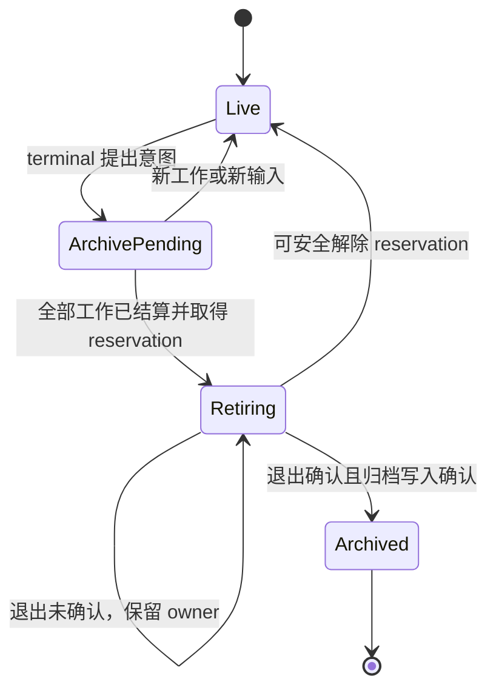

# Octopus 后续修改实施 Spec

版本：1.2 · 2026-10-20（Asia/Shanghai，Wiki 连续使用与效率补审）\
适用基线：`Danuvius152/Octopus@5d99de373921affd27fe307e5770ea397d4f04d6`\
关联报告：[octopus_code_review_20261020.md](octopus_code_review_20261020.md)\
性质：后续实施合同与验收标准；本文描述的新增字段、接口、状态和 prompt 协议均为**拟议设计**，尚未实现。现有能力与新要求在各节明确区分。

本次补充只涉及 Wiki 新发现 CR-17～CR-20 及 CR-12 新增的 App 布尔参数反例：来源保全、移动后的身份/恢复、标题锚点、分块成本与入口一致性；没有扩大其他领域的实施范围。[行为复现](wiki_additional_repros_20261020.py)、[效率复现](wiki_efficiency_repros_20261020.py) 与 [App 参数复现](wiki_adapter_repros_20261020.py) 是审查证据，尚未修复。连续使用和成本实测见关联报告 §5.4、§6.6。

[结构化审查证据](wiki_usage_evidence_20261020.json) 保留本次实际结果及覆盖边界，不作为后续源码修复完成或发布门禁通过的凭据。

本机 P1 的逐项实施取舍见[范围与设计访谈](../plans/p1-remediation-20261020.md)；下文保留完整拟议合同，不将用户明确排除的项目视为本轮已承诺实施。

## 1. 目标、范围与实现原则

### 1.1 目标

在保留当前模块化单体、现有 provider 支持和 Wiki 原文保全机制的前提下，完成以下可验收结果：

1. 禁用账户后所有派生 API 能力立即拒绝新调用，诊断日志不输出凭证和私有 prompt。
2. 被接纳的输入有持久化且可解释的执行状态；一次性计划任务不会在未接纳时静默消失。
3. 临时会话能等待其异步结果，并在最后一步结算后连同 backend 一起可靠退役。
4. Wiki 首次 live read 提供一致版本；读取未改变文件不产生维护失效；无关坏文档不阻断健康目标；历史恢复验证实际字节及身份归属；省略来源时保持有效依赖；同一身份移动后可正确结算；锚点与主格式解析保持一致；分块定位消除每块从头扫描分节，no_change 不计算无用块坐标。
5. 主 API/App/MCP 的 Wiki 操作语义一致，任务卡能从短暂网络失败恢复，并提供实际处理入口。
6. prompt 仅描述真正可用的能力，指南按需复用，实际开销可测量，超长 persona 在执行前得到清楚反馈。

### 1.2 本轮不扩大的范围

继续使用当前 FastAPI/React/SQLite/Markdown/CLI 架构。不在本轮引入微服务、分布式队列、默认 embedding/vector DB 或通用 agent framework。当前可信本机执行模型保持明确，不宣称通过本轮修复获得不可信多租户 OS 隔离。

外部阅读器的“对选中文本提问”、第二个 Wiki adapter 和多进程部署属于后续独立集成；本 spec 为它们留清楚的数据合同，不把它们混入 20 项缺陷的完成标准。

### 1.3 规范用语

- **必须**：该工作包验收门槛，不能仅以 prompt 建议或“通常如此”实现。
- **建议**：有明确价值，但应结合实际观测决定实现深度。
- 文中的字段名是推荐的稳定语义；若现有 schema 已有等价表达，应扩展复用，并在 PR 中说明映射，不另建重复账本。
- 外部副作用不能凭网络 receipt 获得普遍的 exactly-once 保证。本 spec 要求可证明的 admission 幂等、明确的未知执行状态和安全恢复。

### 1.4 问题到工作包的映射

| 工作包 | 主题 | 关联报告 ID |
|---|---|---|
| WP-A | 身份、日志、代理边界 | CR-01、CR-02、CR-13 |
| WP-B | work/session/backend 统一退役 | CR-04、CR-05、CR-06 |
| WP-C | durable request 与 schedule fire | CR-03、CR-07 |
| WP-D | Wiki 事务、失效、健康度、来源保全、身份恢复、锚点、分块成本 | CR-08、CR-09、CR-10、CR-11、CR-17、CR-18、CR-19、CR-20 |
| WP-E | Wiki adapter 与人类处理闭环 | CR-12、CR-14 |
| WP-F | Prompt 能力装配、预算与指南效率 | CR-15、CR-16，另含性能建议 |

## 2. 必须持续成立的系统不变量

| 编号 | 不变量 | 主要 owner |
|---|---|---|
| I-01 | 新 API 调用的 owner 当前可用，历史有效签名不等于当前授权 | 身份服务/各 adapter |
| I-02 | accepted 只表示一次持久 admission；执行进展与终态另有可查询事实 | request repository |
| I-03 | 不因 waiter 取消、缺少 terminal 或用户重连而盲目重复执行 | dispatcher |
| I-04 | 尚有受管 continuation 或待投递结果时，自动归档不能关闭父请求链 | lifecycle + work owner |
| I-05 | 后端退出未确认时，资源 owner 不能从管理集合消失 | lifecycle + process owner |
| I-06 | 一份 Wiki read 的正文、revision、坐标、来源关系与 epoch 来自一致版本 | Wiki transaction owner |
| I-07 | 检查时间/未变化读取不产生语义失效；真实证据变化仍使相应结果失效 | Wiki index/maintenance |
| I-08 | 全库身份安全错误与单文档内容错误有不同影响范围 | Wiki health projection |
| I-09 | 每次写入仍检查当前身份、授权、revision 和保全要求 | Wiki write boundary |
| I-10 | 写入恢复前验证对象实际字节；保存成功与索引成功分别记录 | history/job owner |
| I-11 | 状态通知可以丢失/合并，客户端仍能恢复到权威快照 | API/WS/frontend |
| I-12 | 文本缓存与读取声明不产生授权；不可用工具不由 prompt 创造 | prompt/guide assembly |
| I-13 | 省略 sources 保留有效来源及身份/版本证明，新增关联不隐式清除原生来源 | Wiki curation/source bindings |
| I-14 | 移动只改变当前定位；候选前像、回执和结算始终属于原稳定身份 | Wiki job/history owner |
| I-15 | 标题锚点和来源章节使用与正文结构一致的解析及原坐标 | Wiki format/reference owner |
| I-16 | raw block 匹配不逐块从头扫分节；no_change 只承担必要核验和回执成本 | Wiki raw/revision owner |

当前实现已满足部分不变量的多数路径；实施重点是修复入口不一致，保留已有单次结算、读写核验与 shutdown ownership。[当前结算流程][S-SETTLE] [当前 DB 核验][S-DB-VERIFY] [Wiki 写入][S-HISTORY-WRITE]

## 3. WP-A：统一 owner 撤权与诊断边界

### 3.1 当前缺口与目标文件

涉及 `server/users.py`、`server/mcp_identity.py`、`server/deps.py`、`server/routers/auth.py`、`server/routers/applications.py`、`server/applications.py`、`server/app_backends.py`、相应 DB migration、`server/harness/run.py` 及两个 provider profile。

当前账户禁用只撤销账户 token，MCP/App 验证不检查当前 owner；启动日志直接输出 argv；App query 被完整转发。[禁用][S-DISABLE] [MCP][S-MCP-AUTH] [App][S-APP-AUTH] [日志][S-SPAWN-LOG] [proxy][S-APP-PROXY]

账户禁用已有网页入口：左下账户菜单 → Account → People，仅管理员可见；其他账户行末提供 Disable account / Enable account 图标按钮，自己的账户行不显示按钮。因此只有一个账户时没有可禁用的目标，普通账户也看不到 People 区域。[账户菜单](../../web/src/components/SidebarAccount.tsx) [账户页](../../web/src/components/AccountPage.tsx)

对应接口为 `POST /api/auth/users/{user_id}/disabled`，请求体为 `{"disabled": true}` 或 `{"disabled": false}`，后端同样要求管理员且禁止操作自己的账户。CR-01 已确认的问题是现有禁用操作未完整撤销 MCP/App 派生能力。[管理接口](../../server/routers/auth.py)

### 3.2 身份与撤权合同

新增或统一一个“已验证调用者→当前 owner 状态”的边界。顺序必须是：

1. 验证凭证类型、签名/数据库 token、目标范围与身份 era。
2. 对 App token 从已验证 app_id 查询真实 owner；不得采信请求 body/query 自报 owner。
3. 对有账户 owner 的调用检查账户存在且未禁用；继续检查 scope/work/run lease/当前对象权限。
4. owner 不存在或禁用时拒绝新调用。错误不得泄露其他账户资源是否存在。

禁用操作以持久 disabled 状态提交作为撤权生效点。生效点之后的新授权检查必须失败；已经通过 admission 并进入执行的操作由生命周期规则结算，不能承诺回滚此前已发生的副作用。

禁用后必须停止该 owner 的新 request、scheduled fire、App backend admission 和 Wiki assignment；撤销相关 run lease，发起受管执行停止/退役。清理失败必须保留 owner 和错误，不能因为关闭账号就清空内存 registry。低层每次调用的当前状态检查必须独立成立，不能仅靠一次清理任务。

重新启用仅允许新登录/新授权，不恢复旧 run lease、旧 active work 或旧派生凭证。采用一份持久化 owner auth_epoch 或等价的不可复活代次：MCP/App 新格式均绑定当前代次，禁用时递增。disabled 状态、epoch 与账户 token 撤销通过受控 DB 事务/串行提交一起生效；之后的清理失败不能回滚撤权。

旧 MCP 存在无 run lease/work 的格式，不能只靠撤销 lease 处理。升级时采用一次受控凭证切换：账户模式的旧无代次 MCP/App token 不再作为普通 API 凭证，由仍合法的受管执行/受控 App 重启重新签发；无账户 legacy 模式继续按其独立 era 检查。不要旋转全局 master key 或触碰 provider 登录来实现单账户撤权。

App supervisor 先确认 owner 当前允许执行且旧 backend 已退出，再解析当前代次、铸造 token 并传给启动环境。`script_env` 接收已解析的值，不在同步辅助函数里暗中做阻塞 DB 查询。代次围绕明确撤权/禁用事件变化，不因普通登录或密码更新无故重启全部 App。保留历史任务供授权用户查看。

若旧 writer 的退役仍未确认，最小实现应拒绝重新启用执行并返回可诊断的暂缓结果，保持 disabled/blocked。可以另行允许身份读取，但不能放行新 agent/App/Wiki writer；HTTP lease 撤销本身不证明本机进程停止。退役确认后才恢复执行和发放新授权。

Legacy 无账户模式继续遵守现有 identity era；建立账户后旧安装 token 不重新获得能力。

### 3.3 日志合同

默认允许记录：

- backend/model、session/request/work/run 标识、attempt、工具 namespace；
- 输入/指令/argv 元素的字节数、退出码、耗时、稳定错误码；
- 经审查的相对位置或抽象工作目录类别。

默认禁止记录原始 argv、prompt、Bearer、cookie、connector secret、完整环境变量、包含认证 query 的 URL。长度和统计足以定位 CR-16；无需为了排查超限记录实际正文。若记录 hash，也不能把低熵秘密摘要当作安全替代。

显式诊断输出使用统一 sanitizer：识别参数值、JSON/TOML 配置、headers、stdio env 和 query，而非只删除某一种 Bearer 文本。各 provider 的敏感 transport 不同，测试分别覆盖。stdout/stderr 的已知敏感回显也经过诊断边界后才进入持久日志；包括无效 JSON/非 object 的 warning 摘要和 DEBUG stderr 旁路。限制针对运行日志，不改写作为会话事实交付的正常模型输出。

### 3.4 Proxy query 合同

使用保留多值的 query 列表，先删除由 Octopus 消费的认证键，再构造 upstream request。至少保留重复业务参数、原顺序、空值、Unicode 和正常 percent decoding/encoding 语义。认证参数名应集中定义；不要在每个代理分支复制过滤集合。

正常 header/cookie 认证继续工作；保留现有端到端业务 header，剥离 hop-by-hop 与 Octopus 消费的 Authorization、Cookie、X-Octopus-App-Token 等认证 header。不要引入未经声明的业务 header 白名单，破坏 App 的自定义接口。

### 3.5 验收

| 用例 | 必须结果 |
|---|---|
| 禁用后用既有账户/MCP/App token 调 API | 均拒绝；其他 owner 不受影响 |
| disable→enable 及 disable→restart→enable 后复用带 lease/无 lease 的旧 MCP 和 App token | 均拒绝；新合法 token 可用 |
| 禁用与正在执行的 write/turn 竞争 | 新 admission 被拒；已发生的执行保持可解释终态/unknown，不伪造撤销；旧退出未确认时重新启用不产生新 writer |
| App_id/owner 不匹配、legacy era 改变 | 无旁路，无跨 owner 信息泄露 |
| 实际 Harness.start + fake process + 合成秘密 | 所有捕获日志均无秘密和私有 prompt；保留必要诊断字段 |
| query 含 token、重复 tag、空值及中文 | upstream 无 token；业务参数多值和顺序正确 |

## 4. WP-B：work、session 与 backend 的生命周期

### 4.1 目标与模块职责

涉及 `sessions/lifecycle.py`、`sessions/turns.py`、`sessions/processes.py`、`sessions/base.py`、`research/manager.py`、`bg_tasks.py`、`delegations.py`、`scheduler.py`。

当前归档直接 pop Session，idle 条件只看本地队列/task；delegate terminal 的归档又早于 driver release。[归档][S-ARCHIVE] [release][S-RELEASE] [held owner][S-PROCESSES] [委派回传][S-DELEGATION-END]

将四个事件明确分开：

| 事件 | 含义 | 不隐含什么 |
|---|---|---|
| request terminal committed | 一次请求已有可核验结算 | 整条异步工作链结束 |
| dispatcher released | 当前 driver 释放其执行槽 | 没有外部结果将返回 |
| work chain settled | 所有受管子工作及其投递已结算 | 所有 backend 已退出 |
| session retired | 归档已提交，资源退出已确认，owner 可移除 | 可以遗忘历史执行事实 |

### 4.2 Work owner 协议

每个 Research/bg/delegation/native child owner 提供窄接口，报告：

- 所属 session、原 request/work identity、round/代次；
- 仍在执行的工作数、尚待投递/确认的 continuation；
- 已完成/失败/取消及原因；
- 生命周期变化通知。

接口可以是本进程不可变 snapshot+revision，不要求新服务或消息队列。lifecycle 不读取其他 manager 私有 dict 并猜测状态。

必须在派发外部 work **之前**注册 owner/返回绑定；直到结果被父请求接纳、被明确抑制并持久说明原因，或取消已结算后才解除 pending delivery。work “内容生成 completed”不等于 delivery 已完成。

新工作注册、归档 reservation 与 admission 使用可验证的协调 revision/门闩，避免预检后插入新 work。任何 await 外部 owner 的动作都不得长期持有 dispatch lock，也不能从 terminal callback 等待尚在调用自己的 driver 退出。pending delivery 只能在父方 durable admission 接管阻挡归档的责任后解除；不得先清除 delivery，再异步尝试入队。

### 4.3 自动归档合同

自动归档必须同时满足：

1. 当前对象与 owner/round 仍匹配归档意图；
2. 无已接纳队列、当前 request、driver、待处理 question/steer 或 recording uncertainty；
3. 无仍持有该会话返回权的外部 work、子委派或待投递结果；
4. 没有更新的 follow-up/admission；
5. 所有 backend retirement 已确认，或可进入有 owner 的 retiring 阶段。

推荐流程：



`Retiring→Live` 只适用于可安全回到服务状态的路径。已经停止的 backend 可在后续新请求中正常重建，不能恢复已撤销旧 lease。资源退出未确认时不得同时允许新 writer。

终态通知只提出归档意图；driver release、最后一个 work/delivery 结算、retirement 完成均触发重新评估。对 delegation 意图绑定 round，旧 round 的 callback 不得归档新 round。Wiki 的独立 origin/receipt 生命周期保持，不强行套用 schedule 特例。

reservation 期间的新 admission 采用明确分支：能安全持久排队时先使旧归档意图失效，再等待旧 backend 退役；否则在 accepted 之前返回“正在退役”的可重试暂缓状态，保留正文与重试身份。暂缓不能固化成该 client ID 永久无法再接纳的最终 receipt。外部回传未接纳时仍由原 delivery owner 持有。无论哪条分支，退出未确认都不允许第二个 writer。

stop/drain 在协调锁外完成；最终提交 archived 及移除 owner 前，重新核验 reservation、对象代次、round 与 admission revision。提交窗口中新 admission 必须得到确定的接纳或暂缓结果。DB 提交不确定时保留 owner 并独立核验，不以盲目写回 archived=false 作补偿。跨重启也不能把内存 registry 为空当成工作链结束：先恢复/隔离已知未知 owner，或明确 interrupted/unknown，再开放相应会话执行。

### 4.4 backend 退役合同

自动/显式归档共享最低资源清理原语，但不共享“无条件取消工作”的业务语义：

- 捕获 backend owner，并将退役任务登记到受管集合；
- 撤销该 run 的调用 lease，停止新 I/O；
- 等待进程组退出及必要 drain；
- 确认退出后移除 backend owner，最后完成 session 归档；
- 超时/错误/取消导致退出不确定时，保留退役任务与 owner，shutdown 能再次观察和处理。

归档 DB 写入失败时不宣称成功；backend 已退出是可恢复事实，Session 可继续处于 live/retiring 并在重试后结算。不得为写回 archived=false 而覆盖同时发生的新一轮状态。

Claude STREAM_JSON 是 CR-05 的实际支持路径；Codex CLOSE_AFTER_SPAWN 仍须通过共用不变量测试，但不把它标成已复现的同类 held leak。

### 4.5 完成与通知

“当前 turn 空闲”和“本次计划工作全部完成”使用不同事件语义/文案。父会话主动取消/关闭后，允许保留报告文件并显示投递被阻止原因，但不重新创建会话绕过用户的停止指令。普通自动归档不能等价于用户取消。

### 4.6 验收矩阵

| 场景 | 必须验证的完整顺序 |
|---|---|
| 定时父会话启动 Research/bg/delegation | 初轮结束保持返回绑定；结果恰好接纳一次；父总结结束后归档 |
| 异步失败/取消/超时 | 原因可见，最终结束，不永久占位 |
| A→B→C 嵌套委派 | C 运行时 B 不归档；B relay 完成并 release 后归档 |
| 正常/失败/取消的 child | 使用真实 start_message/dispatch，terminal-before-release 下最终归档 |
| 新 follow-up 与旧 round callback 竞争 | 旧归档意图不能关闭新请求 |
| held backend 干净结束 | stop/drain 确认后才移除 Session |
| stop 卡住、抛错或退出未确认 | owner 仍被 reaper/shutdown 管理，不报告归档成功 |
| 归档与人类新输入竞争 | 不丢弃已经 accepted 的输入，不出现两个 writer |

只替换 provider 最外层 I/O，保留真实 manager、DB、admission、publication 和 driver release，避免现有局部测试的 mock 顺序漏洞。

## 5. WP-C：持久 admission、执行状态与 schedule fire

### 5.1 当前缺口与目标边界

涉及 `db/client_submissions.py`、`sessions/client_submissions.py`、`sessions/turns.py`、`routers/sessions.py`、前端提交/恢复状态，以及 scheduler/DB migration。

当前 receipt 是首次 admission 的记录，排队正文没有持久存储；shutdown 撤销后相同 client ID 仍只返回旧 receipt。[submission][S-CLIENT-SUBMIT] [现有表][S-CLIENT-DB] [shutdown][S-DRAIN]

### 5.2 请求数据合同

扩展现有 client submission/request identity，推荐保留：

| 字段组 | 内容与要求 |
|---|---|
| 身份 | owner、session_id、client_id、input_request_id、execution_owner_request_id、payload_sha256；原有唯一性继续成立，可多输入对应一个执行 owner |
| admission | 不可变首次 receipt、accepted_at、disposition、service generation |
| 输入 | 完整正文、不可变附件引用/摘要、原始用户意图、捕获的结构化 knowledge contract |
| 执行 | execution_state、state_version、last_proven_phase、reason_code、时间、attempt identity |
| 结果 | 关联既有可核验 terminal/input 记录；不再复制一套 transcript |
| 恢复 | recoverable_input、恢复权限、保留策略与删除状态 |

输入沿用现有会话正文的受控持久存储、owner 访问和删除策略，不另写内容日志、临时导出或重复 transcript。现有 owner DEK 主要保护凭证/connector secret，不能将其描述成当前全消息加密保证；本轮不为请求恢复引入未定义的新密钥格式。[当前密钥用途][S-CRYPTO]附件在请求仍可恢复时不得被临时文件清理提前删除；恢复前核对存在性、类型、hash 和当前访问权。捕获的 contract 是历史执行意图，不是永久授权，不能恢复过期 grant。

**accepted 返回之前，输入和 admission identity 必须完成持久化并可独立核验。** 若保存不确定，不返回确定 accepted；按既有 recording uncertainty 保留责任与稳定身份供核验。入队与持久状态在一致的 admission 边界完成，避免 DB 已 accepted 但内存未排队的窗口无法解释。

### 5.3 状态机与重启语义

建议使用下表的 execution_state，与不可变 admission 并列；可用现有等价状态映射。

| execution_state | 可证明含义 | 重启后的处理 |
|---|---|---|
| queued | 已持久接纳，未被 dispatcher claim | 本轮默认不自动恢复执行；记 withdrawn/service_restart_before_start 并可恢复正文 |
| claimed | 已取得执行权，后续阶段尚未完全证明 | 依据持久 phase 核验；无法证明未执行则 unknown |
| running | backend attempt 已开始或有已提交执行证据 | 核验已知终态/副作用；无终态不得自动重放 |
| succeeded / failed / cancelled | 对应 terminal 已提交并核验 | 返回原终态，不重复执行 |
| withdrawn | 可证明在执行前撤销 | 提供恢复到 composer/重新提交入口 |
| unknown | 是否执行或是否结算不可证明 | 展示原因、保留证据、禁止自动重放 |

`last_proven_phase` 至少区分 input committed、claim、spawn intent/ack、terminal committed；记录事实必须在相应边界落盘。仅因“没有 spawn ack”不能证明子进程没有启动，除非有额外 fencing/退出证据。

`queued→claimed` 必须持久 CAS 提交并独立核验后，才打开 executor gate、向 held backend 提交输入或进行 inline steer。claim 失败/不确定时不得继续 I/O；因此 queued 才能证明尚未进入执行入口。terminal 记录是终态权威，execution 投影更新失败由恢复修复，不重新执行。验收覆盖 claim 已提交但未 I/O、I/O 已发出但 ack 未落盘、terminal 已提交但投影未更新三个窗口。

steer 使用单独 input identity，持久关联实际 execution owner、attempt、顺序和输入 intent/ack。其终态通过承载请求映射，不能等待不存在的独立 terminal，也不能因重启自动变成新 turn。承载请求完成并不证明模型逐条满足了所有 steer 意图；输入是否写入不确定时仍为 unknown。测试成功 steer、窗口关闭后回队、写前取消、写后 ack 丢失与共享终态恢复。[当前共享终态语义][S-STEER-OWNER]

优雅 shutdown 先关闭 admission，再把未 claim 队列持久结算为 withdrawn-before-start；不能只 resolve 内存 future。硬重启根据持久阶段保守分类。已有项目选择不自动恢复队列，本 spec 保留该默认，补齐状态和用户恢复能力。

### 5.4 状态 API 与 UI

扩展当前 `GET /api/sessions/{session_id}/submissions/{client_id}`，保留旧 receipt 字段，新增 execution 对象。[当前状态接口][S-SUBMISSION-API]下例仅示范语义：

```json
{
  "accepted": true,
  "request_id": "req-example",
  "execution": {
    "state": "withdrawn",
    "state_version": 3,
    "reason_code": "service_shutdown_before_start",
    "last_proven_phase": "admitted",
    "recoverable_input": true
  }
}
```

状态查询必须读取最新 execution/terminal，不能命中首次 receipt 就短路。相同 client ID、相同 payload 的重试返回同一次 admission+最新状态；相同 ID 不同 payload 按现有冲突语义拒绝。

恢复正文是读操作，放回 composer 后由用户重新发送产生新的 client ID/request identity，并链接原 request。不得把“查询状态”“点击刷新”变成自动重跑。源自 schedule/系统投递的恢复遵循其专属 fire identity 与当前授权，不能借用人类重试语义。

UI 分别表达“已接纳/排队”“执行中”“未执行即撤销，可恢复”“执行结果未知”“已完成”。unknown 不给出误导性的无条件“再试一次”；先显示可核验的执行记录和风险相关事实。

### 5.5 schedule definition 与 fire 分离

新增或扩展持久 fire 记录，最小字段：

- `schedule_id`、定义 revision、due_at UTC、稳定 fire_key；
- owner/原 session/结构化 knowledge contract；
- phase：pending、deferred、admitted、skipped、settled、unknown；
- request_id、admission receipt、终态关联、原因、下一次尝试时间。

唯一键建议基于 schedule_id + 执行语义 generation + due_at；使用一个逻辑到期时刻，而非重试时间制造新 key。纯名称等展示修改不产生新执行机会。与 WP-C request identity 关联，不复制第二套执行终态。

任何 admission 前先持久创建/核验 fire，并绑定实际 target_session_id 与稳定 input/request identity。fresh schedule session 也复用该身份，不在重试时新建第二个会话。fire/request 关联通过同一事务或可独立核验的写前协议完成；恢复先查已绑定 request 的 admission/terminal，pending/deferred 投影不能证明从未接纳。未知窗口保留 unknown。

默认策略：

1. 人类 backlog 保持原顺序；新的 fire 可排其后，不与同一 fire 重复混淆。
2. 容量/短暂 admission 关闭导致无法排队时，持久 deferred，按既有调度服务恢复；不直接删除 one-shot。
3. one-shot durable admission 后停止再次触发，但保留定义/运行记录至可见终态或用户明确删除。
4. 明确截止时间/取消/owner 不可用时可 skipped，必须留原因；到期政策成为显式配置，不伪装成 overlap。
5. 服务错过到期时刻时按记录的 misfire policy 处理。迁移前已过去且无法核验的旧 occurrence 默认记录 legacy_unknown/missed、不补跑；未来 occurrence 按当前定义继续。当前旧 bug 已删除且没有历史的数据不可承诺恢复。
6. fire 已 admitted 或 execution unknown 时，不因 scheduler restart 自动发第二个请求。admitted 后因停机 withdrawn 的 fire 展示“已接纳但未执行即撤销”，不能退回 deferred 自动重发；再次执行使用显式新执行意图并关联原记录。

定义替换/禁用使旧未接纳 fire 变为 skipped/superseded，保留原因；旧 callback 在创建/准入前核验语义 generation。已接纳 fire 保留原捕获定义，编辑不会隐式取消或重新执行它。切换新 ledger 时先暂停旧调度 admission，接管可核验活动记录后启用新触发。

若 settled 在产品中表示本次计划工作完成，必须来自 WP-B 的 work-chain-settled，覆盖子任务、投递和父方后续处理。初轮 request terminal 仅是中间事实，不足以提前通知全部完成。

### 5.6 迁移与验收

旧 submission 没有完整正文时，不可补造。可关联既有 transcript/terminal 得到可核验结果；无法确定的旧记录标记 legacy_unknown，recoverable_input=false，并说明历史数据不足。没有终态不等于从未执行。

新增字段/表采用可重复运行 migration，保留旧 receipt 和唯一键。默认添加字段兼容旧客户端；启用新版 UI 前，服务器必须提供当前 execution 状态。回退应用代码时不得让旧 dispatcher 重新消费新 ledger 中的 unknown 请求；记录最低兼容版本。

必须覆盖：admission 前后中断、claim 前后中断、spawn 窗口、terminal 提交不确定、优雅关闭、重复 client ID、附件过期、旧数据迁移、human backlog、同 fire 重试、不同 schedule 同时到期、定义修改与旧 callback 竞争、misfire/skip 的可见记录。

## 6. WP-D：Wiki 一致性、失效、健康度与历史恢复

### 6.1 事务归属：首次 live read 就一致

目标文件：`wiki/store.py`、catalog/dependency/source projection、`index_state.py` 及相关读取 adapter。当前 read 的 _index 与 public/index_state helper 使用不同连接。[当前 read][S-READ] [public][S-PUBLIC] [state][S-STORE-STATE]

首选方案：

1. 对需要同步的 read 保留当前同步/锁语义；
2. 用同一 db transaction 完成 _index、文档/来源关系读取、managed metadata 与 epoch 投影；
3. 将 public/projection helper 改为显式接受 db 或预取数据，不在内部另开连接；
4. 构造与该事务一致的 response，事务提交成功后才返回；
5. 提交不确定时不返回宣称已成功同步的新 epoch，保留原有可恢复状态。

响应必须保证：

- 返回正文确实对应返回的 revision，start/end/next_start 指向该份正文；
- consumer 的 sources/source_refs、doc identity/path、索引 epoch 对应同一 DB 版本；
- 来源文件的实时 hash 检查保留其真实观察值和状态；
- 不能把多个未协作的外部文件描述成同一瞬间冻结的文件系统快照。外部编辑持续发生时，按 revision/CAS 重读或报告冲突，不承诺超出锁和 DB 能力的原子性。

若采用“先提交索引→再读一致快照”的两阶段方案，必须说明锁范围、revision 二次核验和并发写入窗口；不可继续在任意 helper 隐式开连接。

验收：vault 外 hardlink 修改 consumer sources A→B，**首次** read 即返回 B；再覆盖 source rename/delete、metadata 变化、read_many 中同文档区间、并发编辑和 commit 失败。不以“第二次读就好了”通过验收。

### 6.2 维护失效只能由语义变化驱动

目标文件：`store.py`、`maintenance_inputs.py`、`maintenance_view.py`、`maintenance_state.py`。当前 no-op UPDATE 与无条件 trigger 会让读取改变 generation。[fast path][S-INDEX-FAST] [trigger][S-TRIGGERS]

明确输入分类：

| 变化 | 是否应使维护语义失效 |
|---|---|
| 同 signature/同 revision 的 read/read_many | 否 |
| checked_at、扫描检查时间、无内容变化的 filesystem signature | 否 |
| 文档字节/revision、身份、有效路径变化 | 是，按现有维护语义 |
| 影响用途/候选的 metadata、quality/kind | 是 |
| 直接来源 identity/revision/status 改变 | 是，影响相应依赖者 |
| job receipt、恢复/结算状态改变 | 是，影响对应候选/任务状态 |
| DELETE、REPLACE、move、路径重用 | 必须保留正确失效，不因优化遗漏 |

实现先做最小正确收敛：避免 no-op UPDATE，trigger 用 UPDATE OF 和 WHEN 比较实际值（含 NULL 语义），分离 housekeeping 与语义 generation。保留 INSERT/DELETE/REPLACE 的保护。不要首轮就引入多级目录 epoch 或跨请求结果缓存。

现有 cursor 遇真实语义变化仍可返回 stale_cursor；变化检测不能以固定 TTL 替代。冻结 selection 的身份/版本绑定保持，读取某篇不再无故使候选分页作废。

验收：取第一页→读取同目录/无关目录未变化笔记→连续 refresh→下一页，generation、dirty work 与结果保持；真实编辑/来源变化/receipt 更新仍使适当结果失效。必须同时测“不该失效”和“必须失效”，不能只删 trigger。

### 6.3 分层健康度与 scoped maintenance

目标文件：`index_state.py`、`maintenance_projection.py`、`maintenance_state.py`、`maintenance_view.py`、`maintenance_selections.py` 及 checked maintenance admission。

推荐把状态拆为：

- `vault_safety`：身份冲突、未决 rename/recovery、journal 不完整、协议不兼容等全局不可信状态。
- `content_health`：单文档 extraction/frontmatter/格式错误及其已知作用域。
- `scope_readiness`：指定目标及直接证据依赖能否完成本次操作。

全局安全错误必须阻止写入；content error 只阻止受影响目标与必要依赖。错误作用域无法确定时维持保守屏障并给明确原因，不能简单忽略。

maintenance_status 的后续响应增加明确的 scope 信息、eligible/excluded counts 和有界错误样本。混合目录可以处于 partial，但只要 vault 安全且存在健康候选，就必须允许选择健康子集；不能用目录 ready=false 再次封锁全部结果。新增 can_select 或等价明确字段，旧 ready 的兼容映射写进契约；exact doc 与实际 selected IDs 的准入只判断其必要范围。`total=null` 仅表示无法可靠计算，不用于隐藏可用候选。返回健康候选不等于授予 write grant，准入时仍重查当前健康度与 revision。

这项改动须贯通 status→selection 分页→review observation→checked 提交→worker 准入，覆盖现有 maintenance_selections 的全局 gate。仅让列表显示正常文档、随后仍全局拒绝选择，不算修复完成。

错误必须可操作：告诉用户哪份文档解析失败、健康项目是否能继续，支持只查看异常。默认 asset 排除继续生效；PDF 等已排除类型不被本轮偷偷扩大为维护对象。

验收至少覆盖：

- 坏 tmp asset/无关 Other note + 健康 Library：健康目标可见且可准入；
- 目标本身坏：该目标被排除，并有错误；
- 直接证据源坏/缺失/变化：按当前来源规则阻止或要求复核，不当成无关错误；
- 身份/journal/recovery 不确定：所有相关写入保持拒绝；
- 错误修复与新增错误竞争：准入前复查，cursor/selection 不把旧健康快照当授权。

### 6.4 历史对象完整性与恢复

目标文件：`history.py` 的 blob 创建/复用、普通 restore、snapshot restore、recoverable projection。

新增共用 `read_verified_blob(expected_digest)`：

1. 验证对象路径/类型属于允许的历史对象空间；
2. 读取一次实际 bytes，计算当前 revision/hash；
3. 与 expected digest 不一致即返回稳定 `history_blob_corrupt` 错误；返回已验证的 bytes，恢复必须写入这同一份内容，不能验证后按路径重开并使用另一份未验证字节；
4. 普通/snapshot restore 必须在改动 live file、身份、授权或来源状态之前完成所需对象验证；
5. 已存在同名对象的复用也必须验证；失败保留证据，不静默覆盖或信任它。

全量 snapshot restore 应先验证计划涉及的全部必要对象及当前冲突条件，再进入现有 journal/recovery 写入流程，避免验证到后半才发现坏 blob；不能凭此宣称多文件写入在 OS 上天然原子。多对象若需要分阶段存放，实际送入写入边界的 buffer 仍按 expected digest 验证，不能把第一次检查当作之后任意读取的证明。保留原有未决恢复、来源身份、CAS 和 journal 约束，以及当前 snapshot 创建可用性限制；这项修复不重新启用已停用的创建入口。

历史列表提供 `object_available` 与 `integrity=unknown|verified|corrupt` 或等价区别，不要求每次列表读取所有 blob。已保存 verified 只代表上次观察，可附 verified_at，实际写入前仍重新核验所用 bytes。若沿用 recoverable 字段，明确其是否“可尝试恢复”，实际校验不可省略。

验收：损坏/截断/路径替换 blob 被拒且现文件保持；合法 blob 成功；删除的 None 侧仍正常；同名坏对象复用失败；恢复中断沿原 journal 安全继续。没有断电实验时，不能把这些用例写成 power-loss durability 证明。

### 6.5 不可回退的 Wiki 约束

以下能力不能为简化实现而删除：

- 稳定 doc identity、历史 alias/tombstone、source binding；
- 原材料字节保全与真实操作证明；
- 当前 assignment、registration generation、确切路径/身份授权；
- current revision CAS、raw block 坐标与真实读取范围；
- 终稿新增/修改区段的冷读覆盖；
- 保存、索引、结算的不同阶段；
- 重建派生索引时保留身份/任务/历史账本。

`index.sqlite3` 的备份应包含文件、历史对象与非派生表的一致性说明。只对确认可重建表执行 rebuild；本轮不通过拆数据库绕开事务归属问题。[当前 rebuild][S-REBUILD]

### 6.6 省略来源与新增关联必须在所有写入入口保持一致（CR-17）

目标文件：`curation.py`、`normalize.py`、`operations.py`、`source_bindings.py` 及来源保全回归。当前普通 organize 只继承 managed sources，新增关联时会用其覆盖原生 YAML 来源；normalize 已有保留有效 sources 再追加的正常路径。[错误继承][S-ORGANIZE-SOURCE-INHERIT] [覆盖点][S-ORGANIZE-SOURCE-SHADOW] [正常路径][S-NORMALIZE-SOURCE-MERGE]

在现有写入边界统一三个语义：

| 输入 | 必须产生的来源行为 |
|---|---|
| sources 省略/null | 保留当前有效来源及其原有 doc/revision/location/绑定证明 |
| sources 显式空列表 | 按现有明确替换合同处理；不能与省略混为一谈 |
| sources 显式非空 | 校验本次明确提供的引用，按操作合同替换/确认 |
| 在以上任一情形新增 relations | 追加这次已核验的关联来源；不额外授予对来源正文的写权 |

不能只保留原生 YAML 字节，却以 managed metadata 遮蔽旧来源。保留引用也不能调用“确认当前来源”的流程，暗中换 revision、重新绑定同路径文件或把旧/缺失来源变成已核验。沿用已有 typed reference、来源证明和显式替换合同；不要用简单字符串路径或 dict 去重抹掉版本、位置及独立出现记录。

验收覆盖普通 organize 与带 frontmatter_patch 的 normalize，原生/managed/混合来源、追加关联、显式空列表、来源移动/删除/变化。原生来源 A+新增关联 B 后，两者都在有效依赖中；随后 A 的真实变化仍触发相应过期提示和维护观察。继承旧引用不自动刷新其证据版本。

### 6.7 移动后的重读、前像和发布恢复必须跟随稳定身份（CR-18）

目标文件：`jobs.py:reread/recover_publication/resolve_conflicts`、`history.py` 的候选记录边界及恢复资格，必要的 item/receipt 投影。当前 reread 从 doc_id 读 A、用旧 item.path 写候选，旧位置被 B 占用时会把 A 的 blob 作为 B 的历史前像；同一移动也会造成已成功写入的错误结算。[重读记录][S-JOB-REREAD] [历史身份推断][S-HISTORY-IDENTITY] [发布恢复][S-PUBLICATION-RECOVERY]

必须保持：

1. 原入队路径作为历史事实保留。每次实际读取、记录候选、索引和输出展示都通过已捕获的稳定 doc_id 取得当前路径，不能以旧路径的当前占用者替代它。
2. reread 的字节、实际 revision、path 和 document_id 属于同一次当前读取及其验证边界；候选明确绑定该身份。若读取后身份/内容又变，拒绝或保留可解释冲突，不制造另一文档的恢复前像。proposal 里“原请求期待的版本”和“实际前像版本”保持区分。
3. publication recovery 优先以已记录 output_doc 定位输出，并核对输出 revision、applied marker、当前索引及必要来源状态。输入 doc_id 与输出 doc_id 相同就是原位结果；单纯路径变化不能触发对同一已写入身份的旧 input revision 检查。
4. 只有独立输出身份的场景，才分别核验原输入与输出。不能以修复移动为由删掉 CR-08 的 blob 核验，或放过真正的身份替换、后续人工编辑、未知执行及当前 registration/grant 失效。
5. 关联 conflict 的查找与解决也须按原 job/item/doc 核对，不能因旧路径复用而处理 B 的冲突或漏掉 A 的冲突。当前路径是定位信息，不是额外写权。

已产生的错误前像不能因其 SHA 正确就继续标为可信恢复版本。实现须能依据原 job/item 的 candidate_changes 与文档身份关系识别确定错绑的候选，保留原证据并阻止直接恢复；不能批量改写历史 document_id、删除整份账本或自动改动用户正文。无法确定的历史情况应给出具体人工复核入口。

验收至少包含：提交后移动再写、写后移动再结算、移动后旧路径被另一身份占用、移动后版本变化触发 reread、同路径同字节的新身份替换、独立输出与原输入分别变化。恢复错误候选不得覆盖 B；合法 A 的输入/输出身份、revision 和索引均保持时，最终结算为 done，并显示当前路径，不再调用模型重写成功成果。

### 6.8 标题、章节定位和锚点必须共用正文结构（CR-19）

目标文件：`links.py`、`format.py`、`resolver.py`、`curation.py` 的引用校验及 `tasks.py` 的来源定位。当前 CommonMark 主解析与手工标题扫描不一致，既拒绝 Setext 标题，也会误把代码中的标题当成有效锚点。[主解析][S-FORMAT-HEADINGS] [手工解析][S-LINK-HEADINGS] [实际写入校验][S-LINK-VALIDATION]

从同一份当前解析投影实际标题及其章节范围，保持原文字符坐标、层级、同名标题的 slug 规则和现有 HTML 显式锚点语义。anchor_exists、source_span 与引用校验对同一标题必须给出一致结论；这不意味着把 HTML/TXT 扩大为 Markdown 维护对象。可复用当前操作的解析，不建立跨版本 tokens 缓存，也不靠跳过校验消除误拒绝。

验收包括 ATX、Setext、正常代码围栏、围栏内带非空尾部的反引号行、缩进代码、BOM/CRLF、嵌套/重复标题及中文标题。当前最小反例必须同时锁住两个方向：`Topic\n=====\n` 可被新链接引用；代码块里的 `# Fake` 不得让不存在的 `#fake` 链接通过 publish。来源章节定位应遵循同样的标题结构及章节覆盖要求，不能用链接导航证明实际已读。

### 6.9 分块定位与无需修改确认的成本必须有界（CR-20）

目标文件：`raw_blocks.py`、`revise.py`，必要时增加当前版本的不可变坐标投影。当前 loader 为每块从头扫描全部分节，分页在全部块装配后才切片；no_change 在分支前也构建完整块表。[当前 loader][S-RAW-BLOCKS] [当前分支][S-REVISE-NO-CHANGE]

必须满足：

1. 同一份当前解析内，以有序区间游标或边界索引关联块与分节，消除 O(B×S) 的逐块重扫。空白、frontmatter、BOM/CRLF、代码例子、嵌套标题、块头跨分节等情形保持原始坐标与 locator 合同；未落入正文分节的 metadata 不冒用正文角色。
2. no_change 在完成必要的当前身份、文件类型/编码、字节/revision、assignment/grant 和已读覆盖核验后，直接记录真实持久回执。它不需要 raw block/hash/locator 表，也不写正文或生成额外模型 turn。保留当前 registration、attempt、错误与并发修改拒绝。
3. 分页或反复读取同一 revision 的成本单列观测。复用解析时只持有不可变版本数据并设内存边界；每次调用仍核当前身份、revision 和授权。不得跨 revision 混用坐标、缓存可变 Markdown tokens，或用授权缓存替代实时检查。
4. 保留正文页完整拼接、重复/缺页防护、预算、raw start/offset、局部 patch 与 restructure 的读取证明及保全检查；小预算不能变成漏读或放宽写权限。

验收至少包括 100/400/1,000 个小节、相同块分布的单页与完整分页，独立记录解析次数、块/分节考察及源文件读取；另测 no_change。先证明不再按 B×S 重复遍历，再比较端到端耗时。基线 1,000 小节/84,805 字节的 101 页累计考察 101,303,101 个候选，不得只用“返回内容仍正确”通过验收。不同实现可以调整内部数据结构与计数方法，必须解释实际成本增长。

新增四项的最小可执行证据见 [行为回归](wiki_additional_repros_20261020.py) 与 [效率回归](wiki_efficiency_repros_20261020.py)。失败描述待修复行为；实施须将对应断言转绿，并补足身份替换、来源保留、格式和规模边界。效率回归的候选遍历预算用于拦截已证实的重扫算法，不是生产延迟 SLA。

## 7. WP-E：Wiki adapter 与任务的可操作恢复

### 7.1 App 路由修复与业务边界

目标文件：`routers/wiki.py`、Wiki job service/contracts、App adapter、相关前端 API。

先修 path/query/body 独立解析，保证 `POST /apps/{app_id}/wiki/jobs/{job_id}/cancel|retry` 始终传入 job_id 与 JobControlRequest。不要通过默认 job_id、吞 TypeError 或允许任意 kwargs 隐藏错误。[当前 adapter][S-APP-WIKI]

随后将 cancel/retry/readmit/get/list 等业务调用抽成窄服务，接受已验证 actor context 与类型化参数；主 HTTP、App HTTP、MCP 只做 transport 转换。返回同一 domain result，adapter 映射错误码。业务服务不依赖 FastAPI Request，也不直接调用另一个 HTTP handler。

查询参数也必须复用同一类型验证与默认值。当前 App 对 search/documents 的 include_assets 只比较字符串 true，主 API 接受的 1/yes 却被 App 误当 false，非法值又被当作正常请求。合法布尔输入须产生相同筛选结果，非法输入一致拒绝 422；保持重名参数和范围、Literal 等合同，不以绕开 FastAPI 后的偶然 Python 转换定义另一套接口。[新增失败与正常对照](wiki_adapter_repros_20261020.py)

权限并非所有入口相同：账户 owner、App scoped caller、MCP live scope 保留不同可用操作。共享服务通过明确 ActorContext 表达差异，不能为了路由 parity 将 owner-only readmit 开放给普通 App/MCP。重复请求、expected_attempt、expected_vault_id 和原任务绑定保持。

| 测试维度 | 必须覆盖 |
|---|---|
| 路径 | 主 API 与 App API 的 get/cancel/retry；支持的 MCP 对应调用 |
| 参数 | 正确 job_id；缺 body 默认行为；坏 JSON；非法字段/attempt；URL 编码；合法/非法布尔与数值范围、Literal |
| 状态 | 可取消、已结束、已保存但索引失败、attempt 已变化、结算未确认 |
| 权限 | 正确 owner；他人；禁用 owner；旧 registration；旧 lease |
| 结果 | 原有正常响应；4xx 域错误一致；不得出现参数分派 TypeError 500 |
| assets 查询 | true/false 正常对照；1/yes 与主 API 同义；非法布尔为 422；显式包含 assets 不得静默丢失目标 |

CR-12 的局部修复可以先行合入，但对应回归必须调用真实 route，不能只断言 handler 单独可执行。

### 7.2 Wiki 状态同步协议

当前卡片已有 per-job state_version、attempt，以及账户/service generation 防串写；保留这套边界。[现有客户端][S-WIKI-JOBS-CLIENT] [现有 WS][S-WS]

新增同步状态，不把网络刷新失败当作 job 本身失败：

- 以 account/session/service-generation 为 scope，按 (vault_id, job_id) 保留已知目标 version；
- 无 version 的旧通知仍标 dirty，并保留本地 invalidation 序号；
- 接收事件先记录目标，再开始单一 in-flight fetch；
- 失败保留 dirty，进入有界退避；fetch 成功只有覆盖了本次观察到的目标才能清除；
- fetch 期间又有通知，则合并到新目标，完成后必要时再取一次。

分页列表仅返回部分 job，**不能用“列表请求 200”证明所有目标均已同步**。新增授权单卡片快照，建议 `GET /api/sessions/{session_id}/wiki-jobs/{vault_id}/{job_id}`，从主 DB 的持久通知读取该 session/owner 的 JobCard；其坐标与 WS 事件一致，可覆盖历史 vault。若采用集合 watermark，也必须由服务端明确完整性语义和合法删除/tombstone。

当前 `/api/wiki/jobs/{job_id}` 查询当前注册 vault 并返回 job detail，并非上述持久 JobCard；不得用它的 404 推断历史卡片已删除。旧 vault 已解绑时仍可显示合法持久卡片，完整材料/正文/控制操作则按当前可访问资源判断，清楚显示不可用原因。仅明确的授权撤销/删除语义才能清理卡片，不永久重试不存在对象。

推荐默认退避为 1、2、4、8、16 秒，加入小幅 jitter，最多 5 次自动尝试；这是拟议产品默认，可用实际网络数据调整。预算耗尽后保留“状态暂未同步”和“重试”；重连、重新激活会话、用户重试均可开启新一轮同步。后台隐藏页可以推迟恢复，返回活动页时立即核对。

401/403 等权限变化不做无意义重试，应清理相应授权状态；429 尊重 Retry-After；5xx/临时网络错误适用退避。旧 token/generation、已卸载 scope 的 timer/fetch 返回全部丢弃并清理。

**只重试读快照。** 不能因 cancel/retry 的响应或后续刷新丢失而自动重发 mutation，不能创建新的模型 turn。取消/重试已成功但刷新失败时，应表达“操作已提交，状态尚未同步”；POST 本身响应未知时则表达“操作结果待确认”，先取状态核验，不声称已成功也不自动重发。

### 7.3 任务详情与输出入口

在现有 WikiJobCards 增加“查看详情”和可打开的输出。用户可查看：

- job 阶段、当前 attempt、实际提交/保存/索引/结算状态；
- 已完成、需处理、失败与未完成项目；
- 未截断错误和有界分页的完整输出；
- 文档身份、当前路径、该次输出 revision 与当前 revision 的关系；
- “无需修改”及其真实审阅原因。

正常界面使用清楚的业务文案，内部 ID/digest/cursor 留给展开的诊断区域。当前 full job 并不提供完整输出分页；需新增有界详情投影或分页接口，保留 MCP compact/export 及字节预算，不能让共享服务把全量证据默认灌入所有 transport。过长证据导出为文件并校验来源元信息，不把大 JSON 塞进聊天/argv。

区分“打开当前文档”与“查看当次输出”。当前 read 的 expected_revision 是当前版本检查，不是历史版本选择器；当次正文需要已有合法历史读取能力或独立有界 read-only 接口。历史对象缺失时说明不可用，不自动 restore 当前文件来展示过去。路径重用/身份变化时按 doc_id 处理，不能打开同路径另一个文件并冒充旧输出。

根据当前状态提供操作：

| 状态 | 可用操作及语义 |
|---|---|
| 正在运行 | 取消；告知已保存部分仍保留 |
| 已保存、索引失败 | 恢复原任务索引；不重新生成正文 |
| 可恢复的未完成项 | 沿原 job 继续，仅处理保留范围 |
| scope 失效/需重新准入 | owner 查看当前目标并重新选择；继续核验原 job 约束 |
| 结算未确认 | 先查看/核验状态，不能重放不确定写入 |
| 成功或 no_change | 打开结果与证据；不默认再跑 |

readmit 不是绕过 grant 的重试按钮。界面必须展示本次选择的现存目标和范围；扩大范围须走新的明确知识意图/授权流程，不能沿用旧 grant 继续修改未选文档。

当前 readmit body 不含 expected_attempt/expected_vault_id；若提供详情预览后重新准入，必须新增这两项或等价版本坐标并在同一准入边界核验，原 job/registration 不匹配时 409，不能只靠预览后 UI 再取一次状态。合法 readmit 已将原任务重新排队并唤醒 worker，成功后客户端只刷新，不再自动调用 retry。

### 7.4 关键验收

新增 CR-14 回归要求：running/v1→changed/v2→首次 REST 503→服务恢复且 WS 始终 connected、没有新事件→在自动预算内显示 v2。补充乱序 v3/v2、在途新事件、超过第一页的 job、删除/不可见、账户切换、服务重启、卸载 timer、持续故障可见提示。

通过网络计数断言没有 mutation 重发、没有模型 turn、没有无限轮询。后端状态未变化时不持续请求；恢复同步后停止 retry。

## 8. WP-F：能力一致的 prompt、指南与字节预算

### 8.1 能力解析作为单一输入

目标文件：`harness/assembly.py`、`harness/run.py`、`harness/profile.py`、Codex/Claude profile、research leaf、agent model。

在现有 context assembly 中生成不可变 `ResolvedCapabilities`，包含：

- 真实选择的 MCP namespace/connector installation；
- provider 原生能力，如 web research、native subagents；
- Wiki 当前是否可发现、memory 模式；
- 可公开的稳定能力摘要。

同一结果生成工具连接配置和稳定说明。动态 Wiki grant 仍由 Wiki 服务逐次判断，不能把 resolved capabilities 当整个 turn 永久写入授权。

将内置说明按能力分段：bg、ask、delegation、research、schedule、memory、Wiki discovery。只拼接已提供的部分，顺序稳定。Research web leaf 的 mcp_servers=[] 不再出现任何 Octopus MCP 调用说明；无工具 reasoning leaf 不收到无关工具说明。[当前矛盾入口][S-ASSEMBLY] [leaf][S-LEAF]

角色 persona 不能重新宣传缺失工具；合作角色名应来自实际角色配置或当次任务，不能由服务器硬编码“总是转给某个名字”。

### 8.2 长 persona 与 transport 预算

API 配置校验与最终运行校验都必须存在：

1. 拟议初始 persona 上限为 **32 KiB UTF-8**。这是实施起点，不是当前代码已有上限；UI 显示字节预算及剩余量。
2. 对实际拼接且完成 TOML/JSON/argv 转义后的元素做 preflight；Linux profile 建议每元素使用 **96 KiB** 安全预算，并同时检查总 argv/env 与平台上限。其他平台由 profile 定义自己的 transport budget，不能套用 Linux 单参数结论。
3. 配置保存超限返回 422 与字段/实际字节/上限/处理建议；运行时因 connector 或模板增长超限，返回稳定 `instruction_transport_limit`，在 backend spawn 前结算为未启动失败。
4. 旧配置不得截断或覆盖。迁移后保留正文，标出超限并让用户编辑；无法安全运行的配置提供准确原因。
5. 用户提供的大材料沿已有文件/stdin 通路；persona 是指令，不能悄悄降为普通用户附件或截断后继续执行。
6. 如果未来 provider 支持正式文件/RPC instruction transport，可消除相应 argv 限制，但必须通过实际 CLI 兼容验证后再移除保护。

测试用 ASCII、中文、emoji、大量反斜线/引号、初次启动与 resume；两 provider profile 都验证最终序列化长度。离线可用无害可执行文件检查 OS spawn 边界，真实 provider 另按可用环境执行。日志中只记录预算和原因。

### 8.3 静态指南 bundle 缓存

当前 `workflow.view` 每次读 9 个指南并计算 hash；模块 digest 覆盖 access+实际正文，entry 有模式变体，worker 有框架前缀。[当前规则][S-WORKFLOW]

抽出不可变 `GuideBundle`，包含全部正文、模式变体、access、policy/schema version、包 hash 与实际组合 digest。启动/发布时建立一个完整快照；开发热重载原子替换整包，不返回半新半旧内容。

可以缓存未过滤 schema 和正文序列化；每次 list_tools 仍据实时任务筛可见工具。不得跨调用缓存整个 PolicyView、grant、available_tools、可写路径、来源要求、selection/job 状态、revision 或实际阅读覆盖。

只修改无关模块时，不应要求重新传输未变化模块；access 改变时所有包含 access 的组合 digest 改变。按模块名、mtime 或整包 hash 单独推断当前正文均不够。

### 8.4 条件式指南加载与轻量操作卡

这部分需要协议与 bootstrap 一起修改，不能只改 persona。

推荐扩展现有 guide 接口：

- 新增可选 known_digest/context-presence 声明；
- 服务端先完成实时 actor/module 授权；
- digest 相同且调用者明确仍完整持有正文时，可返回 body_unchanged=true；
- 响应始终携带**本次新计算的 operation、实际 digest 与能力可见性**；
- digest 变化、压缩后正文不完整、未知上下文状态时返回完整正文；
- 不用整个响应的 HTTP 304 复用旧操作卡。

为了省掉仅核对规则的 info+synchronize，可提供轻量 operation/manifest 视图，或让上述 guide 接口同时承担这个有界功能。它只描述当前规则/身份，不声称文件索引已经同步；info 的现有索引检查语义保留。普通工具可附小型 manifest 版本提示，避免相邻调用反复做同样核对。

正文在上下文中的复用是模型可见性事实：宿主“曾发送过”不等于模型压缩后仍持有，不能用一个永久 sent 标志代替。已有同任务、同身份、同 revision 的阅读复用规则保持；不把 guide cache 变成跨任务 read receipt。

### 8.5 实施前后都要保留的 Codex controller 语义

当前稳定 controller checkpoint 去重已经存在，不能重复实现一套。保持：

- 稳定正文没变且 checkpoint 在当前 active history 中有效时，不追加相同 developer item；
- 角色/能力发生变化、compaction 丢失正文或 rollback 时，按 provider 当前 history 正确补回；
- 当前请求约束与稳定规则分开，不丢失来源要求；
- fork 不借用另一个 history 文件的 checkpoint。

性能观测包括 app-server 启动、thread/resume、history scan、inject item 各阶段时间/字节。优化采用正式 provider 接口；不直接改写其 JSONL。没有实际 usage 数据时，不把减少 argv 体积或指南文件 I/O 描述成已节省相同数量的模型 tokens。

## 9. 可直接使用的 system prompt 与升级后的 bootstrap

### 9.1 当前版本可以直接使用的 curator 角色 prompt

**安装位置是实际 curator agent 配置中的 system_prompt 角色部分。** `server/wiki/prompts/curator.md` 不在当前运行时 GuideBundle 中；只编辑该示例文件，不会自动更新已存在 agent。Wiki 配置接口绑定既有 agent，也不承担重写 persona。[当前 bundle][S-WORKFLOW] [curator 示例][S-CURATOR] [Wiki 配置][S-WIKI-CONFIG]

以下文本只表达角色判断与表达方式，保留框架原有能力说明、bootstrap 和按需指南。它不改变当前 /wiki local+web、写入范围或原材料保全合同。

```text
你是 Weber，用户长期的读书伙伴、思考伙伴和知识编辑。
默认用自然、连贯的中文，帮助用户理解材料、形成判断，并联系实际问题。
先辨认用户希望理解、评价、联想、编辑还是应用，围绕这个目的组织工作。
阅读时先找出作者在回答的问题，以及其主张和论证最有力的版本。
把作者观点、用户观点、引文和自己的解释分清，归属应能在文字中辨认。
区分材料已经证实的事实、作者提出的解释，以及仍待验证的推断。
判断一个主张时，追踪支持它的理由、证据、适用条件和可能改变判断的反例。
遇到分歧，说明分歧落在哪个事实、前提或价值取舍上，提出有理由的独立判断。
对不确定之处保持准确的判断强度，新的证据可以使你修正原先结论。
跨领域联系需要说明共同的关系、关键差异和类比的适用边界。
用户自由探索时帮助展开有根据的可能性，让暂未成熟的想法保持开放。
用户需要决策时给出明确建议、成立条件和可检验的下一步。
材料不足时具体指出缺少什么，以及这个缺口限制了哪项判断。
用户的背景和经历只依据明确材料；研究方向、身份或文章主题不足以补出未记载的职业。
总结应保留核心判断、支持理由、必要条件和原有的确定程度。
否定、例外、暂停规则和反例应与它们限制的具体主张对应。
保留对理解有用的例子和机制，让读者能看出结论如何得到。
编辑以当前成稿和本文用途为起点，旧稿用于理解变化和原意。
原有思想、论证、语气、引文和媒介内容都属于需要尊重的材料。
已有适用的摘要和表述可以沿用，改动应有具体的阅读或准确性收益。
短记录、清单、个人资料和操作说明各有用途，结构随用途安排。
确认无须修改也是有效的编辑判断，版本变化本身不能证明内容过时。
新增解释应能脱离本次编辑对话独立理解，说明具体对象、动作和关系。
新的事实补充和判断修正应交代依据，并让读者分清它们与原作者立场的关系。
术语、数字、公式、时间线、比较方向和因果强度保持准确一致。
关联笔记应能说明具体的相互补充、分歧或应用价值，避免用链接数量代替联系。
个人点评仅依据可靠、同文体的作者材料校准，不虚构第一人称经历或情绪。
表达偏好只用于新增文字，原材料中的独特措辞和文风保持其本来面貌。
评价新增文字时，同时检查准确性、归属、条件以及段落之间的承接。
回复的详略服从问题的重要性和用户需要，让读者在答案本身看见关键理由与限制。
```

本例使用现有 Weber 角色名；如果实际配置的 curator 名称不同，只替换角色名。能力协作对象从实际配置选择，不在这段 persona 固定“必须转给 Octo/Vera”。没有必要把同一套 bg、schedule、delegation 说明再复制进来。

### 9.2 当前版本的正确加载行为

| 上下文 | 当前应做 |
|---|---|
| 不使用 Wiki | 不加载 Wiki 指南 |
| 首次使用且缺少对应模块 | 直接 load_guide；它已带当前操作卡，无需额外先 info |
| 只有历史指南，尚未核对本轮卡 | 按现有 bootstrap 用 info 核对当前 guide_digests |
| 当前任务内完整模块仍可见且 digest 匹配 | 复用，不为每次 read 重复 info/load_guide |
| 指南被压缩、丢失或 digest 改变 | 重载所需模块 |
| 无 worker assignment | 不能靠历史 worker 正文或旧 grant 使用写工具 |

现有逻辑已经支持 exact digest 复用；WP-F 优化它的计算和传输成本，不重复发明协议。[当前加载约定][S-WORKFLOW] [worker 复用][S-WORKER-GUIDE]

### 9.3 WP-F 配套协议的具体接口

为避免实施时各 adapter 选择不同方案，本 spec 建议将 `8.4` 落为以下兼容接口：

- `info(view="full")` 为默认且保持当前语义；新增 `view="operation"`，仅返回实时 operation/guide manifest，不 synchronize 全库，不声明新的 index freshness。
- `load_guide(module, known_digest=None, known_access_digest=None)` 保持旧参数调用时完整返回；条件参数只用于调用者仍完整持有的正文。
- 新响应可含 `body_unchanged`、`access_unchanged`，省略相应静态文本但始终返回新 operation；模块 digest 仍针对实际 access+正文组合。
- 新调用方先读服务器 schema/版本；旧服务器不支持时回到现有完整加载。不得只靠 prompt 猜参数是否存在。
- 单一模块正文和 access 的缓存标识分开，首次加载新 article 时可复用仍可见的公共 access；失效时自动补齐。
- 缓存命中之前仍做实时权限检查；403 不带被拒模块正文，也不把旧 operation 作为成功响应。

### 9.4 协议实现并验证后使用的新 bootstrap

下面是**替换框架 Wiki discovery bootstrap 的候选文本**，不是当前版本已支持的指令。仅在 `9.3` 的参数、MCP schema、响应校验与回归都完成后启用。

```text
共享 Wiki 可按任务需要查询；查询本身不产生入库或维护。
工具和操作卡描述当前能力，执行时仍由服务端检查实时授权。

需要 Wiki 时选取相关模块：查询用 query，提交具体维护用 entry；
收到有效 curator assignment 后用 worker，再按操作需要加载
maintenance、article、writing；检索有具体缺口时加载 retrieval。
没有所需正文时直接 load_guide，它同时返回本次操作卡。
完整模块仍在当前上下文时，使用当前工具回执中的 manifest，
或 info(view="operation") 核对；正文 digest 一致就复用。
条件加载只传仍完整可见的 known_digest/known_access_digest。
压缩、丢失、版本变化或工具不支持条件参数时重新完整加载。
需要索引健康度与绑定诊断时再用默认 info。

遵守本请求的来源组合、范围与返回绑定；具体来源限制优先。
显式 /wiki 的开放问题按本地和相关网页综合；缺失一侧时说明缺口。
普通自主查询不因此扩成每次必须联网。snippet 只作定位，
摘要按其来源层级使用；全文任务覆盖同一版本全文。
维护使用当前目标和真实回执，不把旧指南、旧卡或已读声明当授权。
任务结束、取消或授权变化后停止新的维护，按真实状态报告。
```

这段 bootstrap 不规定固定工具调用次数，也不要求总是启动 research。worker 的原文保全、raw patch 与终稿冷读等细则仍留在按需模块中。

### 9.5 Guide 文本的具体整理指导

- `query`：保留命名对象、来源层级、来源组合、何时短读/全文读、答案忠实性；固定的个人目录改为来自账户配置的 personal roots，默认仍为当前 Library/Me。未知个人事实不得转向其他作者文章拼画像。
- `entry/auto-entry`：保留具体目标、完整原材料、固定幂等身份、提交与完成的区别；不要重复 worker 的编辑方法。
- `worker`：保留当前成稿优先、原文保全、按用途选择 no_change/局部/模板化、终稿核对、恢复只续未完成项。它定义编辑执行总则。
- `article`：只放结构、metadata、raw block 布局和保全约束。
- `maintenance`：只放局部补丁、来源复核、冲突/索引/恢复处理。
- `writing`：只放新增摘要、说明与新页面文字的质量要求，不控制原文改写。
- `retrieval`：保留高级选择、坐标、分页与来源细则，常规问题不预加载。

规则从一个模块移到另一个模块时，同步修改加载触发和语义评测；不能只追求更短文本而让模型在行动前拿不到必要约束。重复 access 可在协议层省传输，不靠删除公共安全规则解决。

## 10. 面向真实使用的 Wiki 工作流验收

### 10.1 查询：先明确问点，再取得足够证据

输入示例：“我的笔记怎样解释检索练习？哪些条件下效果会减弱？”

1. 普通自主查询按需用本地资料；显式 /wiki 则保留本地+网页来源合同。
2. 已知身份直接 read；否则 compact search 保留原词和可靠别名。
3. 实际读取相关 Key note/摘要及必要章节。若问题只是局部解释，不强制全篇；若用户要求整篇评价，连续覆盖同一 revision。
4. 根据每个问点陈述主张、理由、条件、反例和来源；网页与本地同源副本不当作独立证据。
5. 证据缺口具体说明。查无命中、提取失败和来源不适用分别表达，不把 search score 当答案 confidence。
6. 不生成 maintain job，不因为查询自动保存聊天。

完成标准：答案包含必要支持关系和适用限制，引用确实读过的当前版本；有足够证据后停止扩展检索。不会为形式生成无关栏目。

### 10.2 新材料入库：一次提交原材料，worker 做一次整理

输入示例：“把这篇文章收入知识库，保留原文，补缺失摘要，放到合适分类。”

1. 入口识别完整原材料、来源和目的，使用稳定 idempotency key；重试沿同一 key。
2. 入口不先另存一份人工改写稿，不先完成全部整理再让 worker 重做。
3. 服务完成原材料接收、查重、任务准入；worker 按当前 assignment 获取真实材料与目标。
4. 模板化前同 revision 全文读取；已有合适摘要沿用，不强制创建 Concept/Topic、新原稿页或凑关联。
5. 写入保护原材料，输出可独立理解；对所有新增/修改区段按终稿 revision 冷读，合并重叠范围。
6. 用户先看到“已提交”；保存/索引/结算完成后展示真实结果。job ID 不能当成功证据。

完成标准：原材料可追溯且保真，输出范围与原意一致，重复请求不产生重复页面，保存成功但索引失败沿原任务恢复。

### 10.3 局部编辑：范围、原块与终稿一致

输入示例：“把这一段的年份纠正为 2024，并补一句限定条件。”

读取当前 doc/revision、实际 raw block 及必要上下文，按准确 expected_text/locator/hash 做最小 patch。提取后的 offset 不替代 raw offset。除非任务本身要求，不重新生成整篇摘要、标签或关联。

如果中途有第二次补丁，终稿检查覆盖本 job 累计修改范围，不只最后一次。纯 metadata/结构修改不加载 writing；无修改时不制造无意义提交。用户删除的原句/字段不从历史自动恢复。

完成标准：目标变化准确，其他原文保持；并发编辑导致 conflict 时保留 proposal、重新取当前证据，不用拆小补丁绕过保全规则。

### 10.4 日常增量维护：候选是观察，准入才是授权

裸 /wiki maintain 或对应中文维护命令继续使用框架当前的结构化 Library 增量语义。普通讨论没有由此获得全库维护权。[entry 与 maintenance][S-ENTRY-FULL] [knowledge contract][S-KNOWLEDGE]

流程为：有界 maintenance status/selection→按冻结 selection 分页→对实际目标作 review observation→checked admission→worker→receipt。快照不是读证明，也不是全范围 write grant。

纯移动、字节未变、索引 ready 且无来源警告/待恢复项，不再次生成摘要。source changed/missing 仍需复核，不能因目标字节未变忽略来源变化。已完成未变项和进行中任务不重复排队。

完成标准：阅读/翻页不会自触发 stale_cursor；无关坏资产不阻塞健康目标；no_change 有真实审阅依据；没有为“清状态”而写入。仅索引 housekeeping 的操作不发起模型 turn。

### 10.5 定时研究→知识入库的组合流程

定时请求先取得持久 fire/request identity，来源和写意图由捕获的结构化 contract 表达。异步研究启动后初轮可以空闲，但父返回绑定仍存续；研究结果到达并被父请求处理后，明确入库意图才提交 Wiki job。

“研究报告生成”“父会话总结”“Wiki 保存/索引/任务结算”分别有结果。用户要求整条任务完成时，通知不能在初轮 idle 就宣称完成。任一阶段失败保留已有成果，并提供具体继续点；不能靠重新发一条相同自然语言调度指令试图恢复全部阶段。

### 10.6 阅读器或 App 的结构化引用：后续接口方向

未来支持“问这篇/问这段”时，建议输入 `DocumentReference`：owner/vault、doc_id、revision、范围/选区、用户问题与来源策略；宿主校验引用后调用 Wiki read。精确引用使模型可以按需读取，不在每次对话复制整篇。

引用文本仍是材料，不能解析为工具授权；当前 revision 不匹配时告知版本变化并选择当前阅读范围。本项需要外部阅读器/adapter 的实际联调，不属于本次已确认缺陷或已完成功能。

## 11. 性能与质量的度量计划

### 11.1 先验证操作次数，再决定延迟目标

当前合成 FTS 基准在 100/400/1,000/2,000 篇、每篇 4 分节的共同术语查询上约为 0.05/0.09/0.20/0.36 秒；每个规模只有两次观察，不能作为生产 p95。[当前搜索实现][S-SEARCH]

先建立以下确定目标：

| 指标/场景 | 本轮目标 |
|---|---|
| 未使用 Wiki 的任务 | 0 次 Wiki guide 加载 |
| web-only leaf | 0 段不可用 Octopus MCP 工具指引 |
| 静态 bundle 已热身且未变 | 每次 view 0 次指南文件读取/重新 hash |
| 未变化 read/read_many/refresh | 0 次维护语义 generation 增长、0 个无效 dirty 项 |
| 多分节 raw block 装配 | 不逐块从分节起点扫描；单页/全分页分别量化解析与 I/O |
| no_change | 0 次无用 raw block/分节坐标装配；核验及持久回执仍完整 |
| 同一当前上下文、未变指南 | 不重复传输完整已持有正文 |
| 保存成功后的 index-only recovery | 0 次正文生成、0 个重复 job |
| 字节未变且无来源/恢复问题的纯移动 | 不因移动本身发起 LLM 改写 |
| 稳定 Codex checkpoint 有效 | 不追加相同稳定 developer item |
| Wiki UI 同步失败 | 读快照有界恢复；0 次 mutation 自动重发、0 次模型 turn |

这些目标不限制真正需要的全文阅读，也不禁止用户明确要求再次审阅已读文章。

### 11.2 最小可用观测字段

使用已有请求/任务日志或结构化统计增加必要字段，不默认保存内容：

- prompt 组成各部分 bytes、最大 argv 元素 bytes、provider usage（若实际返回）；
- stable controller hash 是否变化、补注入原因、controller prepare/scan 时间与字节；
- guide 模块、digest、body/access 是否复用、输出 bytes、静态 bundle 构建次数；
- 工具耗时、返回 bytes、read 范围、实际返回字符、revision；不记录原文；
- synchronize/refresh 的 scan/stat/read 文件数、dirty 数、semantic generation；
- 搜索 query 类别、命中数、SQL/VM 工作、返回结果数；
- job attempt、实际模型执行次数、index-only recovery 次数、状态同步延迟/重试数。

精确搜索原词或私人路径默认不进入共享日志；可使用合成 query ID 或本地显式诊断。token 指标分别保留总输入、缓存输入、输出与 provider 版本；数据缺失时记 unavailable，不从 UTF-8 bytes 猜账单。

### 11.3 测量场景

- 冷启动第一次查询、warm query、同会话二次查询、compaction 后查询；
- 已知身份直读、命名对象查找、宽主题、多方比较、中英混合、无命中；
- 单份和批量新材料、纯移动、source changed、保存后索引恢复；
- 100/400/1,000 个小节的 raw 单页/全分页及 no_change；50/200/800 成员的 job 分批进度写入；
- Wiki 100/1,000/10,000 文档规模与真实用户允许的匿名合成分布；
- Codex 短/长 history resume，分别测 controller 与真正 turn 时间。

对同一环境固定数据集、query、输出质量和缓存条件，采集足够重复样本再设延迟目标。优化不能用删引用、少读必要正文或减少事实覆盖换取表面速度。

### 11.4 搜索与批量导入优化的决策门槛

先修 WP-D，再观察 repeated CTE 是否为主要成本。只有确有收益时，尝试单查询聚合 count/page 或受控 materialization；验证 ranking、coverage、多章命中与 cursor 一致性未变。

批量 material miss 可评估一次补偿 scan+多哈希查询。必须说明它对 vault 外 hardlink 修改的检测时点，逐次提交仍核当前字节/CAS。若无法维持原保证，就保留扫描，不用 TTL 掩饰语义改变。

大 job 进度写入也需单列：本轮 800 个稳定成员、267 次三项状态更新产生 855,735 次 SQLite row changes。当前触发器每次重建所有 membership，outbox 另聚合完整 items。[membership 刷新][S-JOB-MEMBERSHIP] [状态快照][S-JOB-EVENT-SNAPSHOT] 可区分成员关系变化、单项状态变化与 job 级语义变化，增量更新投影和计数；保持旧/新身份失效、REPLACE、receipt、取消和结算合同。该测量隔离进度持久化，不含真实模型或写作成本；不将所有事件或全量失效一概判为可删除。

embedding 只有在记录的真实问题中发现 lexical 召回缺口才进入独立提案；同时给出删除/更新一致性、隐私、成本、可回退方案。当前没有这项前置需求。

### 11.5 Prompt 语义评测

确定性测试检查工具选择、预算、guide digest 和授权；语义评测检查答案/编辑质量，二者分开。

建议从小型可人工复核的问题集开始，至少覆盖：

| 类型 | 评判重点 |
|---|---|
| 精确人名/术语/别名，中英混合 | 不丢命名对象；召回实际目标 |
| 同名人物与“我的职业” | 不混同身份，不从研究方向推断职业 |
| 摘要可回答的局部问题 | 证据充分时不过度读全文 |
| 全篇评价/论证重建 | 完整同版阅读；理由、条件、反例保留 |
| 本地与网页冲突/同源副本/缺一侧 | 来源层级正确，缺口诚实，未假装完成综合 |
| 局部编辑与作者风格 | 最小变化、归属清楚、不替换原文 |
| no_change、纯移动、索引失败 | 不为完成任务制造无用改动 |
| 来源变更但目标字节未变 | 识别需要复核，不错误沿用证据 |

每个样例固定来源版本与预期关键关系，评估 citation accuracy、source coverage、faithfulness、必要条件保留、非预期写入、工具/模型调用数。不要用摘要精确措辞、固定调用次数或“包含某句话”代替语义质量。

`knowledge_eval` 继续 opt-in，不升级为每次修改的付费 release gate。真实模型执行成功后仍需独立语义复核，失败样例和原始 usage 保留。[评测与 provider 规则][S-AGENTS]

## 12. 完整验收矩阵

以下 20 项是本轮缺陷关闭的最低门槛；每项都应在 PR 描述中关联实际测试与结果。

| 报告 ID | 必须新增/补足的回归 | 通过标准 |
|---|---|---|
| CR-01 | 真实账户禁用→旧 account/MCP/App 调用→重新启用 | 禁用均拒；旧派生凭证不复活；新合法授权可用 |
| CR-02 | 真正 start 路径配 fake process，多个 transport 合成秘密 | 日志无凭证/私有文本，诊断仍足够 |
| CR-03 | accepted queue→graceful/hard restart→同 ID 查询/重试 | 最新执行状态正确，正文可恢复，未知执行不重放 |
| CR-04 | fresh schedule→异步 work→初轮结束→回传→父处理 | 返回绑定保持，投递一次，最后归档 |
| CR-05 | reusable backend→成功 turn→auto archive→reaper/shutdown | 退出确认才移除 owner；失败仍可管理 |
| CR-06 | 实际 dispatch 的 delegation terminal-before-release | 完成后最终归档；嵌套/新 round 不被早关 |
| CR-07 | human backlog 下 one-shot fire；重启/重复 fire | 不静默删除；只一次 admission，defer/skip 可见 |
| CR-08 | 合法 hash 文件名对应损坏 bytes→restore | 写入前拒绝，现文件/账本不被坏对象改变 |
| CR-09 | 无关坏 asset、目标坏、source 坏、global identity 坏 | 正确分层影响范围，安全屏障不被放开 |
| CR-10 | 分页→未变化 read/refresh→下一页；真实修改对照 | no-op 不失效；真实语义变化仍失效 |
| CR-11 | 未观察修改后的首次 live read | 正文/revision/来源关系/epoch 一致 |
| CR-12 | 主/App 实际 cancel/retry；assets 布尔、范围、view/intent 对照 | 不缺 job_id；合法筛选同义，非法参数一致拒绝，权限边界保留 |
| CR-13 | query token、多值/空值/Unicode 参数 | 无凭证出站，多值语义保留 |
| CR-14 | 最后通知→503→无新事件/不重连→恢复 | 自动读恢复或预算耗尽提示；无 mutation/model 重试 |
| CR-15 | 能力组合矩阵与 web/reason leaf | prompt 描述与真实工具相符，无禁用工具宣传 |
| CR-16 | 超大多字节/转义 persona，初次与 resume | API/preflight 明确拒绝，未启动进程、不泄漏内容 |
| CR-17 | 原生来源 A→省略 sources 新增关联 B→修改 A；两种 organize 路径对照 | A+B 有效依赖均保留，A 变化仍提示；保留不等于确认新版 |
| CR-18 | 移动前/后写入与结算；A 移走、B 复用旧路径、A 改变后 reread→restore | 候选前像仍属于 A，B 不被覆盖；同身份合法输出可结算；真实替换仍拒绝 |
| CR-19 | ATX/Setext 的合法 publication；代码内伪标题、来源章节定位 | 合法标题不被误拒绝，不存在的锚点不被放行，坐标与主解析一致 |
| CR-20 | 多分节 raw 单页/全分页及 no_change；正文拼接与回执对照 | 消除逐块从头扫分节；no_change 不构建无用块表；身份/版本/授权与坐标保全不回退 |

架构验收额外检查：新增业务 helper 不隐藏事务连接；自动归档只经过统一 owner 协议；App handler 不再依赖动态 kwargs 调另一个 handler；缓存中不保存实时授权；新的 ledger 不复制既有终态事实。

## 13. 分阶段实施、迁移与发布

### 13.1 推荐 PR 边界

| PR | 范围与交付 | 前置依赖 |
|---|---|---|
| PR-1 | WP-A：撤权、可撤销 MCP/App 凭证、日志、proxy + 边界回归 | 独立，可最先执行 |
| PR-2 | WP-B：work owner 协议、归档意图、资源退役 + 组合测试 | 独立，需与 WP-C 保持 request identity 兼容 |
| PR-3 | WP-C 请求：durable input、execution API/UI、恢复与迁移 | 明确 WP-B identity/ownership 接口 |
| PR-4 | WP-C 调度：fire ledger、backlog、misfire、one-shot 记录 | 复用 PR-3 请求结算 |
| PR-5 | WP-D：事务连接、no-op invalidation、scoped health、verified restore、来源保全、移动身份、锚点与分块成本 | 独立；CR-18 先封住跨身份错误前像，其余可在同一专题下拆小 PR |
| PR-6 | WP-E：App adapter、任务详情、WS 恢复 | 可提前单独修 CR-12；复用 PR-1 身份边界 |
| PR-7 | WP-F：能力装配、字节预算、静态 bundle、条件指南 | WP-D 先消除失效噪声；协议与 prompt 同步发布 |
| PR-8 | 文档、观测和必要的实测性能优化 | 前述正确性通过，测量显示具体瓶颈 |

每个 PR 都包含相应失败恢复与迁移，不将错误提示、owner 保留或幂等性延期成“以后补”。避免把全部目标塞入一次巨大重写，也不为改文件数量而制造无业务价值的抽象。

### 13.2 数据迁移与兼容

- 所有新 DB schema 有前向 migration、旧数据分类与最低兼容版本；采用合成历史样本验证。
- 不迁移/重写用户 Markdown、旧 persona 和已有任务成果来适配新代码。
- owner auth_epoch/credential 格式变更明确使旧账户模式 MCP/App 派生 token 失效，由合法受管上下文及 supervisor 下发新值；禁用、代次与撤权提交边界一致，避免同时接受两套撤权规则。
- 新 request/fire 状态落盘后，旧版本不得把 unknown 当 queued 自动重放；必要时阻止不兼容降级启动。
- prompt/guide 协议有 version/schema 协商，旧客户端仍可完整加载；静态缓存失效不复用旧 operation。
- Wiki no-op trigger migration 保留真实变化失效，必要时一次重建派生维护投影；不得删除身份/source/job/history 账本。
- Wiki 来源遮蔽和错绑历史修复区分当前正确投影、原始来源证明与错误恢复资格；不以重建索引静默重绑历史证据。确定错绑的候选保留并限制恢复，后续处理须绑定原 job/item/doc，不自动重写用户正文。
- 发布前按当前受支持流程备份文件、历史对象与 DB；说明派生索引恢复和业务账本恢复的区别。
- 本轮保持单服务进程与现有 provider 设置，文档明确可信本机部署范围。

### 13.3 修改后的验证门禁

实施时重新读取当前 AGENTS.md，使用其实际脚本与当前可用 provider；以下是该审查基线要求的类别：[项目门禁][S-AGENTS]

1. 全部 hermetic 后端：`pytest -m "not real and not knowledge_eval"`。
2. 前端 unit 与 TypeScript build-mode 检查；使用仓库规定的 Bun 脚本。
3. pure-UI E2E；涉及真实 provider 的浏览器/CLI 桶分开记录。
4. lint、生成契约一致性、docs-index 与必要 production build。
5. 在仓库所述已配置 Codex 安装上运行其真实 Codex 选择：\
   `real and (real_codex or codex_bin) and not real_claude and not knowledge_eval`。
6. Claude 没有配置时不安装/登录以补门禁，不把 skipped/deselected 记为 pass；offline profile 验证与真实执行分别报告。

本次审查环境中 Codex/Claude 实机均未运行；本文不能作为这些发布门禁的通过凭据。源码实施后逐项记录实际结果、失败原因、commit、依赖/provider 版本及运行环境，不用旧 review 的测试数作新版本证据。

### 13.4 发布后的观察与回退

优先观察权限拒绝、retirement 未确认、unknown/withdrawn 请求、deferred fire、Wiki stale_cursor、scope exclusion、blob corrupt、状态同步失败、prompt transport 超限。指标只含必要标识和统计，不默认采集私有正文。

异常时停止相关新 admission，保留已执行事实与 owner；不要通过清空任务表、删除 index.sqlite3 或重放全部 unknown 请求“恢复”。回退前检查 schema/credential/ledger 最低兼容版本。需要修复用户数据时先生成具体可检查方案，再按正常产品授权执行。

## 14. 本轮完成定义

本轮实施完成须同时满足：

- 20 项缺陷都有对应回归，源码与用户可见恢复行为符合本 spec；
- 没有通过增加模型轮询、降低授权、跳过来源/原文保全来掩盖缺陷；
- 角色 prompt、按能力指令、结构化请求合同、按需指南各有清楚责任；
- 当前 provider 与部署边界准确记录；
- 完整验证结果与迁移/回退方案可审查；
- 性能改善用操作次数或同条件测量证明，未测 token/账单收益明确不作承诺。

具体编码可调整文件组织与内部命名，但必须保留上述可观察行为和安全恢复边界。

## 附录：基线源码链接

所有代码事实引用固定在本次审查 commit；新增接口和字段以本文规范为准，不冒称已经存在。

[S-SETTLE]: https://github.com/Danuvius152/Octopus/blob/5d99de373921affd27fe307e5770ea397d4f04d6/server/sessions/turns.py#L263-L386
[S-WORKFLOW]: https://github.com/Danuvius152/Octopus/blob/5d99de373921affd27fe307e5770ea397d4f04d6/server/wiki/workflow.py#L20-L161
[S-HISTORY-WRITE]: https://github.com/Danuvius152/Octopus/blob/5d99de373921affd27fe307e5770ea397d4f04d6/server/wiki/history.py#L380-L513
[S-HARNESS]: https://github.com/Danuvius152/Octopus/blob/5d99de373921affd27fe307e5770ea397d4f04d6/server/harness/run.py#L160-L200
[S-SESSION]: https://github.com/Danuvius152/Octopus/blob/5d99de373921affd27fe307e5770ea397d4f04d6/server/sessions/base.py#L320-L659
[S-APP-WIKI]: https://github.com/Danuvius152/Octopus/blob/5d99de373921affd27fe307e5770ea397d4f04d6/server/routers/wiki.py#L87-L195
[S-READ]: https://github.com/Danuvius152/Octopus/blob/5d99de373921affd27fe307e5770ea397d4f04d6/server/wiki/store.py#L939-L991
[S-TRIGGERS]: https://github.com/Danuvius152/Octopus/blob/5d99de373921affd27fe307e5770ea397d4f04d6/server/wiki/maintenance_inputs.py#L180-L222
[S-DB-VERIFY]: https://github.com/Danuvius152/Octopus/blob/5d99de373921affd27fe307e5770ea397d4f04d6/server/db/sessions.py#L425-L564
[S-DRAIN]: https://github.com/Danuvius152/Octopus/blob/5d99de373921affd27fe307e5770ea397d4f04d6/server/sessions/turns.py#L486-L668
[S-SOURCE]: https://github.com/Danuvius152/Octopus/blob/5d99de373921affd27fe307e5770ea397d4f04d6/server/wiki/source_bindings.py#L1-L180
[S-GRANTS]: https://github.com/Danuvius152/Octopus/blob/5d99de373921affd27fe307e5770ea397d4f04d6/server/wiki/grants.py#L1-L210
[S-QUERY-GUIDE]: https://github.com/Danuvius152/Octopus/blob/5d99de373921affd27fe307e5770ea397d4f04d6/server/wiki/prompts/query-v2.md#L1-L13
[S-WORKER-GUIDE]: https://github.com/Danuvius152/Octopus/blob/5d99de373921affd27fe307e5770ea397d4f04d6/server/wiki/prompts/worker-v2.md#L1-L11
[S-RESULT-LIMIT]: https://github.com/Danuvius152/Octopus/blob/5d99de373921affd27fe307e5770ea397d4f04d6/server/mcp_result.py#L1-L83
[S-JOBS]: https://github.com/Danuvius152/Octopus/blob/5d99de373921affd27fe307e5770ea397d4f04d6/server/wiki/jobs.py#L1330-L1419
[S-MAINT-GUIDE]: https://github.com/Danuvius152/Octopus/blob/5d99de373921affd27fe307e5770ea397d4f04d6/server/wiki/prompts/maintenance-v2.md#L1-L15
[S-REBUILD]: https://github.com/Danuvius152/Octopus/blob/5d99de373921affd27fe307e5770ea397d4f04d6/server/wiki/store.py#L716-L753
[S-README]: https://github.com/Danuvius152/Octopus/blob/5d99de373921affd27fe307e5770ea397d4f04d6/README.md#L1-L60
[S-TENANCY]: https://github.com/Danuvius152/Octopus/blob/5d99de373921affd27fe307e5770ea397d4f04d6/docs/plans/multi-tenancy.md#L18-L58
[S-CODEX-ARGV]: https://github.com/Danuvius152/Octopus/blob/5d99de373921affd27fe307e5770ea397d4f04d6/server/harness/codex.py#L229-L335
[S-EVENTS]: https://github.com/Danuvius152/Octopus/blob/5d99de373921affd27fe307e5770ea397d4f04d6/server/wiki/events.py#L56-L96
[S-DISABLE]: https://github.com/Danuvius152/Octopus/blob/5d99de373921affd27fe307e5770ea397d4f04d6/server/users.py#L298-L307
[S-MCP-AUTH]: https://github.com/Danuvius152/Octopus/blob/5d99de373921affd27fe307e5770ea397d4f04d6/server/mcp_identity.py#L75-L123
[S-APP-AUTH]: https://github.com/Danuvius152/Octopus/blob/5d99de373921affd27fe307e5770ea397d4f04d6/server/routers/applications.py#L280-L302
[S-SPAWN-LOG]: https://github.com/Danuvius152/Octopus/blob/5d99de373921affd27fe307e5770ea397d4f04d6/server/harness/run.py#L377-L397
[S-CLAUDE-ARGV]: https://github.com/Danuvius152/Octopus/blob/5d99de373921affd27fe307e5770ea397d4f04d6/server/harness/claude_code.py#L237-L344
[S-CLIENT-SUBMIT]: https://github.com/Danuvius152/Octopus/blob/5d99de373921affd27fe307e5770ea397d4f04d6/server/sessions/client_submissions.py#L1-L64
[S-CLIENT-DB]: https://github.com/Danuvius152/Octopus/blob/5d99de373921affd27fe307e5770ea397d4f04d6/server/db/client_submissions.py#L1-L40
[S-RELEASE]: https://github.com/Danuvius152/Octopus/blob/5d99de373921affd27fe307e5770ea397d4f04d6/server/sessions/turns.py#L880-L950
[S-ARCHIVE]: https://github.com/Danuvius152/Octopus/blob/5d99de373921affd27fe307e5770ea397d4f04d6/server/sessions/lifecycle.py#L469-L535
[S-RESEARCH-RETURN]: https://github.com/Danuvius152/Octopus/blob/5d99de373921affd27fe307e5770ea397d4f04d6/server/research/manager.py#L294-L342
[S-HOLD]: https://github.com/Danuvius152/Octopus/blob/5d99de373921affd27fe307e5770ea397d4f04d6/server/sessions/turns.py#L1590-L1648
[S-PROCESSES]: https://github.com/Danuvius152/Octopus/blob/5d99de373921affd27fe307e5770ea397d4f04d6/server/sessions/processes.py#L103-L179
[S-DELEGATION-END]: https://github.com/Danuvius152/Octopus/blob/5d99de373921affd27fe307e5770ea397d4f04d6/server/delegations.py#L1385-L1447
[S-DELEGATION-TEST]: https://github.com/Danuvius152/Octopus/blob/5d99de373921affd27fe307e5770ea397d4f04d6/tests/test_delegations.py#L271-L297
[S-SCHEDULE-BUSY]: https://github.com/Danuvius152/Octopus/blob/5d99de373921affd27fe307e5770ea397d4f04d6/server/scheduler.py#L156-L183
[S-SCHEDULE-DELETE]: https://github.com/Danuvius152/Octopus/blob/5d99de373921affd27fe307e5770ea397d4f04d6/server/scheduler.py#L235-L302
[S-RESTORE]: https://github.com/Danuvius152/Octopus/blob/5d99de373921affd27fe307e5770ea397d4f04d6/server/wiki/history.py#L542-L629
[S-SNAPSHOT]: https://github.com/Danuvius152/Octopus/blob/5d99de373921affd27fe307e5770ea397d4f04d6/server/wiki/history.py#L940-L968
[S-INDEX-STATE]: https://github.com/Danuvius152/Octopus/blob/5d99de373921affd27fe307e5770ea397d4f04d6/server/wiki/index_state.py#L1-L32
[S-MAINT-PROJECTION]: https://github.com/Danuvius152/Octopus/blob/5d99de373921affd27fe307e5770ea397d4f04d6/server/wiki/maintenance_projection.py#L179-L222
[S-INDEX-FAST]: https://github.com/Danuvius152/Octopus/blob/5d99de373921affd27fe307e5770ea397d4f04d6/server/wiki/store.py#L539-L607
[S-MAINT-CURSOR]: https://github.com/Danuvius152/Octopus/blob/5d99de373921affd27fe307e5770ea397d4f04d6/server/wiki/maintenance_state.py#L1-L99
[S-PUBLIC]: https://github.com/Danuvius152/Octopus/blob/5d99de373921affd27fe307e5770ea397d4f04d6/server/wiki/store.py#L782-L834
[S-STORE-STATE]: https://github.com/Danuvius152/Octopus/blob/5d99de373921affd27fe307e5770ea397d4f04d6/server/wiki/store.py#L245-L259
[S-APP-PROXY]: https://github.com/Danuvius152/Octopus/blob/5d99de373921affd27fe307e5770ea397d4f04d6/server/routers/applications.py#L346-L435
[S-APP-TOKEN]: https://github.com/Danuvius152/Octopus/blob/5d99de373921affd27fe307e5770ea397d4f04d6/server/routers/applications.py#L258-L277
[S-WS]: https://github.com/Danuvius152/Octopus/blob/5d99de373921affd27fe307e5770ea397d4f04d6/web/src/hooks/useWebSocket.ts#L86-L125
[S-WIKI-JOBS-CLIENT]: https://github.com/Danuvius152/Octopus/blob/5d99de373921affd27fe307e5770ea397d4f04d6/web/src/lib/wikiJobs.ts#L1-L84
[S-CARDS]: https://github.com/Danuvius152/Octopus/blob/5d99de373921affd27fe307e5770ea397d4f04d6/web/src/components/WikiJobCards.tsx#L1-L96
[S-AGENT-MODEL]: https://github.com/Danuvius152/Octopus/blob/5d99de373921affd27fe307e5770ea397d4f04d6/server/models.py#L536-L569
[S-LARGE-PROMPT]: https://github.com/Danuvius152/Octopus/blob/5d99de373921affd27fe307e5770ea397d4f04d6/server/large_prompts.py#L1-L131
[S-ASSEMBLY]: https://github.com/Danuvius152/Octopus/blob/5d99de373921affd27fe307e5770ea397d4f04d6/server/harness/assembly.py#L253-L287
[S-CONTEXT]: https://github.com/Danuvius152/Octopus/blob/5d99de373921affd27fe307e5770ea397d4f04d6/server/harness/run.py#L253-L315
[S-LEAF]: https://github.com/Danuvius152/Octopus/blob/5d99de373921affd27fe307e5770ea397d4f04d6/server/research/leaf.py#L1-L78
[S-CONTROLLER]: https://github.com/Danuvius152/Octopus/blob/5d99de373921affd27fe307e5770ea397d4f04d6/server/harness/codex_control.py#L66-L181
[S-CONTROLLER-TEST]: https://github.com/Danuvius152/Octopus/blob/5d99de373921affd27fe307e5770ea397d4f04d6/tests/test_codex_controller.py#L65-L210
[S-CODEX-PROMPT]: https://github.com/Danuvius152/Octopus/blob/5d99de373921affd27fe307e5770ea397d4f04d6/server/harness/codex.py#L51-L160
[S-CLAUDE-PROMPT]: https://github.com/Danuvius152/Octopus/blob/5d99de373921affd27fe307e5770ea397d4f04d6/server/harness/claude_code.py#L44-L219
[S-PROMPTS]: https://github.com/Danuvius152/Octopus/tree/5d99de373921affd27fe307e5770ea397d4f04d6/server/wiki/prompts
[S-MCP-WIKI]: https://github.com/Danuvius152/Octopus/blob/5d99de373921affd27fe307e5770ea397d4f04d6/server/mcp_servers/wiki.py#L1-L300
[S-ENTRY-GUIDE]: https://github.com/Danuvius152/Octopus/blob/5d99de373921affd27fe307e5770ea397d4f04d6/server/wiki/prompts/auto-entry.md#L1-L7
[S-KNOWLEDGE]: https://github.com/Danuvius152/Octopus/blob/5d99de373921affd27fe307e5770ea397d4f04d6/server/knowledge.py#L120-L226
[S-JOB-ENDPOINTS]: https://github.com/Danuvius152/Octopus/blob/5d99de373921affd27fe307e5770ea397d4f04d6/server/routers/wiki.py#L1000-L1097
[S-SEARCH]: https://github.com/Danuvius152/Octopus/blob/5d99de373921affd27fe307e5770ea397d4f04d6/server/wiki/search_index.py#L350-L424
[S-MATERIALS]: https://github.com/Danuvius152/Octopus/blob/5d99de373921affd27fe307e5770ea397d4f04d6/server/wiki/materials.py#L49-L100
[S-AGENTS]: https://github.com/Danuvius152/Octopus/blob/5d99de373921affd27fe307e5770ea397d4f04d6/AGENTS.md#L28-L120
[S-APP-BRIDGE]: https://github.com/Danuvius152/Octopus/blob/5d99de373921affd27fe307e5770ea397d4f04d6/server/wiki/app_bridge.py#L218-L266
[S-CURATOR]: https://github.com/Danuvius152/Octopus/blob/5d99de373921affd27fe307e5770ea397d4f04d6/server/wiki/prompts/curator.md#L1-L21
[S-WIKI-CONFIG]: https://github.com/Danuvius152/Octopus/blob/5d99de373921affd27fe307e5770ea397d4f04d6/server/routers/wiki.py#L407-L434
[S-ENTRY-FULL]: https://github.com/Danuvius152/Octopus/blob/5d99de373921affd27fe307e5770ea397d4f04d6/server/wiki/prompts/entry.md#L1-L12
[S-CLAUDE-MODE]: https://github.com/Danuvius152/Octopus/blob/5d99de373921affd27fe307e5770ea397d4f04d6/server/harness/claude_code.py#L893-L912
[S-CODEX-MODE]: https://github.com/Danuvius152/Octopus/blob/5d99de373921affd27fe307e5770ea397d4f04d6/server/harness/codex.py#L1098-L1112
[S-DELEGATION-CALLBACK]: https://github.com/Danuvius152/Octopus/blob/5d99de373921affd27fe307e5770ea397d4f04d6/server/delegations.py#L1116-L1154
[S-SUBMISSION-API]: https://github.com/Danuvius152/Octopus/blob/5d99de373921affd27fe307e5770ea397d4f04d6/server/routers/sessions.py#L373-L390
[S-STEER-OWNER]: https://github.com/Danuvius152/Octopus/blob/5d99de373921affd27fe307e5770ea397d4f04d6/server/sessions/turns.py#L840-L859


[S-CRYPTO]: https://github.com/Danuvius152/Octopus/blob/5d99de373921affd27fe307e5770ea397d4f04d6/server/crypto.py#L1-L30
[S-ORGANIZE-SOURCE-INHERIT]: https://github.com/Danuvius152/Octopus/blob/5d99de373921affd27fe307e5770ea397d4f04d6/server/wiki/curation.py#L237-L277
[S-ORGANIZE-SOURCE-SHADOW]: https://github.com/Danuvius152/Octopus/blob/5d99de373921affd27fe307e5770ea397d4f04d6/server/wiki/curation.py#L354-L382
[S-NORMALIZE-SOURCE-MERGE]: https://github.com/Danuvius152/Octopus/blob/5d99de373921affd27fe307e5770ea397d4f04d6/server/wiki/normalize.py#L60-L75
[S-JOB-REREAD]: https://github.com/Danuvius152/Octopus/blob/5d99de373921affd27fe307e5770ea397d4f04d6/server/wiki/jobs.py#L1078-L1109
[S-HISTORY-IDENTITY]: https://github.com/Danuvius152/Octopus/blob/5d99de373921affd27fe307e5770ea397d4f04d6/server/wiki/history.py#L167-L183
[S-PUBLICATION-RECOVERY]: https://github.com/Danuvius152/Octopus/blob/5d99de373921affd27fe307e5770ea397d4f04d6/server/wiki/jobs.py#L985-L1024
[S-FORMAT-HEADINGS]: https://github.com/Danuvius152/Octopus/blob/5d99de373921affd27fe307e5770ea397d4f04d6/server/wiki/format.py#L103-L147
[S-LINK-HEADINGS]: https://github.com/Danuvius152/Octopus/blob/5d99de373921affd27fe307e5770ea397d4f04d6/server/wiki/links.py#L19-L47
[S-LINK-VALIDATION]: https://github.com/Danuvius152/Octopus/blob/5d99de373921affd27fe307e5770ea397d4f04d6/server/wiki/curation.py#L82-L109
[S-RAW-BLOCKS]: https://github.com/Danuvius152/Octopus/blob/5d99de373921affd27fe307e5770ea397d4f04d6/server/wiki/raw_blocks.py#L10-L103
[S-REVISE-NO-CHANGE]: https://github.com/Danuvius152/Octopus/blob/5d99de373921affd27fe307e5770ea397d4f04d6/server/wiki/revise.py#L28-L42
[S-JOB-MEMBERSHIP]: https://github.com/Danuvius152/Octopus/blob/5d99de373921affd27fe307e5770ea397d4f04d6/server/wiki/maintenance_inputs.py#L125-L159
[S-JOB-EVENT-SNAPSHOT]: https://github.com/Danuvius152/Octopus/blob/5d99de373921affd27fe307e5770ea397d4f04d6/server/wiki/job_events.py#L87-L128
