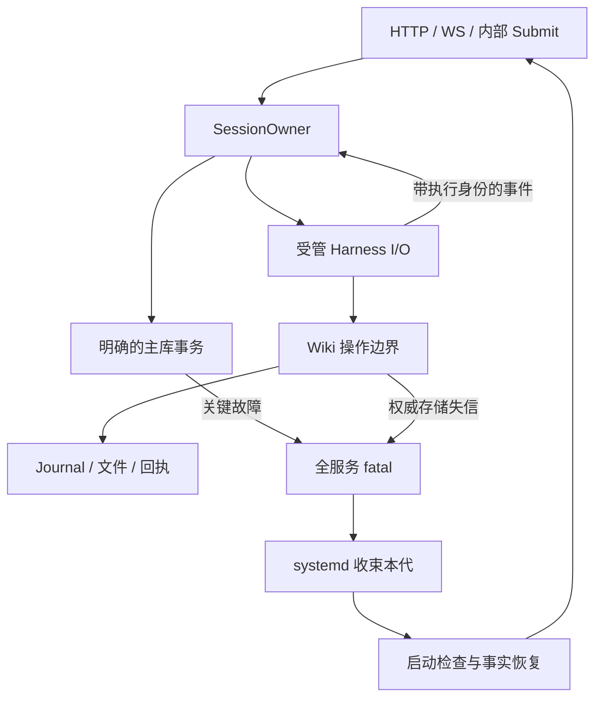

# Octopus 最小机制架构改造：GPT 可执行实施规范

> **2026-10-22 后续范围修订：** 用户要求先修现有架构中的bug，暂停票22引出的交互
> app-server与完整跨turn原生交付。Codex沿用exec，Claude沿用stream-json/idle；
> 本轮receipt与以后追加的会话消息分开。普通委托完成后保留会话。本文§5.6/§5.7及
> T10/T17已按此缩定合同修订；不把旧RPC实验或未实现目标算作通过。当前本地基线7ee4ac9，
> 52/53已有独立验收；下列5d99/85b5记载是历史核对时点。

> Status: in-progress — 总设计与剩余目标；已有实现和验收范围以执行计划、票据为准。\
> 日期：2026-10-20。目标：用更少的状态、写入者和恢复路径，得到可以解释、可以验证的正确系统。\
> 2026-10-20 历史基线：`Danuvius152/Octopus@5d99de373921affd27fe307e5770ea397d4f04d6`；当时只读 `git ls-remote` 核对远端。2026-10-22 文档核对的本地 HEAD 为 `85b5b3c`，本次没有重查远端或验证部署。\
> 输入：用户附件 `architecture-optimization-20261020.md`、此前 code review 与 fail-stop 决策讨论、上述版本源码。附件包含未随本次提供的 CR-03 暂存改动；其新增恢复实现必须在执行时核对，不能当作本次已复现的代码事实。

> **2026-10-22 统一裁决：** 按[开发指南](octopus-development-guide-20261022.md)区分
> 提交、通知、未知结果与资源退役。Saved inputs Dismiss 保留持久隐藏语义，不承担放行。
> 受管启动只证明其清理范围内上一代已退役；同代执行仍由原 Owner 和精确资源引用收束。
> 只有接纳与实际 dispatch 均接管这些责任并通过验证，才删除受管旧代的历史 PGID 阻塞。
> standalone 保持 §3.3 的保守范围，不新增历史 PID 清场。旧代退出不消除 unknown。
> 本次统一文档，不声明这些剩余目标已经实现或部署。

## 0. 直接交给执行 GPT 的任务

将本规范与仓库一起提供给执行 GPT。以下指令可以直接使用：

```text
请按本规范完整修改 Octopus。目标是减少真实机制、共享可变状态和重复事实，
同时保持既有用户功能、账户隔离、来源保全与执行结果的准确表达。

先阅读当前 AGENTS.md、git diff 和相关实现，对照本规范 §1 确认版本；
保留用户已有改动，以实际符号和调用链为准，不照抄旧行号。
按 §11 的依赖顺序完成各工作包，每包都包含实现、旧路径删除、迁移和必要验证。
不要停在方案、伪代码、新增空接口或只套一层 wrapper。

本规范已经选择：主库与 Wiki 的权威存储异常采用全服务 fail-stop；
受管 Linux/WSL 部署由 systemd 清理旧执行；主库使用明确的短事务；
每个会话只有一个状态写入者；Wiki 保留必要 journal/receipt，取消在线存储补偿。
不新增通用 Repository、Event Bus、Queue Manager、状态机依赖或进程恢复数据库。

unknown 表示历史结果不能裁定，不得用进程退出、没有回执或用户点“忽略”消除它；历史结果不确定性与当前写入资格分开，保留同代 Owner 的退休约束，不把 unknown 改成未执行/成功/失败。
启动恢复不能自动重跑未知模型执行。正常取消、慢 I/O 和迟到回报仍必须正确处理。
跨数据库/文件的业务协议不能按字符串搜索 unconfirmed 后批量删除。

修改后按照当前 AGENTS.md 执行适用验证；未运行、不可用与通过分别报告。
最后报告：改变的行为、删除的机制、保留机制的理由、迁移结果、实际测试结果。
源代码提交、推送和部署遵循本次用户授权及项目现行规则。
```

本文件是后续实现的单一设计合同。此前 spec 中的在线补写、反复保留失信连接、逐次提交后独立回读要求，以这里的选择为准；原有已确认缺陷及用户功能不会因为换了故障策略而自动消失。这里的工作包是可审查的实施顺序，每一包均需完整收尾，不是“先留半套以后完善”。

2026-10-20 执行计划访谈补充确认：升级后沿用兼容代码恢复或前向修复，不采用整套快照回退；新请求明确拒绝后可由用户主动用同键重试，旧版拒绝回执保留历史事实。对应合同已同步至 §5、§9；实施依赖与验收安排见[执行计划](../plans/minimal-architecture-execution-20261020.md)。

同日全目录覆盖核对补充：关联代码审阅及旧实施 Spec 已扩展至 CR-20。本规范将 CR-17～20、CR-12 的布尔参数分支，以及已测进度写入放大、任务处理入口补入 §6～§8 与 T29～T36。旧 Spec 中与本规范冲突的恢复/抽象/指南协议仍不采用；逐项分类见执行计划 §11。目标是覆盖已确认缺陷和选定优化，不承诺消除未经验证风险或恢复已丢失的外部历史。

## 1. 证据边界与对附件的裁决

### 1.1 先识别代码版本

执行时记录 HEAD、未提交 diff、实际 SQLite/Python 版本和运行 profile。定位以下符号，必要时查其新名称：

```bash
git rev-parse HEAD
git status --short
git diff --stat
git diff --cached --stat
rg -n 'reserve_client_submission|claim_client_submission|submission_status|_reconcile_recording' server
rg -n 'process_group_exited|require_retired_writers|worker_request|settlement_phase' server
rg -n 'synchronous=|_defer_commit|_maybe_flush|add_close_hook' server
```

已核基线有 `server/db/client_submissions.py` 和 `server/sessions/client_submissions.py` 的短版 admission 实现；没有附件所引完整 `submission_models.py`、`execution_identity.py` 和新增恢复列表链路。基线主库设置为 WAL + NORMAL，附件描述的 FULL 不能直接套到该提交。[C1]、[C2]

| 输入中的论点 | 本规范裁决 | 对实施的影响 |
| --- | --- | --- |
| 先消除共享状态和重复事实，再考虑按类拆文件 | 采纳 | 单一会话 owner；文件按实际职责自然划分 |
| SQLite 正常提交后不需要每次新连接回读 | 有条件采纳 | 先清除跨调用的未提交事务；提交异常进入 fatal；保留身份与幂等检查 |
| `commit()` 抛错等于未提交 | 修正 | 异常不是回滚证明；取消、驱动回报和故障时点可能留下未知结果 |
| `UPDATE … RETURNING` 返回行即已持久成功 | 修正 | 先取完/关闭返回游标，再等待 COMMIT；之后才能发布成功或启动执行 |
| actor 能删除全部锁和身份检查 | 修正 | 只删除被唯一写入者替代的会话状态锁；保留跨对象锁及异步回报的请求/执行身份 |
| actor 内顺序等待 spawn/写帧/stop 即可 | 不采纳 | 慢 I/O 会挡住 Interrupt/Answer；这些操作由受管子任务执行 |
| systemd、进程登记表、PDEATHSIG、killpg 扫描一起使用 | 不采纳 | 本次生产 profile 只使用 systemd 归属与启动检查；不叠加执行表或 PDEATHSIG |
| boot 身份不可读时“宁可多杀一次” | 不采纳 | 不向不能证明归属的历史 PID/PGID 发信号 |
| dismiss 过滤掉 uncertain writer 即可解锁 | 不采纳，也不是过渡方案 | 隐藏只改变可见性；启动拥有旧代证明，同代由原 Owner 收束，用户点击不承担退出证明 |
| 没有 Wiki applied 回执就可以自动 retry | 不采纳 | 缺回执不能证明未执行；保持结果未知，不自动再调用模型 |
| 任意一条 applied 回执即可把 item/job 标 done | 不采纳 | 可能仅完成 ingest 或部分修改；须核验原执行与实际操作覆盖 |
| Wiki items 立即改为两三张表 | 本轮不采纳 | 保留现有 JSON 聚合，使用有限的类型模型和唯一编解码/结算入口 |
| 权限仅在 MCP 入口检查一次 | 不采纳 | HTTP/App 也能调用；动态授权和 revision 在真正操作边界核验 |
| 附件哈希改用 size/mtime/inode 代替 | 本轮不采纳 | stat 是变化提示，不是字节相等证明；先不改变已有输入完整性合同 |
| 不引入 Repository/PostgreSQL/Event Bus/状态机库 | 采纳 | 复用 SQLite、现有通知与 Python 标准库 |

附件 §1 所反驳的“原报告”是另一份 `architecture-analysis-20261020.md`，不能把其 P0/P1 编号与此前本会话 CR-01～CR-16 混用。未经提供的 staged 分支缺陷写成“如果当前分支存在则验证并修正”，不能报告成已运行的复现结果。

SQLite 的 RETURNING 文档明确区分返回修改行与事务提交；Python 文档明确警告在已有线程的应用中使用 `preexec_fn`，而 PDEATHSIG 也不能覆盖任意后代及其建立前的全部窗口。这些修正有接口语义依据，不是额外的容错偏好。[R1]、[R2]、[R3]、[R4]

## 2. 已选目标：四个必要机制

### 2.1 机制与唯一责任

| 机制 | 唯一责任 | 不再承担的职责 |
| --- | --- | --- |
| systemd 服务归属与启动检查 | 收束一代本地执行，在新 main 启动前阻止旧执行重叠 | 不判断任务是否成功，不根据历史 PID 猜身份 |
| Database 明确事务入口 | 一次业务更新的隔离、提交和 fatal 上报 | 不管理 Session 生命周期，不长期维持待补写业务对象 |
| 每会话一个 `SessionOwner` | 会话状态、输入顺序、活动 run、问答、取消和归档意图 | 不等待模型完成，不充当通用任务队列服务 |
| Wiki 既有 journal 与执行回执 | 解释 SQLite、Markdown、原文对象之间的非原子结果 | 不负责同代失信存储反复补写，不重跑未知模型工作 |

`SessionManager` 继续提供既有应用接口、跨会话配额与 owner 注册。Harness 继续负责 provider 协议与受管进程；Wiki 继续负责文档、原文、来源和写入合同。既有 broadcast 只传播通知，数据库/文件事实决定结果。



### 2.2 八条不可删除的不变量

1. **接纳先落盘，执行先 claim。** 完整输入与结构化合同持久后才返回 accepted；claim 提交后才发生对应外部执行。
2. **同一身份不重复执行。** 同键同内容返回原状态，同键不同内容拒绝；未知结果不自动重放。
3. **同一会话一个状态写入者。** 异步子任务只回报事实，不直接改 `Session`/owner 字段。
4. **旧执行停止后才允许新执行。** 整代重启靠 supervisor，正常取消/切换靠当前 owner 持有资源直到退役确认。
5. **致命状态单向。** 本代 `healthy → fatal` 后不重新接单，不尝试在线恢复为 healthy。
6. **Wiki 写入有真实版本和来源依据。** 原文、身份、当前授权、revision 及变更证据持续成立。
7. **结果来自事实。** 模型文字、收到通知、进程退出或任何用户操作，都不能替代终态或产出核验。
8. **恢复可以再次中断。** 启动恢复只消费已持久事实、修复派生状态；重复启动不重复外部动作。

这八条覆盖数据正确性、资源生命周期和真实工作流。不要为减少字段数而把任意两条混成同一个状态。

### 2.3 明确的产品取舍

- 一个权威存储故障可中断本机所有账户的会话与 App；本轮接受这个故障域，不做每租户独立进程。
- 普通来源冲突、用户取消、限流与格式错误是业务结果；只有权威状态或共享执行归属失信才 fatal。
- 重启后的未执行输入保留正文供恢复；未知执行保留证据供核对，不自动重跑。
- 会改变权限、Wiki 范围、来源合同或回传绑定的新指令排到下一 run；保持同一合同的受支持 steer 可以继续。
- 生产崩溃恢复保证绑定受管 Linux/WSL profile。现有 standalone 开发入口仍存在，但不能伪装为同等的跨进程恢复保证。
- 正常发布沿用项目的验证与自然 drain 流程；fatal 策略不把每次正常发布都变成强杀在途任务。

## 3. 进程与启动：删除应用自建跨重启回收系统

### 3.1 生产 profile 的唯一执行归属

复用现有 systemd 部署，核对 `scripts/setup-services.sh` 与 `docs/local-wsl.md` 所述实际安装，不能把示例脚本的绝对路径覆盖到另一台安装。主服务及 Harness、App install/start、bg、Research 等本地后代均在服务 cgroup 内出生；`start_new_session=True` 可保留，正常任务取消仍可使用其当前进程组。禁止把“spawn 后再登记/迁移”作为整代归属前提。[C3]、[C22]、[R5]

不新增附件 W1 的 `executions` 表，不引入 `PR_SET_PDEATHSIG`，不维护跨启动的 PGID 轮询器。旧 schema 若有 PID/boot 列，迁移时只读取其历史诊断意义，不用它们选择信号目标；不再生产新记录后可删除相应列。

将 unit 所依赖的行为显式写出，示意配置如下；路径使用安装器已解析的真实值：

```ini
[Unit]
StartLimitIntervalSec=60
StartLimitBurst=3

[Service]
Type=simple
KillMode=control-group
SendSIGKILL=yes
Delegate=no
TasksAccounting=yes
TimeoutStopSec=10s
Restart=on-failure
RestartSec=3s
ExecStartPre=/absolute/python -I -S /absolute/check_service_scope.py --unit=%n
ExecStart=/absolute/octopus serve --service-process
```

10 秒/3 秒/60 秒/3 次是本规范选定的初始运维预算，不是现有部署测量值；配置要集中，验收时记录实际 stop/start 时间。保留 main 退出检测，不为清理后代而改成 `ExitType=cgroup`。systemd 负责 TERM/KILL，应用不再实现一遍整代清场。[R6]、[R7]

### 3.2 启动检查器的具体合同

增加一个仅依赖标准库的短脚本，直接作为 `ExecStartPre` 运行，不经过 shell，不导入 Octopus、aiosqlite 或启动线程。它只检查，不发送信号：

1. 由 `/proc/self/cgroup` 和 `/proc/self/mountinfo` 解析 cgroup v2 的实际挂载与当前归属，按完整路径组件匹配安装器传入的 unit 名，定位 service unit 根；拒绝解析失败、歧义或不匹配。
2. 检查器可以位于 unit 的 `.control` 等子组，但必须读取 **unit 根** 的 `pids.current`，不能只检查自身叶子组；该值包含整个范围及后代的线程/任务数。
3. 只有值恰为 `1`，且当前成员与检查器自身一致时通过；读取失败、不支持或存在其他 task 均非零退出。
4. 不用此时的 `populated=0`：检查器本身就在组里。不枚举历史 PGID，不在新 server 启动后清理它自己的整个 cgroup。
5. 检查失败由 unit 的启动频率限制收束到可诊断的失败状态；不把不确定结果改成成功。

这是“systemd 清理后，新 main 尚未启动”的检查，不是第二套 supervisor。条件成立依赖生产运行合同：没有外部程序把任务任意迁入该范围，受管任务不会主动迁到其他 unit 后继续修改同一工作区。需要独立存活的外部服务使用各自已有生命周期，不由该检查器接管。`TasksAccounting` 与 pids 控制器的计数单位是 task/thread，应在实际 WSL/systemd 环境验收。[R5]、[R8]

### 3.3 同一数据目录只允许一个服务实例

在 canonical 主 DB/数据目录取得进程级独占文件锁，持有至退出；在数据库恢复与任何 producer 初始化之前取得。锁 FD 不传给 worker。锁用于阻止不同端口或不同 unit 同时操作同一安装，不能替代 cgroup 的后代清理。

生产安装配置绑定既有 unit。普通 `octopus serve` 在该 profile 下调用/连接既有 unit，`--service-process` 只允许从匹配的受管环境进入实际 server；直接 ASGI 启动也在 lifespan 入口执行同一 profile/锁检查。不能只依赖 CLI 包装或监听端口冲突。

生产 profile 禁止 Uvicorn reload 与多 worker。薄 wrapper 不能静默忽略 `--tunnel`、端口、环境等用户参数，也不能每次调用都创建另一 unit；沿用安装器配置入口，遇到与既有 unit 不一致的参数时给出具体配置方法。开发 reload 仅用于隔离的 standalone 数据。

standalone 与测试保留其明确入口和独立数据目录：

- 已标记为受管的生产数据不能通过修改启动命令绕到 standalone 再开第二个 server。
- 测试用临时目录与 fake supervisor 验证应用协议，真实 cgroup 验收单独运行。隔离范围包括 Wiki、附件、App、密钥及 provider home 等实际可写目录，不能只换一个 DB 文件仍复用生产 vault。
- 非受管的既有安装继续使用其现有保守恢复约束；没有可靠归属证明时不自动解除旧 writer 阻挡，也不增加一套备用 PGID 清理系统。
- 首次从旧 standalone 生产部署迁移，执行一次计划停机并确认原有执行停止。新的 cgroup 不能追溯接管此前散落的无记录后代。

这项 profile 约束必须同步 README/部署说明，不能让已有 `octopus serve` 用户突然得到未说明的错误或更弱保证。配置和锁是正确运行约定，不是针对有本机同账户权限的恶意程序建立隔离系统。

### 3.4 唯一启动流水线

顺序固定如下，所有初始化函数拆分“构造/绑定”与“开始生产”：

1. systemd 结束旧 main 与受管后代，启动检查器通过。
2. 新 main 取得安装锁；服务处于未就绪状态。
3. 打开主库，执行 schema 迁移；绑定各 manager，但不启动 scheduler/worker/reaper 的新工作。
4. 取得各已配置 vault 的既有 operation/observer 归属；恢复文件通知账本与 history intent。
5. 核对输入、终态、Wiki item、delegation/Research/bg 与 schedule 的已有记录，生成一致状态。
6. 发布恢复后的只读快照，统一开放内部执行门和 API readiness。提前创建的 producer task 在同一门开放前不得派发；`start()` 不能隐藏一次提前执行。

启动恢复本身遇权威存储故障就失败退出；格式错误或单篇 conflict 留在已有维护/诊断入口，不为了一个坏 YAML 使整个工作台无限重启。全局身份证据无法裁定时，相关 Wiki 写入保持关闭，但应能查看问题和进入明确恢复流程。

## 4. 主库：一个写连接，明确事务，异常即退出本代

### 4.1 删除跨 API 返回仍打开的 SQL 事务

本轮选择取消当前 transcript 的 `_defer_commit/_maybe_flush` SQL 延迟批次。默认每条完整消息使用一个短事务；流式 `text_delta` 沿用现有内存合并/广播，不按 token 写数据库。[C1]、[C6]

所有权威写入都经现有 Database 内一个具体事务入口。建议合同：

```python
async with db.transaction() as tx:
    # tx 只执行本次业务操作的 SQL，不允许网络、模型或子进程 I/O。
    row = await tx.fetch_one("UPDATE ... RETURNING ...", params)
# 上下文正常退出意味着 COMMIT 已成功；此后才可发布成功/开始外部执行。
```

实现要求：

- 单连接事务锁覆盖 BEGIN、该操作全部 SQL、COMMIT/ROLLBACK；相同连接的公共读取也经过协调，不能看到其他协程的未提交中间行。
- 公共业务方法不互相偷偷提交。复用的 SQL helper 接受当前 `tx`，不另开事务；本轮不需要自动重入事务或通用 savepoint 框架。
- 操作失败若是预期业务冲突，确认回滚后返回领域错误；回滚或提交状态不可信则 fatal。
- 本地事务的总期限覆盖锁获取、BEGIN、SQL、游标、COMMIT/必要 ROLLBACK，不为每一步重新续期。尚未碰连接的锁等待取消可安全返回；SQL 已开始后的超时/取消必须在同一入口裁定，`CancelledError` 也不能绕过处理。后台 SQL/提交/回滚状态无法确认时 fatal，不继续使用同代连接。
- `UPDATE ... WHERE expected_state ... RETURNING` 合并 compare-and-set。取完并关闭游标、成功提交之后，返回行才构成业务成功。
- 删除为每条成功写另开 `aiosqlite.connect(mode=ro)` 的核验。恢复时重新打开数据库读取事实；不要把现有查询方法的名称当成必须保留的抽象。
- 测试数据库遵守同一事务合同；`:memory:` 只影响数据库位置，不需要专门的“无独立回读所以较弱成功”分支。

同一主库内的业务边界也必须明确：接纳同时写完整输入、会话/来源绑定及必要用户消息；claim 用条件更新取得执行权；结算在同一事务写精确 terminal，并更新该执行中已有可靠投递证据的输入状态及必要会话投影。跨多个公共方法依次提交不等于原子操作。无法纳入同库事务的 Wiki job handoff 与通知 ACK 保留原执行身份/回执，不冒充单库原子性。

主库采用 WAL + `synchronous=FULL`。Wiki 保留当前同步连接与 journal mode，在各权威写连接显式设置 `synchronous=EXTRA`：它在 rollback journal 下增加提交目录同步，在 WAL 下与 FULL 等效。初始化时校验实际值；不为统一术语强行改成异步主库封装。文件内容和替换目录的同步沿用既有 history 协议，单独设置 SQLite PRAGMA 不会使文件与 DB 原子化。[C7]、[R9]

Wiki 的 PRAGMA/fatal 接线至少覆盖 `Store.connect()`、`EventInbox.connect()`、恢复元数据的写连接（基线 `recovery.Metadata.connect(write=True)`）及现有权威数据创建/迁移连接。PRAGMA 逐连接设置，不能只改启动时的一条连接。底层持久化异常在被包装成普通 `WikiError` 前上报；blob、replace/unlink、fsync 的权威效果/持久性失信也走同一出口。正常路径冲突与效果前可明确拒绝的领域错误仍按业务错误处理，不把全部异常粗暴当存储故障。

**暂不增加第二条 transcript 写连接或第二个持久队列。** 先记录代表性完整消息的事务数量、耗时及首字/取消延迟。只有测量显示必要性能目标无法满足，才单独考虑“内存批量 → 一次完整短事务”；任何批量均不能让未提交 SQL 状态泄漏到公共 API。本轮默认实现不依赖这项后续优化。

### 4.2 一个 `ServiceHealth`，只传播一次致命事实

复用或增加一个轻量服务对象，由 main 创建并注入 Database、Wiki 及 producer。接口只需 `require_healthy()` 与不可返回的 `fail(cause)`；同代不可复位。不另设只为唤醒 Uvicorn 优雅关闭的 fatal watcher。

`fail()` 必须先原子地封闭新执行准入，由唯一的服务故障出口保存首因并执行非零进程退出，防止下游 `except Exception` 把它吞成工具错误后继续派发。同步 Wiki 线程也调用这一个线程安全出口，不保留由各 manager 自选的补偿策略。

| 错误范围 | 行为 |
| --- | --- |
| 关键 DB 提交/回滚结果未知、SQL 开始后的状态不可确认、无法局限的存储 I/O/损坏 | `fatal`，关闭新执行并退出 |
| 明确未产生效果且已经安全结束的正常锁竞争/业务冲突 | 有界等待或明确拒绝；不建补偿队列 |
| 不在明确定义正常分支内的权威持久化异常 | 保守升级 fatal，不由每个 manager 猜测是否继续 |
| 已有终态但通知断线、独立 metrics 失败、可重建投影计算失败 | 通知/组件级处理，不把业务执行改为 unknown |
| 正常用户取消、provider 限流/认证失败、输入过大 | 普通任务结果；其结果保存再失败才升级 fatal |

受管生产 profile 的故障出口使用集中封装的 `os._exit(70)` 结束 main，不 await 普通 cleanup/flush，不走 Uvicorn 的优雅关闭。首因保存在内存；仅在已有非阻塞日志设施可用时投递诊断，否则退出码由 supervisor 记录。不能依赖业务锁、DB、网络或同步日志 flush，也不为此新建日志框架。systemd 观察 main 退出后按 unit 合同收束其后代。退出函数可注入测试替身，但生产不能退化为只设置 `should_exit`；`TimeoutStopSec` 不负责一个尚未进入 systemd stop 阶段的 Python 优雅关闭挂起。

非受管 profile 同样停止使用失信存储并非零退出，但只提供 §3.3 已声明的后代恢复保证。正常关闭仍按“停止 producer → 收束 owner → flush/close”完成。**不能以只有 Python 返回 500、任务抛异常或日志出现 fatal，作为已实施 fail-stop 的验收证据。**

结束本地进程不会撤回已经发出的远端请求或外部效果。精确终态缺失时保留 unknown/attention；supervisor 的清场保证不能被描述成外部动作自动回滚或 exactly-once。

### 4.3 逐条删除的主库路径

- `_recording_blocked`、`_reconcile_recording` 与“存储恢复后原地 resume”的主流程。
- 若实际分支存在，删除 `_submission_recorders/_submission_retries` 及其 shutdown 补写循环。
- deferred commit 失败后的定时无限重试、为等待失信写入而保留连接并再次 close 的分支。
- `record_request/record_terminal` 等正常提交后新连接核验的硬要求。
- delegation 等同一 DB 状态更新的 `_pending_snapshot` 在线补偿；保留稳定轮次/请求身份和原子比较更新。

保留选定终态只提交一次、同 ID 不同内容冲突、HTTP waiter 与实际工作寿命分离。`token_rotation`、账户 bootstrap、App 文件发布等跨 DB/文件的业务协议先列提交点，保留它们确实需要的迁移 intent/恢复事实；fail-stop 不会把这些变成单资源事务。

## 5. 输入与会话：一份 durable 输入事实，一个状态所有者

### 5.1 复用 admission 表，不另建平行请求账本

从现有 `client_submissions` 演进一份权威输入记录；如实际 staged 代码已有对应字段，迁移合并而非创建第二张功能相同的表。表可在迁移后使用更准确名称，但不因改名复制两套在线写入路径。

浏览器、scheduler、delegation、bg/Research 回传等经现有 `start_message` 的来源统一使用 `Submit` 合同。内部来源复用其已有稳定 fire/delivery/job 身份作为去重键；不为每次恢复重新随机生成一个键。Research 内部短 leaf 仍归 Research 自己的执行生命周期，不要求每个内部推理节点都变成会话输入。

五态只描述已接纳输入。新请求在准入前被明确拒绝时不创建输入行；条件恢复后，用户可以主动用相同键和内容再次提交，客户端不自动 POST。已接纳或结果未知的身份继续严格去重。旧版已持久保存的拒绝回执只读保留，按原身份查询仍返回历史拒绝；新的主动发送使用新身份，不能把旧拒绝迁为接纳或可能执行。

必要字段按语义定义如下；具体 DDL 复用当前 schema 的等价字段：

| 字段 | 唯一用途 |
| --- | --- |
| `request_id` | 服务端稳定输入身份，唯一 |
| `session_id`、`source`、`idempotency_key` | 来源命名空间下的幂等唯一键，账户通过真实 owner 校验 |
| 单调 `admission_seq` | 同会话输入顺序和稳定 keyset 分页，不依赖临时列表下标 |
| `payload`、`payload_sha256` | 完整正文、附件引用、结构化来源/范围/回传合同及同键内容比较 |
| `state` | `pending / running / done / withdrawn / unknown` |
| `execution_request_id` | 若使用 steer，关联实际承载此次输入的执行；普通输入关联自身 |
| 必要的 delivery 证据 | 保存 frame/operation 身份与是否得到可靠确认；不使用 reason 字符串偷偷改状态 |
| 新输入的 `recovery_of` | 新工作来源；`recovered_by` 从反向关联推导，不双写两份链接 |
| 原有时间与诊断字段 | 显示和追踪，不存第二份派生 success/failed |

`dismissed` 保留为用户持久隐藏提示的处置，不属于五态执行事实，也不是退役证据。先提交处置，再通知可用的原 Owner；通知失败不撤销提交、不复活失败 Owner。新准入不以是否隐藏历史提示作判断。
成功/失败/中断的业务结果从精确终态关联投影。既有 `messages` 是转录/结果记录，输入表负责 accepted 及未执行正文；不要在三个表再各放一份完整“当前请求状态”。

| 提交点 | 同一主库事务的内容 | 提交后才允许 |
| --- | --- | --- |
| 接纳 | 幂等身份、完整输入、接纳决定、新建/绑定 Session 与来源 | 返回 accepted |
| claim | pending → running、执行绑定、所需 request/context；steer 的 frame/operation 身份 | spawn 或写出对应帧 |
| 结算 | 单次选定 terminal，以及有充分 delivery/归属证据的输入状态 | 发布持久终态通知 |

承载 run 结束时，未确认交付的 steer 不能一起更新为 done。上述事务是在现有 DB 中收拢业务操作，不要求额外执行仓库。

### 5.2 状态迁移与恢复

| 起点 | 事件和必要事实 | 终点 |
| --- | --- | --- |
| 不存在 | 验证通过，完整 payload 与接纳决定同事务提交 | pending |
| pending | owner 决定执行，claim 已提交 | running |
| pending | 用户撤回或本代结束后的启动分类 | withdrawn |
| running | 对应终态已提交且本输入的 delivery/归属可确认 | done |
| running | 本代结束、写出后投递不明，且没有足够终态证据 | unknown |
| 任意已有行 | 同键同内容再次提交 | 返回原行投影，不产生新执行 |
| 任意已有行 | 同键不同内容 | 冲突，不改原记录 |

`running` 的含义是执行权已经取得，因此可能发生外部效果；它不保证 spawn 一定发生。claim 后 spawn 前崩溃可保守归入 unknown，但在 supervisor 确认旧执行停止后，不再阻塞整个会话到主机重启。

恢复次序必须先查精确终态，再按缺失事实分类。pending → withdrawn 保留正文；只有明确用户恢复或既有调度政策允许的、可证明未派发的任务才能再次排队。unknown 的重做需要显式动作、新执行身份和对已有产出的保留，原历史记录不被覆盖。

一次“恢复正文/重新执行”动作复用 Submit 的稳定幂等键；新输入写入 `recovery_of`，该关联与新输入在同一事务提交。每个原输入只允许一个直接恢复后继（用唯一约束表达），后续再恢复沿该后继继续；双击或响应丢失重试返回同一后继，同键不同内容冲突。新的执行身份在这一次动作内稳定，不能每次重试重新生成；不增加 recovery 表或在线补写。

在该事务中先读取原输入，校验当前 owner、预期会话及可恢复的 withdrawn 状态，再返回已有后继或创建新行。unknown 不提供一键恢复重跑；用户核对已有效果后可以显式发起新工作，原 unknown 保留。唯一约束不是授权：不能引用他人输入、抢占其恢复后继，或通过唯一冲突泄露他人记录。新请求按当前权限重新接纳。

旧数据迁移单独处理：

- 旧 `reserved` 或空 receipt 不能仅凭行存在推断 accepted。
- 旧版已保存的明确拒绝保留原回执及其兼容投影，不进入新 pending 派发或恢复链，不为凑五态生造 unknown；保留旧历史不增加在线拒绝 writer。
- 有准确终态则复原其结果；缺失执行引用/完整正文时保留 `legacy_unknown` 诊断，不能补造正文。
- 旧 `steer_delivery_unknown` 等 reason 特判迁入显式 state/投递证据，不在 SQL/Python 两处继续暗中覆盖终态。
- 不因旧 dismissed、无 PGID、boot 改变或者整代已清理，把历史 unknown 改成“确定未执行”。

### 5.3 单一 owner 的具体形状

实现一个具体 `SessionOwner`，由 `SessionManager` 持有。无需通用 actor 基类、消息总线或状态机库。外部只能投递 `Submit/Interrupt/Answer/Archive/Close` 等命令；Harness/计时器回报作为带身份的事件进入同一 mailbox。

owner 持有活动 run、待处理问题、归档意图和可等待的工作引用。准入正文及执行顺序以 durable pending 行为准：mailbox 是命令传递，不是第二份权威执行队列。这样消除“DB 已 accepted，但内存队列尚未入队”的持久双写窗口。

建议集中三个具体结构：

- `ActiveRun`：精确 request/attempt/run 身份、不可变 context、后端句柄、单次结算对象及 I/O task 句柄。
- `PendingQuestion`：一个问题的答案、waiter、attempt 和 timer，替代多个按 question_id 同步增删的字典。
- 有界 mailbox：沿用现有配额；普通 Submit 超额时在持久 accepted 前拒绝，后端 delta 沿用合并；为控制/完成消息保留进入能力，禁止静默丢终态或停止命令。

owner 可以 await 有总期限的短本地 DB 事务，不为每次 SQL 创建一套 effect/回执协议。spawn、写管道、等待进程停止、长事件流和模型调用必须在受管子任务中进行；任务捕获当时的 run/operation 身份，只回报完成事件，不能直接改 owner 状态。

owner 不同步等待另一个 owner，也不 await 可能回调自己的 broadcast subscriber。初始输入、steer 与 Answer 共用同一个有界 stdin 写入者，保持帧顺序；不能为每个 delta 创建不受管任务。`SessionManager` 必须观察 owner task 的异常退出，封闭该会话准入并退役其资源；资源归属/停止无法确认时升级 fatal，不能留下“邮箱存在但无人消费”的会话。

Interrupt/Close 不排在 stdin FIFO 后，而是直接启动捕获原句柄的停止任务。每次帧写入有期限；Answer 的“owner 已接纳”与“provider 已收到”分别报告，管道挂住时不能声称答案仍可实际送达。复用这一个 writer 和已有停止接口，不新增第二套消息总线。

HTTP/WS waiter 取消只结束等待，不能取消 owner 已接管的事务/命令。reply Future 已取消时跳过回送而继续收尾，不能因 `set_result` 异常杀掉 owner。spawn/写帧超时先退役已捕获资源；能确认停止则普通失败或投递未知，无法确认资源归属/停止才 fatal。

处理迟到回报时保留一处身份比较：

- 旧 run 的文本/结果不进入新 run。
- 迟到的 spawn 成功回报必须关闭/退役其捕获句柄，不能直接丢弃造成孤儿。
- 用户取消、waiter 断开或归档意图到达，不取消掉负责收尾的 owner task。
- 对应线程实际还在工作时，取消 Python waiter 不构成 writer 已停止证明。

只删除 ownership 已接管字段对应的 `_dispatch_lock/_steer_lock/_command_lock` 等会话状态锁；跨会话配额、数据库事务、Wiki 文件/注册操作锁各有不同对象，不能全局清零。

### 5.4 steer 与不可变 context

本轮用一个明确规则去掉 live context 的两处安装/回滚：**活动 run 的知识、权限、来源范围与回传绑定在该 run 内保持不变。**

判断可否 steer 时比较规范化执行合同：账户/owner、权限与 grant/scope、知识模式及绑定、来源合同、回传目标，以及会改变工具授权或结果归属的字段。正文、request/frame 身份、提交时间等自然变化字段不参与等价比较；内部身份与合同来自服务端可信解析，不能由客户端自报。

合同等价且后端能正确关联输入及执行结果时，继续支持 steer。合同变化排到下一 run，并向 UI 返回真实 `disposition=queued`。该投影扩展须同步 Pydantic、HTTP、WS、前端和契约测试；不能只在 owner 返回新字符串。不要为了保持 steer 字面效果，扩大旧 token 的权限或让旧任务追随 Session 最新 context。

不可变 context 保存本 run 的权限上限与来源合同，不冻结动态授权结果，也不延长账号/grant 有效期。所有来源在实际 claim/派发时共用当前 owner 可执行性检查；accepted 的旧输入、内部回传和历史 context 都不能绕过账户禁用或授权撤销。

`stdin.write/drain` 成功只说明本地写入完成。若 provider 协议存在可关联的输入确认，Harness 应把它规范化为带 frame/request/attempt 的确认事件，并用离线回放和实际可用 CLI 验证关联。无法可靠确认的 provider 在写任何字节前选择 queue；已经写出但结果不明的输入保持 unknown，不能跟随主请求的一条 terminal 一律 done。[C4]

调用线程、MCP 与 WikiTask 引用同一份不可变 context 及精确 run 绑定；新的 run 创建新 context 和新授权。不要让工具处理器为了读取 context 反向等待一个正在等待该工具的 actor。

按实际通道提供能力：Codex exec运行中新输入排队；Claude仅在活动请求支持的范围内
steer；AskUserQuestion Answer沿原问题通道，不强制统一成stdin或交互RPC。
下一请求可以先入队，但必须在安装新knowledge context/WikiTask/授权之前撤旧lease、
join原held进程及捕获资源，再创建新进程/lease并resume历史。旧idle/Stop不能改绑新请求；
原临时Wiki grant按原合同关闭，不能为尾部延权。退役CLI不等于关闭独立work。

### 5.5 接口与恢复 UI

- HTTP 与 WS 共用同一 Pydantic 输入模型、Submit 路径和统一状态投影。路由做认证/owner 校验，owner 做准入，DB 做事务；不保留三份不一致的拒绝逻辑。
- 新合同的输入行存在且提交成功才是 accepted；旧拒绝回执仍按历史拒绝投影。明确拒绝后的再次提交必须由用户主动发起。客户端断线时继续按原 id 查询；不能把超时当明确 rejected 后自动换 ID 重发。
- 恢复列表在同一个 SELECT 中 JOIN 精确终态，按单条查询相同规则形成最终状态投影；基于该投影完成 owner、可见状态及 cursor 过滤，最后取 `limit+1`。单页查询数量是常数，不逐行补查或在路由二次过滤。`dismissed` 仅控制提示可见性，不作为准入。
- 降序且使用 `< before` 时，`next_cursor` 取实际返回页的最后一行；第 `limit+1` 行仅用于判断 has_more，无后页则 cursor 为 null。它是当前状态的 keyset 分页，不承诺跨 HTTP 请求的冻结快照；状态变化后刷新第一页。
- 历史 unknown 保留正文/输出/原因；用户可 Review、Dismiss，withdrawn 可 Restore。受管启动已经证明退出的旧代记录不再因缺失 PGID 永久阻塞；同代仍可写的执行继续由原 Owner 收束。隐藏后真实执行阻塞仍有独立说明；证明不足不放行冲突执行。
- Stop 暂停待处理队列；用户通过 Resume processing 明确恢复，或发送新指令优先处理而保留旧积压暂停。资源确认退役只解除相应资源限制，不自动解除用户暂停；Resume 也不能绕过权限、配额及同代资源退休检查。控制提示 Dismiss 只关闭前端提示，历史 unknown 不因这些操作自动重跑。
- withdrawn 提供恢复正文；unknown 显示已有输出与原因，用户可明确发起新的工作。提交响应不明时按原键显示“正在核对”；已确认提交但 GET 刷新失败则保留最后确认事实并显示刷新延迟，有限退避重试 GET。成功取得所需状态/版本后才清除 dirty；两者都不是新的持久 execution state，也不触发自动 POST。

2026-10-22 源码核对：Stop 的 accepted 确认会在前端自动移除；Saved inputs Dismiss
及历史 writer 检查仍在。保留 Dismiss 的正确提交/通知合同；票53负责旧代准入接管，
验证前不删除仍承担责任的保护，验证后也不删除同代精确退休约束。
当前 dispatch 快照固定返回 `recording_failure=None`；前端残留的 Retry saving 分支和
`resume_queue=false` 不代表当前 Owner 仍支持在线补写恢复，不据此扩充“放行”合同。

### 5.6 归档、异步回传和 one-shot

复用已有work/request、delegation、Research、bg关联。普通委托本轮完成、回传和资源退休
不自动归档conversation；正常terminal归档及启动按delegation origin扫档必须同时修正。
会话在重启后仍可访问/追问；人工追问是新human request，不重发旧caller回报；parent
显式follow-up沿原CAS建立新round/work，保留conversation、关系和权限限制。

显式Archive和既有schedule临时会话策略保留：先有合法归档意图，Owner再等待输入、
问题、独立返回及真实资源收束，最后事件触发该意图的重评。资源释放本身不创造归档意图。
不批量unarchive，不改origin，不机械删除setup失败清理；不以保留会话或退休CLI为由
close_work/cancel_work。已打开视图、输入能力及委托卡片入口保持，侧栏尊重过滤偏好。

一次性调度使用稳定 `(schedule_id, scheduled_for)` 来源键，与目标 Session/输入创建或绑定在同一主库事务内完成。人类 backlog 可以延期，不能先删除 schedule 再发现未接纳。历史 fire 直接复用统一输入记录及其来源信息，不另造功能重复的调度请求账本；需要保留的调度定义快照存入该来源记录。已执行/unknown 不因重启产生第二个 fire 身份。[C5]

### 5.7 当前调用、迟到会话消息与资源退休分开

本期沿用Codex exec与Claude stream-json。内容项完成不等于调用结束；Owner根据本轮
合法result/turn终态、已接收输出收尾和原事务事实，只结算一次receipt。无终态EOF、
协议错误、取消或异常保留partial与准确原因；退出码0、最后正文和静默不能独立证明成功。

Codex仅排空本次调用有定义边界的已产生输出并退役进程，不承诺父调用结束后的未来原生
尾部，不自动启动报告/exec-resume补齐。Claude本轮result可以结束逻辑流和receipt，
原held进程仍由原Owner持有并在现有回收窗口内尽力接收idle。receipt不是物理进程已退出
的证明，也不证明所有原生目标成功；已知活动、失败或中断事实不能伪装成完成。

idle只追加CLI自然产生且实际到达的会话消息/原生状态，使用捕获的backend、lease、
request/attempt/work；完整消息按既有身份保存，迟到delta不覆盖已完成正文。它不调用
模型、不接纳新用户输入、不重开旧terminal，也不补入已返回App响应或旧委托回报。
下一请求、Stop、reaper或重启可以结束窗口；历史resume不承诺恢复运行中的原生助手。

Stop在活动调用和仅held资源时均可定位原对象，旧request定向Stop不转而停止新请求。
UI根据真实资源提供控制，不把旧request改回running。撤权/退休沿现有捕获边界关闭新登记
并join已捕获操作，未确认退出不放行冲突执行；不新增尾部无限等待或计时器体系。

需要完整helper成果的当前调用应在真实协议支持范围内等待并汇总；提示词只能引导，不能
保证模型一定等待。可靠跨请求执行/返回沿已有bg、Research、named delegation和稳定来源
身份处理；它们不延长或复活父receipt，也不因旧CLI退休被close_work。取消未知不自动重放。
现有独立controller更新的短时app-server继续先关闭再exec，不属于本期暂停的交互迁移。

## 6. Wiki：保留跨资源证据，去掉在线猜测和状态副本

### 6.1 复用不可变类型，删除隐式全局任务实例

基线 `server/knowledge.py` 已有 frozen `KnowledgeContext`、`AdmittedRequest` 与 `OwnedTaskContext`。它们承载要求与来源，不是可复用的 bearer grant。沿用这些字段和类型，补齐与具体 logical run 的固定绑定，不重新发明同义 context 模型。[C8]

建议接口形状如下；复用已有等价类型/方法，不为了采用这些名称而增加适配层：

```python
@dataclass(frozen=True)
class RunBinding:
    ref: RunRef  # session_id + request_id + logical run epoch
    knowledge: KnowledgeContext
    assignment: WikiAssignment | None  # 固定 job/attempt/成员引用

wiki_tasks.open(binding)       # 注册本逻辑 run，创建本 run 的 read ledger
wiki_tasks.capture(mcp_scope)  # 得到固定 binding、scope、read ledger
wiki_tasks.retire(run_ref)     # 撤销其授权；资源 join 由 execution owner 完成
```

Session 的 `ActiveRun` 与 WikiTask 指向同一 `RunBinding`。工具入口捕获它，后续 await 不再按 session 找“最新 context”。当前 run 的 read coverage 不借用另一个 run 的历史读记录；异步 delegation/Research/bg 保存原有 `OwnedTaskContext` 和 return binding。

`main` lifespan 构造一个 `WikiTasks`，通过既有构造参数或工具 factory 闭包注入 SessionManager、Harness、MCP、router 与 worker。删除模块末尾的 `tasks = WikiTasks()` 及隐式 import，禁止保留 fallback singleton。这里只消除任务上下文的隐式实例，不要求同一包再把全部 registry、工具和存储改造成依赖注入框架。

保留当前 `mcp_identity` 的 live lease 检查；基线并非只验签名。当前 Harness 的 MCP bearer 在 spawn 时配置，仅给内存 binding 加 epoch 不会自动更新实际 HTTP 请求。[C3]、[C9]

**本轮明确选择：带请求级 MCP/工具授权的物理 Harness 不跨逻辑请求复用。** 一次逻辑请求结束后撤销 lease，停止并 join 该进程及在途工具；下一请求携带新 bearer 启动新进程。历史对话可沿用 provider 已支持的 resume/session id，历史续接与沿用旧进程凭据分开。一次活动逻辑 run 内的受支持 steer 仍可使用原进程；纯无此类工具的内部 leaf 不增加无意义轮换。

这避免引入动态 bearer 轮换、请求代理或第二套 token 路由。若以后要恢复跨请求进程复用，必须先证明 provider 能在请求边界携带并隔离新授权，再另做变更；本轮不能用“进程可复用”验收替代该证明。记录新增 spawn 成本，不承诺首字延迟不变。真正写入前继续验证原 scope/grant、registration、目标身份和 revision。

落地必须同时调整 `_make_context/spawn_signature` 的 `RUN_WIKI_SCOPE` 归一化、`bind_wiki_task/tasks.run_bindings` 的跨请求重绑、`_reusable_run` 与 `_retire_or_hold_process`；mint 真实 task id 与新 lease。`_begin_retirement` 先撤 lease 再 stop/join。**“支持 stdin 追加帧”与“允许跨请求保留进程”是两个判断**；不能把一个 `reusable` 全改 False 后意外关掉 `_open_steering_window`。请求何时结束按 §5.7 执行。

### 6.2 Job 保留 typed JSON，本轮不增加 Wiki 表

基线 `job_execution.prepare()` 已在同一事务中保存一批至多 3 个 item 的原 request；同一个 job attempt 可以执行多个批次。因此 `(job_id, attempt)` 不能唯一标识一次 worker 执行。附件 W6 的建表建议不是本次简化的前提。[C10]、[C10b]

在现有 `job_execution.py` 或同职责的小模块内收拢：

- 有限的 `JobItem` 类型、状态枚举与不可变 `ExecutionRef`；精确身份包括 job、attempt、session、request，沿用 work/member/reservation 的现有引用。
- 唯一的版本化 `decode_items`、`encode_items` 和原子 `transition_items/settle_execution` 入口。
- 纯元数据更新统一使用短 `BEGIN IMMEDIATE`，按现有锁顺序核对当前 job、attempt、状态及原成员。现有整份 JSON 比较更新可用，不再叠加另一份版本协议。
- 对外继续提供兼容 `items` 列表；同时调整 `maintenance_inputs.py`、`job_events.py` 中读取 JSON 的 SQL/trigger 和 TypeScript 合同。

item 保留业务状态、当前 `worker_request`、必要的 `previous_worker_requests`、结果与证据引用。`worker_request.phase` 收敛为 `prepared / accepted / rejected / settled`；settled 的 disposition 解释完成、失败、取消或中断。已停止但语义结果不明时 item 使用现有 attention，不再创建另一套可在线自愈的 unknown 状态机。

将 `recording_failure`、`recording_recovery`、`execution_unknown` 和 `cancelled_before_admission` 的历史内容一次性转换为原执行引用与 attention 原因，再删除其在线读写。无法解释的 legacy 记录保留原始诊断和 attention，不能转成 pending 使模型自动重跑。同批 item 中最多 3 份短执行引用可以保留；为消除这点序列化重复而增加 item/execution/member 三张表，不是当前收益最大的工作。

### 6.3 `write_txn` 的边界止于纯数据库元数据

统一 job/grant 的纯 SQLite 事务有价值，但不能把以下过程包进一个外层 DB 事务：

1. 在现有 history 中保存、校验 before/after blob，**提交 prepared intent**；同一事务保存不可变 operation receipt、操作详情及来源/预留计划。
2. 在最终授权与目标版本检查后执行原子文件替换/删除。
3. 确认该操作 applied，应用原计划中的来源/身份绑定，再更新可重建索引。

prepared 必须在文件效果发生前独立持久。外层事务还可能与内部独立连接互锁。保持这一个 journal 协议，正常写入、取消核验、启动恢复及 restore 共用其事实，不另建“通用事务协调器”。[C7]

receipt 存在本身不证明 applied；no_change 保留无需文件效果的完成 receipt 路径，并满足真实阅读/判断要求。基线删除分支只有 unlink，须补齐替换分支已有的父目录 fsync，才能使此处持久性选择覆盖删除；这是本轮静态发现的补充修改，未进行断电实验。复用现有目录同步代码即可，不引入文件事务库。

必须保留的证据包括：稳定 document identity/tombstone、原文 blob 与真实 hash、source/material origin plan、原 request/member/reservation、before/after revision、operation receipt、read coverage 和 observer 的 intake/apply/ack。它们分别回答“修改谁、基于什么、实际做了什么”，无法由进程退出替代。

最终 revision/字节检查继续存在。`flock` 只协调遵守它的 Octopus writer，无法让外部编辑器的 check 与 replace 变成一个系统调用级 CAS；保留原文、提案和已观察到的冲突，不能宣称本轮彻底消除了任意外部编辑竞争。

### 6.4 每 vault 每代一次启动恢复

已配置 vault 在 producer 启动前经过恢复；运行中新注册 vault 在首次开放操作前经过同一个入口。自动恢复不得调用 LLM、重发工具变更、续期旧 grant。重复调用应幂等；明确的人类修复操作可以再次进入核验，不是后台无限重试。

移除 `history._locked()` 每次独占加锁时隐式调用 recover 的全量扫描，拆出真正执行分类的 `recover_locked()`，由启动/明确恢复入口调用。基线 `recover()` 的无锁分支依赖这个隐式钩子，必须一起改，否则移走钩子后显式恢复会变成空操作。

正常操作若在 prepared 之后、文件效果之前因撤权或冲突结束，原操作 owner 在本次收尾中将**该 change** 标记 interrupted/conflict；不要等待下次普通请求扫描全库补齐。这个正常收尾的持久化再失败才 fatal。它是单次操作的终结，不是一套后台存储补偿协议。

先保证旧执行已停止、旧 scope 失效，再依次恢复 observer 证据、history intent、当前索引及 job 结算。依据下表分类：

| 事实 | 恢复动作 | 不得推导的结论 |
| --- | --- | --- |
| prepared，当前文件准确匹配 after，blob 与身份均有效 | 确认这次具体效果，完成其既有元数据/来源绑定，不再次覆盖文件 | 整个 item/job 已成功 |
| prepared，当前准确匹配 before | 记录该操作中断，保留原提案 | 模型从未执行、文件从未曾变化 |
| prepared，当前既非 before 也非 after，或身份变化 | conflict/attention；保留 live 文件及证据 | 可以回滚人类修改 |
| applied，文件后来又变化 | 保留历史 applied，索引当前版本 | 原效果没有发生，或可把旧 after 写回 |
| 精确 request 有 durable terminal | 进入正常完成使用的同一结算入口，逐 item 核验实际要求和回执 | terminal 文字足以证明来源、覆盖和产出 |
| 无 terminal，仅有 ingest/部分 applied | interrupted/attention，展示已发生效果及未确认范围 | 整批 done，或安全自动 retry |
| 无 terminal、无 applied，或 legacy 缺原 request | interrupted/attention；允许显式创建新 attempt | 缺证据等于确定未执行 |
| 有明确 admission/claim 证据证明尚未派发 | 按 §5 分类为 withdrawn，保留输入；新建的正常 pending job 仍按正常调度政策运行 | 可以把任何旧 running 一律改 pending |
| 仅可重建投影计算失败 | 局部降级并重建，不重做 LLM 整理 | 共享 SQLite I/O/损坏也只是缓存失败 |

`recover_publication/recover_creation` 在基线正常完成路径也会被调用，不能按函数名称批量删除。收敛成正常完成、取消、启动共用的效果核验入口，再移除其在线 admission/recording 补偿分支。[C10b]

observer 的 overflow、armed 或丢事件证据不能因一次全量扫描成功而清空。全扫可以重建当前搜索结果，不能补回已失去的 rename/source 历史。相关 Wiki 写入应保持诊断状态，通过现有明确恢复流程处理；不能自动换一个新 DB 抹去证据。[C11]

### 6.5 取消由一个 owner 收尾，不由周期任务补齐

固定取消顺序：记录原 attempt 的取消意图 → 在既有写入协调边界撤销原 scope/grant → 释放元数据锁 → owner 停止并 join 原后端与在途工具/文件线程 → 核验已有效果 → 保存结算与事件。已经进入临界区的旧操作必须完成或报告后才能确认停止，不能持有 DB 事务等待它结束。

可沿用现有 API 的 `status=cancelled, settlement_phase=pending/confirmed`，减少兼容变动。这里 pending 是“取消仍在收尾”的正常生命周期，不是“数据库失信后继续运行”的补偿状态；confirmed 表示 writer 已停止，不宣称任务语义完成。

同一 attempt 只存在一个受管 cancel future。HTTP waiter 超时不取消其收尾任务，也不产生第二次取消工作；在既有 HTTP 契约中明确返回正在处理，若不能及时完成则使用 `202` 与可查询状态。前端 pending 显示“正在停止”，不要指导用户重发 POST 以触发结算。

删除 `require_retired` 跨多个容器猜测 writer 的方式，改由精确 execution owner 的 `join_retired` 提供事实。删除 `witness_unprepared_cancellation`、`cancelled_before_admission`、`job_notifications._unsettled` 的取消轮询和 worker 的存储故障 backoff/recover loop。保留底层线程真实退出的等待；取消 asyncio waiter 不会杀掉线程。

任何共享 Wiki 账本的持久化异常进入 §4 的全服务 fatal。修订冲突、已撤销授权、单篇来源错误是正常结果；同一个 `index.sqlite3` 同时保存 job/grant/history/identity，发生在“索引操作”内的 DB 损坏不能随意降级为缓存失败。

**保留 Wiki 通知 outbox 与接收幂等。** 现有流程先向主库写 notice，再 ACK Wiki event，跨两个数据库。启动后机械重送同一 event 不重复通知、不调用 LLM；删取消轮询不等于删这项交付协议。[C12]

### 6.6 来源、移动身份与正文结构的专项修复

这些缺陷不会因 Session 改为单 owner 或存储改为 fail-stop 自动消失，须在原业务边界修复：

| ID | 修改边界 | 必须保持的行为 |
| --- | --- | --- |
| CR-17 | `curation.py`、`normalize.py`、`source_bindings.py` 的来源合并 | sources 省略时继承当前有效来源及原身份/版本证明，新增 relations 不遮蔽原生 YAML 来源；显式空列表、明确替换与省略分开。继承不等于确认新版或重新绑定同路径文件。 |
| CR-18 | `jobs.reread/recover_publication/resolve_conflicts` 与 history 候选/恢复资格 | 用稳定输入/输出 doc_id 区分原位维护与独立输出，按当前路径定位。候选绑定实际读到的身份、路径、revision 和同份字节；旧路径当前占用者不得成为候选 owner。成功输出按原 output_doc/output_revision 核验。 |
| CR-19 | `format.py`、`links.py`、`resolver.py` 及引用/来源章节定位 | 从同份当前 CommonMark 结构投影标题、范围与锚点，保留原坐标和 slug/显式锚点语义；Setext 合法标题可引用，代码内伪标题不可放行。 |

CR-18 的确定错绑历史候选保留证据并禁止直接作为可信恢复版本；不能批量改写历史 doc_id、清库或覆盖人类正文。不能解释的情况保留诊断并提供人工核对入口。该项为完整定点修复，可在 owner 重构之前开展，不等待全部性能优化完成。

最小反例沿用[行为复现](wiki_additional_repros_20261020.py)，实施时移入相应正式回归并补齐来源混合、移动前后、旧路径复用、同字节新身份、BOM/CRLF、重复/中文标题等边界。此次覆盖核对未重跑这些复现，不把历史失败当作本轮新运行结果。

### 6.7 进度写入成本与外部移动限制

保留 items JSON；区分真实成员/资格变化、单项进度与 job 级状态。进度变化不得无条件删除重建未变 membership 并重复计算同一 outbox 快照；旧/新成员、REPLACE、来源资格和回执变化仍须准确失效。用 50/200/800 成员基准记录 row changes、VM steps 和快照计算次数，不承诺保留整份 JSON 更新后所有成本都变为线性，不为此新增 item/execution/member 表。

外部文件移入尚未安装 watch 的新目录时，缺少匹配 MOVED_TO 的历史可能无法证明。真实复现已给出该限制，不能算成 CR-18 的同一修复，也不能承诺一次扫描恢复旧身份。明确支持的受控移动路径和事前观察条件；缺证据时保留来源 missing/诊断，并提供当前允许的核对/恢复入口，不按哈希猜身份、不调用 LLM 补写。任意外部编辑器移动的无条件身份连续性不在本轮保证内。

## 7. Wiki 效率、system prompt 与实际工作流

### 7.1 先去掉重复工作，不扩张缓存协议

本轮实施以下有限优化，并用实际统计确认收益：

| 位置 | 本轮改动 | 仍须保持的合同 |
| --- | --- | --- |
| `workflow.view()` 每次读取 9 个 guide 文件并计算 digest | 服务初始化生成不可变 `GuideBundle`，缓存静态正文、公共 access 文本、各实际 mode/module 的 digest；发布新文本后重启重建 | `PolicyView`、操作卡、授权、allowed tools、registration 与 selection 逐次生成，不能缓存 |
| 同一次检索重复计算候选/分组 | 在该请求内复用已有结果，合并可证明重复的 SQL/扫描 | 排序、结果数量、完整性与权限可见范围一致；不新增持久搜索缓存 |
| 同批 ingest 反复 full refresh | 在安全的同批边界合并一次扫描，再对真正使用的字节/身份做原有验证 | 保留对 vault 外 hardlink 与外部编辑的识别，不能直接删 refresh |
| 无变化的 read/checked_at 导致 maintenance generation 变化 | 将观察时间与语义变化分离；只在影响选区/资格/来源的变化时失效 | 真正 revision、来源、selection 变化必须使过期 cursor/receipt 失效 |
| input 恢复逐行查询终态 | SQL 内关联、过滤、排序与分页 | 同一页面一致视图与准确 has_more，不因过滤得到短页 |
| raw block 每块从头扫分节、no_change 无条件装配全块 | 有序区间游标或边界索引匹配块与分节；no_change 完成必要核验后直接保存真实回执 | 逐次核身份、当前字节/revision、编码、授权及读覆盖；保留坐标、locator 和分页完整性，不能缓存可变 tokens 或授权 |

基线已有 `info + guide_digests + load_guide` 协议以及“完整指南仍在上下文才复用”的规则。**本轮不增加 known_digest、context_presence、独立 manifest endpoint 或指南协商状态机。** 先复用已有合同，删除多层 prompt 中重复要求全文重载的指令。服务端缓存消除文件 I/O 和重复 hash，不等于自动获得 provider 的 token 缓存收益。[C13]

guide digest 必须对应实际发给模型的 `access + 正文`，包括 worker 前缀和 auto/entry 变体。相同 digest 不赋予权限，也不能把已被模型上下文压缩掉的正文当成仍可见；需要时重新加载即可。

基准记录同一组真实规模 fixture 的 query 数、文件扫描/read 次数、guide 读取次数、完整消息提交延迟、首字与取消延迟。结果写入变更说明；不设未经测量的“删行 50%”“效率提升 10 倍”验收指标，不建独立 benchmark 平台。

CR-20 单列 100/400/1,000 小节的单页、完整分页与 no_change，先验证原文/坐标和成本增长，再比较耗时。跨页复用仅使用确切版本的有界不可变坐标数据，逐次校验当前身份、revision 和授权。Codex controller 另记录准备耗时、JSONL 扫描字节与注入原因；只在测量支持时优化，不编辑 provider transcript 或宣称指南字节缓存就是 token 节省。

### 7.2 Prompt 的三个责任层

| 层 | 应包含的内容 | 应放到别处的内容 |
| --- | --- | --- |
| curator `agent.system_prompt` | 角色、文章质量判断、中文表达、证据与产出标准 | 大段工具 schema、会随 run 改变的授权、重复安全口号 |
| 实际 capabilities 生成的工具说明 | 本 run 真正挂载的工具、能力发现方法、短 bootstrap | 未挂载的 Wiki/Research/bg 等工具承诺 |
| 本次 assignment + 按需 guide | 精确目标、来源要求、revision/selection、具体操作流程 | 再次复制完整 persona，替代服务端授权验证 |

工具说明以 Harness 已解析的实际 profile/工具集为输入，收拢成一个具体装配函数。Research leaf 的 `mcp_servers=[]` 就不注入不存在的 MCP 能力。无需新增通用 capability registry；不要让 prompt 宣称的工具超出真正传给 provider 的 schema。[C14]、[C14b]

下面是可直接采用的 curator persona。它是质量与决策准则；实时操作范围仍来自 assignment 和工具回执：

```text
你是这个知识库的整理者。你的工作是让材料准确、易读、可追溯，并方便以后使用。
默认用清楚、自然的中文；保留必要的原文术语、引文和作者观点，不编造来源。
先判断本次任务需要检索、保存、局部修改还是跨材料整理，再使用相应工作流。
普通问答按需检索；只有任务要求保存或维护时才提交整理，不把聊天自动变成材料。
围绕真实问题和材料组织内容，先给出核心判断，再展开依据、适用条件和仍未确定之处。
区分来源直接支持的事实、你的综合推断与尚未核实的内容；有冲突时保留分歧及来源。
保存原始材料及有效来源，使读者能区分原文和整理结果，能回到所依据的版本。
优先改进已有合适页面；只有内容确实独立且有长期使用价值时才新建页面。
短记录保持简短；不为了模板创建空章节，也不按篇数机械生成概念页、标签或双链。
局部修改读取目标段及必要上下文；涉及整篇判断、来源覆盖或 checked 时完成所需全文读取。
使用当前实际提供的工具。指南按需要加载；可以复用仍完整可见且 digest 匹配的正文。
把当前 assignment、来源要求和工具回执作为本次范围；遇到冲突先保留现场和明确说明。
完成前重新读取受影响内容，核对论点、来源、结构和实际落盘结果；写了什么就报告什么。
部分完成、无须修改和受阻都是有效结果；说明已完成范围和缺口，不用模型自述代替回执。
```

落地位置是实际 curator agent 的 `system_prompt` 及其配置入口。更新 `server/wiki/prompts/curator.md` 只会更新参考文本，不能假装现有 agent 已自动采用。给出预览/应用方式；代码迁移不静默覆盖用户自定义 persona。只有明确识别为旧内置默认值时可做版本化默认更新，自定义内容保留。

不要求把中文 prompt 整体翻译成英文来声称提高可靠性。先删除重复指令、修正工具事实和冲突；只有明确 A/B 证据才另做语言选择。

### 7.3 四条用户工作流及完成条件

| 工作流 | 推荐执行路径 | 完成条件 |
| --- | --- | --- |
| 普通查询 / 显式 `/wiki` 查询 | 先确定问题，按需本地检索；显式 `/wiki` 保留既有 local + web 来源要求，普通问题不无条件搜索 web | 回答逐问题综合，有真实来源；没有保存需求就不创建维护 job |
| 保存与整理新材料 | 入口只提交原材料及明确目标；worker 先查可复用页面，再完成本批至多 3 个 item 的整理 | 原文保留，来源绑定成立，实际产出/无需改动逐项可核对；不在入口预整理一遍再交 worker 重做 |
| 已有页面局部修改 | 模型入口提交 `maintain(material="", paths=精确目标)`；获得 assignment 的 worker 读取、修订并 cold read；人类 App 直接保存沿用原编辑路径 | 指定修改真实落盘，未扩张到无关页面；需要整篇判断时完成对应覆盖；不扩大 query/submitter 的写权限 |
| 日常增量维护 / 普通文件编辑 | 维护按准确 selection/revision 处理；普通保存、直接新增 MD 只更新索引 | 实际选区完成或明确 attention；不因索引更新再次启动模型总结，不因 read 时间制造新维护工作 |

来源工具不可用时报告对应缺口，不伪造“已查 web”。worker 不轮询自己的 job 来判断自己是否成功；owner/结算入口依据真正终态与产出完成工作。read-many 与范围读取可合并重叠覆盖，但不能以读标题替代任务要求的全文核验。最终 cold read 重点在修改范围；如果新结构改变整篇逻辑，则复核全篇。

## 8. 与架构一起修复的既有缺陷

以下 CR 编号沿用此前本会话 code review。它们是精确修复，不要求借机重做认证、代理、前端状态管理等整套系统。执行时先确认当前分支是否已修复，再补必要回归用例。

| 编号 | 修改位置 / 行为 | 验收要点 |
| --- | --- | --- |
| CR-01 | `auth.py` 与 MCP/App token 的公共认证入口复用 live owner 可用性检查 | 账户禁用后旧 token 不能继续调用；不同账户不越权；无需新 auth epoch 框架 |
| CR-02 | 按2026-10-21用户更新保留详细本地运行诊断，保留异常栈、stderr、协议上下文及provider/request/耗时/退出码；仅处理实际凭据 | 错误原因与调用上下文仍可排查，实际token/密钥/凭据不原样输出；不一概删除prompt、argv或任意异常链，不新增日志框架 |
| CR-03 | §5 的 durable 完整输入与恢复投影 | accepted 后崩溃仍能显示原文；staged 版本的分页/过滤/幂等另按实际实现核对 |
| CR-04～06 | §5.6 的普通委托保留与合法归档收束 | 普通委托完成/重启仍可访问；显式或schedule归档等待独立返回与真实退休，最后事件只重评已有意图 |
| CR-07 | §5.6 的 one-shot fire 接纳事务 | 人类 backlog 不丢一次性任务，同一 fire 不重复执行 |
| CR-08 | `WikiHistory.restore()` 读取 blob 后校验实际 bytes 的 hash，并使用同一份已验证 bytes | blob 被篡改时拒绝覆盖；校验后不能再次读未经校验的文件用于写入 |
| CR-09 | maintenance health 按实际 eligible 范围评估，贯通 status、selection/review、checked maintain 与 worker admission | 无关坏 tmp/asset 不阻挡健康目标；与目标关联的来源链、身份或共享账本损坏仍阻挡 |
| CR-10 | read/checked_at 与语义 generation 分离 | 无变化读取不使 maintenance cursor 过期；真实变化仍失效 |
| CR-11 | `Store.read` / read response 的首次正文、source binding、revision、epoch 一致 | 同一响应不能拼接两个版本；在现有锁/事务与实际字节核验下检测竞争，必要时有界重读或返回冲突 |
| CR-12 | Wiki App cancel/retry 显式传 `job_id`；主 API/App 共用实际参数类型、默认值及布尔语义 | true/false、1/yes 一致，非法值均 422；保留各入口权限限制，错误 id 为明确 4xx，不靠重试触发正确参数 |
| CR-13 | App proxy 只移除认证用保留 query 参数，按多值序列转发其余参数 | token 不泄漏给 App；重复参数及次序保留 |
| CR-14 | Wiki 前端最终事件后的 GET 刷新失败保留 dirty，并以有界 backoff/重连重试 GET | 暂时网络失败后显示终态；不自动重发 cancel/retry/maintain POST |
| CR-15 | §7.2 的真实工具集装配 | 无 Wiki/MCP 的 leaf 不收到不存在工具说明 |
| CR-16 | persona 保存及真正 spawn 前按 UTF-8 序列化 argv/env 做大小预算 | 中文与拼装后超限能在 spawn 前返回具体错误，不静默截断用户内容；覆盖 E2BIG 分支 |
| CR-17 | §6.6 的有效来源继承与关联追加 | 原生来源 A 加关联 B 后两者保留，A 变化仍 stale；不自动刷新旧引用证明 |
| CR-18 | §6.6 的稳定身份、当前定位及候选恢复资格 | 移动前后仍可结算；旧路径被 B 占用时不生成/恢复成 B 的伪前像；不改写未知历史 |
| CR-19 | §6.6 的共用标题/章节结构 | Setext 可引用、代码内伪标题被拒；链接和来源定位一致 |
| CR-20 | §7.1 的 raw block/no_change 成本修复 | 原文/坐标/回执正确，块到分节不再逐块从头遍历；分页与 no_change 单列测量 |

CR-08～11 的修复不能被“有 fail-stop 所以不需检查”替代。对 CR-11，响应中的来源证据必须对应实际返回的那份字节；先查旧 index 再读新文件、最后沿用旧 source 的组合不合格。对 CR-16，优先沿用现有 `large_prompts`/provider 传输能力；若必须使用命令行，集中配置平台实际预算，不能只对 persona 的字符数设限而漏掉最终 argv。[C7]、[C15]、[C16]、[C16b] App 与前端的对应入口见 [C19]、[C20]、[C21]。

### 8.1 Wiki 任务的可操作处理入口

沿用现有任务卡和 job API，补齐有界详情、未截断错误/输出分页、真实 no_change 原因，以及按 doc_id 定位的当前文档/当次输出入口。当前版本检查不是历史版本选择器；展示当次内容须走合法只读历史能力，不为展示自动 restore 当前文件。明确区分已保存、索引未完成与结果未知。

按状态提供取消、恢复原索引、继续确定未完成项、owner 重新准入；unknown 不自动 retry 模型。重新准入在操作边界核对原 job/attempt/vault 与本次范围，不向普通 App/MCP 扩大 owner-only 权限；成功后只刷新，不连发 retry POST。

CR-14 的补 GET 必须覆盖不在首列表页的 job、旧 vault 持久卡片、在途更高版本通知、账户/服务代次变化与持续故障。使用精确授权单卡片投影或有完整性语义的已有接口；不能以列表 200 或当前 vault 详情 404 冒充历史卡片已同步/已删除。预算耗尽后保留旧事实、未同步提示和重试入口，不无限轮询。Stop 成功静默清除确认条，失败/unknown 继续准确呈现。

## 9. 迁移、旧机制删除与发布

### 9.1 实现过程中的迁移合同

在现有 schema migration 系统中完成以下变化，不建立另一套迁移框架：

| 对象 | 迁移内容 | 失败时保留什么 |
| --- | --- | --- |
| 主库输入记录 | 合并既有/staged admission schema；补齐稳定排序、完整 payload、五态、delivery 和 `recovery_of`；建立实际查询索引与唯一约束 | 原请求/终态和能读取的历史正文；缺失内容以诊断说明，不编造 |
| Wiki item JSON | 一次升级编解码版本，转换原执行引用与补偿字段；同步 SQL trigger/投影读取 | 无法解释的原始事实留在原记录诊断中并设 attention，不自动重排 |
| 当前授权与执行 | 关闭旧内存 scope/lease；新代新签发；保留 grant/receipt 历史归属 | 撤销不删除历史来源与操作证据 |
| HTTP/WS/UI 合同 | 统一 admission 投影、queued、pending cancel、recovery 链接与未知提示；重新生成 types | 老客户端得到明确版本/字段兼容行为，不吞掉未知枚举继续误报 |
| 部署配置 | 受管 profile、unit 根检查、实例锁、非零 fatal、生产单 worker | 旧安装原配置及可核验备份；首次移交按计划停机 |
| 文档与 persona | 更新实际运行文档、默认模板与应用入口；自定义 persona 保留 | 用户自定义文本及当前 agent 绑定 |

不要通过“missing column 就当不存在”“坏 JSON 就返回空列表”掩盖版本错误。新代码在任何建表/迁移/写入前检查支持的 schema 范围，受管发布/启动入口也拒绝不兼容候选。基线 `5d99` 没有未来 schema 拒绝检查；只写一个新版本号不会使未修改的旧 binary 自动理解它。该旧版不能直接指向升级数据，升级后只按 §9.3 使用兼容代码恢复或前向修复；需要旧版也自动拒绝时，必须先给它部署版本门补丁。未知 legacy 内容影响对应记录，不应自动清库。

### 9.2 删减清单与前置验收

| 要删除/收拢的机制 | 允许删除的前提 | 必须留下的对应事实 |
| --- | --- | --- |
| transcript 延迟 SQL commit 和 flush 重试 | 所有公共 DB 调用已满足 §4 短事务隔离 | 完整消息持久记录、delta 合并 |
| request/terminal 成功后的独立连接核验 | COMMIT 已完整等待、异常必 fatal | 精确 ID、内容比较、一次终态 |
| recording blocked/reconcile、staged submission retries | 接纳/claim/结算原子化，fatal 真退出，启动分类完成 | 输入正文、历史 unknown、幂等键 |
| delegation 同库 snapshot 补偿 | 同一业务更新已收进一个事务 | 原请求/轮次和回传身份 |
| 跨重启进程注册/PGID 扫描/PDEATHSIG 方案 | 受管部署通过真实 supervisor 验收 | 运行中精确资源句柄、standalone 明示保证；必要历史诊断不用于发信号 |
| Session 多个状态锁及 callback 内直接变更 | 字段所有写入已归 owner，迟到事件覆盖完成 | 异步事件身份、实际资源退役、跨对象锁 |
| Wiki task 隐式全局实例与 live context 双副本 | 同一个固定 RunBinding 接通所有入口；bearer 不重绑新请求 | run lease、read ledger、动态授权与来源合同 |
| Wiki recording flags、取消 witness/poller、存储恢复 backoff | typed JSON 转换、owner cancel/join、启动一次核验完成 | 原 worker_request 历史、取消意图、产出回执 |
| 各处每次读完整 guide/重复计算 | 静态 bundle 与当前 digest 合同正确 | 当前操作卡、实时授权、需要时的指南重载 |

**本轮明确不新增：**执行数据库、PDEATHSIG、通用 Repository/UnitOfWork/EventBus、第二持久输入队列、Wiki 多表规范化、动态 bearer 代理、持久检索缓存、指南协商状态机。不是预留这些框架的空类；代码里也不留下待启用开关。

**本轮明确保留：**Wiki prepared/applied journal、blob/来源/identity、observer intake/apply/ack、跨库通知 outbox、token rotation/bootstrap 等真正跨资源协议、必要访问控制和最终目标版本检查。运行态的业务取消 pending 也可保留；它与存储结果未知不是同一含义。

### 9.3 上线与兼容恢复步骤

1. 在隔离副本上完成全部迁移与相关回归；记录旧 schema 输入、升级结果及再次执行迁移的幂等性。副本的所有可写目录均与生产分离。
2. 按项目正常发布规则停止新准入并自然 drain；受管旧 main 和后代均停止后才迁移。首次从未受管部署移交时单独确认原执行结束，不用历史裸 PGID 批量 kill。
3. 沿用单一正式数据与现有 history/blob/事件账本，不为发布建立第二份知识库或整套回退快照。迁移前确认支持的 schema 范围及原位迁移入口；在隔离演练中证明迁移失败和再次启动能保留原事实。必要的测试副本只在隔离验收期间存在，收尾后清理。
4. 安装受管 unit 与检查器，执行 schema 迁移及 §3.4 启动恢复；在恢复完成前不放入模型、scheduler 或 App 新写入。
5. 验证新输入、旧 unknown、Wiki attention、取消与 provider resume 均符合合同，再按已授权发布流程开放流量。
6. 上线验收失败时停止受影响写入并保留当前数据与诊断。仅使用支持当前 schema/持久协议的已验证代码恢复，或前向修复；不自动切回不兼容旧 binary，不恢复旧 DB 覆盖新文件或用户后续编辑，不额外制作旧版兼容构建。

每个实现工作包可以独立审查，但不得把半套生命周期或两套并行权威写入路径部署到生产。兼容迁移结束后删除旧在线 writer；不要长期通过 feature flag 同时维护两种错误语义。

## 10. 验收矩阵：证明事实，不测试实现外观

以下是**后续实现的验收要求**，不是本次文档审查已经运行的结果。尽量使用现有 fake backend、临时 SQLite、事件回放和真实路由；对真正进程退出与 systemd 边界补最少的集成验证。

### 10.1 故障与生命周期

| ID | 场景 | 必须观察到的结果 |
| --- | --- | --- |
| T01 | 两个协程交错 transcript 与状态写；一个事务中途失败 | 无跨调用误提交/可见未提交中间态；预期冲突可确认回滚，否则 main fatal |
| T02 | RETURNING 已返回；commit 前失败、实际 commit 后驱动报错各一次 | 成功不提前发布；本代退出；重启分别依据实际持久事实分类，不重复执行 |
| T03 | SQL/commit waiter 被取消、后台 SQL 或普通 close 永不返回 | 不能复用失信连接；真实子进程在测试期限内非零退出，不能只验 fake fail 被调用 |
| T04 | 两个 unit/端口或 direct ASGI 指向同一生产数据 | 后一个在 DB 恢复及 producer 前拒绝；reload/multiworker 不可绕过 |
| T05 | main 异常死亡，后代 `setsid`、再 fork，并有忽略 TERM 的 writer | 真实 systemd 收束整个 unit；新 main 在旧 writer 停止前零次派发，KILL/失败状态可观察 |
| T06 | 检查器在 `.control`；兄弟/子 cgroup 残留，或 pids 能力不可读 | 检查 unit 根并拒绝；无历史 PID 信号；通过时仅检查器自身一个 task |
| T07 | fatal 反复启动失败；检查失败；正常发布 drain | 频率限制生效且有诊断，未就绪不接单；正常发布不按 fatal 强杀正常在途工作 |
| T08 | spawn/写帧迟到或卡住时发送 Interrupt/Answer/Close | owner 能接收控制，Interrupt 不堵在 stdin 后；迟到资源被退役；Answer 未交付不报已交付 |
| T09 | owner 意外退出或 reply Future 已取消 | 无无人消费邮箱/孤儿资源；已接纳工作继续收尾，不能因回送失败丢终态 |
| T10 | 内容项先结束、本轮随后终态；Claude receipt后idle报告与held Stop | 本轮输出不截断、receipt一次；idle只追加原来源会话消息，旧App/委托回报不变；held真实退休，不承诺Codex调用后原生全树汇总 |

T05～T07 必须在隔离数据与已授权测试 unit 上做真实验证；禁止在用户生产服务中随意注入 kill。fake supervisor 只能证明应用调用顺序，不能证明操作系统已经结束旧执行。

### 10.2 输入、授权与真实工作链

| ID | 场景 | 必须观察到的结果 |
| --- | --- | --- |
| T11 | 同键同内容、同键不同内容、accepted 响应丢失、双击恢复、明确拒绝后主动同键重试与 legacy 拒绝查询 | 最多一个接纳/直接恢复后继；冲突明确；完整正文可查；新拒绝不占输入且可主动重试，旧拒绝历史保留；无自动新 ID 重放 |
| T12 | pending、claim 后 spawn 前、执行中、终态已写的四个崩溃点 | 分别按持久事实 withdrawn/unknown/终态分类；不因 cleanup 把未知改成未执行 |
| T13 | 同合同 steer、改合同 steer、写帧后投递不明 | 可确认的前者同 run；后者 queued；不明不随主 terminal 一起 done、不自动重发 |
| T14 | 旧 token/工具回报到达下一请求、账户禁用、grant 撤销 | 已退役 run bearer 永久拒绝且读不到新 context；账户禁用期间各入口拒绝；grant 按当前有效性校验；新请求新 bearer |
| T15 | 同 session 同合同的两个连续请求，provider resume，以及同一 STREAM_JSON run 的 steer | 第二个请求仍新进程/新 lease，旧 bearer 拒绝；历史连续；追加帧仍工作；记录 spawn/首字成本 |
| T16 | schedule 遇人类 backlog；Research/delegation/bg 延迟返回 | one-shot 不丢且不重复；独立异步回传能创建后续输入；不形成 owner 自等死锁 |
| T17 | 普通委托完成/重启、人工追问/parent follow-up、合法归档遇held/独立返回 | 普通会话保持可访问；两种继续不重发旧回报；显式或schedule归档意图等待真实收束，资源退出不自行归档 |
| T18 | 多个 hidden/terminal/unknown 交错分页，页面间状态变化 | 先最终投影再过滤，页面无 N+1/路由二次删行；cursor 不跳过 lookahead，正确刷新第一页 |

### 10.3 Wiki、App 与 prompt

| ID | 场景 | 必须观察到的结果 |
| --- | --- | --- |
| T19 | 一个 job attempt 有超过 3 个 item，跨两批以上；旧回报迟到 | 每批原 request 不被覆盖，逐项结算；legacy 编解码与 SQL trigger 一致 |
| T20 | prepared 后写文件前、文件效果后 applied 前、部分 ingest 后崩溃 | 分别中断/确认具体效果/attention；恢复零模型调用，零工具重放，不整批虚报 done |
| T21 | 取消发生于文件线程写入中，取消 intent 后 main 崩溃 | confirmed 前 writer 真退出；重启确定性收尾；无取消 witness/poller 依赖 |
| T22 | 主库 notice 已提交而 Wiki ACK 未提交时崩溃 | 重送同 event 幂等，无丢通知、重复通知或新模型请求 |
| T23 | 损坏 blob restore、坏 tmp asset、未变化 read、首次 read 外部修改 sources | CR-08～11 正确；坏 asset 的修复贯通 selection/checked/worker admission；当前文件及真实来源保留，无模型“再读一次”补偿 |
| T24 | observer overflow/armed、hardlink 改写、同路径新 occupant | 历史缺口不抹掉，新文件不冒充旧来源；只对可重建部分降级 |
| T25 | App cancel/retry、query token + 重复参数、终态 GET 临时 503 | 正确 job_id；凭据过滤且多值保留；保留 dirty 并恢复 GET，零自动控制 POST |
| T26 | guide 预热后多次调用、mode 变化、grant 撤销、无 MCP leaf | 无重复磁盘读 guide；digest 对应正文；权限当前核验；无不存在工具说明 |
| T27 | 大中文 persona/转义放大/最终 argv + env 超限 | 保存/启动前准确报告容量问题，不截断；真实可用 CLI 的正常边界通过 |
| T28 | 升级 legacy unknown/缺正文/旧 JSON，重复迁移和中途失败 | 历史事实保留、迁移可再次运行、无双 writer、无未知数据自动变 pending |
| T29 | 原生/managed/混合来源，省略/空列表/明确替换并追加 relations | CR-17；原引用身份/版本保留，A+B 有效，来源变化仍使相应结果 stale |
| T30 | 入队后移动、写后移动、旧路径新身份、错绑候选 restore | CR-18；按稳定输入/输出身份结算，候选属于实际读取对象，B 不被 A 的历史覆盖 |
| T31 | ATX/Setext、代码围栏伪标题、中文/重复标题、BOM/CRLF | CR-19；锚点与来源章节同一结构、同一坐标，合法和非法两个方向均覆盖 |
| T32 | 100/400/1,000 小节的单页/全分页及 no_change | CR-20；内容/坐标/回执正确，不再逐块从头扫分节，独立记录解析/读取/遍历成本 |
| T33 | 主 API/App 的 assets 布尔、坏值、参数范围及控制路径 | CR-12 完整分支；合法语义一致、非法 422、job_id 正确，权限不扩大 |
| T34 | 50/200/800 成员 job 的不变成员进度更新及真实成员变化 | 未变 membership 不全量重建；必要失效/REPLACE/outbox 仍正确，测量实际写入放大 |
| T35 | 超首列表页/历史 vault 的卡片，详情截断、移动输出、重新准入及 GET 失败 | 精确快照可恢复，详情有界且可操作，历史只读、无自动 restore/控制 POST/未知执行重放 |
| T36 | 新建目录立即外部 rename、预观察目录对照及缺失来源 | 明确观察边界；不靠扫描/哈希伪造连续身份，不静默抹证据，提供准确诊断与已有核对路径 |

### 10.4 项目已有 release gate

以执行时最新 `AGENTS.md` 为准。当前规则要求 hermetic、实际可用 Codex、前端 unit/types、分开的纯 UI/真实 CLI E2E，以及 lint、生成合同与 docs-index。Claude 未安装的本机不应为本任务探测、安装或认证它；其离线协议检查仍保留。`knowledge_eval` 是 opt-in，不作为默认 gate。[C17]

当前命令入口如下，从项目已有环境运行，保留实际日志与 provider scope：[C18]

```bash
# 仓库根：聚合 hermetic、lint、前端 unit/types、contract/docs 检查
./scripts/check.sh

# 按当前 AGENTS.md 的已配置 provider 选择真实 CLI；不探测其他 provider
.venv/bin/pytest -m "real and (real_codex or codex_bin) and not real_claude and not knowledge_eval"
```

前端分别从 `web` 目录运行：

```bash
bun run test:e2e:fast
bun run test:e2e:llm
bun run build
```

需要单独定位 gate 时使用项目原入口：后端 `.venv/bin/pytest -m "not real and not knowledge_eval"`；前端 `bun run test`、`bun run typecheck`；合同 `scripts/check-contracts.sh`；docs-index `scripts/gen-docs-index.py --check`。不能以 solution tsconfig 的 `tsc --noEmit` 冒充实际类型检查。`scripts/check.sh` 的普通调用不覆盖真实 CLI/E2E，上述额外入口不能漏掉。

本次只交付文档，未运行上述实现验收、付费模型或真实进程终止测试。后续报告必须区分通过、失败、未运行与不适用，不能把跳过计为通过；修复有实际剩余风险时才扩大验证，避免反复全量测试却不推进实现。

## 11. 八个完整工作包

执行前完成 §1 的版本核对。以下顺序表达依赖，不要求在旧接口尚未正确接通时机械新建对应文件；每包都交付真实行为、删除旧路径、必要迁移与验证记录。

| 包 | 主要入口 | 应完成的修改 | 关键验收 / 依赖 |
| --- | --- | --- | --- |
| P1 执行归属与 fatal | 现有部署脚本、`cli.py`、`main.py`、进程启动根与存储入口 | 明确 profile、unit/检查器/安装锁；一个不可返回的 fatal 出口；启动前统一门禁 | T03～07；是删除跨启动补偿的前提 |
| P2 主库事务 | `db/base.py`、`db/sessions.py`、实际各 DB writer | 单连接完整事务；取消 deferred SQL；同库原子操作；FULL/EXTRA 的实际连接配置；删除独立回读与补写 | T01～03；依赖 P1，所有 writer 一次接通 |
| P3 完整输入与协议 | `db/client_submissions.py`、`sessions/client_submissions.py`、HTTP/WS/types | 一份完整 ledger、接纳/claim/结算、恢复后继、正确列表分页；所有来源稳定身份 | T11～13、T18、T28；依赖 P2，迁移与前端一起完成 |
| P4 会话 owner 与 Harness | Session各模块、Harness、knowledge/MCP绑定、WS/result消费者 | 唯一writer、受管I/O、本轮receipt与idle/held分离、先退休后新绑定、实际通道steer、普通委托保留与合法归档、one-shot | 修订T08～17；依赖按叶子票接口裁决，不引入新宿主 |
| P5 Wiki 生命周期与内容合同 | Wiki tasks/jobs/history/observer、curation/source/links/format、membership trigger | typed JSON、一次恢复和取消 owner、保留 journal/outbox、删补偿；CR-08～11/17～19、进度写入及移动边界 | T19～24、T28～31、T34/T36；依赖 P1/P4；CR-18 完整定点修复可前置；不加 Wiki 表 |
| P6 Prompt 与确定的效率问题 | workflow/prompts、harness/assembly、raw_blocks/revise、检索/导入路径 | 静态 bundle、实际工具说明、persona 入口、CR-20、减少重复扫描、预算与 controller 成本测量 | T15、T26～27、T32；与 P5 可并行，但必须使用最终 binding/能力合同 |
| P7 边界缺陷与可操作 UI | auth、App Wiki adapter/proxy、Wiki client/card/detail | CR-01/02/12/13/14 完整分支；输入/取消、精确卡片同步及任务详情/输出/重新准入入口 | T14、T25、T33/T35；基础修复可提前，联调依赖 P3/P5 |
| P8 迁移与发布验收 | schema fixtures、contracts、docs、部署说明 | 完整旧数据升级与删留核对、实际 provider/supervisor 验证、性能记录、可执行发布/兼容恢复说明 | §9 与全部适用 T；依赖 P1～P7 |

推荐每包的交付说明使用同一短格式：

```text
行为：用户可观察到的改变及必要取舍。
实现：主要职责现在由谁拥有，关键提交/退出点在哪里。
删除：旧机制和其原位置；仍保留的机制及原因。
兼容：schema/API/profile 的迁移结果及未解释 legacy 的数量。
验证：实际命令、场景、结果、provider scope；未运行项单列。
```

若当前分支已经实现某项，验证它满足本规范后保留；不要重复建类/表。若只有 staged 代码包含某路径，针对该 diff 审查，不能从附件中的行数照搬补丁。源文件拆分以减少职责交叉为目的，不把“`turns.py` 小于某行数”当作完成条件。

## 12. 完成判定与证据索引

完成的标准是：可以指出唯一的输入事实、唯一状态 writer、明确事务提交点、真实执行退役点，以及 Wiki 为什么保留每一项跨资源证据。失败时只有停止本代与启动核验这条存储恢复路径；正常取消、外部文件冲突和通知断线各按自身业务语义处理，不再伪装成存储补偿。

实现完成时应交付修改后的代码、迁移、适用测试结果和部署文档；无需再生成第二份泛化架构方案。明确说明三项可见取舍：权威存储故障中断全服务；合同变化排新 run；带请求工具权限的后端跨请求重新启动。任何“继续更安全地运行”的新机制都必须证明解决了这里尚未覆盖的具体问题，而不是补回刚刚删除的补偿网络。

### 12.1 本次证据范围

- 本轮核对用户附件、已有 review/spec 与固定版本源码，并用只读远端 HEAD 查询确认版本一致；没有替用户修改 GitHub 源码或部署服务。
- 附件中未提供的 staged CR-03 扩展按条件设计处理；现有源码的确定行为与拟议接口分别标明。
- 本文命名的 `SessionOwner`、`ServiceHealth`、`RunBinding`、事务入口及新增协议字段是实现目标；可复用同义现有结构，不能说它们现在已经存在。
- 本轮为文档静态核对与领域交叉审查，没有重新运行此前 code review 的复现套件；此前实际复现与本轮拟议验收不能混记。

### 12.2 固定版本代码依据

以下链接均固定到 `5d99de373921affd27fe307e5770ea397d4f04d6`。正文给出函数/模块名，执行时以实际分支符号为准。

| 引用 | 对应依据 |
| --- | --- |
| [C1] | 主库连接、PRAGMA 与延迟提交 |
| [C2] | 基线短版 client submission 表逻辑 |
| [C3] | Harness spawn、固定 MCP scope、retirement |
| [C4] | 输入帧发送与本地 drain 的实际边界 |
| [C5] | schedule 的 busy/fire/delete 路径 |
| [C6] | Session 结算、消息、后台回报、hold/retirement |
| [C7] | Wiki journal、文件原子写、blob 与 restore |
| [C8] | 既有不可变 knowledge/context 类型 |
| [C9] | MCP token 的 live lease 检查 |
| [C10] / [C10b] | 原 worker request 批次与 job 执行/结算 |
| [C11] | observer durable intake/apply/ack |
| [C12] | Wiki 通知跨库交付与取消轮询 |
| [C13] | guide 文件读取、digest、实时操作卡与 bootstrap |
| [C14] / [C14b] | prompt 装配与无 MCP 的 Research leaf |
| [C15] | Wiki read、连接和 source/index 投影 |
| [C16] / [C16b] | 大用户输入处理与 Codex persona argv |
| [C17] / [C18] | 当前项目验证规则与聚合检查入口 |
| [C19] / [C20] / [C21] | App Wiki adapter、App proxy、前端任务状态 |
| [C22] | 仓库已有 systemd 安装脚本 |
| [C23] / [C24] | 原生子任务后续报告合同、WebSocket result 消费 |

[C1]: https://github.com/Danuvius152/Octopus/blob/5d99de373921affd27fe307e5770ea397d4f04d6/server/db/base.py
[C2]: https://github.com/Danuvius152/Octopus/blob/5d99de373921affd27fe307e5770ea397d4f04d6/server/db/client_submissions.py
[C3]: https://github.com/Danuvius152/Octopus/blob/5d99de373921affd27fe307e5770ea397d4f04d6/server/harness/run.py
[C4]: https://github.com/Danuvius152/Octopus/blob/5d99de373921affd27fe307e5770ea397d4f04d6/server/harness/run.py#L458-L488
[C5]: https://github.com/Danuvius152/Octopus/blob/5d99de373921affd27fe307e5770ea397d4f04d6/server/scheduler.py
[C6]: https://github.com/Danuvius152/Octopus/blob/5d99de373921affd27fe307e5770ea397d4f04d6/server/sessions/turns.py
[C7]: https://github.com/Danuvius152/Octopus/blob/5d99de373921affd27fe307e5770ea397d4f04d6/server/wiki/history.py
[C8]: https://github.com/Danuvius152/Octopus/blob/5d99de373921affd27fe307e5770ea397d4f04d6/server/knowledge.py
[C9]: https://github.com/Danuvius152/Octopus/blob/5d99de373921affd27fe307e5770ea397d4f04d6/server/mcp_identity.py
[C10]: https://github.com/Danuvius152/Octopus/blob/5d99de373921affd27fe307e5770ea397d4f04d6/server/wiki/job_execution.py
[C10b]: https://github.com/Danuvius152/Octopus/blob/5d99de373921affd27fe307e5770ea397d4f04d6/server/wiki/jobs.py
[C11]: https://github.com/Danuvius152/Octopus/blob/5d99de373921affd27fe307e5770ea397d4f04d6/server/wiki/event_inbox.py
[C12]: https://github.com/Danuvius152/Octopus/blob/5d99de373921affd27fe307e5770ea397d4f04d6/server/wiki/job_notifications.py
[C13]: https://github.com/Danuvius152/Octopus/blob/5d99de373921affd27fe307e5770ea397d4f04d6/server/wiki/workflow.py
[C14]: https://github.com/Danuvius152/Octopus/blob/5d99de373921affd27fe307e5770ea397d4f04d6/server/harness/assembly.py
[C14b]: https://github.com/Danuvius152/Octopus/blob/5d99de373921affd27fe307e5770ea397d4f04d6/server/research/leaf.py
[C15]: https://github.com/Danuvius152/Octopus/blob/5d99de373921affd27fe307e5770ea397d4f04d6/server/wiki/store.py
[C16]: https://github.com/Danuvius152/Octopus/blob/5d99de373921affd27fe307e5770ea397d4f04d6/server/large_prompts.py
[C16b]: https://github.com/Danuvius152/Octopus/blob/5d99de373921affd27fe307e5770ea397d4f04d6/server/harness/codex.py
[C17]: https://github.com/Danuvius152/Octopus/blob/5d99de373921affd27fe307e5770ea397d4f04d6/AGENTS.md
[C18]: https://github.com/Danuvius152/Octopus/blob/5d99de373921affd27fe307e5770ea397d4f04d6/scripts/check.sh
[C19]: https://github.com/Danuvius152/Octopus/blob/5d99de373921affd27fe307e5770ea397d4f04d6/server/routers/wiki.py
[C20]: https://github.com/Danuvius152/Octopus/blob/5d99de373921affd27fe307e5770ea397d4f04d6/server/routers/applications.py
[C21]: https://github.com/Danuvius152/Octopus/blob/5d99de373921affd27fe307e5770ea397d4f04d6/web/src/lib/wikiJobs.ts
[C22]: https://github.com/Danuvius152/Octopus/blob/5d99de373921affd27fe307e5770ea397d4f04d6/scripts/setup-services.sh
[C23]: https://github.com/Danuvius152/Octopus/blob/5d99de373921affd27fe307e5770ea397d4f04d6/docs/plans/native-subagents.md
[C24]: https://github.com/Danuvius152/Octopus/blob/5d99de373921affd27fe307e5770ea397d4f04d6/web/src/hooks/useWebSocket.ts

### 12.3 官方语义依据

以下文档用于确定接口与故障边界；四机制取舍及工作包顺序是针对 Octopus 的设计判断，不宣称是官方规定的唯一架构。

- [R1] SQLite RETURNING：返回修改行与事务提交不是同一事件。
- [R2] SQLite transaction：事务、游标与 COMMIT/ROLLBACK 的语义。
- [R3] Python subprocess：有线程时 `preexec_fn` 的限制。
- [R4] Linux PDEATHSIG：父线程、继承与设置时点的限制。
- [R5] Linux cgroup v2：后代归属、pids 计数与层级范围。
- [R6] systemd.kill：control-group、TERM/KILL 与停止范围。
- [R7] systemd.service：ExecStartPre、main 生命周期与重启行为。
- [R8] systemd.resource-control：TasksAccounting 与 pids 控制器。
- [R9] SQLite synchronous：NORMAL/FULL/EXTRA 在不同 journal mode 下的保证。

[R1]: https://www.sqlite.org/lang_returning.html
[R2]: https://www.sqlite.org/lang_transaction.html
[R3]: https://docs.python.org/3.12/library/subprocess.html
[R4]: https://man7.org/linux/man-pages/man2/PR_SET_PDEATHSIG.2const.html
[R5]: https://docs.kernel.org/admin-guide/cgroup-v2.html
[R6]: https://www.freedesktop.org/software/systemd/man/latest/systemd.kill.html
[R7]: https://www.freedesktop.org/software/systemd/man/latest/systemd.service.html
[R8]: https://www.freedesktop.org/software/systemd/man/latest/systemd.resource-control.html
[R9]: https://www.sqlite.org/pragma.html#pragma_synchronous
